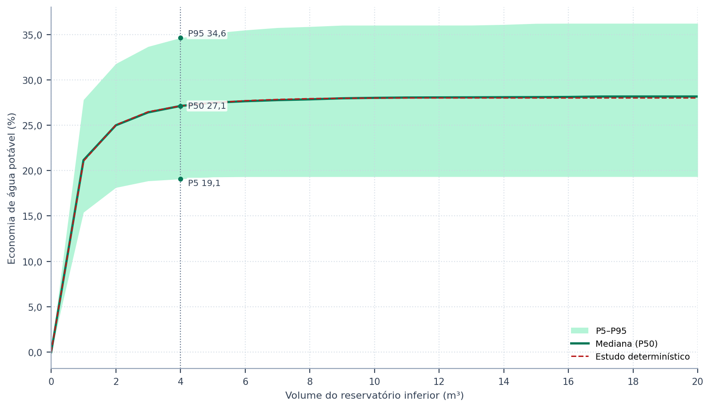
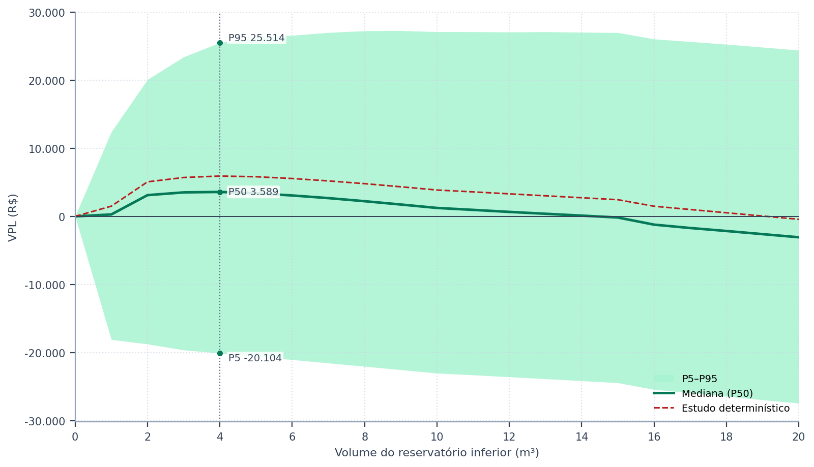
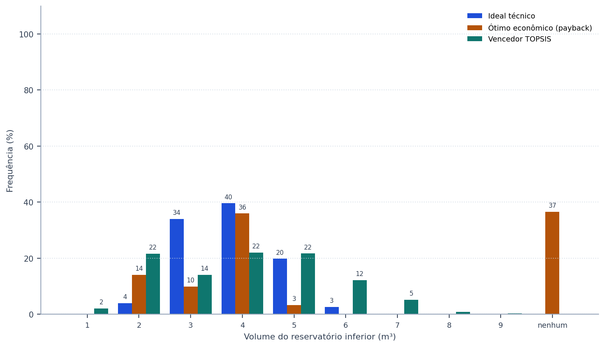
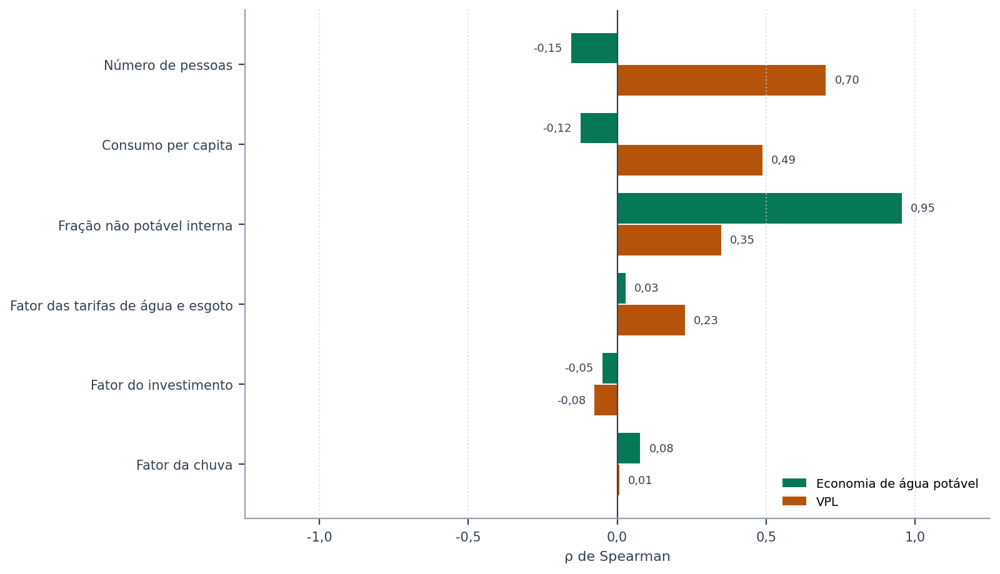

# Como ler os resultados

> **Pergunta que esta seção responde:** o que cada tabela e cada figura diz, e o que
> declarar num relatório ou num artigo?

O exemplo desta seção é o projeto do tutorial, gravado com a ferramenta já montada no
arquivo `10_modulacao_tutorial.triton` (apêndice J), com seis variáveis sorteadas: as três de
consumo, o fator da chuva, o fator das tarifas e o fator do investimento, com as
distribuições de triagem, em mil realizações e semente 42. Os números das tabelas são
os que o programa calcula; rodar a ferramenta com o mesmo projeto e a mesma semente os
reproduz.

## O que entrou

A primeira tabela da tela diz o que foi de fato sorteado: o valor do estudo, a
distribuição declarada e as estatísticas da amostra. Ela é a primeira a ler, porque
confirma que as distribuições produziram o que se pretendia — a média da amostra deve ficar
perto da média declarada, e o intervalo entre P5 e P95 deve ser plausível para a
edificação.

<!-- inclui: _tabelas/cap43_entradas.md -->

## O resultado no volume escolhido

A segunda tabela resume o volume que o estudo escolheu — o vencedor do TOPSIS do caso-base
—, comparando o estudo determinístico com a média, o desvio-padrão, o coeficiente de
variação e os percentis das realizações.

<!-- inclui: _tabelas/cap43_referencia.md -->

Duas leituras importam. A primeira é a **largura**: o intervalo entre P5 e P95 contém 90%
das realizações e é o número que deve acompanhar o resultado publicado. A segunda é a
**posição do estudo determinístico** em relação à mediana. Quando a mediana fica abaixo do
caso-base, as não linearidades do sistema — a tarifa progressiva, o consumo mínimo, a
cisterna que transborda — fazem as realizações desfavoráveis pesarem mais que as
favoráveis, e o caso-base é otimista.

O payback descontado só existe quando o investimento se paga; a tabela o calcula sobre as
realizações em que isso acontece, e a tela diz quantas foram.

<!-- inclui: _tabelas/cap43_probabilidades.md -->

A probabilidade de o investimento se pagar é a proporção de realizações com valor presente
líquido positivo. O intervalo de confiança de 95% ao lado é o de Wilson (1927), adequado a amostras pequenas e a proporções perto de 0% ou de 100%. Ele
mede a incerteza do **sorteio**, e não a das premissas: com mais realizações, ele estreita;
a probabilidade em si, não.

## As faixas por volume

As figuras seguintes mostram a faixa entre os percentis 5 e 95, a mediana e o estudo
determinístico ao longo de todos os volumes. A linha pontilhada marca o volume escolhido, e
os valores escritos são os dele.

*Figura 99 — Economia de água potável por volume do reservatório inferior no exemplo do tutorial: faixa entre os percentis 5 e 95 das realizações, mediana e estudo determinístico. Os valores marcados são os do volume escolhido pelo estudo (linha pontilhada).*

*Figura 99 — Valor presente líquido por volume do reservatório inferior no mesmo exemplo. A faixa que atravessa o zero em todos os volumes indica que nenhum deles se paga com certeza; a mediana abaixo do estudo determinístico, que o caso-base é otimista.*

## A estabilidade da escolha

A tabela e a figura de frequência contam, em cada realização, qual volume seria o ideal
técnico, qual seria o ótimo econômico — o de menor payback descontado, critério do
programa (seção {{n:12}}) — e qual venceria o TOPSIS. Uma realização em que nenhum volume
se paga aparece como «nenhum se paga» na coluna econômica.

<!-- inclui: _tabelas/cap43_frequencia.md -->

*Figura 99 — Frequência, em porcentagem das realizações, com que cada volume é o ideal técnico, o ótimo econômico e o vencedor do TOPSIS no exemplo do tutorial.*

A leitura é a mesma da aceitabilidade SMAA-VIKOR (seção {{n:32}}): um volume que vence na
maioria das realizações é uma recomendação robusta; um que vence numa minoria, ao lado de
vizinhos com frequências parecidas, é uma preferência que depende das premissas, e o texto
precisa dizer isso.

## O que mais pesa

A sensibilidade é medida pela correlação de postos de Spearman (1904) entre
cada variável sorteada e o resultado no volume escolhido. O coeficiente ρ vai de −1 a 1:
o sinal diz o sentido do efeito, e o módulo, a sua força. Por usar postos, e não valores,
ele capta relações monótonas não lineares — como a da tarifa progressiva — e não é
distorcido por realizações extremas.

<!-- inclui: _tabelas/cap43_sensibilidade.md -->

*Figura 99 — Correlação de postos de Spearman de cada variável sorteada com a economia de água potável e com o valor presente líquido no volume escolhido pelo estudo do tutorial, da maior para a menor influência no valor presente líquido.*

O exemplo mostra um efeito que a análise de uma premissa por vez não deixa ver. A fração não
potável é a variável que mais move a economia **percentual**, porque define a demanda que a
água de chuva pode atender. O número de pessoas e o per capita movem pouco a porcentagem —
e no sentido contrário, porque aumentam o consumo total —, mas são os que mais movem o
valor presente líquido: mais consumo empurra a conta para as faixas caras da tarifa
progressiva, e cada metro cúbico poupado passa a valer mais.

## Quanto da incerteza vem de cada fonte

O ρ diz o sentido e a força de uma relação monótona, mas não diz que parte da incerteza do
resultado vem de cada variável. Essa parte é a razão de correlação, η²: a variância das
médias do resultado entre classes da variável, dividida pela variância total. As variáveis
contínuas são agrupadas em decis, o número de pessoas e o modelo climático pelos seus
próprios valores. O η² estima o índice de sensibilidade de primeira ordem (Saltelli et al.,
2008), vai de 0 a 1 e capta também relações não monótonas.

<!-- inclui: _tabelas/cap43_variancia.md -->

No exemplo, o número de pessoas e o per capita respondem por cerca de quatro quintos da
variância do valor presente líquido, e a fração não potável por quase toda a variância da
economia. Os três fatores econômicos e o da chuva, com as larguras de triagem, pesam pouco.
Com variáveis independentes e efeitos aditivos, a soma fica perto de 1; uma soma bem abaixo
de 1 indica interação entre as variáveis. A estimativa por classes tem um pequeno viés para
cima, da ordem do número de classes dividido pelo número de realizações, e por isso a soma
pode passar ligeiramente de 1.

## O modelo climático

> **Só na Edição Brasil (BRL).**

Quando os modelos climáticos são sorteados, a tela acrescenta uma tabela com o resultado
no volume escolhido por modelo — quantas realizações o sortearam, a economia média, o VPL
médio e a probabilidade de o investimento se pagar — e o η² do modelo. O exemplo a seguir,
gravado no arquivo `11_modulacao_climbra.triton`, usa o projeto do tutorial com a chuva da
base CLIMBra para Florianópolis, cenário
SSP2-4.5, de 2025 a 2054, os dezenove modelos marcados e as três variáveis de consumo
sorteadas, em mil realizações e semente 42.

<!-- inclui: _tabelas/cap43_modelos.md -->

<!-- inclui: _tabelas/cap43_modelos_variancia.md -->

Os modelos discordam em mais de um quarto da chuva anual, e ainda assim o modelo explica só
uma pequena parte da variância. Em Florianópolis, a chuva sobra para uma cisterna desse
porte: o que limita a economia é a demanda que a água de chuva pode atender, e não a chuva
que chega. Com cerca de cinquenta realizações por modelo, o erro-padrão do VPL médio de
cada um é da ordem de R$ 1.900, e as diferenças entre as médias da tabela são, na maior
parte, ruído do sorteio do consumo. O η² separa as duas coisas; ler a tabela modelo a
modelo, sem ele, levaria a atribuir ao clima o que é efeito da ocupação. Num clima mais seco,
ou numa cisterna maior, o peso do modelo pode ser outro, e a tabela o mostra.

> **Na International Edition (INT).** Sem a base CLIMBra, a tabela por modelo não aparece;
> a tabela da variância traz as variáveis sorteadas, entre elas o fator da chuva.

## O que declarar

Num relatório ou num artigo, declare: as variáveis sorteadas e as suas distribuições (a
primeira tabela), o número de realizações e a semente, a faixa P5–P95 e a mediana do
resultado no volume escolhido, a probabilidade de o investimento se pagar com o seu
intervalo, a frequência com que o volume escolhido vence e a parte da variância que cada
fonte explica. Com modelos climáticos sorteados, declare também a lista de modelos, o
cenário e o período. O botão **Exportar** grava tudo
isso em JSON, e o CSV das amostras permite refazer qualquer estatística fora do programa.
