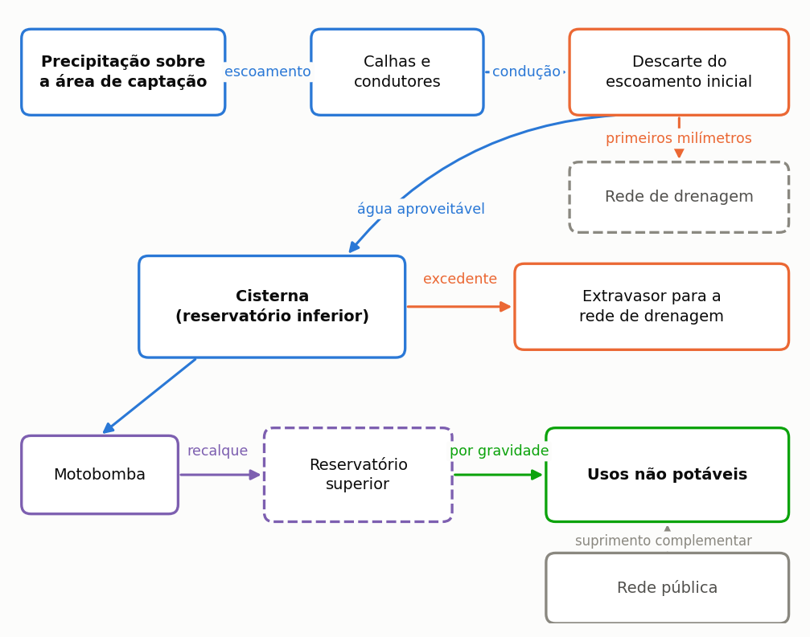
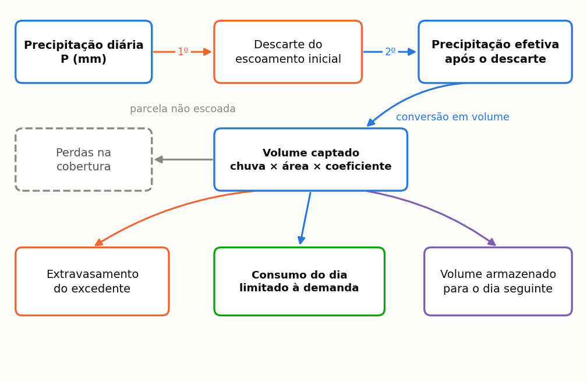
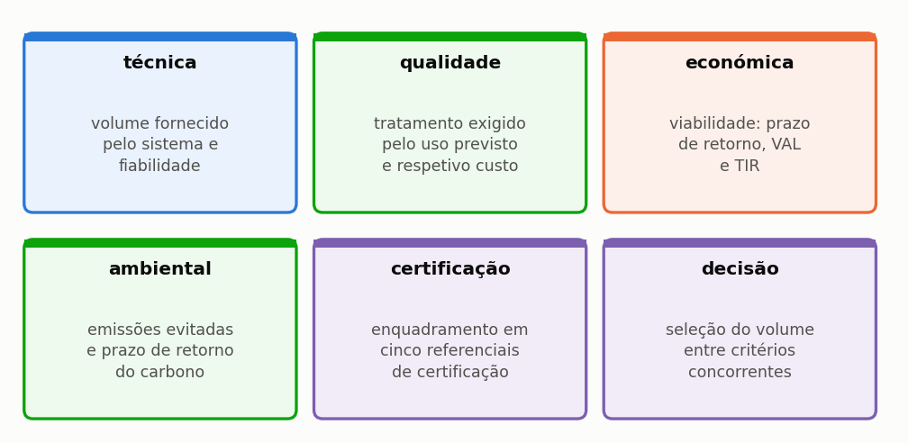
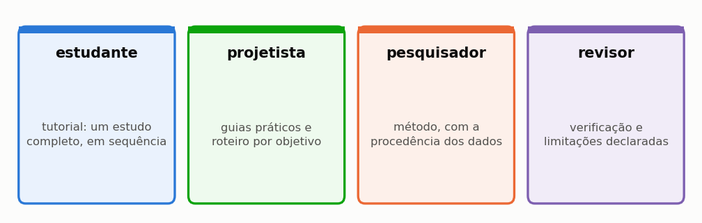
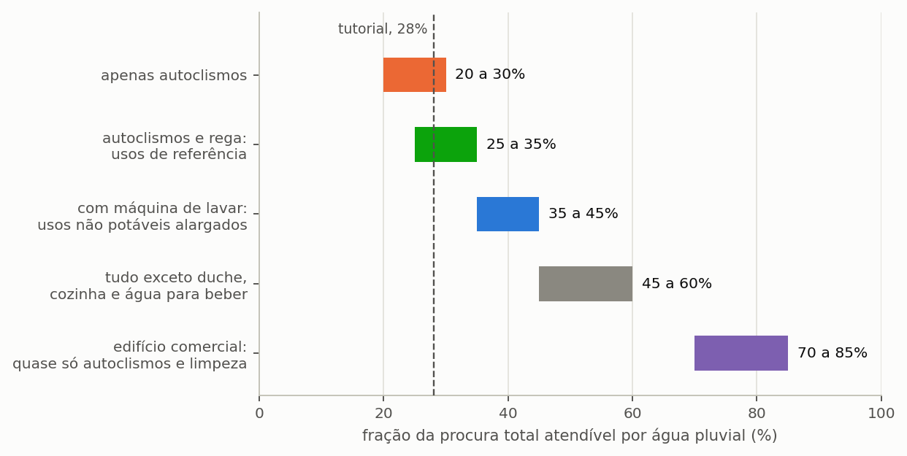

# Triton IBE

## Manual do Utilizador — Comece aqui

Igor Catão Martins Vaz e Enedir Ghisi

Grupo de Pesquisa em Ambientes Sustentáveis
Universidade Federal de Santa Catarina

2026

---

### Sobre este volume

Este é um dos oito volumes em que o manual do Triton pode ser distribuído, e
reúne o capítulo 1 (Comece aqui) e o apêndice G do manual completo. Serve para enviar
apenas a parte que interessa: o método a um revisor, o tutorial a uma turma, os guias
a quem já utiliza o programa.

A numeração das secções e das equações é a mesma do manual completo, de modo que
uma remissão vale nos dois. Quando o texto remete para uma secção que está noutro
volume, o nome do volume vem entre parênteses.

| Volume | Conteúdo |
| :--- | :--- |
| **Comece aqui** | o capítulo 1 (Comece aqui) e o apêndice G |
| O método | o capítulo 2 (O método) e os apêndices A, B, C, E, G e H |
| Guias de uso | o capítulo 3 (Guias disponíveis no programa) e os apêndices D, F e G |
| Tutorial | o capítulo 4 (Tutorial: um exemplo do começo ao fim) e os apêndices G, I e J |
| Enganos, limitações e confiabilidade | o capítulo 5 (Enganos, limitações e confiabilidade) e os apêndices G e H |
| Correções, bugs e versionamento | o capítulo 6 (Correções, bugs e versionamento) |
| Modulação probabilística | o capítulo 7 (Modulação probabilística) e os apêndices G e H |
| Apêndices | os apêndices |

### Como citar

> VAZ, Igor Catão Martins; GHISI, Enedir. **Triton: manual do utilizador**.
> Comece aqui. Versão 0.2.0. Universidade Federal de Santa
> Catarina, 2026.

---

## Índice

**1 Comece aqui**

1.1 O que o Triton faz, e o que ele não faz

1.2 Instalação e primeira execução

1.3 Por onde começar, conforme o seu objetivo

**Apêndices**

Apêndice G — Glossário

## Lista de figuras

Figura 1 — Componentes de um sistema predial de aproveitamento de água da chuva e percurso da água, da captação ao ponto de uso

Figura 2 — O mesmo sistema visto em corte

Figura 3 — Destino da precipitação de um dia

Figura 4 — Sequência de operações do balanço diário, na ordem em que o programa as executa, na notação das equações da secção do balanço diário

Figura 5 — As seis dimensões de análise e a questão avaliada em cada uma

Figura 6 — Os quatro percursos de leitura do manual

Figura 7 — Que parte do consumo total a água da chuva pode atender, conforme os usos que o projeto prevê. É o teto do potencial de economia: nenhum reservatório, por maior que seja, ultrapassa esta fração

Figura 8 — As etapas do programa, agrupadas por natureza

---

## Lista de tabelas

Tabela 1 — Requisitos de sistema para instalar e executar o programa

Tabela 2 — O que a Edição Ibérica traz e o que deixa ao utilizador

Tabela 3 — Formatos de ficheiro que o programa grava e o conteúdo de cada um

Tabela 4 — Ficheiros de exemplo distribuídos com o programa

Tabela 5 — Percurso de leitura recomendado conforme o objetivo do leitor

Tabela 6 — Escolha entre volume fixo e varredura conforme a pergunta do estudo

Tabela 7 — Critérios hidráulicos para decidir sobre o reservatório superior

Tabela 8 — Padronização terminológica de água de chuva e água pluvial

Tabela 9 — Grandezas fundamentais do balanço hídrico e relações entre fração e potencial

---

---
# 1. Comece aqui

---

## 1.1. O que o Triton faz, e o que não faz

O Triton simula sistemas de aproveitamento de água da chuva em edifícios. Dado o regime de chuva de um lugar, a cobertura de um edifício e o consumo de quem o ocupa, responde **quanta água potável o sistema substitui**, a que custo, com que qualidade e com que impacto de carbono.

Esta secção começa pelo princípio. As duas primeiras subsecções tratam do próprio objeto, antes do programa. Quem já projeta redes prediais de água acha-as elementares e pode ir direto às seis dimensões de análise, onde o Triton aparece. Quem chega agora ao assunto encontra aí o vocabulário que o resto do manual usa sem o explicar de novo.

---

### 1.1.1. O que é um sistema de aproveitamento de água da chuva

É um sistema que **recolhe a chuva que cai na cobertura e a usa no lugar da água da rede pública**, nos usos que não exigem água potável.

A ideia é velha e simples. Só uma coisa a torna difícil: a chuva não cai quando é precisa. Por isso o sistema precisa de um reservatório, e por isso o tamanho desse reservatório é a pergunta central de todo o projeto — e deste manual. A Figura 1 mostra os componentes do sistema e o percurso da água, da captação ao ponto de uso.

*Figura 1 — Componentes de um sistema predial de aproveitamento de água da chuva e percurso da água, da captação ao ponto de uso. O reservatório superior aparece a tracejado porque é opcional: num edifício de um só piso, a eletrobomba pode pressurizar diretamente os pontos de uso, e o reservatório superior altera o momento em que a água é fornecida, não o volume disponível.*

Da esquerda para a direita:

**A cobertura** é a área de captação. Conta a **projeção horizontal** do telhado, não a área inclinada: é a sombra do telhado no chão que recebe a chuva. Errar aqui é o primeiro dos dez enganos da secção 5.1 (volume Enganos, limitações e confiabilidade).

**As caleiras e os tubos de queda** levam a água até à cisterna. O programa não os dimensiona. Isso é projeto de drenagem pluvial predial e segue a regulamentação portuguesa aplicável (ver o fim desta secção).

**O dispositivo de descarte das primeiras águas** desvia os primeiros milímetros de cada chuvada, que arrastam o pó, as folhas e os dejetos de aves acumulados na cobertura. É a medida de controlo de qualidade mais barata. A secção 4.6 (volume Tutorial) mostra quanto muda a água que chega ao reservatório.

**A cisterna**, ou reservatório inferior, armazena a água captada. Quando a afluência excede a capacidade, o excedente **extravasa** para a rede de drenagem. Este extravasamento não é desperdício por descuido: é a consequência inevitável de guardar um recurso que chega concentrado.

**A eletrobomba e o reservatório superior** distribuem a água. Num edifício de um só piso, a eletrobomba pode pressurizar diretamente os pontos de uso. Em edifícios de dois ou mais pisos, costuma adotar-se um reservatório elevado: a água é elevada até ele e distribuída por gravidade.

**Os usos não potáveis** são o destino: autoclismos e urinóis, lavagem de pavimentos e de veículos, rega de jardins. Quando a água da chuva não chega, a **rede pública** fornece o complemento, e o abastecimento nunca é interrompido.

O diagrama da Figura 1 mostra o encadeamento das peças, que é o que interessa para seguir o cálculo. Falta-lhe a informação que decide metade das dúvidas de projeto: onde fica cada peça em relação às outras, e a que altura. O corte da Figura 2 repõe essa geometria. O desnível decide se a água desce por gravidade ou precisa de bomba, e a posição da cisterna em relação ao terreno é uma decisão de obra, não de cálculo.

*Figura 2 — O mesmo sistema visto em corte. A área de captação é a projeção horizontal da cobertura, não a área inclinada do telhado. O reservatório elevado recebe a água elevada da cisterna e devolve-a aos pontos de uso por gravidade; a rede pública alimenta-o, com separação atmosférica, no volume que a água da chuva não cobre. O extravasor da cisterna conduz o excedente à rede de drenagem.*

> **Vocabulário que o manual usa o tempo todo.** *Cisterna* e *reservatório inferior* designam o mesmo componente. *Extravasamento* é o volume excedente que o extravasor conduz à rede de drenagem. *Procura pluvial* é a parte do consumo que a água da chuva pode atender; *procura total* é o consumo inteiro do edifício. O apêndice G traz o glossário completo.

---

### 1.1.2. O que o programa calcula, num dia

O programa faz uma conta de entradas e saídas, todos os dias, para cada dia da série de chuva. A Figura 3 mostra como a precipitação de um dia se reparte. A conta é esta:

*Figura 3 — Destino da precipitação de um dia. Cada caixa é uma parcela do balanço, e a soma do volume extravasado, do volume consumido e do volume armazenado é igual ao volume captado. O extravasamento é calculado antes do consumo do dia, e a chuva do dia já pode atender o consumo do dia: uma ordem intermédia entre as regras YAS e YBS, explicada na secção do balanço diário.*

Lendo o desenho:

1. **Desconta-se o descarte.** Com 12 mm de precipitação e 2 mm de descarte, restam 10 mm de precipitação efetiva.
2. **Converte-se em volume.** Dez milímetros sobre 100 m² de telhado, com coeficiente de escoamento de 0,85, dão 850 litros. A conta é `mm × m² × coeficiente` e sai diretamente em litros, porque um milímetro sobre um metro quadrado é exatamente um litro.
3. **Soma-se ao volume armazenado na cisterna.** O que exceder a capacidade **extravasa** para a rede de drenagem.
4. **Retira-se o consumo do dia**, até ao limite da procura pluvial.
5. **O volume remanescente passa para o dia seguinte.** É esta dependência entre dias consecutivos que torna necessária a simulação diária.

Os cinco passos formam um ciclo, não uma lista: o volume que sobra no fim do quinto passo é exatamente o volume de que o terceiro parte no dia seguinte. Esta ligação entre um dia e o outro é a única coisa que uma conta sobre a média anual não reproduz, e é a razão de a simulação ser diária. A Figura 4 representa a sequência na notação das equações do balanço diário.

*Figura 4 — Sequência de operações do balanço diário, na ordem em que o programa as executa, na notação das equações da secção do balanço diário. A ligação a roxo, que contorna o desenho, representa a dependência entre dias consecutivos: o volume remanescente V_res,t é o volume inicial do dia seguinte.*

> **Aprofundamento: porque não basta a média anual.** É tentador dividir a chuva anual por 365 e fazer a conta de uma vez. O resultado é sempre otimista, e por vezes muito. A chuva chega **concentrada**: enche a cisterna num dia, extravasa, e depois falta durante duas semanas. A média não representa nem o extravasamento nem o défice, e ambos reduzem o aproveitamento. A secção 2.1 (volume O método) mostra isto numa tabela de dez dias que pode refazer numa folha de cálculo, e a secção 4.4 (volume Tutorial) mostra o tamanho do erro.

Repetida ao longo de trinta anos de série, esta conta produz a resposta central do programa: o **potencial de economia de água potável**, a fração do consumo total do edifício que a chuva conseguiu substituir.

---

### 1.1.3. As seis dimensões

O volume de água fornecido é a primeira questão de um projeto, mas não a única. O programa avalia o sistema em seis dimensões, que em geral conduzem a volumes ótimos distintos (Figura 5).

*Figura 5 — As seis dimensões de análise e a questão avaliada em cada uma. O programa percorre-as por esta ordem, e cada uma é tratada numa secção própria do capítulo do método.*

Cada dimensão tem tratamento próprio no capítulo do método: a técnica nas secções 2.1 (volume O método) a 2.4 (volume O método), a qualidade na 2.5 (volume O método), a económica na 2.7 (volume O método), a ambiental na 2.8 (volume O método), a certificação na 2.9 (volume O método) e a decisão na 2.10 (volume O método).

A sexta dimensão distingue o programa de uma folha de cálculo. As cinco primeiras dão resultados **divergentes**: o volume de maior poupança de água raramente é o de maior retorno financeiro, e nenhum dos dois costuma ser o de melhor desempenho ambiental. A decisão multicritério torna explícitos os pesos atribuídos a cada critério.

---

### 1.1.4. O que o programa **não** faz

Começar pelos limites é invulgar, e deliberado. Poupa tempo a quem abriu o programa à espera de outra coisa.

**Não dimensiona a instalação hidráulica.** Não calcula o traçado, o diâmetro de cada troço nem a inclinação da rede. O assistente de eletrobomba estima o diâmetro e a perda de carga da conduta de elevação para escolher o equipamento, mas não substitui o projeto da instalação. O esquema exportado em DXF é um esquema; o projeto de execução é do projetista.

**Não detalha o dispositivo de descarte.** O programa calcula o volume do reservatório de descarte, igual à área de captação vezes a lâmina, e orça-o com o separador de folhas. A disposição das ligações, a purga e a ligação à drenagem são projeto hidráulico à parte.

**Não substitui ensaios de qualidade da água.** Dimensiona o equipamento de tratamento a partir de premissas. As constantes do modelo de lavagem da cobertura não estão calibradas com medições, e a qualidade resultante é uma premissa, não um resultado.

**Não modela o passo horário.** Uma chuva de 40 mm em duas horas e a mesma lâmina em vinte e quatro horas dão o mesmo resultado.

**Não faz o inventário completo do ciclo de vida.** A avaliação é de **triagem**, numa única categoria de impacto — o carbono. Não há eutrofização, acidificação, uso do solo nem toxicidade.

**Não certifica.** Mostra onde o projeto se enquadraria. A certificação cabe ao organismo certificador, com a documentação completa do empreendimento.

**Não conhece o local.** Não sabe se o volume cabe no terreno, se o nível freático é alto, nem se a estrutura aguenta o reservatório elevado.

A secção 5.2 (volume Enganos, limitações e confiabilidade) traz a lista completa das limitações conhecidas, com as consequências de cada uma.

---

### 1.1.5. Para quem serve

O manual serve quatro perfis de leitor, com percursos de leitura independentes entre si (Figura 6).

*Figura 6 — Os quatro percursos de leitura do manual. São independentes entre si, e o manual foi organizado para que cada um se possa seguir isoladamente.*

Em números de secção: o estudante segue o capítulo 4, o tutorial do princípio ao fim; o projetista usa os guias do capítulo 3 e o roteiro da secção 1.3; o investigador vai ao método do capítulo 2; e o revisor encontra no capítulo 5 a verificação e os limites declarados.

Quem começa agora deve percorrer o capítulo 4 inteiro, pela ordem em que está escrito. Constrói um projeto de raiz, em Lisboa, e acompanha-o até à decisão final. Cada secção termina a mostrar onde o projeto chegou, para o leitor ver o estudo a formar-se em vez de o receber concluído.

---

### 1.1.6. Normas e entidades de referência

A norma europeia de referência para estes sistemas é a EN 16941-1, sobre sistemas de água não potável no local (sistemas de aproveitamento de água da chuva). Cobre o projeto, o dimensionamento, a instalação, a identificação, a colocação em serviço e a manutenção, com exclusão da água para beber e para a preparação de alimentos. A edição de 2018 foi retirada em 22 de março de 2024 (BSI, https://knowledge.bsigroup.com/products/on-site-non-potable-water-systems-systems-for-the-use-of-rainwater, consultado em 16/10/2026). Não verificado nesta versão: o ano da edição em vigor da EN 16941-1 e a transposição para a norma portuguesa NP EN 16941-1 (catálogo do IPQ).

Em Portugal, a especificação técnica ETA 0701 da ANQIP (Associação Nacional para a Qualidade nas Instalações Prediais) estabelece critérios para estes sistemas em edifícios, para fins que não o consumo humano. Recomenda o desvio de um volume correspondente a 2 mm de precipitação, e remete o projeto de redes prediais para o Regulamento Geral dos Sistemas Públicos e Prediais de Distribuição de Água e de Drenagem de Águas Residuais (Decreto Regulamentar n.º 23/95, de 23 de agosto). A versão consultada é a 7, com validade indicada de 23/01/2009 a 23/01/2014 (cópia no repositório do IPL, https://repositorio.ipl.pt/bitstreams/27266c84-d607-4ad7-9c68-9b51a215314f/download). Não verificado nesta versão: a revisão em vigor da ETA 0701 no sítio da ANQIP e se o Decreto Regulamentar n.º 23/95 mantém a redação aplicável a este uso.

---

### 1.1.7. Uma palavra sobre os resultados

Todo o número que o programa produz é **condicional às premissas declaradas**. O programa não descobre verdades; calcula consequências.

Por isso o manual insiste tanto na declaração. A secção 4.10 (volume Tutorial) traz a lista do que deve constar num artigo, a secção 5.1 (volume Enganos, limitações e confiabilidade) os dez enganos que o programa não impede, e a secção 5.2 (volume Enganos, limitações e confiabilidade) o que ele não cobre.

Um estudo que declara as suas premissas e os seus limites é mais útil — e mais defensável — do que um que apresenta um número isolado.

---

## 1.2. Instalação e primeira execução

> No fim desta secção, tem o programa instalado e aberto, e uma simulação concluída com um resultado que pode conferir contra este manual.

---

### 1.2.1. O que é preciso

<!-- tabela: **Tabela 1** — Requisitos de sistema para instalar e executar o programa -->
| Requisito | O que é preciso |
| :--- | :--- |
| sistema | Windows 10 ou 11, 64 bits |
| espaço em disco | cerca de 0,7 GB |
| memória | 4 GB chegam; 8 GB deixam o varrimento mais folgado |
| privilégios | de administrador, para instalar para todos os utilizadores; sem eles, a instalação vai para a pasta do utilizador |

Não é preciso instalar mais nada. O programa é distribuído já montado, com todos os componentes de que depende para calcular, e não exige a instalação prévia de interpretadores, bibliotecas ou pacotes auxiliares. Também não precisa de ligação à internet: tudo o que consulta durante uma simulação está no próprio computador.

---

### 1.2.2. A edição

Esta é a Edição Ibérica (IBE), o «Triton IBE», que se chamou Edição Portugal (PRT). Está em português de Portugal, trabalha em euros e, por agora, só traz dados de Portugal (a linha de cobertura do programa diz: Espanha, 0 locais): a chuva diária por concelho e os tarifários de água de Lisboa, do Porto e do Funchal. O selo vermelho no topo da barra lateral, o título da janela e o rodapé de cada relatório e de cada exportação dizem de que edição saiu o estudo.

<!-- tabela: **Tabela 2** — O que a Edição Ibérica traz e o que deixa ao utilizador -->
| | Edição Ibérica (IBE) |
| :--- | :--- |
| instalador | `Triton_IBE_Setup_0_1_0.exe` |
| idioma ao abrir | português de Portugal |
| chuva | base Iberia01 por município (Portugal, Espanha, Baleares) e ERA5 nas ilhas (nível C), ou a E-OBS opcional (278 concelhos do Continente), ou série própria; série de exemplo do Funchal |
| tarifas de água, saneamento e resíduos | tarifários de Lisboa, do Porto e do Funchal; nos outros concelhos, digitadas |
| eletricidade | digitada (o Funchal traz a tarifa da EEM) |
| moeda e custos | euro, a única oferecida; custos digitados |
| fator de emissão da rede e da água potável | do local do projeto, obrigatórios |
| certificações e incentivos | LEED, EDGE, GRI |
| etapa 12 | Modulação Probabilística |
| custo da tubagem e da mão de obra | digitado |
| manual que o programa abre | este manual |
| preferências guardadas | `Triton-IBE` |

O método é o mesmo em qualquer país: o balanço diário, o descarte inicial, os coeficientes de escoamento, a análise económica e a avaliação do ciclo de vida são um só motor. O que muda de país para país são os **dados**. Os custos de obra, de bomba, de tratamento e de manutenção não vêm definidos: dependem do local e do mercado, e o utilizador introduz os seus. Os custos que este manual usa nos casos são **ilustrativos, não são preços de mercado**.

Sem os fatores de emissão do local, o programa não calcula a avaliação ambiental: um fator de outra rede elétrica daria um resultado errado sem qualquer aviso.

Quando uma exigência de uma norma nacional importa, o manual descreve-a em termos gerais e pede que consulte a norma aplicável ao local do edifício (ver a secção 1.1).

---

### 1.2.3. A instalação

1. Execute **`Triton_IBE_Setup_0_1_0.exe`**. O instalador pergunta se a instalação é para todos os utilizadores, o que exige administrador, ou só para si.
2. Escolha o idioma da instalação, leia e aceite a licença (código-fonte académico, uso não comercial).
3. Escolha o tipo de instalação. A **padrão** traz o programa, o manual, os casos, os exemplos e todos os idiomas. A **personalizada** permite desmarcar os pacotes de idioma espanhol e chinês.
4. Aceite a pasta sugerida, `C:\Program Files\Triton IBE`, ou escolha outra.
5. Marque, se quiser, **criar ícone no ambiente de trabalho**. A opção **abrir ficheiros .triton com o Triton** vem desmarcada, para não tomar os ficheiros de outra edição do Triton instalada no mesmo computador; marque-a se quiser abrir um projeto com um duplo clique.
6. No fim, o instalador oferece-se para abrir o programa.

Depois, o menu Iniciar tem dois atalhos: o programa e o seu manual em PDF (este documento). Para desinstalar, use *Aplicações e funcionalidades* do Windows, como com qualquer programa; os seus projetos ficam onde os guardou.

> **O que o instalador põe no computador.** O programa, a base de chuva diária por município (Iberia01, mais a reanálise ERA5 das ilhas), a base opcional da E-OBS, a série de exemplo do Funchal, a base de tarifários, os ficheiros de exemplo e este manual. Nada é transferido durante a utilização: o Triton funciona sem ligação à internet.

---

### 1.2.4. Onde ficam os seus ficheiros

O programa nunca decide por si onde guardar. De cada vez que grava um projeto, um relatório ou uma exportação, pergunta a pasta.

<!-- tabela: **Tabela 3** — Formatos de ficheiro que o programa grava e o conteúdo de cada um -->
| O que grava | Extensão | Contém |
| :--- | :--- | :--- |
| projeto | `.triton` | todos os dados de entrada **e a série de chuva** |
| relatório | `.pdf` | o documento completo do estudo |
| resultados | `.xlsx`, `.csv` | as tabelas, para folha de cálculo |
| esquema | `.dxf` | o desenho esquemático, para CAD |

Destes formatos, o `.triton` é o que mais importa guardar. É autocontido: leva dentro de si a série de chuva e, por isso, abre em qualquer outro computador mesmo sem os ficheiros que lhe deram origem. Uma exceção: a chuva das bases que acompanham o programa (Iberia01 e E-OBS). O ficheiro guarda a referência da série — município (`Nome [código]`), fonte e intervalo de datas —, com o número de dias, o total e uma impressão digital (SHA-256) dos valores, e o programa recompõe-na a partir da base ao abrir o projeto, conferindo a impressão. Uma série alterada depois de carregada, ou uma base indisponível ao gravar, continua a ir inteira para o ficheiro. ==É também o ficheiro a anexar a um artigo para que outra pessoa reproduza o estudo,== e é esta propriedade que separa um trabalho verificável de um trabalho apenas relatado.

---

### 1.2.5. A base climática

O programa traz a chuva diária de 8 319 municípios de Portugal continental, Espanha peninsular e Baleares, calculada a partir do Iberia01 v1.0 (Herrera et al., 2019; grelha de 0,1°, 1971 a 2015, licença ODbL, uso comercial permitido, com atribuição). A série de um município é a média das células da grelha com centro dentro dos seus limites; o período padrão é 1986–2015. Canárias, Madeira e Açores usam a reanálise ERA5 de 0,25° (nível C, com aviso). A E-OBS v33.0e (278 concelhos do Continente, 1950 a 2025, uso só não comercial) continua disponível como fonte opcional, com o aviso vermelho nos laudos. Aceita ainda qualquer série própria em CSV: precipitação diária em milímetros, um valor por dia, como descreve o apêndice F (volume Apêndices).

O Iberia01 é uma grelha interpolada de observações, não um registo de pluviómetro. Serve para estudos e para os exemplos deste manual. Num projeto real, use a série medida no local sempre que a tiver.

> **Dados de reanálise no Funchal.** O Funchal está fora do domínio do Iberia01 (e a E-OBS falha em 22% dos dias de 1991 a 2020, acima do máximo admitido de 1%). A série do exemplo do Funchal é por isso reanálise ERA5, de um nó de 0,25° (cerca de 25 km), com nível de qualidade C, e pode diferir da média medida na estação.

---

### 1.2.6. Os ficheiros de exemplo

O manual vem acompanhado de projetos prontos, que reproduzem os resultados impressos aqui.

<!-- tabela: **Tabela 4** — Ficheiros de exemplo distribuídos com o programa -->
| Ficheiro | Para que serve |
| :--- | :--- |
| `casos\01_tutorial_lisboa.triton` | o projeto que o capítulo 4 constrói, pronto |
| `casos\05_dez_dias.triton` | o caso didático de dez dias da secção 2.1 (volume O método) |
| `casos\02_porto.triton` e `casos\03_funchal.triton` | a mesma moradia noutras cidades |
| `exemplos\portugal\*.triton` | três estudos completos: Lisboa, Porto e Funchal |

Ficam na pasta do programa. O apêndice J (volume Apêndices) lista os dez casos do manual, com o capítulo de cada um e o resultado que produzem.

Convém começar pelo caso de dez dias. Abra-o, execute a simulação e compare o resultado com a tabela impressa na secção 2.1 (volume O método). Se coincidirem, a instalação corresponde exatamente a este manual. Se divergirem, o manual e o programa são de versões diferentes, e a secção 6.3 (volume Correções, bugs e versionamento) explica o que fazer.

---

### 1.2.7. A primeira simulação, em cinco minutos

O programa organiza-se em **etapas**, na barra lateral esquerda, pela ordem em que se trabalha. Para a primeira simulação bastam quatro.

1. **Projeto e Chuva.** Escolha o concelho de Lisboa na base climática. Indique a área de captação de 150 m², o coeficiente de escoamento de 0,85 e o descarte de 2,0 mm.
2. **Edificação e Consumo.** Escolha moradia unifamiliar, 4 moradores, 150 litros por habitante e dia, e fração atendível de 28%.
3. **Reservatório & Custos.** Indique um volume fixo de 3.000 L.
4. Simule e vá a **Resultados Técnicos**.

Deve obter um potencial de economia próximo de **16%** (15,77% com a série de Lisboa, Iberia01, 1986–2015).

A secção 4.3 (volume Tutorial) explica o que este número significa, e a secção 4.4 (volume Tutorial) faz a pergunta seguinte: serão 3.000 L o volume certo?

---

### 1.2.8. Se algo correr mal

**O programa não abre.** Verifique se a instalação terminou sem erros e reinstale por cima; a reinstalação preserva os seus ficheiros, porque não ficam na pasta do programa.

**A lista de concelhos está vazia.** Confirme que as bases de chuva (`data\chuva_iberia01_p1.db` a `p4.db` e `ibe_unidades.db`) estão na pasta do programa; se faltarem, reinstale. Em Ceuta e Melilla, use um ficheiro de chuva próprio.

**Falta alguma parte do programa, como a volumetria 3D.** Execute, na Linha de Comandos, `"C:\Program Files\Triton IBE\Triton_IBE.exe" --diagnostico` (com a pasta predefinida). O programa lista o que a instalação traz: o visualizador 3D, a base de chuva, a base de tarifários e o manual. Cada item sai marcado OK ou FALTA. A lista fica também gravada em `triton_diagnostico.txt`, na pasta temporária do Windows. Envie esse ficheiro com a descrição do problema.

**O resultado não bate com o manual.** Confira, por esta ordem: a série de chuva carregada, a área, o coeficiente, a lâmina de descarte, a procura e a fração atendível. Uma divergência de resultado é quase sempre uma divergência de entrada, e a secção 5.1 (volume Enganos, limitações e confiabilidade) lista os enganos mais comuns.

**Apareceu uma mensagem de erro.** A secção 6.2 (volume Correções, bugs e versionamento) traz as mensagens do programa, o que cada uma significa e o que fazer.

---

## 1.3. Por onde começar, conforme o seu objetivo

Este manual reúne cinquenta e quatro secções em oito capítulos e não foi pensado para se ler do princípio ao fim. Funciona melhor como obra de consulta: cada leitor entra pelo ponto que corresponde ao que precisa de fazer. Esta secção existe para indicar esse ponto de entrada.

---

### 1.3.1. Roteiro por objetivo

A tabela abaixo relaciona os cinco propósitos mais comuns de quem abre o programa com o percurso de leitura de cada um.

<!-- tabela: **Tabela 5** — Percurso de leitura recomendado conforme o objetivo do leitor -->
| Quer | Leia |
| :--- | :--- |
| **aprender a usar** o programa | o capítulo 4 inteiro, secções 4.1 (volume Tutorial) a 4.10 (volume Tutorial), por ordem |
| **resolver um caso** hoje | as três perguntas abaixo e, depois, o guia do capítulo 3 que servir |
| **publicar** um estudo | o capítulo 2, que traz o método, e a secção 4.10 (volume Tutorial), com a lista de declaração |
| **rever** um estudo alheio | o capítulo 5 e os apêndices A (volume Apêndices) e B (volume Apêndices) |
| **exportar** para CAD, BIM ou folha de cálculo | a secção 3.9 (volume Guias de uso) |
| **não errar** | a secção 5.1 (volume Enganos, limitações e confiabilidade), com os dez enganos mais comuns |

Quem tem uma hora e nenhuma familiaridade prévia deve ler o tutorial do capítulo 4. Constrói um estudo completo em torno de um único projeto, em Lisboa, e cada secção termina a mostrar onde o projeto chegou. O leitor acompanha a construção em vez de receber o resultado feito.

---

### 1.3.2. As três perguntas que definem um estudo

Antes de abrir o programa, convém responder a três perguntas. Elas determinam boa parte das decisões seguintes, e responder-lhes depois costuma obrigar a refazer trabalho.

#### 1.3.2.1. Que usos vai a água da chuva atender?

A resposta define a **fração atendível**, e a fração atendível é o teto de tudo o resto: um sistema com fração de 28% nunca poupará mais de 28% do consumo total, por maior que seja a cisterna e por mais que chova. Nenhuma decisão de projeto posterior altera este limite, e por isso convém fixá-lo primeiro. A Figura 7 reúne as gamas habituais da fração atendível conforme os usos previstos.

*Figura 7 — Que parte do consumo total a água da chuva pode atender, conforme os usos que o projeto prevê. É o teto do potencial de economia: nenhum reservatório, por maior que seja, ultrapassa esta fração.*

Os casos residenciais tratam-se na secção 4.2 (volume Tutorial) e o caso comercial na secção 3.5 (volume Guias de uso). A linha a tracejado marca os 28% do tutorial, que ficam nos usos não potáveis que a orientação sobre águas pluviais em geral admite: autoclismos, lavagens e rega. Não verificado nesta versão: o artigo da ETA 0701 (ou da norma portuguesa em vigor) que lista os usos admitidos; confirme-o no texto vigente.

#### 1.3.2.2. Vai comparar volumes ou avaliar um só?

A diferença entre avaliar um volume conhecido e procurar o volume adequado determina o modo de simulação e, com ele, o tempo de cálculo e a riqueza do resultado.

<!-- tabela: **Tabela 6** — Escolha entre volume fixo e varredura conforme a pergunta do estudo -->
| Se quer | Use | Onde se trata |
| :--- | :--- | :--- |
| avaliar uma cisterna que já existe | volume fixo | secção 4.3 (volume Tutorial) |
| descobrir o volume a comprar | **varredura** | secções 4.4 (volume Tutorial) e 2.2 (volume O método) |
| escolher entre critérios que discordam | varredura e multicritério | secções 4.9 (volume Tutorial) e 2.10 (volume O método) |

==A varredura é quase sempre a resposta certa.== Custa mais tempo de cálculo, da ordem dos segundos, e produz a curva de retorno decrescente, o argumento mais forte de que um estudo dispõe para justificar um volume.

#### 1.3.2.3. Precisa de reservatório superior?

A terceira pergunta é hidráulica. A resposta depende da altura do edifício e da pressão exigida nos pontos de consumo.

<!-- tabela: **Tabela 7** — Critérios hidráulicos para decidir sobre o reservatório superior -->
| Se o edifício | Então | Onde se trata |
| :--- | :--- | :--- |
| é térreo e os pontos ficam perto da cisterna | pressurização direta, sem reservatório superior | secção 4.5 (volume Tutorial) |
| é moradia de dois pisos ou prédio | reservatório superior, por **pressão** | secção 4.5 (volume Tutorial) |
| precisa de reserva contra falhas de energia | reservatório superior | secção 4.5 (volume Tutorial) |

> O reservatório superior **não aumenta** a poupança de água. Com o mesmo armazenamento total, entrega um pouco menos e gasta energia de elevação. A decisão de o adotar deve ser hidráulica, nunca fundada na expectativa de um aproveitamento maior. No tutorial de Lisboa, a diferença é de 0,32 pontos percentuais (secção 4.5 (volume Tutorial)).

---

### 1.3.3. A ordem de trabalho no programa

A barra lateral do programa está numerada, e a numeração segue a ordem em que se trabalha. As quatro primeiras etapas são de entrada de dados, as cinco seguintes apresentam resultados, e as restantes produzem saídas ou dão apoio ao estudo (Figura 8).

*Figura 8 — As etapas do programa, agrupadas por natureza. As quatro primeiras são de entrada e devem ser preenchidas por ordem, porque cada uma usa o que a anterior definiu; as cinco seguintes são de leitura de resultados; as restantes produzem saídas ou dão apoio, e podem ser usadas a qualquer momento.*

Onde este manual trata cada uma: a etapa 1 na secção 4.1 (volume Tutorial), a 2 na 4.2 (volume Tutorial), a 3 na 4.6 (volume Tutorial), a 4 nas secções 4.3 (volume Tutorial), 4.4 (volume Tutorial) e 4.7 (volume Tutorial), a 5 na 4.3 (volume Tutorial), a 6 na 4.7 (volume Tutorial), a 7 na 4.8 (volume Tutorial), a 8 na 4.9 (volume Tutorial), a 9 na 4.10 (volume Tutorial), a 10 na 3.9 (volume Guias de uso) e a 12, a Modulação Probabilística, nas secções 7.1 (volume Modulação probabilística) a 7.5 (volume Modulação probabilística). A etapa 11 é a documentação incorporada no programa e não tem secção correspondente aqui. A Edição Ibérica não traz catálogo de tarifários de todos os concelhos, e por isso não tem etapa de gestão de tarifas: os tarifários de Lisboa, do Porto e do Funchal vêm já nos projetos de exemplo, e nos restantes concelhos digita as tarifas do seu projeto na etapa económica. A numeração não tem salto.

Convém guardar o projeto no fim de cada etapa. Os parâmetros do apêndice A (volume Apêndices) são gravados e relidos na íntegra, e o ficheiro resultante é a prova documental do estudo, tanto para quem o refizer no futuro como para quem o avaliar.

---

### 1.3.4. Antes de publicar

Três leituras são obrigatórias para quem pretende publicar resultados, e nenhuma é longa. A secção 4.10 (volume Tutorial) traz a lista do que declarar num artigo, com um parágrafo de método pronto a adaptar. A secção 5.1 (volume Enganos, limitações e confiabilidade) reúne os dez enganos de projeto que o programa não consegue impedir. E a secção 5.2 (volume Enganos, limitações e confiabilidade) lista as limitações conhecidas — das quais interessa ler não todas, mas as que afetam o caso em mãos.

O apêndice I (volume Apêndices) condensa as três em fichas de uma página, para consulta rápida.

---

# Apêndices

---

## Apêndice G — Glossário

Termos técnicos e siglas, em português europeu, com o equivalente em inglês quando ele é usado na
literatura, acompanhados das diretrizes de padronização terminológica do Triton.

---

**AAC** (*aproveitamento de água de chuva*). Emprego da água precipitada sobre coberturas
para usos não potáveis em edifícios; a EN 16941-1 trata os sistemas de utilização de água
da chuva no local. Prefira-se o termo «aproveitamento» a «reutilização», porque a água de chuva captada
na cobertura é um recurso primário, e não um efluente gerado por um uso anterior.

**ACV** (*life cycle assessment*). Avaliação de ciclo de vida. Método que contabiliza os
impactos ambientais de um produto ao longo de toda a sua existência, da extração das
matérias-primas ao descarte. A do programa é de **triagem**, e não um inventário completo
conforme a ISO 14040.

**Água de chuva** (*rainwater*). Precipitação atmosférica recolhida diretamente em
superfícies impermeáveis de cobertura (telhados e lajes impermeabilizadas), antes de atingir
o solo ou as redes públicas. Designa o recurso natural e a fonte hídrica captada; evite-se a
forma coloquial «água da chuva».

**Água não potável** (*non-potable water*). Água que não se destina ao consumo humano direto,
mas cumpre os requisitos de qualidade exigidos para os usos admitidos: descargas de autoclismos e
mictórios, lavagem de veículos, pavimentos e roupa, rega de jardins e torres de arrefecimento.

**Água pluvial** (*stormwater*, *pluvial water*). Água de chuva que escoa superficialmente
por superfícies urbanas ou é conduzida por canalizações e sistemas prediais de drenagem. No Triton,
o termo aplica-se de preferência à infraestrutura predial e aos componentes de engenharia: *sistema
de aproveitamento de água pluvial (SAAP)*, *rede pluvial*, *procura pluvial*, *consumo de água pluvial*
e *extravasamento pluvial*.

**Água potável** (*potable water*, *drinking water*). Água que cumpre integralmente os
requisitos de qualidade da água para consumo humano em vigor no local do projeto, destinada à
ingestão direta, à preparação de alimentos e à higiene pessoal.

**Área de captação** (*catchment area*). Área projetada na **horizontal** da superfície
impermeável da cobertura onde a água é captada. Não é a área inclinada do telhado, nem a área
de contribuição usada para dimensionar caleiras e tubos de queda.

**BD+C** (*Building Design and Construction*). Família de referenciais do LEED
para projeto e construção de edificações novas ou em grande reforma. É a família
tratada neste manual, nas versões 4, 4.1 e 5.

**BIM** (*building information modeling*). Modelagem da informação da construção.
Representação digital da edificação em que cada componente carrega propriedades além da
geometria, o que permite compatibilizar projetos de disciplinas diferentes.

**CAD** (*computer-aided design*). Desenho assistido por computador. O programa exporta o
esquema hidráulico em DXF, formato de intercâmbio aceito pelos programas de CAD.

**CAOP** (*Carta Administrativa Oficial de Portugal*). Carta com os limites administrativos oficiais, publicada pela Direção-Geral do Território. A versão CAOP2025 define os limites dos 308 concelhos usados para calcular a série de chuva de cada concelho.

**CAPEX** (*capital expenditure*). Investimento inicial.

**CDD** (*consecutive dry days*). Maior sequência de dias consecutivos com chuva
abaixo de 1 mm.

**Coeficiente de escoamento** (*runoff coefficient*). Fração da chuva que
efetivamente chega ao reservatório, descontadas perdas por absorção, evaporação e
molhamento inicial da cobertura.

**Comprimento representativo de série de precipitação** (*representative rainfall time series length*, $N_{rep}$).
Menor período contínuo em anos de dados diários de chuva necessário para estabilizar
estatisticamente o dimensionamento e o desempenho do sistema (reproduzindo o volume ideal
e o potencial de economia da série completa sob confiança $\ge 90\%$), segundo a
metodologia de Geraldi e Ghisi (2017, 2018, 2019). O comprimento necessário não é uma
constante geográfica fixa: cresce com a fração atendível e com o nível de procura da edificação.

**E-OBS**. Conjunto europeu de dados meteorológicos diários em grelha, construído a partir de observações de estações (projeto ECA&D, serviço Copernicus de alterações climáticas). A Edição Ibérica usa a versão v33.0e da precipitação diária, em grelha de 0,1°, de 1950 a 2025, e obtém a série de cada concelho pela média das células dentro do seu limite (apêndice E (volume Apêndices)).

**ERA5**. Reanálise global do Centro Europeu de Previsões Meteorológicas de Médio Prazo (ECMWF), produzida pelo serviço Copernicus de alterações climáticas. Combina um modelo atmosférico com observações e dá uma série contínua em grelha. Usa-se no exemplo do Funchal; é uma média de área, e não um registo de udómetro.

**Fiabilidade temporal** ($C_t$). Percentual de dias em que o sistema atendeu
plenamente ($V_{con,t} = D_{pl,t}$), parcialmente ou não atendeu a procura pluvial.

**Fiabilidade volumétrica** ($C_v$). Fração da procura **pluvial** que o sistema atendeu
($C_v = \sum V_{con} / \sum D_{pl} = E_{pot} / f$). Não confundir com o potencial de economia,
que tem no denominador a procura total da edificação.

**CSV** (*comma-separated values*). Formato de ficheiro de texto em que cada linha é um
registo e as colunas são separadas por um caractere, tipicamente vírgula ou ponto e
vírgula. É o formato das séries de precipitação.

**cv**. Cavalo-vapor, unidade de potência equivalente a 0,7355 kW, usada na indicação de
eletrobombas. Uma eletrobomba de meio cv tem 0,37 kW de potência de eixo.

**CWD** (*consecutive wet days*). Maior sequência de dias consecutivos com chuva
igual ou superior a 1 mm.

**IVA**. Imposto sobre o valor acrescentado. Na fatura de água, cada parcela leva a taxa que o respetivo tarifário declara (6% na água de Lisboa e do Porto, 4% no Funchal, este último por confirmar); o programa não fixa nenhuma taxa no código (apêndice D (volume Apêndices)).

**Procura estocástica** (*stochastic water demand*). Modelagem do consumo diário de água como
variável probabilística que varia dia a dia e entre realizações (Silva e Ghisi, 2016),
permitindo avaliar o escalão de incerteza do dimensionamento e dos indicadores de desempenho
sob variabilidade real de uso.

**Procura pluvial** (*pluvial demand*, $D_{pl}$). Parcela da procura diária de água da
edificação que pode ser suprida pelo sistema de aproveitamento ($D_{pl,t} = D_{tot,t} \times f$).
Corresponde aos pontos de consumo não potável interligados à rede pluvial.

**Descarte de primeiras águas** (*first flush*). Lâmina inicial de chuva desviada do
sistema, que arrasta a sujidade depositada na cobertura (o programa parte de 2 mm, que o utilizador
deve ajustar à sua cobertura). No Triton é **subtraída** da chuva do dia.

**Disponibilidade**. Regime tarifário em que um valor fixo **soma** por cima do
consumo medido. Cada metro cúbico economizado desconta.

**DN** (*diâmetro nominal*). Designação comercial do diâmetro de um tubo ou conexão, em
milímetros. Não corresponde exatamente ao diâmetro interno nem ao externo: é um número de
referência do qual decorrem as dimensões reais, tabeladas por norma.

**DXF** (*drawing exchange format*). Formato de intercâmbio de desenhos técnicos, lido
por praticamente todos os programas de CAD.

**EDGE** (*excellence in design for greater efficiencies*). Referencial de certificação
da International Finance Corporation, do Banco Mundial. Mede economia percentagem contra
um caso-base local em três dimensões independentes e exige que cada uma cruze o limiar.

**EN** (*Europäische Norm*, norma europeia). Norma publicada pelo Comitê Europeu de
Normalização. Neste manual, a EN 15978, que define os módulos do ciclo de vida da
edificação, e a EN 15804, que rege as declarações ambientais de produtos de construção.

**EPD** (*Environmental Product Declaration*). Declaração ambiental de produto: documento
verificado por terceiros, conforme a ISO 14025 e, na construção, a EN 15804, que publica
os impactos do ciclo de vida de um produto por unidade declarada. É a fonte preferida para
fatores de emissão de materiais e equipamentos.

**ESG** (*environmental, social and governance*). Conjunto de critérios ambientais,
sociais e de governança usado na avaliação de empresas e de empreendimentos. O programa
alimenta indicadores ambientais desse conjunto.

**ETAP**. Estação de tratamento de água pluvial. No programa, o conjunto de filtro
de entrada, desinfeção e filtro de polimento.

**ETCCDI** (*Expert Team on Climate Change Detection and Indices*). Grupo de trabalho
internacional que padronizou os índices de extremos climáticos, dos quais o programa
calcula oito.

**Eficiência de armazenamento** (*storage efficiency*). Água de chuva entregue por dia
dividida pelo volume da cisterna inferior, em %: a renovação diária do volume construído. Cai
com o volume e trava o sobredimensionamento. Não é a ocupação média da cisterna.

**Extravasamento** (*spillage*, *overflow*). Volume que excede a capacidade do reservatório
e é conduzido pelo extravasor quando ele já está cheio.

**Fração atendível por água pluvial** (*non-potable demand share*, $f$). Percentual da procura
total de água da edificação ($D_{tot}$) passível de suprimento por água de chuva ($f = D_{pl} / D_{tot}$).
Representa o **teto assintótico intransponível** do potencial de economia de água potável
($E_{pot} \le f$): mesmo sob capacidade infinita de armazenamento e precipitação ilimitada,
a economia de potável nunca ultrapassa a fração atendível, pois o restante ($1 - f$) é
reservado aos usos nobres e potáveis. Distingue-se da fiabilidade volumétrica ($C_v = E_{pot} / f$),
que avalia o atendimento da parcela pluvial.

**Franquia no mínimo**. Regime tarifário em que o valor fixo já inclui um volume de
consumo. Economizar **abaixo** da franquia não reduz a fatura.

**Ganho marginal**. Variação do potencial de economia por metro cúbico acrescentado
ao reservatório, em %/m³ ($\Delta E_{pot} / \Delta V$). Critério de escolha do volume ideal.

**GRI** (*Global Reporting Initiative*). Padrão internacional de divulgação corporativa
de desempenho socioambiental. Sua série 303 trata de água e efluentes.

**IBE**. Sigla da Edição Ibérica do programa («Triton IBE», para a Península Ibérica): abre em português europeu, em euros, com a chuva do Iberia01 por município e os tarifários transcritos de Lisboa, Porto e Funchal. A linha de cobertura do programa diz quantos locais há em cada país. Os custos e os fatores de emissão são indicados pelo utilizador.

**IFC**. A sigla designa duas coisas distintas. Em certificação, é a *International
Finance Corporation*, do Banco Mundial, que desenvolve o EDGE. No contexto BIM, é o
*Industry Foundation Classes*, formato aberto de intercâmbio que o programa **não**
exporta: a exportação BIM do programa é um ficheiro JSON de propriedades.

**IPCC** (*Intergovernmental Panel on Climate Change*). Painel intergovernamental que
sintetiza o conhecimento científico sobre mudança do clima e organiza os relatórios de
avaliação a que as projeções climáticas se referem.

**ISO 14040**. Norma internacional que estabelece os princípios e a estrutura da
avaliação de ciclo de vida. Um inventário conforme a ISO 14040 exige rastreabilidade de
cada fluxo e revisão crítica externa, requisitos que uma avaliação de triagem não cumpre.

**JSON** (*JavaScript object notation*). Formato de ficheiro de texto estruturado, legível
por pessoas e por programas. É o formato interno do ficheiro `.triton`.

**LCOW** (*levelized cost of water*). Custo nivelado da água: razão entre o valor presente
dos custos do sistema (o investimento e os custos de exploração: energia, manutenção,
cloro e linha de tratamento) e o volume atualizado de água pluvial entregue ao longo do
horizonte de análise, à mesma taxa, em €/m³. É um dos oito critérios do multicritério. Permite confrontar a viabilidade económica do sistema diretamente
com a tarifa da entidade gestora.

**LEED** (*leadership in energy and environmental design*). Referencial de certificação
ambiental de edificações do *U.S. Green Building Council*, o mais difundido
internacionalmente. Trata eficiência hídrica na categoria *Water Efficiency*: na versão 4,
pelos créditos WEc1 e WEc2; na versão 5, pelo crédito WEc2, *Enhanced Water Efficiency*.

**m.c.a.** Metro de coluna d'água, unidade de pressão equivalente à exercida por uma
coluna de água de um metro de altura, cerca de 9,81 kPa. É a unidade usual em instalações
prediais.

**Micromedição**. Medição individualizada por unidade habitacional em edifício
multifamiliar. Informada ao programa como número de economias.

**Manuais do Triton** (*Triton manual suite*). A documentação do programa, montada
das mesmas fontes em três formatos: o manual completo, oito volumes avulsos, cada um com
uma parte dele, e o sítio Web de documentação. Os volumes servem a quem precisa de uma parte
só, para consultar ou enviar:

1. **Manual completo**: todos os capítulos e apêndices.
   
2. **Volume 1 — Comece aqui**: o que o programa faz, como instalá-lo e por onde entrar
   conforme o seu objetivo.
   
3. **Volume 2 — O método**: as equações, os critérios e as fontes por trás de cada número
   que o programa publica.
   
4. **Volume 3 — Guias de uso**: outras cidades, clima futuro, tarifas, procura variável,
   lote, sensibilidade e exportação.
   
5. **Volume 4 — Tutorial**: um projeto de moradia em Lisboa, do primeiro dado ao
   volume recomendado.
   
6. **Volume 5 — Erros, limitações e fiabilidade**: os erros mais comuns, os limites
   do modelo e como o programa é verificado.
   
7. **Volume 6 — Correções, erros e versões**: o que mudou entre versões, as
   mensagens de erro e como relatar um problema.
   
8. **Volume 7 — Modulação probabilística**: o estudo refeito com premissas sorteadas —
   variáveis, distribuições, leitura dos resultados e limites do método.
   
9. **Volume 8 — Apêndices**: parâmetros, processos, fatores de emissão, tarifas, base
   climática, formatos, glossário e referências.
   

Os PDFs acompanham o programa e abrem pela etapa 9. Documentação.

**Payback de carbono**. Tempo para a economia anual líquida de emissões pagar o
carbono incorporado na fabricação do sistema.

**Payback descontado**. Tempo para o fluxo de caixa descontado acumulado cruzar zero.

**Partes no eixo**. A repartição do peso de um eixo do multicritério pelos seus critérios.
Só a proporção dentro do eixo importa; por omissão, as partes são iguais.

**Peso do sistema**. Massa a seco, carga de água e carga em operação do sistema, em kg e kN,
no subsolo, na cobertura e nas prumadas e rede. Os alertas usam limiares de atenção do
programa, e não de norma.

**PB**. Preço-base, em €/m³, da fórmula exponencial `PB × Cⁿ`, em que `C` é o consumo do mês e
`n` o expoente da tabela exponencial para esse consumo. É um dos seis regimes que o programa reconhece; os
tarifários transcritos para Portugal não o usam.

**PEAD**. Polietileno de alta densidade, material dos reservatórios de plástico mais comuns.
É o código do material no ficheiro de projeto.

**Piso de pagamento**. Regime tarifário em que a fatura **não fica** abaixo de um
valor. Diferente de disponibilidade: o piso limita por baixo, a disponibilidade soma
por cima.

**Potencial de economia de água potável** (*potable water saving potential*, $E_{pot}$).
Fração da procura **total** da edificação suprida por água pluvial ($E_{pot} = \sum V_{con} / \sum D_{tot} \times 100\%$).
É o indicador central do programa, limitado superiormente pela fração atendível ($E_{pot} \le f$).

**pp**. Pontos percentuais. Usado para exprimir a diferença entre dois percentuais: de
35% para 37% vão dois pontos percentuais, e não dois por cento.

**PRCPTOT**. Precipitação total anual em dias úmidos.

**PRFV**. Plástico reforçado com fibra de vidro, material de reservatórios de médio e
grande porte. Aparece no programa sob a designação «fibra».

**PRT**. Nome antigo da Edição Ibérica (IBE), de quando ela se chamava Edição Portugal. Projetos e scripts que ainda usam «PRT» (ou «POR») abrem como IBE.

**PVC**. Policloreto de vinilo, material das tubagens prediais de água fria e das colunas de
desvio do descarte inicial.

**R95p**. Soma da precipitação dos dias acima do percentil 95 dos dias úmidos.

**Rendimento da bomba**. Razão entre a potência hidráulica entregue à água e a
potência mecânica no eixo. Não inclui o motor.

**Rendimento do motor**. Razão entre a potência mecânica no eixo e a potência
elétrica consumida da rede.

**RX1day**, **RX5day**. Maior precipitação em um e em cinco dias consecutivos, no
ano.

**SAAP**. Sistema de aproveitamento de água pluvial. Conjunto integrado de componentes
prediais — área de captação, condutores, descarte inicial (*first flush*), estação de
tratamento (ETAP), cisterna inferior, reservatório superior, eletrobomba ou sobrepressor
e rede de distribuição independente — concebido para recolher, tratar, armazenar e fornecer
água não potável.

**SB**. Serviço básico: a parcela fixa mensal da fatura de água da fórmula exponencial, somada ao
resultado dessa fórmula.

**SDII** (*simple daily intensity index*). Precipitação média dos dias úmidos.

**SI** (*seasonality index*). Índice de sazonalidade de Walsh e Lawler. Zero quando a
chuva é uniforme ao longo do ano.

**SMAA** (*stochastic multicriteria acceptability analysis*). Método que sorteia
pesos — no programa, oito, um por critério — e devolve a probabilidade de cada alternativa
vencer.

**SSP** (*shared socioeconomic pathways*). Trajetórias socioeconómicas partilhadas,
que descrevem hipóteses coerentes de desenvolvimento global e as emissões correspondentes.
Combinam-se com os modelos climáticos para produzir projeções.

**TIR**. Taxa interna de retorno. A taxa de desconto que zera o valor presente
líquido.

**taxa de atualização**. Taxa de atualização. A taxa de desconto adotada.

**TOPSIS** (*technique for order of preference by similarity to ideal solution*).
Método de ordenação multicritério de Hwang e Yoon. No programa, ordena os volumes por oito
critérios em quatro eixos: técnico, económico, ambiental e estrutural.

**TRH** (*taxa de recursos hídricos*). Taxa por m³ que acresce à fatura de água e de águas residuais. No tarifário do Porto, a TRH da água é devida à Agência Portuguesa do Ambiente (APA) e leva IVA; no de Lisboa, a TRH do saneamento acresce por m³ recolhido.

**UV**. Radiação ultravioleta, empregada na desinfeção de água por inativação de
microrganismos. Atua apenas no instante da passagem pelo reator e não deixa residual, ao
contrário da cloragem.

**VIKOR**. Método de decisão multicritério proposto por Opricovic, que busca uma solução
de compromisso entre critérios conflitantes. Ver também *SMAA*.

**Volume ideal** (*optimal tank volume*). Menor volume de reservatório da grade de simulação
a partir do qual o ganho marginal de economia de água potável ($\Delta E_{pot} / \Delta V$)
cai abaixo de um limiar declarado (tipicamente $1,0\%/\text{m}^3$ ou $0,5\%/\text{m}^3$).
Evita o superdimensionamento de reservatórios, assegurando a melhor relação custo-benefício.

**VAL**. Valor atual líquido.

**WEM**. Codificação das medidas de eficiência hídrica do EDGE. A WEM14 é o sistema
de aproveitamento de água pluvial.

**XLSX**. Formato de pasta de trabalho do Microsoft Excel, baseado em XML compactado. É um
dos formatos de exportação de folhas de cálculo e de resultados da linha de comando.

**YAS** (*yield after spillage*). Regra de operação em que o extravasamento é
calculado **antes** da retirada da procura e, na forma estrita, a retirada do dia sai
só do volume guardado na véspera. O programa calcula o extravasamento antes, como a
YAS, mas deixa a chuva do dia atender a procura do dia; fica entre a YAS e a YBS
(secção 2.1 (volume O método)).

**YBS** (*yield before spillage*). Regra de operação em que a procura é retirada **antes**
do cálculo do extravasamento. Supõe consumo anterior à chuva do dia e sobrestima o
aproveitamento; o programa não a adota, e o resultado dele fica entre a YAS e a YBS.

---

### G.1. Diretrizes de Padronização e Nomenclatura no Triton

A padronização terminológica é indispensável para assegurar a consistência e o rigor técnico
em artigos científicos, relatórios técnicos, na interface gráfica e na documentação do Triton.
As convenções a seguir detalham a distinção de termos correlatos frequentemente confundidos:

#### G.1.1. 1. Água de Chuva versus Água Pluvial versus «Água da Chuva»

<!-- tabela: **Tabela 8** — Padronização terminológica de água de chuva e água pluvial -->
| Termo | Definição e Contexto de Aplicação | Situação no Triton | Referência |
| :--- | :--- | :--- | :--- |
| **Água de chuva** (*rainwater*) | Precipitação atmosférica recolhida diretamente na cobertura (telhado/laje impermeabilizada), antes de atingir o solo ou as redes públicas. Refere-se à **fonte hídrica** e ao recurso ambiental. | **Canónico e preferencial** para o recurso captado («aproveitamento de água de chuva», «precipitação de água de chuva»). | Prática de redação técnica e científica. |
| **Água pluvial** (*stormwater* / *pluvial water*) | Água de chuva após escoamento superficial urbano ou quando conduzida por canalizações e sistemas prediais de drenagem e armazenamento. Aplica-se à **infraestrutura física** e aos componentes de engenharia. | **Canónico e preferencial** para sistemas, redes e balanço («sistema predial de água pluvial - SAAP», «rede pluvial», «procura pluvial», «extravasamento pluvial»). | Prática de redação técnica e científica. |
| **«Água da chuva»** | Expressão coloquial e informal. | **Desaconselhada**. Não deve ser empregada em publicações, textos normativos, relatórios do Triton ou código. | Prática de redação técnica e científica. |

#### G.1.2. 2. Fração Atendível, Procura Pluvial, Potencial e Fiabilidade

Para evitar ambiguidades matemáticas e conceituais frequentemente encontradas na literatura:

<!-- tabela: **Tabela 9** — Grandezas fundamentais do balanço hídrico e relações entre fração e potencial -->
| Grandeza | Símbolo / Código | Definição | Fórmula | Relação / Teto |
| :--- | :--- | :--- | :--- | :--- |
| **Fração atendível por água pluvial** | $f$ / `rainwater_share` | Proporção da procura total da edificação correspondente a pontos de consumo não potável conectáveis ao SAAP. | $f = D_{pl} / D_{tot}$ | Parâmetro de projeto ($0 \le f \le 1$). Constitui o **teto assintótico** de $E_{pot}$. |
| **Procura pluvial** | $D_{pl}$ / `rainwater_demand` | Volume de água requerido pelos pontos não potáveis da edificação em um intervalo de tempo. | $D_{pl,t} = D_{tot,t} \times f$ | Em L/dia ou m³/ano. |
| **Volume de água pluvial consumido** | $V_{con}$ / `pluvial_consumed` | Volume de água não potável efetivamente suprido pelo reservatório pluvial aos pontos de consumo. | Determinado pelo balanço diário (secção 2.1 (volume O método)) | $V_{con,t} \le D_{pl,t}$ e $V_{con,t} \le S_{t-1} + C_t$. |
| **Potencial de economia de água potável** | $E_{pot}$ / `potential_potable_savings_pct` | Percentual da procura **total** da edificação economizado pelo aproveitamento pluvial. | $E_{pot} = \frac{\sum V_{con}}{\sum D_{tot}} \times 100\%$ | **Indicador central**. Sempre $E_{pot} \le f$. |
| **Fiabilidade volumétrica** | $C_v$ / `volumetric_reliability_pct` | Percentual da procura **pluvial** suprido pela água de chuva armazenada. | $C_v = \frac{\sum V_{con}}{\sum D_{pl}} \times 100\%$ | $C_v = \frac{E_{pot}}{f}$. Pode atingir 100% mesmo quando $E_{pot} < 100\%$. |
| **Fiabilidade temporal** | $C_t$ / `temporal_reliability_pct` | Percentual de dias da série em que a procura pluvial foi 100% atendida ($V_{con,t} = D_{pl,t}$). | $C_t = \frac{N_{dias\_plenos}}{N_{total}} \times 100\%$ | Mede a segurança de abastecimento diário sem suplementação potável. |

#### G.1.3. 3. Síntese de Nomenclatura Recomendada para Artigos e Relatórios

- Utilize **«aproveitamento de água de chuva»** (e não «reutilização de água da chuva» — a água de chuva não é um efluente; o seu uso é *aproveitamento*, não *reutilização*).
- Utilize **«área de captação»** para o plano horizontal da cobertura e reserve **«área de contribuição»** para o dimensionamento hidráulico de caleiras e tubos de queda.
- Utilize **«descarte de primeiras águas»** ou *first flush* para a lâmina inicial desviada, e não «limiar de descarte».
- Utilize **«fração atendível»** (e não «procura relativa» ou «fração de economia») para expressar a partição de usos não potáveis no consumo total.
- Utilize **«comprimento representativo de série»** para a extensão mínima em anos necessária para estabilização estatística da simulação (metodologia de Geraldi e Ghisi).
- Utilize **«LCOW»** ou **«custo nivelado da água»** para a métrica de custo unitário ao longo do ciclo de vida descontado à taxa de atualização.
