# Triton IBE

## Manual do Utilizador — O método

Igor Catão Martins Vaz e Enedir Ghisi

Grupo de Pesquisa em Ambientes Sustentáveis
Universidade Federal de Santa Catarina

2026

---

### Sobre este volume

Este é um dos oito volumes em que o manual do Triton pode ser distribuído, e
reúne o capítulo 2 (O método) e os apêndices A, B, C, E, G e H do manual completo. Serve para enviar
apenas a parte que interessa: o método a um revisor, o tutorial a uma turma, os guias
a quem já utiliza o programa.

A numeração das secções e das equações é a mesma do manual completo, de modo que
uma remissão vale nos dois. Quando o texto remete para uma secção que está noutro
volume, o nome do volume vem entre parênteses.

| Volume | Conteúdo |
| :--- | :--- |
| Comece aqui | o capítulo 1 (Comece aqui) e o apêndice G |
| **O método** | o capítulo 2 (O método) e os apêndices A, B, C, E, G e H |
| Guias de uso | o capítulo 3 (Guias disponíveis no programa) e os apêndices D, F e G |
| Tutorial | o capítulo 4 (Tutorial: um exemplo do começo ao fim) e os apêndices G, I e J |
| Enganos, limitações e confiabilidade | o capítulo 5 (Enganos, limitações e confiabilidade) e os apêndices G e H |
| Correções, bugs e versionamento | o capítulo 6 (Correções, bugs e versionamento) |
| Modulação probabilística | o capítulo 7 (Modulação probabilística) e os apêndices G e H |
| Apêndices | os apêndices |

### Como citar

> VAZ, Igor Catão Martins; GHISI, Enedir. **Triton: manual do utilizador**.
> O método. Versão 0.1.0. Universidade Federal de Santa
> Catarina, 2026.

---

## Índice

**2 O método**

2.1 O balanço hídrico diário

2.2 Volume ideal e a varredura

2.3 Indicadores de eficiência

2.4 Índices pluviométricos

2.5 Dimensionamento da ETAP

2.6 Energia de bombeamento

2.7 Análise econômica e os regimes tarifários

2.8 Avaliação de ciclo de vida

2.9 Certificações

2.10 Decisão multicritério


**Apêndices**

Apêndice A — Os parâmetros do projeto

Apêndice B — Os processos do programa

Apêndice C — Fatores de emissão

Apêndice E — Base climática

Apêndice G — Glossário

Apêndice H — Referências


## Lista de figuras

Figura 1 — Os dez dias do caso resolvido, com a chuva de Lisboa de 11 a 20 de dezembro de 2019: (a) volume captado, a azul, e volume extravasado, a laranja, por dia; nos dias 9 e 10 o extravasamento é quase igual ao captado; (b) volume armazenado no reservatório inferior no fim de cada dia, depois do consumo, com a capacidade de 2 000 L a tracejado; nos dias 9 e 10 o reservatório atinge a capacidade, extravasa e termina o dia com 1 920 L

Figura 2 — Sequência de operações do balanço diário: (a) a ordem adotada pelo programa, com o extravasamento calculado antes do consumo; (b) a ordem invertida (YBS), com o consumo retirado antes do extravasamento

Figura 3 — Curva de potencial de poupança do mesmo edifício, varrida com passo de 250 L e com passo de 5 000 L. A grelha grossa calcula corretamente cada ponto que contém, mas não contém o troço de maior curvatura, entre 1 e 5 m³

Figura 4 — Varredura do projeto do tutorial lida por três critérios: (a) potencial de poupança e (b) valor atual líquido do mesmo conjunto de volumes

Figura 5 — Os três indicadores de eficiência e o que cada um conta

Figura 6 — Classes de abastecimento diário: pleno (V_con,t = D_pl,t), parcial (0 < V_con,t < D_pl,t) e nulo (V_con,t = 0). A altura preenchida representa a fração da procura pluvial do dia satisfeita por água da chuva

Figura 7 — Quatro dos nove índices marcados sobre um ano da série de Lisboa: PRCPTOT e SDII, no alto; RX1day, o maior valor diário do ano; CDD, a maior sequência de dias secos, na faixa sombreada; e R20mm, os dias com 20 mm ou mais, marcados na base

Figura 8 — Índice de sazonalidade de Walsh e Lawler (1981) nas três cidades de exemplo (Lisboa, Porto e Funchal), com as classes do índice ao fundo e a precipitação média anual sob o nome de cada cidade

Figura 9 — Precipitação total anual (PRCPTOT) da série de Lisboa, com a média do período a tracejado, no separador de índices

Figura 10 — Maior sequência anual de dias secos (CDD) e de dias chuvosos (CWD) da série de Lisboa, no separador de índices

Figura 11 — Componentes da linha de tratamento dimensionada pelo programa, na ordem do escoamento, e destino do material retido

Figura 12 — As três tecnologias de desinfeção, o efeito residual de cada uma e a composição do custeio anual (OPEX). O efeito residual distingue a cloração das restantes: protege a água armazenada na cisterna e na rede, enquanto a radiação ultravioleta e o ozono atuam apenas sobre a água que atravessa o reator

Figura 13 — Cadeia energética da bombagem predial

Figura 14 — (a) Altura manométrica de um sistema elevatório predial: desnível geométrico entre os níveis da cisterna e do reservatório superior somado às perdas de carga totais; (b) linha piezométrica ao longo de um troço de tubagem com perda de carga contínua por atrito e singularidades localizadas

Figura 15 — Rendimento indicativo de motores de indução por escalão de potência e classe de eficiência

Figura 16 — Fatura mensal de água e saneamento do projeto do tutorial, discriminada por parcelas, com e sem o sistema pluvial

Figura 17 — Os códigos de escalão tarifário e o respetivo impacto na faturação mensal

Figura 18 — Caracterização conceptual dos regimes tarifários suportados pelo motor de cálculo

Figura 19 — Estrutura do investimento inicial por componente para diferentes capacidades de reservatório

Figura 20 — Projeção do fluxo de caixa acumulado do projeto do tutorial ao longo de 20 anos, demonstrando o comportamento do investimento inicial face à poupança anual na fatura

Figura 21 — As sete componentes do inventário de ciclo de vida do programa: as quatro primeiras correspondem ao carbono incorporado nos materiais; as duas seguintes às emissões operacionais anuais; e a sétima ao crédito ambiental anual pela água evitada (único termo dedutivo)

Figura 22 — Delimitação da fronteira da avaliação ambiental: (a) processos incluídos — carbono incorporado dos reservatórios, tubagens e eletrobombas, emissões elétricas operacionais, produtos de tratamento e crédito da água potável poupada; (b) processos excluídos — movimentos de terras em obra civil, manutenção corretiva, fim de vida e outras categorias de impacte

Figura 23 — Os limiares de redução do consumo de água potável com que o programa enquadra o projeto no LEED v4 (créditos WEc1 e WEc2), no LEED v5 (crédito WEc2, opções 1, 2 e 4) e no EDGE, na mesma escala

Figura 24 — Escore TOPSIS de cada volume da varredura do projeto do tutorial, de 1 a 20 m³, com cisterna de polietileno e pesos iguais entre os sete critérios; a estrela marca o volume de maior escore

Figura 25 — Aceitabilidade de primeiro lugar (b¹) de cada volume candidato, obtida com cinco mil vetores de pesos sorteados no simplex

---

## Lista de tabelas

Tabela 1 — Dados de entrada do caso resolvido de dez dias

Tabela 2 — Série de precipitação dos dez dias do caso resolvido (Lisboa, dezembro de 2019)

Tabela 3 — Balanço hídrico diário do caso resolvido, dia a dia, com captação, consumo, extravasamento e armazenamento

Tabela 4 — Verificação do fecho do balanço de massa nos dez dias

Tabela 5 — Indicadores do caso resolvido de dez dias

Tabela 6 — Variáveis da Equação 1

Tabela 7 — Variáveis da Equação 2

Tabela 8 — Variáveis da Equação 5

Tabela 9 — Retirada do dia e volume armazenado no fim do dia nas regras YAS e YBS estritas e no Triton

Tabela 10 — Variáveis da Equação 7

Tabela 11 — Variáveis da Equação 8

Tabela 12 — Variáveis da Equação 9

Tabela 13 — Variáveis da Equação 10

Tabela 14 — Variáveis da Equação 11

Tabela 15 — Variáveis da Equação 12

Tabela 16 — Volumes dados por regras clássicas de dimensionamento para o projeto do tutorial, arredondados a 250 L, e o potencial que cada um produz na simulação diária

Tabela 17 — Fração de armazenamento dos volumes da varredura e o passo de simulação que Fewkes e Butler (2000) recomendam para cada gama

Tabela 18 — Variáveis da Equação 13

Tabela 19 — Variáveis da Equação 14

Tabela 20 — Variáveis da Equação 15

Tabela 21 — Variáveis da Equação 16

Tabela 22 — Variáveis da Equação 17

Tabela 23 — Variáveis da Equação 18

Tabela 24 — Variáveis da Equação 19

Tabela 25 — Variáveis da Equação 20

Tabela 26 — Quadro-resumo dos indicadores, com o denominador e a pergunta a que cada um responde

Tabela 27 — Variáveis da Equação 21

Tabela 28 — Variáveis da Equação 22

Tabela 29 — Variáveis da Equação 23

Tabela 30 — Variáveis da Equação 24

Tabela 31 — Variáveis da Equação 25

Tabela 32 — Variáveis da Equação 26

Tabela 33 — Variáveis da Equação 27

Tabela 34 — Variáveis da Equação 28

Tabela 35 — Variáveis da Equação 29

Tabela 36 — Filtro mecânico de entrada dimensionado pela área de cobertura

Tabela 37 — Variáveis da Equação 30

Tabela 38 — Recomendação de filtro de polimento por classe de qualidade alvo

Tabela 39 — Dimensionamento do descarte inicial no projeto do tutorial

Tabela 40 — Variáveis da Equação 31

Tabela 41 — Os dois rendimentos da cadeia de bombeamento e o que cada um converte

Tabela 42 — Variáveis da Equação 32

Tabela 43 — Variáveis da Equação 33

Tabela 44 — Variáveis da Equação 34

Tabela 45 — Variáveis da Equação 35

Tabela 46 — Variáveis da Equação 36

Tabela 47 — Variáveis da Equação 37

Tabela 48 — Energia anual de seis sobrepressores genéricos (curvas ilustrativas, sem marca) na pressurização direta do tutorial, com o caudal do autoclismo a limitar o caudal da bomba

Tabela 49 — Variáveis da Equação 38

Tabela 50 — Variáveis da Equação 39

Tabela 51 — Codificação dos regimes tarifários

Tabela 52 — Variáveis da Equação 40

Tabela 53 — Variáveis da Equação 42

Tabela 54 — Variáveis da Equação 43

Tabela 55 — Módulos do ciclo de vida da EN 15978 e o que a avaliação do programa cobre em cada um

Tabela 56 — Variáveis da Equação 44

Tabela 57 — Massa por metro cúbico útil de cada material de reservatório

Tabela 58 — Inventário de carbono do projeto final do tutorial, item a item, com a parcela de cada componente no carbono incorporado; os valores anuais negativos são créditos (fatores da rede e da água ilustrativos, não são valores medidos)

Tabela 59 — Variáveis da Equação 45

Tabela 60 — Variáveis da Equação 46

Tabela 61 — Variáveis da Equação 47

Tabela 62 — Variáveis da Equação 49

Tabela 63 — Opções do crédito WEc2 do LEED v5 a que o aproveitamento pluvial contribui

Tabela 64 — Os sete critérios de decisão, a direção de preferência e o grupo de cada um

Tabela 65 — Variáveis da Equação 50

Tabela 66 — Pontuação de proximidade TOPSIS com pesos iguais nas dimensões e aceitabilidade do primeiro lugar no SMAA-VIKOR, com 5 000 vetores de pesos aleatórios, para os volumes do tutorial

Tabela 67 — Parâmetros do projeto: identificação

Tabela 68 — Parâmetros do projeto: chuva

Tabela 69 — Parâmetros do projeto: captação

Tabela 70 — Parâmetros do projeto: edificação

Tabela 71 — Parâmetros do projeto: procura

Tabela 72 — Parâmetros do projeto: rega

Tabela 73 — Parâmetros do projeto: qualidade da água

Tabela 74 — Parâmetros do projeto: reservatórios

Tabela 75 — Parâmetros do projeto: eletrobomba

Tabela 76 — Parâmetros do projeto: tubagem

Tabela 77 — Parâmetros do projeto: investimento

Tabela 78 — Parâmetros do projeto: exploração

Tabela 79 — Parâmetros do projeto: tarifário

Tabela 80 — Parâmetros do projeto: energia

Tabela 81 — Parâmetros do projeto: financeiro

Tabela 82 — Parâmetros do projeto: certificações

Tabela 83 — Parâmetros do projeto: outros

Tabela 84 — Fatores de emissão que o utilizador indica, e o que declarar em cada um

Tabela 85 — Fatores de emissão dos materiais dos reservatórios, com massa e fronteira

Tabela 86 — Referência registada no programa para cada fator de material, e a sua situação

Tabela 87 — Fatores de emissão dos consumíveis de tratamento

Tabela 88 — Conteúdo da base de precipitação por concelho da Edição Ibérica

Tabela 89 — Concelhos de Portugal continental por nível de qualidade da chuva

Tabela 90 — Série de precipitação distribuída com a Edição Ibérica

Tabela 91 — Padronização terminológica de água de chuva e água pluvial

Tabela 92 — Grandezas fundamentais do balanço hídrico e relações entre fração e potencial

---

## Lista de equações

Equação 1 — Fechamento do balanço de massa

Equação 2 — Volume captado no dia

Equação 3 — Volume disponível antes do consumo

Equação 4 — Volume extravasado

Equação 5 — Volume armazenado antes do consumo

Equação 6 — Volume de água pluvial consumido

Equação 7 — Volume remanescente para o dia seguinte

Equação 8 — Complemento de água potável da rede

Equação 9 — Classificação do dia quanto ao atendimento

Equação 10 — As três parcelas da demanda diária

Equação 11 — Ganho marginal por metro cúbico acrescentado

Equação 12 — Volume ideal pelo critério de ganho marginal

Equação 13 — Fração de armazenamento

Equação 14 — Potencial de economia de água potável

Equação 15 — Confiabilidade volumétrica

Equação 16 — Relação entre potencial e confiabilidade

Equação 17 — Extravasamento médio diário

Equação 18 — Eficiência de uso da água captada

Equação 19 — Volume anual de água potável poupado

Equação 20 — Demanda média diária não atendida

Equação 21 — Precipitação total anual, PRCPTOT

Equação 22 — Precipitação em dias muito úmidos, R95p

Equação 23 — Máxima precipitação em um dia, RX1day

Equação 24 — Máxima precipitação em cinco dias, RX5day

Equação 25 — Índice simples de intensidade diária, SDII

Equação 26 — Dias de precipitação intensa, R20mm

Equação 27 — Dias secos consecutivos, CDD

Equação 28 — Dias úmidos consecutivos, CWD

Equação 29 — Índice de sazonalidade, SI

Equação 30 — Massa de produto clorado por metro cúbico

Equação 31 — Investimento incremental da linha de tratamento

Equação 32 — Consumo específico de energia de recalque

Equação 33 — Consumo específico a partir da vazão

Equação 34 — Vazão de recalque deduzida da potência

Equação 35 — Energia consumida nas partidas

Equação 36 — Energia anual da motobomba

Equação 37 — Energia anual do pressurizador

Equação 38 — Economia mensal na fatura

Equação 39 — Parcela de esgoto da fatura

Equação 40 — Investimento inicial total

Equação 41 — Fator acumulado de inflação

Equação 42 — Fator acumulado de reajuste tarifário

Equação 43 — Valor presente líquido

Equação 44 — Emissão incorporada de um componente

Equação 45 — Emissão anual da energia de bombeamento

Equação 46 — Saldo líquido anual de emissões

Equação 47 — Tempo de retorno ambiental

Equação 48 — Saldo de carbono ao fim da vida útil

Equação 49 — Emissão específica por litro entregue

Equação 50 — Coeficiente de proximidade do TOPSIS

---


---
# 2. O método

---

## 2.1. O balanço hídrico diário

> No fim desta secção, será capaz de refazer, numa folha de cálculo, exatamente o que o Triton
> faz em cada dia da série, e de dizer por que razão o programa chegou ao número a que chegou.

> **Antes de começar.** O capítulo 2 é a camada técnica do manual: mostra as contas por
> dentro. Não precisa dele para usar o programa, porque o capítulo 4 basta, mas precisa
> dele para **defender** um resultado, seja perante um júri, numa revisão ou diante de um cliente
> que perguntou de onde saiu o número.

Esta é a secção de que todas as outras dependem. O potencial de poupança, o fluxo de caixa, a
emissão evitada e a ordenação multicritério saem, todos, dos números que o balanço diário produz.
Quem entende esta secção entende o programa.

O Triton usa um **modelo comportamental de passo diário**: para cada dia da série de precipitação,
o programa resolve o que entra no reservatório, o que sai, o que extravasa e o que fica
armazenado. Não há distribuição de probabilidade nem valor médio anual. Há a série, dia após dia,
e a mesma conta repetida.

---

### 2.1.1. A ordem das operações

O programa executa, para cada dia `t`, sempre por esta ordem:

1. **decide se descarta** a primeira chuva, conforme o modo escolhido;
2. **converte a lâmina em volume** captado, com a área e o coeficiente;
3. **soma ao que sobrou de ontem** e verifica o extravasamento;
4. **satisfaz a procura pluvial** com o que está armazenado;
5. **reparte** o abastecimento entre uso interior e rega;
6. **completa com água da rede** o que a chuva não satisfez;
7. **classifica** o dia como de abastecimento pleno, parcial ou nulo.

A ordem não é arbitrária, e trocar dois passos muda o resultado. O item 2.1.4 volta a este
ponto.

---

### 2.1.2. O caso resolvido

Dez dias, uma moradia, sem reservatório superior. A chuva é a de Lisboa, de 11 a 20 de dezembro
de 2019, na base E-OBS por concelho. A janela foi escolhida por busca determinística entre os
trinta anos da série, por reunir num só período os cinco fenómenos que a secção ensina. Os
números cabem numa folha de cálculo.

<!-- tabela: **Tabela 1** — Dados de entrada do caso resolvido de dez dias -->
| Dado de entrada | Valor |
| :--- | ---: |
| área de captação | 100 m² |
| coeficiente de escoamento | 0,85 |
| lâmina de descarte | 2,0 mm, em todo o evento |
| procura total | 200 L/dia |
| fração suprível por água da chuva | 40% = 80 L/dia |
| volume do reservatório inferior | 2 000 L |
| reservatório superior | nenhum |
| chuva | Lisboa, 11 a 20 de dezembro de 2019 (E-OBS, por concelho) |

A série de chuva dos dez dias, em milímetros:

<!-- tabela: **Tabela 2** — Série de precipitação dos dez dias do caso resolvido (Lisboa, dezembro de 2019) -->
| Dia | 1 | 2 | 3 | 4 | 5 | 6 | 7 | 8 | 9 | 10 |
| ---: | ---: | ---: | ---: | ---: | ---: | ---: | ---: | ---: | ---: | ---: |
| Chuva | 0,0 | 2,1 | 0,0 | 1,2 | 6,0 | 13,5 | 0,7 | 8,1 | 35,7 | 25,8 |

Sem procura exterior, a procura pluvial diária é a procura interior vezes a fração não potável
interior, que aqui coincide com a fração suprível total: 200 × 0,40 = **80 L/dia**. É este o
volume que o sistema tenta entregar todos os dias.

#### 2.1.2.1. A tabela, dia a dia

<!-- tabela: **Tabela 3** — Balanço hídrico diário do caso resolvido, dia a dia, com captação, consumo, extravasamento e armazenamento -->
| Dia | Chuva | Descarte | Chuva efetiva | Captado | Procura pluvial | Consumido | Extravasado | No reservatório | Abastecimento |
| ---: | ---: | ---: | ---: | ---: | ---: | ---: | ---: | ---: | :---: |
| | mm | mm | mm | L | L | L | L | L | |
| 1 | 0,0 | 0,0 | 0,0 | 0 | 80 | 0 | 0 | 0 | nulo |
| 2 | 2,1 | 2,0 | 0,1 | 9 | 80 | 9 | 0 | 0 | parcial |
| 3 | 0,0 | 0,0 | 0,0 | 0 | 80 | 0 | 0 | 0 | nulo |
| 4 | 1,2 | 1,2 | 0,0 | 0 | 80 | 0 | 0 | 0 | nulo |
| 5 | 6,0 | 2,0 | 4,0 | 340 | 80 | 80 | 0 | 260 | pleno |
| 6 | 13,5 | 2,0 | 11,5 | 978 | 80 | 80 | 0 | 1 158 | pleno |
| 7 | 0,7 | 0,7 | 0,0 | 0 | 80 | 80 | 0 | 1 078 | pleno |
| 8 | 8,1 | 2,0 | 6,1 | 518 | 80 | 80 | 0 | 1 516 | pleno |
| 9 | 35,7 | 2,0 | 33,7 | 2 865 | 80 | 80 | 2 380 | 1 920 | pleno |
| 10 | 25,8 | 2,0 | 23,8 | 2 023 | 80 | 80 | 1 943 | 1 920 | pleno |
| **soma** | | | | **6 732** | | **488** | **4 324** | 1 920 | |

<!-- tabela: **Tabela 4** — Verificação do fecho do balanço de massa nos dez dias -->
| Verificação do fecho | Litros |
| :--- | ---: |
| captado no período | 6 732 |
| menos o extravasado | −4 324 |
| menos o consumido | −488 |
| menos o que ficou no reservatório | −1 920 |
| **resíduo** | **0** |

<!-- tabela: **Tabela 5** — Indicadores do caso resolvido de dez dias -->
| Indicador dos dez dias | Valor |
| :--- | ---: |
| potencial de poupança de água potável | 24,4% |
| média diária de água pluvial consumida | 48,9 L/dia |
| média diária de água da rede consumida | 151,2 L/dia |
| média diária extravasada | 432,4 L/dia |
| dias de abastecimento pleno | 60% |
| dias de abastecimento parcial | 10% |
| dias de abastecimento nulo | 30% |

---

### 2.1.3. Ler a tabela

Cinco coisas acontecem nestes dez dias, e cada uma ensina uma regra do programa.

#### 2.1.3.1. O dia 1: reservatório vazio

A simulação começa com o reservatório **vazio**. No dia 1 não chove, não há nada armazenado, e a
procura pluvial de 80 L não é satisfeita por uma gota: o dia é de abastecimento **nulo**, e os
200 L do dia inteiro vêm da rede.

Isto não é um defeito da série escolhida. É a condição inicial do modelo, e conta: em séries
curtas, os primeiros dias penalizam o resultado. Com trinta anos de série o efeito desaparece;
com dez dias, é uma das razões por que o potencial obtido, 24,4%, fica tão abaixo da fração
suprível de 40%. Os dias 3 e 4 juntam mais dois dias de abastecimento nulo, e são 30% dos dez.

#### 2.1.3.2. Os dias 2 e 4: o descarte em ação

No dia 2 choveu 2,1 mm. Depois do descarte de 2,0 mm, ficam 0,1 mm, que sobre 100 m² com o
coeficiente de 0,85 dão 9 L. Os 9 L são consumidos, e o dia é de abastecimento **parcial**: 9 L
dos 80 L pretendidos.

No dia 4 choveu 1,2 mm, menos do que a lâmina de descarte de 2,0 mm. O programa não subtrai 1,2 e
capta zero: **descarta o dia inteiro**. O mesmo se passa no dia 7, com 0,7 mm, e a diferença é que
nesse dia o reservatório tem água de reserva e o abastecimento é pleno à mesma.

> **Atenção.** Quando a regra de descarte se aplica e a chuva do dia não excede a lâmina, perde-se
> o dia **inteiro**, e não a diferença. A conta é `P_ef = P − d_f` quando `P > d_f`, e **zero**
> no caso contrário.

A razão é física: o dispositivo de descarte tem de encher antes de a água chegar à cisterna. Se a
chuva não enche o dispositivo, nada passa. Em climas de chuva fraca e frequente, isto pesa muito
mais do que a intuição sugere, e é por isso que o modo de descarte merece atenção na secção
4.1 (volume Tutorial). Na série de Lisboa do tutorial, chove em 22% dos dias, e 4% dos dias ficam abaixo da lâmina de
descarte.

> **Uma nota para quem compara ferramentas.** Algumas ferramentas de simulação tratam `d_f` como
> **limiar do evento**: abaixo dele nada é captado, acima dele capta-se a chuva **inteira**, sem
> subtração. O Triton subtrai a lâmina. A diferença é deliberada, baixa a poupança estimada, e os
> estudos que comparem as duas regras têm de a declarar. A secção 6.1 (volume Correções, bugs e versionamento) trata da comparação.

#### 2.1.3.3. O dia 9: o extravasamento vem antes do consumo

Choveu 35,7 mm. Descontados os 2,0 mm de descarte, restam 33,7 mm efetivos, que sobre 100 m² com
o coeficiente de 0,85 dão 2 865 L captados.

O reservatório tinha 1 516 L e comporta 2 000 L, pelo que **extravasam 2 380 L**, mais do que o
reservatório inteiro comporta. Só depois disso o programa retira os 80 L da procura, deixando
1 920 L para o dia seguinte.

> **Atenção.** Esta ordem define o modelo. O extravasamento é calculado **antes** da retirada da
> procura, como na regra **YAS** (*yield after spillage*), mas a chuva do próprio dia já pode
> satisfazer a procura do dia, como na regra **YBS**. O Triton fica, por isso, entre as duas, e a
> subsecção «YAS, YBS e a ordem do Triton», adiante, mostra porquê.
>
> Se o consumo viesse antes do extravasamento, o reservatório aceitaria água que fisicamente já
> teria extravasado, e o programa sobrestimaria o aproveitamento. A diferença aparece justamente
> nos dias de chuva forte, que são os que mais pesam no total anual.

Num único dia, o sistema deitou fora o equivalente a quase trinta dias de procura pluvial. É o
retrato do desencontro entre a chuva, que chega concentrada, e a procura, que é constante.

#### 2.1.3.4. O dia 10: o reservatório já está cheio

Choveu 25,8 mm, e o sistema captou 2 023 L. O reservatório começava o dia com 1 920 L, de modo que
**extravasam 1 943 L**: quase tudo o que foi captado. Entre os dias 9 e 10, o reservatório
terminou ambos os dias com os mesmos 1 920 L, e perdeu 4 324 L em dois dias, mais de cinquenta
dias de procura pluvial. Aumentar o reservatório recupera parte disto, e é exatamente esta a
pergunta a que a varredura de volumes da secção 2.2 responde. A Figura 1
resume os dez dias.

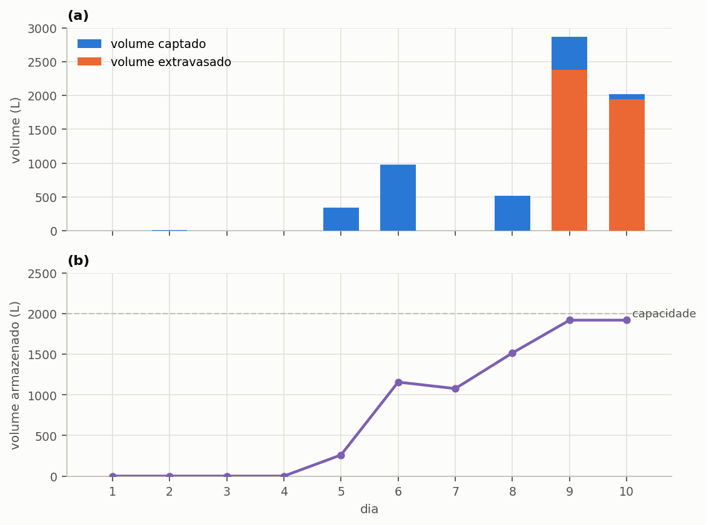

*Figura 1 — Os dez dias do caso resolvido, com a chuva de Lisboa de 11 a 20 de dezembro de 2019: (a) volume captado, a azul, e volume extravasado, a laranja, por dia; nos dias 9 e 10 o extravasamento é quase igual ao captado; (b) volume armazenado no reservatório inferior no fim de cada dia, depois do consumo, com a capacidade de 2 000 L a tracejado; nos dias 9 e 10 o reservatório atinge a capacidade, extravasa e termina o dia com 1 920 L.*

#### 2.1.3.5. A soma: o balanço fecha

A última linha da tabela e o quadro de verificação mostram o fecho:

```equacao:fechamento:1
V_cap = V_ext + V_con + V_res
```

<!-- tabela: **Tabela 6** — Variáveis da Equação 1 -->
| Símbolo | Significado | Unidade |
| :--- | :--- | :--- |
| `V_cap` | volume total captado no período | L |
| `V_ext` | volume total extravasado no período | L |
| `V_con` | volume total de água da chuva consumido no período | L |
| `V_res` | volume remanescente no reservatório no fim do período | L |

Nos dez dias do caso resolvido, a Equação 1 verifica-se com 6 732 L captados,
4 324 L extravasados, 488 L consumidos e 1 920 L remanescentes.

Resíduo zero. O programa não cria nem perde água, e esta verificação é feita automaticamente pela
bateria de testes a cada alteração do código, sobre séries de dez anos, com um resíduo da ordem
de 10⁻¹⁴ por cento do captado.

---

### 2.1.4. As equações

O balanço diário escreve-se em cinco equações encadeadas, que o programa resolve por esta ordem
para cada dia da série. A notação segue a da secção 4.1 (volume Tutorial) para a parte da captação, e o índice
`t` designa sempre o dia corrente da simulação, de modo que `t−1` é o dia imediatamente anterior.

#### 2.1.4.1. O volume captado

A conversão da lâmina precipitada em volume é a primeira operação do dia, e a mais simples de
todas: multiplica-se a chuva efetiva pela área de captação e pelo coeficiente de escoamento
superficial.

```equacao:volume_captado:2
V_cap,t = P_ef,t × A × C
```

<!-- tabela: **Tabela 7** — Variáveis da Equação 2 -->
| Símbolo | Significado | Unidade |
| :--- | :--- | :--- |
| `V_cap,t` | volume captado no dia `t` | L |
| `P_ef,t` | chuva efetiva no dia `t`, já descontada a lâmina de descarte | mm |
| `A` | área de captação, em projeção horizontal | m² |
| `C` | coeficiente de escoamento superficial da cobertura | adimensional |

O resultado da Equação 2 sai diretamente em litros, sem fator de conversão,
porque um milímetro de lâmina sobre um metro quadrado de superfície corresponde exatamente a um
litro de água. É a única simplificação dimensional do modelo, e é exata.

#### 2.1.4.2. O extravasamento e o armazenamento

O volume disponível antes de qualquer consumo é a soma do que sobrou no reservatório no fim do
dia anterior com o que foi captado hoje, como na Equação 3. Desta soma decorrem
duas parcelas, calculadas por esta ordem: o excedente que não cabe no reservatório e por isso
extravasa, e o volume que fica efetivamente armazenado.

```equacao:disponivel:3
D_t = V_res,t−1 + V_cap,t
```

```equacao:extravasado:4
V_ext,t = max(0 ; D_t − V_max)
```

```equacao:armazenado:5
V_arm,t = min(D_t ; V_max)
```

<!-- tabela: **Tabela 8** — Variáveis da Equação 5 -->
| Símbolo | Significado | Unidade |
| :--- | :--- | :--- |
| `D_t` | volume disponível no dia `t`, antes do consumo | L |
| `V_res,t−1` | volume que sobrou no reservatório no fim do dia anterior | L |
| `V_cap,t` | volume captado no dia `t`, da Equação 2 | L |
| `V_ext,t` | volume extravasado no dia `t` | L |
| `V_arm,t` | volume armazenado no dia `t`, antes do consumo | L |
| `V_max` | capacidade útil do reservatório inferior | L |

==A ordem em que as Equações 4 e 5 aparecem define o modelo.== O
extravasamento é calculado **antes** da retirada do consumo do dia, e é por isso que o programa
costuma ser descrito pela regra YAS, do inglês *yield after spillage*, isto é, rendimento
posterior ao extravasamento. A descrição é aproximada, e a subsecção seguinte diz em que falha.
Inverter a ordem faria o reservatório aceitar, sob a forma de consumo, água que fisicamente já
teria extravasado, e sobrestimaria o aproveitamento justamente nos dias de chuva intensa, que são
os que mais pesam no total anual.

A diferença entre as duas ordens é invisível na maior parte dos dias e decisiva nos poucos que
importam. Enquanto o reservatório não enche, extravasar antes ou depois de consumir dá exatamente
o mesmo resultado, porque não há extravasamento algum; nos dias de chuva intensa, em que o
reservatório atinge a capacidade, a ordem determina se uma parcela de água é contabilizada como
consumida ou como perdida. São justamente estes os dias que mais pesam no total anual, e por isso
uma escolha que parece formalidade desloca o resultado inteiro. A Figura 2 compara as
duas sequências na notação das equações desta secção.

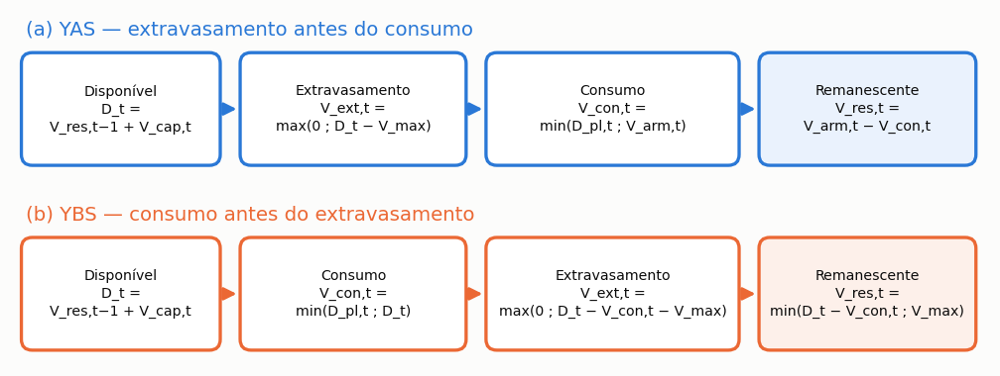

*Figura 2 — Sequência de operações do balanço diário: (a) a ordem adotada pelo programa, com o extravasamento calculado antes do consumo; (b) a ordem invertida (YBS), com o consumo retirado antes do extravasamento. As duas sequências só divergem nos dias em que o reservatório atinge a capacidade, e a YBS supõe um consumo anterior à chuva do dia, o que sobrestima o aproveitamento.*

#### 2.1.4.3. YAS, YBS e a ordem do Triton

Na literatura, a YAS e a YBS têm definição precisa (Fewkes e Butler, 2000). Com `Y_t` o volume
retirado no dia, `Q_t` o volume captado, `S_t` o volume armazenado no fim do dia e `V_max` a
capacidade:

<!-- tabela: **Tabela 9** — Retirada do dia e volume armazenado no fim do dia nas regras YAS e YBS estritas e no Triton -->
| Regra | Retirada do dia | Armazenado no fim do dia |
| :--- | :--- | :--- |
| YAS estrita | `Y_t = min(D_pl,t ; S_t−1)` | `S_t = min(S_t−1 + Q_t − Y_t ; V_max − Y_t)` |
| YBS estrita | `Y_t = min(D_pl,t ; S_t−1 + Q_t)` | `S_t = min(S_t−1 + Q_t − Y_t ; V_max)` |
| Triton | `Y_t = min(D_pl,t ; min(S_t−1 + Q_t ; V_max))` | `S_t = min(S_t−1 + Q_t ; V_max) − Y_t` |

Na YAS estrita, a retirada do dia sai só do que estava guardado na véspera: a chuva de hoje só
serve amanhã. Na YBS estrita, a chuva de hoje satisfaz a procura antes de o reservatório
extravasar. O Triton faz primeiro o extravasamento, como a YAS, e depois deixa a chuva do dia,
até ao limite da capacidade, satisfazer a procura do dia.

Daqui decorre uma desigualdade que vale para qualquer série: o volume consumido pelo Triton nunca
é menor do que o da YAS estrita nem maior do que o da YBS estrita. O resultado fica **entre as
duas**, mais perto da YAS nos reservatórios grandes, em que a véspera quase sempre basta, e mais
longe dela nos pequenos, em que a chuva do dia pesa. Quem compara o Triton com um programa ou com
uma norma que use a YAS estrita deve esperar do Triton um potencial de poupança ligeiramente
maior para o mesmo volume.

O programa mantém esta ordem por decisão: garante a continuidade com os estudos anteriores do
grupo de investigação, e uma mudança aqui deslocaria todos os resultados publicados.

#### 2.1.4.4. A satisfação da procura

Estabelecido quanto há no reservatório, o programa retira dele o menor valor entre a procura
pluvial do dia e o volume disponível, e devolve ao dia seguinte o que restar.

```equacao:consumido:6
V_con,t = min(D_pl,t ; V_arm,t)
```

```equacao:sobra:7
V_res,t = V_arm,t − V_con,t
```

<!-- tabela: **Tabela 10** — Variáveis da Equação 7 -->
| Símbolo | Significado | Unidade |
| :--- | :--- | :--- |
| `V_con,t` | volume de água da chuva consumido no dia `t` | L |
| `D_pl,t` | procura pluvial do dia `t`, montada como na secção 4.2 (volume Tutorial) | L |
| `V_arm,t` | volume armazenado no dia `t`, da Equação 5 | L |
| `V_res,t` | volume remanescente, transferido para o dia seguinte | L |

A Equação 7 é o que torna a simulação diária necessária e insubstituível: liga cada
dia ao seguinte e faz do reservatório uma memória do que aconteceu antes. Nenhum cálculo baseado
em médias mensais ou anuais consegue representar este encadeamento, e é dele que decorre todo o
desencontro entre a oferta concentrada e a procura distribuída.

#### 2.1.4.5. O complemento da rede pública

O que a chuva não satisfez é comprado à entidade gestora, e esta parcela reúne três origens
distintas.

```equacao:potavel:8
V_pot,t = D_pot,t + ΔD_int,t + ΔD_irr,t
```

<!-- tabela: **Tabela 11** — Variáveis da Equação 8 -->
| Símbolo | Significado | Unidade |
| :--- | :--- | :--- |
| `V_pot,t` | volume de água potável consumido da rede no dia `t` | L |
| `D_pot,t` | procura que exige água potável pela natureza do uso | L |
| `ΔD_int,t` | défice do uso interior não potável, não satisfeito pela chuva | L |
| `ΔD_irr,t` | défice da rega, **somente** se o abastecimento de reserva estiver ligado | L |

A terceira parcela da Equação 8 merece atenção porque depende de uma escolha do
utilizador. Com o abastecimento de reserva ligado, a rede socorre a rega nos dias em que a
cisterna seca, e o défice é suprido com água potável; com ele desligado, o jardim simplesmente
não é regado, o edifício não compra essa água, e o volume correspondente é contabilizado como
**procura não satisfeita**, que é a terceira parcela do balanço da procura tratada adiante nesta
secção.

#### 2.1.4.6. A classificação do dia

Por fim, cada dia recebe uma classificação segundo o grau de abastecimento alcançado, e é a partir
dessa classificação que se calculam as percentagens de dias de abastecimento pleno, parcial e
nulo relatadas na secção 2.3.

```equacao:classificacao:9
pleno: V_con,t = D_pl,t ; parcial: 0 < V_con,t < D_pl,t ; nulo: V_con,t = 0
```

<!-- tabela: **Tabela 12** — Variáveis da Equação 9 -->
| Símbolo | Significado | Unidade |
| :--- | :--- | :--- |
| `V_con,t` | volume de água da chuva consumido no dia `t` | L |
| `D_pl,t` | procura pluvial do dia `t` | L |

A comparação da Equação 9 é feita com tolerância de 10⁻⁵ L, e não por igualdade
exata. A razão é aritmética e não conceptual: o balanço trabalha com números de vírgula
flutuante, e uma diferença da ordem do erro de arredondamento classificaria como parcial um dia
que foi plenamente abastecido.

### 2.1.5. O balanço da procura tem três parcelas

A procura total de um dia reparte-se em três, e não em duas:

```equacao:demanda_tres:10
D_t = V_con,t + V_pot,t + V_nao,t
```

<!-- tabela: **Tabela 13** — Variáveis da Equação 10 -->
| Símbolo | Significado | Unidade |
| :--- | :--- | :--- |
| `D_t` | procura total do edifício no dia `t` | L |
| `V_con,t` | parcela satisfeita com água da chuva | L |
| `V_pot,t` | parcela comprada à rede pública | L |
| `V_nao,t` | parcela que ninguém forneceu, isto é, procura não satisfeita | L |

As três parcelas são o consumo de água da chuva, o consumo da rede pública e a **procura não
satisfeita**. A terceira é zero na configuração de partida, em que a rede socorre a rega nos
dias secos. Deixa de ser zero quando o utilizador desliga esse socorro, e então o programa tem de
a mostrar: sem ela, o balanço fecharia por construção, escondendo a água que ninguém forneceu.

---

### 2.1.6. Com reservatório superior

Quando o projeto tem reservatório superior, o passo 4 muda. Em vez de consumir diretamente do
reservatório inferior, o programa:

1. consome do reservatório superior o que estiver **acima do limiar de acionamento**;
2. se ainda falta e há água em baixo, **aciona a eletrobomba**: transfere o menor valor entre o
   que há no inferior e o espaço livre em cima, e conta **um ciclo**;
3. consome de novo do que acabou de chegar;
4. repete até satisfazer a procura ou acabar a água.

O limiar de acionamento é o volume de reserva que não se consome, e serve para a bomba não ligar a
cada litro. Está limitado ao volume do reservatório superior: informar um limiar maior do que o
reservatório não faz o programa recusá-lo, faz com que adote o reservatório cheio.

> **O reservatório superior não aumenta a poupança de água.** Muda **quando** a água é entregue,
> não **quanta**. O que acrescenta é custo: o investimento no reservatório e na bomba, a energia da
> elevação e a emissão associada. A secção 4.5 (volume Tutorial) mostra-o com números.

O número de ciclos e o volume elevado saem daqui e alimentam o cálculo de energia da secção
2.6.

---

### 2.1.7. O que o modelo não representa

- **Não há subpasso horário.** Uma chuva de 40 mm concentrada em duas horas e a mesma lâmina
  repartida por vinte e quatro horas produzem o mesmo resultado. Para reservatórios muito
  pequenos em relação à área de captação, isto subestima o extravasamento.
- **Não há perda por evaporação ou fuga** no reservatório.
- **A condição inicial é reservatório vazio.** Em séries com menos de um ano, isto penaliza
  sensivelmente o resultado.
- **O coeficiente de escoamento é único e constante.** Não varia com a intensidade da chuva nem
  com o tempo desde o último evento.
- **No balanço, o descarte é uma lâmina, e não um dispositivo com dinâmica própria.** O
  reservatório de descarte é dimensionado e orçamentado pelo volume `A × d_f` (secção 2.5),
  mas o seu esvaziamento entre eventos não é simulado: a lâmina é aplicada conforme o modo de
  descarte escolhido.

A secção 5.2 (volume Enganos, limitações e confiabilidade) reúne estas e as restantes limitações conhecidas.

---

### 2.1.8. Para conferir

O caso resolvido desta secção está no ficheiro `05_dez_dias.triton`, na pasta de casos que
acompanha o programa. Abra-o, execute-o e compare com a tabela impressa.

Se algum número divergir, é o manual que está desatualizado em relação ao programa. E nesse caso a
verificação automática já terá avisado, porque cada número desta tabela tem uma asserção
correspondente na bateria de testes descrita na secção 5.3 (volume Enganos, limitações e confiabilidade).

---

## 2.2. Volume ideal e a varredura

> Esta secção formaliza o que a secção 4.4 (volume Tutorial) fez na prática: como o programa constrói a grelha
> de volumes e como aplica o critério de volume ideal.

---

### 2.2.1. A grelha discreta

A varredura simula um conjunto **finito** de volumes, e a construção desse conjunto obedece a
três regras.

**O passo é arredondado por excesso ao múltiplo de 250 litros.** É o quantum comercial: os
reservatórios vendem-se em volumes normalizados, e um ótimo de 1 300 L não se compra. Quando o
passo pedido não é múltiplo de 250, o programa ajusta-o e regista o ajuste em `step_adjusted`,
para que o relatório possa declarar o passo efetivo.

**O número de volumes positivos está limitado a 40.** Uma varredura de 0 a 50 000 L com passo de
100 L seriam 500 simulações de trinta anos, e o ganho de informação não paga o custo. Quando o
limite é atingido, o passo efetivo cresce.

**O volume máximo informado é sempre preservado** como último ponto da grelha. Só o último
intervalo pode, portanto, ser menor do que o passo efetivo.

O volume **zero** entra na grelha como alternativa de referência: é o cenário sem sistema, contra
o qual os restantes se comparam.

---

A consequência prática aparece na Figura 3. Com um passo fino, a curva mostra o
joelho onde o retorno começa a decair; com um passo grosseiro, o joelho cai entre dois pontos da
grelha e o critério elege o primeiro volume tabelado depois dele, que pode estar vários metros
cúbicos além do volume que de facto interessa.

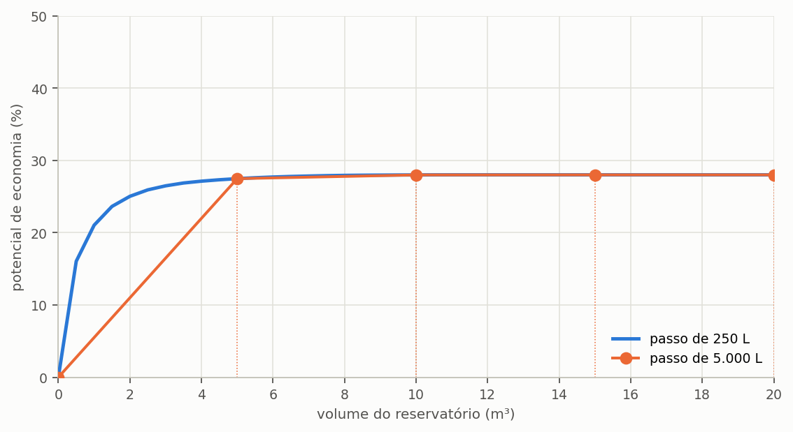

*Figura 3 — Curva de potencial de poupança do mesmo edifício, varrida com passo de 250 L e com passo de 5 000 L. A grelha grossa calcula corretamente cada ponto que contém, mas não contém o troço de maior curvatura, entre 1 e 5 m³.*

---

### 2.2.2. O ganho marginal

A curva de potencial de poupança contra o volume é monótona e côncava: cada metro cúbico
acrescentado ao reservatório rende menos do que o anterior, e o rendimento tende para zero à
medida que o sistema se aproxima do teto imposto pela fração suprível. O programa quantifica este
rendimento decrescente pela derivada discreta da curva, calculada para cada volume da grelha a
partir do segundo.

```equacao:ganho_marginal:11
Δ(V_i) = [ Epot(V_i) − Epot(V_i−1) ] ÷ [ (V_i − V_i−1) ÷ 1000 ]
```

<!-- tabela: **Tabela 14** — Variáveis da Equação 11 -->
| Símbolo | Significado | Unidade |
| :--- | :--- | :--- |
| `Δ(V_i)` | ganho marginal do volume `V_i` em relação ao anterior | %/m³ |
| `Epot(V_i)` | potencial de poupança de água potável obtido com o volume `V_i` | % |
| `Epot(V_i−1)` | potencial de poupança obtido com o volume imediatamente menor | % |
| `V_i` | volume do reservatório na posição `i` da grelha | L |
| `V_i−1` | volume imediatamente menor da grelha | L |
| `1000` | conversão de litros para metros cúbicos | L/m³ |

A divisão por mil no denominador da Equação 11 existe para que o resultado saia
em pontos percentuais por metro cúbico acrescentado, que é a unidade em que a decisão se toma:
os reservatórios compram-se e orçamentam-se em metros cúbicos, não em litros.

==Por ser uma derivada discreta, o ganho marginal depende do passo da grelha.== Uma grelha fina
produz um valor mais local, próximo da derivada verdadeira nesse ponto; uma grelha grossa produz
a média do rendimento ao longo de um intervalo maior. A subsecção sobre a sensibilidade ao passo,
adiante, mede o tamanho deste efeito.

---

### 2.2.3. O critério de volume ideal

O volume ideal define-se como o menor volume positivo da grelha cujo ganho marginal já caiu abaixo
de um limiar declarado pelo utilizador.

```equacao:volume_ideal:12
V_ideal = min { V_i > 0 : Δ(V_i) ≤ Δ_lim }
```

<!-- tabela: **Tabela 15** — Variáveis da Equação 12 -->
| Símbolo | Significado | Unidade |
| :--- | :--- | :--- |
| `V_ideal` | volume ideal pelo critério do ganho marginal | L |
| `V_i` | volume do reservatório na posição `i` da grelha | L |
| `Δ(V_i)` | ganho marginal do volume `V_i`, da Equação 11 | %/m³ |
| `Δ_lim` | limiar de ganho marginal declarado pelo utilizador; o programa abre com 5,0, e o tutorial adota 1,0 | %/m³ |

Quando nenhum volume da grelha satisfaz a condição da Equação 12, o que acontece
quando a gama varrida termina antes de a curva achatar, o programa adota o maior volume da grelha
e regista essa circunstância no relatório, para que o leitor saiba que o ótimo encontrado é um
limite da busca e não um ponto de inflexão da curva.

#### 2.2.3.1. Um exemplo, passo a passo

A tabela da varredura do tutorial, na secção 4.4 (volume Tutorial), permite refazer a conta à mão. Entre
3 000 L e 4 000 L o potencial sobe de 15,39% para 16,60%, isto é, 1,21 pontos percentuais por
mais um metro cúbico. Como 1,21 é maior do que o limiar de 1,0 %/m³, o volume não é ainda o ideal.
Entre 4 000 L e 5 000 L o potencial sobe de 16,60% para 17,49%, isto é, 0,89 pontos por metro
cúbico, já abaixo do limiar: o primeiro volume a cruzá-lo é 5 000 L, e é ele o volume ideal. Com o
limiar mais folgado de 3 %/m³, o volume ideal seria 3 000 L (15,39%), e com o mais exigente de
0,5 %/m³ seria 10 000 L (20,37%).

Repare no que se passa logo a seguir. Entre 6 000 L e 8 000 L o potencial sobe 1,20 pontos, mais
do que os 0,70 do intervalo anterior, de 5 000 para 6 000 L, e no entanto o ganho **por metro
cúbico** desce, de 0,70 para 0,60 %/m³, porque o intervalo tem dois metros cúbicos. É por isso que
o critério usa o ganho por metro cúbico, e não o ganho entre pontos consecutivos da grelha: o
segundo depende do passo, e o primeiro muito menos.

Em Lisboa, a escolha do limiar pesa mais do que noutros climas. A curva não satura: sobe ainda
de 20,37% a 10 000 L para 24,01% a 20 000 L, por causa do verão seco, e o ganho marginal desce
devagar, de 1,84 %/m³ aos 3 000 L para 0,32 %/m³ aos 20 000 L. O volume ideal sai do limiar
declarado, e não de um patamar da curva: declare o limiar junto do volume.

> **O critério é hidráulico e só hidráulico.** Ignora custo, tarifário e carbono. Um volume ideal
> por este critério não é uma recomendação de projeto; é o ponto em que a curva de aproveitamento
> deixa de compensar **em água**. A secção 2.10 trata da escolha com os restantes critérios,
> que muitas vezes apontam para volumes diferentes.

---

Este é um critério entre outros igualmente defensáveis, e convém dizê-lo com clareza. Um
projetista que queira o máximo desempenho hídrico escolherá o maior volume da varredura; um que
responda por um orçamento escolherá o volume de maior valor atual líquido; o critério do ganho
marginal fica entre os dois, por ser o que identifica onde a curva deixa de compensar. Os três
leem a mesma varredura e não têm de coincidir: neste projeto apontam volumes muito diferentes, de
1 000 L pelo critério financeiro a 12 000 L pelo técnico, com 5 000 L pelo ganho marginal.
Nenhum dos três está errado; errado é não dizer qual deles se usou. A Figura 4
marca o volume eleito por cada critério, com o valor anotado na legenda do gráfico.

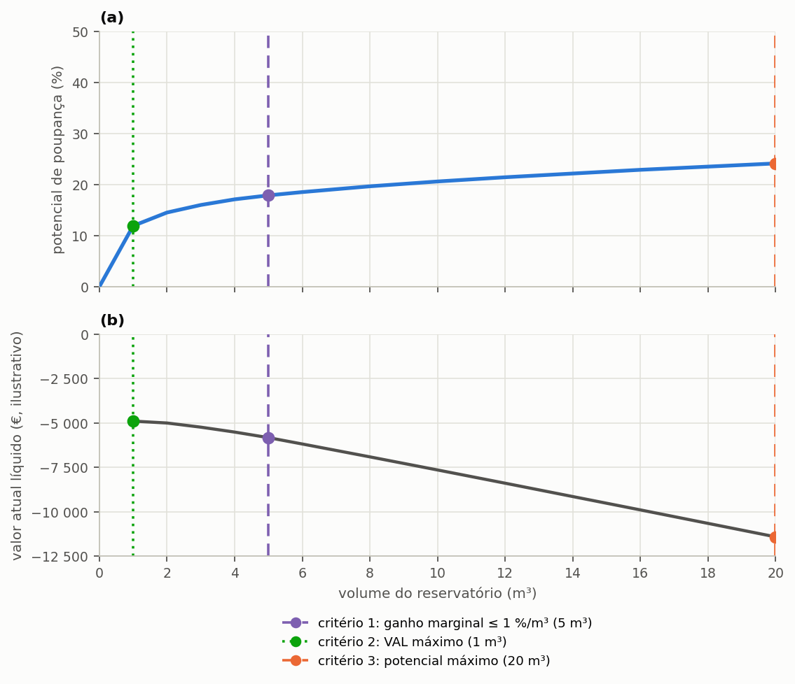

*Figura 4 — Varredura do projeto do tutorial lida por três critérios: (a) potencial de poupança e (b) valor atual líquido do mesmo conjunto de volumes. As linhas verticais marcam o volume eleito pelo ganho marginal abaixo de 1 %/m³, pelo VAL máximo e pelo potencial máximo; o volume de cada um vai anotado na legenda, porque depende da grelha varrida e dos pressupostos económicos em vigor.*

---

### 2.2.4. Por que o programa simula: os métodos empíricos

Normas e manuais oferecem há muito um conjunto de métodos para dimensionar o reservatório: o de
Rippl, a simulação e várias regras práticas, como a alemã e a britânica. Continuam em uso corrente
em projetos e em trabalhos académicos, e convém perceber o que cada um responde antes de os
comparar com a varredura do programa. Algumas normas trazem ainda um método simplificado do mesmo
género, um número de dias do menor valor entre a produção anual e a procura, a par da simulação
diária detalhada.

**O método de Rippl** é o diagrama de massas aplicado ao reservatório: acumula, período a período,
a diferença entre a procura e a chuva aproveitável, e adota como volume o maior défice acumulado
da série. O volume resultante é o que satisfaria **toda** a procura mesmo na pior estiagem
registada, e por isso cresce com o comprimento da série e com a sua resolução: com dados diários,
as sequências secas aparecem inteiras; com dados mensais, parte delas dilui-se na média do mês.

**Os métodos práticos** são regras de bolso. O alemão toma 6% do menor valor entre a chuva
aproveitável anual e a procura anual; o britânico toma 5% do produto `P × A`, com `P` a
precipitação média anual e `A` a área de captação. Nenhum dos dois usa a distribuição da chuva no
tempo, e o britânico nem sequer usa a procura.

A tabela seguinte aplica cinco abordagens de dimensionamento ao projeto do tutorial de Lisboa,
arredonda cada volume a um múltiplo de 250 L e simula, no próprio programa, o potencial que cada
uma produz.

<!-- tabela: **Tabela 16** — Volumes dados por regras clássicas de dimensionamento para o projeto do tutorial, arredondados a 250 L, e o potencial que cada um produz na simulação diária -->
| Método | Regra | Volume | Potencial simulado |
| :--- | :--- | ---: | ---: |
| regra prática alemã | 6% do menor entre a oferta e a procura anuais | 3 750 L | 16,32% |
| Rippl, série mensal | maior défice acumulado, meses | 47 000 L | 26,78% |
| Rippl, série diária | maior défice acumulado, dias | 51 500 L | 26,92% |
| regra prática britânica | 0,05 × P × A | 5 500 L | 17,85% |
| **simulação diária, ganho marginal de 1 %/m³** | varredura | **5 000 L** | **17,49%** |

<!-- tabela: **Tabela 17** — Fração de armazenamento dos volumes da varredura e o passo de simulação que Fewkes e Butler (2000) recomendam para cada gama -->
| Volume | Fração de armazenamento S/(A·R) | Passo de tempo recomendado por Fewkes e Butler |
| ---: | ---: | :--- |
| 1 000 L | 0,0093 | horário |
| 2 000 L | 0,0185 | diário |
| 3 000 L | 0,0278 | diário |
| 4 000 L | 0,0371 | diário |
| 8 000 L | 0,0741 | diário |
| 12 000 L | 0,1112 | diário |
| 20 000 L | 0,1854 | mensal |

A primeira tabela mostra o que a curva côncava da secção 4.4 (volume Tutorial) já anunciava, com uma diferença
de peso: em Lisboa, o verão seco faz do método de Rippl um pedido enorme. Com série diária, pede
51 500 L, e com série mensal, 47 000 L: perto de dez vezes os 5 000 L da simulação. Esses
reservatórios entregam de facto mais, 26,92% e 26,78% contra 17,49%, e chegam perto do teto de
28%, porque são dimensionados para que quase nunca falte água. Mas cada metro cúbico acima de
5 000 L rende pouco, e uma cisterna de 47 a 52 m³ é impraticável numa moradia como a do tutorial. As regras práticas ficam do outro lado: a alemã (3 750 L, 16,32%) dá menos do que a
simulação, e a britânica (5 500 L, 17,85%) acerta a ordem de grandeza por coincidência, porque
nenhuma das duas tem como saber que a chuva de Lisboa se concentra no inverno, e dariam o mesmo
volume a uma cidade de chuva bem repartida.

==A diferença essencial é que os métodos empíricos respondem a uma pergunta fixa, e a simulação
responde à pergunta que o projetista declara.== Rippl pergunta que volume nunca falha; o método
britânico pergunta que fração da chuva guardar; a varredura com ganho marginal pergunta a partir
de que volume o metro cúbico seguinte deixa de compensar. O volume adequado varia com a chuva
local, a área de cobertura, o número de moradores e as procuras, e dimensionar reservatórios pela
tradição local, sem simulação, pode levar a sistemas de baixa eficiência. Nas três cidades de
exemplo, a varredura dá volumes ideais diferentes, 5 000 L em Lisboa e no Porto e 4 000 L no
Funchal, com a mesma moradia e o mesmo limiar: a diferença vem só da chuva.

---

### 2.2.5. O passo de tempo e a fração de armazenamento

O programa simula dia a dia, e esta escolha tem uma gama de validade conhecida. Fewkes e Butler
(2000) compararam modelos comportamentais com passos de um minuto, uma hora, um dia e um mês,
tomaram como referência o modelo horário com a regra YAS, descrita na secção 2.1, e
mostraram que o passo adequado depende de uma grandeza adimensional, a **fração de
armazenamento**.

```equacao:fracao_de_armazenamento:13
F_S = S ÷ (A × R)
```

<!-- tabela: **Tabela 18** — Variáveis da Equação 13 -->
| Símbolo | Significado | Unidade |
| :--- | :--- | :--- |
| `F_S` | fração de armazenamento | adimensional |
| `S` | capacidade do reservatório | m³ |
| `A` | área de captação em projeção horizontal | m² |
| `R` | precipitação média anual | m |

Pelos resultados daqueles autores, o modelo horário é o indicado para frações até 0,01; o diário,
para frações entre 0,01 e 0,125; e o mensal, só acima de 0,125. A razão física é simples: quanto
menor o reservatório relativamente à chuva que recebe, mais enche e extravasa **dentro** de um
mesmo dia chuvoso, enquanto a procura é retirada ao longo das horas; um passo diário soma numa só
entrada o que, hora a hora, teria entrado e saído aos poucos.

A segunda tabela calcula a fração para os volumes da varredura do tutorial. A cisterna escolhida,
de 5 000 L, tem uma fração de cerca de 0,046, dentro da gama do modelo diário; o reservatório de
1 000 L (0,0093) fica abaixo de 0,01, e para ele o resultado diário deve ler-se como uma
aproximação. Fewkes e Butler recomendam o passo horário para esse volume e o diário para os
outros. Campisano e Modica (2015), que simularam um sistema residencial com passos diários e
subdiários a partir de caudais medidos, chegaram a uma conclusão complementar: o passo diário é
fiável para estimar a **poupança de água**, mas são precisos passos de, no máximo, uma hora quando
o objetivo é a **retenção de águas pluviais**, sobretudo em reservatórios pequenos e com procura
alta.

> **Na prática.** Para a poupança de água potável em edifícios, o passo diário do programa é
> adequado na gama habitual de projeto. Se a fração de armazenamento do seu estudo ficar abaixo de
> 0,01, declare a limitação; e se o objetivo for amortecer caudais de ponta na drenagem urbana, o
> programa não é a ferramenta adequada.

---

### 2.2.6. O que a literatura diz sobre o volume ideal

Não há uma definição única de volume ideal, e a revisão sistemática de Semaan et al. (2020) ajuda
a situar o critério do programa. Examinando estudos de otimização de sistemas domésticos, os
autores observaram que o dimensionamento do reservatório é o objetivo de otimização mais
importante, mas que o custo é o critério mais usado; que o subdimensionamento produz sistemas
incapazes de fornecer um volume fiável; e que o sobredimensionamento eleva o investimento com um
benefício marginal pequeno e pode até comprometer a qualidade da água, que fica armazenada por
mais tempo.

Campisano et al. (2017), numa revisão ampla sobre sistemas urbanos de aproveitamento pluvial,
reúnem critérios de três famílias: os de **eficiência hídrica**, como o potencial de poupança e a
fiabilidade; os **económicos**, como o valor atual líquido e o período de recuperação; e os de
**desempenho na drenagem**, como a retenção. O programa cobre as duas primeiras famílias e declara
não cobrir a terceira.

O critério do ganho marginal pertence à primeira família e tem uma vantagem sobre a fiabilidade
fixa, como a de Rippl: não exige que o projetista escolha um nível de falha aceitável, que
raramente tem justificação técnica, mas sim um nível de retorno decrescente, que se lê
diretamente em metros cúbicos de reservatório. A desvantagem é simétrica: o limiar de 1 %/m³, ou
de 5 %/m³, também é uma escolha, e tem de ser declarado.

---

### 2.2.7. A sensibilidade ao passo

O volume ideal depende do passo da varredura, e convém saber quanto.

Um passo grosso salta o joelho da curva: com um passo de 5 000 L, o primeiro ponto avaliado depois
do zero já tem o ganho marginal médio de todo o intervalo, que é alto, e o segundo pode já estar
abaixo do limiar. O ideal sai deslocado para cima.

Um passo fino resolve melhor o joelho, ao custo de tempo.

**Recomendação prática:** passo entre 500 e 1 000 L para reservatórios residenciais, e entre
2 000 e 5 000 L para edifícios de grande porte, declarando sempre o passo adotado junto do volume
ideal.

---

### 2.2.8. Por que a curva tem esta forma

A curva de aproveitamento pluvial é côncava e assintótica, sempre. Duas razões:

**Os eventos pequenos são a maioria.** Os primeiros litros de armazenamento captam as chuvas
frequentes e pequenas, que respondem pela maior parte dos dias. Os últimos litros só servem para
os poucos eventos extremos.

**A fração suprível é um teto.** O potencial não pode ultrapassar a fração da procura que a chuva
satisfaz, definida na secção 4.2 (volume Tutorial). A curva aproxima-se desse teto e nunca o cruza, invariante
que a bateria de testes verifica até volumes de 100 m³. Em Lisboa, o teto é de 28% e a curva
chega a 24,01% aos 20 000 L: ainda longe dele.

---

### 2.2.9. A série é suficientemente longa?

Todo o resultado desta secção depende da série de chuva carregada, e a pergunta que o revisor faz
primeiro é se ela basta. Geraldi e Ghisi responderam-lhe em três artigos: extraem-se subséries de
uma série longa, simula-se cada uma e conta-se com que frequência reproduzem o resultado da série
inteira. O comprimento representativo é o menor que reproduz o resultado na maior parte das
janelas, e que **continua a reproduzi-lo** nos comprimentos maiores: um acerto isolado numa
subsérie curta não vale como recomendação.

O programa tem esta análise na etapa da varredura, no botão «a série de chuva é suficientemente
longa?». Usa a mesma grelha de volumes e o mesmo limiar de ganho marginal da varredura, porque a
resposta depende deles, e devolve o veredicto numa frase, com a tabela de frequência por
comprimento.

==A resposta é deste projeto, e não da cidade.== É o ponto que os artigos não isolam e que a
análise torna visível: o comprimento de série necessário depende de quanto da procura se pede à
chuva. Quanto maior a parte a cobrir, mais a cisterna depende das estiagens raras, e mais longa
tem de ser a série que as contém. Uma série curta não erra o potencial médio; erra o volume, que é
o que se compra.

O programa devolve o veredicto para o seu projeto, com a sua cobertura, a sua procura e a sua
fração suprível. Execute-o para cada cidade de uma comparação: as três cidades de exemplo, com
trinta anos de dados diários cada uma, são um bom teste. [A COMPLETAR: o comprimento de série
representativo para Lisboa, Porto e Funchal ainda não foi calculado para esta edição; correr a
análise nos três projetos de exemplo e tabelar aqui.]

> **Atenção: uma série curta não se torna longa por tirar médias.** Se a análise disser que o
> projeto precisa de mais anos do que a série tem, o volume ideal calculado é provisório, e é isso
> que se declara no trabalho. Repetir a simulação com outra janela dos mesmos dados não resolve: o
> que falta é registo, não processamento. Algumas normas fixam um número mínimo de anos de dados
> diários; o Triton mantém a análise de Geraldi e Ghisi, que responde para cada projeto em vez de
> fixar um mínimo.

---

### 2.2.10. O que a varredura não responde

- **Que volume comprar.** Os reservatórios existem em volumes comerciais; o ideal calculado deve
  ser arredondado para o volume disponível mais próximo, e a varredura já ajuda ao trabalhar em
  múltiplos de 250 L.
- **Se o sistema compensa.** Isso é a secção 2.7.
- **Se o volume cabe no terreno.** O programa não conhece o local.
- **Quanto a cisterna amortece a drenagem.** O passo diário não representa os caudais de ponta, e
  a retenção exige um passo horário ou menor, como mostram Campisano e Modica (2015).

---

## 2.3. Indicadores de eficiência

> Esta secção define formalmente cada indicador que o programa reporta, com a sua unidade, e diz
> **o que cada um não mede**.

Um indicador mal interpretado é pior do que nenhum, e os desta secção confundem-se com frequência
na literatura. Os dois primeiros partem do mesmo numerador, a água da chuva efetivamente
consumida, e diferem apenas no denominador: uma diferença aritmética pequena e uma diferença de
significado grande, porque cada denominador formula uma pergunta distinta. O terceiro não é uma
razão entre volumes, e sim uma contagem de dias, e responde a uma pergunta que nenhum dos outros
dois alcança: com que frequência se pode contar com o sistema (Figura 5).

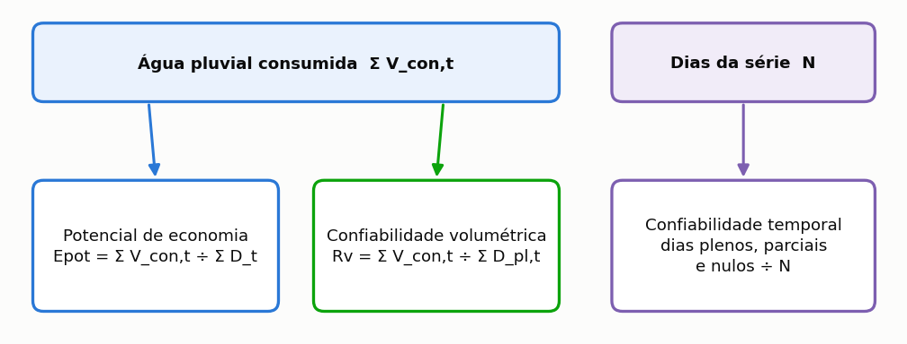

*Figura 5 — Os três indicadores de eficiência e o que cada um conta. O potencial de poupança e a fiabilidade volumétrica partilham o numerador e relacionam-se pela identidade Epot = Rv × f, em que f é a fração suprível; a fiabilidade temporal conta dias, e não litros.*

---

### 2.3.1. Potencial de poupança de água potável

O potencial de poupança de água potável é o indicador central do programa e o que figura no
resumo de qualquer estudo. Exprime a fração do consumo **total** do edifício que a água da chuva
conseguiu substituir ao longo de toda a série simulada, e não apenas da parte que a chuva poderia
satisfazer.

```equacao:potencial:14
Epot = ( Σ V_con,t ÷ Σ D_t ) × 100
```

<!-- tabela: **Tabela 19** — Variáveis da Equação 14 -->
| Símbolo | Significado | Unidade |
| :--- | :--- | :--- |
| `Epot` | potencial de poupança de água potável | % |
| `V_con,t` | volume de água da chuva consumido no dia `t` | L |
| `D_t` | procura total do edifício no dia `t` | L |
| `Σ` | somatório sobre todos os dias da série simulada | — |

O denominador da Equação 14 é a procura **total**, e esta escolha é a origem da
confusão mais comum na leitura dos resultados. Um sistema que satisfizesse integralmente toda a
procura que lhe cabe, sem falhar um único dia, ainda assim apresentaria um potencial de poupança
igual à fração suprível declarada, e não cem por cento. O teto, portanto, não é uma limitação do
sistema: é uma consequência aritmética da definição do indicador.

---

### 2.3.2. Fiabilidade volumétrica

A fiabilidade volumétrica responde a uma pergunta diferente e complementar: da água que o sistema
**devia** fornecer, quanto forneceu de facto? O denominador aqui é a procura pluvial, e não a
procura total.

```equacao:confiabilidade:15
Rv = ( Σ V_con,t ÷ Σ D_pl,t ) × 100
```

<!-- tabela: **Tabela 20** — Variáveis da Equação 15 -->
| Símbolo | Significado | Unidade |
| :--- | :--- | :--- |
| `Rv` | fiabilidade volumétrica do sistema | % |
| `V_con,t` | volume de água da chuva consumido no dia `t` | L |
| `D_pl,t` | procura pluvial do dia `t`, isto é, a parte suprível pela chuva | L |
| `Σ` | somatório sobre todos os dias da série simulada | — |

As Equações 14 e 15 diferem apenas no denominador, e essa
diferença basta para que se relacionem por uma identidade exata, útil como conferência rápida de
qualquer resultado.

```equacao:relacao_indicadores:16
Epot = Rv × f
```

<!-- tabela: **Tabela 21** — Variáveis da Equação 16 -->
| Símbolo | Significado | Unidade |
| :--- | :--- | :--- |
| `Epot` | potencial de poupança de água potável | % |
| `Rv` | fiabilidade volumétrica | % |
| `f` | fração da procura total suprível por água da chuva | adimensional |

==Um sistema com 55% de fiabilidade e 28% de fração suprível poupa 15,4% do consumo total, e os
três números dizem a mesma coisa de três maneiras.== É o caso da moradia de Lisboa do tutorial com
uma cisterna de 3 000 L, a primeira simulação da secção 4.3 (volume Tutorial): o potencial de poupança é de
15,39%, e dividindo pela fração suprível de 0,28 obtém-se uma fiabilidade volumétrica de cerca de
55,0%. Relatar apenas um deles, sem declarar a fração suprível adotada, torna o resultado
impossível de comparar com o de outro estudo, e é a causa mais frequente de comparações indevidas
na literatura da área.

A literatura usa nomes diferentes para a mesma razão. Fewkes e Butler (2000) chamam **eficiência
de poupança de água** ao quociente entre o volume de água da chuva fornecido e a procura que o
sistema devia satisfazer, que é a fiabilidade volumétrica desta secção. Outros autores chamam
eficiência ao que aqui é potencial de poupança; algumas normas chamam-lhe taxa de cobertura. Ao
comparar com outro trabalho, confira o denominador, e não o nome.

---

### 2.3.3. Fiabilidade temporal

A fiabilidade temporal classifica cada dia da série numa de três classes mutuamente exclusivas,
conforme a relação entre o volume de água da chuva consumido e a procura pluvial do dia, definida
na Equação 9. O dia é **pleno** quando a água da chuva satisfaz integralmente a
procura pluvial; **parcial**, quando satisfaz parte dela e a rede pública fornece o resto; e
**nulo**, quando o reservatório está vazio e a rede fornece toda a procura
(Figura 6). As três percentagens somam 100%. A classificação conta dias, e não
volume: um dia em que faltou um litro para satisfazer a procura é parcial, e não quase pleno, e
por isso a fiabilidade temporal não se converte diretamente em volume poupado.

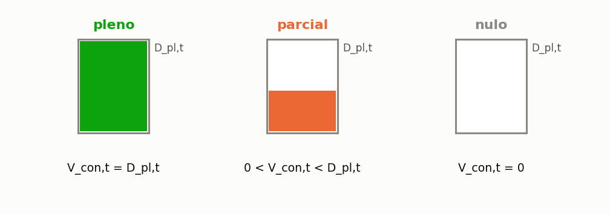

*Figura 6 — Classes de abastecimento diário: pleno (V_con,t = D_pl,t), parcial (0 < V_con,t < D_pl,t) e nulo (V_con,t = 0). A altura preenchida representa a fração da procura pluvial do dia satisfeita por água da chuva.*

Formalmente, o dia é **pleno** quando `V_con,t = D_pl,t`, com tolerância de 10⁻⁵ L; **parcial**
quando `0 < V_con,t < D_pl,t`; e **nulo** quando `V_con,t = 0`.


No tutorial de Lisboa com a cisterna de 3 000 L, 53,3% dos dias são plenos, 2,9% parciais e 43,8%
nulos. Repare que a fiabilidade temporal, 53,3%, é menor do que a volumétrica, cerca de 55,0%.
Não há contradição: os dias parciais não contam como plenos, mas contribuem com volume, e é essa
água que a fiabilidade volumétrica soma e a temporal não. A diferença entre as duas é, por isso,
uma medida indireta de quanto as falhas são falhas parciais. Com uma cisterna de 4 000 L os dias
plenos sobem para 58,0%, e com 5 000 L para 61,3%.

**O que mede:** com que frequência o utilizador pode contar com o sistema.

**O que não mede:** o volume. Um sistema pode ter 95% de dias plenos e um potencial baixo se a
procura pluvial for pequena, e o contrário também acontece.

> A fiabilidade temporal é o indicador que mais importa para o **projeto de águas**. Muitos dias
> nulos exigem uma alimentação automática de reserva bem dimensionada, e o utilizador nota a
> alternância entre as duas fontes.

---

### 2.3.4. Extravasamento

```equacao:extravasamento_medio:17
V_ext,med = ( Σ V_ext,t ) ÷ n
```

<!-- tabela: **Tabela 22** — Variáveis da Equação 17 -->
| Símbolo | Significado | Unidade |
| :--- | :--- | :--- |
| `V_ext,med` | extravasamento médio diário | L/dia |
| `V_ext,t` | volume extravasado no dia `t` | L |
| `n` | número de dias da série simulada | dia |

**O que mede:** quão pequena é a cisterna em relação aos eventos de chuva.

**O que não mede:** desperdício. A água que extravasa vai para a drenagem urbana, como iria sem o
sistema. Não há perda em relação ao cenário sem sistema; há apenas uma oportunidade não
aproveitada.

> O extravasamento **nunca se anula** num sistema real. Tende para um piso que é a diferença entre
> o que a cobertura capta e o que a procura consome. No tutorial de Lisboa, a oferta bruta da
> cobertura é 1,5 vez a procura pluvial, e mesmo com 20 000 L o extravasamento médio ainda é de
> 54 L/dia. Quem quer retenção de cheias precisa de um reservatório de detenção, que é outro
> projeto com outra lógica.

---

### 2.3.5. Eficiência de uso da água captada

O programa não imprime este indicador, mas ele sai diretamente dos anteriores e ajuda a perceber o
extravasamento. É a fração da água que chegou à cisterna, já descontado o descarte das primeiras
águas, que acabou consumida.

```equacao:uso_da_captacao:18
η_cap = ( Σ V_con,t ÷ Σ V_cap,t ) × 100
```

<!-- tabela: **Tabela 23** — Variáveis da Equação 18 -->
| Símbolo | Significado | Unidade |
| :--- | :--- | :--- |
| `η_cap` | eficiência de uso da água captada | % |
| `V_con,t` | volume de água da chuva consumido no dia `t` | L |
| `V_cap,t` | volume captado no dia `t`, depois do descarte | L |
| `Σ` | somatório sobre todos os dias da série simulada | — |

Na cisterna de 3 000 L do tutorial, o sistema consome 33,7 m³ por ano e extravasa em média
106,4 L/dia, cerca de 39 m³ por ano; as duas parcelas, com o pouco que fica no reservatório,
fecham o balanço de massa. Chegam assim à cisterna cerca de 73 m³ por ano, e é consumido pouco
menos de metade, cerca de 46%. O número explica por que aumentar a cisterna rende tão pouco a
partir de certo ponto: a água não falta na cobertura, falta **procura** para a consumir. A oferta
bruta da cobertura, de 92 m³ por ano, é 1,5 vez a procura pluvial de 61 m³ por ano; quando a
oferta excede largamente a procura pluvial, a eficiência de uso da água captada é
necessariamente baixa, qualquer que seja o volume.

---

### 2.3.6. Duração e intensidade das falhas

Os indicadores anteriores dizem quanto e com que frequência o sistema falha, mas não **como**
falha. Hashimoto, Stedinger e Loucks (1982) propuseram, para sistemas de recursos hídricos em
geral, três critérios complementares que hoje se usam também no aproveitamento pluvial: a
**fiabilidade**, que é a probabilidade de o sistema estar num estado satisfatório; a
**resiliência**, que mede a rapidez com que recupera de uma falha; e a **vulnerabilidade**, que
mede a gravidade das falhas quando ocorrem.

O programa reporta a primeira e não reporta as outras duas, mas ambas podem calcular-se a partir
da série diária detalhada, exportada para folha de cálculo: conte as sequências de dias não
plenos e tome a sua duração média, cujo inverso é uma medida de resiliência; e tome o défice
médio nos dias de falha como fração da procura pluvial, uma medida de vulnerabilidade.

A leitura para o projeto é direta. Se as falhas são longas e quase totais, o abastecimento de
reserva pela rede pública tem de ser automático e dimensionado para o caudal total dos pontos de
utilização pluviais, e não apenas para completar pequenas faltas. Os dias nulos do tutorial
(43,8% com 3 000 L) são deste tipo: a cisterna está vazia, e não ligeiramente em falta.

---

### 2.3.7. Volume anual poupado

```equacao:volume_poupado:19
V_poup = ( V_con,med × 365,25 ) ÷ 1000
```

<!-- tabela: **Tabela 24** — Variáveis da Equação 19 -->
| Símbolo | Significado | Unidade |
| :--- | :--- | :--- |
| `V_poup` | volume de água potável poupado por ano | m³/ano |
| `V_con,med` | consumo médio diário de água da chuva | L/dia |
| `365,25` | duração do ano médio, incluindo os bissextos | dia/ano |
| `1000` | conversão de litros para metros cúbicos | L/m³ |

**O que mede:** a base de cálculo da análise económica e da avaliação de ciclo de vida.

> **Aprofundamento: o 365,25 não é descuido.** A conversão usa o ano médio, incluindo os
> bissextos, porque as séries longas os contêm. Usar 365 introduziria um viés sistemático de
> 0,07%, pequeno, mas gratuito.

---

### 2.3.8. Ganho marginal

A definição formal do ganho marginal, com a grelha de volumes explicitada, está na Equação
11, na secção 2.2.

Definido na secção 2.2. É o indicador que decide o volume ideal, e **só existe numa
varredura**: uma simulação de volume único não o produz.

---

### 2.3.9. Procura não satisfeita

```equacao:nao_atendida:20
V_nao,med = ( Σ V_nao,t ) ÷ n
```

<!-- tabela: **Tabela 25** — Variáveis da Equação 20 -->
| Símbolo | Significado | Unidade |
| :--- | :--- | :--- |
| `V_nao,med` | procura média diária não satisfeita por nenhuma fonte | L/dia |
| `V_nao,t` | procura não satisfeita no dia `t` | L |
| `n` | número de dias da série simulada | dia |

Terceira parcela do balanço da procura. É zero na configuração de partida e deixa de ser zero
quando o abastecimento de reserva da rega está desligado.

**Por que existe:** sem ela, o balanço fecharia por construção, atribuindo à rede toda a procura
que a chuva não satisfez. A secção 2.1 detalha.

---

### 2.3.10. Quadro-resumo

<!-- tabela: **Tabela 26** — Quadro-resumo dos indicadores, com o denominador e a pergunta a que cada um responde -->
| Indicador | Unidade | Denominador | Responde |
| :--- | :--- | :--- | :--- |
| potencial de poupança | % | procura total | quanto do consumo de água potável desce |
| fiabilidade volumétrica | % | procura pluvial | quanto do pretendido foi satisfeito |
| dias plenos, parciais, nulos | % | dias da série | com que frequência se pode contar com ele |
| extravasamento | L/dia | — | o reservatório é pequeno? |
| volume poupado | m³/ano | — | base do dinheiro e do carbono |
| ganho marginal | %/m³ | — | vale a pena ampliar? |
| procura não satisfeita | L/dia | — | o que ninguém forneceu |

---

## 2.4. Índices pluviométricos

> Esta secção traz a equação de cada um dos nove índices que o programa calcula, e declara três
> divergências em relação ao padrão ETCCDI.

Os índices pluviométricos não participam no balanço hídrico e não alteram nenhum resultado de
simulação. A sua função é caracterizar a série de precipitação, e uma caracterização honesta é o
que permite comparar estudos de cidades diferentes.

---

### 2.4.1. Os nove índices

Os índices calculam-se **ano a ano** sobre a série carregada, e o programa reporta a média e a
dispersão do conjunto de anos. Em toda esta secção, `P_i` designa a precipitação do dia `i` do
ano, e um **dia húmido** é aquele em que `P_i ≥ 1 mm`, convenção do ETCCDI adotada porque lâminas
inferiores a um milímetro são da ordem do erro de medição dos udómetros convencionais.

#### 2.4.1.1. Precipitação total anual, PRCPTOT

Soma da precipitação de todos os dias húmidos do ano. Difere do total anual bruto por excluir os
dias de lâmina desprezável, o que evita que o ruído do instrumento se acumule no total.

```equacao:prcptot:21
PRCPTOT = Σ P_i , para P_i ≥ 1 mm
```

<!-- tabela: **Tabela 27** — Variáveis da Equação 21 -->
| Símbolo | Significado | Unidade |
| :--- | :--- | :--- |
| `PRCPTOT` | precipitação total dos dias húmidos do ano | mm |
| `P_i` | precipitação do dia `i` | mm |
| `Σ` | somatório sobre os dias do ano que satisfazem a condição | — |

#### 2.4.1.2. Precipitação em dias muito húmidos, R95p

Soma da precipitação dos dias cuja lâmina excede o percentil 95 dos dias húmidos. Mede quanto do
total anual chega nos eventos extremos, e é o índice mais diretamente ligado ao extravasamento das
cisternas.

```equacao:r95p:22
R95p = Σ P_i , para P_i > q_95
```

<!-- tabela: **Tabela 28** — Variáveis da Equação 22 -->
| Símbolo | Significado | Unidade |
| :--- | :--- | :--- |
| `R95p` | precipitação acumulada nos dias muito húmidos | mm |
| `P_i` | precipitação do dia `i` | mm |
| `q_95` | percentil 95 da precipitação dos dias húmidos da série | mm |

#### 2.4.1.3. Máxima precipitação num dia, RX1day

O maior valor diário registado no ano. É o índice que dimensiona o ladrão e a caleira, e não o
reservatório.

```equacao:rx1day:23
RX1day = max ( P_i )
```

<!-- tabela: **Tabela 29** — Variáveis da Equação 23 -->
| Símbolo | Significado | Unidade |
| :--- | :--- | :--- |
| `RX1day` | maior precipitação diária do ano | mm |
| `P_i` | precipitação do dia `i` | mm |
| `max` | valor máximo sobre todos os dias do ano | — |

#### 2.4.1.4. Máxima precipitação em cinco dias, RX5day

O maior acumulado de cinco dias consecutivos no ano. Importa mais ao aproveitamento pluvial do
que o RX1day, porque um reservatório enche ao longo de um evento prolongado e não apenas no pico
diário.

```equacao:rx5day:24
RX5day = max ( Σ P_j ) , para j de i a i + 4
```

<!-- tabela: **Tabela 30** — Variáveis da Equação 24 -->
| Símbolo | Significado | Unidade |
| :--- | :--- | :--- |
| `RX5day` | maior acumulado de cinco dias consecutivos no ano | mm |
| `P_j` | precipitação do dia `j` da janela | mm |
| `i` | primeiro dia de cada janela de cinco dias | — |
| `max` | valor máximo sobre todas as janelas do ano | — |

#### 2.4.1.5. Índice simples de intensidade diária, SDII

Precipitação média dos dias húmidos. Separa dois regimes que o total anual confunde: muita chuva
em poucos dias e pouca chuva em muitos dias podem produzir o mesmo PRCPTOT e SDII muito
diferentes.

```equacao:sdii:25
SDII = PRCPTOT ÷ n_húmidos
```

<!-- tabela: **Tabela 31** — Variáveis da Equação 25 -->
| Símbolo | Significado | Unidade |
| :--- | :--- | :--- |
| `SDII` | intensidade média dos dias húmidos | mm/dia |
| `PRCPTOT` | precipitação total dos dias húmidos, da Equação 21 | mm |
| `n_húmidos` | número de dias húmidos do ano | dia |

#### 2.4.1.6. Dias de precipitação intensa, R20mm

Contagem dos dias em que a lâmina atinge ou excede vinte milímetros. Num sistema de aproveitamento
pluvial, são tipicamente os dias de extravasamento.

```equacao:r20mm:26
R20mm = # { i : P_i ≥ 20 mm }
```

<!-- tabela: **Tabela 32** — Variáveis da Equação 26 -->
| Símbolo | Significado | Unidade |
| :--- | :--- | :--- |
| `R20mm` | número de dias com precipitação intensa no ano | dia |
| `P_i` | precipitação do dia `i` | mm |
| `# { }` | contagem dos dias que satisfazem a condição | — |

#### 2.4.1.7. Dias secos consecutivos, CDD

Maior sequência de dias consecutivos com precipitação inferior a um milímetro. ==É o índice que
melhor prevê o desempenho de um sistema pluvial,== porque a estiagem mais longa é o que esvazia a
cisterna.

```equacao:cdd:27
CDD = max ( L ) , com P_i < 1 mm em toda a sequência L
```

<!-- tabela: **Tabela 33** — Variáveis da Equação 27 -->
| Símbolo | Significado | Unidade |
| :--- | :--- | :--- |
| `CDD` | maior sequência de dias secos consecutivos no ano | dia |
| `L` | comprimento de uma sequência de dias secos consecutivos | dia |
| `P_i` | precipitação do dia `i` | mm |

#### 2.4.1.8. Dias húmidos consecutivos, CWD

Maior sequência de dias consecutivos com precipitação igual ou superior a um milímetro.
Caracteriza a persistência da chuva, e as sequências longas favorecem o enchimento completo do
reservatório.

```equacao:cwd:28
CWD = max ( L ) , com P_i ≥ 1 mm em toda a sequência L
```

<!-- tabela: **Tabela 34** — Variáveis da Equação 28 -->
| Símbolo | Significado | Unidade |
| :--- | :--- | :--- |
| `CWD` | maior sequência de dias húmidos consecutivos no ano | dia |
| `L` | comprimento de uma sequência de dias húmidos consecutivos | dia |
| `P_i` | precipitação do dia `i` | mm |

#### 2.4.1.9. Índice de sazonalidade, SI

Mede o afastamento entre a distribuição mensal real da chuva e a distribuição perfeitamente
uniforme ao longo do ano. Ao contrário dos oito anteriores, não pertence ao conjunto ETCCDI: foi
proposto por Walsh e Lawler em 1981.

```equacao:sazonalidade:29
SI = ( 1 ÷ R ) × Σ | X_m − R ÷ 12 |
```

<!-- tabela: **Tabela 35** — Variáveis da Equação 29 -->
| Símbolo | Significado | Unidade |
| :--- | :--- | :--- |
| `SI` | índice de sazonalidade de Walsh e Lawler | adimensional |
| `R` | precipitação total do ano | mm |
| `X_m` | precipitação total do mês `m`, com `m` de 1 a 12 | mm |
| `R ÷ 12` | precipitação mensal que haveria se a chuva fosse uniforme | mm |
| `Σ` | somatório sobre os doze meses do ano | — |
| `\| \|` | valor absoluto da diferença | — |

O índice da Equação 29 vale zero quando todos os meses recebem a mesma lâmina e
tende para 1,83 quando toda a chuva do ano cai num único mês. Entre estes extremos, Walsh e
Lawler (1981) classificam o regime em muito uniforme (abaixo de 0,20), uniforme com estação
húmida definida (0,20 a 0,39), sazonal com estação seca curta (0,40 a 0,59), sazonal (0,60 a
0,79), marcadamente sazonal com estação seca longa (0,80 a 0,99), com a maior parte da chuva em
até três meses (1,00 a 1,19) e extremo (1,20 ou mais).

O índice de sazonalidade é o que mais importa ao aproveitamento pluvial, e a secção 3.1 (volume Guias de uso)
mostra porquê: é a distribuição da chuva ao longo do ano, e não o total precipitado, que decide o
rendimento do sistema.

---

Os nove índices ficam abstratos enquanto permanecem em forma de tabela, e a Figura 7
posiciona-os sobre um ano da série. Postos sobre um ano real de série, cada um passa a apontar um
troço identificável do registo: o dia mais intenso, os dias acima do limiar, a maior estiagem, o
total acumulado.

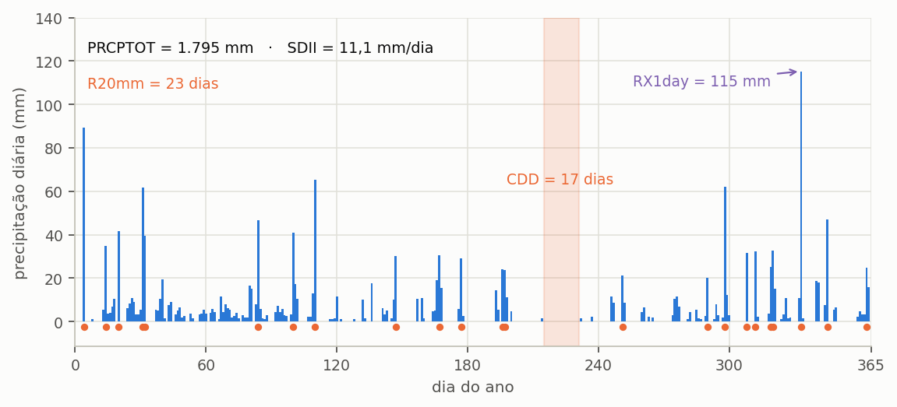

*Figura 7 — Quatro dos nove índices marcados sobre um ano da série de Lisboa: PRCPTOT e SDII, no alto; RX1day, o maior valor diário do ano; CDD, a maior sequência de dias secos, na faixa sombreada; e R20mm, os dias com 20 mm ou mais, marcados na base.*

A sazonalidade é o índice que menos se parece com os restantes, porque não descreve intensidade
nem frequência: descreve quanto a chuva do ano se concentra numa parte dele. É também o índice que
mais separa cidades com totais anuais semelhantes, e o que melhor prevê se um reservatório terá de
atravessar uma estiagem longa (Figura 8).

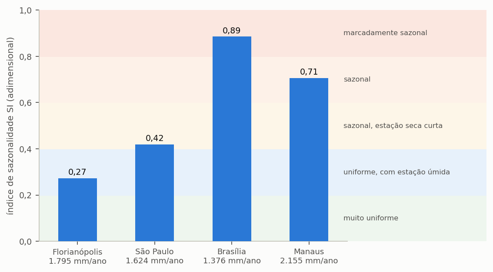

*Figura 8 — Índice de sazonalidade de Walsh e Lawler (1981) nas três cidades de exemplo (Lisboa, Porto e Funchal), com as classes do índice ao fundo e a precipitação média anual sob o nome de cada cidade. Precipitação anual elevada e distribuição uniforme ao longo do ano são propriedades independentes.*

---

### 2.4.2. Três divergências que têm de ser declaradas

O programa chama ao conjunto «ETCCDI mais sazonalidade», e a precisão da expressão importa.

**Primeira: o conjunto não é ETCCDI puro.** O índice de sazonalidade é de Walsh e Lawler, e não
pertence ao conjunto do *Expert Team on Climate Change Detection and Indices*. Em compensação, o
**R10mm**, que é ETCCDI, **não** está implementado.

Oito dos nove índices são ETCCDI; o nono não é; e falta um que seria.

**Segunda: o período de base do percentil.** O R95p exige um percentil 95 dos dias húmidos. O
ETCCDI define o período de base fixo de 1961 a 1990. O programa calcula o percentil sobre **toda a
série carregada**.

A consequência é que o R95p de duas séries de comprimentos diferentes **não é diretamente
comparável**, porque o limiar de cada uma é próprio. Para uma comparação estrita com a literatura
ETCCDI, corte a série no período de base.

O programa calcula o percentil **apenas sobre os dias húmidos**, o que está correto: incluir os
dias secos deslocaria o percentil para baixo em séries sazonais.

**Terceira: as janelas incompletas do RX5day.** A soma móvel de cinco dias usa janelas parciais no
início de cada ano, de modo que as primeiras janelas têm de um a quatro dias. O efeito é pequeno e
vai sempre no sentido de subestimar o RX5day dos primeiros dias do ano.

---

O separador de índices do programa apresenta cada indicador ano a ano: a precipitação total anual
(Figura 9) e as maiores sequências de dias secos e chuvosos
(Figura 10).

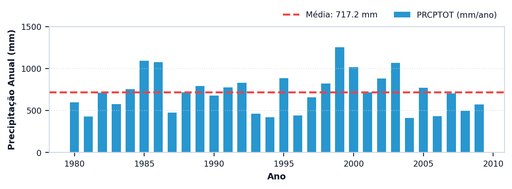

*Figura 9 — Precipitação total anual (PRCPTOT) da série de Lisboa, com a média do período a tracejado, no separador de índices. Figura gerada pelo próprio programa.*

---
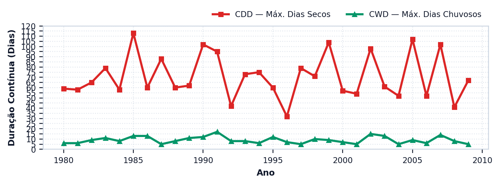

*Figura 10 — Maior sequência anual de dias secos (CDD) e de dias chuvosos (CWD) da série de Lisboa, no separador de índices. São os dois índices mais diretamente ligados ao volume de reservatório que o regime de chuva exige. Figura gerada pelo próprio programa.*

---
### 2.4.3. Para que servem no estudo

**Caracterizar a série** no método do artigo. PRCPTOT, SDII e SI descrevem o regime melhor do que
a média anual sozinha.

**Explicar o resultado.** Um CDD alto, ou um regime fortemente sazonal, explica um desempenho
inferior ao que o total anual sugere: na secção 3.1 (volume Guias de uso), Lisboa recebe chuva em 22% dos dias, o
seu mês mais chuvoso tem 47,3 vezes a chuva do mais seco, e a mesma moradia rende 17,49% com
5 000 L, contra 22,04% no Porto, onde chove em 31% dos dias e a razão entre o mês mais e o menos
chuvoso é de 9,8.

**Comparar cenários climáticos.** Entre a série histórica e a projetada, o que costuma mudar
primeiro é o SDII e o CDD, e não o PRCPTOT. Reportar só o total anual esconde a mudança que mais
afeta o sistema.

---

### 2.4.4. O que os índices não fazem

Não entram no balanço. Não alteram o dimensionamento. Não substituem a simulação diária, que é
justamente o argumento do programa contra os métodos por valores médios.

Um índice é um resumo. O balanço usa a série inteira.

---

## 2.5. Dimensionamento da ETAP

> Esta secção formaliza como o programa dimensiona a estação de tratamento de água
> pluvial (ETAP) e explica a **regra incremental**, que impede o tratamento de ser contado
> duas vezes no orçamento e no fluxo de caixa.

A água que escoa de uma cobertura transporta poeiras, folhas, partículas e dejetos de aves, e
nenhum uso — nem mesmo a alimentação de autoclismos — admite que chegue ao ponto de consumo
tal como sai do telhado. A estação de tratamento de água pluvial, abreviada como ETAP, é o
conjunto de equipamentos que realiza essa adequação, e o programa dimensiona-a a partir
de três entradas: a classe de qualidade exigida pelo uso, a área de captação e o volume
pluvial anual efetivamente consumido, este último resultante do balanço diário
apresentado na secção 2.1.

A linha de tratamento dimensionada pelo programa possui quatro componentes em série: o **descarte inicial** desvia a primeira lâmina de cada evento de precipitação, que transporta as impurezas acumuladas na cobertura; o **filtro mecânico de entrada** retém folhas e sólidos grosseiros antes que cheguem ao reservatório; a **desinfeção** é o estágio obrigatório, do qual depende a segurança microbiológica da água armazenada; e o **filtro de polimento** é opcional, destinando-se a utilizações em que a limpidez ou a ausência de resíduos dissolvidos é requerida.

---

A linha de tratamento é uma sequência, e a ordem dos estágios não é arbitrária: cada
um remove aquilo que tornaria o seguinte ineficaz. Convém ter o encadeamento inteiro à vista antes de discutir cada componente (Figura 11). A ordem não é intercambiável: desinfetar antes de filtrar consome o reagente na matéria orgânica em suspensão e deixa microrganismos protegidos no interior das partículas. A turbidez é, por isso, condição de eficácia da desinfeção, e não apenas um parâmetro estético.

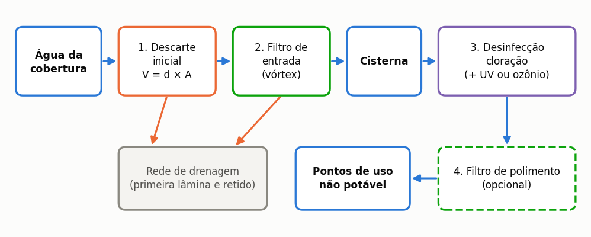

*Figura 11 — Componentes da linha de tratamento dimensionada pelo programa, na ordem do escoamento, e destino do material retido. O descarte inicial e o filtro de entrada atuam antes da cisterna; a desinfeção atua depois deles porque o reagente seria consumido pela matéria orgânica em suspensão que os estágios anteriores removem; o filtro de polimento é opcional.*

---

### 2.5.1. O filtro de entrada

O filtro de entrada é dimensionado pela área de cobertura, e não pela classe de
qualidade pretendida, porque tem de acomodar o caudal de ponta produzido pela cobertura
— grandeza independente do destino final da água. As três faixas adotadas pelo
programa correspondem às capacidades nominais que os fabricantes declaram para equipamentos
usuais de mercado (filtros mecânicos em linha e vórtex autolimpantes).

<!-- tabela: **Tabela 36** — Filtro mecânico de entrada dimensionado pela área de cobertura -->
| Cobertura | Equipamento | Malha |
| :--- | :--- | ---: |
| até 200 m² | vórtex autolimpante DN 100 | 350 µm |
| até 500 m² | vórtex autolimpante DN 150 | 400 µm |
| acima de 500 m² | cesto ou ciclónico DN 200 | 500 µm |

> Os limites de faixa acompanham a área nominal que o fabricante declara atender, e não
> uma margem arbitrária. É a razão pela qual uma cobertura de 180 m² recebe o filtro de
> DN 100: o equipamento é suficiente para até 200 m², e impor
> o escalão seguinte encareceria a instalação sem fundamento técnico.

---

### 2.5.2. A desinfeção

A desinfeção é o estágio que o programa nunca dispensa, e a razão reside no conceito de
residual desinfetante. Entre as três tecnologias disponíveis, apenas a cloração deixa na água um
agente desinfetante que permanece ativo após a passagem pelo equipamento; a radiação ultravioleta e a ozonização atuam no instante da passagem e nada deixam a jusante (Figura 12).

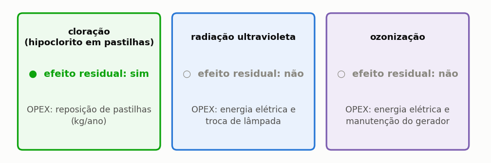

*Figura 12 — As três tecnologias de desinfeção, o efeito residual de cada uma e a composição do custeio anual (OPEX). O efeito residual distingue a cloração das restantes: protege a água armazenada na cisterna e na rede, enquanto a radiação ultravioleta e o ozono atuam apenas sobre a água que atravessa o reator.*


==A radiação ultravioleta e o ozono entram como barreira adicional à cloração, e não como
substitutos desta.== Sem residual, a água tratada volta a contaminar-se ao longo da rede
de distribuição interior, e as boas práticas de engenharia sanitária — em harmonia com a
norma EN 16941-1 e as recomendações técnicas da ANQIP (ETA 0701) — mantêm a cloração residual
livre para proteção do armazenamento e tubagens. A consequência económica é direta: as duas opções adicionais
somam o seu custo ao do cloro, e optar por qualquer uma delas não reduz o custeio operacional.

#### 2.5.2.1. A massa de cloro

O consumo de desinfetante é dimensionado pela massa de produto comercial necessária por metro
cúbico tratado, resultante da dosagem aplicada e do teor de cloro ativo do produto adquirido.

```equacao:massa_cloro:30
m_prod = ( C_Cl ÷ 1000 ) ÷ p
```

<!-- tabela: **Tabela 37** — Variáveis da Equação 30 -->
| Símbolo | Significado | Unidade |
| :--- | :--- | :--- |
| `m_prod` | massa de produto comercial consumida por metro cúbico tratado | kg/m³ |
| `C_Cl` | dose de cloro ativo aplicada à água | mg Cl₂/L |
| `1000` | conversão de miligramas por litro para quilogramas por metro cúbico | — |
| `p` | pureza do produto, em massa de cloro ativo por massa de produto | adimensional |

> **Adquire-se o produto comercial, e não o cloro puro.** As pastilhas de hipoclorito de
> cálcio contêm habitualmente cerca de 65% de cloro ativo, e o preço de mercado por quilograma refere-se
> ao produto embalado, não ao princípio ativo. Dimensionar o custo pela massa de cloro
> puro subestimaria a despesa na proporção inversa da concentração (~35%).

---

### 2.5.3. O filtro de polimento

O filtro de polimento é opcional e constitui o único ponto do dimensionamento em que a
classe de qualidade pretendida orienta a escolha do equipamento. Para utilizações mais
exigentes, o programa recomenda a sua inclusão, variando também o
meio filtrante: usos que envolvam contacto próximo exigem carvão ativado em bloco, ao passo que
usos gerais se satisfazem com filtro de areia ou cartucho de polipropileno de vinte micrómetros.

<!-- tabela: **Tabela 38** — Recomendação de filtro de polimento por classe de qualidade alvo -->
| Classe | Recomenda polimento? | Equipamento quando selecionado |
| :--- | :---: | :--- |
| 1 — Usos não potáveis gerais e autoclismos | não | filtro de areia ou cartucho de 20 µm |
| 2 — Rega e lavagem de pavimentos | sim | idem |
| 3 — Torres de arrefecimento e climatização | sim | idem |
| 4 — Lavagem de roupa | sim | **carvão ativado em bloco** |

A recomendação não é uma imposição cega: o filtro só integra o orçamento se o
utilizador o selecionar explicitamente. Quando a classe o recomenda e o utilizador não o seleciona,
o programa regista a opção no relatório técnico, garantindo a rastreabilidade da decisão.

---

### 2.5.4. O descarte de primeiras águas

O descarte de primeiras águas entra no cálculo em duas vertentes. No balanço hídrico diário,
é a lâmina subtraída à precipitação de cada dia com chuva, descrita na secção 2.1. No orçamento,
quando o dimensionamento físico do dispositivo de primeira lavagem está ativado na etapa
**3. Qualidade & ETAP**, constitui um subsistema com investimento, manutenção e pegada de carbono próprios,
composto pelo separador de folhas e pela câmara de desvio.

O volume da câmara de descarte é o produto da lâmina de desvio pela área de captação,
`V_desc = d × A`, em litros, com `d` em milímetros e `A` em metros quadrados. Para pequenos volumes,
o sistema prevê tubagem vertical de desvio com válvula de drenagem lenta; para volumes maiores,
uma câmara dedicada com boia de vedação. Na edição para Portugal, os custos de investimento e
manutenção do subsistema são parametrizáveis na interface ou adotam valores ilustrativos de referência.

<!-- tabela: **Tabela 39** — Dimensionamento do descarte inicial no projeto do tutorial -->
| Parâmetro | Valor |
| :--- | ---: |
| lâmina de descarte | 2 mm |
| área de captação | 150 m² |
| volume da câmara de descarte | 300 L |
| carbono incorporado da câmara e separador | 21,1 kg CO₂e |

O investimento do subsistema integra o orçamento da linha de tratamento e entra no
fluxo de caixa através da regra incremental apresentada a seguir.

---

### 2.5.5. A regra incremental

A regra incremental impede o erro frequente de duplicar parcelas de tratamento no orçamento
e no custeio operacional. Aplica-se em três níveis distintos:

**No investimento inicial.** O orçamento global de um sistema de aproveitamento de águas pluviais
já inclui habitualmente uma verba preliminar de filtragem e acessórios. Somar o custo da linha de
tratamento detalhada sem abater essa verba duplicaria a despesa. O programa calcula apenas o acréscimo:

```equacao:capex_etap:31
CAPEX_inc = CAPEX_linha − V_gen
```

<!-- tabela: **Tabela 40** — Variáveis da Equação 31 -->
| Símbolo | Significado | Unidade |
| :--- | :--- | :--- |
| `CAPEX_inc` | investimento incremental da linha de tratamento | € |
| `CAPEX_linha` | custo total dos equipamentos da linha dimensionada | € |
| `V_gen` | verba genérica de tratamento já incluída na rubrica de acessórios | € |

**No custeio anual.** O consumo de cloro já é contabilizado na linha de reagentes operacionais
do fluxo de caixa. O custeio incremental da ETAP deduz essa parcela para que o produto químico não seja
orçado duas vezes.

**Na avaliação de ciclo de vida.** A linha de tratamento detalhada **substitui** o termo expedito
de cloração, assegurando que o inventário de materiais reflita a configuração física exata sem sobreposições.

---

### 2.5.6. Desativação da ETAP

O dimensionamento da linha de tratamento pode ser desligado na interface. Nesse caso,
nem o investimento nem os custos operacionais da ETAP incidem sobre a análise económica.
Essa opção destina-se a estudos em que a edificação já dispõe de tratamento pré-existente
ou em que se pretende isolar o custo hidráulico do armazenamento. Desativá-la no programa
não significa que a água pluvial dispense tratamento sanitário: significa unicamente que o tratamento
não está a ser imputado a este orçamento.

---

### 2.5.7. Limites do dimensionamento

O dimensionamento automático do programa concentra-se nos equipamentos funcionais da linha.
Ficam sob responsabilidade do projetista: o traçado detalhado da tubagem de ligação e drenagem,
a verificação rigorosa das perdas de carga localizadas no circuito de tratamento, o plano
sistemático de manutenção preventiva (limpeza periódica de malhas, desobstrução de vórtex e calibração de dosadores)
e a monitorização analítica laboratorial da qualidade da água, conforme estipulado pela regulamentação
técnica e sanitária em vigor.

---

## 2.6. Energia de bombagem

> Esta secção formaliza a cadeia energética completa do eixo à tomada elétrica e explica por que a
> potência nominal de placa **não** é o valor medido pelo contador de energia.

Três versões deste modelo existiram ao longo da evolução do programa, e as versões preliminares
cometiam os enganos descritos no item «Por que a cadeia completa importa»: tomar a potência mecânica
de placa como consumo elétrico e descontar o rendimento da bomba duas vezes. Quem consulta estudos
elaborados em versões antigas necessita de ter presente esta distinção.

---

### 2.6.1. A potência de placa é a potência de eixo

As normas de motores elétricos (norma internacional IEC 60034-30-1 e norma europeia EN 60034-1)
estipulam que o **rendimento** venha expressamente indicado na placa de identificação do motor,
como grandeza distinta da potência nominal. Esta distinção reflete o facto físico de a potência
de placa representar a potência mecânica disponível **no veio (eixo)**.

A cadeia de bombagem integra, por conseguinte, dois rendimentos complementares:

<!-- tabela: **Tabela 41** — Os dois rendimentos da cadeia de bombeamento e o que cada um converte -->
| Rendimento | Conversão efetuada |
| :--- | :--- |
| **da bomba**, `η_b` | potência mecânica no veio em potência hidráulica transmitida ao fluido |
| **do motor elétrico**, `η_m` | potência elétrica absorvida da rede em potência mecânica no veio |

O programa solicita ambos os parâmetros em campos diferenciados.

---

### 2.6.2. As equações de cálculo

**Consumo específico de energia na elevação**, por metro cúbico bombeado:

```equacao:energia_especifica:32
e = ( ρ × g × H ) ÷ ( η_b × η_m )
```

<!-- tabela: **Tabela 42** — Variáveis da Equação 32 -->
| Símbolo | Significado | Unidade |
| :--- | :--- | :--- |
| `e` | consumo específico de energia por volume elevado | kWh/m³ |
| `ρ` | massa volúmica da água, adotada como 1.000 | kg/m³ |
| `g` | aceleração da gravidade, adotada como 9,81 | m/s² |
| `H` | altura manométrica total da instalação | m c.a. |
| `η_b` | rendimento hidráulico da bomba | adimensional |
| `η_m` | rendimento do motor elétrico | adimensional |

==A Equação 32 é independente do caudal de serviço e da potência instalada.==
Elevar um metro cúbico de água a uma dada altura manométrica requer a mesma quantidade de energia
teórica quer se utilize um grupo elevatório pequeno ou sobredimensionado; a variação na potência
determina o tempo necessário para completar a bombagem, não o consumo específico do processo.

**Quando o caudal de funcionamento é expressamente declarado:**

```equacao:energia_por_vazao:33
e = P ÷ ( Q × η_m )
```

<!-- tabela: **Tabela 43** — Variáveis da Equação 33 -->
| Símbolo | Significado | Unidade |
| :--- | :--- | :--- |
| `e` | consumo específico de energia por volume elevado | kWh/m³ |
| `P` | potência de placa da eletrobomba, medida no veio | kW |
| `Q` | caudal de bombagem introduzido ou deduzido | m³/h |
| `η_m` | rendimento do motor elétrico | adimensional |

O rendimento da bomba hidráulica não surge na Equação 33 porque
já está implicitamente refletido no facto de um veio com potência `P` permitir fornecer o caudal `Q`
à altura manométrica considerada. Dividir novamente por `η_b` duplicaria as perdas hidráulicas.

**Caudal deduzido, quando não declarado:**

```equacao:vazao_deduzida:34
Q = ( P × η_b ) ÷ ( ρ × g × H )
```

<!-- tabela: **Tabela 44** — Variáveis da Equação 34 -->
| Símbolo | Significado | Unidade |
| :--- | :--- | :--- |
| `Q` | caudal de bombagem deduzido | m³/h |
| `P` | potência de placa do grupo elevatório | kW |
| `η_b` | rendimento hidráulico da bomba | adimensional |
| `ρ` | massa volúmica da água (1.000) | kg/m³ |
| `g` | aceleração da gravidade (9,81) | m/s² |
| `H` | altura manométrica total | m c.a. |

**Energia consumida nos arranques:**

```equacao:energia_partida:35
E_part = ( P × t_part ) ÷ η_m
```

<!-- tabela: **Tabela 45** — Variáveis da Equação 35 -->
| Símbolo | Significado | Unidade |
| :--- | :--- | :--- |
| `E_part` | energia consumida nos arranques acumulados do período | kWh |
| `P` | potência nominal no veio | kW |
| `t_part` | tempo acumulado de arranque transitório no período | h |
| `η_m` | rendimento do motor elétrico | adimensional |

O rendimento da bomba hidráulica não intervém na Equação 35 pelo facto
de durante o curto intervalo de arranque não existir débito útil estável, correspondendo
a energia consumida ao regime de transição do motor elétrico.

A energia elétrica anual total consumida pelo grupo de bombagem corresponde à soma do
consumo do volume efetivamente transferido com o dispêndio dos ciclos de arranque:

```equacao:energia_anual:36
E_ano = e × V_rec + ( P × t_part ) ÷ η_m
```

<!-- tabela: **Tabela 46** — Variáveis da Equação 36 -->
| Símbolo | Significado | Unidade |
| :--- | :--- | :--- |
| `E_ano` | energia elétrica anual consumida pela eletrobomba | kWh/ano |
| `e` | consumo específico de energia | kWh/m³ |
| `V_rec` | volume anual bombeado para o reservatório superior | m³/ano |
| `P` | potência nominal no veio | kW |
| `t_part` | tempo acumulado de arranques durante o ano | h/ano |
| `η_m` | rendimento do motor elétrico | adimensional |

---

A potência de placa de uma eletrobomba expressa a potência mecânica no veio, e não o consumo elétrico
registado no contador (Figura 13). A título de exemplo, uma eletrobomba de 0,37 kW (0,5 cv)
com motor elétrico de rendimento 60,5% absorve da rede cerca de 0,61 kW: calcular a despesa energética
apenas com a potência de placa subestimaria o consumo em cerca de 40%, distorcendo a análise económica.


*Figura 13 — Cadeia energética da bombagem predial. A potência nominal indicada na placa é a potência no veio, posicionada no centro da cadeia: entre esta e o contador elétrico situa-se o rendimento do motor (η_m); entre o veio e a potência hidráulica útil entregue à água situa-se o rendimento da bomba (η_b).*

A potência hidráulica necessária é determinada pela altura manométrica total, que combina
o desnível geométrico real com as perdas de carga contínuas e singulares da instalação (Figura 14).
As perdas de carga contínuas na tubagem são calculadas pela formulação universal de Darcy-Weisbach
(`h_f = f · (L/D) · v²/2g`), e as perdas localizadas em válvulas, curvas e uniões pela equação
geral `h_loc = K · v²/2g`. Em circuitos prediais habituais de elevação, as perdas somam tipicamente entre 10% e 30% do desnível geométrico.

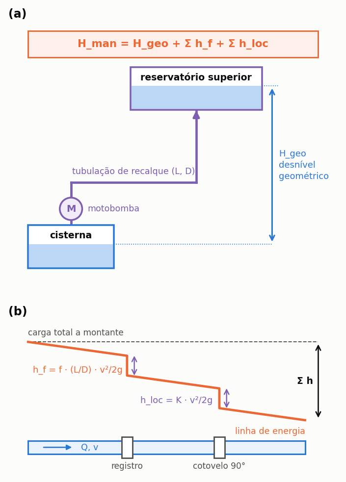

*Figura 14 — (a) Altura manométrica de um sistema elevatório predial: desnível geométrico entre os níveis da cisterna e do reservatório superior somado às perdas de carga totais; (b) linha piezométrica ao longo de um troço de tubagem com perda de carga contínua por atrito e singularidades localizadas.*

---

### 2.6.3. O rendimento do motor elétrico

Caso o utilizador não especifique o rendimento no projeto, o programa adota valores de
referência baseados na classe de eficiência standard (IE1) da IEC 60034-30-1 para pequenos
motores de indução monofásicos de dois polos (~2.900 rpm / 50 Hz em Portugal) (Figura 15):


*Figura 15 — Rendimento indicativo de motores de indução por escalão de potência e classe de eficiência. O programa adota valores conservadores da classe standard quando o utilizador não insere dados específicos da ficha técnica.*

Os dois valores mais frequentes em instalações residenciais são 0,5 cv (0,37 kW),
com cerca de **60,5%** de rendimento standard, e 1,0 cv (0,75 kW), com cerca de **69,3%**.
A diferença de quase nove pontos percentuais repercute-se de modo direto no custeio energético.

---

### 2.6.4. Por que a cadeia completa importa

O consumo específico do sistema do tutorial (0,5 cv, 12 m c.a. de altura manométrica,
com reservatório superior) situa-se em torno de 0,11 kWh/m³. Descurar o rendimento
do motor ou descontar indevidamente o rendimento da bomba altera esse resultado em dezenas de pontos percentuais.

A formulação transparente adotada pelo programa visa exatamente evidenciar cada elo
físico da conversão de energia, permitindo auditorias técnicas consistentes.

---

### 2.6.5. O assistente de dimensionamento de eletrobombas

Quando o utilizador não dispõe das especificações exatas de catálogo da eletrobomba,
o botão *Assistente de Dimensionamento de Eletrobomba* (na etapa **4. Reservatório & Custos**)
permite estimar os parâmetros a partir dos dados do edifício:

1. **Caudal de elevação.** `Q = V_sup ÷ t_ench`, considerando o volume do reservatório superior e o tempo de enchimento de referência (habitualmente 45 minutos).
2. **Diâmetro económico.** Estimado por formulações hidráulicas usuais para regimes descontínuos em tubagem de polietileno de alta densidade (PEAD) ou PVC.
3. **Velocidade de escoamento.** Mantida na faixa de boa prática técnica (entre 0,6 m/s e 2,0 m/s).
4. **Perdas de carga.** Estimadas com base no comprimento do traçado e acessórios da instalação.
5. **Altura manométrica e potência.** Determinação do ponto de funcionamento de projeto `(Q, H_man)`.
6. **Seleção de equipamento.** Cruzamento do ponto de funcionamento com curvas de modelos comerciais integrados.

---

### 2.6.6. Pressurização hidropneumática direta

Nos sistemas sem reservatório superior, em que a distribuição não potável é efetuada
por bombagem direta com grupo sobrepressor hidropneumático, o ciclo de funcionamento difere
substancialmente. A bomba arranca em cada abertura de torneira ou descarga de autoclismo,
sendo o caudal limitado pelo ponto de utilização e não pela capacidade máxima do equipamento.

O programa calcula o consumo da pressurização direta considerando o tempo efetivo de funcionamento:

```equacao:energia_pressurizador:37
E = (P ÷ η_m) · [V ÷ min(Q_b(H), Q_p) + N · t_r]
```

<!-- tabela: **Tabela 47** — Variáveis da Equação 37 -->
| Símbolo | Significado | Unidade |
| :--- | :--- | :--- |
| `E` | energia elétrica anual do sobrepressor | kWh/ano |
| `P` | potência nominal no veio | kW |
| `η_m` | rendimento do motor elétrico | adimensional |
| `V` | volume pluvial consumido no ano | m³/ano |
| `Q_b(H)` | caudal fornecido pela bomba à pressão de serviço `H` | m³/h |
| `Q_p` | caudal do dispositivo de utilização | m³/h |
| `N` | número anual de acionamentos | 1/ano |
| `t_r` | tempo de pós-circulação / retardo eletrónico de desligamento | h |

<!-- tabela: **Tabela 48** — Energia anual de seis sobrepressores genéricos (curvas ilustrativas, sem marca) na pressurização direta do tutorial, com o caudal do autoclismo a limitar o caudal da bomba -->
| Modelo | Comando | Caudal da curva a 18 m de altura manométrica | Horas por ano | kWh por ano | kWh/m³ | kWh por ano a 24 m |
| :--- | :--- | ---: | ---: | ---: | ---: | ---: |
| Modelo A, 0,25 cv | pressostato | 10,1 L/min | 71 | 26,1 | 0,68 | 163,1 |
| Modelo B, 0,33 cv | fluxostato | 18,0 L/min | 71 | 31,4 | 0,82 | não atinge |
| Modelo C, 0,5 cv | pressostato | 27,5 L/min | 71 | 43,1 | 1,13 | 43,1 |
| Modelo D, 0,5 cv | pressostato | 26,0 L/min | 71 | 43,1 | 1,13 | 43,1 |
| Modelo F, 0,5 cv | eletrónico | 12,8 L/min | 71 | 43,1 | 1,13 | não atinge |
| Modelo E, 0,5 cv | eletrónico | 7,0 L/min | 112 | 67,9 | 1,77 | não atinge |

A comparação dos regimes evidencia que a pressurização hidropneumática direta consome
significativamente mais energia por metro cúbico fornecido do que a elevação pontual para
um reservatório superior por gravidade. Embora o custo financeiro absoluto da eletricidade
possa ser reduzido em moradias unifamiliares, a energia operacional constitui uma parcela
relevante na pegada ecológica do ciclo de vida analisada na secção 2.8.

---

## 2.7. Análise económica e regimes tarifários

> Esta secção formaliza o modelo de fluxo de caixa e detalha os regimes
> tarifários — o fator determinante na viabilidade económico-financeira de um sistema de aproveitamento de águas pluviais.

---

### 2.7.1. A poupança resulta da diferença entre duas faturas reais

O programa não calcula a poupança financeira multiplicando simplesmente o volume pluvial
poupado por uma tarifa unitária média. Essa distinção é crítica: para cada mês do horizonte
de projeto, o programa simula duas faturas completas — uma correspondente ao consumo total
que a edificação teria sem o sistema pluvial e outra associada à água potável da rede pública
efetivamente adquirida —, apurando a poupança através da diferença entre ambas.

```equacao:economia_mensal:38
E_mês = F(V_tot) − F(V_pot)
```

<!-- tabela: **Tabela 49** — Variáveis da Equação 38 -->
| Símbolo | Significado | Unidade |
| :--- | :--- | :--- |
| `E_mês` | poupança mensal obtida | € |
| `F(·)` | função de cálculo da fatura (água, saneamento e taxas) para um dado volume | € |
| `V_tot` | consumo mensal total que a edificação teria sem o sistema | m³ |
| `V_pot` | volume mensal de água potável adquirido da rede | m³ |

A razão desta metodologia assenta na estrutura progressiva por escalões e na existência
de componentes fixas nos tarifários. ==O metro cúbico poupado abate sempre nos escalões superiores de consumo, que são os mais onerosos por unidade de volume.== No tutorial de Lisboa, a fatura mensal desce de 46,25 € para 35,06 €, gerando uma poupança mensal de 11,19 €. Utilizar uma tarifa média linear induziria distorções significativas nos resultados.

---

### 2.7.2. A fatura dos serviços de águas

A estrutura tarifária dos serviços municipais de água e águas residuais é representada no
programa por uma sequência de patamares, em que cada patamar associa intervalos de volume,
preços e regras específicas de faturação.

A fatura mensal engloba parcelas de natureza distinta: uma tarifa fixa (quota de serviço),
que remunera a disponibilidade das infraestruturas e não varia com o consumo; os escalões
variáveis de consumo de água potável; e as tarifas de saneamento (águas residuais) e gestão de
resíduos associadas. A poupança gerada pela água pluvial incide de forma assimétrica sobre essas parcelas, tal como ilustrado na Figura 16.

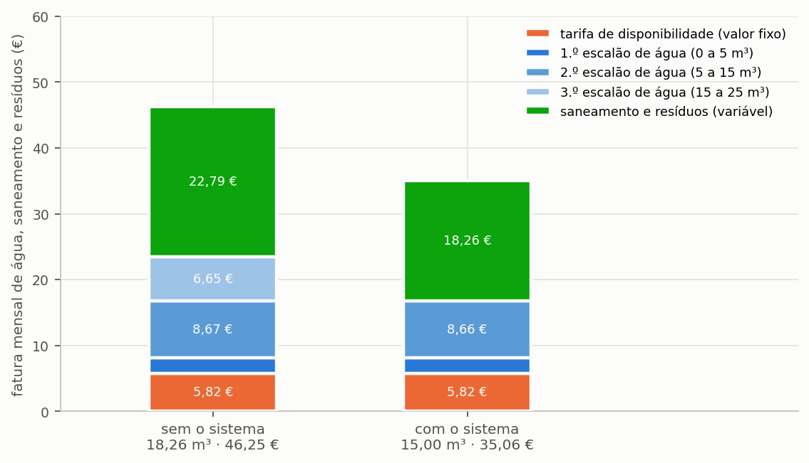

*Figura 16 — Fatura mensal de água e saneamento do projeto do tutorial, discriminada por parcelas, com e sem o sistema pluvial. A quota de serviço fixa permanece invariável; a redução financeira reflete-se nos escalões superiores de consumo volumétrico e na redução proporcional da tarifa variável de saneamento.*

O código associado a cada escalão no programa determina a sua aplicação no cálculo (Figura 17):
os códigos 1 ou 0 correspondem a escalões de consumo volumétrico; o código −1 representa a quota fixa de serviço
(tarifa de disponibilidade); o código −2 representa franquias retroativas; o código −3 define pisos mínimos de faturação;
e os códigos 2 e 3 correspondem a regimes de progressividade analítica.

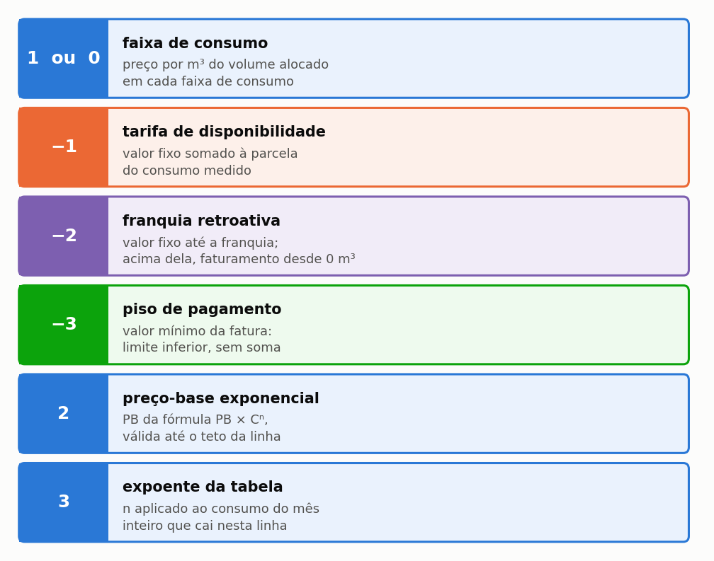

*Figura 17 — Os códigos de escalão tarifário e o respetivo impacto na faturação mensal. Estruturas com valores numéricos similares podem gerar resultados divergentes consoante a formulação regulamentar de cada escalão.*

#### 2.7.2.1. Saneamento e taxas proporcionais

```equacao:esgoto:39
T_esg = T_agua × s
```

<!-- tabela: **Tabela 50** — Variáveis da Equação 39 -->
| Símbolo | Significado | Unidade |
| :--- | :--- | :--- |
| `T_esg` | parcela de saneamento/águas residuais indexada | € |
| `T_agua` | parcela variável de consumo de água potável | € |
| `s` | rácio proporcional ou percentual regulamentar de saneamento | adimensional |

Quando o serviço de saneamento é cobrado em percentagem do valor da água ou por tarifa volumétrica proporcional aos metros cúbicos medidos, cada metro cúbico pluvial consumido gera benefício duplo: reduz a fatura do abastecimento e reduz a fatura do saneamento.

---

### 2.7.3. Os seis regimes tarifários suportados

O motor de cálculo suporta seis modalidades fundamentais de tarifação, detalhadas na secção 3.3 (volume Guias de uso) (Figura 18):

<!-- tabela: **Tabela 51** — Codificação dos regimes tarifários -->
| Regime | Descrição no programa | Aplicação matemática | Impacto da poupança de água |
| :--- | :--- | :--- | :--- |
| sem mínimo | escalões de consumo simples | soma volumétrica por escalão | cada metro cúbico poupado reduz a fatura |
| quota fixa (disponibilidade) | quota fixa (−1) mais escalões | valor fixo somado ao consumo | o consumo reduz-se; a quota fixa mantém-se |
| franquia no mínimo | quota fixa (−1) com 1.º escalão nulo | franquia incluída na tarifa base | poupar dentro da franquia não reduz a fatura |
| franquia retroativa | franquia comutativa (−2) | consumo acima cobra desde 0 m³ | baixar da franquia reduz abruptamente a fatura |
| piso de pagamento | limite inferior garantido (−3) | fatura limitada por um mínimo | reduções abaixo do piso não geram poupança |
| fórmula progressiva | base polinomial/exponencial | progressividade contínua | redução diferenciada pelo nível de consumo |

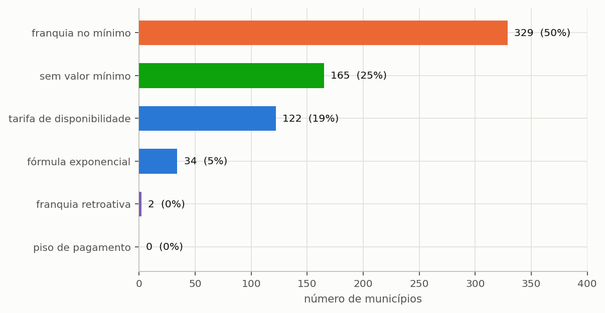

*Figura 18 — Caracterização conceptual dos regimes tarifários suportados pelo motor de cálculo.*

---

### 2.7.4. Investimento inicial (CAPEX)

O investimento inicial do sistema resulta do somatório das rubricas orçamentais da instalação:

```equacao:capex:40
CAPEX = C_cist + C_sup + C_mo + C_tub + C_ace + ( C_bomba × n_b ) + CAPEX_inc
```

<!-- tabela: **Tabela 52** — Variáveis da Equação 40 -->
| Símbolo | Significado | Unidade |
| :--- | :--- | :--- |
| `CAPEX` | investimento inicial total do sistema | € |
| `C_cist` | custo do reservatório inferior (cisterna) | € |
| `C_sup` | custo do reservatório superior (quando existente) | € |
| `C_mo` | custo de mão de obra e montagem | € |
| `C_tub` | custo das tubagens e conexões | € |
| `C_ace` | acessórios, válvulas, quadro e cablagens | € |
| `C_bomba` | custo unitário da eletrobomba | € |
| `n_b` | número de eletrobombas instaladas (serviço e reserva) | unidade |
| `CAPEX_inc` | investimento incremental da linha de tratamento (ETAP) | € |

Nesta edição, as rubricas do CAPEX partem de zero e são introduzidas pelo utilizador: o programa não traz preços de Portugal nem de Espanha. A secção 4.7 (volume Tutorial), em «O CAPEX nesta edição», descreve o estado verdadeiro, como introduzir os valores e o que está apenas planeado.

No caso de estudo do tutorial (Lisboa, cisterna de 5.000 L em polietileno com reservatório superior de 1.000 L), o investimento total ilustrativo ascende a 6.650 €. A Figura 19 apresenta a decomposição orçamental por componente.

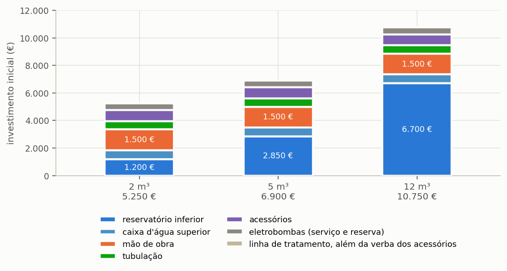

*Figura 19 — Estrutura do investimento inicial por componente para diferentes capacidades de reservatório. Em volumes domésticos moderados, a tubagem, mão de obra e acessórios representam uma fração significativa do custo total.*

---

### 2.7.5. Custeio operacional anual (OPEX)

O custeio operacional anual agrega:
1. A energia elétrica consumida pelas eletrobombas (secção 2.6).
2. O consumo de reagentes desinfetantes (cloração).
3. A manutenção periódica da ETAP e do dispositivo de primeiras águas.
4. Outros custos operacionais declarados pelo utilizador.

Num projeto novo, nenhum destes custos vem preenchido: os preços partem de zero, e as rotinas de manutenção existem só como roteiro. A secção 4.7 (volume Tutorial), em «O que entra no custo de exploração (OPEX)», diz o que é calculado sozinho (as quantidades), o que é do utilizador (os preços) e o que está planeado e não implementado. O campo de custo anual do resumo não inclui as rotinas de manutenção.

---

### 2.7.6. Projeção temporal do fluxo de caixa

A projeção económica é calculada mês a mês ao longo do período de vida útil analisado (habitualmente 20 anos), atualizando os custos operacionais pela inflação e as faturas pelas taxas de atualização tarifária:

```equacao:inflacao:41
f_inf = ( 1 + i )^( m − 1 )
```

```equacao:reajuste:42
f_j = ( 1 + r_j )^k
```

<!-- tabela: **Tabela 53** — Variáveis da Equação 42 -->
| Símbolo | Significado | Unidade |
| :--- | :--- | :--- |
| `f_inf` | fator acumulado de inflação no mês `m` | adimensional |
| `i` | taxa de inflação mensal estimada | adimensional |
| `f_j` | fator de atualização tarifária acumulado no período | adimensional |
| `r_j` | taxa de atualização tarifária anual | adimensional |
| `k` | número de anos decorridos até ao mês de cálculo | adimensional |

A Figura 20 sintetiza o fluxo de caixa acumulado ao longo do horizonte temporal.

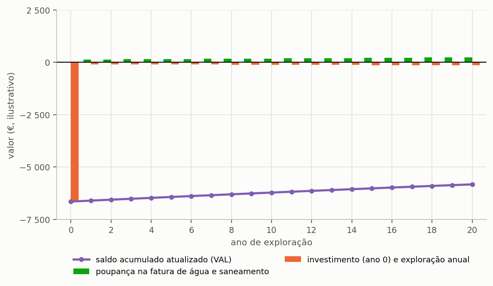

*Figura 20 — Projeção do fluxo de caixa acumulado do projeto do tutorial ao longo de 20 anos, demonstrando o comportamento do investimento inicial face à poupança anual na fatura.*

---

### 2.7.7. Indicadores de rentabilidade

**Valor Atual Líquido (VAL):**

```equacao:vpl:43
VPL = − CAPEX + Σ [ FC_m ÷ ( 1 + TMA )^m ]
```

<!-- tabela: **Tabela 54** — Variáveis da Equação 43 -->
| Símbolo | Significado | Unidade |
| :--- | :--- | :--- |
| `VPL` | valor atual líquido do investimento (VAL) | € |
| `CAPEX` | investimento inicial total | € |
| `FC_m` | fluxo de caixa líquido verificado no mês `m` | € |
| `TMA` | taxa de atualização mensal de referência | adimensional |
| `m` | índice mensal de 1 até ao horizonte de cálculo | mês |

**Taxa Interna de Rentabilidade (TIR):** taxa que anula o VAL da série financeira. Caso o investimento não seja amortizável dentro do horizonte, o programa assinala a ausência de solução real.

**Período de recuperação do investimento (Payback):** mês em que o saldo acumulado descontado cruza o valor zero. No tutorial de Lisboa, aos custos de referência ilustrativos (6.650 € de investimento para uma poupança anual de cerca de 134 €), o VAL obtido é de −5.828,77 €, não existindo período de amortização no horizonte de 20 anos. Este resultado ilustra com clareza que, em climas com verão seco e tarifários moderados, o aproveitamento pluvial deve ser equacionado sob a perspetiva de resiliência e sustentabilidade ambiental, e não apenas de retorno financeiro imediato.

---

## 2.8. Avaliação de ciclo de vida e pegada de carbono

> Esta secção descreve as etapas do inventário ambiental, a fronteira do sistema adotada e
> explicita as premissas de triagem da pegada de carbono.

A avaliação de ciclo de vida (ACV) contabiliza os impactes ambientais de um produto ou
sistema ao longo do seu ciclo existencial, desde a extração das matérias-primas até ao descarte
ou reciclagem. Aplicada a um sistema de aproveitamento de águas pluviais, permite verificar
se as emissões de gases com efeito de estufa associadas ao fabrico e montagem dos reservatórios,
tubagens e eletrobombas são efetivamente compensadas pelas emissões evitadas ao prescindir do
fornecimento convencional de água potável da rede pública.

==A avaliação integrada no programa é uma ACV de triagem (*screening*), e não um estudo exaustivo de conformidade normativa.==
A sua finalidade é ordenar alternativas de dimensionamento (por exemplo, comparar o polietileno com o betão armado)
e identificar os processos dominantes, permitindo escolhas técnicas informadas em fase de projeto.

---

### 2.8.1. Estrutura da ACV segundo as normas internacionais

Em conformidade com a NP EN ISO 14040 e a NP EN ISO 14044, a avaliação estrutura-se em quatro fases:

1. **Definição do objetivo e âmbito.** Estabelece a finalidade do estudo, as fronteiras do sistema e a **unidade funcional**. A unidade funcional de referência no programa é o sistema completo concebido para responder às necessidades de um dado edifício ao longo da sua vida útil de projeto (tipicamente 20 anos), comparado com o abastecimento pela rede pública.
2. **Análise de inventário (ICV).** Quantifica os fluxos de matéria e energia: massa de componentes fabricados, consumo de eletricidade na bombagem, produtos químicos de desinfeção e volume de água potável evitado.
3. **Avaliação do impacte.** Converte os fluxos do inventário em indicadores ambientais. O programa calcula a categoria das **alterações climáticas**, expressa em quilogramas de dióxido de carbono equivalente (kg CO₂e), através dos fatores de emissão documentados no apêndice C.
4. **Interpretação dos resultados.** Analisa a robustez dos resultados e a sensibilidade do balanço de emissões face ao material do reservatório e à intensidade carbónica da rede elétrica.

---

### 2.8.2. Módulos do ciclo de vida segundo a norma EN 15978

Para instalações no setor da construção, a norma europeia EN 15978 define a partição temporal do ciclo de vida:

<!-- tabela: **Tabela 55** — Módulos do ciclo de vida da EN 15978 e o que a avaliação do programa cobre em cada um -->
| Módulo | Etapa do ciclo de vida | Cobertura pelo programa |
| :--- | :--- | :--- |
| A1 a A3 | Fabrico: extração de matérias-primas, transporte à fábrica e produção | Sim: reservatórios, tubagens, eletrobombas, descarte inicial e acessórios |
| A4 e A5 | Construção: transporte até à obra e instalação no edifício | Não considerado (a escavação e movimentação de terras não estão incluídas) |
| B1 a B5 | Uso, manutenção, reparação e substituição de componentes | Não considerado |
| B6 | Consumo de energia operacional | Sim: eletricidade consumida na bombagem |
| B7 | Consumo de água operacional | Sim: crédito ambiental da água potável evitada e reagentes da ETAP |
| C1 a C4 | Fim de vida: demolição, transporte, valorização e deposição final | Não considerado |
| D | Benefícios e encargos potenciais para além da fronteira (reciclagem) | Não considerado |

A fronteira de análise do programa classifica-se, assim, como **do berço ao portão da fábrica somada à fase de exploração (*cradle-to-gate with operational stage*)**.

---

### 2.8.3. As sete etapas do inventário de emissões

O inventário de emissões do programa reparte-se em sete parcelas funcionais (Figura 21):

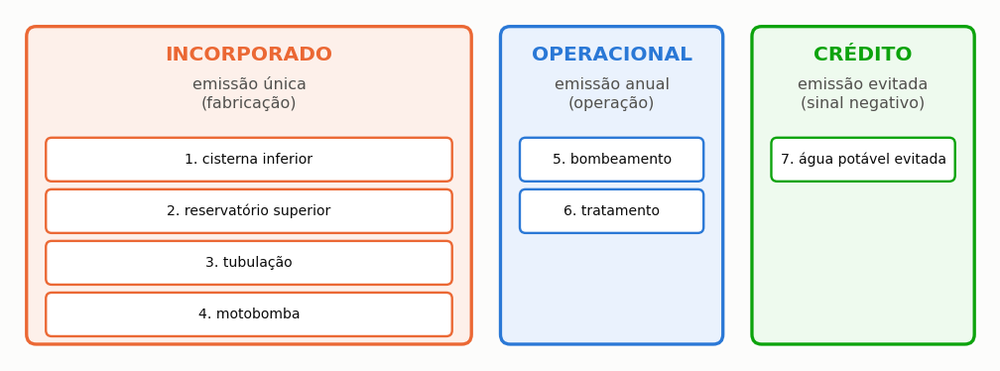

*Figura 21 — As sete componentes do inventário de ciclo de vida do programa: as quatro primeiras correspondem ao carbono incorporado nos materiais; as duas seguintes às emissões operacionais anuais; e a sétima ao crédito ambiental anual pela água evitada (único termo dedutivo).*

---

### 2.8.4. Carbono incorporado nos materiais

```equacao:emissao_componente:44
E_comp = m_comp × FE_mat
```

<!-- tabela: **Tabela 56** — Variáveis da Equação 44 -->
| Símbolo | Significado | Unidade |
| :--- | :--- | :--- |
| `E_comp` | emissão de carbono incorporado no componente | kg CO₂e |
| `m_comp` | massa estimada do componente | kg |
| `FE_mat` | fator de emissão do material (*cradle-to-gate*) | kg CO₂e/kg |

<!-- tabela: **Tabela 57** — Massa por metro cúbico útil de cada material de reservatório -->
| Material | Massa indicativa por m³ útil | Massa para 5 m³ |
| :--- | ---: | ---: |
| Polietileno de alta densidade (PEAD) | 22 kg/m³ | 110 kg |
| Fibra de vidro (PRFV) | 15 kg/m³ | 75 kg |
| Aço inoxidável | 38 kg/m³ | 190 kg |
| Betão armado | 1.200 kg/m³ | 6.000 kg |

> **A massa condiciona o balanço de carbono.** O betão armado é o material mais massivo da lista. Em sistemas de pequena escala, um reservatório de betão de capacidade excessiva pode acumular uma dívida carbónica que não chega a ser amortizada ao longo dos 20 anos de vida útil do projeto.

#### 2.8.4.1. Inventário do projeto do tutorial

A tabela seguinte ilustra a repartição das emissões para o caso de estudo do tutorial (Lisboa, cisterna de 5.000 L em polietileno com reservatório superior de 1.000 L):

<!-- tabela: **Tabela 58** — Inventário de carbono do projeto final do tutorial, item a item, com a parcela de cada componente no carbono incorporado; os valores anuais negativos são créditos (fatores da rede e da água ilustrativos, não são valores medidos) -->
| Item | Incorporado | Parcela do incorporado | Anual |
| :--- | ---: | ---: | ---: |
| cisterna de 5 000 L, polietileno | 177,3 kg | 48,9% | — |
| reservatório superior de 1 000 L, polietileno | 35,5 kg | 9,8% | — |
| tubagem de PVC, DN 100 mm | 55,5 kg | 15,3% | — |
| tubagem de PVC, DN 32 mm | 3,5 kg | 1,0% | — |
| tubagem de PVC, DN 25 mm | 8,9 kg | 2,5% | — |
| duas eletrobombas de 0,5 cv | 61,0 kg | 16,8% | — |
| descarte das primeiras águas: reservatório de 300 L e separador de folhas | 21,1 kg | 5,8% | — |
| energia de elevação | — | — | 2,05 kg/ano |
| cloragem por pastilhas | — | — | 0,16 kg/ano |
| água da rede evitada | — | — | −19,59 kg/ano |
| **total** | **362,9 kg** | **100%** | **−17,38 kg/ano** |

---

### 2.8.5. Emissões operacionais e crédito ambiental

**Bombagem:**

```equacao:emissao_energia:45
E_ener = C_ano × FE_rede
```

<!-- tabela: **Tabela 59** — Variáveis da Equação 45 -->
| Símbolo | Significado | Unidade |
| :--- | :--- | :--- |
| `E_ener` | emissões anuais associadas à energia de bombagem | kg CO₂e/ano |
| `C_ano` | consumo anual de eletricidade da instalação | kWh/ano |
| `FE_rede` | fator de emissão da rede elétrica | kg CO₂e/kWh |

No estudo do tutorial, adotam-se fatores ilustrativos consistentes de referência (0,40 kg CO₂e/kWh para a rede e 0,50 kg CO₂e/m³ para a água potável evitada).

---

### 2.8.6. Fronteiras e processos excluídos

A Figura 22 sintetiza os limites da análise ambiental efetuada pelo programa:

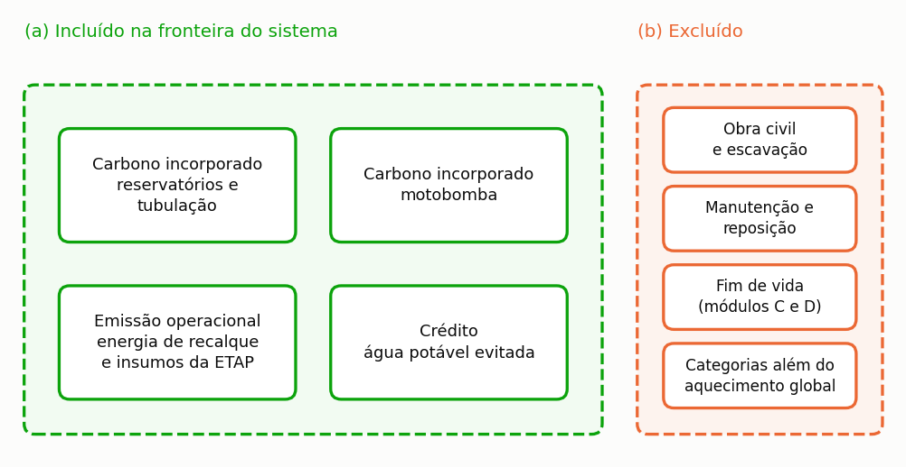

*Figura 22 — Delimitação da fronteira da avaliação ambiental: (a) processos incluídos — carbono incorporado dos reservatórios, tubagens e eletrobombas, emissões elétricas operacionais, produtos de tratamento e crédito da água potável poupada; (b) processos excluídos — movimentos de terras em obra civil, manutenção corretiva, fim de vida e outras categorias de impacte.*

---

### 2.8.7. Indicadores de desempenho ambiental

**Saldo líquido anual:**

```equacao:saldo_liquido:46
E_liq = E_evit − E_ener − E_trat
```

<!-- tabela: **Tabela 60** — Variáveis da Equação 46 -->
| Símbolo | Significado | Unidade |
| :--- | :--- | :--- |
| `E_liq` | saldo líquido anual de emissões evitadas | kg CO₂e/ano |
| `E_evit` | emissão evitada pela água potável substituída | kg CO₂e/ano |
| `E_ener` | emissão associada ao consumo elétrico da bombagem | kg CO₂e/ano |
| `E_trat` | emissões devidas aos consumíveis de tratamento | kg CO₂e/ano |

**Período de recuperação carbónica (Payback ambiental):**

```equacao:payback_carbono:47
PB_amb = E_inc ÷ E_liq
```

<!-- tabela: **Tabela 61** — Variáveis da Equação 47 -->
| Símbolo | Significado | Unidade |
| :--- | :--- | :--- |
| `PB_amb` | período de recuperação ambiental do sistema | ano |
| `E_inc` | carbono incorporado total no fabrico dos componentes | kg CO₂e |
| `E_liq` | saldo líquido anual de emissões evitadas | kg CO₂e/ano |

**Saldo acumulado ao fim da vida útil:**

```equacao:saldo_vida:48
S_vida = ( E_liq × n_anos ) − E_inc
```

```equacao:emissao_especifica:49
E_esp = S_vida ÷ V_vida
```

<!-- tabela: **Tabela 62** — Variáveis da Equação 49 -->
| Símbolo | Significado | Unidade |
| :--- | :--- | :--- |
| `S_vida` | saldo líquido total acumulado na vida útil | kg CO₂e |
| `n_anos` | vida útil de projeto adotada (tipicamente 20 anos) | ano |
| `E_inc` | carbono incorporado inicial | kg CO₂e |
| `E_esp` | emissão específica líquida evitada por volume | g CO₂e/L |
| `V_vida` | volume total de água pluvial fornecido na vida útil | m³ |

Caso o saldo anual não seja positivo (quando a energia de bombagem ou o tratamento superam o crédito da água evitada), a dívida de fabrico não é amortizada. O programa assinala essa ocorrência devolvendo o código convencional de 999 anos para permitir a ordenação comparativa em varreduras de projeto.

---

## 2.9. Certificações

> Esta secção reúne as regras de enquadramento dos referenciais de sustentabilidade que o
> programa avalia e distingue, em cada um, o que é requisito do referencial do que é critério
> adotado pelo programa.

Os sistemas de aproveitamento de águas pluviais aparecem em praticamente todos os referenciais
de certificação ambiental de edifícios, e em cada um com uma métrica própria. Uns medem a
poupança contra o consumo total do edifício, outros contra um caso-base de referência, e outros
ainda exigem a comparação em mais de uma dimensão em simultâneo. O programa calcula o
enquadramento nos referenciais internacionais abaixo a partir dos resultados da simulação, e fá-lo
sempre com a mesma ressalva: ==o programa mostra onde o projeto se enquadraria, e não certifica
coisa alguma.== A certificação é decidida pelo organismo certificador, com a documentação
completa do empreendimento, da qual o desempenho hídrico é apenas uma peça.

A Edição Ibérica mostra o LEED, o EDGE e o GRI. Os referenciais nacionais e europeus (ANQIP,
LiderA, BREEAM, Level(s)) não estão incorporados: descrevem-se mais abaixo, para que o
utilizador saiba o que cada um pede, e a poupança de água potável que o relatório do programa
fornece aplica-se com as regras de cada um, fora do programa.

Antes de os percorrer um a um, convém vê-los lado a lado. Os limiares de cada referencial estão
em escalas que parecem incomparáveis enquanto ficam em tabelas separadas, e passam a comparar-se
quando postos sobre a mesma régua de poupança (Figura 23). Os limiares abaixo
são os codificados no programa; confirme-os no texto vigente de cada referencial antes de os
citar. O LEED v4 pontua em separado a redução do uso exterior (WEc1: 1 ponto a partir de 50% e 2
pontos com 100%) e a do uso interior (WEc2: de 1 a 6 pontos entre 25% e 50%); o LEED v5 reúne a
categoria no crédito WEc2, em que a redução em aparelhos sanitários e torneiras vale de 1 a 3 pontos entre 30% e
40% e a redução do projeto inteiro, de 1 a 8 pontos entre 30% e 65%; e o EDGE exige uma redução
mínima de 20% em simultâneo na água, na energia e na energia incorporada nos materiais, sem
pontuação.

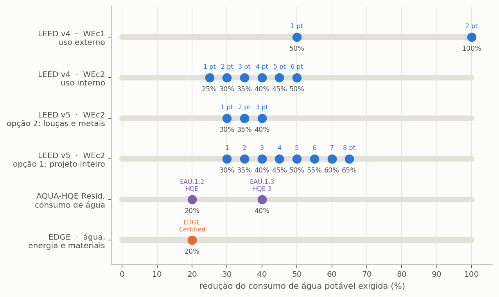

*Figura 23 — Os limiares de redução do consumo de água potável com que o programa enquadra o projeto no LEED v4 (créditos WEc1 e WEc2), no LEED v5 (crédito WEc2, opções 1, 2 e 4) e no EDGE, na mesma escala. Os referenciais cujo critério pontua a existência de um sistema, e não uma percentagem, não entram na régua. Um mesmo projeto cruza referenciais diferentes em pontos diferentes, e é por isso que declarar a poupança obtida vale mais do que declarar a certificação pretendida.*

---

### 2.9.1. LEED v4 e v4.1, categoria Water Efficiency

O LEED é o referencial do U.S. Green Building Council (<https://www.usgbc.org/leed>, consultado a
16 de outubro de 2026), o mais difundido a nível internacional; a página oficial dá-o como o
sistema de classificação de edifícios sustentáveis mais utilizado e lista as versões v5, v4.1 e v4,
com os níveis Certified (40 a 49 pontos), Silver (50 a 59), Gold (60 a 79) e Platinum (80 ou
mais). A versão 5 coexiste com as versões 4 e 4.1; o programa enquadra o projeto nas duas, e o
estudo deve declarar qual usou. Nas versões 4 e 4.1, a eficiência hídrica ocupa uma categoria
própria, que vale oito pontos repartidos por dois créditos. A distinção fundamental que impõe é
entre uso interior e uso exterior da água, e é dessa separação que decorre toda a pontuação.

O crédito WEc1 trata da redução do uso exterior, isto é, da rega e das restantes procuras das
áreas descobertas, e vale até dois pontos. O programa concede os dois pontos com 100% de redução
do uso exterior de água potável e um ponto a partir de 50%, tomando a água da chuva destinada à
rega do próprio balanço diário; e um projeto sem procura exterior registada não pontua, situação
em que o programa regista explicitamente a razão, para que o utilizador não interprete o zero
como falha de desempenho.

O crédito WEc2 trata da redução do uso interior e vale até seis pontos, repartidos numa escala de
cinco em cinco pontos percentuais a partir de 25% de poupança. Antecede-o um pré-requisito, o
WEp2, que exige 20% de redução interior e é obrigatório: sem ele o empreendimento não é elegível
para certificação, e não confere pontuação alguma.

> A separação entre uso interior e exterior depende inteiramente da **discriminação da procura**
> descrita na secção 4.2 (volume Tutorial). O programa não inventa essa separação: usa a água da chuva que o
> balanço diário destinou à rega, que é satisfeita depois do uso interior. Sem procura exterior
> discriminada, o crédito WEc1 aparece como não avaliado, e a poupança interior é tomada,
> por prudência, igual à poupança total.

> A etiqueta da pontuação dá apenas os pontos da categoria da água. O nível do LEED — Certified,
> Silver, Gold ou Platinum — resulta da soma de todas as categorias, e a água sozinha não o
> define.

---

### 2.9.2. LEED v5, crédito WEc2 Enhanced Water Efficiency

Na versão 5, os créditos de uso interior e exterior foram reunidos no crédito WEc2, *Enhanced Water
Efficiency*, que vale até oito pontos em construção nova e até sete em *Core and Shell*; o
programa avalia apenas a construção nova. O código WEc1 passou a designar outro crédito, *Water
Metering and Leak Detection*, de contagem setorizada e deteção de fugas, e não deve ser confundido
com o WEc1 de uso exterior do LEED v4. O pré-requisito WEp2 exige, entre outras condições, uma
redução de 20% no consumo de aparelhos sanitários e torneiras em relação à linha de base do referencial, e o
pré-requisito WEp1 exige que a fonte alternativa de água, como a cisterna pluvial, tenha um
contador próprio, separado do da rede pública. O projeto pontua por uma de duas vias: a Opção 1,
que mede a redução do uso de água do projeto inteiro, ou a soma das Opções 2 a 6, que tratam cada
parcela em separado.

<!-- tabela: **Tabela 63** — Opções do crédito WEc2 do LEED v5 a que o aproveitamento pluvial contribui -->
| Opção | O que mede | Pontuação |
| :--- | :--- | :--- |
| 1. Projeto inteiro | redução do uso de água do projeto contra a linha de base | 30% 1 ponto, e 1 ponto por cada 5%, até 65% 8 pontos; com fonte alternativa de água, cada escalão vale 1 ponto a mais, até 8 |
| 2. Louças e torneiras | redução calculada contra a linha de base do WEp2, que pode incluir fonte alternativa | 30% 1 ponto, 35% 2 pontos, 40% 3 pontos |
| 4. Uso exterior, via 2 | redução da necessidade teórica de rega | 50% 1 ponto, 100% 2 pontos |
| 6. Reutilização, via 2 | sistema de reutilização no local que sirva a rega, os autoclismos, a reposição ou o processo | 2 pontos |

O programa calcula as duas vias e adota a de maior pontuação: a Opção 1 com a poupança total, e a
soma das Opções 2, 4 e 6 com a poupança interior, a poupança exterior e a existência do sistema,
que o programa trata como o sistema de reutilização da Opção 6. O teto de oito pontos vale para
as duas. As Opções 3 e 5, de equipamentos e de água de processo, e a via 1 da Opção 4, de
paisagismo sem rega, não dependem do aproveitamento pluvial e ficam fora do cálculo. Como no
LEED v4, as reduções do referencial medem-se contra uma linha de base de caudais de aparelhos e de
rega, e não contra a procura modelada, pelo que o enquadramento é indicativo.

O aproveitamento pluvial pode ainda contribuir para o crédito SSc3, *Rainwater Management*. Pela
Opção 1, concede 1, 2 ou 3 pontos pela retenção no lote do volume correspondente ao percentil 80,
85 ou 90 das chuvas locais (70, 75 ou 80 em lote sem recuos), e 1 ponto adicional quando parte
desse volume é reutilizada, sem exceder o teto de 3 pontos; pela Opção 2, concede 3 pontos a quem
retém o acréscimo de escoamento em relação à cobertura natural do terreno. O programa não avalia
este crédito, porque depende do escoamento de todo o terreno, e não só da cobertura; a matriz de
critérios regista-o como não avaliado.

[A COMPLETAR: confirmar, no texto vigente do *LEED v4.1 BD+C* e do *LEED v5 BD+C Rating System*, os
limiares e as pontuações dos créditos WEc1, WEc2 (v4) e WEc2 (v5), e o crédito SSc3. A página
<https://www.usgbc.org/leed> confirma o sistema, as versões e os níveis, mas não os créditos.]

---

### 2.9.3. EDGE, o único que não pontua

O EDGE, desenvolvido pela International Finance Corporation (IFC) do Banco Mundial, segue uma
lógica distinta da de todos os anteriores. Em vez de atribuir pontos a desempenhos crescentes, mede
a percentagem de poupança contra um caso-base local em três dimensões independentes — energia,
água e energia incorporada nos materiais — e exige que **cada uma** delas cruze o limiar
estabelecido. Não há compensação entre dimensões: um desempenho hídrico excecional não supre uma
deficiência na energia.

O EDGE tem ainda dois níveis acima do primeiro. O **EDGE Advanced** exige, além dos 20% nas três
dimensões, uma poupança de energia de pelo menos 40% no local; o **Zero Carbon** exige o anterior
mais 100% de energia renovável, no local ou fora dele, ou a compra de compensações de carbono para
completar os 100%. Os níveis e os requisitos conferem com a página oficial do EDGE
(<https://edgebuildings.com/certify/certification/>, consultada a 16 de outubro de 2026).

Vale notar qual é a barra que o nível avançado eleva. ==O EDGE Advanced sobe a exigência de
energia, e não a de água.== A consequência prática para quem projeta sistemas pluviais é que o
sistema garante a barra hídrica com relativa folga, ao passo que o nível de certificação
alcançado se decide inteiramente fora do âmbito do projeto de água. O programa avalia apenas a
barra de água, pela medida WEM14, cuja entrada na aplicação do IFC é a área de captação em metros
quadrados.

> **O limite honesto está no denominador.** O caso-base do EDGE é local, varia com o país e com a
> tipologia, e é fixado pela própria aplicação do IFC. O programa aceita o caso-base declarado
> pelo utilizador; na sua ausência, adota a procura modelada do projeto e adverte que a
> percentagem resultante é um **piso**, e não o valor que a certificação reconhecerá.
>
> As barras de energia e de energia incorporada nos materiais estão fora do alcance do programa,
> que declara essa limitação no relatório. Afirmar que um projeto é EDGE Certified dispondo de um
> terço da evidência necessária seria irresponsável.

[A COMPLETAR: confirmar com o guia da medida WEM14 da aplicação EDGE a definição da medida e o
dado de entrada; a página de certificação não a descreve.]

---

### 2.9.4. GRI 303

A Global Reporting Initiative não é um referencial de certificação de edifícios, mas uma norma de
divulgação empresarial de desempenho socioambiental. A sua série 303 trata da água e dos efluentes
(<https://www.globalreporting.org/standards/standards-development/topic-standard-project-for-water-and-effluents/>,
consultada a 16 de outubro de 2026), e dois dos seus indicadores são alimentados diretamente pelos
resultados do programa: o GRI 303-3, que reporta a captação evitada em metros cúbicos por ano e
acumulada ao longo do período, e o GRI 303-5, que exprime a taxa de circularidade hídrica do
empreendimento.

[A COMPLETAR: confirmar, no texto do GRI 303:2018, a redação exata das divulgações 303-3 e 303-5; a
página consultada apresenta o projeto da norma, não as divulgações.]

---

### 2.9.5. Referenciais nacionais e europeus fora do programa

O programa não avalia estes referenciais. Descrevem-se aqui só os factos verificados nas páginas
oficiais, para que o utilizador saiba onde procurar os requisitos.

**ANQIP.** A Associação Nacional para a Qualidade nas Instalações Prediais
(<https://www.anqip.pt>, consultada a 16 de outubro de 2026) certifica produtos, sistemas de
águas pluviais e de águas cinzentas, e instalações hidráulicas prediais (CertIHP, certificação
voluntária). A página de produtos certificados (<https://www.anqip.pt/pt/produtos-certificacao>)
exibe a **etiqueta de eficiência hídrica**, com classes por produto: de A++ a B nos autoclismos e
de A+ a D nos chuveiros. A especificação técnica ANQIP ETA 0701, de sistemas de aproveitamento de
águas pluviais em edifícios (SAAP), é a referência portuguesa de projeto para usos não potáveis; a
certificação da instalação rege-se por uma especificação própria, a ETA 0702.

[A COMPLETAR: as indicações sobre a ETA 0701 e a ETA 0702 vêm de documentos de versões antigas
(validade 2009 a 2014) obtidos por pesquisa; confirmar na ANQIP a versão vigente de ambas, o
âmbito da certificação do SAAP e as classes em vigor da etiqueta de eficiência hídrica.]

**LiderA.** Sistema voluntário que orienta e certifica ambientes construídos sustentáveis, com
vinte áreas e uma escala de classes de A++ a E (<https://lidera.info>, consultado a 16 de outubro de
2026).

[A COMPLETAR: critérios e indicadores de água do LiderA (a página inicial não os lista; ver as
especificações da versão 4 no mesmo sítio).]

**BREEAM.** Método de avaliação da sustentabilidade do ambiente construído, associado ao grupo BRE
(<https://breeam.com>, consultado a 16 de outubro de 2026).

[A COMPLETAR: critérios de água do BREEAM aplicáveis ao aproveitamento pluvial, níveis de
classificação e versão aplicável em Portugal; a página consultada não os apresenta.]

**Level(s).** Quadro europeu voluntário de indicadores de sustentabilidade de edifícios de
escritórios e residenciais, do Centro Comum de Investigação da Comissão Europeia. O indicador 3.1,
consumo de água na fase de utilização (m³ por ocupante e por ano), traz uma lista de verificação
de projeto que inclui o aproveitamento de águas pluviais e a reutilização de águas cinzentas
(manual do utilizador, versão 1.1, janeiro de 2021:
<https://susproc.jrc.ec.europa.eu/product-bureau/sites/default/files/2021-01/UM3_Indicator_3.1_v1.1_31pp.pdf>).

[A COMPLETAR: confirmar se existe versão mais recente do manual do indicador 3.1.]

> **Declare-o no estudo.** O enquadramento só é defensável com a versão vigente do referencial à
> mão, e o programa não substitui essa verificação.

---

### 2.9.6. O que declarar

Qualquer estudo que reporte enquadramento em sistemas de certificação precisa de explicitar quatro
pontos, e a omissão de qualquer um deles compromete a verificabilidade do resultado. O primeiro é
que as classes 2 a 4 de qualidade da água adotadas pelo programa são adaptações internas, e não
classes de uma norma. O segundo diz respeito ao EDGE, e consiste em declarar que apenas a barra de
água foi avaliada, identificando o caso-base utilizado. O terceiro aplica-se ao LEED, e consiste
em declarar a versão do referencial adotada e informar se a partição entre uso interior e exterior
foi discriminada a partir de dados do projeto ou se, na falta dela, a poupança interior foi tomada
igual à poupança total. O quarto, por fim, é a ressalva geral: o enquadramento produzido pelo
programa é indicativo, e a certificação é decidida pelo organismo certificador à luz da
documentação completa do empreendimento.

---

## 2.10. Decisão multicritério

> Esta secção formaliza os dois métodos de ordenação que o programa oferece e declara três
> desvios em relação à formulação canónica que um estudo publicado precisa de citar.

A análise multicritério é o ramo da investigação operacional que trata de escolher entre
alternativas quando os critérios de avaliação discordam entre si e não se podem reduzir a um único
número sem que alguém declare o que vale mais. É exatamente a situação de um projeto de
aproveitamento pluvial: o volume que entrega mais água não é o que rende mais dinheiro, e nenhum
dos dois costuma ser o de menor impacto de carbono.

O que os métodos desta secção fazem não é descobrir a resposta certa. ==Tornam explícita a
ponderação que, de outro modo, ficaria implícita na escolha de quem decide.== É essa a diferença
toda entre um estudo que declara os seus valores e um que os esconde atrás de um resultado
aparentemente objetivo.

---

### 2.10.1. Os sete critérios

O programa avalia cada volume da varredura segundo sete critérios, agrupados em três dimensões.
Cada critério tem uma direção de preferência: em uns, mais é melhor; noutros, menos.

<!-- tabela: **Tabela 64** — Os sete critérios de decisão, a direção de preferência e o grupo de cada um -->
| # | Critério | Direção | Grupo |
| :-- | :--- | :--- | :--- |
| 1 | potencial de poupança | maximizar | técnico |
| 2 | extravasamento | minimizar | técnico |
| 3 | valor atual líquido | maximizar | económico |
| 4 | período de recuperação descontado | minimizar | económico |
| 5 | taxa interna de rentabilidade | maximizar | económico |
| 6 | CO₂e no fim da vida | minimizar | ambiental |
| 7 | consumo de água potável | minimizar | ambiental |

As alternativas submetidas à ordenação são os volumes simulados na varredura, e cada uma
comparece com os sete valores acima, calculados nas secções 2.1, 2.7 e 2.8. Não há
critério inventado nesta etapa: o método limita-se a ordenar o que as dimensões anteriores já
produziram.

---

### 2.10.2. TOPSIS

O TOPSIS — *Technique for Order of Preference by Similarity to Ideal Solution*, proposto por Hwang
e Yoon em 1981 — parte de uma ideia geométrica simples. Se cada alternativa é um ponto num espaço
de sete dimensões, uma por critério, existem dois pontos de referência: a **solução ideal**,
composta pelo melhor valor de cada critério, e a **solução anti-ideal**, composta pelos piores.
Nenhuma alternativa real ocupa qualquer deles, porque nenhuma vence em tudo nem perde em tudo, e a
melhor alternativa é a que está em simultâneo mais perto do ideal e mais longe do pior caso.

O método executa cinco passos. Monta a matriz de decisão, com as alternativas nas linhas e os
critérios nas colunas; normaliza essa matriz, para que critérios medidos em euros, em pontos
percentuais e em quilogramas passem a ocupar escalas comparáveis; aplica os pesos declarados;
identifica as soluções ideal e anti-ideal; e ordena as alternativas pela proximidade relativa ao
ideal.

```equacao:topsis:50
C_i = d_i⁻ ÷ ( d_i⁺ + d_i⁻ )
```

<!-- tabela: **Tabela 65** — Variáveis da Equação 50 -->
| Símbolo | Significado | Unidade |
| :--- | :--- | :--- |
| `C_i` | coeficiente de proximidade da alternativa `i`, entre 0 e 1 | adimensional |
| `d_i⁺` | distância euclidiana da alternativa `i` à solução ideal | adimensional |
| `d_i⁻` | distância euclidiana da alternativa `i` à solução anti-ideal | adimensional |

O coeficiente da Equação 50 valeria 1 para uma alternativa que coincidisse com a
solução ideal em todos os critérios, e 0 para uma que coincidisse com a anti-ideal. Como nenhuma
alternativa real ocupa esses extremos, o que interessa não é o valor absoluto do coeficiente, mas a
ordenação que ele produz.

---

Aplicado à varredura completa do projeto do tutorial (Lisboa), de 1 a 20 m³ em passos de 1 m³ e com
pesos iguais, o escore cresce até um máximo interior e decresce nos volumes maiores, em que o
investimento e o carbono incorporado passam a pesar mais do que o ganho de água
(Figura 24). O máximo da varredura completa pode diferir do volume obtido na secção
4.9 (volume Tutorial) com sete candidatos, porque o ideal e o anti-ideal se constroem a partir do conjunto
avaliado: acrescentar ou retirar alternativas desloca os pontos de referência e pode alterar a
ordenação, fenómeno conhecido como inversão de ordem (*rank reversal*).

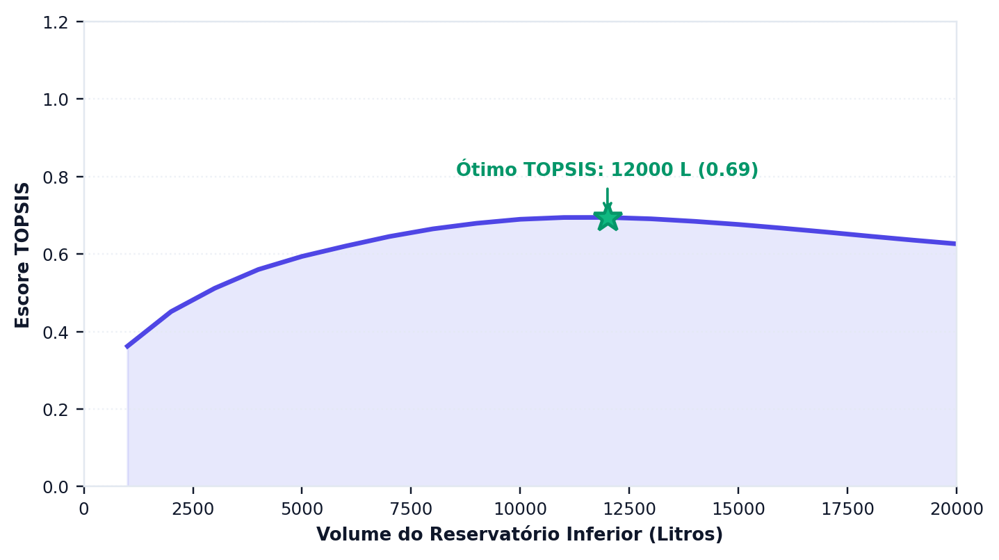

*Figura 24 — Escore TOPSIS de cada volume da varredura do projeto do tutorial, de 1 a 20 m³, com cisterna de polietileno e pesos iguais entre os sete critérios; a estrela marca o volume de maior escore. Os custos que alimentam os critérios económicos são ilustrativos, não são preços de mercado. Figura gerada pelo próprio programa.*

---

### 2.10.3. Três desvios a declarar

A implementação do programa afasta-se da formulação canónica em três pontos, todos deliberados, e
um estudo publicado precisa de os declarar para não atribuir aos métodos originais um
comportamento que é do programa.

**A normalização é uma variante.** A formulação canónica de Hwang e Yoon emprega a normalização
vetorial, que pressupõe valores não negativos em todos os critérios. O valor atual líquido, porém,
é com frequência negativo nos volumes pequenos, em que o investimento não se paga. O programa
contorna a restrição transladando cada critério por `x − min(x)` antes de normalizar. A escolha é
necessária e deliberada, mas apresentar o resultado como TOPSIS canónico seria incorreto: declare
a variante.

**As condições de Opricovic não estão implementadas.** O método VIKOR, na formulação de Opricovic,
exige duas verificações sobre a solução de compromisso encontrada — a de vantagem aceitável e a de
estabilidade aceitável — e, quando qualquer uma falha, devolve um **conjunto** de soluções
equivalentes em vez de um único vencedor. O programa devolve sempre a melhor alternativa, sem
realizar o teste. Na prática, isto significa que a solução de compromisso do VIKOR deve ser lida
ao lado da análise de sensibilidade aos pesos, e nunca sozinha.

**A atribuição do código.** A implementação do VIKOR e do SMAA-VIKOR foi escrita de forma
independente e verificada contra a biblioteca `crispyn`, de Aleksandra Bączkiewicz. O TOPSIS foi
verificado contra a formulação original de Hwang e Yoon num caso de valores todos positivos, em que
a translação descrita acima é inócua e as duas formulações têm de coincidir.

---

### 2.10.4. SMAA-VIKOR

O SMAA — *Stochastic Multicriteria Acceptability Analysis* — existe para responder à pergunta a
que o TOPSIS não responde: e se os pesos fossem outros? Em vez de exigir um conjunto de pesos
definido de antemão, o método sorteia milhares de combinações de pesos e devolve, para cada
alternativa, a probabilidade de ocupar cada posição da ordenação.

A leitura do resultado é direta e informativa. Um volume que vence em 80% dos sorteios é uma
recomendação robusta, que não depende de uma ponderação específica para se sustentar. Um volume
que vence em 30% é uma recomendação frágil, e o texto do estudo tem de o dizer em vez de
apresentar o vencedor como se fosse consensual.

> É a ferramenta certa quando não há consenso sobre os pesos — que é o caso normal em projetos
> reais, nos quais o cliente, o projetista e a entidade licenciadora costumam valorizar dimensões
> diferentes.

---

A leitura mais útil da análise estocástica não é o vencedor, mas a margem com que vence. Um volume
que fica em primeiro lugar em três quartos dos sorteios de pesos é uma escolha estável, que
sobrevive a uma mudança de prioridades do decisor; dois volumes tecnicamente empatados indicam o
contrário, e nesse caso declarar o peso adotado deixa de ser formalidade e passa a ser a única
informação que sustenta a recomendação (Figura 25).

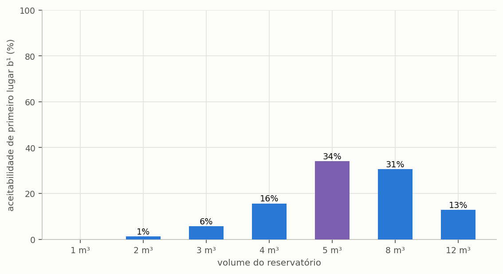

*Figura 25 — Aceitabilidade de primeiro lugar (b¹) de cada volume candidato, obtida com cinco mil vetores de pesos sorteados no simplex. O volume destacado é o que mais vezes fica em primeiro lugar, e os restantes repartem o resto.*

#### 2.10.4.1. O tutorial, pelos dois métodos

A tabela põe lado a lado o escore TOPSIS, com pesos iguais entre as três dimensões, e a
aceitabilidade de primeiro lugar do SMAA-VIKOR, com cinco mil vetores de pesos sorteados, para os
sete volumes do tutorial de Lisboa em polietileno com reservatório superior. O investimento e o
carbono por trás dos escores são os valores ilustrativos da secção 4.7 (volume Tutorial) (ilustrativo, não é
preço de mercado).

<!-- tabela: **Tabela 66** — Pontuação de proximidade TOPSIS com pesos iguais nas dimensões e aceitabilidade do primeiro lugar no SMAA-VIKOR, com 5 000 vetores de pesos aleatórios, para os volumes do tutorial -->
| Volume | Pontuação TOPSIS | Posição no TOPSIS | Primeiro lugar no SMAA-VIKOR, b¹ |
| ---: | ---: | ---: | ---: |
| 1 000 L | 0,429 | 7.º | 0,0% |
| 2 000 L | 0,549 | 6.º | 1,2% |
| 3 000 L | 0,620 | 4.º | 5,7% |
| 4 000 L | 0,673 | 2.º | 15,6% |
| 5 000 L | 0,699 | 1.º | 34,1% |
| 8 000 L | 0,665 | 3.º | 30,6% |
| 12 000 L | 0,552 | 5.º | 12,8% |

Os dois métodos concordam no vencedor, 5 000 L, e discordam na margem. O TOPSIS separa o primeiro
do segundo classificado (4 000 L) por 0,026 de escore, diferença que nenhum dado de entrada
sustenta. O SMAA mede essa fragilidade: 5 000 L vence em 34,1% dos sorteios e 8 000 L em 30,6%,
quase empatados, e com os 4 000 L (15,6%) os três somam quatro em cada cinco sorteios. Pela régua
desta secção, a recomendação é frágil, e o estudo deve declarar 8 000 L e 4 000 L como as
alternativas. Os extremos não fazem melhor: 1 000 L não vence em sorteio algum, e 2 000 L em 1,2%
deles. Nenhuma ponderação plausível recomenda o menor volume, e isso também é resultado.

---

### 2.10.5. Os pesos

O programa aceita um peso por dimensão, técnica, económica e ambiental, ou um peso por critério.
Com pesos iguais entre as dimensões, cada uma vale um terço, repartido igualmente pelos seus
critérios: os dois técnicos e os dois ambientais valem um sexto cada, e os três económicos, um
nono cada. A escolha, contudo, não é técnica: é uma declaração de valor, e por isso tem de constar
do texto do estudo. ==A afirmação «volume ótimo pelo TOPSIS», sem os pesos, é impossível de
reproduzir,== e dois estudos com pesos diferentes chegam a volumes diferentes sem que nenhum dos
dois esteja errado.

No tutorial, a escolha dos pesos desloca o resultado. Com pesos iguais, o TOPSIS recomenda 5 000 L
(com 4 000 L em segundo); com 60% no peso técnico, recomenda 8 000 L (com 12 000 L em segundo); com
60% no económico ou no ambiental, volta a 5 000 L (com 4 000 L em segundo).

Três condutas são defensáveis, e a escolha entre elas depende do que se sabe sobre as prioridades
de quem decide. Pesos iguais, declarados explicitamente como ausência de preferência, constituem a
posição neutra. Pesos justificados, com a razão de cada um, são preferíveis quando as prioridades
são conhecidas. E o SMAA, que reporta a gama de resultados em vez de um vencedor único, é a conduta
mais completa quando não há consenso.

---

### 2.10.6. Os melhores por critério isolado

Além da ordenação ponderada, o programa identifica o vencedor de cada grupo de critérios — técnico,
financeiro e ambiental — e reporta os três em separado. São números que vale a pena publicar em
conjunto, porque cada um responde a uma pergunta legítima e diferente.

Quando os três coincidem, a recomendação é forte e a decisão dispensa ponderação. Quando divergem,
que é o caso comum e o do tutorial, ==a divergência **é** o resultado:== escondê-la atrás de um
único número ponderado empobrece o estudo e transfere para o leitor uma conclusão que ele não tem
como avaliar. No tutorial de Lisboa, o critério técnico escolhe 12 000 L, o ambiental 2 000 L e o
financeiro 1 000 L (nenhum volume recupera o investimento com a tarifa de Lisboa e estes custos
ilustrativos, pelo que o critério financeiro se decide pelo valor atual líquido menos mau); o
compromisso de pesos iguais escolhe 5 000 L.

---

### 2.10.7. O que o método não faz

Convém terminar pelos limites, porque os métodos multicritério são frequentemente apresentados com
uma autoridade que não têm.

**Não escolhem os pesos.** A ponderação é do analista, e é uma decisão de valor, não de técnica.
Nenhum procedimento estatístico a substitui.

**Não validam os critérios.** Se o valor atual líquido estiver errado porque a estrutura tarifária
foi mal introduzida, o TOPSIS ordenará o erro com precisão impecável. O método ordena o que recebe.

**Não incorporam restrições.** O espaço disponível no terreno, o orçamento máximo, uma exigência
regulamentar: tudo isso são filtros anteriores à ordenação, aplicados pelo projetista ao decidir
quais volumes chegam sequer a entrar na comparação.

---

# Apêndices

---

## Apêndice A — Os parâmetros do projeto

São **118 parâmetros**. É a lista completa do que um projeto guarda nesta
edição, com o nome exato de cada campo dentro do ficheiro `.triton`.

A lista não foi transcrita à mão: é extraída do próprio programa a cada versão, e por
isso não pode divergir dele.

A coluna **onde se introduz** diz em que ecrã o campo aparece; a coluna **quem consome**
diz que cálculo o usa. Um campo sem nenhuma das duas é um campo gravado no ficheiro e
nunca lido, e está listado na secção 5.2 (volume Enganos, limitações e confiabilidade).

Os padrões são os do projeto com que a Edição Ibérica abre: a chuva é a normal 1991-2020
do concelho de Lisboa na base E-OBS, e os custos, os preços e a tarifa de eletricidade
partem de zero ou vazios, para o utilizador os introduzir em euros. Um traço significa
que o campo não tem valor inicial.

O ficheiro de projeto guarda ainda 4 campos de esquemas nacionais de outras
edições. Não têm efeito nesta e não são listados.

### A.1. Identificação

3 parâmetros.

<!-- tabela: **Tabela 67** — Parâmetros do projeto: identificação -->
| Parâmetro | Padrão | Unidade | Onde se introduz | Quem consome |
| :--- | ---: | :--- | :--- | :--- |
| `project_name` | Novo projeto Triton | — | Exportação, Janela principal, Relatórios | Automação, CAD e BIM, Folhas de cálculo, Relatórios |
| `project_id` | — | — | Janela principal, Relatórios | Automação |
| `created_at` | — | — | Janela principal | — |

### A.2. Chuva

9 parâmetros.

<!-- tabela: **Tabela 68** — Parâmetros do projeto: chuva -->
| Parâmetro | Padrão | Unidade | Onde se introduz | Quem consome |
| :--- | ---: | :--- | :--- | :--- |
| `precip_file` | — | — | Janela principal, Projeto | Automação, Cenários, Folhas de cálculo |
| `climate_source_mode` | national_db | — | Janela principal, Projeto | — |
| `climate_city_uf` | Lisboa | — | Janela principal, Projeto, Relatórios | — |
| `climate_city_name` | Lisboa | — | Janela principal, Projeto, Relatórios | — |
| `climate_model` | E-OBS v33.0e | — | Janela principal, Projeto, Relatórios | — |
| `climate_scenario` | EOBS | — | Janela principal, Projeto, Relatórios | — |
| `climate_start_date` | 01/01/1991 | — | Janela principal, Projeto, Relatórios | — |
| `climate_end_date` | 31/12/2020 | — | Janela principal, Projeto, Relatórios | — |
| `start_date` | 01/01/1980 | — | Exportação, Janela principal, Projeto, Tarifário e custos | Automação, Clima, Folhas de cálculo |

Observações do código:

- `climate_source_mode`: "national_db" (a base E-OBS por concelho) ou "custom_file" (ficheiro do utilizador)

### A.3. Captação

7 parâmetros.

<!-- tabela: **Tabela 69** — Parâmetros do projeto: captação -->
| Parâmetro | Padrão | Unidade | Onde se introduz | Quem consome |
| :--- | ---: | :--- | :--- | :--- |
| `discard` | — | — | Ambiental, Documentação, Gráficos, Janela principal, Projeto, Qualidade, Relatórios | ACV, Automação, CAD e BIM, Cenários, ETAP, Folhas de cálculo, Relatórios |
| `discard_mode` | 1 | — | Janela principal, Projeto, Varrimento | Automação, Balanço diário, Cenários |
| `discard_days_interval` | 7 | — | Janela principal, Projeto, Varrimento | Automação, Balanço diário, Cenários |
| `area` | 100 | — | Ambiental, Documentação, Edificação, Gráficos, Janela principal, Qualidade, Relatórios, Tarifário e custos, Varrimento | ACV, Automação, Balanço diário, CAD e BIM, Cenários, ETAP, Folhas de cálculo, Relatórios |
| `irrigation_garden_area_m2` | 0 | — | — | — |
| `runoff_coeff` | — | — | Edificação, Janela principal, Qualidade, Varrimento | Automação, Balanço diário, Cenários, Folhas de cálculo |
| `first_flush_system_enabled` | não | — | Ambiental, Qualidade | ACV, Automação, ETAP |

Observações do código:

- `discard`: mm
- `discard_mode`: 1 = todos os eventos, 2 = 1.º evento após período seco, 3 = a cada X dias
- `discard_days_interval`: intervalo para o modo 3
- `area`: m²
- `irrigation_garden_area_m2`: Área de jardim em m² para o assistente de dimensionamento
- `runoff_coeff`: ver hydrology_defaults

### A.4. Edificação

2 parâmetros.

<!-- tabela: **Tabela 70** — Parâmetros do projeto: edificação -->
| Parâmetro | Padrão | Unidade | Onde se introduz | Quem consome |
| :--- | ---: | :--- | :--- | :--- |
| `num_economias` | 1 | — | Ambiental, Edificação | Automação, Económico |
| `building_template_id` | res_medio | — | Edificação | Automação, Tarifário |

Observações do código:

- `num_economias`: Número de frações autónomas com contador individual

### A.5. Procura

17 parâmetros.

<!-- tabela: **Tabela 71** — Parâmetros do projeto: procura -->
| Parâmetro | Padrão | Unidade | Onde se introduz | Quem consome |
| :--- | ---: | :--- | :--- | :--- |
| `demand_type` | 0 | — | — | — |
| `demand_mode` | constant | — | Ambiental, Edificação, Janela principal, Relatórios, Varrimento | Automação, Balanço diário |
| `demand_value` | 200 | — | Documentação, Económico, Janela principal | Automação, Balanço diário |
| `demand_monthly` | — | — | Janela principal | Automação |
| `residents_type` | 0 | — | — | — |
| `residents_count` | 4 | — | Ambiental, Económico, Janela principal | Automação, Balanço diário, Eletrobomba |
| `residents_monthly` | — | — | Janela principal | Automação |
| `potable_indoor_share` | 0,6 | — | Edificação, Janela principal | Automação |
| `non_potable_indoor_share` | 0,4 | — | Edificação, Janela principal | Automação, Balanço diário |
| `rainwater_share` | 0,4 | — | Documentação, Janela principal, Varrimento | Automação, Balanço diário, Cenários, Folhas de cálculo |
| `weekly_demands` | — | — | Edificação, Janela principal, Varrimento | Automação, Balanço diário |
| `weekly_residents` | — | — | Edificação, Janela principal, Varrimento | Automação, Balanço diário |
| `weekly_shares` | — | — | Edificação, Janela principal, Varrimento | Automação, Balanço diário |
| `monthly_shares` | — | — | Edificação, Janela principal, Varrimento | Automação, Balanço diário |
| `daily_demands` | — | — | Edificação, Janela principal, Varrimento | Automação, Balanço diário |
| `daily_residents` | — | — | Edificação, Janela principal, Varrimento | Automação, Balanço diário |
| `daily_shares` | — | — | Edificação, Janela principal, Varrimento | Automação, Balanço diário |

Observações do código:

- `demand_mode`: "constant", "weekly", "monthly", "daily"
- `demand_value`: L/dia, por residente ou total
- `potable_indoor_share`: Fração potável do consumo interior; 1 − non_potable_indoor_share
- `non_potable_indoor_share`: Fração não potável do consumo interior (autoclismos, máquina de lavar); ver fracao_atendivel
- `rainwater_share`: fração de 0 a 1 (0,4 = 40%)

### A.6. Rega

4 parâmetros.

<!-- tabela: **Tabela 72** — Parâmetros do projeto: rega -->
| Parâmetro | Padrão | Unidade | Onde se introduz | Quem consome |
| :--- | ---: | :--- | :--- | :--- |
| `irrigation_liters_per_day` | 0 | — | Ambiental, Edificação, Janela principal, Relatórios | Automação, Balanço diário |
| `irrigation_rain_threshold_mm` | 2 | — | Edificação, Janela principal | Automação, Balanço diário |
| `irrigation_potable_backup` | sim | — | Edificação, Janela principal | Automação, Balanço diário |
| `irrigation_rate_l_m2_day` | 3 | — | — | — |

Observações do código:

- `irrigation_liters_per_day`: Procura exterior (rega, lavagem de zonas exteriores), L/dia
- `irrigation_rain_threshold_mm`: Limiar diário de precipitação para suspender a rega (mm/dia)
- `irrigation_potable_backup`: Se True, a rede pública abastece a rega em dias secos se a cisterna secar
- `irrigation_rate_l_m2_day`: Taxa diária de rega (L/m²/dia)

### A.7. Qualidade da água

9 parâmetros.

<!-- tabela: **Tabela 73** — Parâmetros do projeto: qualidade da água -->
| Parâmetro | Padrão | Unidade | Onde se introduz | Quem consome |
| :--- | ---: | :--- | :--- | :--- |
| `water_quality_target_class` | classe_1 | — | Ambiental, Qualidade | ACV, Automação, ETAP |
| `water_quality_disinfection` | cloro | — | Ambiental, Qualidade | ACV, Automação, ETAP |
| `water_quality_polishing` | não | — | Ambiental, Qualidade | ACV, Automação, ETAP |
| `etap_enabled` | sim | — | Ambiental, Económico, Otimizador | ACV, Automação, ETAP |
| `chlorine_treatment_enabled` | sim | — | Ambiental, Económico, Otimizador, Qualidade | ACV, Automação, Económico |
| `chlorine_dose_mg_l` | — | — | Ambiental, Económico, Otimizador, Qualidade | ACV, Automação, ETAP, Económico, Relatórios |
| `chlorine_product_purity` | — | — | Ambiental, Qualidade | ACV, Automação, ETAP, Económico |
| `chlorine_cost_per_kg` | 0 | — | Económico, Otimizador, Qualidade | Automação, ETAP, Económico, Preços |
| `chlorine_co2_kg_per_kg` | — | — | Ambiental, Qualidade | ACV, Automação, ETAP |

Observações do código:

- `water_quality_disinfection`: "cloro", "uv", "ozonio" (ozono), "nenhum"
- `chlorine_dose_mg_l`: mg de Cl2 ativo por litro
- `chlorine_product_purity`: kg de Cl2 ativo por kg de produto
- `chlorine_cost_per_kg`: € por kg de PRODUTO comercial

### A.8. Reservatórios

12 parâmetros.

<!-- tabela: **Tabela 74** — Parâmetros do projeto: reservatórios -->
| Parâmetro | Padrão | Unidade | Onde se introduz | Quem consome |
| :--- | ---: | :--- | :--- | :--- |
| `upper_tank_vol` | 500 | — | Ambiental, Assistente da bomba, Económico, Exportação, Janela principal, Otimizador, Relatórios, Reservatório superior, Tarifário e custos, Varrimento | Automação, Balanço diário, CAD e BIM, Cenários, Folhas de cálculo, Multicritério, Preços |
| `upper_tank_used` | 1 | — | Ambiental, Económico, Janela principal, Otimizador, Relatórios, Tarifário e custos, Varrimento | ACV, Automação, Balanço diário, Cenários, Eletrobomba, Folhas de cálculo, Preços |
| `lower_tank_max` | 10000 | — | Janela principal, Varrimento | Automação, Balanço diário, Cenários, Folhas de cálculo |
| `lower_tank_step` | 250 | — | Janela principal, Varrimento | Automação, Balanço diário, Cenários, Folhas de cálculo |
| `lower_tank_mode` | 1 | — | Janela principal, Varrimento | Automação |
| `lower_tank_fixed` | 2000 | — | Janela principal, Tarifário e custos, Varrimento | Automação |
| `delta_ideal` | 5 | — | Janela principal, Otimizador, Varrimento | Automação, Cenários |
| `econ_lower_tank_vol` | 2000 | — | Ambiental, Económico, Tarifário e custos, Varrimento | Automação |
| `lower_tank_material` | PEAD | — | Económico, Otimizador, Tarifário e custos | ACV, Automação, Preços |
| `upper_tank_material` | PEAD | — | Económico, Otimizador, Tarifário e custos | ACV, Automação, Preços |
| `cost_lower_tank` | 0 | — | Económico, Tarifário e custos, Varrimento | Automação, Económico, Preços |
| `cost_upper_tank` | 0 | — | Económico, Tarifário e custos, Varrimento | Automação, Económico |

Observações do código:

- `upper_tank_vol`: L
- `upper_tank_used`: 0 = sem reservatório superior, 1 = com reservatório superior
- `lower_tank_max`: L
- `lower_tank_step`: L
- `lower_tank_mode`: 0 = volume fixo, 1 = varrimento
- `lower_tank_fixed`: usado no modo de volume fixo
- `delta_ideal`: limiar de ganho marginal para o volume ideal, em %/m³
- `lower_tank_material`: "PEAD" (polietileno), "CONCRETO" (betão), "FIBRA" (PRFV), "ACO_INOX" (aço inoxidável)
- `upper_tank_material`: "PEAD" (polietileno), "CONCRETO" (betão), "FIBRA" (PRFV), "ACO_INOX" (aço inoxidável)

### A.9. Eletrobomba

18 parâmetros.

<!-- tabela: **Tabela 75** — Parâmetros do projeto: eletrobomba -->
| Parâmetro | Padrão | Unidade | Onde se introduz | Quem consome |
| :--- | ---: | :--- | :--- | :--- |
| `pumping_threshold` | 50 | — | Janela principal, Varrimento | Automação, Balanço diário, Cenários, Folhas de cálculo |
| `supply_arrangement` | — | — | Ambiental, Económico, Varrimento | ACV, Automação, Económico, Eletrobomba |
| `pressurizer_pressure_m` | 18 | — | Varrimento | Eletrobomba |
| `pressurizer_starts_per_person_day` | 5,05 | — | Varrimento | Eletrobomba |
| `pressurizer_model` | — | — | Varrimento | Eletrobomba |
| `pressurizer_point_flow_l_min` | 9 | — | Varrimento | Eletrobomba |
| `pressurizer_power_kw` | 0,18 | — | Varrimento | Eletrobomba |
| `pressurizer_flow_l_min` | 13,3 | — | Varrimento | Eletrobomba |
| `pressurizer_post_run_s` | 0 | — | Varrimento | Eletrobomba |
| `pump_count` | 2 | — | Ambiental, Económico, Otimizador, Relatórios, Tarifário e custos | ACV, Automação, Económico, Preços, Relatórios |
| `pump_power_str` | 1/2 | — | Relatórios | — |
| `pump_power_kw` | 0,36775 | — | Económico, Gráficos, Otimizador, Relatórios, Tarifário e custos, Varrimento | Automação, CAD e BIM, Económico, Eletrobomba, Preços, Relatórios |
| `pump_manometric_head_m` | 0 | — | Varrimento | Automação, Eletrobomba |
| `pump_efficiency` | 0 | — | Gráficos, Tarifário e custos, Varrimento | Automação, Eletrobomba |
| `pump_flow_rate` | 0 | — | Económico, Gráficos, Otimizador, Relatórios, Tarifário e custos, Varrimento | Automação, Eletrobomba |
| `pump_startup_time_h` | 0,03 | — | Económico, Gráficos, Otimizador, Tarifário e custos | Automação, Eletrobomba |
| `pump_motor_efficiency` | 0 | — | Tarifário e custos | Automação, Eletrobomba |
| `pump_unit_cost` | 0 | — | Económico, Otimizador, Tarifário e custos, Varrimento | Automação, Económico, Preços |

Observações do código:

- `pumping_threshold`: L, nível de acionamento da elevação
- `pump_count`: principal + reserva como configuração inicial recomendada
- `pump_power_kw`: kW (1 cv = 0,7355 kW; 1/2 cv = 0,36775 kW)
- `pump_efficiency`: %, 0 = deduzir da potência
- `pump_startup_time_h`: h
- `pump_motor_efficiency`: %
- `pump_unit_cost`: preço de uma eletrobomba, em euros (zero até o utilizador o introduzir)

### A.10. Tubagem

1 parâmetro.

<!-- tabela: **Tabela 76** — Parâmetros do projeto: tubagem -->
| Parâmetro | Padrão | Unidade | Onde se introduz | Quem consome |
| :--- | ---: | :--- | :--- | :--- |
| `pipes_list` | — | — | Económico, Tarifário e custos | ACV, Automação |

### A.11. Investimento

3 parâmetros.

<!-- tabela: **Tabela 77** — Parâmetros do projeto: investimento -->
| Parâmetro | Padrão | Unidade | Onde se introduz | Quem consome |
| :--- | ---: | :--- | :--- | :--- |
| `cost_labor` | 0 | — | Económico, Tarifário e custos, Varrimento | Automação, Económico |
| `cost_piping` | 0 | — | Económico, Tarifário e custos, Varrimento | Automação, Económico |
| `cost_accessories` | 0 | — | Económico, Tarifário e custos, Varrimento | Automação, ETAP, Económico |

### A.12. Exploração

1 parâmetro.

<!-- tabela: **Tabela 78** — Parâmetros do projeto: exploração -->
| Parâmetro | Padrão | Unidade | Onde se introduz | Quem consome |
| :--- | ---: | :--- | :--- | :--- |
| `op_costs` | — | — | Económico, Otimizador, Tarifário e custos, Varrimento | Automação, Económico |

### A.13. Tarifário

17 parâmetros.

<!-- tabela: **Tabela 79** — Parâmetros do projeto: tarifário -->
| Parâmetro | Padrão | Unidade | Onde se introduz | Quem consome |
| :--- | ---: | :--- | :--- | :--- |
| `tariff_customized` | não | — | Projeto | — |
| `water_tariffs` | — | — | Projeto, Tarifário, Tarifário e custos, Varrimento | Económico |
| `tariff_city_uf` | personalizado | — | Janela principal, Projeto, Relatórios, Tarifário, Tarifário e custos | — |
| `tariff_city_name` | personalizado | — | Janela principal, Projeto, Relatórios, Tarifário, Tarifário e custos | — |
| `tariff_vigencia` | — | — | Projeto, Tarifário e custos | — |
| `tariff_category` | residencial | — | Económico, Tarifário, Tarifário e custos | Tarifário |
| `sewage_rate` | 100 | — | Projeto, Tarifário, Tarifário e custos | Automação, Económico, Tarifário |
| `sewage_mode` | 1 | — | Económico, Otimizador, Projeto, Tarifário, Tarifário e custos | Automação, Económico, Tarifário |
| `sewage_tariffs` | — | — | — | Económico, Tarifário |
| `sewage_volume_factor` | 1 | — | — | Automação, Económico, Tarifário |
| `water_tax_fixed` | 0 | — | Tarifário e custos | Automação, Económico |
| `water_tax_var` | 0 | — | Tarifário e custos | Automação, Económico |
| `tariff_escalation` | 12 | — | Económico, Otimizador, Tarifário e custos, Varrimento | Automação, Económico |
| `water_tariff_escalation` | 5 | — | Económico, Otimizador, Tarifário e custos, Varrimento | Automação, Económico |
| `sewage_tariff_escalation` | 5 | — | Económico, Otimizador, Tarifário e custos | Automação, Económico |
| `elec_tariff_escalation` | 5 | — | Económico, Otimizador, Varrimento | Automação, Económico |
| `elec_tariff` | 0 | — | Económico, Gráficos, Otimizador, Projeto, Relatórios, Tarifário e custos, Varrimento | Automação, Económico |

Observações do código:

- `tariff_category`: categoria da tabela tarifária aplicada; "personalizada" quando introduzida pelo utilizador
- `sewage_mode`: 0 = valor fixo em €, 1 = percentagem da parcela de água, 2 = €/m³ consumido, 3 = escalões
- `water_tax_fixed`: € por mês
- `water_tax_var`: % (o IVA da água, nas faturas portuguesas)
- `tariff_escalation`: meses; duração do período de atualização
- `water_tariff_escalation`: % por período de atualização; com 12 meses, % por ano
- `sewage_tariff_escalation`: % por período de atualização; com 12 meses, % por ano
- `elec_tariff_escalation`: % por período de atualização; com 12 meses, % por ano
- `elec_tariff`: preço da eletricidade por kWh, em euros (zero até o utilizador o introduzir)

### A.14. Energia

4 parâmetros.

<!-- tabela: **Tabela 80** — Parâmetros do projeto: energia -->
| Parâmetro | Padrão | Unidade | Onde se introduz | Quem consome |
| :--- | ---: | :--- | :--- | :--- |
| `elec_city_uf` | personalizado | — | Janela principal, Projeto, Tarifário e custos | — |
| `elec_city_name` | personalizado | — | Janela principal, Projeto, Tarifário e custos | — |
| `elec_tax_fixed` | 0 | — | Tarifário e custos | Automação, Económico |
| `elec_tax_var` | 0 | — | Tarifário e custos | Automação, Económico |

Observações do código:

- `elec_tax_fixed`: € por mês
- `elec_tax_var`: %

### A.15. Financeiro

4 parâmetros.

<!-- tabela: **Tabela 81** — Parâmetros do projeto: financeiro -->
| Parâmetro | Padrão | Unidade | Onde se introduz | Quem consome |
| :--- | ---: | :--- | :--- | :--- |
| `inflation` | 0,2 | — | Documentação, Económico, Otimizador, Tarifário e custos, Varrimento | Automação, Económico |
| `analysis_period_years` | 20 | — | Económico, Otimizador, Relatórios, Tarifário e custos, Varrimento | ACV, Automação, Económico, Relatórios |
| `tma` | 2 | — | Económico, Otimizador, Tarifário e custos, Varrimento | Automação, Económico |
| `install_month` | 0 | — | — | — |

Observações do código:

- `inflation`: % por mês; inflação dos custos de exploração e manutenção
- `analysis_period_years`: anos
- `tma`: % por mês; taxa de atualização

### A.16. Certificações

1 parâmetro.

<!-- tabela: **Tabela 82** — Parâmetros do projeto: certificações -->
| Parâmetro | Padrão | Unidade | Onde se introduz | Quem consome |
| :--- | ---: | :--- | :--- | :--- |
| `edge_base_case_l_person_day` | 0 | — | Ambiental | — |

### A.17. Outros

6 parâmetros.

<!-- tabela: **Tabela 83** — Parâmetros do projeto: outros -->
| Parâmetro | Padrão | Unidade | Onde se introduz | Quem consome |
| :--- | ---: | :--- | :--- | :--- |
| `phi_operation_rule` | — | — | Janela principal, Varrimento | Automação, Balanço diário, Folhas de cálculo |
| `data_base_estudo` | — | — | Tarifário e custos | — |
| `precos_de_catalogo` | não | — | Assistente da bomba, Económico, Otimizador, Qualidade, Tarifário e custos, Varrimento | Automação, ETAP, Preços |
| `bim_layout` | — | — | Exportação, Janela principal | — |
| `capex_do_arranjo` | não | — | Janela principal, Tarifário e custos, Varrimento | ETAP |
| `mao_de_obra_automatica` | não | — | Janela principal, Tarifário e custos, Varrimento | — |

---

## Apêndice B — Os processos do programa

São **24 processos**, do ficheiro de chuva ao relatório. Cada um declara o
que o desencadeia, o que recebe, as regras com as suas ramificações, o que produz e o
que acontece quando falha.

É o apêndice mais técnico do manual, e serve a duas pessoas: quem revê um estudo feito
com o programa e precisa de saber exatamente que conta foi feita, e quem encontrou um
resultado estranho e quer saber por onde o número passou.

Os nomes em `código` são os campos do ficheiro de projeto, listados no apêndice A.

### B.1. PROC-01 — Carregar a série de precipitação

*Chuva*

**Gatilho.** Separador Projeto: escolher o concelho na base E-OBS ou abrir um ficheiro CSV.

**Entradas**

- Concelho da base E-OBS v33.0e (278 concelhos com série, 1950 a 2025), ou ficheiro CSV diário em milímetros por dia
- `climate_start_date` e `climate_end_date`, que recortam a série (a normal 1991-2020 é o recorte inicial)
- `start_date`, data do primeiro dia da série

**Regras**

1. A série vira um vetor `numpy` de milímetros por dia; o índice do vetor é o dia, e a data serve só para saber o dia da semana e o mês.
2. A série de um concelho é a média diária das células da grelha E-OBS (0,1°) com centro dentro do concelho (limites da CAOP2025). Os Açores ficam fora do domínio da E-OBS e a Madeira não cumpre o limite de 1% de dias sem dado: 30 concelhos ficam sem série na base, e nenhum recebe a série de um vizinho. Para esses, a série é um ficheiro do utilizador.
3. Dia sem dado em todas as células é uma falha (NaN), e a simulação recusa a série em vez de o tratar como dia seco.
4. Ano incompleto é descartado na leitura, para não enviesar totais anuais.
5. A base vem no programa, em `data/portugal_eobs.db`; o exemplo do Funchal usa uma série ERA5 em `data/rainfall/Funchal.csv`.

**Saídas**

- `precip_data`: vetor de mm/dia, que é a entrada de **dois** processos distintos — PROC-04 (descarte e captação) e PROC-03 (suspensão da rega)

**Exceção.** Ficheiro ilegível ou sem coluna de chuva interrompe o carregamento com mensagem; a simulação não corre com série vazia ou com falhas.

### B.2. PROC-02 — Compor a procura diária

*Procura*

**Gatilho.** Início da simulação, uma vez por execução.

**Entradas**

- `demand_mode`: constante, semanal, mensal ou diária
- `demand_value` (L/dia por pessoa), `residents_count`
- `rainwater_share` ou `non_potable_indoor_share`
- vetores `weekly_*`, `monthly_*`, `daily_*` quando o modo os usa

**Regras**

1. Procura-base do dia = `demand_value × residents_count`, com o multiplicador do dia da semana, do mês ou do dia, conforme o modo.
2. A fração não potável separa a procura em duas: interna potável e interna não potável.
3. Quando o modo é semanal, mensal ou diário, a fração vem do próprio vetor do período; fora disso, vale `non_potable_indoor_share`, e só então `rainwater_share`.
4. Valor nulo ou zero em qualquer posição do vetor cai para o valor constante.

**Saídas**

- `tot_arr`: procura total do dia
- `pot_in_arr`: potável interna, que a chuva nunca atende
- `non_pot_in_arr`: não potável interna, prioridade 1 da chuva
- `pluv_arr` = não potável interna + rega ativa

**Exceção.** Data inicial ilegível cai para 01/01/1980 em vez de interromper, porque só afeta o dia da semana.

### B.3. PROC-03 — Suprimir a rega nos dias de chuva

*Procura*

**Gatilho.** Composição da procura, um teste por dia da série.

**Entradas**

- `irrigation_liters_per_day`
- `irrigation_rain_threshold_mm` (padrão 2 mm/dia)
- `precip_data`, o **mesmo** vetor que alimenta a captação

**Regras**

1. Se a chuva do dia ≥ limiar, a rega do dia é **zero** e o dia entra na contagem de dias suprimidos.
2. Caso contrário, a rega do dia é o volume nominal.
3. É a segunda leitura do ficheiro de chuva, e independente da primeira: um dia pode suprimir a rega e ainda assim render captação.

**Saídas**

- `irr_arr`: rega do dia
- `irr_suppressed_mask`: dias suprimidos, que viram `total_irrigation_days_suppressed` no resultado

**Exceção.** Sem volume de rega registado, o vetor é zero e a máscara é falsa em todos os dias.

### B.4. PROC-04 — Descartar as primeiras águas

*Balanço hídrico*

**Gatilho.** Todo dia com chuva, dentro do ciclo diário.

**Entradas**

- `precip_mm` do dia
- `discard_mm`
- `discard_mode` (1, 2 ou 3)
- `discard_days_interval`

**Regras**

1. **Modo 1**: descarta em todo evento de chuva.
2. **Modo 2**: descarta apenas no primeiro evento após período seco, definida como véspera com menos de 1 mm.
3. **Modo 3**: descarta quando passaram `discard_days_interval` dias desde o último descarte.
4. Quando o descarte se aplica: `p_eff = p − discard_mm` se `p > discard_mm`, senão **zero**: toda a chuva do dia vai para o descarte.
5. Quando não se aplica: `p_eff = p`, a chuva inteira é aproveitável.

**Saídas**

- `p_eff`: lâmina efetiva do dia, em mm, que segue **só** para PROC-05
- `eff_precip_mm` na série diária detalhada, quando ela é guardada

**Exceção.** Lâmina de descarte negativa é rejeitada na barreira de validação, antes do ciclo.

### B.5. PROC-05 — Converter lâmina em volume captado

*Balanço hídrico*

**Gatilho.** Todo dia, depois do descarte.

**Entradas**

- `p_eff` de PROC-04
- `area` (m²)
- `runoff_coeff`

**Regras**

1. `v_ac = p_eff × area × runoff_coeff`, em litros.
2. É aqui que o ficheiro de chuva vira volume, e é o único ponto onde isso acontece.
3. O coeficiente é adimensional e fica em [0, 1]; fora disso a simulação nem começa.

**Saídas**

- `v_ac`: volume captado do dia, que segue para PROC-06
- `harvested_liters` na série diária

**Exceção.** Área negativa ou coeficiente fora de [0, 1] levantam `ValueError` nomeando o campo, em PROC-11.

### B.6. PROC-06 — Armazenar e extravasar

*Balanço hídrico*

**Gatilho.** Todo dia, depois da captação.

**Entradas**

- `v_ac`
- volume remanescente do dia anterior
- `lower_tank_vol`

**Regras**

1. **Extravasamento antes do consumo**, como na regra YAS; a chuva do dia, até a capacidade, já atende a procura do dia, o que põe o modelo entre a YAS e a YBS estritas.
2. `disponível = v_lower + v_ac`. Se passar da capacidade, o excedente extravasa e o reservatório fica cheio.
3. A ordem importa: retirar a procura antes faria o reservatório aceitar água que fisicamente já teria extravasado, sobrestimando o aproveitamento.

**Saídas**

- `v_spill_today`, somado em `avg_spilled_l_day`, que vira critério de extravasamento no multicritério
- `v_in_tank`, o volume disponível para atendimento

**Exceção.** Volume zero é válido e representa o cenário sem sistema; negativo é rejeitado.

### B.7. PROC-07 — Atender com reservatório único

*Balanço hídrico*

**Gatilho.** Todo dia, quando não há reservatório superior.

**Entradas**

- `v_in_tank`
- `pluvial_demand_per_day` de PROC-02

**Regras**

1. `v_c = min(procura pluvial, volume no reservatório)`.
2. O volume remanescente permanece para o dia seguinte: `v_lower = v_in_tank − v_c`.

**Saídas**

- `v_c`: volume pluvial consumido no dia

**Exceção.** Nenhuma: o mínimo já trata reservatório vazio e procura nula.

### B.8. PROC-08 — Atender com elevação para reservatório superior

*Balanço hídrico*

**Gatilho.** Todo dia, quando `upper_tank_used` e o volume superior é positivo.

**Entradas**

- `v_lower`, `v_upper`
- `upper_tank_vol`
- `pumping_threshold`, o volume de reserva que não se consome

**Regras**

1. Laço até a procura ser atendida ou a água acabar.
2. Primeiro consome do reservatório superior o que estiver **acima** do limiar de acionamento.
3. Se ainda falta e há água em baixo, aciona a bomba: transfere `min(v_lower, espaço livre em cima)`, conta **um ciclo** e regista a lote.
4. Depois do elevação, consome de novo.
5. O limiar é limitado ao volume do reservatório superior na entrada do processo.

**Saídas**

- `v_c`
- `v_rec_today`, somado em `total_pumped_liters`
- `cycles_today`, somado em `total_pump_cycles`
- `max_pump_batch_liters`

**Exceção.** Volume superior negativo é rejeitado na validação. O ciclo tem saída garantida: se não há água em baixo nem em cima, interrompe.

### B.9. PROC-09 — Repartir o atendimento e completar com potável

*Balanço hídrico*

**Gatilho.** Todo dia, depois do atendimento.

**Entradas**

- `v_c`
- `non_pot_in_day`
- `irr_day`
- `pot_in_day`
- `irrigation_potable_backup`

**Regras**

1. **Prioridade 1**, uso interno não potável: `c_pluv_in = min(v_c, não potável interna)`.
2. **Prioridade 2**, rega: `c_pluv_irr = min(v_c − c_pluv_in, rega do dia)`.
3. O potável consumido é a soma de três parcelas: o potável interno, o déficit do não potável interno e — só se o suprimento de reserva estiver ligado — o déficit da rega.
4. Com o suprimento de reserva desligado, o jardim simplesmente não é regado no dia seco, e a rede não é acionada.

**Saídas**

- `potable_consumed_liters` do dia
- `avg_pluvial_indoor_consumed_l_day` e `avg_pluvial_irrigation_consumed_l_day`, que separam o uso interno do externo para os créditos WEc1 e WEc2 do LEED v4 e as Opções 2 e 4 do WEc2 do LEED v5

**Exceção.** Nenhuma: todas as parcelas são mínimos e máximos com zero.

### B.10. PROC-10 — Classificar o atendimento do dia

*Balanço hídrico*

**Gatilho.** Todo dia, ao fim do atendimento.

**Entradas**

- `v_c`
- `pluvial_demand_per_day`

**Regras**

1. **Pleno** quando o consumido iguala a procura pluvial, com tolerância de 10⁻⁵ L.
2. **Parcial** quando consumiu algo, mas menos que a procura.
3. **Nulo** quando não consumiu nada.

**Saídas**

- `pct_days_full_satisfaction`, `pct_days_partial_satisfaction` e `pct_days_null_satisfaction`, que são a confiabilidade temporal do sistema

**Exceção.** Nenhuma.

### B.11. PROC-11 — Validar a entrada física

*Balanço hídrico*

**Gatilho.** Primeira linha de `run_single_simulation`, antes de qualquer conta.

**Entradas**

- volume inferior e superior
- área
- coeficiente de escoamento
- lâmina de descarte
- procura diária
- fração pluvial

**Regras**

1. Volume negativo, área negativa, descarte negativo e procura negativa são recusados.
2. Coeficiente de escoamento e fração pluvial têm de ficar em [0, 1].
3. **Volume zero continua válido**: é a referência «sem sistema» da varrimento.
4. A mensagem nomeia o campo e o valor recebido, em vez de corrigir por baixo dos panos.

**Saídas**

- Nenhuma saída: ou passa, ou levanta `ValueError`

**Exceção.** É o próprio tratamento. Antes desta porta, volume de −1.000 L devolvia −166,67% de economia, e o número seguia para o económico, para a ACV e para o relatório.

### B.12. PROC-12 — Agregar o período e calcular os indicadores

*Balanço hídrico*

**Gatilho.** Fim do ciclo diário.

**Entradas**

- acumuladores do ciclo
- `n_days`

**Regras**

1. **Potencial de economia** = pluvial consumido no período ÷ procura total do período × 100.
2. As médias diárias dividem os acumulados pelo número de dias simulados.
3. As conversões para o ano usam **365,25** dias, e não 365, para absorver os bissextos da série.
4. O potencial fica sempre em [0, 100] — invariante que a barreira de validação existe para garantir.

**Saídas**

- `SingleTankSimulationResult`, com 21 campos, que é o objeto que **todos** os módulos a jusante consomem

**Exceção.** Procura total nula devolve potencial zero em vez de dividir por zero.

### B.13. PROC-13 — Varrer volumes e achar o volume ideal

*Balanço hídrico*

**Gatilho.** Separador Varrimento: botão de simular.

**Entradas**

- `lower_tank_max`
- `lower_tank_step`
- `delta_ideal` (%/m³)

**Regras**

1. A grade discreta arredonda o passo **para cima** até o múltiplo de 250 L, que é o quantum comercial de reservatório, e limita a 40 volumes positivos.
2. O volume máximo informado é sempre preservado como último ponto, de modo que só o último intervalo pode ser menor que o passo.
3. Zero entra na grade como alternativa de referência.
4. Roda PROC-04 a PROC-12 uma vez por volume.
5. O **volume ideal** é o primeiro cujo ganho marginal `Δpotencial/Δm³` cai abaixo do limiar: a partir dali, mais reservatório não compensa.

**Saídas**

- `SweepSimulationResult`: um resultado por volume, o volume ideal, e o registo de que o passo foi ajustado
- A lista de volumes é a lista de **candidatos** do multicritério

**Exceção.** Passo maior que o máximo devolve grade com um ponto. O ajuste do passo é registado em `step_adjusted`, e não silenciado.

### B.14. PROC-14 — Calcular os índices pluviométricos

*Chuva*

**Gatilho.** Separador Gráficos e relatório científico.

**Entradas**

- `precip_data`
- datas da série

**Regras**

1. Nove índices: PRCPTOT, R95p, RX1day, RX5day, SDII, R20mm, CDD, CWD e o índice de sazonalidade de Walsh e Lawler.
2. O conjunto **não** é ETCCDI puro: a sazonalidade não é do conjunto, e o R10mm, que é, está ausente.
3. O percentil 95 é calculado sobre a **série inteira carregada**, e não sobre a base fixa 1961–1990 do ETCCDI.
4. O RX5day usa `min_periods=1`, de modo que as primeiras janelas do ano têm de 1 a 4 dias.

**Saídas**

- Nove séries anuais, para gráfico e relatório

**Exceção.** Série menor que um ano devolve os índices possíveis, sem interromper.

### B.15. PROC-15 — Dimensionar a estação de tratamento

*Qualidade e ETAP*

**Gatilho.** Mudança na separador Qualidade da Água, ou início do económico e da ACV.

**Entradas**

- `water_quality_target_class` (4 classes de uso)
- `water_quality_disinfection`: cloro, ultravioleta ou ozono
- `water_quality_polishing`, filtro de polimento
- `annual_pluvial_m3` de PROC-12
- `area`
- dose, pureza, preço e fator de CO₂ do cloro
- `discard` e `first_flush_system_enabled`, para o descarte inicial

**Regras**

1. A classe alvo define as etapas obrigatórias; a desinfeção escolhida define o equipamento e o exploração.
2. O filtro de polimento é aplicado **se e somente se** marcado; quando a classe o recomendaria e o utilizador recusa, isso fica registado em `polishing_recommended_but_declined` em vez de ser imposto.
3. O que se compra é o **produto** — pastilha a 65% de cloro ativo — e não o cloro puro. Faturar a massa de cloro ativo, e não a do produto, subestima o custo em cerca de 35%.
4. **Regra incremental**: o CAPEX da linha desconta a verba genérica de tratamento já embutida em «Acessórios», e os custos de exploração descontam a cloragem, que o fluxo de caixa já paga. A regra vive num lugar só, consumida pelos **dois** motores económicos.
5. Com `first_flush_system_enabled`, o dispositivo de descarte inicial, de volume `discard × area`, entra no CAPEX e no exploração da linha.
6. Na ACV, a linha de tratamento **substitui** o termo de cloragem; nunca soma a ele.
7. Com `etap_enabled = False`, a linha de tratamento não entra em conta alguma: nem no CAPEX, nem no exploração, nem na avaliação ambiental.

**Saídas**

- `total_etap_capex`, que entra no CAPEX
- `total_etap_annual_opex`, que entra no exploração
- `total_etap_co2e_kg_yr`, que substitui a cloragem na ACV
- `disinfection_stages`, exibido no relatório

**Exceção.** Pureza fora de (0, 1] é recusada pelo validador da cadeia de cloragem.

### B.16. PROC-16 — Calcular a energia de bombeamento

*Eletrobomba*

**Gatilho.** Económico e ACV, a partir do mesmo resultado de simulação.

**Entradas**

- `supply_arrangement`: elevação, pressurização direta ou gravidade
- `total_pumped_liters` e `total_pump_cycles` de PROC-08
- `pressurizer_pressure_m`, `pressurizer_starts_per_person_day`, `residents_count`
- `pump_power_kw`, `pump_efficiency`, `pump_flow_rate`
- `pump_manometric_head_m`
- `pump_startup_time_h`

**Regras**

1. O arranjo decide o que se bombeia. **Elevação**: o volume enviado ao reservatório superior. **Pressurização direta**: todo o volume pluvial consumido, com a pressão de trabalho no lugar da altura e sem energia de partida. **Gravidade**: nada. É a única fonte de kWh do económico e da ACV.
2. Energia específica `e = ρgH/(η_bomba·η_motor)` por m³ elevado, ou `P/(Q·η_motor)` quando a caudal é declarada.
3. A potência de placa é potência de eixo e **já embute** o rendimento da bomba; por isso `P × horas / η_bomba` conta esse rendimento duas vezes, e o que falta é dividir pelo rendimento do motor. Quatro cópias dessa fórmula antiga sobreviviam no programa e sobrestimavam o consumo em 1,68 vez — a pior delas ordenava volumes no multicritério.
4. A energia de partida entra à parte, pelo número de ciclos.
5. Caudal e rendimento não informados caem para valores típicos **da potência escolhida**, e não para constantes fixas.

**Saídas**

- `annual_kwh`, que vira custo no económico e emissão na ACV
- `pump_hours_year`, `annual_cycles`

**Exceção.** Arranjo por gravidade, arranjo não informado num projeto antigo, ou potência zero: a energia é zero.

### B.17. PROC-17 — Calcular a fatura de água, saneamento e resíduos

*Económico*

**Gatilho.** Duas vezes por mês de projeção: com e sem aproveitamento.

**Entradas**

- volume mensal em litros
- `water_tariffs`: quádruplas (mínimo, máximo, valor, código)
- `sewage_mode` e `sewage_rate`
- taxas fixa e variável (nelas entram o IVA e as parcelas fixas)
- `num_economias`, o número de frações autónomas com contador individual

**Regras**

1. O consumo é avaliado **no patamar de uma fração** e multiplicado pelo número de frações, para não distorcer os escalões progressivos em prédio com contadores individuais.
2. Código **1** ou **0**: escalão progressivo, cobrado só sobre o volume dentro dele.
3. Código **−1**, tarifa de disponibilidade: valor fixo que **soma** ao consumo medido.
4. Código **−2**, franquia retroativa: até ao volume da franquia paga-se o valor fixo; passando-o, **todo** o volume desde zero é tarifado pelos escalões.
5. Código **−3**, piso de pagamento: não soma, **limita por baixo**. Com piso de 40 € e consumo tarifado de 55 €, poupar até 15 € não reduz nada — e é exatamente isso que um estudo de aproveitamento pluvial precisa de ver.
6. A fatura portuguesa soma a água (tarifa fixa mensal e escalões por m³), o saneamento, os resíduos urbanos, a taxa de recursos hídricos (TRH) e o IVA de cada parcela, à taxa que o tarifário declara. Nenhuma taxa de IVA fica no código.
7. O saneamento pode ser cobrado por escalões próprios sobre o volume recolhido (coeficiente de recolha × volume de água; em Lisboa, 90%), com a TRH por m³ recolhido, ou como percentagem da **parcela de água**, e não da fatura total.
8. As tarifas fixas das parcelas que não são a água entram como taxa fixa mensal. Não variam com o consumo e anulam-se na poupança; entram para a conta mensal sair igual à impressa.
9. Os seis regimes tarifários são descritos no apêndice D (volume Apêndices); os tarifários transcritos (Lisboa, Porto e Funchal) estão nesse mesmo apêndice.

**Saídas**

- Valor da fatura de água, saneamento e resíduos em €/mês, para a projeção de PROC-18

**Exceção.** Tabela vazia dá fatura zero: o programa não presume tarifário. Estrutura incompleta é sinalizada pela barreira de validação, que separa erro de aviso. Os resíduos por escalões (Funchal) ainda não têm campo próprio: a parte variável soma-se à do saneamento.

### B.18. PROC-18 — Projetar o fluxo de caixa

*Económico*

**Gatilho.** Separador Económico, após a simulação técnica.

**Entradas**

- CAPEX das cinco rubricas mais bomba e ETAP
- poupança mensal de água e saneamento de PROC-17
- custos de exploração: bombagem, cloragem, ETAP e custos operacionais declarados
- `tma` (taxa de atualização), `inflation`, `analysis_period_years`
- atualizações separadas de água, saneamento e energia, e o intervalo entre atualizações

**Regras**

1. Água e saneamento são atualizados por índices **separados**, e não pela fatura agregada.
2. A inflação incide só sobre os custos de exploração; as atualizações tarifárias incidem só sobre a fatura.
3. A atualização é aplicada a cada `tariff_escalation` meses, em degraus.
4. O período de recuperação é o primeiro mês em que o acumulado descontado cruza zero.

**Saídas**

- `vpl` (VAL), `tir_monthly_pct`, `tir_annual_pct`, `payback_months`
- `monthly_cash_flows`, série mês a mês
- `annual_pump_kwh`, `annual_chlorine_kg`

**Exceção.** Poupança mensal negativa é truncada em zero antes de entrar no fluxo. TIR sem raiz real devolve nulo em vez de um número inventado.

### B.19. PROC-19 — Avaliar o ciclo de vida

*ACV*

**Gatilho.** Separador Ambiental, após a simulação técnica.

**Entradas**

- `tank_vol_liters`
- `annual_pluvial_m3` de PROC-12
- materiais e massas dos dois reservatórios
- comprimentos por diâmetro de tubo
- `pump_count`
- fator da rede elétrica
- fator de emissão da água potável entregue
- resultado da ETAP de PROC-15

**Regras**

1. Sete etapas: cisterna inferior, reservatório superior, tubagem, eletrobomba, operação de bombeamento, operação de tratamento e potável evitada.
2. Volume zero **sem** volume pluvial é o cenário sem sistema, e não recebe impacto fixo de caixa, tubo ou bomba.
3. A linha de tratamento **substitui** o termo de cloragem; não soma a ele. A cloragem acompanha o tratamento, e não o reservatório superior.
4. Reservatório superior só no arranjo de elevação; eletrobombas em todo arranjo com bomba; energia de PROC-16.
5. A água evitada é a **entregue**, não a produzida: as perdas de distribuição fazem com que produzir 1 m³ entregue menos de 1 m³, e um fator dado à saída da estação tem de ser convertido para o volume entregue. O utilizador indica o fator de emissão da água entregue ao edifício e o da rede elétrica local; a edição não traz valor predefinido para nenhum dos dois.
6. O período de retorno do carbono é o carbono incorporado dividido pela economia anual líquida; sem economia líquida positiva, devolve 999 anos em vez de infinito.

**Saídas**

- `total_embodied_co2_kg`, `net_annual_avoided_co2_kg`
- `lifetime_net_co2_saved_kg`, que é critério do multicritério
- `environmental_payback_years`
- `inventory_items`, o inventário item a item

**Exceção.** Fator sem procedência primária recebe rótulo de triagem, e o rótulo é exibido — a lacuna é declarada, não escondida.

### B.20. PROC-20 — Enquadrar nas certificações

*ESG e certificações*

**Gatilho.** Separador Ambiental e relatórios.

**Entradas**

- `potential_potable_savings_pct`
- volume pluvial e potável anuais
- repartição interno/externo de PROC-09
- CO₂ evitado no ciclo de vida
- `area`, para a área de captação da WEM14
- caso-base do EDGE, quando declarado

**Regras**

1. **LEED v4**: WEc1 até 2 pontos pelo uso externo, WEc2 até 6 pontos pelo uso interno, pela escala oficial. Sem procura externa registada, WEc1 é zero e diz porquê.
2. **LEED v5 BD+C** (rating system de novembro de 2025): WEc2 até 8 pontos, pela Opção 1 (projeto inteiro, 30% a 65%, +1 com fonte alternativa) ou pela soma das Opções 2 (louças e metais, 30% a 40%), 4 (externo, 50% e 100%) e 6 (reutilização no lote, 2 pontos), só em construção nova. SSc3 registado como não avaliado; o ponto de reutilização dele não ultrapassa o teto de 3.
3. **EDGE**: **não pontua**. Mede percentual contra um caso-base local e compara com 20%, em três barras independentes. O nível avançado sobe a barra de *energia* para 40%, e não a de água. O programa avalia só a barra de água, pela medida WEM14, e diz que as outras duas estão fora do seu alcance.
4. Sem caso-base declarado, o EDGE usa a procura modelada e avisa que o número é **piso**.
5. **GRI 303**: captação evitada e taxa de circularidade.

**Saídas**

- `credit_details`: a matriz de créditos que alimenta a tabela do ecrã e os relatórios
- `esg_summary_text`
- cartões de LEED, EDGE e GRI

**Exceção.** Procura total nula devolve zero por cento sem dividir por zero.

### B.21. PROC-21 — Ordenar volumes por múltiplos critérios

*Multicritério*

**Gatilho.** Separador Otimizador, com a varrimento pronta.

**Entradas**

- um candidato por volume da varrimento, cada um com potencial, extravasamento, VAL, período de recuperação descontado, TIR, CO₂ de ciclo de vida e consumo de potável
- pesos dos sete critérios

**Regras**

1. Sete critérios: **maximizar** potencial, VAL e TIR; **minimizar** extravasamento, período de recuperação, CO₂ e consumo de potável.
2. A normalização translada por `x − min(x)` **antes** da normalização vetorial de Hwang e Yoon, para admitir VAL negativo. É variante deliberada, e precisa ser declarada como variante.
3. O SMAA-VIKOR sorteia pesos e devolve as probabilidades de cada volume ocupar cada posição.
4. As condições C1 e C2 de Opricovic não estão implementadas.

**Saídas**

- Ordenação dos volumes, distância ao ideal por critério, volume de compromisso

**Exceção.** Candidato único devolve ordenação trivial. Critério constante entre candidatos não contribui para a distância.

### B.22. PROC-22 — Gravar e reabrir o projeto

*Ficheiro do projeto*

**Gatilho.** Menu de guardar e de abrir.

**Entradas**

- `TritonConfig` inteiro, com os campos do apêndice A
- estado da interface
- análise corrente

**Regras**

1. Formato JSON, em secções nomeadas.
2. A leitura usa valor por defeito campo a campo, de modo que ficheiro antigo continua abrindo.
3. `created_at` e `precip_file` descrevem o ato de guardar, e não o projeto: por isso não voltam.
4. É a quinta travessia do programa — a que atravessa o **tempo** em vez dos módulos. Trinta dos 87 campos de então não sobreviviam ao ciclo, inclusive a escolha inteira da ETAP, a altura manométrica, os materiais dos reservatórios, a rega e a água de rega.

**Saídas**

- Ficheiro `.triton`
- `TritonConfig` reconstruída

**Exceção.** Secção ausente no ficheiro cai para os valores por defeito da classe. JSON inválido interrompe a abertura com mensagem.

### B.23. PROC-23 — Emitir relatórios e exportações

*Relatórios*

**Gatilho.** Separador Relatórios; separador Exportação.

**Entradas**

- resultados de PROC-12, PROC-18, PROC-19, PROC-20 e PROC-21
- dados do projeto

**Regras**

1. Três relatórios: executivo, ambiental com ESG, e científico.
2. Exportação para CAD e BIM a partir do dimensionamento.
3. Folhas de cálculo com a série diária e a varrimento.

**Saídas**

- HTML, PDF, DXF, JSON para BIM e XLSX

**Exceção.** A conversão para PDF tenta o motor do Qt e cai para o gerador alternativo quando ele não está disponível.

### B.24. PROC-24 — Automação para estudos de larga escala

*Automação*

**Gatilho.** Linha de comandos `triton`, descrita na secção 3.6 (volume Guias de uso); acompanha a instalação como pacote Python, e não o instalador de Windows.

**Entradas**

- ficheiro de projeto
- ficheiro de chuva

**Regras**

1. Chama o **mesmo** núcleo de cálculo da janela, sem ecrã.
2. Só parte dos parâmetros é alcançável por ela; os demais só existem na interface, e o caminho é montar o projeto na janela e variar por automação só o que muda entre os casos.
3. Serve a matrizes fatoriais de milhares de casos e à propagação de incerteza por sorteio, que são o instrumental dos trabalhos publicados pelo grupo.

**Saídas**

- JSON e CSV com os resultados

**Exceção.** Parâmetro fora do intervalo admitido é recusado antes de simular, com a mesma barreira de validação da interface.

---

## Apêndice C — Fatores de emissão

Todos os fatores que a avaliação de ciclo de vida usa, com a procedência, a fronteira e o grau
de confiança. A avaliação é de **triagem**, e não um inventário conforme a ISO 14040 (apêndice G).

A Edição Ibérica separa os fatores em dois tipos.

- **A indicar pelo utilizador.** O fator da rede elétrica e o fator da água potável entregue ao
  edifício dependem do local e do ano do projeto. A edição não traz valor predefinido para nenhum
  deles: os campos partem de zero, e a avaliação de ciclo de vida só tem sentido depois de os
  introduzir. O utilizador obtém-nos junto de uma fonte do local do projeto, e declara a fonte, o ano
  e a fronteira. Esta edição do manual não fixa nenhuma fonte nacional: uma série oficial portuguesa só
  entrará aqui depois de verificada (ver as pendências).
- **Fatores de triagem do programa.** Os fatores dos materiais dos reservatórios, das tubagens, da
  eletrobomba e dos consumíveis de tratamento são valores de partida, editáveis no ecrã. Cada um vem
  listado abaixo com a referência que o código-fonte regista. Essas referências não foram reverificadas
  para esta edição do manual (pendente, ver abaixo): trate cada valor como hipótese de triagem e
  substitua-o por uma Declaração Ambiental de Produto (EPD) do produto que especificar, sempre que
  existir.

---

### C.1. Fatores a indicar pelo utilizador

<!-- tabela: **Tabela 84** — Fatores de emissão que o utilizador indica, e o que declarar em cada um -->
| Fator | Unidade | Padrão | O que declarar |
| :--- | :--- | :--- | :--- |
| rede elétrica | kg CO₂e/kWh | nenhum (zero) | fonte, **ano**, se é CO₂ ou CO₂e, e se cobre só a produção ou também perdas e combustíveis a montante |
| água potável de rede entregue ao edifício | kg CO₂e/m³ | nenhum (zero) | fonte, fronteira, e se o valor é por m³ **entregue** ou por m³ produzido |
| material do reservatório, quando substitui o predefinido | kg CO₂e/kg e kg/m³ | ver abaixo | fonte, versão, fronteira do sistema de produto |

**A fronteira é por metro cúbico entregue ao edifício**, e não por metro cúbico produzido na estação.
Um fator dado à saída da estação tem de ser dividido pela fração do volume produzido que chega ao
edifício (um menos as perdas na distribuição da entidade gestora), ou a emissão evitada fica
subestimada.

**O fator da rede muda todos os anos**, e um estudo sem o ano declarado é irreprodutível. Um fator só
de CO₂ e um fator de CO₂ equivalente são grandezas diferentes: a avaliação de ciclo de vida precisa do
segundo.

---

### C.2. Materiais dos reservatórios

<!-- tabela: **Tabela 85** — Fatores de emissão dos materiais dos reservatórios, com massa e fronteira -->
| Material | Massa por m³ útil | Fator | Fronteira |
| :--- | ---: | ---: | :--- |
| polietileno de alta densidade | 22 kg/m³ | 1,612 kg CO₂e/kg | berço ao portão |
| betão armado | 1 200 kg/m³ | 0,140 kg CO₂e/kg | berço ao portão |
| fibra de vidro | 15 kg/m³ | 3,250 kg CO₂e/kg | berço ao portão |
| aço inoxidável AISI 304 | 38 kg/m³ | 3,700 kg CO₂e/kg | berço ao portão |

A massa por metro cúbico útil é o que converte o volume do reservatório em massa de material. É ela, e
não o fator, que faz o betão dominar o inventário: 1 200 kg por metro cúbico contra 22 do polietileno.
As massas são cenários geométricos do programa, e não o peso de um produto.

<!-- tabela: **Tabela 86** — Referência registada no programa para cada fator de material, e a sua situação -->
| Material | Referência registada no programa | Situação |
| :--- | :--- | :--- |
| polietileno | Franklin Associates para o American Chemistry Council (outubro de 2020), *Cradle-to-Gate Life Cycle Analysis of High-Density Polyethylene (HDPE) Resin*, Tabela 6: 1 612 kg CO₂e por 1 000 kg de resina (TRACI 2.1, IPCC 2013 GWP-100, âmbito dos Estados Unidos) | registada; reverificação pendente |
| betão | valor de triagem de 0,14 kg CO₂e/kg; Hammond e Jones (2008, doi:10.1680/ener.2008.161.2.87) publicam um valor para o betão, mas o valor exato adotado não está rastreado até ele | triagem, sem fonte rastreada |
| fibra de vidro | Composites UK, *Embodied carbon data for composites*: intervalo típico de 2,5 a 4,0 kg CO₂e/kg; adota-se o ponto médio | registada; reverificação pendente |
| aço inoxidável | worldstainless (World Steel Association), relatório de emissões de CO₂ de 24/09/2024, berço ao portão: 1,95 kg CO₂/kg com 85% de sucata, 2,45 com 75%, 3,70 com 50%, 6,80 com 30%; adota-se o caso de 50% de sucata | registada; reverificação pendente |

> **Consequência prática, demonstrada na secção 4.8 (volume Tutorial):** o material pode decidir o **sinal** do
> resultado ambiental. Com a chuva de Lisboa e os fatores ilustrativos do tutorial, nenhum dos quatro
> materiais paga a dívida de carbono em vinte anos; a secção conta o resultado tal como saiu.

---

### C.3. Tubagens e eletrobomba

A tubagem de PVC toma-se a 2,36 kg CO₂e por quilograma de tubo instalado, módulos A1 a A3 de uma
Declaração Ambiental de Produto (EPD Australasia S-P-05503, 25/11/2022, EN 15804+A2), multiplicado pela
massa linear do tubo para o seu diâmetro nominal. As massas lineares são valores de triagem: substitua-as
pela ficha técnica do tubo que especificar.

A eletrobomba toma-se a uma intensidade de 4,77 kg CO₂e por quilograma de bomba, da EPD da Grundfos
EPD-GRU-20250340-CBA1-EN (2025, módulos A1 a A3), aplicada à massa da bomba. Indique a massa da bomba que
especificar; havendo EPD do fabricante, é ela que prevalece.

> **Declare no estudo.** A EPD é de um circulador europeu com eletrónica integrada, e a sua massa de
> referência inclui a embalagem. A intensidade por quilograma é uma aproximação de ordem de grandeza, e
> não o inventário da bomba instalada.

Situação das duas referências: registadas no programa, reverificação pendente.

---

### C.4. Consumíveis de tratamento

<!-- tabela: **Tabela 87** — Fatores de emissão dos consumíveis de tratamento -->
| Consumível | Fator |
| :--- | ---: |
| pastilha de hipoclorito de cálcio a 65% | 1,72 kg CO₂e/kg de produto |
| lâmpada ultravioleta | energia da rede |
| gerador de ozono | energia da rede |

A massa é de **produto**, e não de cloro ativo. As pastilhas têm cerca de 65% de cloro ativo.

O fator do hipoclorito é uma aproximação tirada de uma base comercial (ecoinvent 3.8, *cutoff*, hipoclorito
de sódio em solução a 15%, geografia resto do mundo, EF 3.1 *Climate change*: 2,522 kg CO₂e por kg de NaOCl,
convertido para base de cloro ativo e para uma pastilha a 65%). Não há processo de hipoclorito de cálcio, e a
base não é aberta: o fator é um valor de **triagem**. Se dispuser de um fator aberto para o produto que usa,
introduza-o no campo `chlorine_co2_kg_per_kg`.

---

### C.5. Fatores com rótulo de triagem

Nem todo o parâmetro tem fonte primária, e os que não a têm são assinalados no relatório: as massas por
metro cúbico útil do polietileno, do betão e do aço inoxidável, que são cenários geométricos, o fator do
betão, o fator do hipoclorito e qualquer fator introduzido sem fonte. Os fatores que o utilizador introduz
sem fonte recebem também o rótulo de triagem. Um inventário que apresenta todos os fatores com o mesmo grau
de confiança esconde onde está a fragilidade.

---

### C.6. O que consultar antes de publicar

1. a EPD ou a ficha técnica de cada produto que especificar;
2. o separador Documentação, capítulo de avaliação de ciclo de vida, para as justificações mostradas ao utilizador;
3. o inventário do relatório ambiental, que lista cada item com o fator aplicado.

---

## Apêndice E — Base climática

> **A Edição Ibérica traz a base E-OBS por concelho.** A precipitação diária de 278 concelhos do
> Continente vem no programa, em `data/portugal_eobs.db`. Os Açores e a Madeira não têm série na base:
> para eles, a série é sempre um ficheiro do utilizador (secção 4.1 (volume Tutorial)). Um exemplo, o Funchal, vem com
> uma série de reanálise ERA5.

---

### E.1. O que a base contém

<!-- tabela: **Tabela 88** — Conteúdo da base de precipitação por concelho da Edição Ibérica -->
| O que a base traz | Valor |
| :--- | :--- |
| fonte | E-OBS v33.0e, precipitação diária (RR), média do conjunto, grelha regular de 0,1° |
| período | 01/01/1950 a 31/12/2025 (27 759 dias) |
| concelhos com série | 278, todos no Continente, em 18 distritos |
| concelhos sem série | 30: os 19 dos Açores e os 11 da Madeira |
| limites dos concelhos | CAOP2025, Direção-Geral do Território (Aviso n.º 3502/2026/2, DR, 2.ª série, n.º 34, 18/02/2026) |
| formato | base SQLite (`portugal_eobs.db`), uma série comprimida por concelho |

**Como se obtém a série de um concelho.** É a média diária das células da grelha cujo centro cai dentro do
limite do concelho. Num concelho pequeno, sem nenhum centro de célula dentro do limite, usa-se a célula mais
próxima do centroide. Um dia sem dado em todas as células do concelho fica como falha (NaN), e a simulação
recusa a série, em vez de a tratar como dia seco. A grelha tem cerca de 10 km: a série de um concelho é uma
média de área, e suaviza as chuvadas intensas.

**Que concelhos ficam de fora, e porquê.** Os Açores situam-se a oeste de 25° W, fora do domínio da E-OBS.
Na Madeira, a E-OBS só tem a célula das estações que funcionavam em cada ano, e todos os concelhos faltam em
mais de 1% dos dias de 1991 a 2020 (o Funchal, em 22%). O critério da base é rejeitar o concelho com mais de
1% de dias sem dado nessa normal. Nenhum concelho recebe a série de um vizinho.

**Citação exigida pela fonte.** Cornes, R. C., van der Schrier, G., van den Besselaar, E. J. M., Jones, P. D.
(2018). An Ensemble Version of the E-OBS Temperature and Precipitation Data Sets. *Journal of Geophysical
Research: Atmospheres*, 123(17), 9391-9409. doi:10.1029/2017JD028200. Reconhecimento: *We acknowledge the E-OBS
dataset from the EU-FP6 project UERRA (https://www.uerra.eu) and the Copernicus Climate Change Service, and the
data providers in the ECA&D project (https://www.ecad.eu).*

**Recortes.** A normal climatológica de 1991 a 2020 é o recorte inicial. O programa oferece ainda as normais
de 1981-2010, 1971-2000 e 1961-1990 e o período dos últimos trinta anos (1996-2025); as janelas de estudo
são recortes livres da série.

---

### E.2. Quanto confiar na série da E-OBS

Comparámos a E-OBS (versão 33.0e) com o Iberia01, uma grelha de 0,1° feita com uma rede de 3 486 estações
da Península (AEMET, IPMA e APA), entre 1971 e 2000, célula a célula e dia a dia. Resultado:

- Em Portugal, a E-OBS dá em média 8% menos chuva que o Iberia01 (nos 10% de células mais afastadas, até 18%
  menos). Na Espanha, entre 10% e 16% menos.
- Os extremos saem alisados: o percentil 95 dos dias de chuva fica cerca de 9% abaixo em Portugal, e o máximo
  diário anual, 14% abaixo. Isto tende a subestimar o extravasamento de um reservatório.
- O calendário dos dias é bom (correlação diária mediana de 0,86 em Portugal).

Em três estações do GHCN-Daily que a E-OBS não usa (Faro, Évora e Castelo Branco), a E-OBS deu 19% a 22%
menos chuva. São poucas estações, por isso este resultado é preliminar. O Iberia01 termina em 2015 e os seus
autores avisam que não serve para análise de tendência histórica; por isso este manual não afirma nenhuma
tendência de longo prazo da chuva.

**Nível de qualidade por concelho.** O programa mostra um nível, A, B ou C, e o motivo. O nível é o pior de
duas medidas. *Concordância com o Iberia01*: A se a diferença do total anual é de 10% ou menos e a do máximo
diário anual de 15% ou menos; B se são de 20% e 25% ou menos; C no resto. Falamos de «diferença para o
Iberia01», e não de «viés»: o Iberia01 é também uma grelha interpolada, não uma medição. *Geometria*: só
rebaixa até B, quando o concelho tem menos de três células, quando nenhuma célula tem o centro lá dentro ou
quando a série é igual à de outro concelho.

<!-- tabela: **Tabela 89** — Concelhos de Portugal continental por nível de qualidade da chuva -->
| Nível | Concelhos | O que significa |
| :--- | ---: | :--- |
| A | 45 | três células ou mais e boa concordância com o Iberia01 |
| B | 159 | concordância razoável, ou poucas células |
| C | 74 | diferença grande para o Iberia01 |

Para 148 concelhos a geometria é o motivo de ficarem fora de A (menos de três células). O Algarve tem 15
dos 16 concelhos em C, e Braga, Vila Real e Santarém mais de metade. O nível não é uma nota de exatidão: diz
onde a base é mais frágil. Em C, valide com uma série local.

**Correção opcional.** A edição traz, em ficheiro separado, fatores mensais de correção do total, calibrados
com o Iberia01 em 1971–2000 (o período de referência que os autores recomendam) e **desligados por defeito**.
Ligá-los multiplica a chuva de cada mês pelo fator do concelho; o programa regista no projeto que a correção
foi usada. Os fatores derivam do Iberia01, que está sob a Open Database License, e por isso seguem sob a
mesma licença.

**Uso comercial.** A E-OBS é de uso estritamente não comercial em pesquisa e educação. No primeiro arranque o
programa pergunta o uso pretendido e o laudo repete a licença e a citação.

**Reprodutibilidade.** Cada projeto grava o identificador do pacote de chuva (`PT-EOBS-v33.0e-37fcba20`), a
versão da E-OBS e o SHA-256 do pacote, e por defeito leva a série dentro do ficheiro. Se reabrir um projeto
com um pacote diferente, o programa avisa e o laudo regista a mudança.

**Cobertura.** O ecrã inicial, o título da janela e o rodapé dos laudos mostram uma linha lida da base:
Portugal continental, 278 concelhos (A 45, B 159, C 74); Espanha: 0 locais. A grelha cobre a Península, mas a
edição só tem concelhos de Portugal por enquanto.

---

### E.3. A série que vem como ficheiro

Uma série diária acompanha o programa na pasta `data/rainfall`. É uma **reanálise**, e não um registo de
udómetro.

<!-- tabela: **Tabela 90** — Série de precipitação distribuída com a Edição Ibérica -->
| Ficheiro | Local | Período | Dias | Chuva média anual | Fonte |
| :--- | :--- | :--- | ---: | ---: | :--- |
| `Funchal.csv` | Funchal (32,65° N, 16,90° O, célula de grelha a 323 m de altitude) | 01/01/1991 a 31/12/2020 | 10 958 | cerca de 538 mm | reanálise ERA5, via Open-Meteo |

O formato é um valor por linha: a precipitação diária em milímetros, sem data. A data do primeiro dia vem
do projeto (1 de janeiro de 1991 neste ficheiro).

**O que é.** A ERA5 é a reanálise global de quinta geração do Centro Europeu de Previsões Meteorológicas de
Médio Prazo (ECMWF), produzida pelo serviço Copernicus de alterações climáticas (Hersbach et al., 2020,
*Quarterly Journal of the Royal Meteorological Society*, 146, 1999-2049). A série foi extraída para uma
célula de grelha de cerca de 9 km, pela interface de arquivo da Open-Meteo.com (licença CC BY 4.0), em
14/10/2026. Uma célula é uma média de área: suaviza as chuvadas intensas e exagera o número de dias de
chuva fraca, e por isso é um ponto de partida, e não um substituto de um registo medido.

**Porque o Funchal usa a ERA5.** A E-OBS não serve ao Funchal (22% de dias sem dado em 1991-2020, acima do
limite de 1%). A média anual da reanálise pode diferir da média medida na estação. Num projeto real,
use a série medida.

**Os projetos de exemplo.** Lisboa e Porto usam a base E-OBS por concelho, e o ficheiro do projeto guarda a
referência da série e a impressão digital dos valores; por defeito a série vai dentro do ficheiro, com o identificador do pacote. O Funchal traz
a série ERA5 dentro do ficheiro.

---

### E.4. Usar a sua própria série

1. Obtenha um registo diário, em milímetros, do serviço meteorológico ou do udómetro mais próximo do local.
   Anote a estação, a distância ao local, o período e a fonte.
2. Guarde-o num CSV com um valor por dia. Aceita-se o ponto ou a vírgula como separador decimal, e uma linha
   de cabeçalho é ignorada.
3. Abra-o na etapa 1 (Projeto e chuva) e indique a data do primeiro dia.

Um ano incompleto é descartado na leitura, para não enviesar os totais anuais. Exigem-se dados diários: as
médias mensais escondem os períodos secos que decidem o volume (secção 5.1.2 (volume Enganos, limitações e confiabilidade)).

**Que extensão de série.** A extensão necessária para estabilizar o volume ideal não é uma constante
geográfica: cresce com a fração atendível e com a procura do edifício (glossário, apêndice G). A série
de cada concelho da base tem trinta anos na normal 1991-2020.

---

### E.5. Cenários futuros

A Edição Ibérica não traz projeções de modelos climáticos. Para estudar um clima futuro, prepare a série
diária projetada, a partir da fonte que escolher, e carregue-a como qualquer outro ficheiro. O fator de chuva
da modulação probabilística (secção 7.1 (volume Modulação probabilística)) permite testar uma série mais seca ou mais húmida por uma
percentagem declarada. A secção 3.2 (volume Guias de uso) trata da condução do estudo.

---

### E.6. O que declarar num estudo

- a **fonte** da série (E-OBS v33.0e, estação ou produto de reanálise) e a sua versão;
- o **local**: o concelho da base, ou, para um udómetro, a distância ao local;
- o **período**, com o primeiro e o último ano;
- se a série foi **corrigida, preenchida ou regionalizada**, e como;
- para uma projeção, o modelo, o cenário e a janela, e o método de correção do enviesamento;
- o número de **anos** de dados;
- a citação e o reconhecimento exigidos pela E-OBS, e, para a ERA5, a atribuição à Open-Meteo.

---

## Apêndice G — Glossário

Termos técnicos e siglas, em português europeu, com o equivalente em inglês quando ele é usado na
literatura, acompanhados das diretrizes de padronização terminológica do Triton.

---

**AAC** (*aproveitamento de água de chuva*). Emprego da água precipitada sobre coberturas
para usos não potáveis em edifícios; a EN 16941-1 trata os sistemas de utilização de água
da chuva no local. Prefira-se o termo «aproveitamento» a «reutilização», porque a água de chuva captada
na cobertura é um recurso primário, e não um efluente gerado por um uso anterior.

**ACV** (*life cycle assessment*). Avaliação de ciclo de vida. Método que contabiliza os
impactos ambientais de um produto ao longo de toda a sua existência, da extração das
matérias-primas ao descarte. A do programa é de **triagem**, e não um inventário completo
conforme a ISO 14040.

**Água de chuva** (*rainwater*). Precipitação atmosférica recolhida diretamente em
superfícies impermeáveis de cobertura (telhados e lajes impermeabilizadas), antes de atingir
o solo ou as redes públicas. Designa o recurso natural e a fonte hídrica captada; evite-se a
forma coloquial «água da chuva».

**Água não potável** (*non-potable water*). Água que não se destina ao consumo humano direto,
mas cumpre os requisitos de qualidade exigidos para os usos admitidos: descargas de autoclismos e
mictórios, lavagem de veículos, pavimentos e roupa, rega de jardins e torres de arrefecimento.

**Água pluvial** (*stormwater*, *pluvial water*). Água de chuva que escoa superficialmente
por superfícies urbanas ou é conduzida por canalizações e sistemas prediais de drenagem. No Triton,
o termo aplica-se de preferência à infraestrutura predial e aos componentes de engenharia: *sistema
de aproveitamento de água pluvial (SAAP)*, *rede pluvial*, *procura pluvial*, *consumo de água pluvial*
e *extravasamento pluvial*.

**Água potável** (*potable water*, *drinking water*). Água que cumpre integralmente os
requisitos de qualidade da água para consumo humano em vigor no local do projeto, destinada à
ingestão direta, à preparação de alimentos e à higiene pessoal.

**Área de captação** (*catchment area*). Área projetada na **horizontal** da superfície
impermeável da cobertura onde a água é captada. Não é a área inclinada do telhado, nem a área
de contribuição usada para dimensionar caleiras e tubos de queda.

**BD+C** (*Building Design and Construction*). Família de referenciais do LEED
para projeto e construção de edificações novas ou em grande reforma. É a família
tratada neste manual, nas versões 4, 4.1 e 5.

**BIM** (*building information modeling*). Modelagem da informação da construção.
Representação digital da edificação em que cada componente carrega propriedades além da
geometria, o que permite compatibilizar projetos de disciplinas diferentes.

**CAD** (*computer-aided design*). Desenho assistido por computador. O programa exporta o
esquema hidráulico em DXF, formato de intercâmbio aceito pelos programas de CAD.

**CAOP** (*Carta Administrativa Oficial de Portugal*). Carta com os limites administrativos oficiais, publicada pela Direção-Geral do Território. A versão CAOP2025 define os limites dos 308 concelhos usados para calcular a série de chuva de cada concelho.

**CAPEX** (*capital expenditure*). Investimento inicial.

**CDD** (*consecutive dry days*). Maior sequência de dias consecutivos com chuva
abaixo de 1 mm.

**Coeficiente de escoamento** (*runoff coefficient*). Fração da chuva que
efetivamente chega ao reservatório, descontadas perdas por absorção, evaporação e
molhamento inicial da cobertura.

**Comprimento representativo de série de precipitação** (*representative rainfall time series length*, $N_{rep}$).
Menor período contínuo em anos de dados diários de chuva necessário para estabilizar
estatisticamente o dimensionamento e o desempenho do sistema (reproduzindo o volume ideal
e o potencial de economia da série completa sob confiança $\ge 90\%$), segundo a
metodologia de Geraldi e Ghisi (2017, 2018, 2019). O comprimento necessário não é uma
constante geográfica fixa: cresce com a fração atendível e com o nível de procura da edificação.

**E-OBS**. Conjunto europeu de dados meteorológicos diários em grelha, construído a partir de observações de estações (projeto ECA&D, serviço Copernicus de alterações climáticas). A Edição Ibérica usa a versão v33.0e da precipitação diária, em grelha de 0,1°, de 1950 a 2025, e obtém a série de cada concelho pela média das células dentro do seu limite (apêndice E).

**ERA5**. Reanálise global do Centro Europeu de Previsões Meteorológicas de Médio Prazo (ECMWF), produzida pelo serviço Copernicus de alterações climáticas. Combina um modelo atmosférico com observações e dá uma série contínua em grelha. Usa-se no exemplo do Funchal; é uma média de área, e não um registo de udómetro.

**Fiabilidade temporal** ($C_t$). Percentual de dias em que o sistema atendeu
plenamente ($V_{con,t} = D_{pl,t}$), parcialmente ou não atendeu a procura pluvial.

**Fiabilidade volumétrica** ($C_v$). Fração da procura **pluvial** que o sistema atendeu
($C_v = \sum V_{con} / \sum D_{pl} = E_{pot} / f$). Não confundir com o potencial de economia,
que tem no denominador a procura total da edificação.

**CSV** (*comma-separated values*). Formato de ficheiro de texto em que cada linha é um
registo e as colunas são separadas por um caractere, tipicamente vírgula ou ponto e
vírgula. É o formato das séries de precipitação.

**cv**. Cavalo-vapor, unidade de potência equivalente a 0,7355 kW, usada na indicação de
eletrobombas. Uma eletrobomba de meio cv tem 0,37 kW de potência de eixo.

**CWD** (*consecutive wet days*). Maior sequência de dias consecutivos com chuva
igual ou superior a 1 mm.

**IVA**. Imposto sobre o valor acrescentado. Na fatura de água, cada parcela leva a taxa que o respetivo tarifário declara (6% na água de Lisboa e do Porto, 4% no Funchal, este último por confirmar); o programa não fixa nenhuma taxa no código (apêndice D (volume Apêndices)).

**Procura estocástica** (*stochastic water demand*). Modelagem do consumo diário de água como
variável probabilística que varia dia a dia e entre realizações (Silva e Ghisi, 2016),
permitindo avaliar o escalão de incerteza do dimensionamento e dos indicadores de desempenho
sob variabilidade real de uso.

**Procura pluvial** (*pluvial demand*, $D_{pl}$). Parcela da procura diária de água da
edificação que pode ser suprida pelo sistema de aproveitamento ($D_{pl,t} = D_{tot,t} \times f$).
Corresponde aos pontos de consumo não potável interligados à rede pluvial.

**Descarte de primeiras águas** (*first flush*). Lâmina inicial de chuva desviada do
sistema, que arrasta a sujidade depositada na cobertura (o programa parte de 2 mm, que o utilizador
deve ajustar à sua cobertura). No Triton é **subtraída** da chuva do dia.

**Disponibilidade**. Regime tarifário em que um valor fixo **soma** por cima do
consumo medido. Cada metro cúbico economizado desconta.

**DN** (*diâmetro nominal*). Designação comercial do diâmetro de um tubo ou conexão, em
milímetros. Não corresponde exatamente ao diâmetro interno nem ao externo: é um número de
referência do qual decorrem as dimensões reais, tabeladas por norma.

**DXF** (*drawing exchange format*). Formato de intercâmbio de desenhos técnicos, lido
por praticamente todos os programas de CAD.

**EDGE** (*excellence in design for greater efficiencies*). Referencial de certificação
da International Finance Corporation, do Banco Mundial. Mede economia percentagem contra
um caso-base local em três dimensões independentes e exige que cada uma cruze o limiar.

**EN** (*Europäische Norm*, norma europeia). Norma publicada pelo Comitê Europeu de
Normalização. Neste manual, a EN 15978, que define os módulos do ciclo de vida da
edificação, e a EN 15804, que rege as declarações ambientais de produtos de construção.

**EPD** (*Environmental Product Declaration*). Declaração ambiental de produto: documento
verificado por terceiros, conforme a ISO 14025 e, na construção, a EN 15804, que publica
os impactos do ciclo de vida de um produto por unidade declarada. É a fonte preferida para
fatores de emissão de materiais e equipamentos.

**ESG** (*environmental, social and governance*). Conjunto de critérios ambientais,
sociais e de governança usado na avaliação de empresas e de empreendimentos. O programa
alimenta indicadores ambientais desse conjunto.

**ETAP**. Estação de tratamento de água pluvial. No programa, o conjunto de filtro
de entrada, desinfeção e filtro de polimento.

**ETCCDI** (*Expert Team on Climate Change Detection and Indices*). Grupo de trabalho
internacional que padronizou os índices de extremos climáticos, dos quais o programa
calcula oito.

**Extravasamento** (*spillage*, *overflow*). Volume que excede a capacidade do reservatório
e é conduzido pelo extravasor quando ele já está cheio.

**Fração atendível por água pluvial** (*non-potable demand share*, $f$). Percentual da procura
total de água da edificação ($D_{tot}$) passível de suprimento por água de chuva ($f = D_{pl} / D_{tot}$).
Representa o **teto assintótico intransponível** do potencial de economia de água potável
($E_{pot} \le f$): mesmo sob capacidade infinita de armazenamento e precipitação ilimitada,
a economia de potável nunca ultrapassa a fração atendível, pois o restante ($1 - f$) é
reservado aos usos nobres e potáveis. Distingue-se da fiabilidade volumétrica ($C_v = E_{pot} / f$),
que avalia o atendimento da parcela pluvial.

**Franquia no mínimo**. Regime tarifário em que o valor fixo já inclui um volume de
consumo. Economizar **abaixo** da franquia não reduz a fatura.

**Ganho marginal**. Variação do potencial de economia por metro cúbico acrescentado
ao reservatório, em %/m³ ($\Delta E_{pot} / \Delta V$). Critério de escolha do volume ideal.

**GRI** (*Global Reporting Initiative*). Padrão internacional de divulgação corporativa
de desempenho socioambiental. Sua série 303 trata de água e efluentes.

**IBE**. Sigla da Edição Ibérica do programa («Triton IBE», para a Península Ibérica): abre em português europeu, em euros, com a chuva E-OBS por concelho e os tarifários transcritos de Lisboa, Porto e Funchal. Hoje só os concelhos de Portugal têm dados; a linha de cobertura do programa diz quantos locais há em cada país (Espanha: 0). Os custos e os fatores de emissão são indicados pelo utilizador.

**IFC**. A sigla designa duas coisas distintas. Em certificação, é a *International
Finance Corporation*, do Banco Mundial, que desenvolve o EDGE. No contexto BIM, é o
*Industry Foundation Classes*, formato aberto de intercâmbio que o programa **não**
exporta: a exportação BIM do programa é um ficheiro JSON de propriedades.

**IPCC** (*Intergovernmental Panel on Climate Change*). Painel intergovernamental que
sintetiza o conhecimento científico sobre mudança do clima e organiza os relatórios de
avaliação a que as projeções climáticas se referem.

**ISO 14040**. Norma internacional que estabelece os princípios e a estrutura da
avaliação de ciclo de vida. Um inventário conforme a ISO 14040 exige rastreabilidade de
cada fluxo e revisão crítica externa, requisitos que uma avaliação de triagem não cumpre.

**JSON** (*JavaScript object notation*). Formato de ficheiro de texto estruturado, legível
por pessoas e por programas. É o formato interno do ficheiro `.triton`.

**LCOW** (*levelized cost of water*). Custo nivelado da água: razão entre o valor presente
de todos os custos do ciclo de vida do sistema (CAPEX, substituições, O&M, energia e
produtos químicos) e o volume descontado de água pluvial consumida ao longo do horizonte
de análise, em €/m³. Permite confrontar a viabilidade económica do sistema diretamente
com a tarifa da entidade gestora.

**LEED** (*leadership in energy and environmental design*). Referencial de certificação
ambiental de edificações do *U.S. Green Building Council*, o mais difundido
internacionalmente. Trata eficiência hídrica na categoria *Water Efficiency*: na versão 4,
pelos créditos WEc1 e WEc2; na versão 5, pelo crédito WEc2, *Enhanced Water Efficiency*.

**m.c.a.** Metro de coluna d'água, unidade de pressão equivalente à exercida por uma
coluna de água de um metro de altura, cerca de 9,81 kPa. É a unidade usual em instalações
prediais.

**Micromedição**. Medição individualizada por unidade habitacional em edifício
multifamiliar. Informada ao programa como número de economias.

**Manuais do Triton** (*Triton manual suite*). A documentação do programa, montada
das mesmas fontes em três formatos: o manual completo, oito volumes avulsos, cada um com
uma parte dele, e o sítio Web de documentação. Os volumes servem a quem precisa de uma parte
só, para consultar ou enviar:

1. **Manual completo**: todos os capítulos e apêndices.
   
2. **Volume 1 — Comece aqui**: o que o programa faz, como instalá-lo e por onde entrar
   conforme o seu objetivo.
   
3. **Volume 2 — O método**: as equações, os critérios e as fontes por trás de cada número
   que o programa publica.
   
4. **Volume 3 — Guias de uso**: outras cidades, clima futuro, tarifas, procura variável,
   lote, sensibilidade e exportação.
   
5. **Volume 4 — Tutorial**: um projeto de moradia em Lisboa, do primeiro dado ao
   volume recomendado.
   
6. **Volume 5 — Erros, limitações e fiabilidade**: os erros mais comuns, os limites
   do modelo e como o programa é verificado.
   
7. **Volume 6 — Correções, erros e versões**: o que mudou entre versões, as
   mensagens de erro e como relatar um problema.
   
8. **Volume 7 — Modulação probabilística**: o estudo refeito com premissas sorteadas —
   variáveis, distribuições, leitura dos resultados e limites do método.
   
9. **Volume 8 — Apêndices**: parâmetros, processos, fatores de emissão, tarifas, base
   climática, formatos, glossário e referências.
   

Os PDFs acompanham o programa e abrem pela etapa 9. Documentação.

**Payback de carbono**. Tempo para a economia anual líquida de emissões pagar o
carbono incorporado na fabricação do sistema.

**Payback descontado**. Tempo para o fluxo de caixa descontado acumulado cruzar zero.

**PB**. Preço-base, em €/m³, da fórmula exponencial `PB × Cⁿ`, em que `C` é o consumo do mês e
`n` o expoente da tabela exponencial para esse consumo. É um dos seis regimes que o programa reconhece; os
tarifários transcritos para Portugal não o usam.

**PEAD**. Polietileno de alta densidade, material dos reservatórios de plástico mais comuns.
É o código do material no ficheiro de projeto.

**Piso de pagamento**. Regime tarifário em que a fatura **não fica** abaixo de um
valor. Diferente de disponibilidade: o piso limita por baixo, a disponibilidade soma
por cima.

**Potencial de economia de água potável** (*potable water saving potential*, $E_{pot}$).
Fração da procura **total** da edificação suprida por água pluvial ($E_{pot} = \sum V_{con} / \sum D_{tot} \times 100\%$).
É o indicador central do programa, limitado superiormente pela fração atendível ($E_{pot} \le f$).

**pp**. Pontos percentuais. Usado para exprimir a diferença entre dois percentuais: de
35% para 37% vão dois pontos percentuais, e não dois por cento.

**PRCPTOT**. Precipitação total anual em dias úmidos.

**PRFV**. Plástico reforçado com fibra de vidro, material de reservatórios de médio e
grande porte. Aparece no programa sob a designação «fibra».

**PRT**. Nome antigo da Edição Ibérica (IBE), de quando ela se chamava Edição Portugal. Projetos e scripts que ainda usam «PRT» (ou «POR») abrem como IBE.

**PVC**. Policloreto de vinilo, material das tubagens prediais de água fria e das colunas de
desvio do descarte inicial.

**R95p**. Soma da precipitação dos dias acima do percentil 95 dos dias úmidos.

**Rendimento da bomba**. Razão entre a potência hidráulica entregue à água e a
potência mecânica no eixo. Não inclui o motor.

**Rendimento do motor**. Razão entre a potência mecânica no eixo e a potência
elétrica consumida da rede.

**RX1day**, **RX5day**. Maior precipitação em um e em cinco dias consecutivos, no
ano.

**SAAP**. Sistema de aproveitamento de água pluvial. Conjunto integrado de componentes
prediais — área de captação, condutores, descarte inicial (*first flush*), estação de
tratamento (ETAP), cisterna inferior, reservatório superior, eletrobomba ou sobrepressor
e rede de distribuição independente — concebido para recolher, tratar, armazenar e fornecer
água não potável.

**SB**. Serviço básico: a parcela fixa mensal da fatura de água da fórmula exponencial, somada ao
resultado dessa fórmula.

**SDII** (*simple daily intensity index*). Precipitação média dos dias úmidos.

**SI** (*seasonality index*). Índice de sazonalidade de Walsh e Lawler. Zero quando a
chuva é uniforme ao longo do ano.

**SMAA** (*stochastic multicriteria acceptability analysis*). Método que sorteia
pesos e devolve a probabilidade de cada alternativa vencer.

**SSP** (*shared socioeconomic pathways*). Trajetórias socioeconómicas partilhadas,
que descrevem hipóteses coerentes de desenvolvimento global e as emissões correspondentes.
Combinam-se com os modelos climáticos para produzir projeções.

**TIR**. Taxa interna de retorno. A taxa de desconto que zera o valor presente
líquido.

**taxa de atualização**. Taxa de atualização. A taxa de desconto adotada.

**TOPSIS** (*technique for order of preference by similarity to ideal solution*).
Método de ordenação multicritério de Hwang e Yoon.

**TRH** (*taxa de recursos hídricos*). Taxa por m³ que acresce à fatura de água e de águas residuais. No tarifário do Porto, a TRH da água é devida à Agência Portuguesa do Ambiente (APA) e leva IVA; no de Lisboa, a TRH do saneamento acresce por m³ recolhido.

**UV**. Radiação ultravioleta, empregada na desinfeção de água por inativação de
microrganismos. Atua apenas no instante da passagem pelo reator e não deixa residual, ao
contrário da cloragem.

**VIKOR**. Método de decisão multicritério proposto por Opricovic, que busca uma solução
de compromisso entre critérios conflitantes. Ver também *SMAA*.

**Volume ideal** (*optimal tank volume*). Menor volume de reservatório da grade de simulação
a partir do qual o ganho marginal de economia de água potável ($\Delta E_{pot} / \Delta V$)
cai abaixo de um limiar declarado (tipicamente $1,0\%/\text{m}^3$ ou $0,5\%/\text{m}^3$).
Evita o superdimensionamento de reservatórios, assegurando a melhor relação custo-benefício.

**VAL**. Valor atual líquido.

**WEM**. Codificação das medidas de eficiência hídrica do EDGE. A WEM14 é o sistema
de aproveitamento de água pluvial.

**XLSX**. Formato de pasta de trabalho do Microsoft Excel, baseado em XML compactado. É um
dos formatos de exportação de folhas de cálculo e de resultados da linha de comando.

**YAS** (*yield after spillage*). Regra de operação em que o extravasamento é
calculado **antes** da retirada da procura e, na forma estrita, a retirada do dia sai
só do volume guardado na véspera. O programa calcula o extravasamento antes, como a
YAS, mas deixa a chuva do dia atender a procura do dia; fica entre a YAS e a YBS
(secção 2.1).

**YBS** (*yield before spillage*). Regra de operação em que a procura é retirada **antes**
do cálculo do extravasamento. Supõe consumo anterior à chuva do dia e sobrestima o
aproveitamento; o programa não a adota, e o resultado dele fica entre a YAS e a YBS.

---

### G.1. Diretrizes de Padronização e Nomenclatura no Triton

A padronização terminológica é indispensável para assegurar a consistência e o rigor técnico
em artigos científicos, relatórios técnicos, na interface gráfica e na documentação do Triton.
As convenções a seguir detalham a distinção de termos correlatos frequentemente confundidos:

#### G.1.1. 1. Água de Chuva versus Água Pluvial versus «Água da Chuva»

<!-- tabela: **Tabela 91** — Padronização terminológica de água de chuva e água pluvial -->
| Termo | Definição e Contexto de Aplicação | Situação no Triton | Referência |
| :--- | :--- | :--- | :--- |
| **Água de chuva** (*rainwater*) | Precipitação atmosférica recolhida diretamente na cobertura (telhado/laje impermeabilizada), antes de atingir o solo ou as redes públicas. Refere-se à **fonte hídrica** e ao recurso ambiental. | **Canónico e preferencial** para o recurso captado («aproveitamento de água de chuva», «precipitação de água de chuva»). | Prática de redação técnica e científica. |
| **Água pluvial** (*stormwater* / *pluvial water*) | Água de chuva após escoamento superficial urbano ou quando conduzida por canalizações e sistemas prediais de drenagem e armazenamento. Aplica-se à **infraestrutura física** e aos componentes de engenharia. | **Canónico e preferencial** para sistemas, redes e balanço («sistema predial de água pluvial - SAAP», «rede pluvial», «procura pluvial», «extravasamento pluvial»). | Prática de redação técnica e científica. |
| **«Água da chuva»** | Expressão coloquial e informal. | **Desaconselhada**. Não deve ser empregada em publicações, textos normativos, relatórios do Triton ou código. | Prática de redação técnica e científica. |

#### G.1.2. 2. Fração Atendível, Procura Pluvial, Potencial e Fiabilidade

Para evitar ambiguidades matemáticas e conceituais frequentemente encontradas na literatura:

<!-- tabela: **Tabela 92** — Grandezas fundamentais do balanço hídrico e relações entre fração e potencial -->
| Grandeza | Símbolo / Código | Definição | Fórmula | Relação / Teto |
| :--- | :--- | :--- | :--- | :--- |
| **Fração atendível por água pluvial** | $f$ / `rainwater_share` | Proporção da procura total da edificação correspondente a pontos de consumo não potável conectáveis ao SAAP. | $f = D_{pl} / D_{tot}$ | Parâmetro de projeto ($0 \le f \le 1$). Constitui o **teto assintótico** de $E_{pot}$. |
| **Procura pluvial** | $D_{pl}$ / `rainwater_demand` | Volume de água requerido pelos pontos não potáveis da edificação em um intervalo de tempo. | $D_{pl,t} = D_{tot,t} \times f$ | Em L/dia ou m³/ano. |
| **Volume de água pluvial consumido** | $V_{con}$ / `pluvial_consumed` | Volume de água não potável efetivamente suprido pelo reservatório pluvial aos pontos de consumo. | Determinado pelo balanço diário (secção 2.1) | $V_{con,t} \le D_{pl,t}$ e $V_{con,t} \le S_{t-1} + C_t$. |
| **Potencial de economia de água potável** | $E_{pot}$ / `potential_potable_savings_pct` | Percentual da procura **total** da edificação economizado pelo aproveitamento pluvial. | $E_{pot} = \frac{\sum V_{con}}{\sum D_{tot}} \times 100\%$ | **Indicador central**. Sempre $E_{pot} \le f$. |
| **Fiabilidade volumétrica** | $C_v$ / `volumetric_reliability_pct` | Percentual da procura **pluvial** suprido pela água de chuva armazenada. | $C_v = \frac{\sum V_{con}}{\sum D_{pl}} \times 100\%$ | $C_v = \frac{E_{pot}}{f}$. Pode atingir 100% mesmo quando $E_{pot} < 100\%$. |
| **Fiabilidade temporal** | $C_t$ / `temporal_reliability_pct` | Percentual de dias da série em que a procura pluvial foi 100% atendida ($V_{con,t} = D_{pl,t}$). | $C_t = \frac{N_{dias\_plenos}}{N_{total}} \times 100\%$ | Mede a segurança de abastecimento diário sem suplementação potável. |

#### G.1.3. 3. Síntese de Nomenclatura Recomendada para Artigos e Relatórios

- Utilize **«aproveitamento de água de chuva»** (e não «reutilização de água da chuva» — a água de chuva não é um efluente; o seu uso é *aproveitamento*, não *reutilização*).
- Utilize **«área de captação»** para o plano horizontal da cobertura e reserve **«área de contribuição»** para o dimensionamento hidráulico de caleiras e tubos de queda.
- Utilize **«descarte de primeiras águas»** ou *first flush* para a lâmina inicial desviada, e não «limiar de descarte».
- Utilize **«fração atendível»** (e não «procura relativa» ou «fração de economia») para expressar a partição de usos não potáveis no consumo total.
- Utilize **«comprimento representativo de série»** para a extensão mínima em anos necessária para estabilização estatística da simulação (metodologia de Geraldi e Ghisi).
- Utilize **«LCOW»** ou **«custo nivelado da água»** para a métrica de custo unitário ao longo do ciclo de vida descontado à taxa de atualização.

---

## Apêndice H — Referências

Normas, publicações e bases que sustentam as decisões do programa. A lista da Edição Ibérica só traz normas
internacionais e europeias e publicações de alcance geral, mais os documentos portugueses de que o programa
depende. A lista completa, com a proveniência de cada citação, está no módulo de bibliografia do programa e no
separador Documentação.

---

### H.1. Normas de aproveitamento de água de chuva

**EN 16941-1:2024** — On-site non-potable water systems — Part 1: Systems for the use of rainwater.
Bruxelas: CEN, 2024.

---

### H.2. Referenciais de certificação

**LEED v4 / v4.1 BD+C** — USGBC. Categoria *Water Efficiency*, créditos WEc1 e WEc2. Registo de projetos
comerciais até 30 jun. 2027.

**LEED v5 BD+C** — U.S. GREEN BUILDING COUNCIL. *LEED v5 Building Design and Construction: rating system*.
Washington, DC: USGBC, nov. 2025. Pré-requisitos WEp1 (*Water Metering and Reporting*) e WEp2 (*Minimum Water
Efficiency*), créditos WEc2 (*Enhanced Water Efficiency*) e SSc3 (*Rainwater Management*).

**EDGE** — IFC, Grupo Banco Mundial. *EDGE Certification Process*, e a codificação WEM das medidas de eficiência
hídrica. Administrado pelo GBCI em mais de 120 países.

**GRI 303** — Global Reporting Initiative. Água e efluentes, indicadores 303-3 e 303-5.

---

### H.3. Métodos

**Hwang, C.-L.; Yoon, K.** (1981). *Multiple Attribute Decision Making: Methods and Applications*. A formulação
original do TOPSIS.

**Opricovic, S.; Tzeng, G.-H.** O método VIKOR e as condições C1 e C2 de vantagem aceitável e estabilidade.

**Lahdelma, R.; Hokkanen, J.; Salminen, P.** (1998), e **Tervonen, T.; Figueira, J.** (2008). SMAA e SMAA-2.

**Walsh, R. P. D.; Lawler, D. M.** (1981). O índice de sazonalidade.

**ETCCDI** — *Expert Team on Climate Change Detection and Indices*, da OMM. Os índices de extremos climáticos.

---

### H.4. Usos finais da água

**Mayer, P. W.; DeOreo, W. B. et al.** (1999). *Residential End Uses of Water*. Denver: AWWA Research
Foundation. Frequência de uso dos aparelhos: 5,05 descargas e 0,37 ciclos de máquina de lavar roupa por pessoa
por dia; as descargas são a base dos acionamentos da pressurização direta.

---

### H.5. Normas de avaliação de ciclo de vida

**ISO 14040:2006** — Environmental management: life cycle assessment, principles and framework. As quatro fases
da avaliação.

**ISO 14044:2006** — Environmental management: life cycle assessment, requirements and guidelines.

**EN 15978:2011** — Sustainability of construction works: assessment of environmental performance of buildings,
calculation method. Os módulos A a D do ciclo de vida do edifício.

**EN 15804:2012+A2:2019** — Sustainability of construction works: environmental product declarations, core rules
for the product category of construction products.

---

### H.6. Dimensionamento e desempenho de sistemas de aproveitamento pluvial

**SOUZA, E. L.; GHISI, E.** (2012). Potable water savings by using rainwater for non-potable uses in houses.
*Water*, v. 4, n. 3, p. 607-628. doi:10.3390/w4030607.

**CAMPISANO, A. et al.** (2017). Urban rainwater harvesting systems: research, implementation and future
perspectives. *Water Research*, v. 115. doi:10.1016/j.watres.2017.02.056.

**CAMPISANO, A.; MODICA, C.** (2015). Appropriate resolution timescale to evaluate water saving and retention
potential of rainwater harvesting for toilet flushing in single houses. *Journal of Hydroinformatics*, v. 17,
n. 3. doi:10.2166/hydro.2015.022.

**FEWKES, A.; BUTLER, D.** (2000). Simulating the performance of rainwater collection and reuse systems using
behavioural models. *Building Services Engineering Research and Technology*, v. 21, n. 2, p. 99-106.
doi:10.1177/014362440002100204.

**GHISI, E.** (2010). Parameters influencing the sizing of rainwater tanks for use in houses. *Water Resources
Management*, v. 24, n. 10, p. 2381-2403. doi:10.1007/s11269-009-9557-4.

**HASHIMOTO, T.; STEDINGER, J. R.; LOUCKS, D. P.** (1982). Reliability, resiliency, and vulnerability criteria
for water resource system performance evaluation. *Water Resources Research*, v. 18, n. 1, p. 14-20.
doi:10.1029/WR018i001p00014.

**MATOS, C.; SANTOS, C.; PEREIRA, S. et al.** (2013). Rainwater storage tank sizing: case study of a commercial
building. *International Journal of Sustainable Built Environment*, v. 2, n. 2, p. 109-118.
doi:10.1016/j.ijsbe.2014.04.004.

**SEMAAN, M. et al.** (2020). Optimal sizing of rainwater harvesting systems for domestic water usages: a
systematic literature review. *Resources, Conservation & Recycling: X*, v. 6, 100033.
doi:10.1016/j.rcrx.2020.100033.

---

### H.7. Clima futuro

**HAWKINS, E.; SUTTON, R.** (2011). The potential to narrow uncertainty in projections of regional precipitation
change. *Climate Dynamics*, v. 37, p. 407-418. doi:10.1007/s00382-010-0810-6.

**KISAKYE, V.; VAN DER BRUGGEN, B.** (2018). Effects of climate change on water savings and water security from
rainwater harvesting systems. *Resources, Conservation and Recycling*. doi:10.1016/j.resconrec.2018.07.009.

**LASH, D. et al.** (2014). Robust rainwater harvesting: probabilistic tank sizing for climate change
adaptation. *Journal of Water and Climate Change*. doi:10.2166/wcc.2014.080.

**MARAUN, D.** (2016). Bias correcting climate change simulations: a critical review. *Current Climate Change
Reports*, v. 2, n. 4, p. 211-220. doi:10.1007/s40641-016-0050-x.

---

### H.8. Ciclo de vida e energia de sistemas pluviais

**GHIMIRE, S. R. et al.** (2014). Life cycle assessment of domestic and agricultural rainwater harvesting
systems. *Environmental Science & Technology*, v. 48. doi:10.1021/es500189f.

**GHIMIRE, S. R. et al.** (2017). Life cycle assessment of a commercial rainwater harvesting system compared
with a municipal water supply system. *Journal of Cleaner Production*. doi:10.1016/j.jclepro.2017.02.025.

**VAZ, I. C. M. et al.** (2023). Sustainable rainwater management and life cycle assessment: challenges and
perspectives. *Sustainability*, v. 15, n. 16, 12133. doi:10.3390/su151612133.

**VIEIRA, A. S. et al.** (2014). Energy intensity of rainwater harvesting systems: a review. *Renewable and
Sustainable Energy Reviews*, v. 34, p. 225-242. doi:10.1016/j.rser.2014.03.012.

**WARD, S.; BUTLER, D.; MEMON, F. A.** (2012). Benchmarking energy consumption and CO2 emissions from
rainwater-harvesting systems: an improved method by proxy. *Water and Environment Journal*, v. 26, n. 2,
p. 184-190. doi:10.1111/j.1747-6593.2011.00279.x.

---

### H.9. Incerteza e simulação de Monte Carlo

**SILVA, A. S.; GHISI, E.** (2016). Uncertainty analysis of daily potable water demand on the performance
evaluation of rainwater harvesting systems in residential buildings. *Journal of Environmental Management*,
v. 180, p. 82-93. doi:10.1016/j.jenvman.2016.05.028.

**WILSON, E. B.** (1927). Probable inference, the law of succession, and statistical inference. *Journal of the
American Statistical Association*, v. 22, n. 158, p. 209-212. doi:10.1080/01621459.1927.10502953.

**SPEARMAN, C.** (1904). The proof and measurement of association between two things. *The American Journal of
Psychology*, v. 15, n. 1, p. 72-101. doi:10.2307/1412159.

**SALTELLI, A.; RATTO, M.; ANDRES, T.; CAMPOLONGO, F.; CARIBONI, J.; GATELLI, D.; SAISANA, M.; TARANTOLA, S.**
(2008). *Global Sensitivity Analysis: The Primer*. Chichester: Wiley. doi:10.1002/9780470725184.

---

### H.10. Dados de precipitação

**CORNES, R. C.; VAN DER SCHRIER, G.; VAN DEN BESSELAAR, E. J. M.; JONES, P. D.** (2018). An ensemble version
of the E-OBS temperature and precipitation data sets. *Journal of Geophysical Research: Atmospheres*, v. 123,
n. 17, p. 9391-9409. doi:10.1029/2017JD028200. A base de precipitação por concelho (apêndice E).

**DIREÇÃO-GERAL DO TERRITÓRIO.** *Carta Administrativa Oficial de Portugal (CAOP2025)*. Aviso n.º 3502/2026/2,
Diário da República, 2.ª série, n.º 34, de 18/02/2026. Os limites dos concelhos.

**HERSBACH, H. et al.** (2020). The ERA5 global reanalysis. *Quarterly Journal of the Royal Meteorological
Society*, v. 146, p. 1999-2049. A reanálise da série de exemplo do Funchal.

**Open-Meteo.com.** Weather data by Open-Meteo.com, licença CC BY 4.0, com base na reanálise ERA5 do ECMWF
(Copernicus Climate Change Service). Interface de arquivo consultada em 14/10/2026.

---

### H.11. Fatores de emissão

As fontes que o programa regista para os fatores de triagem do apêndice C. A sua reverificação para esta
edição está pendente.

**FRANKLIN ASSOCIATES** para o American Chemistry Council (2020). *Cradle-to-Gate Life Cycle Analysis of
High-Density Polyethylene (HDPE) Resin*. Tabela 6.

**HAMMOND, G. P.; JONES, C. I.** (2008). Embodied energy and carbon in construction materials. *Proceedings of
the Institution of Civil Engineers: Energy*, v. 161, n. 2, p. 87-98. doi:10.1680/ener.2008.161.2.87.

**EPD Australasia.** *Environmental product declaration: PVC pipes*, S-P-05503, 25/11/2022, EN 15804+A2.

**Grundfos.** *Environmental Product Declaration*, EPD-GRU-20250340-CBA1-EN, 2025, módulos A1 a A3.

**worldstainless** (World Steel Association). Relatório de emissões de CO₂, 24/09/2024.

**Composites UK.** *Embodied carbon data for composites*.

---

### H.12. Tarifários

Os documentos das entidades gestoras de onde se transcreveram os tarifários do apêndice D (volume Apêndices), com o endereço
de origem e a impressão digital SHA-256 registados em `tarifas_portugal/fontes/FONTES.tsv`:

**EPAL.** *Preços de venda de água*, 1.ª edição 2026 (Lisboa, água).

**Câmara Municipal de Lisboa.** *Tarifário do saneamento 2026* e *Tarifário dos resíduos urbanos 2026*,
Regulamento CML n.º 569-A/2014.

**Águas e Energia do Porto, EM.** *Tarifário Geral 2026*.

**Câmara Municipal do Funchal.** *Tabela de Taxas e Outras Receitas Municipais 2026*.

---

### H.13. Como citar o programa

Ao publicar um estudo feito com o Triton, cite o programa **com a versão** e a edição, e declare os itens da
secção 4.10 (volume Tutorial). Um estudo que cita o programa sem versão não é reproduzível: as correções entre versões mudam
resultados, e a secção 2.6 traz o exemplo do consumo da eletrobomba, que mudou 65% entre duas versões
consecutivas.
