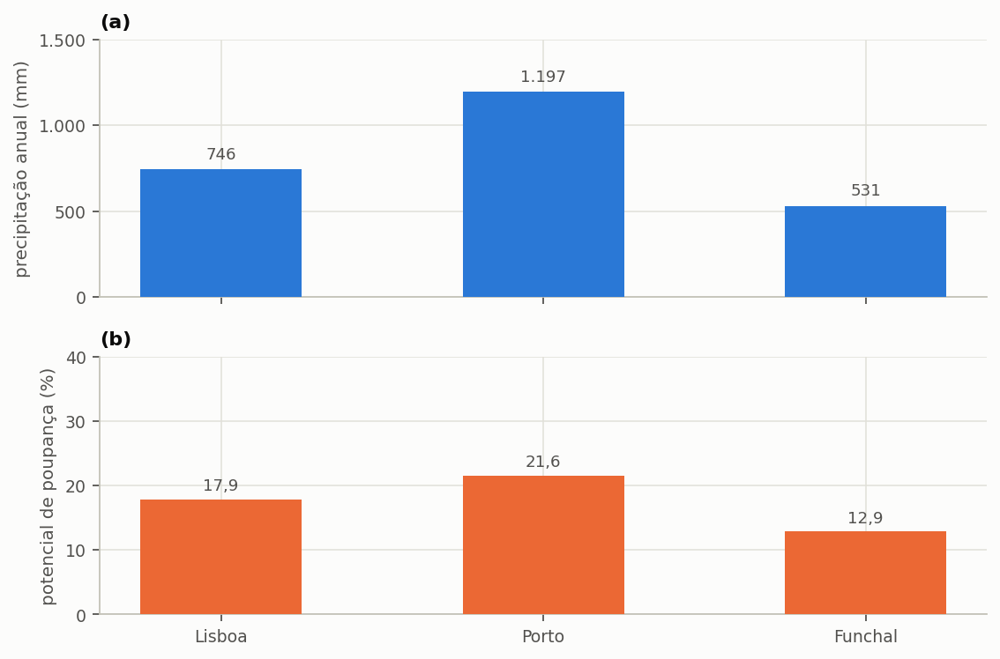
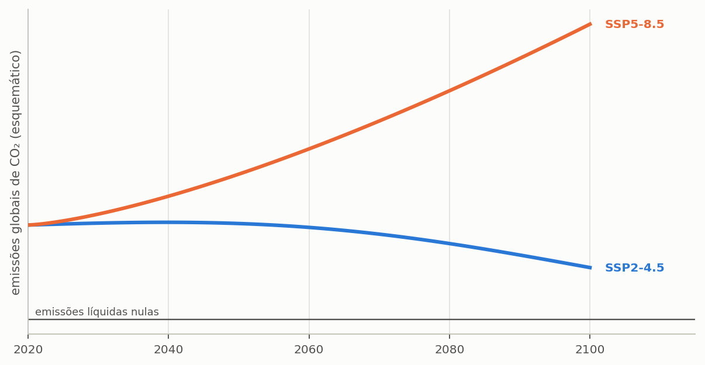
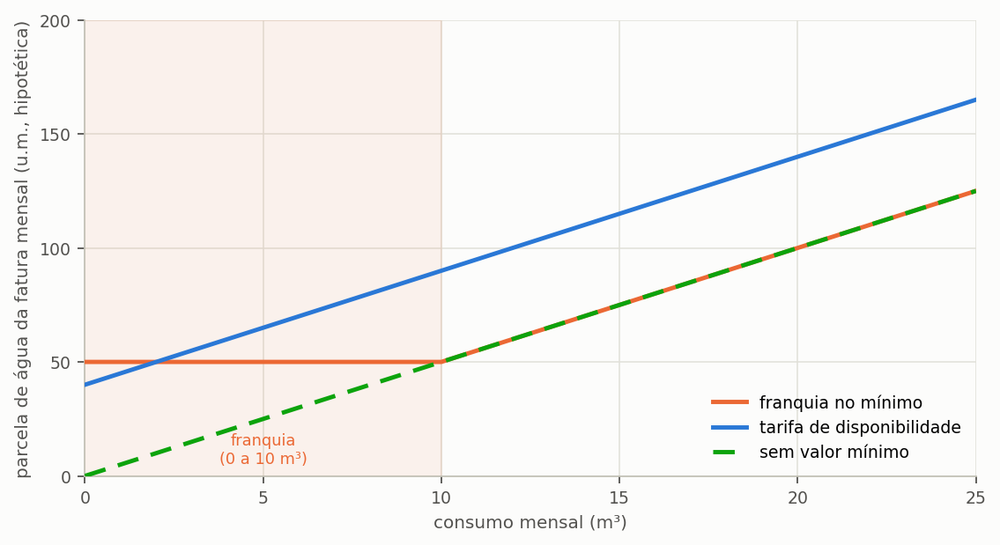
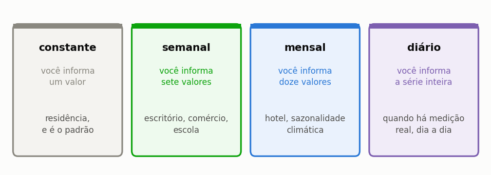
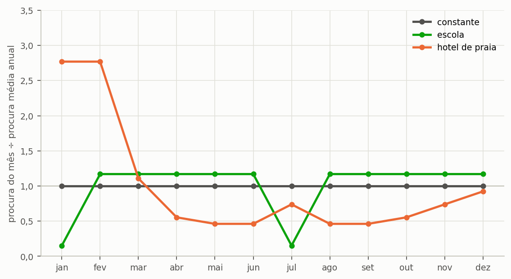
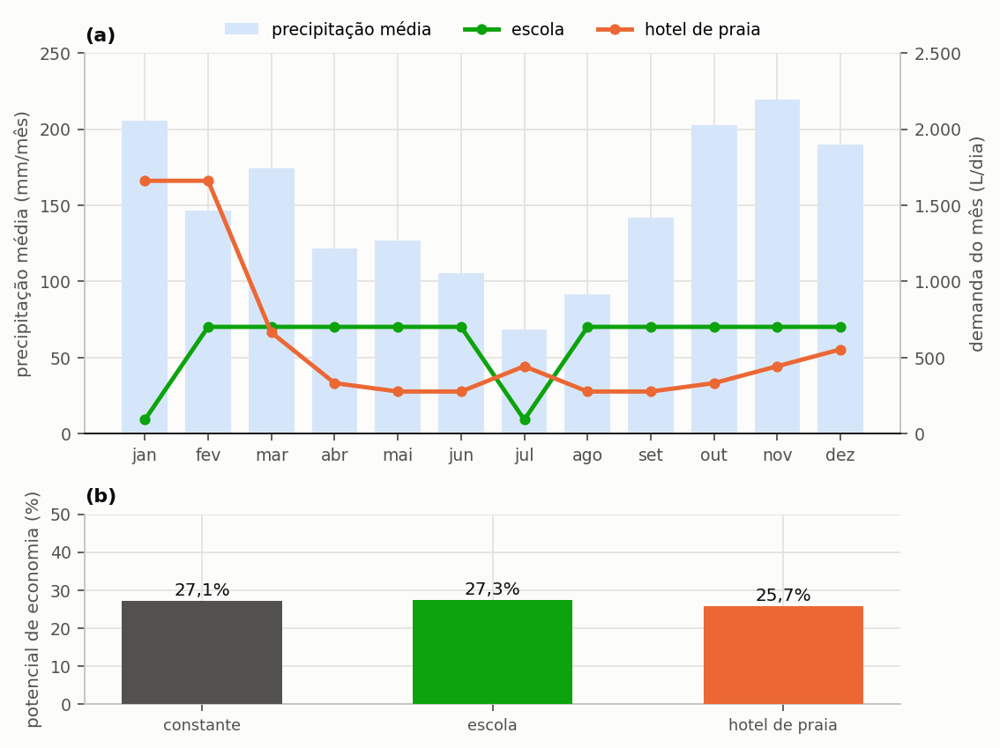
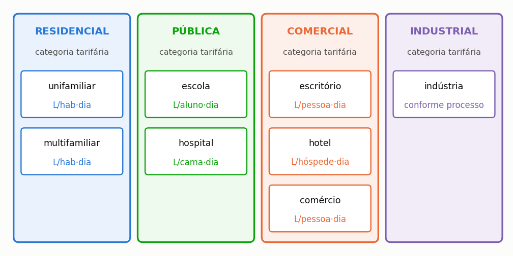
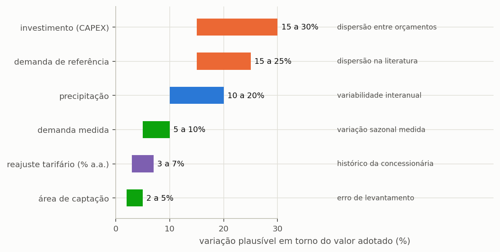
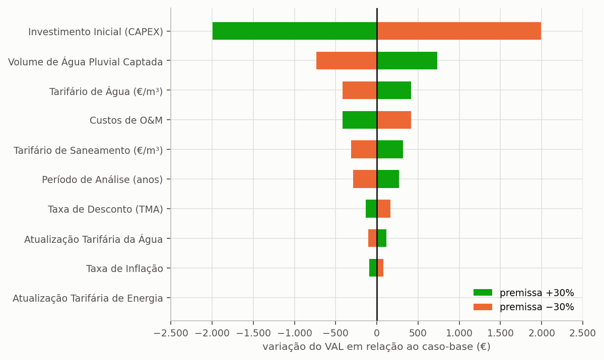

# Triton IBE

## Manual do Utilizador — Guias de uso

Igor Catão Martins Vaz e Enedir Ghisi

Grupo de Pesquisa em Ambientes Sustentáveis
Universidade Federal de Santa Catarina

2026

---

### Sobre este volume

Este é um dos oito volumes em que o manual do Triton pode ser distribuído, e
reúne o capítulo 3 (Guias disponíveis no programa) e os apêndices D, F e G do manual completo. Serve para enviar
apenas a parte que interessa: o método a um revisor, o tutorial a uma turma, os guias
a quem já utiliza o programa.

A numeração das secções e das equações é a mesma do manual completo, de modo que
uma remissão vale nos dois. Quando o texto remete para uma secção que está noutro
volume, o nome do volume vem entre parênteses.

| Volume | Conteúdo |
| :--- | :--- |
| Comece aqui | o capítulo 1 (Comece aqui) e o apêndice G |
| O método | o capítulo 2 (O método) e os apêndices A, B, C, E, G e H |
| **Guias de uso** | o capítulo 3 (Guias disponíveis no programa) e os apêndices D, F e G |
| Tutorial | o capítulo 4 (Tutorial: um exemplo do começo ao fim) e os apêndices G, I e J |
| Enganos, limitações e confiabilidade | o capítulo 5 (Enganos, limitações e confiabilidade) e os apêndices G e H |
| Correções, bugs e versionamento | o capítulo 6 (Correções, bugs e versionamento) |
| Modulação probabilística | o capítulo 7 (Modulação probabilística) e os apêndices G e H |
| Apêndices | os apêndices |

### Como citar

> VAZ, Igor Catão Martins; GHISI, Enedir. **Triton: manual do utilizador**.
> Guias de uso. Versão 0.2.0. Universidade Federal de Santa
> Catarina, 2026.

---

## Índice

**3 Guias disponíveis no programa**

3.1 Comparar cidades

3.2 Usar cenário climático futuro

3.3 Ajustar a tarifa do seu município

3.4 Modular a demanda por calendário

3.5 Simular escola, hospital e comércio

3.6 Comparar muitos casos de uma vez

3.7 Análise de sensibilidade

3.8 Importar um projeto do Netuno 4

3.9 Exportar para CAD, BIM e planilha


**Apêndices**

Apêndice D — Regimes tarifários

Apêndice F — Arquivos, pastas e formatos

Apêndice G — Glossário


## Lista de figuras

Figura 1 — (a) Precipitação média anual e (b) potencial de economia de água potável do projeto do tutorial, com 150 m² de captação, 600 L/dia de procura, fração atendível de 28% e cisterna de 5 000 L, em Lisboa, no Porto e no Funchal

Figura 2 — Precipitação média mensal em (a) Lisboa, (b) Porto e (c) Funchal, na mesma escala; a linha a tracejado é a média mensal de cada série

Figura 3 — A forma de duas trajetórias de emissão típicas

Figura 4 — Parte da água na fatura mensal em função do consumo, em três regimes de valor mínimo

Figura 5 — Os quatro modos de modulação, o que cada um pede ao utilizador e a situação em que cada um se justifica

Figura 6 — Perfis de procura usados na comparação, expressos como a razão entre a procura do mês e a procura média

Figura 7 — (a) Perfis de procura da escola e do hotel sobre a precipitação média mensal da cidade de cada caso; (b) potencial de poupança de cada perfil contra a mesma procura anual repartida por igual

Figura 8 — As oito tipologias disponíveis, agrupadas pela categoria tarifária que a entidade gestora cobra

Figura 9 — Intervalo de variação plausível de cada pressuposto numa análise de sensibilidade, com a origem da incerteza

Figura 10 — A variação do valor atual líquido quando cada pressuposto é alterado em 30% para mais e para menos, mantidos os restantes

---

## Lista de tabelas

Tabela 1 — O mesmo projeto do tutorial simulado em Lisboa, no Porto e no Funchal

Tabela 2 — Razão entre o mês mais chuvoso e o menos chuvoso nas três cidades

Tabela 3 — Os seis códigos de escalão tarifário e o efeito de cada um na fatura

Tabela 4 — Os seis regimes tarifários e o que acontece ao poupar em cada um

Tabela 5 — Efeito da poupança de água na fatura em dois regimes tarifários opostos (estruturas hipotéticas, em unidades monetárias)

Tabela 6 — Fatura mensal doméstica de água, saneamento e resíduos nos três concelhos, tarifários de 2026 transcritos pelo programa

Tabela 7 — As três formas de comparar alternativas conforme o que varia entre elas

Tabela 8 — Subcomandos da linha de comandos e finalidade de cada um

Tabela 9 — Potencial, valor atual líquido e período de recuperação do projeto final do tutorial com cada premissa variada isoladamente, do valor baixo ao alto (os custos são ilustrativos, não são preços de mercado)

Tabela 10 — Leitura da aceitabilidade SMAA-VIKOR do volume mais aceite

Tabela 11 — Dados do formato antigo recuperados pela importação

Tabela 12 — Formatos de exportação e finalidade de cada um

Tabela 13 — Opções da exportação para folha de cálculo e quando usar cada uma

Tabela 14 — Os códigos da tabela tarifária de água

Tabela 15 — Como o programa guarda cada parcela da fatura portuguesa

Tabela 16 — As quatro formas de introduzir o saneamento

Tabela 17 — Os seis regimes tarifários e o que acontece ao poupar

Tabela 18 — Preço por escalão de consumo mensal (€/m³, sem IVA), por concelho e serviço

Tabela 19 — Estrutura do tarifário do Funchal

Tabela 20 — Contas mensais de conferência do tarifário do Funchal

Tabela 21 — Estrutura do tarifário de Lisboa

Tabela 22 — Contas mensais de conferência do tarifário de Lisboa

Tabela 23 — Estrutura do tarifário do Porto

Tabela 24 — Contas mensais de conferência do tarifário do Porto

Tabela 25 — Concelhos com documento tarifário recolhido e ainda por transcrever

Tabela 26 — Estados de confiança dos valores tarifários e respetivos critérios

Tabela 27 — Concelhos e serviços por estado de confiança dos valores tarifários

Tabela 28 — Concelhos por distrito e estado de confiança dos valores tarifários

Tabela 29 — Concelhos com tarifário transcrito e o estado de cada serviço

Tabela 30 — Formatos que o programa lê e onde cada um é carregado

Tabela 31 — Formatos que o programa escreve e onde cada um é gerado

Tabela 32 — As sete secções do ficheiro de projeto e o que cada uma guarda

Tabela 33 — Localização dos ficheiros do programa e dos ficheiros do utilizador

Tabela 34 — Secções do ficheiro estudo.json (esquema triton-estudo, versão 1)

Tabela 35 — Apelidos das substituições e o campo do projeto que cada um altera

Tabela 36 — Ficheiros que triton estudo run grava na pasta de saída

Tabela 37 — Compatibilidade entre versões do ficheiro de projeto

Tabela 38 — Padronização terminológica de água de chuva e água pluvial

Tabela 39 — Grandezas fundamentais do balanço hídrico e relações entre fração e potencial

---


---
# 3. Guias disponíveis no programa

---

## 3.1. Comparar cidades

> **Pergunta a que este guia responde:** o mesmo projeto renderia o mesmo noutra cidade?

Não renderia, e a diferença não é a que a chuva sozinha sugere. A expectativa corrente é que mais chuva dê mais aproveitamento. Isso vale como ordenação, mas falha como proporção, e falha por uma razão que merece uma secção inteira.

> **As suas cidades.** O programa traz a chuva diária de 8 319 municípios da Península e das Baleares (Iberia01) e, nas ilhas, a reanálise ERA5 (nível C), com o Funchal como exemplo. Para qualquer outro local, use um ficheiro de chuva próprio, um por cidade; tudo o resto do guia vale como está escrito.

---

### 3.1.1. Como fazer a comparação

O procedimento é simples: manter todos os parâmetros do projeto e mudar apenas a série de precipitação. Na etapa **1. Projeto e Chuva**, escolha outro concelho da base ou carregue um ficheiro próprio, e execute de novo a simulação. Para comparar várias cidades sem refazer o projeto de cada vez, guarde um ficheiro por cidade, como a secção 3.6 recomenda.

---

### 3.1.2. O resultado

O projeto do tutorial — 150 m² de captação, 600 L/dia de procura, 28% de fração atendível e cisterna de 5 000 L — levado ao Porto e ao Funchal dá a tabela abaixo, ao lado de Lisboa.

<!-- tabela: **Tabela 1** — O mesmo projeto do tutorial simulado em Lisboa, no Porto e no Funchal -->
| Cidade | Chuva anual | Dias com chuva | Razão entre o mês mais e o menos chuvoso | Potencial com 5 000 L | Volume ideal |
| :--- | ---: | ---: | ---: | ---: | ---: |
| Lisboa | 746 mm | 35% | 22,7× | 17,87% | 5 000 L |
| Porto | 1 197 mm | 48% | 9,9× | 21,58% | 5 000 L |
| Funchal | 531 mm | 42% | 22,4× | 12,86% | 4 000 L |

A Figura 1 separa as duas grandezas, cada uma na sua escala.



*Figura 1 — (a) Precipitação média anual e (b) potencial de economia de água potável do projeto do tutorial, com 150 m² de captação, 600 L/dia de procura, fração atendível de 28% e cisterna de 5 000 L, em Lisboa, no Porto e no Funchal. O potencial acompanha a chuva anual, mas não proporcionalmente.*

---

### 3.1.3. A oferta em relação à procura, e o seu calendário

Lidas lado a lado, as colunas de chuva anual e de potencial de economia ordenam as cidades da mesma maneira, mas não andam em proporção. O Porto recebe 60% mais chuva do que Lisboa (1 197 mm contra 746 mm) e rende 3,71 pontos percentuais a mais: 21,58% contra 17,87%. Lisboa recebe 40% mais chuva do que o Funchal (746 mm contra 531 mm) e rende 5,01 pontos a mais, 17,87% contra 12,86%. Face ao teto de 28%, o Porto chega a 77%, Lisboa a 64% e o Funchal a 46%.

A explicação está em dois eixos. O primeiro é a **oferta em relação à procura**. Com 150 m² e coeficiente de 0,85, a chuva anual dá cerca de 153 m³ no Porto, 95 m³ em Lisboa e 68 m³ no Funchal, contra uma procura pluvial de 61 m³ por ano. O Porto tem 2,5 vezes o que precisa, Lisboa 1,6 vez e o Funchal pouco mais do que 1 vez. Onde a oferta sobra, a cisterna enche com facilidade e o potencial aproxima-se do teto; onde mal chega, a oferta limita-o, por maior que seja o reservatório.

O segundo eixo é o **calendário**. A tabela acima mostra-o duas vezes. A fração de dias com chuva é de 48% no Porto, 35% em Lisboa e 42% no Funchal. E a razão entre o mês mais chuvoso e o menos chuvoso, que mede quanto a chuva se concentra ao longo do ano, é de 9,9 no Porto, 22,4 no Funchal e 22,7 em Lisboa.

<!-- tabela: **Tabela 2** — Razão entre o mês mais chuvoso e o menos chuvoso nas três cidades -->
| Cidade | Razão | O que significa |
| :--- | ---: | :--- |
| Porto | 9,9× | chove o ano todo, com uma estação mais húmida marcada |
| Funchal | 22,4× | chuva frequente, mas com um verão claramente mais seco |
| Lisboa | 22,7× | **um verão seco depois de um inverno húmido** |

Em Lisboa, o verão é o que pesa. A cisterna enche no inverno e seca na estiagem: o atendimento pleno chega a 62,7% dos dias com 5 000 L, contra 76,0% no Porto e 44,1% no Funchal com o mesmo reservatório. Um reservatório dimensionado para atravessar noventa dias de estiagem teria de armazenar noventa dias de procura pluvial, o que neste projeto são 15 120 litros — um volume que nenhuma cisterna residencial comporta. É por isso que a curva de volume de Lisboa não satura (secção 4.4 (volume Tutorial)) e que o sistema fica parado durante parte de cada ano.

> **A conclusão prática.** ==O potencial do aproveitamento pluvial depende de a chuva chegar, e de chegar quando é precisa.== O Porto mostra o que a abundância faz; Lisboa mostra o que um verão seco tira a uma chuva razoável; o Funchal mostra o que acontece quando a chuva, mesmo frequente, quase não excede a procura.

---

A Figura 2 apresenta o regime mensal das três cidades na mesma escala.


*Figura 2 — Precipitação média mensal em (a) Lisboa, (b) Porto e (c) Funchal, na mesma escala; a linha a tracejado é a média mensal de cada série. Lisboa concentra a chuva no inverno e tem um verão seco (a razão entre o mês mais e o menos chuvoso é de 22,7); o Porto é mais repartido (9,9); o Funchal tem uma razão quase igual à de Lisboa (22,4). É esta distribuição, e não o total anual sozinho, que decide o comportamento do reservatório.*

---

### 3.1.4. Atenção ao Funchal

A série do Funchal é de natureza diferente das outras duas. Lisboa e o Porto usam o Iberia01, uma grelha de 0,1° interpolada de observações, média das células dentro do município. O Funchal está fora do domínio do Iberia01 (e a E-OBS não serve: faltam dados em 22% dos dias de 1991 a 2020, e o critério admite no máximo 1%), pelo que o exemplo usa a reanálise ERA5, um nó de grelha de 0,25° (cerca de 25 km), com nível de qualidade C, e não um registo de estação. Comparar o Funchal com Lisboa e o Porto mistura, por isso, dois produtos. É a série menos fiável das três, e o seu valor serve para ilustrar o método, não para dimensionar. Num projeto real, use a série medida no local.

---

### 3.1.5. Não leve um resultado de outra cidade

A comparação acima não é peculiaridade deste tutorial, e a lição para quem compara cidades é a mesma em qualquer estudo: a série local decide, e um volume ou um potencial trazido de outra cidade, ainda que vizinha, não substitui a simulação. Um número publicado para um clima que não é o seu é uma hipótese a testar, não um resultado a adotar.

#### 3.1.5.1. Muitas cidades de uma vez

Para comparar mais de três ou quatro cidades, trocar a série à mão deixa de ser prático. A folha de cenários da secção 3.6 corre o mesmo projeto contra várias séries numa única execução, gravando um resultado por linha. Mantenha na folha os mesmos parâmetros de edifício e de reservatório em todas as linhas, e varie apenas a série: é o que isola o efeito do clima.

---

### 3.1.6. O que mais muda entre cidades

A precipitação não é a única grandeza que varia entre cidades, e as outras duas podem inverter a conclusão económica de um estudo comparativo.

A primeira é a **tarifa**. O preço do metro cúbico varia de uma entidade gestora para outra, e a estrutura também: Lisboa soma à água da EPAL o saneamento e os resíduos da Câmara Municipal; o Porto tem o tarifário da Águas e Energia do Porto; o Funchal, o da Câmara Municipal do Funchal (os três de 2026, transcritos em `triton/data/portugal_tarifarios.json`). Um potencial de 15% sob uma tarifa íngreme pode render mais dinheiro do que um de 27% sob uma tarifa baixa, e a secção 3.3 trata do mecanismo em pormenor. As cidades de exemplo levam os seus tarifários publicados, mas só o tutorial de Lisboa leva custos, pelo que este guia as compara pelo potencial de poupança, e não pelo período de recuperação. O IVA do Funchal (4%) está por confirmar; ver `examples/LEIA.md`.

A segunda é o **fator de emissão da rede elétrica**, que altera em simultâneo a emissão evitada por metro cúbico de água substituída e o custo ambiental da bombagem. Na Edição Ibérica, introduz-se em cada projeto. A eletricidade só vem tabelada para o Funchal (tarifa da Empresa de Eletricidade da Madeira, fonte secundária, a confirmar).

> **Ao comparar cidades num estudo, deixe claro o que variou.** Comparar só a precipitação, mantendo fixos a tarifa e o fator de emissão, isola o efeito climático e é uma comparação legítima, desde que declarada como tal. Variar todas as grandezas ao mesmo tempo produz um número que não se consegue explicar, porque nele se somam efeitos de sinais possivelmente opostos.

---

### 3.1.7. O volume ideal também muda, mas pouco

A última coluna da tabela guarda uma surpresa menor: com o limiar de 1 %/m³, o volume ideal é de 5 000 L em Lisboa e no Porto e de 4 000 L no Funchal, uma amplitude modesta perante a diferença de regimes que as separa.

A explicação está na natureza do critério. O volume ideal pelo ganho marginal localiza o joelho da curva de aproveitamento, e a posição desse joelho depende de como os primeiros metros cúbicos de armazenamento enchem e esvaziam contra uma procura diária de 168 L, que é a mesma nas três cidades. O que varia fortemente é o **patamar** que a curva atinge depois do joelho (17,87%, 21,58% e 12,86%), e não o ponto em que dobra. A coincidência pertence a esta casa, a este limiar e a estas três cidades; não é uma lei, e outra procura ou outro limiar podem separá-las.

Dito de outro modo: no Funchal acerta-se quase o mesmo volume que no Porto e colhe-se bastante menos água com ele.

---

## 3.2. Usar um cenário climático futuro

> **Pergunta a que este guia responde:** o sistema que dimensiono hoje ainda serve em 2060?

> **As suas projeções.** A Edição Ibérica não traz base de projeções climáticas. As bases que acompanham o programa (Iberia01, 1971 a 2015, e a E-OBS opcional, 1950 a 2025) são observadas e não contêm futuro. O método deste guia aplica-se tal como está a séries projetadas que carregue como ficheiros de chuva: por exemplo, séries diárias com correção de viés de um serviço climático nacional ou de um estudo de regionalização. O guia diz o que pedir a essas séries e como compará-las. O sítio do Instituto Português do Mar e da Atmosfera (IPMA, https://www.ipma.pt, consultado em 16/10/2026) tem uma ligação para o «Portal do Clima». Não verificado nesta versão: o conteúdo do Portal do Clima (séries diárias de precipitação projetada, modelos, cenários, resolução e condições de utilização); este manual não afirma nada sobre ele.

Um reservatório de água da chuva dura trinta anos ou mais, e a chuva que cairá sobre o edifício durante esse período não será a mesma que caiu no passado recente. Dimensionar um sistema de vida longa só sobre a série histórica supõe, implicitamente, um clima estacionário — uma suposição que as projeções disponíveis não sustentam. O Triton não pode fornecer as projeções para o seu local, mas corre o mesmo projeto sobre qualquer série que lhe dê, para que o dimensionamento possa incorporar esta questão de forma explícita.

---

### 3.2.1. O que a série projetada tem de ser

Verifique quatro coisas em qualquer série projetada antes de a carregar.

**Tem de ser diária e em milímetros.** O programa lê um valor por dia, como em qualquer ficheiro de chuva (apêndice F). Projeções mensais não servem: o reservatório responde à distribuição dos dias.

**Deve ter correção de viés.** Os modelos climáticos globais têm uma resolução de dezenas a centenas de quilómetros e reproduzem mal a chuva local: tendem a errar a frequência dos dias de chuva, a intensidade e os extremos. Uma série que não tenha sido ajustada à distribuição observada vai falsear o rendimento, normalmente num sentido que não se sabe prever. A correção melhora a estatística; não transforma um mau modelo num bom, e não consegue corrigir uma tendência implausível.

**Representa uma célula de grelha, não uma estação.** A série de um lugar é a da célula que o contém, pelo que descreve a chuva média de uma área e não a de um pluviómetro. Em relevo acidentado ou no litoral, a diferença entre a célula e o lote pode ser grande. A série do Funchal que acompanha o programa é deste tipo (reanálise ERA5, célula de cerca de 9 km), e a E-OBS é uma grelha de 0,1°.

**O seu histórico é simulado.** A parte histórica de uma série de modelo não é a chuva observada, mas a simulação do modelo para esse período, corrigida para ter a mesma **estatística** que a observação. A cronologia não coincide: um dia de chuva na série do modelo não corresponde a um dia de chuva real. Por isso, a comparação certa para um cenário futuro é com o **histórico do mesmo modelo**, não com a série observada. Misturar as duas atribuiria ao clima futuro a diferença entre a observação e o modelo.

---

### 3.2.2. Escolher cenário e janela

O **cenário** representa a trajetória futura das emissões de gases com efeito de estufa. Os cenários não são previsões, mas hipóteses coerentes sobre o comportamento socioeconómico global ao longo do século (Figura 3). Uma trajetória intermédia estabiliza e depois reduz as emissões; uma trajetória intensiva em combustíveis fósseis supõe emissões altas e crescentes, sem mitigação efetiva.



*Figura 3 — A forma de duas trajetórias de emissão típicas. A trajetória intermédia tem emissões que se estabilizam e depois caem; a intensiva em combustíveis fósseis supõe emissões altas e crescentes, sem mitigação efetiva. A figura mostra a forma de cada uma, não valores projetados.*

A **janela temporal** é o recorte da série futura sobre o qual o estudo se faz. O programa deixa recortar qualquer período, nas datas inicial e final da etapa **1. Projeto e Chuva**. A convenção mais usada é tomar janelas de trinta anos, a mesma duração das normais climatológicas; a etapa avisa quando o recorte tem menos de dez anos. A escolha da janela deve ter relação com a vida útil pretendida do sistema: avaliar um reservatório de vinte anos, instalado agora, contra o fim do século avalia um período em que já terá sido substituído.

A escolha do **modelo climático** é a mais delicada das decisões, e dedica-se-lhe adiante uma subsecção própria.

---

### 3.2.3. Como conduzir o estudo

O procedimento certo é correr o mesmo projeto em cada combinação de interesse e comparar os resultados entre si, em vez de dimensionar diretamente sobre a série projetada. Quatro passos resumem-no.

1. Feche o dimensionamento com a série **histórica**. É a referência.
2. Corra o mesmo projeto sobre o **histórico simulado** de cada modelo que for usar. É contra ele, e não contra a série observada, que o futuro se compara.
3. Mantenha todos os outros parâmetros e troque só a série, para cada cenário e janela.
4. Compare o **potencial de economia** e os **dias de atendimento pleno**, sempre como diferença entre o futuro e o histórico do mesmo modelo. O segundo costuma degradar-se mais do que o primeiro, porque o que muda primeiro é a distribuição, não o total.

> **Um exemplo de leitura.** Suponha que, com um modelo, o potencial é de 15% no histórico simulado e de 13% numa janela futura, e que a série observada dá 17%. A mudança atribuível ao clima é de dois pontos, e não de quatro: os dois pontos restantes são a diferença entre o modelo e a observação, que existe também no passado. (Os números são hipotéticos, para mostrar a aritmética.)

> **O que não fazer.** Dimensionar diretamente sobre a série futura e apresentar o resultado como projeto. A série futura é uma projeção com grande incerteza; serve para testar a **robustez** de um dimensionamento feito sobre o histórico, não para o substituir.

---

### 3.2.4. A escolha do modelo, e porque pesa tanto

Modelos climáticos diferentes projetam futuros diferentes para a mesma cidade sob o mesmo cenário de emissões, e essa dispersão não é ruído a eliminar: é a expressão honesta da incerteza física do problema. Para a chuva, a dispersão entre modelos costuma ser maior do que a diferença entre cenários de emissão, o que significa que a escolha do modelo pode pesar mais no resultado do que a escolha do futuro socioeconómico. A consequência para o projeto é direta: correr os dois cenários com um só modelo informa menos do que correr um cenário com vários modelos.

Três condutas são defensáveis perante esta dispersão, apresentadas aqui por ordem decrescente de rigor.

**Conjunto.** Corra todos os modelos disponíveis e reporte a gama de resultados, com a mediana. É o mais rigoroso e o mais caro em tempo de cálculo. A secção 3.6 mostra como fazê-lo em lote.

**Subconjunto justificado.** Escolha alguns modelos com bom desempenho documentado para a sua região, e declare o critério de escolha e a fonte.

**Modelo único, declarado como tal.** Aceitável numa análise exploratória, desde que o texto não apresente o resultado como uma projeção robusta.

> **O que nunca fazer:** correr vários modelos, escolher o que dá o resultado mais conveniente e reportar só esse.

---

### 3.2.5. O que as três cidades sugerem sobre um clima futuro

Os estudos que simulam sistemas de aproveitamento pluvial sob projeções climáticas tendem a concordar num ponto: a mudança no total anual de chuva importa menos do que a mudança na sua **distribuição**. A secção 3.1 mostra o mesmo no espaço: Lisboa tem 62% da chuva do Porto e uma razão de 22,7 entre o mês mais e o menos chuvoso, contra 9,9 no Porto, e o seu potencial é de 17,87% contra 21,58% com o mesmo reservatório de 5 000 L. Um clima futuro com estiagens mais longas comporta-se, para o reservatório, como uma mudança de cidade, e um reservatório adequado hoje pode precisar de ser maior para dar a mesma fiabilidade. Este manual não cita estudos específicos; quem queira apoiar esta afirmação em literatura deve indicar estudos com fonte aberta (DOI).

---

### 3.2.6. O que declarar

Um estudo com cenário climático tem de indicar, no método:

- o **modelo ou modelos**, pelo nome, e o critério de seleção;
- o **cenário**;
- a **janela temporal**, com os anos;
- a **série histórica** usada como referência;
- se houve regionalização ou correção de viés, e com que método, contra que conjunto observado;
- a **origem da série**, com a versão;
- que o futuro foi comparado com o **histórico simulado do mesmo modelo**.

Sem isto, o resultado não é reproduzível.

---

### 3.2.7. Uma ressalva de método

As projeções climáticas carregam duas incertezas sobrepostas, de natureza diferente: a do cenário, que é socioeconómica e diz respeito a escolhas humanas futuras, e a do modelo, que é física e diz respeito à representação do sistema climático. Nenhuma se reduz com mais simulações do mesmo material, porque não é uma incerteza de amostragem.

Um estudo conduzido com honestidade apresenta o resultado como uma gama, e não como um número único, e evita conclusões que dependam da terceira casa decimal de uma projeção para 2060.

---

## 3.3. Ajustar o tarifário do seu concelho

> **Pergunta que este guia responde:** o tarifário do meu projeto é aquele em que o edifício
> é faturado, e está bem introduzido?

> **Edição Ibérica.** O programa traz transcritos os tarifários de três concelhos, Lisboa,
> Porto e Funchal, com a fonte e a data de cada um. Para qualquer outro concelho, o tarifário
> introduz-se à mão, com a mesma tabela de escalões, os mesmos códigos e os mesmos seis regimes
> de valor mínimo descritos aqui. Este guia é, por isso, também a referência para lançar
> qualquer estrutura tarifária.

Este é o guia que mais altera resultados. A estrutura tarifária decide a viabilidade
económica de um sistema pluvial mais do que qualquer parâmetro de projeto, e é também o dado
que mais vezes aparece errado nos estudos publicados sobre o tema.

---

### 3.3.1. Como se compõe a fatura de água, saneamento e resíduos

Antes de conferir um tarifário, convém perceber o que se confere. A fatura de água não é o
produto do consumo por um preço único, e cinco características distinguem-na da fatura de
eletricidade, que é a referência mais familiar para a maioria dos leitores.

**O serviço é local, e o preço também.** Cada concelho é servido por uma entidade gestora,
municipal, intermunicipal ou empresarial, e cada entidade publica o seu tarifário. Não há tarifa
nacional de água. Os três exemplos do programa mostram-no. Em Lisboa, a água é vendida pela EPAL
e o saneamento e os resíduos são cobrados pela Câmara Municipal. No Porto, a água e o saneamento
são da Águas e Energia do Porto, EM, e os resíduos ficam de fora da fatura dessa entidade. No
Funchal, os três serviços constam da tabela de taxas da Câmara Municipal.

**A tarifa é progressiva por escalões de consumo.** O metro cúbico não custa o mesmo em
qualquer quantidade: o consumo divide-se em escalões, e cada escalão tem preço próprio,
crescente. Em Lisboa, os primeiros 5 m³ de água custam 0,4634 €/m³ e o escalão acima de 25 m³
custa 2,5961 €/m³, antes de IVA. ==A progressividade torna a poupança de água mais valiosa do que
parece:== o metro cúbico que se deixa de consumir é o do escalão mais alto atingido na fatura, o
mais caro.

**Há uma parte que não depende do consumo.** As três entidades cobram uma tarifa fixa mensal,
mesmo a quem não consome nada: a água de Lisboa tem 5,82 €/mês, a do Porto 3,726 €/mês
(0,1242 €/dia, em meses de 30 dias) e a do Funchal 4,12 €/mês. É o assunto da secção sobre os
seis regimes, adiante.

**O saneamento e os resíduos cobram-se sobre a água.** Nos três concelhos, a parte variável do
saneamento tem escalões próprios. Em Lisboa, os escalões aplicam-se ao volume recolhido, que o
tarifário fixa em 90% da água consumida. Os resíduos têm uma parte fixa e, em Lisboa e no
Funchal, uma parte indexada ao volume de água. Poupar um metro cúbico de água poupa também estas
parcelas, e é por isso que o valor do metro cúbico poupado excede o preço da água sozinho.

**O IVA é declarado parcela a parcela.** A água de Lisboa e do Porto leva IVA de 6%, taxa que a
tabela da EPAL declara e que o tarifário do Porto não imprime. O saneamento e os resíduos de
Lisboa não levam IVA nos documentos da Câmara. No Funchal, o programa aplica 4% a todas as
parcelas, valor ainda **por confirmar** (ver abaixo). Há ainda a taxa de recursos hídricos,
cobrada pela Agência Portuguesa do Ambiente e repercutida nas tarifas: no Porto entra com
0,0392 €/m³; em Lisboa, a do saneamento entra com 0,032 €/m³ recolhido.

> **O que o programa traz, e o que tem de lançar.** O tarifário transcrito cobre o
> **utilizador doméstico** no tarifário geral, com o contador de pequeno calibre. As categorias
> não domésticas existem, são públicas e constam dos documentos de cada entidade, mas o
> programa não as traz: para estudar uma escola, um comércio ou uma indústria, lance a estrutura
> da categoria correta no modo personalizado deste mesmo ecrã. A secção 3.5 mostra o
> procedimento. Os documentos de outras capitais de distrito já estão reunidos na base de fontes
> do programa, por transcrever; até lá, nesses concelhos o tarifário também se lança à mão.

---

### 3.3.2. Comece por conferir o que já está no projeto

Na etapa **1. Projeto e Chuva**, no quadro «Concelho de referência & tarifário (água, saneamento
e resíduos)», escolha o concelho. Para Lisboa, Porto e Funchal, o programa mostra as entidades
gestoras, a vigência do tarifário e as fontes, e assinala que o tarifário foi transcrito dos
documentos oficiais. Para um concelho sem tarifário transcrito, avisa que a tarifa se informa em
«Editar». Três itens merecem conferência com o documento em vigor da sua entidade gestora, e a
ordem importa, porque o primeiro invalida os restantes.

1. **a data de vigência**: os tarifários atualizam-se todos os anos;
2. **os valores dos escalões**;
3. **o regime de valor mínimo**, que é o item 3.3.4.

Havendo divergência em qualquer dos três, carregue em «Editar / Detalhar Tarifas da Cidade…» e
corrija a tabela. A correção vale para o seu projeto e fica guardada dentro do ficheiro
`.triton`, o que significa que quem receber o projeto reproduz o mesmo cálculo, com a mesma
tabela. O botão «Repor o tarifário transcrito do concelho» devolve a tabela de origem.

---

### 3.3.3. Como a tabela é construída

Cada linha da estrutura tarifária é representada no programa por uma quádrupla de valores: o
volume mínimo do escalão, o volume máximo, um valor monetário e um código. O código é o elemento
decisivo, porque é ele que diz o que aquele valor significa, e estruturas parecidas cobram de
maneiras muito diferentes conforme o código de cada linha.

<!-- tabela: **Tabela 3** — Os seis códigos de escalão tarifário e o efeito de cada um na fatura -->
| Código | O que é | Como entra na fatura |
| ---: | :--- | :--- |
| 1 ou 0 | escalão de consumo | cobra-se o preço por volume que cai **dentro** de cada escalão de consumo |
| −1 | tarifa de disponibilidade | valor fixo **somado** à parte de consumo |
| −2 | franquia retroativa | até ao volume da franquia, paga-se o valor fixo; acima dele, tarifa-se **tudo desde zero** |
| −3 | piso de pagamento | a fatura **não desce** abaixo deste valor |
| 2 | preço de base exponencial | `PB` da fórmula `PB × Cⁿ`, válido até ao máximo da linha |
| 3 | expoente da tabela exponencial | o `n` aplicado ao consumo **do mês inteiro** que cai na linha |

A água de Lisboa, tomada como exemplo, tem cinco linhas: uma de disponibilidade e quatro
escalões progressivos. O IVA de 6% é um campo à parte, aplicado sobre a soma.

```
(0,00 ; 0,00   ; 5,82   ; -1)   disponibilidade, soma sempre
(0,00 ; 5,00   ; 0,4634 ;  1)   primeiro escalão
(5,00 ; 15,00  ; 0,8666 ;  1)   segundo escalão
(15,00 ; 25,00 ; 2,0398 ;  1)   terceiro escalão
(25,00 ; 999999 ; 2,5961 ; 1)   último escalão
```

O saneamento de Lisboa tem os seus próprios escalões, aplicados a 90% do volume de água, e a
fatura de resíduos tem uma parte fixa e uma parte por metro cúbico. O programa guarda tudo isto
nos campos tarifários do projeto, e a conta mensal que o programa calcula coincide com a soma
parcela a parcela, conferida por teste.

---

### 3.3.4. Os seis regimes, e por que decidem projetos

O valor mínimo aparece na fatura de quase todas as entidades, e significa coisas **diferentes**
em cada uma. O programa distingue seis regimes:

<!-- tabela: **Tabela 4** — Os seis regimes tarifários e o que acontece ao poupar em cada um -->
| Regime | O que acontece ao poupar | Onde aparece nos exemplos |
| :--- | :--- | :--- |
| **sem mínimo** | cada m³ poupado desconta | nenhum dos três |
| **disponibilidade** | idem; a tarifa fixa mantém-se, mas não impede a poupança | Lisboa, Porto e Funchal (tarifa fixa mensal da água) |
| **fórmula exponencial** | idem; o m³ poupado vale pelo preço de base elevado ao expoente | nenhum dos três |
| **franquia no mínimo** | abaixo da franquia, poupar **não desconta nada** | nenhum dos três |
| **franquia retroativa** | acima da franquia, tarifa-se tudo desde zero | nenhum dos três |
| **piso de pagamento** | a fatura não desce abaixo do piso | nenhum dos três |

**O caso que deita abaixo um estudo.** Compare duas estruturas hipotéticas, lado a lado, para o
mesmo consumo. Os preços são números redondos em unidades monetárias (u.m.), escolhidos para
facilitar a conta; são uma ilustração, não um tarifário:

<!-- tabela: **Tabela 5** — Efeito da poupança de água na fatura em dois regimes tarifários opostos (estruturas hipotéticas, em unidades monetárias) -->
| Consumo | Estrutura A, franquia no mínimo (50 u.m. pelos primeiros 10 m³, depois 5 u.m./m³) | Estrutura B, disponibilidade (40 u.m. mais 5 u.m./m³) |
| ---: | ---: | ---: |
| 14 m³ | 70 u.m. | 110 u.m. |
| 12 m³ | 60 u.m. | 100 u.m. |
| 10 m³ | 50 u.m. | 90 u.m. |
| 8 m³ | **50 u.m.** | 80 u.m. |
| 5 m³ | **50 u.m.** | 65 u.m. |

Na estrutura A, a fatura **deixa de descer aos 10 m³**. Uma casa que consome 12 m³ e instala um
sistema que poupa 4 desce para 8 e poupa 10 u.m., e não as 20 u.m. que o preço médio de
5 u.m./m³ sugeriria. Se poupasse 7, desceria para 5 e pouparia as **mesmas** 10 u.m.: os três
metros cúbicos adicionais não valem nada.

Na estrutura B, cada metro cúbico poupado reduz a fatura, desde o primeiro.

> Correr um caso da estrutura A com os dados da estrutura B produz um período de recuperação
> que não existe. Verifique o regime antes de confiar em qualquer resultado económico.

Os três concelhos do programa pertencem todos à segunda família: em cada um, todos os metros
cúbicos poupados reduzem a fatura. Em Lisboa, para a moradia do tutorial, a fatura sem o
sistema corresponde a 18,26 m³ por mês e custa 46,25 €; com o sistema, a 14,92 m³ e 34,93 €.
A poupança é de 3,34 m³ e 11,32 € por mês, ou seja, 3,39 € por metro cúbico poupado, contra
os 2,53 € por metro cúbico que o preço médio da fatura sem sistema sugeriria. Cada metro cúbico
poupado desconta o escalão mais alto da água e as parcelas do saneamento e dos resíduos que o
acompanham.

A Figura 4 mostra as três respostas lado a lado. O que distingue os regimes não é o
preço praticado, e sim a forma da curva: ==onde a curva é horizontal, poupar água não reduz a
fatura em nada.==



*Figura 4 — Parte da água na fatura mensal em função do consumo, em três regimes de valor mínimo. O saneamento não entra no gráfico porque acompanha a água e apenas multiplica a curva, sem lhe mudar a forma. Na tarifa de disponibilidade e sem valor mínimo, cada metro cúbico poupado reduz a fatura desde o primeiro; na franquia no mínimo, o troço horizontal marca a gama de consumo em que poupar água não reduz a fatura.*

---

### 3.3.5. O que os três tarifários dizem, lado a lado

Os valores abaixo vêm dos documentos oficiais transcritos pelo programa (utilizador doméstico,
tarifário geral, meses de 30 dias). Servem para ver como estruturas parecidas dão contas
diferentes, e não para substituir a consulta do documento em vigor.

<!-- tabela: **Tabela 6** — Fatura mensal doméstica de água, saneamento e resíduos nos três concelhos, tarifários de 2026 transcritos pelo programa -->
| Concelho | Entidades | Fatura de 10 m³ | Fatura de 30 m³ | IVA aplicado |
| :--- | :--- | ---: | ---: | :--- |
| Lisboa | EPAL (água); Câmara Municipal (saneamento e resíduos) | 25,8683 € | 94,3767 € | 6% na água; sem IVA no saneamento e nos resíduos |
| Porto | Águas e Energia do Porto, EM | 20,2995 € | 93,3293 € | 6% na água, no saneamento e na taxa de recursos hídricos |
| Funchal | Câmara Municipal do Funchal | 17,0872 € | 67,5272 € | 4%, por confirmar |

A 10 m³, Lisboa é a mais cara; a 30 m³, Lisboa e Porto quase se igualam, porque o Porto tem
escalões superiores mais caros. Quem compara concelhos pelo preço do primeiro escalão chega a
conclusões erradas: compare faturas para o consumo do edifício.

Três dúvidas ficam registadas, por honestidade, e o programa não as esconde:

- **Lisboa.** O «Adicional C.M. Lisboa» (0,1483 €/m³) vem impresso na tabela da EPAL sem dizer
  se leva IVA; o programa trata-o sem IVA. O saneamento e os resíduos da Câmara estão tratados
  sem IVA, como os documentos declaram.
- **Porto.** A tarifa de disponibilidade de água é a da secção dos utilizadores domésticos; o
  documento repete a tabela noutra página com um valor mais alto, lido como o dos não domésticos
  por inferência do desenho da página, a confirmar com a entidade. A taxa de 6% é a reduzida do
  Continente e não vem impressa no documento. Os resíduos urbanos não constam deste tarifário e
  ficam fora da fatura.
- **Funchal.** O IVA de 4% **não foi confirmado**: com 5%, a fatura de 10 m³ passaria de
  17,0872 € para 17,2515 €. O primeiro escalão do saneamento e dos resíduos não tem valor
  impresso e foi tratado como zero. A parte variável dos resíduos foi somada à do saneamento,
  porque o programa ainda não tem campo para resíduos por escalões; no ecrã, o «saneamento» do
  Funchal inclui, por isso, os resíduos variáveis.

---

### 3.3.6. A fórmula exponencial

Algumas entidades não cobram a água por escalões. A parte da água é dada por uma fórmula:

```
Água = PB × Cⁿ + SB
```

em que `PB` é o preço de base, em €/m³; `C` é o consumo do mês, em m³; `n` é o expoente que a
**tabela de expoentes** da entidade atribui a esse consumo; e `SB` é o serviço de base, cobrado
mesmo sem consumo. Tipicamente, `n` vale 1,00 até um limiar e sobe com o consumo a partir daí.

Duas diferenças em relação aos escalões decidem o cálculo:

- **O expoente aplica-se ao consumo inteiro.** Nos escalões, cada metro cúbico paga o preço do
  escalão em que cai; na fórmula, o `n` da linha em que cai o consumo total aplica-se a todo o
  volume. Passar um limiar encarece, por isso, também os metros cúbicos abaixo dele.
- **Não há degrau de preço, há curva.** O preço médio do metro cúbico de água é `PB × Cⁿ⁻¹`:
  constante enquanto `n` vale 1 e crescente depois.

Para o aproveitamento pluvial, a consequência é que **toda a poupança desconta desde o primeiro
metro cúbico**, e desconta mais onde o expoente é maior.

Nenhum dos três concelhos do programa usa este regime. No programa, a fórmula entra na mesma
tabela de quádruplas, com dois códigos próprios: uma linha de código 2 guarda o preço de base
`PB`, e uma linha de código 3 por cada intervalo da tabela de expoentes guarda o `n`.

```
(0,00 ; 0,00   ; SB   ; -1)   serviço de base, soma sempre
(0,00 ; 999999 ; PB   ;  2)   preço de base PB
(0,00 ; 20,00  ; 1,00 ;  3)   n para o consumo em (0, 20]
...                           uma linha por intervalo da tabela de expoentes
```

No diálogo do tarifário, a estrutura aparece com o rótulo «Fórmula exponencial», as linhas
«Expoente n» podem ser editadas e o simulador mostra o cálculo `PB × Cⁿ` do consumo escolhido.
O campo do saneamento passa a «Saneamento (por m³ consumido)», e a etapa económica oferece o
mesmo modo, «Por m³ consumido», ao lado do valor fixo e da percentagem da água.

---

### 3.3.7. Quando o mínimo é diluído na tarifa

Um erro frequente ao registar tarifas: a entidade informa «fatura mínima de 50 para 10 m³», e
quem regista grava 5 por m³ até 10 m³.

A diferença é enorme. Na primeira leitura, quem consome 4 m³ paga 50; na segunda, paga 20. E,
pior para um estudo pluvial, na segunda leitura poupar abaixo de 10 m³ **desconta**, quando na
realidade não desconta.

Se registar um tarifário novo, **verifique isto**: um mínimo declarado como fatura é uma tarifa
de disponibilidade ou uma franquia, e não um preço por metro cúbico.

---

### 3.3.8. O saneamento

A percentagem de saneamento, quando existe, incide sobre a **parte da água** da fatura, e não
sobre a fatura total.

Cem por cento significa que a parte do saneamento iguala a da água, e portanto que o saneamento
é **metade da fatura**. Poupar água poupa as duas partes, e é por isso que o valor efetivo do
metro cúbico poupado é superior ao preço da água.

Os três concelhos do programa cobram o saneamento por escalões próprios, sobre o volume de água
consumido ou sobre uma fração dele (90% em Lisboa), e não por uma percentagem única. O programa
tem um modo para cada forma: percentagem da parte da água, preço por metro cúbico, e escalões
sobre uma fração do volume. Escolha o que corresponde ao documento.

---

### 3.3.9. Vigência, atualização e tabelas alternativas

Um tarifário vale desde a data do documento de onde saiu, e nem sempre há um mais recente. O
diálogo do tarifário mostra essa data em **Tabela vigente desde**, ao lado da **Data-base do
estudo**, guardada no projeto. Entre as duas, o programa aplica as atualizações que já caíram,
com a taxa de atualização configurada, e as seguintes vêm nos aniversários da vigência, e não
doze meses depois do início do estudo. É uma estimativa, porque a atualização que de facto
houve pode ter sido outra; com o tarifário atual à mão, introduza-o com a sua vigência. Um
projeto antigo, sem as datas, fica como estava.

Alguns concelhos têm mais de uma tabela residencial, por exemplo por calibre do contador. Os
três tarifários do programa são os do contador de pequeno calibre. Escolha a tabela que
corresponde ao imóvel e registe no projeto a razão. Quem tiver a fatura do próprio imóvel pode,
como sempre, introduzir a tabela.

### 3.3.10. Onde encontrar os dados

Por ordem de fiabilidade:

1. **Tarifário publicado pela entidade gestora**, em regra no seu sítio ou no do município. É o
   documento oficial e traz a data de vigência. As entidades de titularidade municipal enviam o
   tarifário à ERSAR, entidade reguladora, para parecer.
2. **Simulador de fatura** da entidade, quando existir. Bom para conferir: simule dois consumos
   e veja se a sua tabela reproduz os dois valores.
3. **Fatura real de água, saneamento e resíduos**, do próprio imóvel. É a melhor evidência, e
   permite conferir a estrutura inteira.

> **Registe sempre a data de vigência e a fonte.** Um estudo que não diz de quando é a tarifa
> não pode ser reproduzido daqui a dois anos.

---

### 3.3.11. Confira antes de confiar

Depois de montar a tabela, faça o teste que o item 3.3.7 sugere: simule dois consumos, um
dentro e outro fora do escalão mínimo, e compare com a fatura real ou com o simulador da
entidade. Os tarifários transcritos do programa foram conferidos assim: a conta de 10 m³ e a de
30 m³ de cada concelho foram refeitas à mão, só com os números impressos nos documentos.

Se os dois valores coincidirem, a estrutura está certa. Se só um coincidir, o regime de valor
mínimo está errado, e é exatamente esse o erro que mais compromete um estudo pluvial.

---

## 3.4. Modular a procura por calendário

> **Pergunta que este guia responde:** e quando o consumo não é o mesmo todos os dias?

As escolas fecham para férias, os hotéis enchem no verão e os escritórios esvaziam ao fim de
semana. Tratar qualquer um destes edifícios como se tivesse um consumo uniforme erra nos dois
sentidos ao mesmo tempo: sobrestima a procura nos períodos vazios e subestima-a nos picos.
==O erro não se compensa ao longo do ano, porque o que importa ao sistema pluvial não é o total
consumido, e sim o encontro entre o consumo e a chuva disponível nesse dia.==

---

### 3.4.1. Os quatro modos

O programa oferece quatro modos de modulação da procura, que diferem no número de valores que o
utilizador informa e na situação em que cada um se justifica (Figura 5).




*Figura 5 — Os quatro modos de modulação, o que cada um pede ao utilizador e a situação em que cada um se justifica. O modo diário só faz sentido quando existe medição real, porque inventar uma série diária acrescenta precisão aparente sem acrescentar informação.*


Em qualquer um deles pode modular três coisas de forma independente: a **procura per capita**, o
**número de ocupantes** e a **fração suprível por água da chuva**.

Modular a ocupação costuma ser mais fiel do que modular a procura: numa escola em férias, não é
o aluno que bebe menos água, é que não há aluno.

---

### 3.4.2. Como preencher

Na etapa **2. Edificação e Consumo**, escolha o modo. Abre-se a tabela do período.

- Uma célula vazia ou a zero **cai para o valor constante**. É deliberado: permite modular só os
  meses que interessam e deixar o resto no valor de partida.
- Os valores podem ser digitados ou carregados de um ficheiro CSV.
- No modo diário, o primeiro dia da série de procura alinha com o primeiro dia da **série de
  chuva**. Se as duas tiverem comprimentos diferentes, a de procura é reciclada ciclicamente.

---

### 3.4.3. Por que isto muda o resultado

Modular a procura não altera apenas o total anual consumido; altera o encontro no tempo entre
oferta e procura, que é precisamente o problema que o reservatório existe para resolver. Dois
casos do manual ilustram o alcance deste efeito.

**Uma escola com perfil semanal.** Na escola do Porto do manual (300 alunos, 40 L por aluno e por
dia, procura modulada por dia da semana, reservatório de 30 000 L), o perfil semanal rende 23,03%,
contra 23,16% para a mesma procura anual repartida por igual: 0,13 pontos percentuais. O ritmo
semanal de uma escola quase nada muda neste caso. O ganho que se imagina quando a escola fecha na estação seca
exigiria um perfil mensal de escola, com períodos letivos e férias, e o manual não tem esse caso.

**Um hotel com ocupação concentrada.** No hotel de Lisboa do manual (800 m² de cobertura, 60
hóspedes, 200 L por hóspede e por dia, 45% suprível por água da chuva, reservatório de 25 000 L),
a ocupação, ilustrativa, vai de 40% em janeiro a 100% em agosto e volta a 45% em dezembro. Com a
série de chuva de Lisboa, o perfil mensal rende 10,36%, contra 11,07% para a mesma procura anual
repartida por igual (média de 8 365,1 L/dia): menos 0,71 pontos percentuais. A procura concentra-se
de junho a setembro, o verão seco de Lisboa, enquanto a chuva cai sobretudo de outubro a março. O
reservatório enche no inverno, quando o hotel está meio vazio, e esvazia-se no verão, quando a
procura é máxima e já não chove.

Os dois casos parecem diferentes, e a regra que sustentam tem duas partes. ==Uma procura repartida
ao longo do ano aproveita melhor o mesmo reservatório; uma procura concentrada em poucos meses
perde rendimento, e perde mais quando esses meses são os secos.== O hotel de Lisboa junta os dois
efeitos, concentração e desfasamento: o pico cai na estação seca, e uma só simulação não consegue
separar um do outro. Para isolar o efeito da concentração, compare o mesmo perfil deslocado seis
meses, ou contra uma procura constante.

Uma diferença de 0,71 pontos é considerável para uma alteração que não muda um único litro do
consumo anual, e é totalmente invisível a qualquer cálculo feito sobre médias, que é justamente
por isso que o Triton simula dia a dia. Os perfis estão na Figura 6, e o rendimento
de cada um, na Figura 7.



*Figura 6 — Perfis de procura usados na comparação, expressos como a razão entre a procura do mês e a procura média. Todos têm exatamente o mesmo consumo anual; o que muda é a forma como se reparte pelos doze meses.*



*Figura 7 — (a) Perfis de procura da escola e do hotel sobre a precipitação média mensal da cidade de cada caso; (b) potencial de poupança de cada perfil contra a mesma procura anual repartida por igual. O perfil do hotel concentra a procura nos meses secos, e é essa concentração que lhe custa 0,71 pontos percentuais. A ocupação do hotel é ilustrativa.*

---

### 3.4.4. A fração suprível também pode variar

Menos óbvio e, por vezes, mais importante. Numa escola, a percentagem de uso não potável muda
entre o período letivo e as férias: nas férias mantêm-se a lavagem de pavimentos e a rega do
jardim, que são usos **inteiramente** supríveis por chuva.

Modular a fração capta isto. Manter a fração constante subestima o aproveitamento no período de
baixa ocupação.

Na tabela, a coluna «Não Potável Interno (%)» é uma percentagem, como todos os campos digitados:
28 significa 28%. No ficheiro de projeto, a mesma coluna é guardada como fração, 0,28, e a secção
4.2 (volume Tutorial) explica porquê. Uma célula com um valor entre 0 e 1 fica laranja.

---

### 3.4.5. Cuidados

**Não module o que não mediu.** Uma modulação inventada acrescenta precisão aparente sem
acrescentar informação alguma, e transmite ao leitor a impressão de um rigor que os dados não
têm. Na dúvida, uma procura constante declarada com clareza é mais honesta do que um perfil mensal
arbitrado. Foi o que se fez com a ocupação do hotel: está declarada como ilustrativa.

**Declare a origem do perfil.** Pode vir de medição própria, de doze faturas mensais de água, de
uma referência bibliográfica ou de uma estimativa, e estas quatro origens não têm o mesmo peso
como prova num estudo publicado.

**Confira o total anual depois de modular.** O programa mostra a procura média diária resultante
da modulação, e a divergência entre esse valor e o que se esperava é o indicador mais rápido de
um erro de preenchimento da tabela.

---

### 3.4.6. O caminho mais simples, quando existe

Se tem **doze faturas de água** do edifício, tem o perfil mensal medido, que é a melhor fonte
possível. Divida o consumo de cada mês pelo número de dias e pelo número de ocupantes, e use o
modo mensal.

Doze faturas valem mais do que qualquer referência da literatura.

---

## 3.5. Simular escola, hospital e comércio

> **Pergunta que este guia responde:** o programa serve para edifícios não residenciais?

Serve, e serve bem para a parte hídrica. Há, porém, uma ressalva de peso quanto à parte
económica, e é preciso conhecê-la antes de o estudo começar, e não depois de concluído.

---

### 3.5.1. A ressalva: a categoria tarifária

As entidades gestoras cobram tarifários diferentes conforme a categoria do utilizador
(doméstico, comercial, industrial, Estado e outros), e as categorias não domésticas costumam
custar mais do que a doméstica. O tarifário transcrito de Lisboa, do Porto e do Funchal é o do
**utilizador doméstico**. É o certo para uma moradia e seria o errado para uma escola, um hotel ou
uma loja.

> **O que fazer, em cinco minutos.** Procure o tarifário em vigor da sua entidade gestora, que
> costuma estar no sítio dela, e localize a tabela da categoria que interessa. Lance os escalões
> no modo personalizado do diálogo do tarifário, na etapa **1. Projeto e Chuva**, com o regime de
> valor mínimo correspondente. A secção 3.3 descreve cada campo. Feito isto, o resultado
> económico passa a ser o do seu caso, e não uma aproximação doméstica.

Os dois casos não residenciais do manual, a escola do Porto e o hotel de Lisboa, mantêm o
tarifário doméstico do concelho respetivo e deixam os custos por definir: comparam chuva e
procura, não dinheiro. Tome as suas percentagens como resultados hídricos, e não leia nelas
nenhuma conclusão económica.

Declare a que categoria pertence o tarifário. Um estudo que aplica um tarifário doméstico a um
edifício não doméstico assume uma limitação, e o sentido do erro é, em regra, conservador,
porque as categorias não domésticas tendem a ser mais caras. Mas essa é uma propriedade do
documento tarifário, e tem de a verificar no seu.

---

### 3.5.2. As tipologias disponíveis

As oito tipologias do programa agrupam-se pela categoria tarifária em que a entidade gestora as
enquadra, e cada uma tem uma unidade de consumo própria (Figura 8). A unidade de
consumo muda o significado do valor per capita informado, e a categoria decide a estrutura de
escalões da fatura: simular uma escola com tarifário doméstico é um dos enganos descritos na
secção 5.1 (volume Enganos, limitações e confiabilidade).




*Figura 8 — As oito tipologias disponíveis, agrupadas pela categoria tarifária que a entidade gestora cobra. A unidade de consumo muda com a tipologia, e é ela que dá sentido ao valor per capita informado.*


---

### 3.5.3. O que muda em cada tipologia

**Escola.** É um caso favorável ao aproveitamento pluvial por duas razões que se somam. A fração
não potável do consumo é alta, porque o autoclismo domina o uso e muitas unidades não têm
duche nem cozinha. E a área de cobertura por aluno costuma ser grande, pelo que a oferta raramente
é o fator limitante.

A modulação por calendário tem, porém, um efeito que depende do clima, e convém simulá-la em vez
de supor o resultado. A escola do Porto do manual tem 1 200 m² de cobertura, 300 alunos, 40 L por
aluno e por dia, 70% suprível, uma procura modulada por dia da semana (40 L em cinco dias, 20 L e
5 L nos dias de fim de semana) e um reservatório de 30 000 L. Rende 23,03%, contra 23,16% para
uma procura constante com o mesmo total anual (média de 9 014,3 L/dia). O ritmo semanal, sozinho,
quase nada muda. Uma escola que fecha na estação seca comportar-se-ia de outro modo, e o perfil
mensal da secção 3.4 é a ferramenta para esse caso; o manual não tem um perfil mensal de
escola para citar. A secção 3.1 mostra como a distribuição da chuva muda de uma cidade para
outra.

**Hospital.** O caso mais delicado. Consumo alto e contínuo, sem sazonalidade relevante, o que é
bom para o aproveitamento. Mas a **exigência de qualidade** é outra: há usos que não admitem água
da chuva em circunstância alguma, e a torre de arrefecimento, que seria um uso ideal, exige
controlo microbiológico contra a legionela. Trate a classe de qualidade com cuidado, e não use as
classes 2 a 4 do programa como se fossem requisito normativo: são critérios adotados pelo
programa, e a exigência de cada caso é fixada pela autoridade de saúde e pela regulamentação
aplicável.

**Escritório e comércio.** Procura concentrada em dias úteis, cinco dias em sete. Module por
semana. A fração não potável é alta, porque quase todo o consumo é autoclismo, urinol e
limpeza. A fração suprível varia muito entre escritórios, mesmo dentro de uma cidade, e deve
vir do edifício estudado sempre que possível: meça-a, ou levante-a como se descreve adiante,
antes de tomar um valor de uma referência.

**Hotel.** Sazonalidade forte, e é o caso em que modular por mês mais importa. Veja o hotel de
Lisboa da secção 3.4: com a ocupação concentrada no verão seco, rende 10,36%, contra 11,07%
para a mesma procura anual repartida por igual, uma perda de 0,71 pontos percentuais. Uma procura
concentrada desperdiça capacidade do reservatório, e a perda é maior quando a concentração cai na
estação seca. A ocupação desse hotel é ilustrativa.

---

### 3.5.4. De onde tirar a fração não potável

A fração suprível é o teto do potencial de poupança, como a secção 2.3 (volume O método) mostra, e é por isso
o parâmetro que mais pesa no resultado de um edifício não residencial. Há três caminhos para a
obter, por ordem decrescente de fiabilidade.

**Medição dos usos finais.** Contadores setoriais ou registadores de caudal nos ramais, durante
algumas semanas representativas. É o único caminho que produz um número do edifício, e não de uma
média.

**Levantamento por entrevista e caudal.** Pergunte aos ocupantes a frequência e a duração de cada
uso e multiplique pelos caudais medidos dos aparelhos. Custa pouco e capta o comportamento real
do edifício, mas depende da memória dos entrevistados.

**Valor de referência da literatura.** Aceitável num estudo preliminar, desde que a referência
seja da mesma tipologia, do mesmo país e, idealmente, da mesma região. Evite transpor frações
residenciais para outras tipologias, e mesmo entre habitações a variação é grande: a quota do
autoclismo numa casa difere muito da de um escritório ou de uma escola.

> **Declare o caminho.** «Fração suprível de 60%, medida» e «fração suprível de 60%, de
> referência» são estudos diferentes, e o leitor precisa de saber qual dos dois está a ler.

---

### 3.5.5. Contagem individual e o número de frações autónomas

Num edifício multifamiliar com contagem individual, informe o **número de frações autónomas**.
O programa avalia o consumo ao nível de **uma** unidade e multiplica pelo número de frações.

Isto importa por causa dos escalões progressivos: um prédio de vinte apartamentos com contagem
individual paga vinte faturas no primeiro escalão, e não uma fatura que soma todo o consumo e
cai no escalão mais caro. Tratar o prédio como uma só unidade sobrestimaria grosseiramente a
poupança.

---

### 3.5.6. O que declarar

Além do que a secção 4.10 (volume Tutorial) já pede:

- a **tipologia** e a unidade de consumo adotada;
- a **origem** do consumo per capita: medição, referência ou norma;
- a **categoria tarifária** introduzida, e se é aquela em que o edifício é faturado;
- o **perfil de modulação** e a sua origem;
- para um hospital, a classe de qualidade adotada e o que ela cobre.

---

## 3.6. Comparar muitos casos de uma vez

> **Pergunta que este guia responde:** como comparar dezenas de alternativas sem refazer o
> projeto inteiro para cada uma?

O programa foi construído para comparar alternativas, e oferece três formas distintas de o
fazer. A escolha entre elas não é questão de gosto: cada forma responde a uma pergunta diferente,
e usar a errada gasta tempo sem produzir a informação desejada.

---

### 3.6.1. As três formas

<!-- tabela: **Tabela 7** — As três formas de comparar alternativas conforme o que varia entre elas -->
| Se o que muda é | Use | Onde |
| :--- | :--- | :--- |
| **só o volume da cisterna** | a varredura | etapa 4. Reservatório & Custos |
| **o volume, e quer decidir** | a tabela multicritério | etapa 8. Decisão Multicritério |
| **qualquer outro pressuposto** | projetos guardados, um por caso | ficheiro `.triton` |

A primeira é automática, a segunda também, e a terceira exige organização.

---

### 3.6.2. A varredura: dezenas de volumes de uma só vez

Na etapa **4. Reservatório & Custos**, escolha o modo **varredura** e informe o volume máximo e
o passo. O programa simula todos os volumes da grelha e desenha a curva.

A varredura é o modo normal de trabalho, e não uma função avançada reservada a casos especiais:
é quase sempre a resposta certa, porque «que volume adotar?» é a pergunta central de todo o
projeto de aproveitamento pluvial. A secção 4.4 (volume Tutorial) percorre uma varredura completa passo a
passo, e a secção 2.2 (volume O método) formaliza como se constrói a grelha de volumes.

O custo computacional é modesto e não justifica hesitação: uma varredura de 0 a 20 000 L com
passo de 1 000 L corresponde a vinte e uma simulações de trinta anos cada, e conclui-se em poucos
segundos num computador comum.

---

### 3.6.3. A tabela multicritério: todos os volumes, todas as dimensões

A etapa **8. Decisão Multicritério** mostra, numa só tabela, cada volume da varredura com:

- a poupança de água e os dias de abastecimento;
- o valor atual líquido, o período de recuperação descontado e a taxa interna de rentabilidade;
- o carbono líquido no fim da vida útil e o retorno ambiental;
- a pontuação TOPSIS e a aceitabilidade SMAA-VIKOR.

Por baixo da tabela, a conclusão dá a **faixa de escolha** de cada método — «Faixa TOPSIS», «Faixa
VIKOR / SMAA» e «Faixa PROMETHEE II» —, com o volume de maior pontuação ao lado: os volumes com
resultados multicritério semelhantes, e não um vencedor (secção 2.10 (volume O método)).

É a forma mais densa de comparar alternativas que o programa oferece. O **perfil de decisão**
troca os quatro pesos de eixo — técnico, económico, ambiental e estrutural — e reordena a tabela
no momento: «Equilibrado» dá 25% a cada eixo, cada «Priorizar …» dá 70% a um eixo e 10% a cada
um dos outros, e «Pesos objetivos (CRITIC), calculados dos resultados» calcula os pesos dos
próprios resultados. Os pesos ficam em quatro **cartões**, um por eixo: o peso do eixo em cima e,
por baixo, as **partes no eixo** dos seus critérios. Sob os cartões, o botão «Partes iguais» volta
ao padrão, e «Recalcular» refaz a ordenação. Com o CRITIC, os cartões mostram, só para leitura, a
soma por eixo dos pesos calculados, e as partes desaparecem. A secção 2.10 (volume O método) explica os oito critérios e os
métodos por trás.

---

### 3.6.4. Quando muda outra coisa que não o volume

Cidade, tarifário, procura, material do reservatório e tipologia do edifício são parâmetros que
a varredura não percorre, e para variar qualquer um deles o caminho é manter um projeto guardado
por caso. O procedimento abaixo parece burocrático à primeira vista e poupa horas de trabalho
repetido, sobretudo quando o estudo é retomado semanas depois.

1. Construa o projeto completo uma vez, com todo o pormenor.
2. Guarde-o com um nome que descreva o caso: `escola_porto_30000.triton`.
3. Mude **uma** coisa, e guarde-o com outro nome.
4. Corra cada um e anote o resultado numa folha de cálculo sua.

Os ficheiros de exemplo do manual foram feitos assim: `02_porto.triton` e `03_funchal.triton`
são a mesma moradia do tutorial de Lisboa (`01_tutorial_lisboa.triton`), com a série de chuva e o
tarifário trocados. É o que a secção 3.1 compara. (Trocar a cidade troca duas coisas ao
mesmo tempo; o manual fá-lo de propósito, porque o tarifário não altera o resultado hídrico, e o
resultado hídrico é o objeto da comparação.)

> **Mude uma coisa de cada vez.** Se trocar a cidade e o tarifário em conjunto, o resultado
> muda e não há como saber qual dos dois o moveu. Parece óbvio, e é o erro mais comum nos estudos
> comparativos.

---

### 3.6.5. Como organizar os ficheiros

Uma convenção de nomes poupa mais tempo do que parece:

```
estudo_escola/
   base.triton
   cidade_porto.triton
   cidade_lisboa.triton
   tarifa_nao_domestica.triton
   procura_medida.triton
   resultados.xlsx
```

E três hábitos que evitam trabalho repetido:

**Guarde o projeto, e não só o resultado.** O `.triton` traz a chuva dentro de si e reproduz o
estudo inteiro; a folha de cálculo de resultados, não.

**Anote no nome do ficheiro o que muda.** Seis meses depois, `teste3.triton` não quer dizer
nada.

**Exporte para folha de cálculo no fim de cada ronda.** A etapa **10. Exportação** grava as
tabelas em `.xlsx`, e é aí que se monta a comparação entre casos.

---

### 3.6.6. Quantos casos cabem

O programa não impõe limite ao número de casos comparados, e o limite real é a paciência do
analista: cada simulação de trinta anos demora frações de segundo, mas montar e conferir cada
projeto demora minutos, e é a conferência que consome o tempo.

Na prática, um estudo comparativo bem conduzido reúne entre cinco e vinte casos. Quando o número
cresce muito para além disso, costuma ser sinal de que a pergunta de investigação não foi
suficientemente delimitada, ou de que o trabalho é um estudo de grande escala, que pede outros
instrumentos.

Para estudos de grande escala, como matrizes fatoriais de cidade, área, procura e volume, ou a
propagação de incerteza, o programa oferece uma interface de linha de comandos, descrita a seguir.

---

### 3.6.7. A linha de comandos

A instalação do programa como pacote Python regista o comando `triton`, que executa as mesmas
rotinas de cálculo da interface gráfica sem abrir a janela; o instalador de Windows com interface
gráfica não o inclui. A linha de comandos lê ficheiros `.triton`, projetos em JSON estruturado e
um formato de texto antigo, separado por ponto e vírgula, e grava os resultados em texto, JSON,
CSV, HTML ou XLSX. É a interface indicada para estudos reprodutíveis, porque o próprio comando
documenta os pressupostos alterados.

<!-- tabela: **Tabela 8** — Subcomandos da linha de comandos e finalidade de cada um -->
| Subcomando | Finalidade |
| :--- | :--- |
| `validate` | confere a estrutura do projeto, a série de chuva e os pressupostos essenciais, sem simular |
| `run` | simula o projeto; por omissão, apenas a análise técnica |
| `analyze` | executa a cadeia completa: técnica, económica, ambiental, peso do sistema e TOPSIS |
| `econ` | executa a análise económica |
| `init` | cria um projeto `.triton` modelo, editável, com a série de chuva referenciada ou incorporada |
| `init-catalog` | cria um catálogo JSON modelo de pressupostos de edifício ou de climas |
| `matrix` | combina um catálogo de pressupostos com um catálogo de climas e simula todas as combinações |
| `matrix-projects` | executa uma lista de projetos, uma pasta de séries de chuva ou a matriz fatorial declarada no projeto |
| `batch` | executa os cenários de uma folha de cálculo CSV ou XLSX, a partir de um projeto de base |
| `uncertainty` | propaga incertezas por Monte Carlo para um volume de reservatório |
| `series-length` | responde a quantos anos de chuva o projeto precisa, pelo método de Geraldi e Ghisi |
| `stochastic-demand` | sorteia o consumo diário e devolve o desempenho como intervalo, e não como número único |
| `estudo` | organiza, roda e relata estudos em lote por JSON (`estudo.json`): vários edifícios por tipologia, com tabelas para artigos |

Os subcomandos `run`, `analyze` e `econ` aceitam as mesmas opções: `--analysis` escolhe a análise
(`technical`, `economic`, `environmental`, `system_weight`, `topsis` ou `all`); `--volume` fixa o volume do
reservatório inferior, em litros; `--rainfall` substitui a série de chuva do projeto;
`--set CAMPO=VALOR` altera um campo do projeto e pode repetir-se; `--weights` informa os quatro
pesos de eixo do multicritério, pela ordem técnico, económico, ambiental e estrutural (ou oito
pesos, um por critério; três, de projetos anteriores à 0.2.0, ainda são aceites, com o eixo
estrutural na média dos três), ou a palavra `critic`, para os pesos objetivos do CRITIC, calculados
dos resultados (secção 2.10 (volume O método)); `--criterion-shares` informa as oito partes no eixo (por omissão,
`1,1,1,1,1,1,1,1`; não se aplicam com `critic`); `--score-band` dá a tolerância da faixa de
escolha, de 0 a 1 (por omissão, 0,05: os volumes com pontuação a até 5% da amplitude da maior);
`--weight-sensitivity N` sorteia N vetores de pesos (com `critic`, os quatro pesos de eixo) e
indica a frequência com que cada volume vence; `--format` e `--output` definem o formato e o
ficheiro de saída; e `--seed` fixa a semente das análises estocásticas, para que o resultado seja
reprodutível. Sete valores em `--weights` ou em `--criterion-shares` são recusados: eram do modelo
de sete critérios.

No ficheiro de projeto, os mesmos dados ficam em `analysis.topsis_weights` (quatro ou oito valores,
ou `"critic"`), `analysis.topsis_criterion_shares` e `analysis.topsis_score_band`. A saída de texto
escreve a faixa do TOPSIS numa linha — «TOPSIS: volumes de A a B L com pontuações semelhantes (até 5%
da amplitude, a partir da maior) | maior pontuação em X L» —, o HTML traz o parágrafo «Faixa de escolha
(TOPSIS)», e o JSON as chaves `topsis.choice_band`, `choice_band_min_volume_l`,
`choice_band_max_volume_l` e `smaa_vikor.choice_band`.

`--analysis all` traz também o **peso do sistema** (`system_weight`): a massa a seco, a carga de
água e a carga em operação, em quilogramas e em quilonewtons, no subsolo, na cobertura e nas
prumadas e rede, com os alertas da secção 2.10 (volume O método); `--analysis system_weight` corre a cadeia até ao peso do sistema, sem o TOPSIS.
Os mesmos números saem no HTML, no XLSX (folha `system_weight`, com o resumo do volume escolhido;
os valores de cada volume ficam na folha `alternatives`) e no texto do terminal.

Aplicados ao projeto da varredura do tutorial, `validate` e `run` ficam assim (a linha de comandos
imprime a confirmação no idioma da interface do programa):

```
triton validate 04_tutorial_varredura.triton

triton run 04_tutorial_varredura.triton --volume 5000 --format json --output r.json
```

O ficheiro `r.json` regista a proveniência (projeto de origem, número de dias da série e data
inicial) e, para o volume de 5 000 L, o potencial de poupança de 17,87%, com 62,7% de dias de
abastecimento pleno.

O subcomando `uncertainty` sorteia, em cada amostra, a precipitação, a área de captação, a
procura e o investimento com uma distribuição de coeficiente de variação declarado, e indica os
percentis de 5%, 50% e 95% do potencial de poupança e do valor atual líquido, com a probabilidade
de o valor atual líquido ser positivo. Corra-o sobre o tutorial com um número modesto de amostras
e uma `--seed` fixa, e leia os percentis do potencial como um intervalo, e não como um número
único. Em Lisboa, o potencial do tutorial (17,87% a 5 000 L) está bem abaixo do teto de 28%, e a
curva ainda sobe aos 20 000 L; por isso, uma variação da chuva ou da procura desloca o potencial
mais do que deslocaria num sistema que já opera junto do teto. O valor atual líquido, negativo no
tutorial com os custos ilustrativos da secção 4.7 (volume Tutorial), move-se em proporção ao investimento e ao
tarifário. A modulação probabilística, descrita nos seus capítulos próprios, faz o mesmo trabalho
a partir da interface gráfica.

O subcomando `series-length` faz, sem limite de tempo de ecrã, a análise que a etapa da varredura
oferece no botão «a série de chuva é suficientemente longa?», descrita na secção 2.2 (volume O método). Sem
`--windows`, percorre **todas** as janelas possíveis, que é o modo exaustivo dos artigos; com
`--windows N`, sorteia N janelas por comprimento, com a semente declarada. As opções
`--max-volume`, `--step` e `--threshold` definem a grelha e o limiar de ganho marginal, e
`--confidence` e `--tolerance` definem o critério de semelhança.

O subcomando `stochastic-demand` sorteia o consumo **dia a dia** e executa a simulação muitas
vezes, devolvendo o potencial de poupança, os dias de abastecimento pleno e o extravasamento
como intervalo entre os percentis de 5% e 95%. São dois os parâmetros de variação, e a diferença
entre eles é o que o subcomando tem para ensinar: `--daily-cv` é a variação de um dia para o
seguinte, e `--level-uncertainty` é a incerteza sobre quanto o edifício consome em média. ==O
primeiro quase não move o resultado, porque, sorteado de forma independente em cada dia,
cancela-se ao longo de uma série de trinta anos; o segundo move.== Com `--absence` declara-se a
probabilidade de um dia sem consumo nenhum, como uma viagem, e com `--ideal-volume` o programa
apura também o volume ideal de cada realização, que é o que mede se a decisão de projeto resiste
à incerteza do consumo.

Este subcomando não tem equivalente na interface gráfica, e é uma decisão de projeto: são muitos
parâmetros, a leitura exige cuidado, e no ecrã confundiriam mais do que ajudariam.

> Os subcomandos `compare-mass` e `run-vaz-study` executam estudos de investigação do grupo sobre
> bases climáticas de dezenas de milhares de séries, e exigem os ficheiros dessas bases; não fazem
> parte do uso corrente do programa.

---

### 3.6.8. Estudos em lote por JSON

Quando a comparação é por **tipologia** (escolas, comerciais, residências unifamiliares e multifamiliares, hospitais, aeroportos) e o resultado vai para um artigo ou para o resumo de um congresso, manter um projeto guardado por caso e montar a folha de cálculo à mão deixa de compensar. O subcomando `estudo` da linha de comando organiza o estudo num ficheiro `estudo.json`: o projeto base, os casos, o que muda de um caso para o outro, a análise e as saídas. O programa roda todos os casos numa ordem estável e grava tabelas prontas.

```powershell
## 3.6. 1. Esqueleto do estudo, com os rótulos da tipologia e nenhum valor preenchido.
triton estudo init .\escolas --tipologia escolar

## 3.6. 2. Preencha escolas\estudo.json (os «XX» e null) e coloque os .triton e as séries em escolas\casos.
triton estudo validate .\escolas\estudo.json

## 3.6. 3. Execute todos os casos (em ordem estável); --paralelo N usa N processos e não muda o resultado.
triton estudo run .\escolas\estudo.json --saida .\saida\escolas --paralelo 4

## 3.6. 4. Refaça as tabelas sem recalcular (por exemplo, depois de mudar métricas ou casas decimais).
triton estudo resumo .\saida\escolas

## 3.6. 5. Preencha o texto do resumo do congresso com os números reais.
triton estudo texto .\saida\escolas --modelo .\escolas\modelo_texto.md

## 3.6. 6. Vários estudos (uma pasta com estudo*.json), com o comparativo entre tipologias.
triton estudo lote .\estudos --saida .\saida\comparativo

## 3.6. 7. Reúne os resultados.csv de várias execuções numa só tabela (tipologia, caso, métrica: mínimo, média, mediana, máximo).
triton estudo consolidar .\saida --saida .\saida\consolidado
```

As tipologias (`escolar`, `comercial`, `residencial-unifamiliar`, `residencial-multifamiliar`, `hospitalar`, `aeroportuario`) são só estrutura e rótulos: `estudo init --tipologia` grava o rótulo, o `grupo` dos casos e, num comentário, o que `usuarios` significa naquela tipologia. Nenhum número vem com a tipologia: área, demanda, utilizadores e fração vêm dos seus casos, com a fonte de cada um.

A ação `consolidar` procura todos os `resultados.csv` sob as pastas indicadas (vários estudos, lotes, execuções repetidas) e grava `consolidado.csv` e `consolidado.md` na pasta de saída: uma linha por tipologia (`grupo`), caso e métrica, com `n`, mínimo, média, mediana e máximo dos valores dos casos concluídos (`status` ok). A unidade faz parte da chave do grupo, pelo que moedas diferentes nunca se misturam. Os números têm o mesmo formato do `resultados.csv` (ponto decimal, dez algarismos significativos); a tabela em Markdown segue `--idioma`. Se o pacote opcional `duckdb` estiver instalado (extra opcional `analise`, que não faz parte do instalador), é ele que lê e agrupa os ficheiros; sem ele a biblioteca padrão faz o mesmo, e os dois caminhos dão os mesmos bytes (`--motor csv` força o segundo; `--motor duckdb` exige o pacote).

`estudo run` e `estudo lote` mostram o progresso na saída de erro. `--progresso simples` escreve uma linha por caso (`[i/N] id: ok (t s)`); `--progresso rich` desenha uma barra de progresso e precisa do pacote opcional `rich` (extra opcional `cli`; sem ele o programa avisa uma vez e usa `simples`); o padrão `auto` só usa `rich` se este estiver instalado e a saída de erro for um terminal. Os ficheiros de resultado são idênticos em bytes em qualquer modo, e `--quiet` desliga o progresso.

Na secção `analise` do `estudo.json`, `pesos` aceita também `"critic"`, e `tolerancia_faixa` dá a tolerância da faixa de escolha (de 0 a 1; por omissão, 0,05). As métricas `faixa_topsis_min_l` e `faixa_topsis_max_l` levam a faixa do TOPSIS de cada caso para as tabelas do artigo: relate-as em vez de um volume só.

O que cada secção do `estudo.json` contém, os apelidos das substituições (área de captação, demanda, utilizadores, fração, volume do reservatório e outros) e os ficheiros de saída estão no apêndice «Ficheiros, pastas e formatos». O exemplo `examples/estudos/residencial-unifamiliar-exemplo/` roda a moradia do tutorial em Lisboa, no Porto e no Funchal (`portugal/lisboa.triton`, `portugal/porto.triton`, `portugal/funchal.triton`): `triton estudo run examples\estudos\residencial-unifamiliar-exemplo\estudo.json --saida saida\exemplo`.

Quando a chuva vem da E-OBS (uso restrito a pesquisa e educação não comerciais), as saídas herdam do `analyze` o aviso de licença e a citação que ele regista em `provenance`: o resumo, a `tabela.md`, a `tabela.tex` e o `resultados.json` os repetem, e o aviso sobre o uso não comercial vai primeiro. As séries ERA5 do exemplo trazem o crédito Open-Meteo (CC BY 4.0). Projetos com a chuva de outra origem (série própria) não levam o bloco da E-OBS.

> **O programa organiza; quem decide é o analista.** Nenhum campo do esqueleto vem preenchido, e um «XX» ou um `null` impede a execução. Área, demanda, número de utilizadores e fração atendível de cada edifício precisam vir de uma fonte que o estudo cite. O resumo avisa quando os custos não foram informados (CAPEX igual a zero), porque então o valor atual líquido e o retorno não são resultados.

---

## 3.7. Análise de sensibilidade

> **Pergunta que este guia responde:** que pressuposto mais move o meu resultado, e quanto aguenta
> ele?

Todo o estudo de aproveitamento pluvial assenta em pressupostos incertos, e os três mais
influentes são, em regra, justamente os menos verificáveis: o tarifário subirá mesmo 3% ao ano
durante vinte anos? A procura é de facto 150 litros por pessoa e por dia? A cisterna custará o
que o orçamento prevê?

A análise de sensibilidade mede quanto destas dúvidas chega ao resultado final. ==Não elimina a
incerteza, nem se propõe fazê-lo; mede o tamanho da incerteza,== que é exatamente a informação de
que o leitor precisa para decidir quanto confiar no número apresentado.

---

### 3.7.1. O procedimento, em três passos

O procedimento não exige ferramenta especializada, e é o mesmo que se emprega em qualquer análise
de engenharia perante um parâmetro mal conhecido: varia-se uma coisa de cada vez e observa-se o
efeito.

1. **Escolha o pressuposto** que suspeita ser o mais influente.
2. **Corra o projeto três vezes**: com o valor provável, com um valor baixo e com um alto.
3. **Anote o resultado das três** e compare.

Repita o procedimento para cada pressuposto duvidoso. No fim, terá identificado quais deles movem
de facto o resultado e quais são irrelevantes, e essa separação vale mais do que qualquer
refinamento do valor central, porque indica onde investir o esforço de recolha de dados. A secção
3.6 mostra como organizar os ficheiros para que o conjunto de execuções não se transforme em
confusão.

---

### 3.7.2. Que intervalo adotar para cada pressuposto

O intervalo de variação a adotar para cada pressuposto não é matéria de palpite: decorre do que
se sabe sobre a origem do dado, e um dado medido admite um intervalo muito mais estreito do que um
dado tomado da literatura (Figura 9). A atualização das tarifas exprime-se em
pontos percentuais por ano; os restantes intervalos, em percentagem do valor adotado.



*Figura 9 — Intervalo de variação plausível de cada pressuposto numa análise de sensibilidade, com a origem da incerteza. Os intervalos maiores correspondem a pressupostos adotados de referência, e não medidos no projeto.*


> **Não perturbe o que conhece.** Se a área foi medida num levantamento, o intervalo é estreito;
> alargá-lo produz uma incerteza artificial que dilui o resultado e esconde o pressuposto que
> realmente importa.

---

### 3.7.3. Os pressupostos que dominam o resultado económico

Nos estudos económicos de aproveitamento pluvial, os pressupostos que mais movem o resultado são
os que atuam ao longo de todo o horizonte de análise: o próprio período de análise, o volume de
água da chuva efetivamente consumido, a taxa de atualização e a **atualização das tarifas**. A
atualização das tarifas merece atenção particular porque é a menos verificável e atua de forma
composta: cinco por cento ao ano durante vinte anos multiplicam a tarifa por 2,65; três por
cento, por 1,81; e sete por cento, por 3,87. A poupança dos últimos anos acompanha esse fator, e
a escolha da taxa pode decidir boa parte da conclusão económica do estudo.

Experimente no seu caso: na etapa **6. Resultados Económicos**, mude a atualização anual das
tarifas para 1%, anote o VAL, repita com 3% e com 5%. Três execuções, três minutos, e um
intervalo em vez de um número.

> **Num artigo, mostre esse intervalo.** Um valor atual líquido único, calculado com uma
> atualização de 3% ao ano e apresentado sem sensibilidade, sugere uma precisão que o pressuposto
> não tem.

#### 3.7.3.1. O tutorial, pressuposto a pressuposto

A tabela seguinte aplica o procedimento ao projeto final do tutorial, em Lisboa: 5 000 L em
polietileno, elevação para um reservatório superior de 1 000 L, com os custos ilustrativos do
manual (ilustrativos, não são preços de mercado). O VAL provável é negativo, de −6 053 €. A
tabela varia cinco pressupostos, um de cada vez, entre um valor baixo e um alto.

<!-- tabela: **Tabela 9** — Potencial, valor atual líquido e período de recuperação do projeto final do tutorial com cada premissa variada isoladamente, do valor baixo ao alto (os custos são ilustrativos, não são preços de mercado) -->
| Premissa | Baixo | Provável | Alto | Potencial | VAL a 20 anos (ilustrativo, não é preço de mercado) | Período de recuperação descontado |
| :--- | ---: | ---: | ---: | ---: | ---: | ---: |
| atualização das tarifas de água e saneamento, % ao ano | 1,0 | 3,0 | 5,0 | 18,28% a 18,28% | −6 435 € a −5 570 € | sem recuperação a sem recuperação |
| taxa de atualização mínima, % ao mês | 0,2 | 0,4 | 0,6 | 18,28% a 18,28% | −5 839 € a −6 210 € | sem recuperação a sem recuperação |
| consumo per capita, L/hab·dia | 120,0 | 150,0 | 180,0 | 20,09% a 16,55% | −7 245 € a −5 567 € | sem recuperação a sem recuperação |
| fração suprível, % | 20,0 | 28,0 | 40,0 | 14,98% a 21,33% | −6 403 € a −5 850 € | sem recuperação a sem recuperação |
| preço da cisterna, % do orçamento | 70,0 | 100,0 | 130,0 | 18,28% a 18,28% | −5 198 € a −6 908 € | sem recuperação a sem recuperação |

A primeira coisa a ler é o que **não** acontece: nenhum pressuposto, no valor baixo ou no alto,
torna o VAL positivo, e nenhum produz período de recuperação. Com o tarifário de Lisboa e estes
custos, o sistema do tutorial não se paga em vinte anos, e nenhuma dúvida isolada sobre os dados
de entrada o altera. A razão é o preço da água, baixo face ao custo da obra; não é um defeito do
exemplo. Leia o resto da tabela com isto em mente: a pergunta não é que pressuposto torna o
projeto viável, mas qual deles mais move o resultado.

**O que mais move o VAL é o preço da cisterna.** De 70% a 130% do orçamento, o VAL passa de
−5 198 € a −6 908 €, a maior amplitude das cinco (1 710 €). Quando a poupança é pequena, quem
decide o saldo é o investimento: a cisterna de polietileno de 5 000 L, de 2 850 € (ilustrativo, não é preço de
mercado), pesa nele de forma direta, ao contrário do que acontece num caso em que o sistema se
paga com folga.

**O consumo per capita vem logo atrás.** De 120 a 180 L por pessoa e por dia, o potencial desce
de 20,09% para 16,55% enquanto o VAL sobe de −7 245 € para −5 567 €, uma amplitude de 1 678 €.
Com mais consumo, a fração suprível aplica-se a uma procura maior, a cisterna falta mais vezes,
o potencial desce um pouco e a poupança em dinheiro sobe.

**Os pressupostos decididos pelo mercado pesam menos.** A atualização das tarifas desloca o VAL de
−6 435 € (1% ao ano) para −5 570 € (5% ao ano), e a taxa de atualização de −5 839 € (0,2% ao mês)
para −6 210 € (0,6% ao mês); nenhuma toca no potencial.

**A fração suprível é o pressuposto que mais move o potencial.** De 20% a 40%, o potencial vai
de 14,98% a 21,33%, mas o VAL só vai de −6 403 € a −5 850 €, porque cada ponto percentual de
poupança vale pouco em euros ao preço da água de Lisboa. É o pressuposto que a secção 4.2 (volume Tutorial)
fixou e que depende da decisão sobre usos, e não de medição: incluir ou não a máquina de lavar
roupa, face ao critério de qualidade aplicável ao caso, move o resultado hídrico mais do que
qualquer parâmetro económico.

O resultado contraria a intuição de quem orça antes de simular? Em parte. Aqui, cotar a cisterna
vale a pena, porque o investimento domina o saldo; mas nenhuma cotação, por favorável que seja,
inverte o sinal do VAL. Gastar tempo a definir os usos continua a ser o que mais melhora o
resultado hídrico.

---

### 3.7.4. A sensibilidade que o programa faz sozinho

Há um caso em que a análise de sensibilidade já vem pronta e não exige execuções adicionais, e diz
respeito à decisão final do estudo: a escolha do volume em função dos pesos atribuídos aos
critérios.

Na etapa **8. Decisão Multicritério**, a coluna de **aceitabilidade SMAA-VIKOR** é já uma análise
de sensibilidade pronta. Responde: se os oito pesos dos critérios fossem sorteados em vez de
fixados, com 25% esperado em cada eixo, com que frequência ficaria cada volume em primeiro lugar?

Leia-a assim:

<!-- tabela: **Tabela 10** — Leitura da aceitabilidade SMAA-VIKOR do volume mais aceite -->
| Aceitabilidade do volume mais aceite | O que significa |
| :--- | :--- |
| acima de 70% | recomendação robusta; os pesos quase não importam |
| entre 40 e 70% | recomendação razoável, e vale a pena declarar a segunda opção |
| abaixo de 40% | a escolha depende dos pesos, e o texto tem de o dizer |

A distinção que esta coluna permite é de natureza epistemológica, e não apenas estatística: um
volume que vence em 80% dos sorteios de pesos constitui uma recomendação, ao passo que um volume
que vence em 30% constitui uma preferência do analista, legítima desde que apresentada como tal.
No tutorial de Lisboa, o volume mais aceite, 3 000 L, vence em 24,1% dos sorteios, com 5 000 L
em segundo, com 20,5%, e 2 000 L em terceiro, com 18,2%: abaixo de 40%, a escolha depende dos
pesos, e o texto tem de o dizer. A secção 2.10 (volume O método) expõe o método que produz este número.

---

O gráfico de tornado (Figura 10) é a forma consagrada de apresentar este conjunto:
uma barra por pressuposto, ordenada pela amplitude, com as duas variações em cores distintas.
Lido de cima para baixo, responde à pergunta que o revisor fará primeiro, que é de que pressuposto
depende o resultado.



*Figura 10 — A variação do valor atual líquido quando cada pressuposto é alterado em 30% para mais e para menos, mantidos os restantes. A cor identifica a variação aplicada, e não o sinal do efeito: é o que permite ver que subir a taxa de atualização reduz o valor atual, ao passo que subir a tarifa o aumenta. O caso de base desta figura sai do modelo económico simplificado do programa, que desconta um fluxo anual com tarifa marginal única e atualização declarada; por isso o valor atual do caso de base não coincide com o do fluxo de caixa mensal do tutorial. O que o tornado mede é a sensibilidade relativa, e não o valor absoluto.*

---

### 3.7.5. Como apresentar

Três formas, da mais simples à mais completa:

**Tabela de cenários.** Pessimista, provável e otimista, com os pressupostos de cada um
declarados. Simples, honesta e suficiente para a maior parte dos trabalhos.

**Gráfico de tornado.** Uma barra por pressuposto, mostrando quanto o resultado varia quando ele
varia sozinho. Ordena os pressupostos por importância e é a apresentação mais informativa por
área de página.

**Distribuição.** O intervalo completo do resultado, quando todos os pressupostos variam
juntos. Exige declarar as distribuições adotadas, e não apenas os intervalos.

> **Aprofundamento: propagação por Monte Carlo.** A terceira forma faz-se sorteando milhares de
> combinações de pressupostos e acumulando a distribuição do resultado. O programa faz esta
> propagação com o subcomando `uncertainty` da linha de comandos, descrito na secção 3.6.
> Para um estudo de curso ou de projeto, a tabela de cenários do primeiro item responde à mesma
> pergunta com uma fração do esforço, e é mais fácil de defender, porque cada cenário tem
> pressupostos que se podem ler.

---

### 3.7.6. O que declarar

- os **intervalos** adotados e a origem de cada um;
- quantas execuções foram feitas, e com que valores;
- para a escolha do volume, a **faixa de escolha** e a tolerância, e a **aceitabilidade** do volume mais aceite;
- **que pressupostos não foram perturbados**, e porquê.

O último é o que mais se esquece, e o que um revisor mais cobra.

---

## 3.8. Importar um projeto antigo

> **Pergunta que este guia responde:** os meus estudos antigos abrem no Triton?

Os estudos guardados no formato de texto antigo de uma ferramenta de simulação anterior abrem no
Triton, e a maior parte dos dados atravessa a conversão sem perdas. O cuidado que esta secção
pede decorre de dois factos que convivem mal: alguns campos não atravessam, e a importação não
diz quais. Um estudo reaproveitado sem conferência pode, por isso, continuar a parecer o estudo
original enquanto simula outra coisa.

---

### 3.8.1. Como importar

Basta abrir o ficheiro antigo pelo menu de abertura de projetos. O programa reconhece o formato
antigo, que é texto separado por ponto e vírgula, e converte-o para a estrutura interna da versão
atual. Feita a conversão, guarde o projeto: passa a ser gravado no formato JSON do Triton, com os
campos descritos no apêndice A (volume Apêndices), e o ficheiro original permanece intacto no disco, o que
convém preservar como prova do estudo anterior.

---

### 3.8.2. O que vem na conversão

Praticamente todo o núcleo de entrada do formato antigo tem correspondente direto na versão
atual, e é convertido sem intervenção do utilizador. A tabela seguinte indica o que a importação
recupera.

<!-- tabela: **Tabela 11** — Dados do formato antigo recuperados pela importação -->
| Dado | Vem? |
| :--- | :---: |
| ficheiro e data inicial da chuva | sim |
| área de captação, coeficiente de escoamento | sim |
| descarte das primeiras águas e modo | sim |
| procura total e número de moradores | sim |
| percentagem suprível por água da chuva | sim |
| reservatório superior, limiar de elevação | sim |
| reservatório inferior, intervalo e passo | sim |
| diferença entre potenciais | sim |
| tarifas de água e saneamento, impostos | sim |
| custos iniciais: mão de obra, tubagem, acessórios | sim |
| eletrobomba: potência, rendimento, caudal, tempo de arranque, custo | sim |
| tarifa de energia e impostos | sim |
| inflação, atualização, período de análise, taxa de atualização | sim |
| custos de exploração | sim |

---

### 3.8.3. O que não vem

> **Atenção, e confira sempre.** O leitor de ficheiros antigos **não reconhece nenhuma chave de
> procura variável**. Um projeto antigo que usasse uma procura mensal ou diária é importado como
> procura **constante**, sem aviso algum.

A consequência desta limitação merece ser explicitada, porque altera resultados sem alterar o
aspeto do projeto. Se o estudo original modulava a procura por calendário (uma escola em férias,
um hotel de época), a importação degrada-o para um consumo uniforme, e o desencontro entre oferta
e procura que a modulação representava desaparece do cálculo. No hotel de Lisboa do manual, essa
degradação transformaria 10,36% em 11,07%. Confira o modo de procura logo após importar, e
reintroduza o perfil à mão se estiver em «constante» quando não devia. A secção 3.4 mostra
como.

Há ainda um conjunto de parâmetros que não vêm por outra razão: simplesmente não existiam no
formato antigo. São a rega e a supressão da rega por chuva, a classe de qualidade da água e a
linha de tratamento, os materiais dos reservatórios e os comprimentos de tubagem por diâmetro, os
parâmetros da avaliação de ciclo de vida, a tipologia do edifício e o número de frações
autónomas. Todos assumem o valor de partida da versão atual, e todos merecem revisão antes de o
projeto importado ser considerado pronto.

---

### 3.8.4. Por que o resultado muda

Mesmo que a importação recupere na perfeição todos os dados de entrada, o resultado da simulação
pode não ser idêntico ao da ferramenta anterior. A diferença é deliberada e tem causa conhecida.

A causa principal está no **tratamento do descarte das primeiras águas**. A regra antiga trata a
lâmina de descarte como limiar do evento: quando a chuva do dia não a atinge, nada é captado;
quando a ultrapassa, capta-se a chuva inteira, sem subtração. O Triton subtrai a lâmina à
precipitação do dia, o que é fisicamente mais fiel, porque a água desviada para o dispositivo de
autolimpeza não chega, de facto, à cisterna. Com as mesmas entradas, a regra antiga devolve, por
isso, um potencial de poupança mais alto do que o Triton, e a diferença é maior onde é comum a
chuva fraca em muitos dias. A secção 6.1 (volume Correções, bugs e versionamento) trata da comparação.

---

### 3.8.5. Comparar as duas ferramentas corretamente

Quando o trabalho compara explicitamente as duas ferramentas, há um procedimento simples que
isola o comportamento do balanço hídrico da divergência metodológica deliberada, e não exige
nenhum recurso do programa: **corra ambas com descarte igual a zero**. Sem descarte, as duas
regras coincidem por construção, e qualquer diferença que sobre é atribuível à implementação, e
não ao método.

Feita essa comparação, repita-a com o descarte real do projeto, para medir a diferença total. Os
dois números, tomados em conjunto, separam o que é mudança deliberada de método do que seria uma
eventual divergência de implementação, e essa separação é justamente o que um revisor pede.

> O programa não tem opção para emular a regra antiga de descarte. Use o caminho do descarte
> zero, que produz o mesmo resultado com um pouco mais de trabalho e nenhuma surpresa.

---

### 3.8.6. Depois de importar

Sete conferências bastam para transformar um projeto importado num projeto fiável, e devem fazer-se
pela ordem abaixo, porque as primeiras afetam o resultado das seguintes.

1. **Modo de procura**: foi degradado para constante?
2. **Tipologia** do edifício: é a correta?
3. **Materiais** dos reservatórios: o valor de partida é o polietileno.
4. **Classe de qualidade** da água e tecnologia de desinfeção.
5. **Regime tarifário**: o formato antigo não distinguia os regimes de valor mínimo, e a secção
   3.3 mostra o que isso muda.
6. **Rendimento do motor** da eletrobomba, que o formato antigo não tinha.
7. **Corra o projeto e confira o potencial** com o resultado antigo antes de confiar no ficheiro
   importado.

E guarde o ficheiro original: é a prova documental do estudo anterior, e nenhuma conversão o
substitui.

---

## 3.9. Exportar para CAD, BIM e folha de cálculo

> **Pergunta que este guia responde:** como levar o resultado para o projeto de execução e para a
> análise própria?

---

### 3.9.1. O que cada formato leva

<!-- tabela: **Tabela 12** — Formatos de exportação e finalidade de cada um -->
| Formato | Extensão | O que leva | Para quê |
| :--- | :--- | :--- | :--- |
| relatório | HTML, PDF | resultado completo e pressupostos | entregar |
| folha de cálculo | XLSX | série diária e varredura | reanalisar |
| auditoria | XLSX | todos os campos dos pressupostos, do tarifário, do tratamento, da ACV, da economia e do arranjo | conferir |
| desenho | DXF | esquema hidráulico dimensionado | projeto de execução |
| manifesto BIM | JSON | componentes com tipo, posição, nível e parâmetros | importação no Revit |
| projeto | TRITON | todas as etapas e a série de chuva | reabrir e auditar |

---

### 3.9.2. O ficheiro de projeto

O formato `.triton` é o único que guarda o estudo inteiro: as nove etapas, os pesos do
multicritério, as rotas de ACV e a **série diária de chuva**, incorporada no próprio ficheiro.
Um `.triton` reabre noutro computador sem o CSV de origem e reproduz o mesmo número; é com ele
que se distribuem os casos do apêndice J (volume Apêndices). O formato CSV antigo de uma ferramenta anterior
continua disponível na exportação, assinalado como legado, porque não preserva as etapas
acrescentadas desde então.

---

### 3.9.3. Folha de cálculo

A exportação para folha de cálculo é o caminho de quem pretende fazer análise própria dos
resultados, seja para construir um gráfico que o programa não oferece, seja para combinar os
números do Triton com dados de outra origem. Estão disponíveis dois conjuntos de dados, que
respondem a perguntas diferentes.

A **série diária** traz uma linha por dia simulado, com a chuva registada, a chuva efetiva depois
do descarte, o volume captado, a procura do dia, o consumo pluvial, o consumo da rede, o
extravasamento, o volume armazenado nos dois reservatórios, o volume elevado e a classe de
abastecimento. É a base de qualquer gráfico ou estatística que o programa não ofereça pronta, e é
o que se usa quando a análise pretendida difere da que o programa faz.

A **varredura** traz uma linha por volume simulado, com todos os indicadores calculados para cada
um. É a base da curva de retorno decrescente apresentada na secção 4.4 (volume Tutorial), e o formato adequado
para quem a queira redesenhar com outra apresentação.

A etapa **10. Exportação** monta a folha de cálculo a partir de seis conjuntos, que se marcam um
a um: o resumo executivo com os metadados do projeto, o balanço hídrico diário, a curva da
varredura com a fiabilidade, o fluxo de caixa ano a ano, o inventário de ciclo de vida e a matriz
de decisão multicritério. Três escolhas completam a exportação:

<!-- tabela: **Tabela 13** — Opções da exportação para folha de cálculo e quando usar cada uma -->
| Opção | Escolhas | Quando usar |
| :--- | :--- | :--- |
| formato | XLSX, CSV ou JSON | XLSX para abrir no Excel; CSV para R, Python ou outro programa; JSON para integração |
| separador do CSV | ponto e vírgula ou vírgula | ponto e vírgula no Excel em português; vírgula no R e na maior parte das ferramentas internacionais |
| filtro temporal | primeiro ano típico ou série completa | o ano para ilustrar; a série completa para qualquer estatística |
| horizonte económico | 10, 20, 25 ou 30 anos | 20 anos, uma vida útil de projeto habitual para componentes de canalização, salvo justificação em contrário |

#### 3.9.3.1. Exportar tudo, para auditoria

O botão **Exportar TUDO (auditoria)**, ao lado da exportação para folha de cálculo, grava um só
ficheiro Excel com as seis folhas acima e, além delas, folhas que ninguém escolhe: percorrem
**todos** os campos do que o programa usou. São os pressupostos do projeto, uma linha por
parâmetro, com o valor e a descrição tirada do próprio código; o tarifário aplicado, com o
significado de cada código de escalão, o regime, o modo do saneamento e a fatura para consumos de
0 a 50 m³; a linha de tratamento dimensionada na etapa da qualidade, com os estágios, as doses e
o carbono que a ACV soma; o inventário de ciclo de vida item a item; os resultados da simulação,
da economia e do multicritério; e o arranjo 3D, com cada peça, cada troço e o quantitativo por
diâmetro. A folha «0_Leia_me» diz o que há em cada uma.

É o ficheiro para quem precisa de conferir uma conta do princípio ao fim, ou de responder a um
avaliador que pergunte o que entrou no carbono ou na economia. Um parâmetro novo no programa
aparece nele sem que ninguém tenha de se lembrar de o acrescentar.

> **Um aviso de tamanho.** Trinta anos de série diária são 10 950 linhas por simulação. Uma
> varredura de doze volumes com série detalhada gera cento e trinta mil linhas. Exporte a série
> detalhada só do volume que interessa.

---

### 3.9.4. Desenho em DXF

O programa gera o esquema hidráulico do sistema dimensionado: cisterna, filtro, descarte, bomba
quando houver, reservatório superior, e a tubagem com os diâmetros adotados.

O que o programa produz é um **esquema**, e não um projeto de execução. Representa os componentes
do sistema e as ligações lógicas entre eles, com os diâmetros adotados, e serve de base para que
o projetista desenhe a instalação em planta, com as cotas, o traçado e as interferências reais do
edifício. ==Um esquema não substitui o projeto de águas, e entregá-lo como tal seria um erro de
responsabilidade técnica.==

O esquema também não traz, e o projeto de execução tem de acrescentar, os requisitos de instalação
predial para água não potável. Em Portugal, o ponto de partida para os sistemas de aproveitamento
de águas pluviais em edifícios são a especificação técnica **ETA 0701** da ANQIP (Associação
Nacional para a Qualidade nas Instalações Prediais), na versão 12 que a associação disponibiliza,
e a norma europeia **EN 16941-1**, que trata do projeto, dimensionamento, instalação,
identificação, entrada em serviço e manutenção destes sistemas para usos não potáveis. Os
requisitos habituais, a verificar nesses documentos e na regulamentação em vigor, são:

- tubagem de água da chuva identificada por cor e por inscrição de água não potável, a
  intervalos regulares nos troços à vista;
- rede de distribuição independente da de água potável, sem ligação cruzada, com separação
  atmosférica na alimentação de reserva a partir da rede pública;
- pontos de utilização de uso restrito, como a torneira do jardim, com placa de água não
  potável;
- reservatórios de água potável e não potável separados, com separação clara entre eles;
- bombagem de acordo com as regras de abastecimento de água a edifícios, que em regra pedem uma
  bomba de reserva.

Não verificado nesta versão: as cores, inscrições, distâncias de separação e requisitos de bombagem exatos da ETA 0701 (versão 12), da EN 16941-1 e do regulamento nacional de distribuição predial de água, que não foram lidos.

O que o programa **não** dimensiona:

- traçado e inclinação da tubagem;
- perda de carga real da instalação;
- arranjo hidráulico do dispositivo de descarte, de que o programa calcula apenas o volume,
  `A × d_f`, e o custo;
- descarga de superfície e ligação à drenagem;
- fundação e impermeabilização da cisterna.

---

### 3.9.5. Biblioteca de blocos e manifesto BIM

Na etapa **10. Exportação**, o modo *Biblioteca de Blocos para Plantas + BIM JSON* grava os
blocos DXF dos componentes à escala 1:1, em milímetros, e, ao lado deles, o ficheiro
`*_triton-bim.json`. O programa não exporta IFC. O manifesto JSON é o contrato entre o
dimensionamento e o modelo: cada instância declara o tipo do componente, o nível, a posição local
em milímetros, a rotação e os parâmetros dimensionados, como a capacidade e o diâmetro, e a
estrutura é validada antes de ser gravada.

A integração com o Autodesk Revit faz-se por um importador distribuído com o programa, executado
no motor CPython 3 do pyRevit, com um documento aberto no Revit 2022 ou posterior, e insere as
instâncias do manifesto usando as famílias indicadas em `family_mapping.json`, que associa cada
tipo do programa (cisterna, reservatório superior, filtro, descarte inicial, grupo
eletrobomba, válvulas de seccionamento, válvula de retenção, separação atmosférica, descarga de
superfície, ponto de utilização não potável, entrada tranquilizada, aspiração flutuante,
interruptor de nível, eletroválvula, contador de água, válvula de pé com ralo, respiro e quadro
de comando) a uma família e a um tipo do gabinete.

Sem organização guardada, o programa pré-preenche o arranjo habitual destas instalações, a partir
do estudo: captação da cobertura, filtro e descarte inicial; cisterna com entrada tranquilizada,
aspiração flutuante com válvula de pé e ralo, interruptor de nível contra o funcionamento a seco,
respiro com rede e descarga de superfície com sifão e válvula antirretorno para a rede pluvial;
válvulas de seccionamento dos dois lados do grupo eletrobomba, válvula de retenção na elevação e
quadro de comando; reservatório superior com interruptor de nível, respiro com rede, descarga de
superfície com saída visível, esgoto de limpeza com válvula junto à saída e distribuição com
válvula até um ponto de utilização identificado; e o abastecimento potável de reserva (contador,
válvula e eletroválvula), que só abre quando falta água da chuva e descarrega no reservatório
superior por separação atmosférica, como a boa prática pede. Quem decide é o quadro de comando:
com o reservatório superior no nível de arranque e água na cisterna, liga a eletrobomba; com a
cisterna no mínimo, bloqueia a eletrobomba e abre a eletroválvula, que enche o reservatório só até
à bóia de reserva, mais baixa, para sobrar volume para a chuva seguinte. Eletrobomba e
eletroválvula nunca funcionam juntas. Na volumetria, os cabos de comando (dos interruptores de
nível ao quadro e deste à eletrobomba e à eletroválvula) aparecem a tracejado, e a lógica
completa está na ficha do quadro. O arranjo é um ponto de partida: posições, percursos e peças
são do projetista.

O arranjo segue duas escolhas do projeto:

- **Número de eletrobombas.** Com duas, a de reserva é desenhada em paralelo com a principal, com
  válvula de seccionamento na aspiração, válvula de retenção e válvula de seccionamento na
  elevação próprias. Liga-se às linhas da principal por tês.
- **Arranjo de abastecimento.** Muda o que existe na instalação:
  - **Elevação para reservatório superior:** é o arranjo descrito acima.
  - **Pressurização direta:** não há reservatório superior. O sobrepressor leva a água da cisterna
    diretamente ao ponto de utilização. O abastecimento potável de reserva descarrega na própria
    cisterna, também por separação atmosférica, e só até uma bóia de reserva instalada nela.
  - **Gravidade:** não há bomba. A cisterna fica sobre uma base, acima do ponto de utilização, e a
    água sai por uma saída lateral baixa com válvula. O abastecimento potável de reserva
    descarrega na cisterna, como na pressurização.

Enquanto os troços não estão organizados, o arranjo é refeito a cada mudança do volume, do
abastecimento ou do número de bombas.

Com estes dados, o programa monta também a prancha do esquema 3D, fora de escala e em folha A3 na
horizontal. Só os níveis que organizam a instalação (cisterna, reservatório superior, grupo
eletrobomba, filtro e descarte) ganham plano de cota; as peças pequenas aparecem no desenho pelo
código, e o tipo e a cota de cada uma estão na tabela «Peças e acessórios», ao lado da sequência
de montagem e do quantitativo por diâmetro.

O importador não cria famílias nem substitui componentes por aproximação: uma instância sem
família ou sem nível correspondente fica listada como pendente no fim da importação. As
coordenadas são locais, e a amarração ao ponto de base e ao norte do projeto faz-se no Revit,
pelo projetista. O manifesto serve a coordenação e o levantamento de quantidades, e não substitui
a modelação da instalação de águas.

#### 3.9.5.1. Do arranjo ao CAPEX e à ACV

O mesmo arranjo alimenta o custo e o carbono. O programa levanta, peça a peça:

- os metros de tubo por diâmetro;
- as curvas, uma por mudança de direção do percurso;
- as ligações, uma em cada extremo de percurso ligado a uma peça;
- cada peça do manifesto, por tipo;
- os metros de cabo de comando.

Cada item recebe um preço e uma massa. O preço vai para o CAPEX: tubos e ligações em *Tubagem*,
peças e cabos em *Acessórios*. A massa, vezes o fator do material, vai para a ACV na etapa A1–A3.
Cisterna, reservatório superior e grupo eletrobomba já têm linha própria nas duas análises e não
são contados de novo. O filtro e o descarte inicial entram no CAPEX pela linha de tratamento,
quando está ativa, e na ACV pelo subsistema de descarte, quando está ativo.

Um teste automático confere que nenhuma peça, nenhum metro de tubo, nenhuma curva, nenhum tê e
nenhum cabo do arranjo fica sem custo ou sem carbono. O teste cobre os três arranjos de
abastecimento, com uma e com duas eletrobombas. A folha `Auditoria_Quantitativo` do *Exportar
tudo* lista cada item com o seu destino no CAPEX e na ACV, e fecha a soma contra os valores que as
análises usaram. A mesma folha confere ainda se o arranjo é coerente com o projeto: um arranjo
organizado à mão pode ficar para trás quando o projeto muda o abastecimento ou o número de
bombas, e a divergência aparece aí.

Os preços e as massas das peças são um cenário de referência, e não uma cotação. Estão em
`costs_database.json`, na chave `pecas_do_arranjo`, e podem ser alterados aí. Na etapa económica,
o projetista pode também digitar outros valores de tubagem e acessórios: a partir daí o programa
usa os valores digitados. Um projeto novo parte do arranjo. Um ficheiro antigo mantém os custos
que já declarava. Na Edição Ibérica o programa não aplica os preços de referência da base de
custos: os custos são digitados, em euros, e os casos do próprio manual usam números redondos
declarados como ilustrativos, não como preços de mercado.

---

### 3.9.6. Relatórios

Os três da secção 4.10 (volume Tutorial): executivo, ambiental com ESG, e científico. Em HTML para consulta e em
PDF para entrega.

> O programa tem dois geradores de PDF e usa o mais completo que o computador permitir. Quando
> recorre ao alternativo, o documento sai mais simples, com o mesmo conteúdo e os mesmos números.

---

### 3.9.7. Um conselho de arquivo

Ao fechar um estudo, guarde junto, na mesma pasta:

1. o ficheiro `.triton`;
2. a **série de chuva** usada, ou a sua identificação exata na base;
3. o relatório científico em PDF;
4. a folha de cálculo da varredura;
5. se houve execução em lote, o **script** com os comandos;
6. um ficheiro de texto com a **versão do programa**.

São seis itens que tornam o estudo reprodutível daqui a cinco anos. Sem eles, o relatório em PDF
é só uma afirmação.

---

# Apêndices

---

## Apêndice D — Regimes tarifários

A Edição Ibérica traz o tarifário doméstico de **3 concelhos**, transcrito
dos documentos das entidades gestoras: Funchal, Lisboa, Porto. Para qualquer
outro concelho, o utilizador introduz o tarifário do projeto, na janela de tarifário (etapa 5),
e o programa calcula a fatura com e sem o sistema. Este apêndice descreve a estrutura que o
programa aceita, os seis regimes que reconhece e os tarifários transcritos.

### D.1. Os códigos de escalão

Cada linha da tabela de água é uma quádrupla `(mínimo, máximo, valor, código)`, em m³ por mês
e euros por m³ (ou euros por mês nos códigos fixos).

<!-- tabela: **Tabela 14** — Os códigos da tabela tarifária de água -->
| Código | Significado |
| ---: | :--- |
| 1 ou 0 | escalão progressivo: cobrado só sobre o volume dentro dele |
| −1 | tarifa de disponibilidade: valor fixo por mês que se soma ao consumo medido |
| −2 | franquia retroativa: até à franquia paga-se o valor fixo; depois, todo o volume desde zero é cobrado pelos escalões |
| −3 | piso de pagamento: a fatura não pode ficar abaixo do valor |

O efeito de cada código na fatura está desenhado na secção 2.7 (volume O método), e não se repete aqui.

### D.2. A fatura portuguesa

Uma fatura doméstica soma, por mês, a água (tarifa fixa e escalões por m³), o saneamento de
águas residuais, os resíduos urbanos, a taxa de recursos hídricos (TRH, por m³) e o IVA de
cada parcela, **à taxa que o próprio tarifário declara**. Nenhuma taxa de IVA fica no código.
O programa trata cada parcela assim:

<!-- tabela: **Tabela 15** — Como o programa guarda cada parcela da fatura portuguesa -->
| Parcela | Como entra no projeto |
| :--- | :--- |
| água | escalões em `water_tariffs`; o IVA da água em `water_tax_var` |
| saneamento por escalões | modo 3 do saneamento, sobre o volume recolhido (coeficiente de recolha × volume de água); a TRH e o IVA entram no preço de cada escalão |
| saneamento ou resíduos por m³ | modo 2 do saneamento, com um preço único por m³ de água, IVA incluído |
| tarifas fixas das outras parcelas | taxa fixa mensal (`water_tax_fixed`), com IVA |

Os resíduos por escalões (como no Funchal) ainda não têm campo próprio: a parte variável soma-se
à do saneamento, e só a parte fixa fica numa parcela à parte. A atualização tarifária é
introduzida em separado para a água, o saneamento e a energia (apêndice A (volume Apêndices)).

### D.3. As quatro formas do saneamento

<!-- tabela: **Tabela 16** — As quatro formas de introduzir o saneamento -->
| Modo | O saneamento é |
| ---: | :--- |
| 0 | um valor fixo |
| 1 | uma percentagem da parcela de água (e não da fatura toda) |
| 2 | um valor por m³ consumido |
| 3 | escalões, aplicados a uma fração do volume de água que o utilizador declara |

### D.4. Os seis regimes

O programa classifica uma tabela de água num de seis regimes. O regime diz quanto vale poupar
água, que é o que um estudo de aproveitamento de água de chuva precisa de ver.

<!-- tabela: **Tabela 17** — Os seis regimes tarifários e o que acontece ao poupar -->
| Regime | Estrutura | O que acontece ao poupar |
| :--- | :--- | :--- |
| **Sem mínimo** | Só escalões progressivos. | Cada m³ poupado reduz a fatura. |
| **Tarifa de disponibilidade** | Um valor fixo que **soma** ao consumo medido. | Cada m³ poupado reduz a fatura; a parte fixa mantém-se. É a estrutura dos três tarifários transcritos. |
| **Franquia no mínimo** | O valor fixo já inclui um volume. | Poupar **abaixo** da franquia não desconta nada. |
| **Franquia retroativa** | Até à franquia paga-se o valor fixo; passando-a, **tudo desde zero** é cobrado pelos escalões. | Ao passar a franquia, todo o volume é faturado desde zero. |
| **Piso de pagamento** | A fatura **não fica** abaixo do piso. | Não soma: limita. A poupança que leve a fatura abaixo do piso não rende nada. |
| **Fórmula exponencial** | Serviço básico mais `PB × Cⁿ`, com o expoente `n` dado pelo consumo do mês. | Cada m³ poupado reduz a fatura, mas não a um preço fixo por m³. |

**Teste rápido.** Simule dois consumos, um dentro e outro fora do escalão mínimo, e compare-os
com uma fatura real. Se só um coincidir, o regime está errado. A secção 3.3 ensina o
teste que identifica uma estrutura errada.

### D.5. Os tarifários transcritos

Os valores abaixo são os impressos nos documentos das entidades gestoras, transcritos em
`triton/data/portugal_tarifarios.json` e recolhidos em 07/10/2026. São exemplos fiéis de
como se introduz um tarifário, e não um catálogo: os tarifários mudam todos os anos, e é
preciso verificar o documento em vigor da sua entidade gestora antes de qualquer conclusão
económica. Os três têm a estrutura da tarifa de disponibilidade com escalões progressivos.

<!-- tabela: **Tabela 18** — Preço por escalão de consumo mensal (€/m³, sem IVA), por concelho e serviço -->
| Concelho | Serviço | 0–5 | 5–15 | 15–25 | 25–50 | mais de 50 |
| :--- | :--- | ---: | ---: | ---: | ---: | ---: |
| Funchal | água | 0,39 | 0,69 | 1,28 | 2,87 | 5,02 |
| Funchal | saneamento | 0,00 | 0,55 | 1,01 | 1,01 | 1,01 |
| Lisboa | água | 0,4634 | 0,8666 | 2,0398 | 2,5961 | 2,5961 |
| Lisboa | saneamento | 0,2198 | 0,5787 | 1,3621 | 1,7165 | 1,7165 |
| Porto | água | 0,4945 | 0,9649 | 1,7657 | 3,0016 | 3,0016 |
| Porto | saneamento | 0,3875 | 0,7606 | 1,4608 | 2,4423 | 2,4423 |

#### D.5.1. Funchal: Câmara Municipal do Funchal

Vigência a partir de 01/01/2026. Utilizador doméstico, tarifário geral, contador até 15 mm, meses de 30 dias.

Documentos usados (o endereço de origem e a impressão digital SHA-256 de cada um estão registados em `tarifas_portugal/fontes/FONTES.tsv`):

- Câmara Municipal do Funchal, Tabela de Taxas e Outras Receitas Municipais 2026
  Endereço: https://cmfdoc.funchal.pt/media/k2/attachments/Tabela_de_Taxas_Municipais_2026_.pdf (entregue pelo autor); SHA-256 `97084c0265bfcb75c75e7b9e2d95aebab3417973f3cd0964b34696d3eea76f87`; recolhido em 07/10/2026.

<!-- tabela: **Tabela 19** — Estrutura do tarifário do Funchal -->
| Parte | De (m³/mês) | Até (m³/mês) | Valor | IVA |
| :--- | ---: | ---: | ---: | ---: |
| água, tarifa fixa por mês | — | — | 4,12 € | 4% |
| água, escalão | 0 | 5 | 0,39 €/m³ | 4% |
| água, escalão | 5 | 15 | 0,69 €/m³ | 4% |
| água, escalão | 15 | 25 | 1,28 €/m³ | 4% |
| água, escalão | 25 | 50 | 2,87 €/m³ | 4% |
| água, escalão | 50 | sem limite | 5,02 €/m³ | 4% |
| saneamento, tarifa fixa por mês | — | — | 1,97 € | 4% |
| saneamento, escalão (sobre 100% do volume de água) | 0 | 5 | 0,00 €/m³ | 4% |
| saneamento, escalão (sobre 100% do volume de água) | 5 | 15 | 0,55 €/m³ | 4% |
| saneamento, escalão (sobre 100% do volume de água) | 15 | sem limite | 1,01 €/m³ | 4% |
| Resíduos urbanos (tarifa fixa), fixa por mês | — | — | 2,19 € | 4% |

Conta mensal conferida à mão, só com números impressos nos documentos (os testes exigem que o programa as reproduza):

<!-- tabela: **Tabela 20** — Contas mensais de conferência do tarifário do Funchal -->
| Consumo | Conta |
| ---: | ---: |
| 10 m³/mês | 17,0872 € |
| 30 m³/mês | 67,5272 € |

Hipóteses e dúvidas registadas ao transcrever:

- Tarifa de disponibilidade de água: 4,12 €/mês para contador até 15 mm (artigo 57.º).
- Água por escalões: até 5 m³ (0,39 €/m³), 6 a 15 m³ (0,69 €/m³), 16 a 25 m³ (1,28 €/m³), 26 a 50 m³ (2,87 €/m³) e > 50 m³ (5,02 €/m³) (artigo 56.º).
- Saneamento e resíduos urbanos têm escalões com cortes idênticos (0–5 m³ com valor zero, 6–15 m³ e > 15 m³). Como incidem sobre o volume de água consumida com a mesma taxa de IVA (4%), os componentes variáveis foram somados nos escalões de águas residuais: 0 a 5 m³ (0,00 €/m³), 5 a 15 m³ (0,33 + 0,22 = 0,55 €/m³) e > 15 m³ (0,41 + 0,60 = 1,01 €/m³).
- Tarifa fixa de saneamento: 1,97 €/mês (artigo 10.º); tarifa fixa de resíduos urbanos: 2,19 €/mês (artigo 6.º).
- IVA: o documento indica «Valor final sem IVA». Adotou-se 4%, que se tomou como a taxa reduzida do IVA na Região Autónoma da Madeira; a taxa, o diploma que a fixa e a sua aplicação à água, ao saneamento e aos resíduos NÃO foram verificados (sem consulta a fonte oficial) e ficam a confirmar. Com 5%, a conta de 10 m³ passaria de 17,0872 para 17,2515 €.
- Escalões de água, saneamento e resíduos aplicados por faixa (cada m³ paga o preço da sua faixa), como nos demais tarifários; a tabela não explicita se o preço do escalão atingido vale para todo o volume. A confirmar com a Câmara.
- O 1.º escalão (até 5 m³) de saneamento e de resíduos não tem valor impresso: tratado como zero, hipótese não confirmada (pode ser isenção ou omissão da tabela). O valor fixo mensal de cada um é cobrado em qualquer caso.
- A tabela não imprime Taxa de Recursos Hídricos (TRH 0 neste tarifário, a confirmar). O programa ainda não tem campo para resíduos por escalões, por isso a parte variável dos resíduos foi somada à do saneamento: na interface o «saneamento» do Funchal inclui os resíduos variáveis (só a parte fixa dos resíduos, 2,19 €/mês, fica numa parcela própria).

#### D.5.2. Lisboa: EPAL (água); Câmara Municipal de Lisboa (saneamento e resíduos urbanos)

Vigência a partir de 01/01/2026. Utilizador doméstico, tarifário geral, contador até 25 mm, meses de 30 dias.

Documentos usados (o endereço de origem e a impressão digital SHA-256 de cada um estão registados em `tarifas_portugal/fontes/FONTES.tsv`):

- EPAL, Preços de venda de água, 1.ª edição 2026
  Endereço: https://www.epal.pt/EPAL/docs/default-source/clientes/pre%c3%a7os-2026.pdf?sfvrsn=0; SHA-256 `d0ebc13e306944db42fc96b57544ade72625478e99b5b0dc26d81fc6f0b5f42d`; recolhido em 07/10/2026.
- CML, Tarifário do saneamento 2026, Regulamento CML n.º 569-A/2014
  Endereço: https://www.lisboa.pt/fileadmin/portal/municipio/organizacao/financas/taxas/tarifario_saneamento_2026.pdf (entregue pelo autor); SHA-256 `6c6295d9e5da3d09a7cd5476abe242757edd761b137359d5a4b561d1f080c37a`; recolhido em 07/10/2026.
- CML, Tarifário dos resíduos urbanos 2026, Regulamento CML n.º 569-A/2014
  Endereço: https://www.lisboa.pt/fileadmin/portal/municipio/organizacao/financas/taxas/tarifario_residuos_urbanos_2026.pdf (entregue pelo autor); SHA-256 `7fa873127affb4e33306166292c9da937f0d68b39987a97ead767a866e32e54f`; recolhido em 07/10/2026.

<!-- tabela: **Tabela 21** — Estrutura do tarifário de Lisboa -->
| Parte | De (m³/mês) | Até (m³/mês) | Valor | IVA |
| :--- | ---: | ---: | ---: | ---: |
| água, tarifa fixa por mês | — | — | 5,82 € | 6% |
| água, escalão | 0 | 5 | 0,4634 €/m³ | 6% |
| água, escalão | 5 | 15 | 0,8666 €/m³ | 6% |
| água, escalão | 15 | 25 | 2,0398 €/m³ | 6% |
| água, escalão | 25 | sem limite | 2,5961 €/m³ | 6% |
| saneamento, tarifa fixa por mês | — | — | 2,999 € | 0% |
| saneamento, escalão (sobre 90% do volume de água) | 0 | 5 | 0,2198 €/m³ | 0% |
| saneamento, escalão (sobre 90% do volume de água) | 5 | 15 | 0,5787 €/m³ | 0% |
| saneamento, escalão (sobre 90% do volume de água) | 15 | 25 | 1,3621 €/m³ | 0% |
| saneamento, escalão (sobre 90% do volume de água) | 25 | sem limite | 1,7165 €/m³ | 0% |
| saneamento, taxa de recursos hídricos | — | — | 0,0320 €/m³ recolhido | 0% |
| Adicional C.M. Lisboa, por m³ de água | — | — | 0,1483 €/m³ | 0% |
| Resíduos urbanos, fixa por mês | — | — | 2,2333 € | 0% |
| Resíduos urbanos, por m³ de água | — | — | 0,1710 €/m³ | 0% |
| TGR (taxa de gestão de resíduos), por m³ de água | — | — | 0,0523 €/m³ | 0% |

Conta mensal conferida à mão, só com números impressos nos documentos (os testes exigem que o programa as reproduza):

<!-- tabela: **Tabela 22** — Contas mensais de conferência do tarifário de Lisboa -->
| Consumo | Conta |
| ---: | ---: |
| 10 m³/mês | 25,8683 € |
| 30 m³/mês | 94,3767 € |

Hipóteses e dúvidas registadas ao transcrever:

- IVA da água: 6%, declarado na tabela da EPAL (Código do IVA, Lista I, verba 1.7).
- Saneamento e resíduos: prestados pela própria Câmara; os documentos não cobram IVA, e a AT não aplica IVA a esses serviços quando prestados por entidade pública (posição contestada pela Provedora de Justiça, Público, 05/12/2024). Zero até haver fonte em contrário.
- Escalões do saneamento aplicados ao volume recolhido = 90% do volume de água (nota 1 do tarifário); a TRH do saneamento acresce por m³ recolhido (nota 4).
- Adicional C.M. Lisboa: por m³ de água, impresso na tabela da EPAL; a tabela não diz se leva IVA — tratado sem IVA, a confirmar numa fatura.
- Tarifas de disponibilidade por 30 dias tomadas como mensais.

#### D.5.3. Porto: Águas e Energia do Porto, EM

Vigência a partir de 01/01/2026. Utilizador doméstico, tarifário geral, contador até 25 mm, meses de 30 dias.

Documentos usados (o endereço de origem e a impressão digital SHA-256 de cada um estão registados em `tarifas_portugal/fontes/FONTES.tsv`):

- Águas e Energia do Porto, Tarifário Geral 2026
  Endereço: https://www.aguasdoporto.pt/files/uploads/cms/Tarif%C3%A1rio%20Geral%202026.pdf; SHA-256 `7d6b5d0ceeef749d558018b4b1b24e661f3a415a1d55cab09f0de7aae340e0de`; recolhido em 07/10/2026.

<!-- tabela: **Tabela 23** — Estrutura do tarifário do Porto -->
| Parte | De (m³/mês) | Até (m³/mês) | Valor | IVA |
| :--- | ---: | ---: | ---: | ---: |
| água, tarifa fixa por mês | — | — | 3,726 € | 6% |
| água, escalão | 0 | 5 | 0,4945 €/m³ | 6% |
| água, escalão | 5 | 15 | 0,9649 €/m³ | 6% |
| água, escalão | 15 | 25 | 1,7657 €/m³ | 6% |
| água, escalão | 25 | sem limite | 3,0016 €/m³ | 6% |
| saneamento, tarifa fixa por mês | — | — | 1,995 € | 6% |
| saneamento, escalão (sobre 100% do volume de água) | 0 | 5 | 0,3875 €/m³ | 6% |
| saneamento, escalão (sobre 100% do volume de água) | 5 | 15 | 0,7606 €/m³ | 6% |
| saneamento, escalão (sobre 100% do volume de água) | 15 | 25 | 1,4608 €/m³ | 6% |
| saneamento, escalão (sobre 100% do volume de água) | 25 | sem limite | 2,4423 €/m³ | 6% |
| Taxa de Recursos Hídricos (TRH), por m³ de água | — | — | 0,0392 €/m³ | 6% |

Conta mensal conferida à mão, só com números impressos nos documentos (os testes exigem que o programa as reproduza):

<!-- tabela: **Tabela 24** — Contas mensais de conferência do tarifário do Porto -->
| Consumo | Conta |
| ---: | ---: |
| 10 m³/mês | 20,2995 € |
| 30 m³/mês | 93,3293 € |

Hipóteses e dúvidas registadas ao transcrever:

- Tarifa de disponibilidade de água, utilizador doméstico, contador ≤ 20 mm (Q3 ≤ 4 m³/h): 0,1242 €/dia (pág. 2 do PDF, sob «Utilizadores domésticos») × 30 = 3,726 €/mês. O PDF repete a tabela na pág. 3 com 0,1367 €/dia para o mesmo escalão de contador; essa repetição vem depois da «Tarifa variável» dos utilizadores não domésticos (pág. 2) e sem cabeçalho próprio, e as demais linhas coincidem com as da pág. 2, por isso foi lida como a tarifa de disponibilidade dos não domésticos. Leitura por inferência do layout, a confirmar com a entidade gestora.
- Tarifa de disponibilidade de águas residuais: 0,0665 €/dia × 30 = 1,995 €/mês.
- IVA: 6% na água e nas águas residuais (Águas e Energia do Porto, EM).
- Taxa de Recursos Hídricos (TRH) da água: 0,0392 €/m³ devida à APA, com IVA a 6% (o PDF diz apenas que às tarifas acresce o IVA à taxa legal em vigor; os 6% são a taxa reduzida do Continente, não impressa no documento).
- Resíduos urbanos: não constam do tarifário da Águas e Energia do Porto (são da Porto Ambiente) e ficam de fora desta fatura. Meses de 30 dias, como nos escalões do PDF («/30 dias»).

#### D.5.4. Eletricidade

O Funchal leva ainda a tarifa de eletricidade, para o custo de bombagem: tarifa Base da
Empresa de Eletricidade da Madeira, 6,90 kVA, 0,1673 €/kWh sem IVA. A fonte é um comparador
(luzegas.pt, atualizado em 20/02/2025), **secundária**: confirme na EEM ou na ERSE. Lisboa e
Porto não têm tarifa de eletricidade registada, e o custo de bombagem fica a zero até o
utilizador introduzir a sua.

### D.6. Documentos recolhidos e ainda não transcritos

Os documentos abaixo estão arquivados com o endereço de origem e a impressão digital, mas
ainda não foram transcritos para o programa, que por isso não os oferece. Neles, introduza o
tarifário à mão. O tarifário de Bragança, em vigor, continua por obter.

<!-- tabela: **Tabela 25** — Concelhos com documento tarifário recolhido e ainda por transcrever -->
| Concelho | Entidade | Documento |
| :--- | :--- | :--- |
| Coimbra | Águas de Coimbra | editais n.º 433 e 438/2025 |
| Braga | AGERE | tarifário de fevereiro de 2026 |
| Setúbal | SMS Setúbal | água, saneamento e resíduos 2026 |
| Leiria | SMAS Leiria | tarifário 2026 |
| Faro | FAGAR | tarifário 2026 |
| Aveiro | AdRA | tarifário 2026 |
| Viseu | Águas de Viseu | tarifários de abril de 2026 |
| Beja | EMAS Beja | tarifário 2025 |
| Évora | Câmara Municipal de Évora | tarifário 2025 |
| Castelo Branco | SM Castelo Branco | tarifário em vigor (publicado em 24/02/2026) |
| Santarém | Águas de Santarém | tarifários geral e do saneamento 2026 |
| Ponta Delgada | SMAS Ponta Delgada | tarifário 2026 |
| Viana do Castelo | Águas do Alto Minho | cartaz do tarifário 2026 |
| Portalegre | SMAT Portalegre | edital 2026 |
| Guarda | Câmara Municipal da Guarda | edital n.º 16/2026 |
| Vila Real | ADIN e Câmara Municipal | tarifas 2026 e resíduos 2026 |

### D.7. Confiança dos valores tarifários por concelho

Nem todos os tarifários valem o mesmo. O Triton IBE traz transcritos 3 dos 280 concelhos que cobre (278 de Portugal continental, mais Funchal e Ponta Delgada), e para os restantes o utilizador introduz o tarifário do projeto. Para cada concelho, e para cada um dos três serviços (água, saneamento e resíduos urbanos), o programa de manutenção atribui um de três estados, com o motivo escrito.

Em Portugal a água, o saneamento de águas residuais e os resíduos urbanos são muitas vezes de entidades diferentes (em Lisboa, a EPAL fornece a água e a Câmara trata do saneamento e dos resíduos; no Porto, a Águas e Energia do Porto trata da água e do saneamento, e a EMAP dos resíduos). Por isso o estado é dado por serviço, cada um com a sua entidade e o seu documento. O saneamento cobra-se por escalões sobre uma fração do volume de água, o IVA vem de cada documento, a taxa de recursos hídricos (TRH) é uma parcela própria e a tarifa fixa depende do calibre do contador. Só se avalia o utilizador doméstico.

#### D.7.1. A escala e os critérios

<!-- tabela: **Tabela 26** — Estados de confiança dos valores tarifários e respetivos critérios -->
| Estado | Critério |
| :--- | :--- |
| 🟢 verde, verificado | Documento oficial arquivado com URL e SHA-256; `confirmado_em` há menos de 12 meses; transcrição conferida com as contas impressas; verificação independente registada em `verificado_por` (fatura real com tolerância de ±0,05 €, ou segunda leitura por uma pessoa diferente do transcritor; um modelo de IA nunca conta); e nenhuma pendência com efeito acima de 1 % na conta de 10 m³. |
| 🟡 amarelo, a validar | Há documento oficial arquivado ou transcrito, mas falta algum dos requisitos do verde: transcrição, conferência, reconfirmação nos últimos 12 meses, verificação independente, ou há pendência com efeito acima de 1 %. |
| ⚪ cinza, sem dado | Sem documento oficial arquivado, entidade gestora por identificar, ou dado ruim. O programa não traz tarifário e a ficha da ERSAR indica onde o procurar. |

O estado do concelho é verde quando os três serviços são verdes, cinza quando são todos cinza, e amarelo nos restantes casos. **Não há verde sem verificação independente**: a transcrição feita por quem leu o documento prova a aritmética, não a leitura. Uma **pendência** é uma hipótese que o documento não resolve (o IVA aplicado, um valor que não vem impresso, a leitura de uma tabela); cada uma traz o efeito estimado na conta de 10 m³ e, acima de 1 %, impede o verde.

#### D.7.2. Situação em 23/10/2026

<!-- tabela: **Tabela 27** — Concelhos e serviços por estado de confiança dos valores tarifários -->
| Estado | Concelhos | Água | Saneamento | Resíduos |
| :--- | ---: | ---: | ---: | ---: |
| 🟢 verde, verificado | 0 | 0 | 0 | 0 |
| 🟡 amarelo, a validar | 42 | 42 | 42 | 11 |
| ⚪ cinza, sem dado | 238 | 238 | 238 | 269 |
| **total** | **280** | **280** | **280** | **280** |

Por distrito (e região autónoma), com o estado do concelho:

<!-- tabela: **Tabela 28** — Concelhos por distrito e estado de confiança dos valores tarifários -->
| Distrito | 🟢 verde | 🟡 amarelo | ⚪ cinza | Total |
| :--- | ---: | ---: | ---: | ---: |
| Aveiro | 0 | 10 | 9 | 19 |
| Beja | 0 | 1 | 13 | 14 |
| Braga | 0 | 1 | 13 | 14 |
| Bragança | 0 | 3 | 9 | 12 |
| Castelo Branco | 0 | 1 | 10 | 11 |
| Coimbra | 0 | 1 | 16 | 17 |
| Évora | 0 | 1 | 13 | 14 |
| Faro | 0 | 1 | 15 | 16 |
| Guarda | 0 | 1 | 13 | 14 |
| Leiria | 0 | 1 | 15 | 16 |
| Lisboa | 0 | 1 | 15 | 16 |
| Portalegre | 0 | 1 | 14 | 15 |
| Porto | 0 | 1 | 17 | 18 |
| Região Autónoma da Madeira | 0 | 1 | 0 | 1 |
| Região Autónoma dos Açores | 0 | 1 | 0 | 1 |
| Santarém | 0 | 1 | 20 | 21 |
| Setúbal | 0 | 1 | 12 | 13 |
| Viana do Castelo | 0 | 7 | 3 | 10 |
| Vila Real | 0 | 6 | 8 | 14 |
| Viseu | 0 | 1 | 23 | 24 |

A tabela concelho a concelho (entidade gestora de cada serviço, estado de cada serviço, vigência, o que falta e a ligação ao documento ou à ficha tarifária da ERSAR) acompanha o programa em `tarifas_portugal/CONFIANCA_POR_CONCELHO.csv`, em formato aberto.

Os concelhos transcritos:

<!-- tabela: **Tabela 29** — Concelhos com tarifário transcrito e o estado de cada serviço -->
| Concelho | Água | Saneamento | Resíduos | O que falta |
| :--- | :--- | :--- | :--- | :--- |
| Funchal | 🟡 | 🟡 | 🟡 | em todos os serviços com documento: sem verificação independente (fatura real ±0,05 € ou segunda leitura por outra pessoa); pendência (efeito não quantificável): a tabela não diz se o preço do escalão atingido vale por faixa ou para todo o volume; água: pendência (efeito de 2,30 % na conta): Taxa de Recursos Hídricos não impressa no documento (tratada como zero); ordem de grandeza: a TRH da água do Porto, 0,0392 €/m³, pesaria cerca de 2,3 % na conta de 10 m³; saneamento: pendência (efeito não quantificável): o 1.º escalão (0 a 5 m³) do saneamento e dos resíduos não tem valor impresso e foi tratado como zero; pendência (efeito de 2,30 % na conta): Taxa de Recursos Hídricos não impressa no documento (tratada como zero); ordem de grandeza: a TRH da água do Porto, 0,0392 €/m³, pesaria cerca de 2,3 % na conta de 10 m³; resíduos: pendência (efeito não quantificável): o 1.º escalão (0 a 5 m³) do saneamento e dos resíduos não tem valor impresso e foi tratado como zero |
| Lisboa | 🟡 | 🟡 | 🟡 | em todos os serviços com documento: sem verificação independente (fatura real ±0,05 € ou segunda leitura por outra pessoa); saneamento: pendência (efeito de 2,59 % na conta): IVA do saneamento e dos resíduos tratado como 0 % (os documentos não cobram IVA; posição contestada pela Provedora de Justiça); com 6 % a conta de 10 m³ sobe 2,59 %; resíduos: pendência (efeito de 2,59 % na conta): IVA do saneamento e dos resíduos tratado como 0 % (os documentos não cobram IVA; posição contestada pela Provedora de Justiça); com 6 % a conta de 10 m³ sobe 2,59 % |
| Porto | 🟡 | 🟡 | ⚪ | em todos os serviços com documento: sem verificação independente (fatura real ±0,05 € ou segunda leitura por outra pessoa); água: pendência (efeito de 1,96 % na conta): tarifa de disponibilidade da água lida por inferência do layout (0,1242 €/dia; a outra leitura, 0,1367 €/dia, subiria a conta de 10 m³ 1,96 %); resíduos: entidade EMAP: sem documento arquivado |

#### D.7.3. Como ler o estado

1. Procure o concelho do projeto. A entidade gestora de cada serviço vem da ficha tarifária da ERSAR (e, no Funchal e em Ponta Delgada, do próprio documento); quando nenhuma fonte a indica, a tabela diz «a identificar».
2. Leia o estado de cada serviço, não só o do concelho: um concelho amarelo pode ter a água documentada e os resíduos sem dado.
3. Leia «o que falta». É a lista do que o utilizador deve verificar antes de apoiar uma conclusão económica.
4. Confira a vigência. Os tarifários portugueses mudam em regra todos os anos, em janeiro ou nos primeiros meses, e um tarifário com mais de 12 meses pode já ter sido substituído.

#### D.7.4. O que fazer em concelhos amarelos e cinzentos

- **Cinza.** Obtenha o tarifário em vigor da entidade gestora de cada serviço (a ficha da ERSAR indica a entidade e o ano), introduza os escalões, as tarifas fixas, o IVA e a regra do saneamento na janela de tarifário (etapa 5) e confira a fatura que o programa calcula com uma fatura real do edifício.
- **Amarelo.** O valor tem documento oficial por trás, mas não foi verificado de modo independente. Confira a conta com uma fatura real e, se o programa lhe der um valor diferente por mais de 0,05 €, use o da fatura.
- **Em qualquer estado diferente de verde.** Declare no estudo a entidade gestora, a data de vigência e o estado de confiança, e acompanhe o resultado económico de uma análise de sensibilidade à tarifa.

### D.8. Introduzir o seu tarifário

1. Obtenha o documento tarifário em vigor da sua entidade gestora e anote a data.
2. Introduza os escalões, as tarifas fixas, o IVA e a regra do saneamento na janela de tarifário (etapa 5).
3. Confira a fatura que o programa calcula com uma fatura real do edifício.
4. Declare no estudo a entidade gestora, a data de vigência, o regime e a moeda.

---

## Apêndice F — Ficheiros, pastas e formatos

Tudo o que o programa lê e escreve, e onde cada coisa fica.

---

### F.1. O que o programa lê

<!-- tabela: **Tabela 30** — Formatos que o programa lê e onde cada um é carregado -->
| Formato | Extensão | O que é | Onde se carrega |
| :--- | :--- | :--- | :--- |
| projeto | `.triton` | um estudo completo, com a chuva dentro | Abrir projeto |
| projeto antigo | `.json` | projeto de versão anterior, mesmo conteúdo | Abrir projeto |
| projeto legado | `.csv` | projeto guardado como tabela por uma versão inicial do programa | Abrir projeto |
| série de chuva | `.csv` | uma coluna de milímetros por dia (a edição traz um exemplo em `data/rainfall`) | etapa 1. Projeto e Chuva |
| procura diária | `.csv` | consumo medido, dia a dia | etapa 2. Edificação e Consumo |
| cenários | `.xlsx` | uma linha por cenário | menu Cenários & Ferramentas |

**A série de chuva em CSV** é o formato mais simples possível: uma linha por dia, com
a lâmina em milímetros. O programa aceita ponto ou vírgula como separador decimal, e
ignora uma linha de cabeçalho se houver. Ano incompleto é descartado na leitura, para
não enviesar os totais anuais.

> **Projeto legado em CSV.** O formato antigo não guarda tudo o que a versão atual
> usa: modulação de procura, materiais, pesos do multicritério e a série de chuva
> ficam de fora. Ao abrir um ficheiro desses, o programa avisa e adota os valores
> padrão para o que falta. A secção 3.8 mostra o que conferir depois de importar.

---

### F.2. O que o programa escreve

<!-- tabela: **Tabela 31** — Formatos que o programa escreve e onde cada um é gerado -->
| Formato | Extensão | O que leva | Onde se gera |
| :--- | :--- | :--- | :--- |
| projeto | `.triton` | todos os parâmetros e a série de chuva | Guardar projeto |
| relatório | `.pdf` | o estudo completo, pronto para entregar | etapa 9. Relatórios PDF |
| folha de cálculo | `.xlsx` | série diária, varrimento e indicadores | etapa 10. Exportação |
| tabela | `.csv` | os mesmos dados, em texto delimitado | etapa 10. Exportação |
| dados | `.json` | os resultados, para reprocessar | etapa 10. Exportação |
| desenho | `.dxf` | o esquema hidráulico, para CAD | etapa 10. Exportação |
| desenho | `.svg` | o mesmo esquema, como imagem vetorial | etapa 10. Exportação |

Na exportação em CSV escolhe-se o separador: **ponto e vírgula** para abrir numa folha de cálculo
configurada em português, **vírgula** para o padrão internacional. Escolher mal faz a folha de
cálculo abrir tudo numa coluna só.

O desenho sai em três apresentações: **prancha técnica A3**, **esquemático simples** e
**biblioteca de blocos**, esta última acompanhada de um ficheiro JSON com as
propriedades dos componentes, para compatibilização BIM. A secção 3.9 trata de todos.

---

### F.3. O ficheiro de projeto, por dentro

O `.triton` é um ficheiro de texto no formato JSON. Pode ser aberto em qualquer editor
de texto, e isso é deliberado: um estudo publicado precisa ser inspecionável sem o
programa.

Ele tem sete secções:

<!-- tabela: **Tabela 32** — As sete secções do ficheiro de projeto e o que cada uma guarda -->
| Secção | O que guarda |
| :--- | :--- |
| `metadata` | nome do projeto, identificador e datas |
| `rainfall` | a cidade, o período e a **série diária inteira** |
| `building_and_demand` | área, coeficiente, ocupantes, consumo e fração |
| `demand_modulation` | os perfis semanal, mensal e diário, quando houver |
| `reservoirs_and_pumping` | volumes, limiares e a eletrobomba |
| `water_quality_and_etap` | classe-alvo, desinfeção e tratamento |
| `financial_and_economic` | tarifas, impostos, atualizações e prazo |

O apêndice A (volume Apêndices) lista todos os parâmetros, com o nome exato de cada campo.

> **A série de chuva vai dentro do ficheiro.** É o que torna o projeto reproduzível:
> quem receber o ficheiro obtém exatamente os seus números, mesmo sem ter a base
> climática instalada. Em compensação, um projeto com trinta anos de série ocupa
> cerca de 160 kB — o que é pouco para um ficheiro e muito para um anexo de e-mail com
> vinte deles.

---

### F.4. Onde ficam as coisas

<!-- tabela: **Tabela 33** — Localização dos ficheiros do programa e dos ficheiros do utilizador -->
| O que | Onde |
| :--- | :--- |
| o programa | `C:\Program Files\Triton` |
| as séries de chuva que acompanham | na pasta do programa, em `data\rainfall` |
| os tarifários transcritos (Lisboa, Porto e Funchal) | dentro do programa, em `triton\data\portugal_tarifarios.json` |
| os casos do manual | na pasta do programa, em `casos` |
| os três projetos de exemplo (Lisboa, Porto e Funchal) | na pasta do programa, em `examples\portugal` |
| a base de precipitação por município (Iberia01) e a E-OBS opcional | na pasta do programa, em `data\chuva_iberia01_p1.db` a `p4.db`, `data\ibe_unidades.db`, `data\chuva_ilhas_era5.db` e `data\portugal_eobs.db` |
| **os seus projetos e relatórios** | **onde escolher ao guardar** |

O programa não cria pasta de trabalho nem guarda ficheiros escondidos. Cada gravação
pergunta o destino, e nada do que se produz fica dentro da pasta de instalação — o
que significa que reinstalar ou atualizar o programa não apaga nada do que é seu.

---

### F.5. O ficheiro de estudo em lote (`estudo.json`)

Usado por `triton estudo` (capítulo «Comparar muitos casos de uma vez»). Esquema `triton-estudo`, versão 1.

<!-- tabela: **Tabela 34** — Secções do ficheiro estudo.json (esquema triton-estudo, versão 1) -->
| Secção | Conteúdo |
| :--- | :--- |
| `esquema` | `{"nome": "triton-estudo", "versao": 1}`; outra versão é recusada |
| `estudo` | `id` (letras, números, ponto, hífen e sublinhado), `titulo`, `tipologia` (`escolar`, `comercial`, `residencial-unifamiliar`, `residencial-multifamiliar`, `hospitalar`, `aeroportuario` ou `outra`), `tipologia_rotulo`, `autores`, `nota` |
| `projeto_base` | `arquivo`: um `.triton`, com caminho relativo ao `estudo.json`; ou `modelo`: `"edicao"`, o modelo de projeto da edição (então cada caso informa área, demanda, fração e chuva: nada é presumido) |
| `padroes` | `substituicoes` e `clima` aplicados a todos os casos; o que o caso declara vence o padrão |
| `casos` | lista; cada caso tem `id`, `nome`, `grupo` (por padrão, a tipologia), `projeto` (outro `.triton` para este caso), `clima` e `substituicoes` |
| `clima` | `arquivo` (série diária de chuva, CSV), `data_inicio` (dd/mm/aaaa), `nome` e `fonte` (rótulos que vão para a procedência) |
| `analise` | `tipo` (`technical`, `economic`, `environmental`, `topsis` ou `all`), `volume` (`otimo_tecnico`, `topsis`, `smaa_vikor` ou um volume em litros), `pesos` (quatro de eixo — técnico, económico, ambiental, estrutural —, oito de critério ou `"critic"`, para os pesos objetivos do CRITIC; três, de estudos anteriores à 0.2.0, ainda aceites), `partes_no_eixo` (oito valores), `tolerancia_faixa` (a tolerância da faixa de escolha, de 0 a 1; por omissão, 0,05) e `semente` |
| `saidas` | `formatos` (`csv`, `json`, `md`, `tex`, `xlsx`), `metricas`, `casas_decimais` (um inteiro ou uma por métrica), `idioma` (`auto`, `pt-BR`, `pt-PT`, `en`, `es`, `zh`), `milhar`, `legenda` e `orientacao` (`casos_nas_linhas` ou `metricas_nas_linhas`) |

Chaves que começam por `_` são comentários e o programa as ignora. Campo vazio, `null` ou «XX» é «a preencher»: a validação o recusa e diz onde está. Uma chave desconhecida é erro, com a sugestão da mais parecida. `triton estudo esquema` imprime o JSON Schema do ficheiro, para completar e conferir no editor.

#### F.5.1. Apelidos das substituições

<!-- tabela: **Tabela 35** — Apelidos das substituições e o campo do projeto que cada um altera -->
| Apelido | Campo do projeto | Unidade |
| :--- | :--- | :--- |
| `area_captacao_m2` | `area` | m² |
| `coeficiente_escoamento` | `runoff_coeff` | 0 a 1 |
| `descarte_mm` | `discard` | mm |
| `usuarios` (também `populacao`, `pessoas`, `ocupantes`) | `residents_count` | pessoas |
| `demanda_per_capita_l_dia` | `demand_value` | L/pessoa·dia |
| `demanda_total_l_dia` | `demand_value` (a demanda total dividida pelos utilizadores) | L/dia |
| `fracao_pluvial_pct` ou `fracao_pluvial` | `rainwater_share` | % ou 0 a 1 |
| `volume_reservatorio_l` | `lower_tank_fixed` (e `lower_tank_mode` = volume fixo) | L |
| `volume_maximo_l`, `passo_volume_l` | `lower_tank_max` (varredura), `lower_tank_step` | L |
| `reservatorio_superior_l` | `upper_tank_vol` (e `upper_tank_used`) | L |
| `limiar_bombeamento_l`, `economias`, `irrigacao_l_dia` | `pumping_threshold`, `num_economias`, `irrigation_liters_per_day` | L, unidades, L/dia |
| `data_inicio`, `regra_phi`, `delta_ideal_pct` | `start_date`, `phi_operation_rule`, `delta_ideal` | dd/mm/aaaa, 0 a 1, %/m³ |
| `periodo_analise_anos`, `tma_pct_mes`, `tarifa_energia` | `analysis_period_years`, `tma`, `elec_tariff` | anos, % ao mês, moeda/kWh |

Além dos apelidos, a chave de uma substituição pode ser **qualquer campo que `--set` aceita** (por exemplo `cost_labor`) ou um **caminho pontilhado do próprio `.triton`**, como `inputs.building_and_demand.catchment_area_m2`. O caminho precisa existir no projeto e o valor precisa ter o mesmo tipo do que já está lá; senão o caso termina com erro claro, que lista as chaves disponíveis. Um apelido desconhecido também é recusado, com a sugestão do mais parecido. Dois nomes para o mesmo parâmetro no mesmo caso (`area_captacao_m2` e `area_m2`, ou `fracao_pluvial` e `fracao_pluvial_pct`) são conflito. A fração em 0 a 1 recusa 40 (provável percentual); o percentual recusa fora de 0 a 100.

As substituições passam pela mesma conciliação de frações do `--set`, e o preenchimento preliminar de custos (CAPEX) roda **depois** delas, de modo que o preço da cisterna acompanha o volume do caso. `triton estudo apelidos` lista todos os apelidos e métricas, na língua da edição.

#### F.5.2. Saídas do estudo

<!-- tabela: **Tabela 36** — Ficheiros que triton estudo run grava na pasta de saída -->
| Ficheiro | Conteúdo |
| :--- | :--- |
| `resultados.csv` | formato **tidy**: uma linha por caso e métrica (`estudo_id`, `caso_id`, `caso`, `grupo`, `metrica`, `rotulo`, `valor`, `unidade`, `status`); ponto decimal, sem separador de milhar, UTF-8 |
| `resultados.json` | os mesmos valores, mais a **proveniência**: versão do Triton, edição, SHA-256 do `estudo.json` e de cada projeto e série de chuva, fonte, crédito e licença da chuva, avisos e a data de execução |
| `tabela.md` | tabela em Markdown, com os números no formato do idioma (vírgula decimal em português e espanhol, ponto em inglês e chinês) |
| `tabela.tex` | tabela LaTeX com `booktabs` (`\toprule`, `\midrule`, `\bottomrule`), pronta para colar; precisa de `\usepackage{booktabs}` |
| `tabela.xlsx` | opcional (`xlsx` em `formatos`): números de verdade, formatados, mais as abas `tidy` e `proveniencia` |
| `resumo.md` | resumo curto: casos, faixa de cada resultado, avisos, fontes e licenças |
| `casos/<id>/resultado.json` e `analise.json` | todas as métricas do caso e a análise completa do motor (é o que o `resumo` e o `texto` leem) |
| `estudo.json` | cópia do estudo que gerou a pasta |
| `consolidado.csv` e `consolidado.md` | gravados por `triton estudo consolidar` (não pelo `run`): uma linha por tipologia (`grupo`), caso, métrica e unidade, com `n`, mínimo, média, mediana e máximo dos `resultados.csv` encontrados |

As saídas não levam caminho absoluto: os projetos aparecem com caminho relativo ao `estudo.json` (ou só o nome). Duas execuções do mesmo estudo dão ficheiros idênticos; a data de execução é a única diferença, e a variável de ambiente `SOURCE_DATE_EPOCH` a fixa. O `xlsx` guarda a data de criação nas propriedades do ficheiro e não é idêntico byte a byte, só no conteúdo.

**Retomada e códigos de saída.** Numa pasta de saída que já tem resultados, `run` exige `--retomar` (pula os casos prontos e inalterados: a impressão digital do caso inclui o estudo, os ficheiros, a versão e a edição) ou `--sobrescrever` (refaz tudo). O código de saída é 0 se todos os casos foram calculados, 1 se algum caso terminou com erro (as saídas dos demais são gravadas e o caso com erro aparece com `status` `erro`) e 2 se o estudo ou os argumentos são inválidos.

**Métricas.** O volume de cada caso é, por padrão, o ótimo técnico da varredura (`volume: "otimo_tecnico"`); com `"topsis"`, o primeiro do ranking; com um número, o volume fixo. As métricas disponíveis incluem `volume_l`, `economia_agua_potavel_pct`, `agua_pluvial_m3_ano`, `agua_potavel_m3_ano`, `extravasamento_m3_ano`, os dias com atendimento total, parcial e nulo, `capex`, `vpl`, `economia_anual_agua`, `opex_anual`, `tir_anual_pct`, `payback_descontado_meses`, `co2_liquido_vida_kg`, `indice_topsis`, `faixa_topsis_min_l` e `faixa_topsis_max_l` (a faixa de escolha do TOPSIS) e `aceitabilidade_smaa_pct`, além das entradas do caso (`area_captacao_m2`, `usuarios`, `demanda_total_l_dia`, `chuva_media_anual_mm`). As métricas económicas pedem `analise.tipo` `economic` ou `all`; as ambientais, `environmental` ou `all`. Os nomes crus do relatório (`potable_savings_pct`) também valem. Valores monetários saem na moeda de cada projeto; se os casos têm moedas diferentes, o resumo avisa que não são comparáveis e o comparativo não os agrega. Com CAPEX igual a zero (custos não informados), o resumo avisa que VAL, TIR e payback não são resultados.

**Texto com os números.** `triton estudo texto` substitui no seu modelo `.md` os marcadores cercados por chaves duplas (duas de cada lado; os exemplos abaixo vêm sem elas): `economia_agua_potavel_pct:caso-01` (o valor de um caso), `economia_agua_potavel_pct:@min`, `@max`, `@media`, `@mediana` (sobre os casos calculados; `@media(escolar)` restringe a um grupo), `n_casos` e, depois de uma barra vertical, as casas decimais (`vpl:caso-01|0`). Onde falta resultado o marcador vira «XX» e o comando lista as pendências (com `--estrito`, termina com código 1). Métrica desconhecida é erro.

### F.6. Compatibilidade entre versões

<!-- tabela: **Tabela 37** — Compatibilidade entre versões do ficheiro de projeto -->
| Situação | O que acontece |
| :--- | :--- |
| projeto de versão anterior | abre; campos novos assumem o valor por defeito |
| projeto desta versão em versão anterior | pode não abrir, ou perder campos |
| projeto legado em CSV | abre com aviso; confira o que a secção 3.8 lista |
| ficheiro JSON de outro programa | **recusado**, com mensagem própria |

A última linha merece explicação. Um ficheiro JSON que não seja um projeto do Triton
poderia, em princípio, ser aceito e preenchido com valores por defeito — e o utilizador
simularia 100 m² acreditando simular os 180 m² que o ficheiro descreve. O programa
prefere interromper a abertura com mensagem própria, o que é incômodo e é correto: um
projeto aberto errado produz um estudo inteiro errado.

---

## Apêndice G — Glossário

Termos técnicos e siglas, em português europeu, com o equivalente em inglês quando ele é usado na
literatura, acompanhados das diretrizes de padronização terminológica do Triton.

---

**AAC** (*aproveitamento de água de chuva*). Emprego da água precipitada sobre coberturas
para usos não potáveis em edifícios; a EN 16941-1 trata os sistemas de utilização de água
da chuva no local. Prefira-se o termo «aproveitamento» a «reutilização», porque a água de chuva captada
na cobertura é um recurso primário, e não um efluente gerado por um uso anterior.

**ACV** (*life cycle assessment*). Avaliação de ciclo de vida. Método que contabiliza os
impactos ambientais de um produto ao longo de toda a sua existência, da extração das
matérias-primas ao descarte. A do programa é de **triagem**, e não um inventário completo
conforme a ISO 14040.

**Água de chuva** (*rainwater*). Precipitação atmosférica recolhida diretamente em
superfícies impermeáveis de cobertura (telhados e lajes impermeabilizadas), antes de atingir
o solo ou as redes públicas. Designa o recurso natural e a fonte hídrica captada; evite-se a
forma coloquial «água da chuva».

**Água não potável** (*non-potable water*). Água que não se destina ao consumo humano direto,
mas cumpre os requisitos de qualidade exigidos para os usos admitidos: descargas de autoclismos e
mictórios, lavagem de veículos, pavimentos e roupa, rega de jardins e torres de arrefecimento.

**Água pluvial** (*stormwater*, *pluvial water*). Água de chuva que escoa superficialmente
por superfícies urbanas ou é conduzida por canalizações e sistemas prediais de drenagem. No Triton,
o termo aplica-se de preferência à infraestrutura predial e aos componentes de engenharia: *sistema
de aproveitamento de água pluvial (SAAP)*, *rede pluvial*, *procura pluvial*, *consumo de água pluvial*
e *extravasamento pluvial*.

**Água potável** (*potable water*, *drinking water*). Água que cumpre integralmente os
requisitos de qualidade da água para consumo humano em vigor no local do projeto, destinada à
ingestão direta, à preparação de alimentos e à higiene pessoal.

**Área de captação** (*catchment area*). Área projetada na **horizontal** da superfície
impermeável da cobertura onde a água é captada. Não é a área inclinada do telhado, nem a área
de contribuição usada para dimensionar caleiras e tubos de queda.

**BD+C** (*Building Design and Construction*). Família de referenciais do LEED
para projeto e construção de edificações novas ou em grande reforma. É a família
tratada neste manual, nas versões 4, 4.1 e 5.

**BIM** (*building information modeling*). Modelagem da informação da construção.
Representação digital da edificação em que cada componente carrega propriedades além da
geometria, o que permite compatibilizar projetos de disciplinas diferentes.

**CAD** (*computer-aided design*). Desenho assistido por computador. O programa exporta o
esquema hidráulico em DXF, formato de intercâmbio aceito pelos programas de CAD.

**CAOP** (*Carta Administrativa Oficial de Portugal*). Carta com os limites administrativos oficiais, publicada pela Direção-Geral do Território. A versão CAOP2025 define os limites dos 308 concelhos usados para calcular a série de chuva de cada concelho.

**CAPEX** (*capital expenditure*). Investimento inicial.

**CDD** (*consecutive dry days*). Maior sequência de dias consecutivos com chuva
abaixo de 1 mm.

**Coeficiente de escoamento** (*runoff coefficient*). Fração da chuva que
efetivamente chega ao reservatório, descontadas perdas por absorção, evaporação e
molhamento inicial da cobertura.

**Comprimento representativo de série de precipitação** (*representative rainfall time series length*, $N_{rep}$).
Menor período contínuo em anos de dados diários de chuva necessário para estabilizar
estatisticamente o dimensionamento e o desempenho do sistema (reproduzindo o volume ideal
e o potencial de economia da série completa sob confiança $\ge 90\%$), segundo a
metodologia de Geraldi e Ghisi (2017, 2018, 2019). O comprimento necessário não é uma
constante geográfica fixa: cresce com a fração atendível e com o nível de procura da edificação.

**E-OBS**. Conjunto europeu de dados meteorológicos diários em grelha, construído a partir de observações de estações (projeto ECA&D, serviço Copernicus de alterações climáticas). A Edição Ibérica usa a versão v33.0e da precipitação diária, em grelha de 0,1°, de 1950 a 2025, e obtém a série de cada concelho pela média das células dentro do seu limite (apêndice E (volume Apêndices)).

**ERA5**. Reanálise global do Centro Europeu de Previsões Meteorológicas de Médio Prazo (ECMWF), produzida pelo serviço Copernicus de alterações climáticas. Combina um modelo atmosférico com observações e dá uma série contínua em grelha. Usa-se no exemplo do Funchal; é uma média de área, e não um registo de udómetro.

**Fiabilidade temporal** ($C_t$). Percentual de dias em que o sistema atendeu
plenamente ($V_{con,t} = D_{pl,t}$), parcialmente ou não atendeu a procura pluvial.

**Fiabilidade volumétrica** ($C_v$). Fração da procura **pluvial** que o sistema atendeu
($C_v = \sum V_{con} / \sum D_{pl} = E_{pot} / f$). Não confundir com o potencial de economia,
que tem no denominador a procura total da edificação.

**CRITIC** (*criteria importance through intercriteria correlation*). Método de pesos objetivos
de Diakoulaki, Mavrotas e Papayannakis (1995): cada critério pesa pelo contraste entre as
alternativas e pela independência em relação aos outros critérios, calculados dos próprios
resultados. No programa, uma opção de ponderação (`--weights critic`), e não o padrão; os pesos
mudam com o conjunto de volumes avaliado e não exprimem a preferência de ninguém.

**CSV** (*comma-separated values*). Formato de ficheiro de texto em que cada linha é um
registo e as colunas são separadas por um caractere, tipicamente vírgula ou ponto e
vírgula. É o formato das séries de precipitação.

**cv**. Cavalo-vapor, unidade de potência equivalente a 0,7355 kW, usada na indicação de
eletrobombas. Uma eletrobomba de meio cv tem 0,37 kW de potência de eixo.

**CWD** (*consecutive wet days*). Maior sequência de dias consecutivos com chuva
igual ou superior a 1 mm.

**IVA**. Imposto sobre o valor acrescentado. Na fatura de água, cada parcela leva a taxa que o respetivo tarifário declara (6% na água de Lisboa e do Porto, 4% no Funchal, este último por confirmar); o programa não fixa nenhuma taxa no código (apêndice D).

**Procura estocástica** (*stochastic water demand*). Modelagem do consumo diário de água como
variável probabilística que varia dia a dia e entre realizações (Silva e Ghisi, 2016),
permitindo avaliar o escalão de incerteza do dimensionamento e dos indicadores de desempenho
sob variabilidade real de uso.

**Procura pluvial** (*pluvial demand*, $D_{pl}$). Parcela da procura diária de água da
edificação que pode ser suprida pelo sistema de aproveitamento ($D_{pl,t} = D_{tot,t} \times f$).
Corresponde aos pontos de consumo não potável interligados à rede pluvial.

**Descarte de primeiras águas** (*first flush*). Lâmina inicial de chuva desviada do
sistema, que arrasta a sujidade depositada na cobertura (o programa parte de 2 mm, que o utilizador
deve ajustar à sua cobertura). No Triton é **subtraída** da chuva do dia.

**Disponibilidade**. Regime tarifário em que um valor fixo **soma** por cima do
consumo medido. Cada metro cúbico economizado desconta.

**DN** (*diâmetro nominal*). Designação comercial do diâmetro de um tubo ou conexão, em
milímetros. Não corresponde exatamente ao diâmetro interno nem ao externo: é um número de
referência do qual decorrem as dimensões reais, tabeladas por norma.

**DXF** (*drawing exchange format*). Formato de intercâmbio de desenhos técnicos, lido
por praticamente todos os programas de CAD.

**EDGE** (*excellence in design for greater efficiencies*). Referencial de certificação
da International Finance Corporation, do Banco Mundial. Mede economia percentagem contra
um caso-base local em três dimensões independentes e exige que cada uma cruze o limiar.

**EN** (*Europäische Norm*, norma europeia). Norma publicada pelo Comitê Europeu de
Normalização. Neste manual, a EN 15978, que define os módulos do ciclo de vida da
edificação, e a EN 15804, que rege as declarações ambientais de produtos de construção.

**EPD** (*Environmental Product Declaration*). Declaração ambiental de produto: documento
verificado por terceiros, conforme a ISO 14025 e, na construção, a EN 15804, que publica
os impactos do ciclo de vida de um produto por unidade declarada. É a fonte preferida para
fatores de emissão de materiais e equipamentos.

**ESG** (*environmental, social and governance*). Conjunto de critérios ambientais,
sociais e de governança usado na avaliação de empresas e de empreendimentos. O programa
alimenta indicadores ambientais desse conjunto.

**ETAP**. Estação de tratamento de água pluvial. No programa, o conjunto de filtro
de entrada, desinfeção e filtro de polimento.

**ETCCDI** (*Expert Team on Climate Change Detection and Indices*). Grupo de trabalho
internacional que padronizou os índices de extremos climáticos, dos quais o programa
calcula oito.

**Eficiência de armazenamento** (*storage efficiency*). Água de chuva entregue por dia
dividida pelo volume da cisterna inferior, em %: a renovação diária do volume construído. Cai
com o volume e trava o sobredimensionamento. Não é a ocupação média da cisterna.

**Extravasamento** (*spillage*, *overflow*). Volume que excede a capacidade do reservatório
e é conduzido pelo extravasor quando ele já está cheio.

**Faixa de escolha** (*choice band*). Os volumes com resultado multicritério semelhante ao do
volume de maior pontuação: aqueles cuja medida, normalizada entre a pior (0) e a melhor (1) dos
volumes avaliados, fica a até a tolerância da melhor (por omissão, 5% da amplitude). Depende da
tolerância e da grade de volumes avaliada; num estudo, relata-se a faixa com a tolerância, e não um
volume só.

**Fração atendível por água pluvial** (*non-potable demand share*, $f$). Percentual da procura
total de água da edificação ($D_{tot}$) passível de suprimento por água de chuva ($f = D_{pl} / D_{tot}$).
Representa o **teto assintótico intransponível** do potencial de economia de água potável
($E_{pot} \le f$): mesmo sob capacidade infinita de armazenamento e precipitação ilimitada,
a economia de potável nunca ultrapassa a fração atendível, pois o restante ($1 - f$) é
reservado aos usos nobres e potáveis. Distingue-se da fiabilidade volumétrica ($C_v = E_{pot} / f$),
que avalia o atendimento da parcela pluvial.

**Franquia no mínimo**. Regime tarifário em que o valor fixo já inclui um volume de
consumo. Economizar **abaixo** da franquia não reduz a fatura.

**Ganho marginal**. Variação do potencial de economia por metro cúbico acrescentado
ao reservatório, em %/m³ ($\Delta E_{pot} / \Delta V$). Critério de escolha do volume ideal.

**GRI** (*Global Reporting Initiative*). Padrão internacional de divulgação corporativa
de desempenho socioambiental. Sua série 303 trata de água e efluentes.

**IBE**. Sigla da Edição Ibérica do programa («Triton IBE», para a Península Ibérica): abre em português europeu, em euros, com a chuva do Iberia01 por município e os tarifários transcritos de Lisboa, Porto e Funchal. A linha de cobertura do programa diz quantos locais há em cada país. Os custos e os fatores de emissão são indicados pelo utilizador.

**IFC**. A sigla designa duas coisas distintas. Em certificação, é a *International
Finance Corporation*, do Banco Mundial, que desenvolve o EDGE. No contexto BIM, é o
*Industry Foundation Classes*, formato aberto de intercâmbio que o programa **não**
exporta: a exportação BIM do programa é um ficheiro JSON de propriedades.

**IPCC** (*Intergovernmental Panel on Climate Change*). Painel intergovernamental que
sintetiza o conhecimento científico sobre mudança do clima e organiza os relatórios de
avaliação a que as projeções climáticas se referem.

**ISO 14040**. Norma internacional que estabelece os princípios e a estrutura da
avaliação de ciclo de vida. Um inventário conforme a ISO 14040 exige rastreabilidade de
cada fluxo e revisão crítica externa, requisitos que uma avaliação de triagem não cumpre.

**JSON** (*JavaScript object notation*). Formato de ficheiro de texto estruturado, legível
por pessoas e por programas. É o formato interno do ficheiro `.triton`.

**LCOW** (*levelized cost of water*). Custo nivelado da água: razão entre o valor presente
dos custos do sistema (o investimento e os custos de exploração: energia, manutenção,
cloro e linha de tratamento) e o volume atualizado de água pluvial entregue ao longo do
horizonte de análise, à mesma taxa, em €/m³. É um dos oito critérios do multicritério. Permite confrontar a viabilidade económica do sistema diretamente
com a tarifa da entidade gestora.

**LEED** (*leadership in energy and environmental design*). Referencial de certificação
ambiental de edificações do *U.S. Green Building Council*, o mais difundido
internacionalmente. Trata eficiência hídrica na categoria *Water Efficiency*: na versão 4,
pelos créditos WEc1 e WEc2; na versão 5, pelo crédito WEc2, *Enhanced Water Efficiency*.

**m.c.a.** Metro de coluna d'água, unidade de pressão equivalente à exercida por uma
coluna de água de um metro de altura, cerca de 9,81 kPa. É a unidade usual em instalações
prediais.

**Micromedição**. Medição individualizada por unidade habitacional em edifício
multifamiliar. Informada ao programa como número de economias.

**Manuais do Triton** (*Triton manual suite*). A documentação do programa, montada
das mesmas fontes em três formatos: o manual completo, oito volumes avulsos, cada um com
uma parte dele, e o sítio Web de documentação. Os volumes servem a quem precisa de uma parte
só, para consultar ou enviar:

1. **Manual completo**: todos os capítulos e apêndices.
   
2. **Volume 1 — Comece aqui**: o que o programa faz, como instalá-lo e por onde entrar
   conforme o seu objetivo.
   
3. **Volume 2 — O método**: as equações, os critérios e as fontes por trás de cada número
   que o programa publica.
   
4. **Volume 3 — Guias de uso**: outras cidades, clima futuro, tarifas, procura variável,
   lote, sensibilidade e exportação.
   
5. **Volume 4 — Tutorial**: um projeto de moradia em Lisboa, do primeiro dado ao
   volume recomendado.
   
6. **Volume 5 — Erros, limitações e fiabilidade**: os erros mais comuns, os limites
   do modelo e como o programa é verificado.
   
7. **Volume 6 — Correções, erros e versões**: o que mudou entre versões, as
   mensagens de erro e como relatar um problema.
   
8. **Volume 7 — Modulação probabilística**: o estudo refeito com premissas sorteadas —
   variáveis, distribuições, leitura dos resultados e limites do método.
   
9. **Volume 8 — Apêndices**: parâmetros, processos, fatores de emissão, tarifas, base
   climática, formatos, glossário e referências.
   

Os PDFs acompanham o programa e abrem pela etapa 9. Documentação.

**Payback de carbono**. Tempo para a economia anual líquida de emissões pagar o
carbono incorporado na fabricação do sistema.

**Payback descontado**. Tempo para o fluxo de caixa descontado acumulado cruzar zero.

**Partes no eixo**. A repartição do peso de um eixo do multicritério pelos seus critérios.
Só a proporção dentro do eixo importa; por omissão, as partes são iguais.

**Peso do sistema**. Massa a seco, carga de água e carga em operação do sistema, em kg e kN,
no subsolo, na cobertura e nas prumadas e rede. Os alertas usam limiares de atenção do
programa, e não de norma.

**PB**. Preço-base, em €/m³, da fórmula exponencial `PB × Cⁿ`, em que `C` é o consumo do mês e
`n` o expoente da tabela exponencial para esse consumo. É um dos seis regimes que o programa reconhece; os
tarifários transcritos para Portugal não o usam.

**PEAD**. Polietileno de alta densidade, material dos reservatórios de plástico mais comuns.
É o código do material no ficheiro de projeto.

**Piso de pagamento**. Regime tarifário em que a fatura **não fica** abaixo de um
valor. Diferente de disponibilidade: o piso limita por baixo, a disponibilidade soma
por cima.

**Potencial de economia de água potável** (*potable water saving potential*, $E_{pot}$).
Fração da procura **total** da edificação suprida por água pluvial ($E_{pot} = \sum V_{con} / \sum D_{tot} \times 100\%$).
É o indicador central do programa, limitado superiormente pela fração atendível ($E_{pot} \le f$).

**pp**. Pontos percentuais. Usado para exprimir a diferença entre dois percentuais: de
35% para 37% vão dois pontos percentuais, e não dois por cento.

**PRCPTOT**. Precipitação total anual em dias úmidos.

**PRFV**. Plástico reforçado com fibra de vidro, material de reservatórios de médio e
grande porte. Aparece no programa sob a designação «fibra».

**PRT**. Nome antigo da Edição Ibérica (IBE), de quando ela se chamava Edição Portugal. Projetos e scripts que ainda usam «PRT» (ou «POR») abrem como IBE.

**PVC**. Policloreto de vinilo, material das tubagens prediais de água fria e das colunas de
desvio do descarte inicial.

**R95p**. Soma da precipitação dos dias acima do percentil 95 dos dias úmidos.

**Rendimento da bomba**. Razão entre a potência hidráulica entregue à água e a
potência mecânica no eixo. Não inclui o motor.

**Rendimento do motor**. Razão entre a potência mecânica no eixo e a potência
elétrica consumida da rede.

**RX1day**, **RX5day**. Maior precipitação em um e em cinco dias consecutivos, no
ano.

**SAAP**. Sistema de aproveitamento de água pluvial. Conjunto integrado de componentes
prediais — área de captação, condutores, descarte inicial (*first flush*), estação de
tratamento (ETAP), cisterna inferior, reservatório superior, eletrobomba ou sobrepressor
e rede de distribuição independente — concebido para recolher, tratar, armazenar e fornecer
água não potável.

**SB**. Serviço básico: a parcela fixa mensal da fatura de água da fórmula exponencial, somada ao
resultado dessa fórmula.

**SDII** (*simple daily intensity index*). Precipitação média dos dias úmidos.

**SI** (*seasonality index*). Índice de sazonalidade de Walsh e Lawler. Zero quando a
chuva é uniforme ao longo do ano.

**SMAA** (*stochastic multicriteria acceptability analysis*). Método que sorteia
pesos — no programa, oito, um por critério, com 25% esperado em cada eixo — e devolve a
probabilidade de cada alternativa vencer.

**SSP** (*shared socioeconomic pathways*). Trajetórias socioeconómicas partilhadas,
que descrevem hipóteses coerentes de desenvolvimento global e as emissões correspondentes.
Combinam-se com os modelos climáticos para produzir projeções.

**TIR**. Taxa interna de retorno. A taxa de desconto que zera o valor presente
líquido.

**taxa de atualização**. Taxa de atualização. A taxa de desconto adotada.

**TOPSIS** (*technique for order of preference by similarity to ideal solution*).
Método de ordenação multicritério de Hwang e Yoon. No programa, ordena os volumes por oito
critérios em quatro eixos: técnico, económico, ambiental e estrutural.

**TRH** (*taxa de recursos hídricos*). Taxa por m³ que acresce à fatura de água e de águas residuais. No tarifário do Porto, a TRH da água é devida à Agência Portuguesa do Ambiente (APA) e leva IVA; no de Lisboa, a TRH do saneamento acresce por m³ recolhido.

**UV**. Radiação ultravioleta, empregada na desinfeção de água por inativação de
microrganismos. Atua apenas no instante da passagem pelo reator e não deixa residual, ao
contrário da cloragem.

**VIKOR**. Método de decisão multicritério proposto por Opricovic, que busca uma solução
de compromisso entre critérios conflitantes. Ver também *SMAA*.

**Volume ideal** (*optimal tank volume*). Menor volume de reservatório da grade de simulação
a partir do qual o ganho marginal de economia de água potável ($\Delta E_{pot} / \Delta V$)
cai abaixo de um limiar declarado (tipicamente $1,0\%/\text{m}^3$ ou $0,5\%/\text{m}^3$).
Evita o superdimensionamento de reservatórios, assegurando a melhor relação custo-benefício.

**VAL**. Valor atual líquido.

**WEM**. Codificação das medidas de eficiência hídrica do EDGE. A WEM14 é o sistema
de aproveitamento de água pluvial.

**XLSX**. Formato de pasta de trabalho do Microsoft Excel, baseado em XML compactado. É um
dos formatos de exportação de folhas de cálculo e de resultados da linha de comando.

**YAS** (*yield after spillage*). Regra de operação em que o extravasamento é
calculado **antes** da retirada da procura e, na forma estrita, a retirada do dia sai
só do volume guardado na véspera. O programa calcula o extravasamento antes, como a
YAS, mas deixa a chuva do dia atender a procura do dia; fica entre a YAS e a YBS
(secção 2.1 (volume O método)).

**YBS** (*yield before spillage*). Regra de operação em que a procura é retirada **antes**
do cálculo do extravasamento. Supõe consumo anterior à chuva do dia e sobrestima o
aproveitamento; o programa não a adota, e o resultado dele fica entre a YAS e a YBS.

---

### G.1. Diretrizes de Padronização e Nomenclatura no Triton

A padronização terminológica é indispensável para assegurar a consistência e o rigor técnico
em artigos científicos, relatórios técnicos, na interface gráfica e na documentação do Triton.
As convenções a seguir detalham a distinção de termos correlatos frequentemente confundidos:

#### G.1.1. 1. Água de Chuva versus Água Pluvial versus «Água da Chuva»

<!-- tabela: **Tabela 38** — Padronização terminológica de água de chuva e água pluvial -->
| Termo | Definição e Contexto de Aplicação | Situação no Triton | Referência |
| :--- | :--- | :--- | :--- |
| **Água de chuva** (*rainwater*) | Precipitação atmosférica recolhida diretamente na cobertura (telhado/laje impermeabilizada), antes de atingir o solo ou as redes públicas. Refere-se à **fonte hídrica** e ao recurso ambiental. | **Canónico e preferencial** para o recurso captado («aproveitamento de água de chuva», «precipitação de água de chuva»). | Prática de redação técnica e científica. |
| **Água pluvial** (*stormwater* / *pluvial water*) | Água de chuva após escoamento superficial urbano ou quando conduzida por canalizações e sistemas prediais de drenagem e armazenamento. Aplica-se à **infraestrutura física** e aos componentes de engenharia. | **Canónico e preferencial** para sistemas, redes e balanço («sistema predial de água pluvial - SAAP», «rede pluvial», «procura pluvial», «extravasamento pluvial»). | Prática de redação técnica e científica. |
| **«Água da chuva»** | Expressão coloquial e informal. | **Desaconselhada**. Não deve ser empregada em publicações, textos normativos, relatórios do Triton ou código. | Prática de redação técnica e científica. |

#### G.1.2. 2. Fração Atendível, Procura Pluvial, Potencial e Fiabilidade

Para evitar ambiguidades matemáticas e conceituais frequentemente encontradas na literatura:

<!-- tabela: **Tabela 39** — Grandezas fundamentais do balanço hídrico e relações entre fração e potencial -->
| Grandeza | Símbolo / Código | Definição | Fórmula | Relação / Teto |
| :--- | :--- | :--- | :--- | :--- |
| **Fração atendível por água pluvial** | $f$ / `rainwater_share` | Proporção da procura total da edificação correspondente a pontos de consumo não potável conectáveis ao SAAP. | $f = D_{pl} / D_{tot}$ | Parâmetro de projeto ($0 \le f \le 1$). Constitui o **teto assintótico** de $E_{pot}$. |
| **Procura pluvial** | $D_{pl}$ / `rainwater_demand` | Volume de água requerido pelos pontos não potáveis da edificação em um intervalo de tempo. | $D_{pl,t} = D_{tot,t} \times f$ | Em L/dia ou m³/ano. |
| **Volume de água pluvial consumido** | $V_{con}$ / `pluvial_consumed` | Volume de água não potável efetivamente suprido pelo reservatório pluvial aos pontos de consumo. | Determinado pelo balanço diário (secção 2.1 (volume O método)) | $V_{con,t} \le D_{pl,t}$ e $V_{con,t} \le S_{t-1} + C_t$. |
| **Potencial de economia de água potável** | $E_{pot}$ / `potential_potable_savings_pct` | Percentual da procura **total** da edificação economizado pelo aproveitamento pluvial. | $E_{pot} = \frac{\sum V_{con}}{\sum D_{tot}} \times 100\%$ | **Indicador central**. Sempre $E_{pot} \le f$. |
| **Fiabilidade volumétrica** | $C_v$ / `volumetric_reliability_pct` | Percentual da procura **pluvial** suprido pela água de chuva armazenada. | $C_v = \frac{\sum V_{con}}{\sum D_{pl}} \times 100\%$ | $C_v = \frac{E_{pot}}{f}$. Pode atingir 100% mesmo quando $E_{pot} < 100\%$. |
| **Fiabilidade temporal** | $C_t$ / `temporal_reliability_pct` | Percentual de dias da série em que a procura pluvial foi 100% atendida ($V_{con,t} = D_{pl,t}$). | $C_t = \frac{N_{dias\_plenos}}{N_{total}} \times 100\%$ | Mede a segurança de abastecimento diário sem suplementação potável. |

#### G.1.3. 3. Síntese de Nomenclatura Recomendada para Artigos e Relatórios

- Utilize **«aproveitamento de água de chuva»** (e não «reutilização de água da chuva» — a água de chuva não é um efluente; o seu uso é *aproveitamento*, não *reutilização*).
- Utilize **«área de captação»** para o plano horizontal da cobertura e reserve **«área de contribuição»** para o dimensionamento hidráulico de caleiras e tubos de queda.
- Utilize **«descarte de primeiras águas»** ou *first flush* para a lâmina inicial desviada, e não «limiar de descarte».
- Utilize **«fração atendível»** (e não «procura relativa» ou «fração de economia») para expressar a partição de usos não potáveis no consumo total.
- Utilize **«comprimento representativo de série»** para a extensão mínima em anos necessária para estabilização estatística da simulação (metodologia de Geraldi e Ghisi).
- Utilize **«LCOW»** ou **«custo nivelado da água»** para a métrica de custo unitário ao longo do ciclo de vida descontado à taxa de atualização.
