# Triton IBE

## Manual do Utilizador — Tutorial

Igor Catão Martins Vaz e Enedir Ghisi

Grupo de Pesquisa em Ambientes Sustentáveis
Universidade Federal de Santa Catarina

2026

---

### Sobre este volume

Este é um dos oito volumes em que o manual do Triton pode ser distribuído, e
reúne o capítulo 4 (Tutorial: um exemplo do começo ao fim) e os apêndices G, I e J do manual completo. Serve para enviar
apenas a parte que interessa: o método a um revisor, o tutorial a uma turma, os guias
a quem já utiliza o programa.

A numeração das secções e das equações é a mesma do manual completo, de modo que
uma remissão vale nos dois. Quando o texto remete para uma secção que está noutro
volume, o nome do volume vem entre parênteses.

| Volume | Conteúdo |
| :--- | :--- |
| Comece aqui | o capítulo 1 (Comece aqui) e o apêndice G |
| O método | o capítulo 2 (O método) e os apêndices A, B, C, E, G e H |
| Guias de uso | o capítulo 3 (Guias disponíveis no programa) e os apêndices D, F e G |
| **Tutorial** | o capítulo 4 (Tutorial: um exemplo do começo ao fim) e os apêndices G, I e J |
| Enganos, limitações e confiabilidade | o capítulo 5 (Enganos, limitações e confiabilidade) e os apêndices G e H |
| Correções, bugs e versionamento | o capítulo 6 (Correções, bugs e versionamento) |
| Modulação probabilística | o capítulo 7 (Modulação probabilística) e os apêndices G e H |
| Apêndices | os apêndices |

### Como citar

> VAZ, Igor Catão Martins; GHISI, Enedir. **Triton: manual do utilizador**.
> Tutorial. Versão 0.1.0. Universidade Federal de Santa
> Catarina, 2026.

---

## Índice

**4 Tutorial: um exemplo do começo ao fim**

4.1 O projeto e a chuva

4.2 A edificação e a demanda

4.3 A primeira simulação

4.4 Escolher o volume

4.5 Precisa de reservatório superior?

4.6 Que qualidade o uso exige

4.7 Quanto custa e em quanto se paga

4.8 Quanto carbono evita

4.9 Qual volume escolher, afinal

4.10 O relatório, e o que declarar num artigo


**Apêndices**

Apêndice G — Glossário

Apêndice I — Fichas de uma página

Apêndice J — Arquivos de exemplo


## Lista de figuras

Figura 1 — Série de precipitação de Lisboa usada em todo o tutorial (E-OBS, concelho de Lisboa, 1991 a 2020): (a) precipitação total de cada ano, com a média dos trinta anos em linha contínua e os anos acima da média a azul e abaixo dela a laranja; (b) distribuição de frequência da precipitação diária nos dias de chuva, em escala logarítmica, que mostra como poucos dias respondem pelos maiores volumes

Figura 2 — O ciclo sazonal médio da série, calculado e desenhado pelo programa assim que a precipitação é carregada

Figura 3 — O coeficiente de escoamento que o programa atribui a cada material da cobertura

Figura 4 — As gamas habituais de consumo per capita por tipologia de edifício

Figura 5 — Repartição típica do consumo de uma moradia por uso final

Figura 6 — Estados do campo de fração atendível na interface

Figura 7 — O nível da cisterna ao longo do primeiro ano da série de Lisboa, com a chuva diária ao fundo

Figura 8 — (a) Potencial de economia em função do volume do reservatório, que continua a subir aos 20 000 L (24,01%) sem alcançar o teto de 28%, com o volume ideal marcado; (b) ganho marginal, em escala logarítmica, com o limiar de 1 %/m³ adotado no tutorial

Figura 9 — O primeiro gráfico do separador de resultados: o potencial de economia de água potável em função do volume do reservatório inferior

Figura 10 — O segundo gráfico: o ganho marginal, em pontos percentuais por metro cúbico acrescentado

Figura 11 — O terceiro gráfico: o volume extravasado e o volume pluvial consumido, ambos anuais, na mesma escala

Figura 12 — O quarto gráfico: a repartição dos dias do período em atendidos por inteiro, atendidos em parte e não atendidos

Figura 13 — Uso da capacidade do reservatório inferior no projeto do tutorial, com procura pluvial de 168 L/dia: (a) curvas de permanência da autonomia armazenada no fim de cada dia, em dias de procura pluvial, para vários volumes; (b) renovações anuais do volume, dadas pela razão entre o consumo pluvial anual e a capacidade, com a fração de dias em que o reservatório termina vazio (até 5% da capacidade) indicada sob cada volume

Figura 14 — As quatro classes de qualidade do programa e a situação de cada uma

Figura 15 — O gráfico do separador económico: o valor atual líquido de cada volume da varredura, com o máximo económico e o ótimo técnico marcados

Figura 16 — O gráfico do separador ambiental para o mesmo projeto, com cisterna de betão: as parcelas do balanço de carbono em vinte anos, com fatores ilustrativos

Figura 17 — Emissões líquidas acumuladas da cisterna de 5 000 L ao longo da vida útil, para polietileno e betão, com fatores ilustrativos

Figura 18 — Emissões líquidas em vinte anos da cisterna de 5 000 L, por material, com fatores ilustrativos

Figura 19 — Emissões líquidas em vinte anos contra o volume da cisterna, para (a) polietileno e (b) betão, no projeto do tutorial, com fatores ilustrativos

Figura 20 — O gráfico do separador de decisão: o escore de proximidade ao ideal de cada volume candidato, com o vencedor destacado

Figura 21 — O segundo gráfico do separador de decisão: o quanto o volume escolhido se aproxima do melhor valor possível em cada um dos sete critérios

---

## Lista de tabelas

Tabela 1 — Caracterização da série de precipitação de Lisboa adotada no tutorial

Tabela 2 — Os três modos de aplicação do descarte de primeiras águas

Tabela 3 — Estado do projeto do tutorial no fim da definição da chuva e da captação

Tabela 4 — Estado do projeto do tutorial no fim da definição da procura

Tabela 5 — Comparação entre a oferta anual de água da chuva e a procura atendível

Tabela 6 — Resultado da primeira simulação do tutorial, com um reservatório de 3 000 L

Tabela 7 — Classificação de cada dia da simulação quanto ao grau de atendimento

Tabela 8 — Estado do projeto do tutorial depois da primeira simulação

Tabela 9 — Varredura de volumes do projeto do tutorial, com o ganho marginal de cada metro cúbico acrescentado

Tabela 10 — Ganho marginal de economia por cada metro cúbico acrescentado ao reservatório

Tabela 11 — Indicadores do volume ideal obtido com o limiar de 1 %/m³ adotado no tutorial

Tabela 12 — Volume ideal obtido com cada limiar de ganho marginal, para o mesmo projeto

Tabela 13 — Custo e desempenho comparados entre o volume ideal e o maior volume varrido (os preços são ilustrativos, não são preços de mercado)

Tabela 14 — Estado do projeto do tutorial depois da escolha do volume

Tabela 15 — Os três arranjos de abastecimento e o que cada um acrescenta ao projeto

Tabela 16 — Reservatório único comparado com dois reservatórios, mantido o mesmo armazenamento total (o custo da energia é ilustrativo, não é preço de mercado)

Tabela 17 — Efeito do limiar de arranque da bomba no potencial de poupança e no número de arranques

Tabela 18 — Estado do projeto do tutorial depois da decisão sobre o reservatório superior

Tabela 19 — Linha de tratamento conforme a tecnologia de desinfeção adotada: etapas, energia ultravioleta e carbono anual

Tabela 20 — Recomendação de filtração fina por classe de qualidade

Tabela 21 — Filtro mecânico de entrada dimensionado pela área da cobertura

Tabela 22 — Estado do projeto do tutorial depois da definição da classe de qualidade

Tabela 23 — Composição da fatura de água, saneamento e resíduos de Lisboa antes e depois do sistema pluvial

Tabela 24 — Indicadores económicos do projeto do tutorial em vinte anos de análise (todos os custos são ilustrativos, não são preços de mercado)

Tabela 25 — Os seis regimes tarifários e o efeito de cada um sobre a poupança

Tabela 26 — Composição do investimento inicial do projeto do tutorial (ilustrativo, não é preço de mercado)

Tabela 27 — O que um projeto novo da Edição Ibérica traz preenchido e o que fica por definir pelo utilizador

Tabela 28 — Parâmetros ilustrativos do tutorial, que não são preços de mercado, e onde o utilizador os troca pelos seus

Tabela 29 — Efeito das três rotinas de manutenção ilustrativas sobre o custo do resumo e sobre o resultado do tutorial (custos ilustrativos, não são preços de mercado)

Tabela 30 — Séries públicas recolhidas fora do programa, ainda não ligadas a ele, com a data de acesso e o início da soma de verificação

Tabela 31 — Premissas da projeção económica e o peso de cada uma no resultado

Tabela 32 — Estado do projeto do tutorial depois da análise económica (ilustrativo, não é preço de mercado)

Tabela 33 — Balanço de carbono do projeto do tutorial com cisterna de betão (fatores ilustrativos)

Tabela 34 — Emissões líquidas de carbono do projeto do tutorial conforme o material do reservatório (os preços são ilustrativos, não são preços de mercado)

Tabela 35 — Efeito do volume da cisterna de betão nas emissões líquidas de carbono

Tabela 36 — Efeito da troca de betão por polietileno nas três dimensões de análise (ilustrativo, não é preço de mercado)

Tabela 37 — Estado do projeto do tutorial depois da análise ambiental (ilustrativo, não é preço de mercado)

Tabela 38 — Matriz de decisão multicritério: cada volume da varredura avaliado nas três dimensões de análise (os custos são ilustrativos, não são preços de mercado)

Tabela 39 — Volume vencedor segundo cada critério isolado

Tabela 40 — Os sete critérios do multicritério e o sentido de preferência de cada um

Tabela 41 — Volume escolhido pelo TOPSIS conforme a dimensão com peso dominante, e o segundo classificado

Tabela 42 — Resumo do projeto do tutorial, com todos os parâmetros e resultados

Tabela 43 — Padronização terminológica de água de chuva e água pluvial

Tabela 44 — Grandezas fundamentais do balanço hídrico e relações entre fração e potencial

Tabela 45 — Ficha de consulta: os dez passos de um estudo completo e a secção que trata de cada um

Tabela 46 — Ficha de consulta: as dez armadilhas de projeto e onde cada uma é tratada

Tabela 47 — Ficha de consulta: os seis regimes tarifários e o efeito de poupar

Tabela 48 — Ficha de consulta: os indicadores e a pergunta que cada um responde

Tabela 49 — Os casos de exemplo e o que cada um demonstra

Tabela 50 — Resultado que cada caso de exemplo produz ao ser relido e simulado

---


---
# 4. Tutorial: um exemplo do começo ao fim

---

## 4.1. O projeto e a chuva

> No fim desta secção, tem um projeto criado, uma série de precipitação carregada e a captação definida. E sabe porque cada um destes três números importa mais do que parece.

As dez secções deste capítulo constroem **um só projeto**, do princípio ao fim. A cada secção o estudo ganha uma camada, e o resultado muda. Guarde o ficheiro: é o mesmo até à secção 4.10.

### 4.1.1. O projeto

Uma moradia unifamiliar em Lisboa. Quatro moradores, cobertura de 150 m², cisterna enterrada no logradouro. É um caso deliberadamente comum, para que o método se destaque, e não o edifício.

Lisboa tem três razões a favor. A série de precipitação é longa e completa: 30 anos de valores diários, de 1991 a 2020. O tarifário da água é público e verificável: a EPAL fornece a água e a Câmara Municipal cobra o saneamento e os resíduos. E o regime de chuva tem um verão muito seco, o que — como a secção 4.4 mostrará — decide a escolha do volume. A secção 3.1 (volume Guias de uso) leva a mesma moradia ao Porto e ao Funchal e mostra quanto muda só pelo clima.

> **O seu local.** O tutorial corre sobre a série de Lisboa e o tarifário que acompanham o programa. Num projeto real, substitua-os pela série medida no local e pela tarifa que paga, como explica a secção 4.7. O método hidráulico é o mesmo.

---

### 4.1.2. A série de precipitação

Abra a etapa **1. Projeto e Chuva**. Há dois caminhos para a chuva.

**Ficheiro próprio.** Um CSV com uma leitura diária por linha, em milímetros, numa só coluna. É o caminho de quem tem dados de uma estação concreta. A ETA 0701 da ANQIP recomenda dados de fontes oficiais, de preferência séries históricas de pelo menos 10 anos, e indica o Sistema Nacional de Informação de Recursos Hídricos (SNIRH) para as precipitações médias mensais de estações do país (item 4.1, versão 7 da ETA; ver a secção 1.1 (volume Comece aqui)).

**Base de concelhos (E-OBS).** O programa traz a precipitação diária de 278 concelhos do Continente, de 1950 a 2025, extraída da E-OBS v33.0e. A série de um concelho é a média das células da grelha com centro dentro dos seus limites. É o caminho de quem estuda outros concelhos, e a secção 3.2 (volume Guias de uso) mostra como testar um cenário climático.

Para o nosso projeto, escolha o concelho de **Lisboa** e recorte os **30 anos** de 1991 a 2020.

<!-- tabela: **Tabela 1** — Caracterização da série de precipitação de Lisboa adotada no tutorial -->
| A série de Lisboa | Valor |
| :--- | ---: |
| dias na série | 10 958 |
| anos | 30,0 |
| precipitação média anual | 719 mm |
| dias com chuva | 22% |
| chuva média nos dias chuvosos | 9,0 mm |
| maior chuva diária | 91,2 mm |
| dias abaixo da lâmina de descarte | 4% |

Três números desta tabela decidem o projeto, e vale a pena olhar para eles antes de qualquer simulação.

**719 mm por ano** é pouca chuva para esta cobertura, e muito concentrada no inverno. A oferta bruta, cerca de 92 m³ por ano, é 1,5 vez a procura pluvial da casa (61 m³ por ano, secção 4.2). Há água a mais no ano, mas no momento errado: o fator limitante será o verão seco e o tamanho do reservatório, não o total anual.

**Chove em 22% dos dias.** Chuva rara obriga a cisterna a atravessar longas estiagens. Compare com o Porto, na secção 3.1 (volume Guias de uso), onde chove em 31% dos dias e a mesma casa poupa mais. Em Lisboa, o mês mais chuvoso recebe 47,3 vezes o que recebe o mais seco.

**Quatro por cento dos dias têm chuva, mas abaixo de 2 mm.** Esses dias serão descartados por inteiro, e o ponto sobre o descarte das primeiras águas, mais adiante, explica porquê.

> **Quantos anos de série usar.** Trinta é confortável. Abaixo de dez, o resultado começa a depender do troço escolhido; abaixo de cinco, o viés do reservatório vazio no início da simulação passa a pesar de forma sensível. A secção 5.1 (volume Enganos, limitações e confiabilidade) trata este engano em pormenor.

---

Vale a pena olhar para uma série inteira antes de a usar. Trinta anos de Lisboa não são trinta anos parecidos: os totais variam de ano para ano, e é essa variação que a média anual apaga. A distribuição diária conta o resto da história — a maior parte dos dias não tem chuva nenhuma, e o volume anual é entregue por um número pequeno de dias intensos (Figura 1).

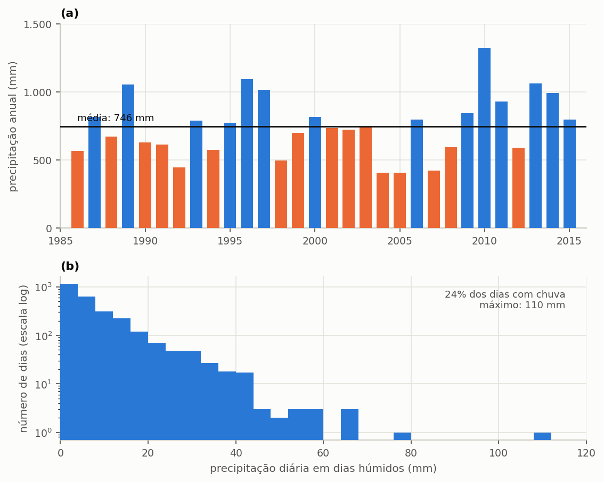

*Figura 1 — Série de precipitação de Lisboa usada em todo o tutorial (E-OBS, concelho de Lisboa, 1991 a 2020): (a) precipitação total de cada ano, com a média dos trinta anos em linha contínua e os anos acima da média a azul e abaixo dela a laranja; (b) distribuição de frequência da precipitação diária nos dias de chuva, em escala logarítmica, que mostra como poucos dias respondem pelos maiores volumes. O maior dia da série tem 91,2 mm.*

---

### 4.1.3. A área de captação

O projeto do tutorial adota 150 m² de área de captação, e este é o primeiro campo em que se erra com frequência.

A área de captação é a **projeção horizontal** da cobertura, não a área inclinada do telhado. Um telhado com 30% de inclinação sobre uma planta de 150 m² tem cerca de 157 m² de superfície de telha e capta, ainda assim, os mesmos 150 m² de chuva: a precipitação cai na vertical, e o que encontra é a sombra da cobertura projetada no chão. A ETA 0701 da ANQIP define-a assim: a projeção em planta do local onde é recolhida a água da chuva. É esta área `A` que entra na equação da disponibilidade.

> **Área de captação não é área de contribuição.** O dimensionamento de caleiras e tubos de queda usa outra área, para outro fim. Para dimensionar a drenagem pelo caudal de ponta de uma chuvada curta e intensa, acrescentam-se à projeção os acréscimos devidos à inclinação da cobertura e às paredes que intercetam a chuva empurrada pelo vento. Essa área sobrestima o volume que a cobertura capta ao longo do ano. No Triton, indique a projeção horizontal; a área de contribuição fica para o projeto das caleiras, que o programa não faz. A ETA 0701 remete as caleiras e os tubos de queda para o Regulamento Geral português ou para a norma europeia EN 12056-3. [A COMPLETAR: confirmar no texto do Decreto Regulamentar n.º 23/95 (Diário da República) os artigos aplicáveis ao cálculo de caudais pluviais antes de os citar por número.]

> **Atenção.** Usar a área inclinada sobrestima a captação na razão `1/cos(inclinação)`. Num telhado de 30% dá 4,4% a mais de água que não existe. Em telhados mais inclinados, o erro cresce depressa.

---

Carregada a série, o programa já mostra o regime que ela descreve. Vale a pena conferir este desenho antes de seguir: uma série trocada de concelho, ou com a unidade errada, costuma aparecer no ciclo sazonal da Figura 2 antes de aparecer em qualquer resultado.

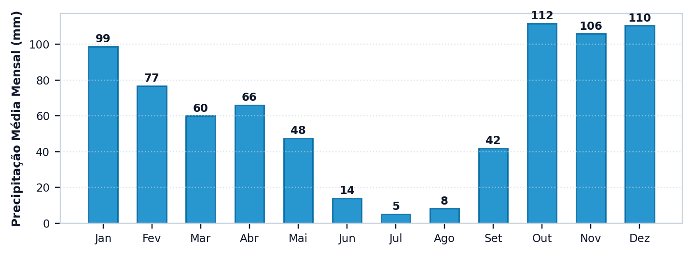

*Figura 2 — O ciclo sazonal médio da série, calculado e desenhado pelo programa assim que a precipitação é carregada. Em Lisboa, o mês mais chuvoso recebe cerca de 47 vezes o que recebe o mais seco (47,3), e é esta diferença que o reservatório tem de atravessar: o verão é quase sem chuva. Figura gerada pelo próprio programa.*

---
### 4.1.4. O coeficiente de escoamento

O tutorial escreve 0,85 no campo do coeficiente. O programa, por seu lado, abre com a telha cerâmica selecionada e aplica 0,75, o valor que a lista de materiais lhe atribui, e que é também o valor que assume quando nenhum material é indicado. ==Atenção ao reproduzir o tutorial: para chegar aos números deste manual, escolha «Outro / Personalizado» e escreva 0,85.==

A origem do 0,85 merece rigor, porque é citado com frequência como coeficiente de escoamento e não o é. Em Portugal, a ETA 0701 da ANQIP escreve o volume anual aproveitável como o produto da precipitação média anual, da área de captação, de um coeficiente de escoamento inicial da cobertura `C` e da eficiência hidráulica da filtragem `ηf`. Recomenda `C` = 0,8 para coberturas impermeáveis (telha, betão, etc.), 0,6 para coberturas planas com gravilha, 0,3 para coberturas verdes extensivas e 0,5 para as intensivas, e admite `ηf` = 0,9 em filtros com manutenção e limpeza regulares (itens 4.3.1 a 4.3.3 da versão 7). O 0,85 do tutorial é, assim, um valor redondo entre estes, e não um valor de norma. O Triton tem um só campo para a fração da chuva que chega à cisterna e modela o descarte à parte, em milímetros. Escrever aí um valor que já inclua a perda do escoamento inicial e aplicar também o descarte de 2 mm conta essa perda duas vezes. Num estudo, declare o valor adotado no campo, a sua origem e o descarte, e não atribua a uma norma um coeficiente que ela não fixa.

> **A norma europeia.** A EN 16941-1 também escreve o rendimento da captação como produto de um coeficiente da superfície da cobertura e de uma eficiência do filtro. [A COMPLETAR: confirmar, na edição em vigor da EN 16941-1 (catálogo do IPQ ou do CEN), os valores tabelados antes de os citar; o manual não os reproduz.] O Triton mantém a sua lista de coeficientes e o descarte inicial; para se aproximar de uma norma, escreva o produto como valor personalizado e ajuste a lâmina de descarte.

O coeficiente de escoamento representa a fração da chuva incidente que chega, de facto, à cisterna, e a diferença até à unidade é o que se perde no caminho. As perdas têm quatro origens: a absorção pelo material da cobertura, a evaporação na superfície aquecida, o salpico para fora da caleira e a molhagem inicial da telha em cada nova chuvada. A Figura 3 mostra o coeficiente que o programa atribui a cada material de cobertura.

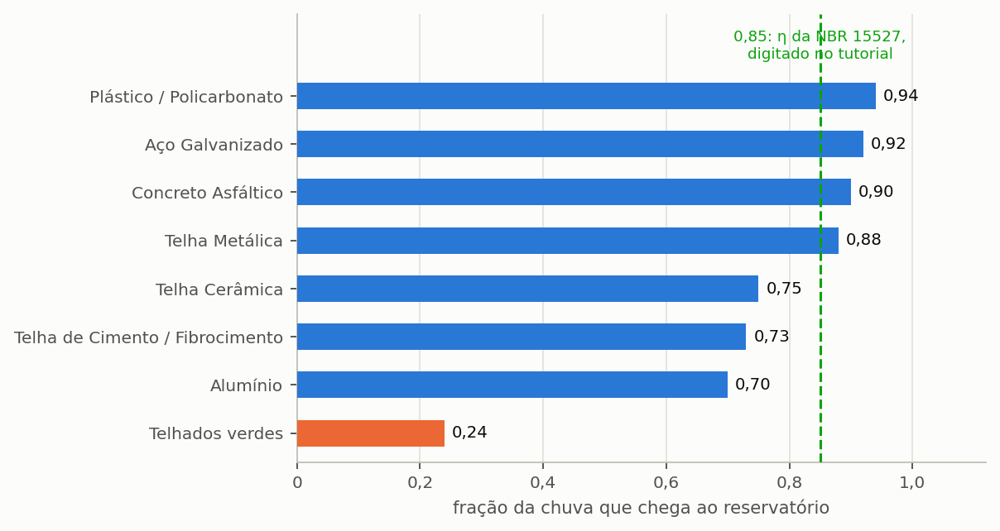

*Figura 3 — O coeficiente de escoamento que o programa atribui a cada material da cobertura. A linha a tracejado marca 0,85, o fator de captação adotado no tutorial. A cobertura verde é a única que se afasta do grupo, porque retém parte da chuva no substrato.*


O programa aceita qualquer valor entre zero e um, e recusa valores fora deste intervalo, indicando o campo — um coeficiente maior do que a unidade significaria que a cobertura entrega mais água do que a chuva lhe traz. A etapa **11. Documentação** traz a mesma tabela, com a fonte dos valores. Para uma cobertura mista, o coeficiente a escrever é a média dos coeficientes de cada material, ponderada pelas respetivas áreas.

---

### 4.1.5. O descarte das primeiras águas

O tutorial descarta 2,0 mm em todas as chuvadas.

A primeira água que lava a cobertura leva pó, folhas, dejetos de aves e tudo o que se depositou desde a chuva anterior. Descartá-la, em vez de a conduzir à cisterna, é a medida de qualidade mais barata e mais eficaz de que um sistema pluvial dispõe, e por isso é praticamente universal em projetos bem conduzidos. Em Portugal, a ETA 0701 recomenda um dispositivo automático de desvio do escoamento inicial, tendo em conta as longas estiagens de verão, e, na falta de dados ou de estudos locais, o desvio de um volume correspondente a 2 mm de precipitação, podendo adotar-se um valor inferior em casos justificados (itens 4.2.2 e 4.2.4). É esse o valor adotado aqui. Num estudo, justifique a lâmina que adotar.

O programa oferece três modos de aplicar o descarte, que correspondem a três tipos de dispositivo de autolimpeza.

<!-- tabela: **Tabela 2** — Os três modos de aplicação do descarte de primeiras águas -->
| Modo | Quando descarta | Quando usar |
| :--- | :--- | :--- |
| 1 | em todas as chuvadas | o padrão, e o mais conservador |
| 2 | só na primeira chuvada após uma estiagem | dispositivo que não se esvazia sozinho entre chuvas próximas |
| 3 | de X em X dias | dispositivo com esvaziamento programado |

> **Atenção, e este é o ponto que mais surpreende.** Quando o descarte se aplica e a chuva do dia **não excede** a lâmina, perde-se o dia **inteiro**, não a diferença. Um dia de 1,6 mm com descarte de 2,0 mm capta **zero**.
>
> Na série de Lisboa, isto atinge 4% dos dias. Em climas de chuvisco frequente, a parcela é maior.

A razão deste comportamento é física, não convencional: o dispositivo de autolimpeza tem de encher por completo antes de qualquer água seguir para a cisterna. Quando a chuva do dia não chega para o encher, nada passa, e o volume retido perde-se para a drenagem, juntamente com a sujidade que lavou.

> **A lâmina não é o dispositivo.** `d_f` é uma lâmina em milímetros. O volume hidráulico do reservatório de autolimpeza é `A × d_f`, que no nosso projeto dá 150 × 2 = **300 litros**. A etapa **3. Qualidade & ETAP** dimensiona e orça esse reservatório (secção 2.5 (volume O método)), e a secção 4.7 mostra o seu custo no investimento.

---

### 4.1.6. O que temos até aqui

<!-- tabela: **Tabela 3** — Estado do projeto do tutorial no fim da definição da chuva e da captação -->
| Dado | Valor |
| :--- | ---: |
| série | Lisboa, 30 anos |
| área de captação | 150 m² |
| coeficiente de escoamento | 0,85 |
| lâmina de descarte | 2,0 mm, todas as chuvadas |

Com isto, o programa já sabe **quanta água entra**. Falta dizer quanta sai, o que é a secção 4.2.

Uma conta de algibeira, para calibrar a expectativa: 719 mm por ano sobre 150 m² com coeficiente de 0,85 dão cerca de 92 m³ por ano de água bruta, antes do descarte. A secção 4.3 mostra quanto desse volume se converte em poupança efetiva — e a diferença entre os dois números é a lição mais importante do tutorial.

---

## 4.2. A edificação e a procura

> No fim desta secção, o programa sabe **quanta água sai** e, mais importante, **que parte dela a chuva pode atender**. Essa fração é o teto de tudo o que vem a seguir.

A secção 4.1 definiu a oferta. Esta define a procura. E há uma assimetria que convém perceber desde já: **a chuva não pode atender toda a procura**, por mais água que haja. Existe um teto, é definido aqui, e nenhum reservatório o ultrapassa.

---

### 4.2.1. A tipologia

Na etapa **2. Edificação e Consumo**, escolha *Residencial unifamiliar*. O programa traz oito tipologias, cada uma com o consumo per capita de referência (Figura 4) e a repartição habitual dos usos finais. A indústria não tem gama de referência, porque o consumo depende do processo produtivo e não da ocupação: nesse caso, o valor tem de vir de medição.

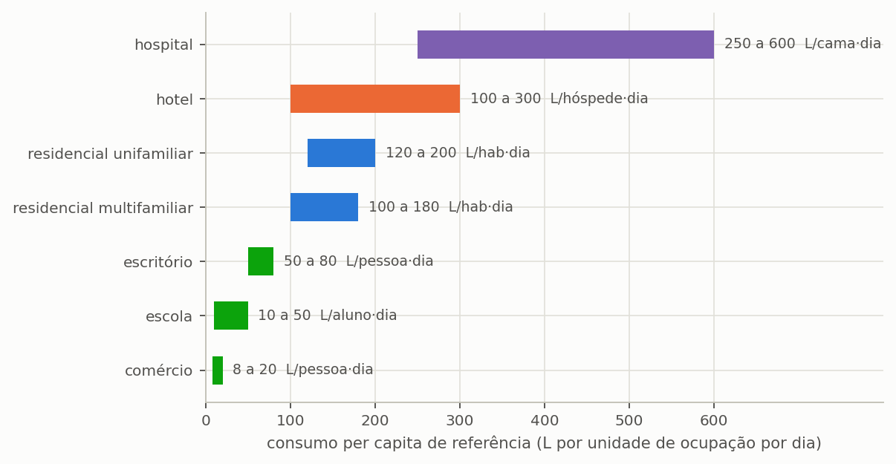

*Figura 4 — As gamas habituais de consumo per capita por tipologia de edifício. A amplitude de cada gama é grande de propósito: são valores de referência para quem ainda não mediu, e a medição, quando existe, prevalece sempre.*


A tipologia é um ponto de partida, não uma imposição: o valor continua editável. A secção 3.5 (volume Guias de uso) trata dos casos não residenciais, que têm uma armadilha própria na tarifa.

---

### 4.2.2. Os moradores e o consumo

**Quatro moradores, 150 L/hab·dia.** Total de **600 L/dia**.

O valor de 150 L/hab·dia é uma referência redonda para uma moradia com abastecimento regular, não uma medição. Se tem a fatura da água e do saneamento do edifício, use-a: divida o consumo mensal, em litros, por trinta e pelo número de moradores. O número medido vale mais do que qualquer referência.

O programa aceita procura **constante** ou modulada por semana, mês ou dia. O tutorial usa a constante; a secção 3.4 (volume Guias de uso) mostra a modulação, que importa em escolas, hotéis e em qualquer edifício com sazonalidade.

---

### 4.2.3. A fração que a chuva pode atender

**28%.** É o número mais importante desta secção.

A água da chuva não vai para o duche, para a pia da cozinha nem para beber. Numa moradia, vai para o autoclismo, a lavagem de pavimentos, a rega do jardim e a lavagem do automóvel. O peso destes usos no consumo total é o **teto do potencial de economia**.

A repartição adotada no tutorial está representada na Figura 5, com os usos que a chuva atende assinalados. O autoclismo pesa 20% do consumo e a limpeza e a rega 8%; o duche, a pia da cozinha, o lavatório e a máquina de lavar roupa, que pesam o resto, ficam com a água potável.

Somando os dois usos que a chuva atende, chega-se aos 28% do tutorial. É um valor conservador para uma moradia sem jardim grande, e é conservador de propósito: limita-se aos usos que a orientação sobre águas pluviais admite com mais facilidade.

> **A máquina de lavar roupa é uma escolha que o tutorial não faz.** A ETA 0701 da ANQIP (versão 12) inclui a lavagem em máquinas de lavar roupa entre os usos possíveis da água da chuva, ao lado das descargas de autoclismo, da lavagem de pavimentos e automóveis, da rega de zonas verdes e de outros usos (torres de arrefecimento, redes de incêndio, AVAC). Para a máquina de lavar sem tratamento específico, o item 4.6.6 só a admite quando a água de lavagem atinge pelo menos 55 °C, e pede um microfiltro de malha mínima de 100 µm. O uso na máquina é comum na literatura e na prática, e por isso muitos estudos trabalham com frações atendíveis maiores do que a deste tutorial. O tutorial **não** o adota: a máquina fica com a água potável, e a fração atendível fica nos 28% do autoclismo e dos usos exteriores. Um projeto que inclua a lavagem de roupa tem de declarar essa escolha e o critério de qualidade adotado, e confrontá-la com a norma em vigor no local do edifício. [A COMPLETAR: confirmar a revisão em vigor da ETA 0701 e o que a EN 16941-1 diz sobre a lavagem de roupa.]

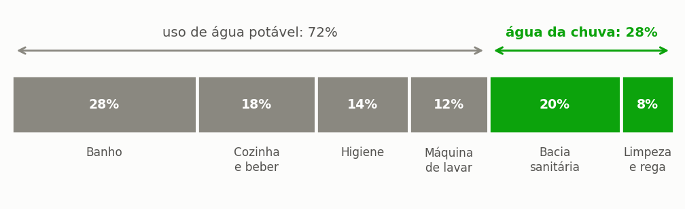

*Figura 5 — Repartição típica do consumo de uma moradia por uso final. A cinzento, os usos que exigem água potável; a verde, os que podem usar água da chuva, cuja soma é a fração atendível e o teto do potencial de economia: nenhum reservatório, por maior que seja, poupa mais do que esta fração.*

> **Este número é o teto.** Com 28% de fração atendível, o potencial de economia **nunca** passa de 28%, por maior que seja o reservatório e por mais que chova. A tabela da secção 4.4 mostra a curva a aproximar-se desse limite sem o atingir: em Lisboa, a 20.000 L ainda só chega a 24,01%.
>
> Quem quer passar dos 28% tem de mudar o **uso**, não o reservatório: acrescentar um uso, como a lavagem de roupa, com o critério de qualidade declarado, ou reduzir o consumo potável.

#### 4.2.3.1. Percentagem no ecrã, fração no ficheiro

A mesma grandeza aparece com duas grafias, e cada uma tem o seu lugar. Em todos os campos em que se escreve — as frações do ecrã da edificação, as tabelas semanal e mensal, as tabelas de cenários, a folha de cálculo de lote e o argumento `--share` da linha de comandos — a fração é uma **percentagem, de 0 a 100**: 28 significa 28%. No ficheiro de projeto, no ficheiro de parâmetros e em `rainwater_share` e `non_potable_indoor_share`, é uma **fração, de 0 a 1**: 0,28.

A divisão não é arbitrária. A percentagem é a forma em que a grandeza circula entre projetistas, normas e faturas da água, e é a forma em que menos se erra ao escrever. A fração é a forma em que entra na equação do balanço, a multiplicar a procura interior (secção 2.1 (volume O método)), e é a forma que dispensa conversões a quem lê o ficheiro com outro programa.

O que não se admite é a mistura. Até esta versão, doze pontos do programa aceitavam as duas grafias e decidiam pela regra «acima de 1 é percentagem». A regra falha justamente nos valores pequenos, onde o erro não se vê: 1 passava a 100%, e não a 1%; 0,5 escrito numa coluna em percentagem passava a 50%. ==Agora a unidade é fixada pelo lugar, nunca adivinhada pelo valor.== Uma percentagem acima de 100 é recusada; uma fração acima de 1 é recusada com a indicação de que parece uma percentagem. A Figura 6 mostra os três estados do campo na interface.

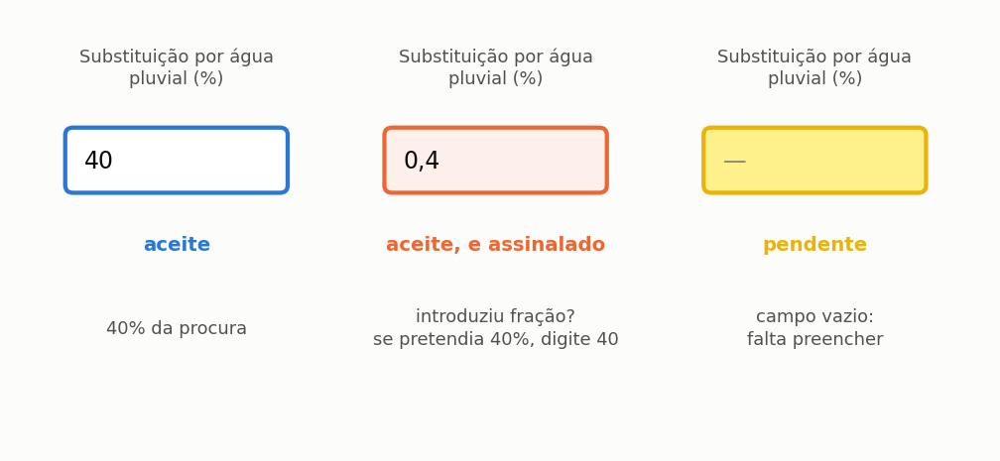

*Figura 6 — Estados do campo de fração atendível na interface. O campo recebe uma percentagem de 0 a 100; no ficheiro de projeto e nos parâmetros de cálculo a grandeza é guardada como fração de 0 a 1. Um valor entre 0 e 1 escrito no campo fica assinalado a laranja, sem bloquear o cálculo, porque 0,4% é possível, embora raro.*

> **O marcador laranja.** Um valor entre 0 e 1 num campo em percentagem é aceite, porque uma substituição inferior a 1% é possível, mas o campo fica laranja e a dica explica o que foi entendido. Nas tabelas de cenários e na folha de cálculo de lote, o programa pergunta antes de simular.

---

### 4.2.4. Discriminar os usos, ou não

O programa aceita dois níveis de pormenor na descrição da procura, e a escolha depende do que o estudo quer responder.

No **modo simplificado**, indicam-se duas coisas: a fração não potável do consumo interior — autoclismos e lavagem de roupa — e, se existir, a procura exterior em litros por dia. A fração atendível **total** sai das duas,

```text
f = (fração interior × procura interior + procura exterior) ÷ (procura interior + procura exterior)
```

e aparece num campo que não se edita, porque é resultado e não dado. Sem procura exterior, a total é a própria fração interior: os 28% deste tutorial. É o modo adotado aqui, e chega para a maior parte dos estudos.

> **Porque a total não se escreve.** Em versões anteriores, o campo da fração total era editável, mas a simulação usava a fração interior; e, ao abrir um projeto, o ecrã repunha a interior em 35% e a exterior em zero, fossem quais fossem as guardadas. Um projeto que declarava 28% era simulado com 35%. Hoje o ecrã restaura as duas, a total é calculada, e um ficheiro antigo cujas frações discordem abre com a total que declara, com um aviso.

No **modo discriminado**, a procura divide-se em três parcelas: a potável interior, que a chuva nunca atende; a não potável interior, que é a prioridade do sistema; e a rega, atendida em último lugar. A divisão muda duas coisas. Altera a ordem de atendimento nos dias de escassez, em que o uso interior tem precedência sobre o jardim; e permite distinguir o uso interior do exterior nos créditos de certificação, distinção que o LEED exige em créditos separados, como descreve a secção 2.9 (volume O método).

Vale a pena discriminar quando há um jardim de área relevante, quando a certificação está no horizonte do projeto, ou quando a rega pode ser suprimida nos dias de chuva — situação que o ponto seguinte trata.

---

### 4.2.5. A rega e a supressão por chuva

Declarado um volume de rega, o programa oferece um limiar de supressão por chuva: nos dias em que a precipitação excede esse limiar, o jardim não é regado. O comportamento reproduz o de qualquer programador de rega com sensor de chuva, equipamento corrente e barato, e ignorá-lo sobrestimaria a procura exterior ao longo do ano inteiro. O limiar predefinido é de 2 mm por dia.

> **A série de chuva é lida duas vezes.** Uma leitura converte-se em volume captado, depois do descarte. A outra decide se o jardim é regado. As duas são independentes: um dia pode suprimir a rega **e** render captação.

Resta uma escolha que merece atenção particular, porque altera o resultado económico e não é neutra: o **fornecimento de reserva** da rega. Com ele ligado, a rede pública rega o jardim nos dias secos em que a cisterna não chega, e esse volume entra na fatura da água e do saneamento como consumo potável. Com ele desligado, o jardim simplesmente não é regado nesse dia, o edifício não compra essa água, e o volume correspondente aparece no balanço como *procura não atendida* — a terceira parcela tratada na secção 2.1 (volume O método).

==A distinção entre as duas configurações é conceptual antes de ser numérica.== Um jardim que tem de ser regado todos os dias representa uma procura real, que alguém pagará; um jardim que aceita não ser regado num dia seco representa uma comodidade, e tratá-lo como procura infla tanto o consumo como a poupança aparente do sistema.

---

### 4.2.6. O que temos até aqui

<!-- tabela: **Tabela 4** — Estado do projeto do tutorial no fim da definição da procura -->
| Dado | Valor |
| :--- | ---: |
| tipologia | residencial unifamiliar |
| moradores | 4 |
| consumo per capita | 150 L/hab·dia |
| procura total | 600 L/dia |
| fração atendível pela chuva | 28% |
| **procura pluvial** | **168 L/dia** |

O programa sabe agora a oferta e a procura. Antes de simular, uma comparação que vale a pena guardar:

<!-- tabela: **Tabela 5** — Comparação entre a oferta anual de água da chuva e a procura atendível -->
| | m³/ano |
| :--- | ---: |
| oferta bruta de água da chuva (precipitação × área × coeficiente) | 92 |
| **procura pluvial do ano** | **61** |

A oferta excede a procura: o volume bruto é **1,5 vez** o que se pretende usar, antes de deduzir o descarte. Se a oferta fosse o único limite, o sistema atenderia 100% da procura pluvial e chegaria ao teto de 28%.

Não chega, e a secção 4.3 mostra porquê.

---

## 4.3. A primeira simulação

> No fim desta secção, tem o primeiro resultado no ecrã e sabe **ler** os quatro números que importam. Ler é a parte difícil: o programa entrega muitos números, e três deles respondem a perguntas diferentes.

Falta um dado para simular: o volume do reservatório. Vamos arriscar um palpite.

**3 000 litros.** Uma cisterna de betão de 3 m³ é um tamanho comum de logradouro e é o que um projetista proporia sem pensar muito. A secção 4.4 vai perguntar se é o volume certo. Aqui só queremos ver o programa a correr.

Na etapa **4. Reservatório & Custos**, escolha volume fixo, indique 3 000 L, deixe o reservatório superior por assinalar e simule.

---

### 4.3.1. O resultado

<!-- tabela: **Tabela 6** — Resultado da primeira simulação do tutorial, com um reservatório de 3 000 L -->
| Resultado com 3 000 L | Valor |
| :--- | ---: |
| potencial de poupança de água potável | **15,39%** |
| água da chuva consumida | 92,3 L/dia |
| água da rede consumida | 507,7 L/dia |
| água extravasada | 106,4 L/dia |
| dias de abastecimento pleno | 53,3% |
| dias de abastecimento parcial | 2,9% |
| dias de abastecimento nulo | 43,8% |
| procura pluvial pretendida | 168 L/dia |
| volume anual poupado | 33,7 m³/ano |

O ecrã devolve várias dezenas de valores, e quatro bastam para julgar o projeto nesta etapa. Cada um responde a uma pergunta distinta, e é justamente por isso que não se substituem: um projeto pode ser bom pelo primeiro e mau pelo terceiro, e a leitura conjunta é o que evita conclusões apressadas.

---

### 4.3.2. O potencial de economia: 15,39%

Este indicador responde à pergunta que motiva a maior parte dos projetos: quanto da fatura da água e do saneamento deixa de se pagar. É o valor central do programa e o que consta do resumo de qualquer estudo. Corresponde à razão entre a água da chuva consumida e a procura total do edifício ao longo de toda a série, como na Equação 14 (volume O método).

O denominador merece atenção, porque dele decorre tudo o resto: é a procura **total**, não a procura pluvial. É esta escolha que fixa o teto do indicador nos 28%, a fração atendível definida na secção 4.2, e não em cem por cento.

O sistema alcançou 15,39% contra um teto de 28%, o que significa que entrega 55% do que se propunha entregar (92,3 L/dia de chuva consumida, contra 168 L/dia de procura pluvial). Os 45% em falta correspondem aos dias em que a cisterna não tinha água suficiente para atender à procura pluvial do dia.

> **Não confunda as duas percentagens.** «Economia de 15%» e «atendimento de 55% da procura pluvial» descrevem o mesmo sistema e são números diferentes. Estudos publicados trocam por vezes um pelo outro. Declare qual está a usar.

---

### 4.3.3. O extravasamento: 106,4 L/dia

**Responde: o reservatório é suficientemente grande?**

Em média, ao longo dos trinta anos, extravasam da cisterna 106,4 litros por dia, que seguem para a rede de drenagem. Menos do que os 168 L/dia que o sistema pretende consumir, mas ainda assim muita água a perder.

Parece o argumento definitivo a favor de aumentar o reservatório, e é um argumento fraco. A cobertura oferece 1,5 vez o que a casa consome (secção 4.2), e boa parte desse excedente extravasaria de qualquer cisterna: a secção 4.4 mostra que nem 20 000 L o reduzem abaixo de 54 L/dia. O extravasamento só diz algo sobre o volume quando comparado com o de outros volumes, e é essa comparação que a secção 4.4 faz.

> Um extravasamento elevado não é defeito do programa nem do projeto. É a assinatura do desencontro entre a chuva, que chega concentrada em poucos dias, e a procura, que é constante. O reservatório existe para amortecer isso, e todo o reservatório finito falha em algum episódio.

---

### 4.3.4. Os dias de atendimento: 53,3% plenos

**Responde: com que frequência posso contar com o sistema?**

É a fiabilidade **temporal** do sistema, e responde a uma pergunta que o potencial de economia não alcança: com que frequência se pode contar com a água da chuva. Cada dia da simulação recebe uma de três classificações, conforme o grau de atendimento alcançado.

<!-- tabela: **Tabela 7** — Classificação de cada dia da simulação quanto ao grau de atendimento -->
| Classe | O que significa |
| :--- | :--- |
| pleno | a chuva atendeu **toda** a procura pluvial do dia |
| parcial | atendeu parte, e a rede completou |
| nulo | a cisterna estava vazia; tudo veio da rede |

Em 53,3% dos dias o sistema deu conta sozinho da procura pluvial. Nos restantes 46,7%, a rede pública entrou, total ou parcialmente: 2,9% dos dias foram parciais e 43,8% nulos. A distinção tem consequência direta no projeto hidráulico. Um sistema com muitos dias de atendimento nulo exige um abastecimento automático de reserva bem dimensionado, e o utilizador nota a alternância entre as duas origens ao longo do ano. Um sistema com 99% de dias plenos é, na prática, independente da rede para os usos que atende.

> **Potencial e fiabilidade não andam juntos.** É possível ter um potencial alto com fiabilidade baixa: um reservatório que enche na estação chuvosa e seca na estiagem entrega muito volume no ano e falha metade dos dias. A tabela da secção 4.4 mostra as duas colunas a divergir.

---

### 4.3.5. O volume anual poupado

**Responde: quanto vale isto em dinheiro e em carbono?**

É o valor que passa para as secções 4.7 e 4.8, porque tanto a poupança na fatura da água e do saneamento como a emissão de carbono evitada se calculam a partir dele. Vale 33,7 m³/ano, bem menos de metade dos 92 m³/ano que a cobertura disponibiliza antes do descarte; o descarte e o extravasamento explicam a diferença.

---

Antes de discutir porque o potencial não chega aos 28%, convém ver o reservatório a trabalhar. O separador de resultados traz a série diária do nível da cisterna, e é nela que se veem de uma só vez os dois regimes que limitam o aproveitamento: o extravasamento e a falta (Figura 7).

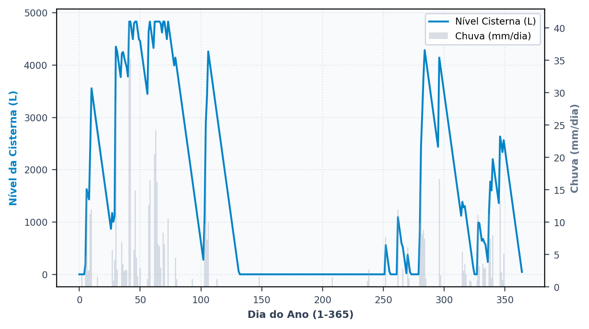

*Figura 7 — O nível da cisterna ao longo do primeiro ano da série de Lisboa, com a chuva diária ao fundo. Os planaltos no topo são os dias em que o reservatório está cheio e extravasa; os vales no zero são os dias em que secou e a rede atendeu tudo. Em Lisboa, os vales concentram-se no verão. Figura gerada pelo próprio programa.*

---
### 4.3.6. Porque não chegamos aos 28%

A secção 4.2 terminou com uma comparação aparentemente favorável: 92 m³ anuais de oferta contra 61 m³ de procura pluvial, isto é, 1,5 vez o necessário. Perante este excedente, seria razoável esperar atendimento integral, e no entanto o sistema entrega apenas 55% do pretendido.

A explicação está inteiramente no **tempo**. O excedente não ocorre quando a água faz falta: a precipitação chega concentrada, enche a cisterna de 3 000 L num único dia de chuva intensa, extravasa no mesmo dia, e falta duas semanas depois. Em Lisboa, a falta é longa: o verão quase não tem chuva. O excedente anual e o atendimento diário são grandezas que não comunicam, e é precisamente esta incomunicabilidade que torna a simulação diária indispensável.

A cisterna de 3 000 L armazena o equivalente a dezoito dias de procura pluvial. Qualquer estiagem mais longa esvazia-a, e a partir daí o sistema depende inteiramente da rede até à chuva seguinte.

É por isso que aumentar o reservatório funciona — e é por isso que aumentar tem limite. A secção 4.4 mede exatamente onde fica esse limite.

---

### 4.3.7. O que temos até aqui

<!-- tabela: **Tabela 8** — Estado do projeto do tutorial depois da primeira simulação -->
| Resultado com 3 000 L | |
| :--- | ---: |
| potencial de economia | 15,39% |
| de um teto de | 28% |
| extravasamento | 106,4 L/dia |
| dias de atendimento pleno | 53,3% |

Um resultado defensável, mas longe do teto. E escolhemos 3 000 L por palpite: pode ser pouco, e pode ser demais.

Quanto seria o certo?

---

## 4.4. Escolher o volume

> No fim desta secção, tem a curva de retorno do reservatório, sabe onde deixa de compensar, e percebe porque **não existe** um volume ótimo absoluto — existe um volume ótimo para um critério declarado.

A secção 4.3 adotou 3 000 L como primeiro palpite e encontrou 106,4 L/dia a extravasar e um atendimento pleno em apenas 53,3% dos dias. A pergunta que se impõe é quanto reservatório vale a pena ter. Não se responde com uma tentativa isolada: responde-se simulando o mesmo projeto para muitos volumes e vendo como o resultado evolui. É o que o programa chama **varredura**.

---

### 4.4.1. Executar a varredura

Na etapa **4. Reservatório & Custos**, escolha o modo varredura e indique o volume máximo e o passo. Para o nosso projeto: máximo de 20 000 L, passo de 1 000 L.

Há duas particularidades na montagem da grelha que convém conhecer antes de interpretar o resultado. A primeira é que o passo indicado é arredondado para cima até ao múltiplo de 250 L, o quantum comercial dos reservatórios — ninguém compra uma cisterna de 1 300 L, e um ótimo apontado para esse volume seria inexequível. Quando o passo pedido não é múltiplo de 250, o programa ajusta-o e regista o ajuste, para que o relatório possa declarar o passo realmente usado.

A segunda é que a grelha se limita a quarenta volumes positivos. Uma varredura de 0 a 50 000 L com passo de 100 L exigiria quinhentas simulações de trinta anos cada, e o ganho de informação não compensa o tempo de cálculo, porque a curva é suave e quarenta pontos descrevem-na com folga. O volume máximo indicado é sempre mantido como último ponto da grelha, pelo que só o último intervalo pode ser menor do que o passo efetivo.

O volume zero faz parte da grelha como alternativa de referência: representa o cenário sem sistema, com o qual todos os outros se comparam.

---

### 4.4.2. A curva

<!-- tabela: **Tabela 9** — Varredura de volumes do projeto do tutorial, com o ganho marginal de cada metro cúbico acrescentado -->
| Volume | Potencial | Ganho sobre o anterior | Ganho por metro cúbico acrescentado | Extravasado | Dias plenos |
| ---: | ---: | ---: | ---: | ---: | ---: |
| L | % | pontos percentuais | %/m³ | L/dia | % |
| 0 | 0,00 | — | — | 199 | 0,0 |
| 1 000 | 10,39 | 10,39 | 10,39 | 136 | 33,6 |
| 2 000 | 13,55 | 3,16 | 3,16 | 117 | 46,1 |
| 3 000 | 15,39 | 1,84 | 1,84 | 106 | 53,3 |
| 4 000 | 16,60 | 1,21 | 1,21 | 99 | 58,0 |
| 5 000 | 17,49 | 0,89 | 0,89 | 94 | 61,3 |
| 6 000 | 18,19 | 0,70 | 0,70 | 89 | 64,0 |
| 8 000 | 19,39 | 1,21 | 0,60 | 82 | 68,4 |
| 10 000 | 20,37 | 0,98 | 0,49 | 76 | 72,0 |
| 12 000 | 21,23 | 0,86 | 0,43 | 70 | 75,2 |
| 16 000 | 22,73 | 1,50 | 0,38 | 61 | 80,6 |
| 20 000 | 24,01 | 1,27 | 0,32 | 54 | 85,2 |

A Figura 8 traça os resultados da tabela: o potencial de economia sobe em direção à fração atendível sem a atingir, e o ganho marginal cai mais de trinta vezes ao longo da varredura.

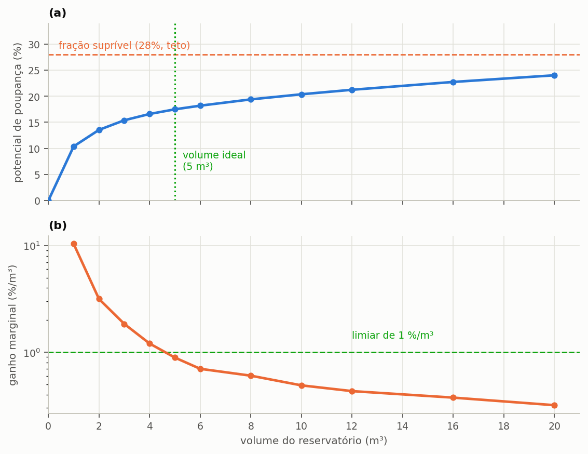

*Figura 8 — (a) Potencial de economia em função do volume do reservatório, que continua a subir aos 20 000 L (24,01%) sem alcançar o teto de 28%, com o volume ideal marcado; (b) ganho marginal, em escala logarítmica, com o limiar de 1 %/m³ adotado no tutorial.*

A coluna decisiva da tabela é a do **ganho por metro cúbico acrescentado**, a derivada discreta da curva de potencial, que exprime quanto cada metro cúbico adicional de reservatório acrescenta de economia. A tabela abaixo destaca alguns intervalos, e o padrão que revela é o argumento central desta secção.

<!-- tabela: **Tabela 10** — Ganho marginal de economia por cada metro cúbico acrescentado ao reservatório -->
| De → para | Ganho por m³ |
| :--- | ---: |
| 0 → 1 000 L | 10,39 %/m³ |
| 1 000 → 2 000 L | 3,16 %/m³ |
| 2 000 → 3 000 L | 1,84 %/m³ |
| 3 000 → 4 000 L | 1,21 %/m³ |
| 4 000 → 5 000 L | 0,89 %/m³ |
| 10 000 → 12 000 L | 0,43 %/m³ |
| 16 000 → 20 000 L | 0,32 %/m³ |

==O primeiro metro cúbico de reservatório entrega mais de 10 pontos percentuais de economia; os de 16 para 20 m³ entregam menos de um terço de ponto cada um.== A diferença é de mais de trinta vezes, e os metros cúbicos custam o mesmo betão, a mesma escavação e a mesma mão de obra.

Aqui Lisboa difere de um clima de chuva bem repartida. A curva **não satura**: a 20 000 L ainda sobe, e só 85,2% dos dias são plenos. A razão é o verão seco. O mês mais chuvoso recebe 47,3 vezes o que recebe o mais seco, e uma cisterna maior continua a ganhar, porque guarda mais inverno para atravessar mais verão. O ganho é pequeno, mas não chega a zero.

O comportamento tem, ainda assim, a forma característica de toda a curva de aproveitamento pluvial, e decorre de dois factos que atuam em conjunto. Os primeiros litros de armazenamento captam os episódios pequenos e frequentes, que são a maioria das chuvas em qualquer regime; e o teto imposto pela fração atendível, de 28% neste projeto, puxa a curva para a horizontal à medida que o sistema dele se aproxima, de modo que o espaço restante para ganho se vai esgotando.

---

#### 4.4.2.1. Os quatro gráficos que o ecrã mostra

A varredura não devolve apenas a curva de potencial. O separador de resultados traz quatro gráficos que respondem a perguntas diferentes sobre o mesmo conjunto de simulações, reproduzidos a seguir com os dados deste tutorial: o potencial de economia (Figura 9), o ganho marginal (Figura 10), os volumes extravasado e consumido (Figura 11) e a classificação dos dias (Figura 12).

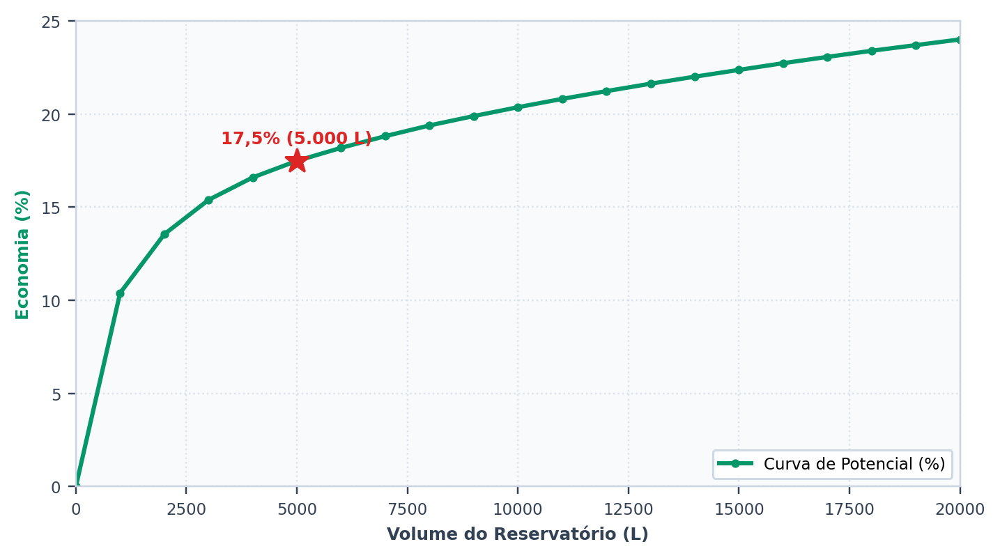

*Figura 9 — O primeiro gráfico do separador de resultados: o potencial de economia de água potável em função do volume do reservatório inferior. A estrela marca o volume selecionado. Figura gerada pelo próprio programa, com os dados do tutorial.*

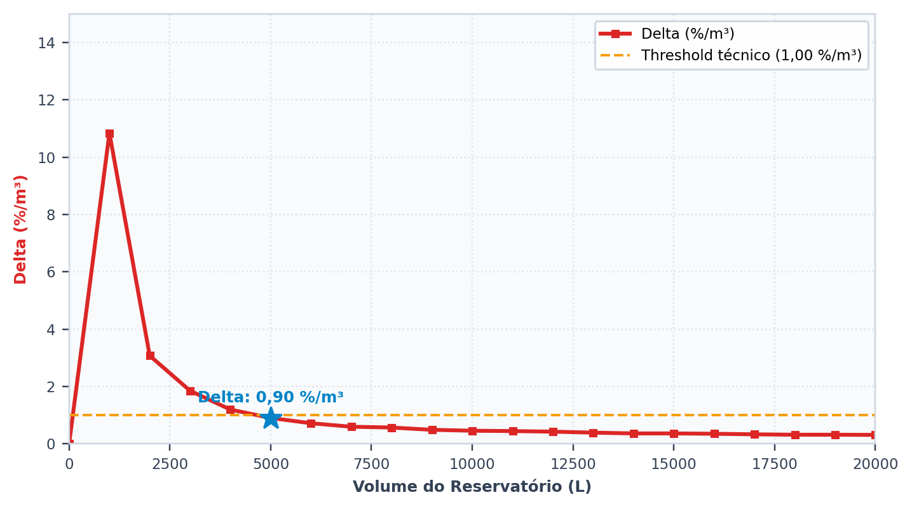

*Figura 10 — O segundo gráfico: o ganho marginal, em pontos percentuais por metro cúbico acrescentado. É a derivada da curva anterior, e é sobre ela que opera o critério do volume ideal. Figura gerada pelo próprio programa.*

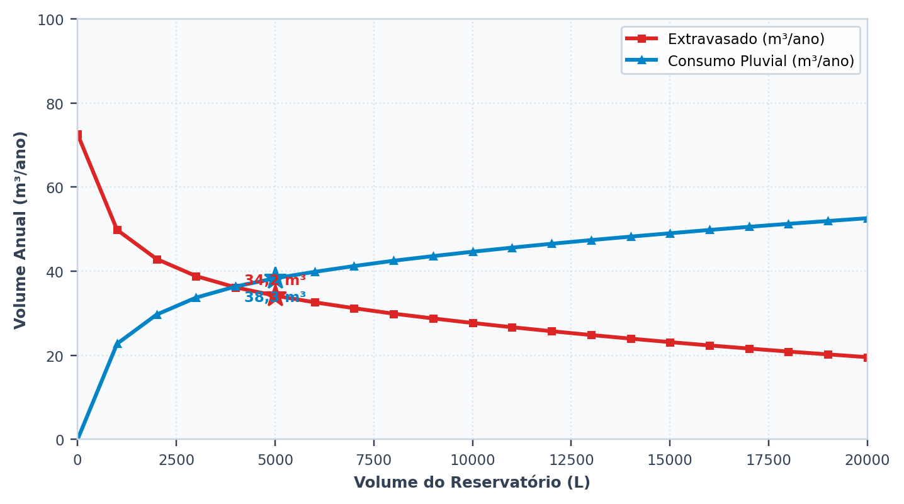

*Figura 11 — O terceiro gráfico: o volume extravasado e o volume pluvial consumido, ambos anuais, na mesma escala. As duas curvas explicam-se uma à outra, porque toda a água que deixa de extravasar passa a ser consumida. Figura gerada pelo próprio programa.*

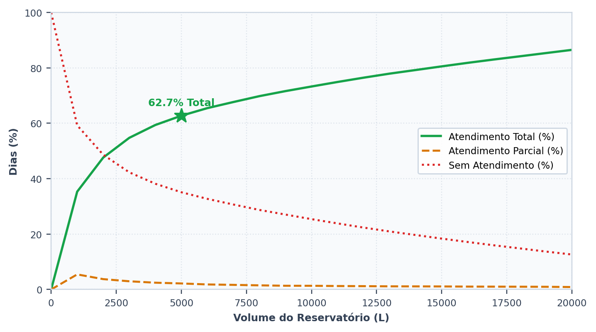

*Figura 12 — O quarto gráfico: a repartição dos dias do período em atendidos por inteiro, atendidos em parte e não atendidos. É a leitura temporal da mesma varredura, e a única que responde à pergunta com que frequência se pode contar com o sistema. Figura gerada pelo próprio programa.*

---

### 4.4.3. O volume ideal

Perante uma curva cujo rendimento decai desta forma, a pergunta «qual é o volume ideal?» só admite resposta depois de se estabelecer o que significa deixar de compensar. O Triton adota para isso o critério do ganho marginal: o volume ideal é o menor volume cujo ganho por metro cúbico acrescentado já desceu abaixo de um limiar declarado pelo utilizador, conforme a formulação da secção 2.2 (volume O método).

O programa abre com um limiar de 5 %/m³, e o tutorial adota um mais exigente, de 1 %/m³. A diferença não é um pormenor: com o valor predefinido, o volume ideal deste projeto seria de 2 000 L (ganho de 3,16 %/m³); com o limiar do tutorial, o primeiro volume a descer abaixo dele é o de 5 000 L, com um ganho marginal de 0,89 %/m³. Quem refizer o tutorial tem, por isso, de alterar o limiar no programa antes de executar a varredura.

<!-- tabela: **Tabela 11** — Indicadores do volume ideal obtido com o limiar de 1 %/m³ adotado no tutorial -->
| Indicador | Valor |
| :--- | ---: |
| volume ideal, limiar de 1 %/m³ | 5 000 L |
| potencial nesse volume | 17,49% |
| de um teto de | 28% |
| dias de atendimento pleno | 61,3% |

O limiar, contudo, é uma escolha do analista, e decide o resultado tanto como os dados de entrada. A tabela abaixo mostra o volume ideal que cada limiar plausível produziria para este mesmo projeto.

<!-- tabela: **Tabela 12** — Volume ideal obtido com cada limiar de ganho marginal, para o mesmo projeto -->
| Limiar declarado | Volume ideal | Potencial |
| ---: | ---: | ---: |
| 3,0 %/m³ | 3 000 L | 15,39% |
| 1,0 %/m³ | 5 000 L | 17,49% |
| 0,5 %/m³ | 10 000 L | 20,37% |

<!-- tabela: **Tabela 13** — Custo e desempenho comparados entre o volume ideal e o maior volume varrido (os preços são ilustrativos, não são preços de mercado) -->
| | 5 000 L | 20 000 L |
| :--- | ---: | ---: |
| potencial de poupança | 17,49% | 24,01% |
| preço da cisterna de betão (ilustrativo, não é preço de mercado) | 2 600 € | 8 600 € |
| massa de betão | 6 000 kg | 24 000 kg |
| carbono incorporado do sistema | 1 026 kg CO₂e | 3 546 kg CO₂e |
| **razão de preços** | | **3,3×** |
| **ganho de potencial** | | **+6,52 pontos** |

O programa não emite opinião sobre qual seria o limiar correto, e não poderia: a escolha depende do custo do reservatório, do valor da água no concelho e do espaço disponível no terreno, nenhum dos quais é um dado hidrológico. O que o programa faz é aplicar fielmente o limiar declarado e registá-lo no relatório.

> **Num estudo publicado, declare o limiar.** Dois artigos com «volume ideal» de limiares diferentes não são comparáveis. Entre o primeiro e o último limiares da tabela, a diferença é de 7 000 L de reservatório, que compram 4,98 pontos percentuais de economia.

---

### 4.4.4. Porque o critério do ganho marginal não basta

O critério do ganho marginal é puramente hidráulico: olha para a curva de aproveitamento e para mais nada. Não sabe quanto custa o reservatório, quanto vale o metro cúbico de água no concelho em causa, nem quanto carbono traz consigo o material escolhido. Desta cegueira decorrem três consequências, e cada uma pode deslocar a recomendação num sentido diferente.

- Se a água for muito cara, o ganho de 0,89 %/m³ do quinto metro cúbico pode pagar-se bem, e o volume económico será **maior** do que o hidráulico.
- Se a cisterna for cara ou o espaço escasso, o inverso.
- Uma cisterna de betão de 20 m³ pesa 24 toneladas e traz, com o resto do sistema, cerca de **3,5 toneladas de CO₂e** incorporado (3 546 kg), contra cerca de uma tonelada na de 5 m³ (1 026 kg). Os últimos metros cúbicos acrescentam pouca economia, e não têm como compensar a diferença.

São três critérios e três respostas diferentes para a mesma pergunta, e nenhuma é mais legítima do que as outras em abstrato. É por isso que o tutorial não acaba aqui: as secções 4.7 e 4.8 acrescentam à análise, respetivamente, o dinheiro e o carbono, e a secção 4.9 põe as três dimensões na mesma mesa, com pesos declarados, para chegar a um volume de compromisso que se possa defender.

> **O engano mais comum, e está na secção 5.1 (volume Enganos, limitações e confiabilidade).** Publicar o volume de maior economia de água como se fosse o volume recomendado. Pela tabela, 20 000 L dão o maior potencial, 24,01%. A cisterna de betão custa **3,3 vezes mais** do que a de 5 000 L (2 600 € contra 8 600 €; preços ilustrativos, não são preços de mercado) e traz **3,5 vezes mais carbono incorporado**, para entregar 6,52 pontos percentuais a mais.

---

A varredura tem ainda uma leitura que a tabela não mostra: quanto da capacidade o consumo realmente usa. Medir o reservatório pelo nível engana, porque a cisterna grande parece sempre cheia justamente por guardar água que a procura nunca chega a retirar. A Figura 13 mede a capacidade pelo consumo, de duas maneiras. A primeira é a **autonomia armazenada**, o volume no fim de cada dia dividido pela procura pluvial diária de 168 L, apresentada como curva de permanência. A segunda é o número de **renovações por ano**, a razão entre o consumo pluvial anual e a capacidade, que diz quantas vezes o volume da cisterna é realmente consumido e reposto.

A cisterna pequena renova o seu volume muitas vezes por ano e termina o dia vazia com frequência: a capacidade é inteiramente usada, e falta água. A grande renova-o poucas vezes e raramente se esvazia, mas guarda, na maior parte dos dias, semanas de procura, mais do que a estiagem registada exigiria. Essa reserva que o consumo não chega a mobilizar é o que o investimento adicional compra, e é a leitura física do retorno decrescente da curva de potencial. Em Lisboa, onde o verão é longo, esta leitura é menos severa do que numa chuva bem repartida: parte da reserva é de facto consumida em agosto.

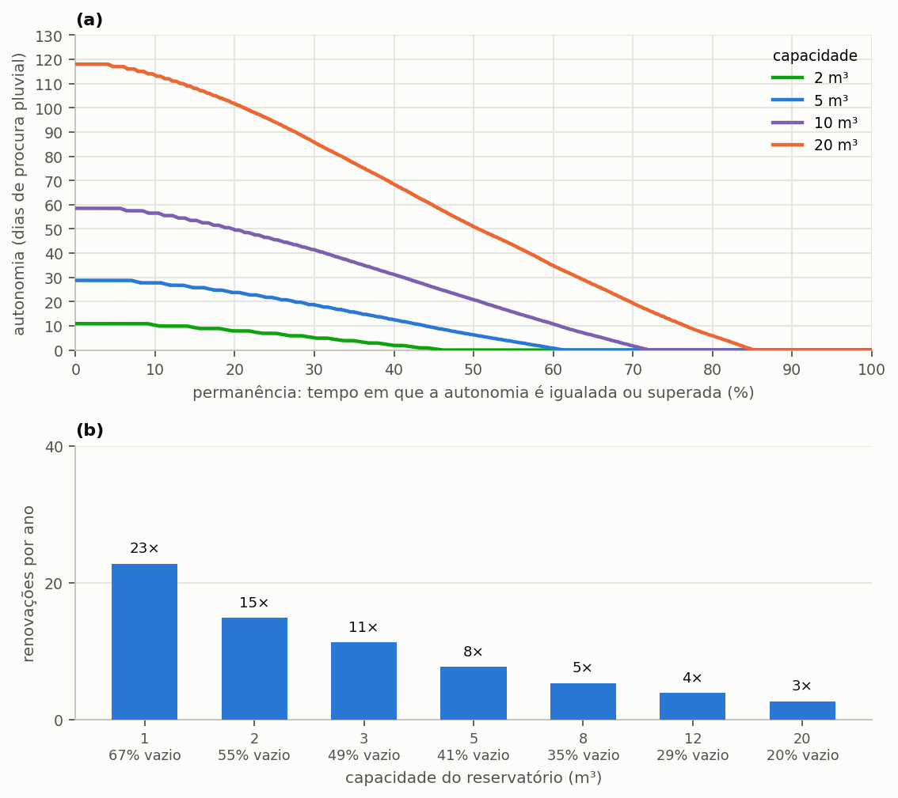

*Figura 13 — Uso da capacidade do reservatório inferior no projeto do tutorial, com procura pluvial de 168 L/dia: (a) curvas de permanência da autonomia armazenada no fim de cada dia, em dias de procura pluvial, para vários volumes; (b) renovações anuais do volume, dadas pela razão entre o consumo pluvial anual e a capacidade, com a fração de dias em que o reservatório termina vazio (até 5% da capacidade) indicada sob cada volume.*

---
### 4.4.5. Mais duas leituras da tabela

**O extravasamento não chega a zero.** Parte de 199 L/dia sem reservatório e desce para 54 L/dia com vinte metros cúbicos, e ainda não estabilizou. Parte da água que a cobertura capta continuará a ir para a drenagem, por uma razão que nenhum aumento do reservatório resolve: a procura simplesmente não a consome. Os sistemas de aproveitamento pluvial não retêm água por reter, e quem procura amortecer cheias precisa de um reservatório de retenção, que é outro projeto, com outro critério de dimensionamento.

**A fiabilidade cresce mais depressa do que o potencial.** Ao passar de 3 000 para 4 000 L, o potencial de economia ganha 1,21 pontos percentuais, ao passo que os dias de atendimento pleno sobem de 53,3% para 58,0%. Quando o critério de projeto é o conforto de uso — não faltar água da chuva nos pontos que a utilizam — e não a poupança na fatura, a leitura da mesma tabela leva a outra escolha.

---

### 4.4.6. O que temos até aqui

O tutorial adota 5 000 L e segue. É o volume ideal pelo critério hidráulico com o limiar de 1 %/m³, e é o valor que o projeto leva até à secção 4.9, onde será posto em causa outra vez, agora com o dinheiro e o carbono incorporados na análise.

<!-- tabela: **Tabela 14** — Estado do projeto do tutorial depois da escolha do volume -->
| Projeto até aqui | |
| :--- | ---: |
| série | Lisboa, 30 anos |
| área de captação | 150 m² |
| procura total | 600 L/dia |
| fração atendível | 28% |
| **volume do reservatório** | **5 000 L** |
| potencial de economia | 17,49% |
| dias de atendimento pleno | 61,3% |

Resta uma decisão hidráulica antes de se poder falar de dinheiro: esta água precisa de subir para um reservatório elevado, ou pode ser pressurizada diretamente a partir da cisterna? É o assunto da secção 4.5.

---

## 4.5. Precisa de reservatório superior?

> No fim desta secção, sabe responder à pergunta com um número, e não por hábito. A resposta costuma surpreender.

O arranjo clássico do aproveitamento pluvial emprega dois reservatórios: uma cisterna enterrada, que recebe a água da cobertura, e um reservatório elevado, que alimenta os pontos de consumo por gravidade; entre os dois, uma eletrobomba faz a elevação. O arranjo é tão difundido que quase todos os projetos o adotam sem examinar a razão, e esta secção examina-a.

---

### 4.5.1. Para que serve o reservatório superior

==O reservatório superior não serve para guardar mais água; serve para a entregar.== A distinção parece subtil e decide toda a análise, porque tudo o que se segue depende de não confundir capacidade de armazenamento com capacidade de distribuição.

A cisterna está enterrada, e os pontos de consumo — autoclismo, tanque, torneira de jardim — ficam acima dela. Alguma coisa tem de vencer esse desnível, e há duas maneiras de o fazer com bomba.

- **Pressurização direta.** Uma bomba pequena com pressostato liga sempre que se abre um ponto de consumo. Não há reservatório superior.
- **Elevação para um reservatório elevado.** A bomba enche o reservatório de tempos a tempos, e a gravidade faz o resto.

Quando a cisterna fica acima dos pontos de uso, há ainda uma terceira: a **gravidade**, sem bomba. A etapa **4. Reservatório & Custos** pergunta qual dos três arranjos o projeto adota, e é esta resposta que define a energia e as eletrobombas no custo e no carbono.

<!-- tabela: **Tabela 15** — Os três arranjos de abastecimento e o que cada um acrescenta ao projeto -->
| Arranjo | Energia calculada | Reservatório superior e eletrobombas |
| :--- | :--- | :--- |
| elevação para reservatório superior | volume elevado, pela altura manométrica, mais os arranques | entram no custo e no carbono |
| pressurização direta | todo o volume pluvial consumido, pela pressão de trabalho | só as eletrobombas |
| gravidade | nenhuma | nenhuma |

Na pressurização direta, a etapa 4 pede o modelo do sobrepressor, escolhido num catálogo de seis modelos genéricos de referência, de A a F, cada um com uma curva caudal × pressão ilustrativa (nenhum é um produto real), a pressão de trabalho e o caudal do ponto de uso. O sobrepressor liga a cada descarga, 5,05 por pessoa e por dia segundo o levantamento de usos finais de Mayer et al. (1999), e fica ligado enquanto o autoclismo acoplado enche, ao ritmo da torneira de bóia. A energia é esse tempo vezes a potência elétrica. No tutorial, a uma pressão de 18 m, o menor modelo gastaria 26,1 kWh por ano, cerca de cinco vezes os 5,1 kWh da elevação; a secção 2.6 (volume O método) explica porquê e mostra que o modelo escolhido pesa mais do que a pressão. [A COMPLETAR: confirmar a referência de Mayer et al. (1999) e o valor de 5,05 descargas por pessoa e por dia numa fonte aberta.]

A elevação para um reservatório elevado tem três vantagens práticas reais. A eletrobomba liga poucas vezes por dia, em vez de dezenas, o que prolonga a vida do equipamento; a pressão nos pontos de consumo é constante, porque decorre da altura da coluna de água e não do funcionamento da bomba; e há reserva disponível durante uma falha de energia. ==Nenhuma destas três vantagens é poupança de água==, e é justamente essa a confusão que a secção desfaz.

---

### 4.5.2. A comparação justa

Comparar um sistema de 5 000 L sem reservatório elevado com outro de 5 000 L mais 1 000 L de reservatório superior é uma armadilha metodológica, porque o segundo dispõe de mais armazenamento total e ganharia por essa razão, não pelo arranjo. Para isolar o efeito do arranjo, é preciso manter o armazenamento constante: comparam-se, portanto, 6 000 L num único reservatório contra 5 000 L em baixo mais 1 000 L em cima.

<!-- tabela: **Tabela 16** — Reservatório único comparado com dois reservatórios, mantido o mesmo armazenamento total (o custo da energia é ilustrativo, não é preço de mercado) -->
| Mesmo armazenamento de 6 000 L | Um só reservatório | 5 000 em baixo + 1 000 em cima |
| :--- | ---: | ---: |
| potencial de poupança | 18,19% | 17,88% |
| dias de abastecimento pleno | 64,0% | 62,8% |
| volume elevado | — | 39,2 m³/ano |
| arranques da bomba | — | 49 por ano |
| horas de bomba | — | 8,4 h/ano |
| energia | — | 5,1 kWh/ano |
| custo da energia (ilustrativo, não é preço de mercado) | — | 1,03 €/ano |
| **diferença de potencial** | | **−0,31 pontos** |

Com o mesmo armazenamento, o arranjo com reservatório elevado entrega 0,31 pontos percentuais a menos de economia do que o reservatório único (17,88% contra 18,19%). A diferença não é erro de arredondamento, e tem uma causa: **a cisterna extravasa enquanto o reservatório superior ainda tem espaço**.

A chuva entra só pela cisterna, e o extravasamento é calculado nela antes do consumo do dia. A elevação, porém, só acontece quando há consumo e o reservatório superior desce abaixo do limiar de acionamento. Assim, num dia de chuva com a cisterna cheia, a água que excede os 5 000 L de baixo perde-se mesmo que o reservatório de cima tenha centenas de litros livres. Um reservatório único de 6 000 L guardá-la-ia.

É também por isso que um limiar de acionamento maior rende mais: com ele, a bomba enche o reservatório mais cedo, a cisterna está mais vazia quando a chuva chega, e extravasa menos. A reserva abaixo do limiar não fica imobilizada, porque é consumida logo a seguir a cada elevação e quando a cisterna seca.

> **O reservatório superior não aumenta a poupança de água. Custa.** No nosso projeto, custa o reservatório, custa a bomba, custa 5,1 kWh por ano de energia, e custa 0,31 pontos de potencial em relação a um reservatório único do mesmo volume total.
>
> Isto não o torna errado. Torna a decisão **hidráulica**, e não hídrica: adote-o se o projeto precisa de pressão por gravidade ou de reserva contra falhas de energia, e não à espera de que renda mais água.

---

### 4.5.3. O limiar de acionamento

Se adotar o reservatório superior, há um parâmetro a ajustar: o volume de reserva que não se consome, abaixo do qual a bomba arranca.

<!-- tabela: **Tabela 17** — Efeito do limiar de arranque da bomba no potencial de poupança e no número de arranques -->
| Limiar de arranque | Potencial | Arranques por ano |
| ---: | ---: | ---: |
| 0 L | 17,78% | 45 |
| 100 L | 17,88% | 49 |
| 300 L | 17,95% | 61 |
| 500 L | 18,01% | 80 |

Um limiar maior significa **mais potencial e mais arranques**, pela razão acima. De 0 para 500 L, o potencial sobe 0,23 pontos (de 17,78% para 18,01%) e os arranques passam de 45 para 80 por ano.

A troca é entre um ganho hídrico marginal e o desgaste da eletrobomba. As eletrobombas residenciais suportam bem alguns arranques por dia; o que as mata é o liga-desliga contínuo. Oitenta arranques por ano são menos de dois por semana, e nenhum dos valores da tabela chega perto de ser um problema.

> **Onde o limiar importa a sério** é nos edifícios com procura concentrada, em que o reservatório esvazia depressa. Aí pode passar dos mil arranques por ano, e convém dimensionar o reservatório em vez de mexer no limiar.

---

### 4.5.4. A energia, e porque é pequena

Cinco vírgula um quilowatts-hora por ano. A 0,20 € por quilowatt-hora, valor ilustrativo, não é preço de mercado, são 1,03 € por ano.

Parece pouco demais, e vale a pena perceber porquê. Elevar um metro cúbico de água a dez metros custa, em energia hidráulica, cerca de 0,027 kWh. Com os rendimentos da bomba e do motor, e somados os arranques, o programa chega a cerca de 0,13 kWh por metro cúbico elevado. Os 39,2 metros cúbicos elevados por ano dão os 5,1 quilowatts-hora da tabela.

A água é pesada, mas a altura de um edifício pequeno é pouca. É por isso que o custo energético do aproveitamento pluvial é desprezável face à poupança na fatura da água e do saneamento — e é por isso também que o argumento de que «bombear água gasta mais energia do que poupa» não se sustenta num edifício de pequeno porte.

> **Atenção à potência de placa.** O programa pede o rendimento **da bomba** e o rendimento **do motor** em separado. A potência de placa é a potência mecânica no veio, e o rendimento do motor é o que separa o que o veio entrega do que o contador regista. Em branco, o programa adota um rendimento de motor por omissão, que depende da potência nominal; substitua-o pelo valor da ficha técnica do motor. A secção 2.6 (volume O método) detalha.

---

### 4.5.5. A decisão do tutorial

**Adotamos a elevação para um reservatório superior de 1 000 L, com limiar de 100 L.**

A decisão é hidráulica, e não hídrica. O reservatório elevado dá pressão constante nos pontos de uso sem depender da bomba a cada descarga, mantém água disponível durante uma falha de energia e faz a eletrobomba arrancar 49 vezes por ano, em vez das mais de sete mil partidas de um sobrepressor acionado a cada descarga por quatro moradores, que gastaria entre 26 e 68 kWh por ano conforme o modelo genérico. O preço é o que a tabela mostra: o reservatório, as bombas, 5,1 kWh por ano e 0,31 pontos de potencial face a um reservatório único de 6 000 L. As bombas são duas, a principal e a de reserva, a precaução habitual num sistema de elevação de que o edifício não pode prescindir.

Em relação à cisterna de 5 000 L sozinha, o potencial sobe de 17,49% para 17,88%, porque o reservatório acrescenta 1 000 L de armazenamento. Daqui em diante, o custo, o carbono e a decisão do tutorial incluem o reservatório superior, as duas eletrobombas e a energia da elevação.

<!-- tabela: **Tabela 18** — Estado do projeto do tutorial depois da decisão sobre o reservatório superior -->
| Projeto até aqui | |
| :--- | ---: |
| volume do reservatório inferior | 5 000 L |
| arranjo | elevação para reservatório superior |
| reservatório superior | 1 000 L, limiar de 100 L |
| potencial de economia | 17,88% |

Já sabemos quanta água o sistema entrega. Falta saber **que água** é essa.

---

## 4.6. Que qualidade o uso exige

> No fim desta secção, o projeto tem uma linha de tratamento definida, e sabe distinguir o que a norma exige do que o programa recomenda.

Até aqui, o tutorial tratou a água da chuva apenas como volume: quanto se capta, quanto se armazena, quanto se consome. A água é também uma qualidade, e a qualidade custa dinheiro — em equipamento, na instalação, e em consumíveis, todos os meses. Esta secção define a classe de qualidade do projeto e dimensiona a linha de tratamento correspondente.

---

### 4.6.1. O que a norma diz, e o que não diz

Em Portugal, a ETA 0701 da ANQIP (versão 7; ver a secção 1.1 (volume Comece aqui)) trata a qualidade em função do uso. Para a rega de zonas verdes e a lavagem de pavimentos, admite que a água da chuva, cumpridas as prescrições de instalação, pode dispensar qualquer tratamento complementar físico-químico ou bacteriológico (item 4.6.3). Para o autoclismo, só admite a água sem tratamento quando respeita, no mínimo, as normas de qualidade das águas balneares (item 4.6.4); se os valores máximos dos parâmetros microbiológicos não forem cumpridos, prevê a desinfeção por ultravioletas, cloro ou outro processo adequado, e recomenda, no caso do cloro, um residual livre entre 0,2 e 0,6 mg/L (item 4.6.5). Os tratamentos básicos que admite são a filtragem, no filtro de montante, e a sedimentação, na cisterna (item 4.6.2). [A COMPLETAR: a versão 7 da ETA 0701 cita o Decreto-Lei n.º 236/98 e a Diretiva 76/160/CEE para as águas balneares; confirmar a legislação hoje em vigor sobre a qualidade das águas balneares e os valores-limite aplicáveis antes de os usar como critério, e confirmar a revisão em vigor da ETA 0701.]

A norma europeia EN 16941-1 também trata do tema, sem dispensar o cumprimento da regulamentação nacional ou local. [A COMPLETAR: ler a edição em vigor da EN 16941-1 (catálogo do IPQ ou do CEN) e indicar o que fixa para a qualidade da água e a desinfeção, com o número do capítulo.]

Em geral, uma norma para uso não potável fixa uma lista curta de parâmetros mínimos: um indicador microbiológico como a *E. coli*, a turvação e o pH, e, se houver cloro, um intervalo para o residual livre. A desinfeção fica muitas vezes a critério do projetista, e a monitorização pede-se com uma periodicidade indicada. Verifique a norma aplicável ao local do projeto e introduza os seus limites como critério.

O programa, por seu lado, oferece quatro classes, e a razão é prática: o autoclismo e a rega do jardim não expõem o utilizador da mesma maneira, ainda que uma norma os não distinga (Figura 14).

> **Reutilização não é aproveitamento.** Os parâmetros fixados para a **reutilização** de águas residuais tratadas costumam ser muito mais restritivos do que os do aproveitamento da água da chuva: ausência de coliformes, residual de cloro mais alto e turvação mais baixa. A água da chuva não é reutilização, e a tabela que se aplica ao aproveitamento é a da norma da água da chuva, não a da norma de reutilização.


*Figura 14 — As quatro classes de qualidade do programa e a situação de cada uma. A classe 1 é o conjunto mínimo de referência, com os parâmetros menos exigentes; as classes 2 a 4 são adaptações do programa, adequadas para comparar tratamentos e impróprias para apresentar como exigência normativa.*


> **As classes 2 a 4 são adaptações do programa, não de uma norma.** O próprio Triton o declara no ecrã e no relatório. Num estudo publicado, não as apresente como exigência normativa: apresente-as como critério adotado, e cite a origem.

---

### 4.6.2. A classe recomenda, o utilizador decide

Escolher uma classe não impõe nenhum equipamento ao projeto. A classe exprime uma recomendação do programa, fundada na exigência típica do uso pretendido, e a decisão de a adotar ou não fica com quem assina o projeto.

<!-- tabela: **Tabela 19** — Linha de tratamento conforme a tecnologia de desinfeção adotada: etapas, energia ultravioleta e carbono anual -->
| Desinfeção | Etapas | Energia UV anual | CO₂e anual |
| :--- | :---: | ---: | ---: |
| Cloragem por pastilhas | 1 | 0,0 kWh | 0,2 kg |
| Cloragem + ultravioleta | 2 | 37,5 kWh | 18,2 kg |
| Cloragem + ozonização | 2 | 0,0 kWh | 15,2 kg |

<!-- tabela: **Tabela 20** — Recomendação de filtração fina por classe de qualidade -->
| Classe de destino | Recomenda-se filtração fina? |
| :--- | :---: |
| classe 1 | não |
| classe 2 | sim |
| classe 3 | sim |
| classe 4 | sim |

A segunda tabela revela o ponto: sem o filtro de polimento, as quatro classes custam exatamente o mesmo. A classe-alvo altera uma única coisa, que é se o programa recomenda ou não a filtração fina, e o filtro correspondente só entra no orçamento quando o utilizador o assinala explicitamente.

Quando a classe recomenda o polimento e o utilizador o recusa, o programa regista a recusa no relatório, em vez de impor o equipamento em silêncio ou de deixar a decisão passar sem registo. ==É a conduta correta em qualquer programa de projeto: quem assina decide, e a decisão fica documentada para quem vier depois.==

---

### 4.6.3. A desinfeção

A desinfeção é a etapa de que depende a segurança microbiológica da água armazenada, e o programa oferece três tecnologias. A diferença entre elas é grande, em custo e em comportamento, e o critério que as separa não é a eficácia de desinfeção — as três desinfetam — mas a persistência do efeito.

**Cloragem por pastilhas.** Um doseador com pastilhas de hipoclorito de cálcio na linha, numa só etapa. É a opção predefinida. Deixa **residual** na água, o que protege o reservatório e a rede interior contra a recontaminação. A edição não traz catálogo de equipamentos, pelo que o custo da linha é o que indicar na etapa económica, a partir dos seus orçamentos; este manual não cita nenhum preço de equipamento de tratamento.

**Ultravioleta.** Um reator com lâmpada UV, numa segunda etapa a seguir à cloragem. A lâmpada e o reator consomem 37,5 kWh por ano neste projeto. **Não deixa residual**: desinfeta o que passa por ele, e nada protege a água depois.

**Ozonização.** Também uma segunda etapa a seguir à cloragem, também sem residual.

> **Atenção.** No programa, o ultravioleta e o ozono entram como barreira **adicional** à cloragem, não como substitutos. É a prática correta: sem residual, a água tratada volta a contaminar-se no caminho até ao ponto de uso.
>
> Por isso, as linhas de UV e de ozono somam-se à do cloro em vez de a substituir. Quem esperava que trocar o cloro pelo UV **reduzisse** o custo verá o contrário.

O impacto de carbono segue a mesma ordem: 0,2 kg CO₂e por ano com cloragem, 18,2 com ultravioleta e 15,2 com ozonização, para o volume tratado neste projeto, com o fator de rede ilustrativo de 0,40 kg CO₂e/kWh. A diferença está toda na eletricidade consumida pela lâmpada e pelo gerador de ozono, já que o consumível químico da cloragem tem uma emissão de fabrico modesta em comparação.

---

### 4.6.4. O filtro de entrada

Antes de qualquer desinfeção vem o filtro mecânico de entrada, que retira folhas e sólidos grosseiros da água antes de ela chegar ao reservatório. O programa dimensiona-o pela área da cobertura, e não pela classe de qualidade pretendida, porque o que este filtro tem de vencer é o caudal de ponta da cobertura — uma grandeza que não depende do destino final da água.

<!-- tabela: **Tabela 21** — Filtro mecânico de entrada dimensionado pela área da cobertura -->
| Cobertura | Filtro | Malha |
| :--- | :--- | ---: |
| até 200 m² | vórtex autolimpante DN 100 | 350 µm |
| até 500 m² | vórtex autolimpante DN 150 | 400 µm |
| acima | cesto ou ciclónico DN 200 | 500 µm |

A nossa cobertura de 150 m² fica no primeiro escalão. Estes filtros retêm partículas de algumas centenas de micrómetros, muito abaixo de um milímetro; a ETA 0701 recomenda, para o filtro a montante da cisterna, uma malha entre 0,2 mm e 0,8 mm (item 4.4.2).

---

### 4.6.5. A regra incremental do custo

O investimento na linha de tratamento não se soma por inteiro ao investimento total do sistema, para evitar a dupla contagem. O orçamento de um sistema pluvial já reserva uma verba genérica de tratamento na rubrica dos acessórios, porque nenhum projetista orça um sistema sem prever alguma filtragem; somar a linha detalhada por cima dessa verba cobraria o tratamento duas vezes. O programa desconta a verba genérica e soma só o incremento, como a Equação 31 (volume O método) formaliza na secção 2.5 (volume O método).

O mesmo vale para o custo de exploração: a cloragem já se paga na linha de consumíveis químicos do fluxo de caixa, e a linha de tratamento desconta essa parcela para não cobrar duas vezes o hipoclorito.

E na avaliação do ciclo de vida, a linha de tratamento **substitui** o termo da cloragem em vez de se lhe somar. A secção 2.5 (volume O método) detalha a regra.

---

### 4.6.6. A decisão do tutorial

**Classe 1, cloragem por pastilhas, sem filtro de polimento.**

A água vai para o autoclismo e para a área exterior. A classe 1, o conjunto mínimo de referência do programa (um limite de *E. coli*, a turvação e o pH, com um intervalo de cloro livre), cobre ambos. Um projeto que acrescente a máquina de lavar roupa sai dos usos que a maioria das normas lista, e o responsável tem de definir e declarar o critério de qualidade para ela, como a secção 4.2 regista. A cloragem deixa residual, é a mais simples das três linhas, e tem a energia e o carbono mais baixos: 0,2 kg CO₂e por ano. O descarte inicial dimensiona-se na mesma etapa; a sua câmara é a de 300 L da secção 4.1.

<!-- tabela: **Tabela 22** — Estado do projeto do tutorial depois da definição da classe de qualidade -->
| Projeto até aqui | |
| :--- | ---: |
| volume | 5 000 L |
| classe de qualidade | 1, conjunto mínimo de referência |
| desinfeção | cloragem por pastilhas |
| filtro de polimento | não |
| carbono anual da linha de tratamento | 0,2 kg CO₂e |

Temos volume, arranjo e qualidade. Agora, a pergunta que decide se o projeto sai do papel.

---

## 4.7. Quanto custa e em quanto tempo se paga

> No fim desta secção, tem o fluxo de caixa a vinte anos e sabe porque a **estrutura tarifária da entidade gestora** decide a viabilidade mais do que qualquer parâmetro do projeto.

> **Os custos deste manual são ilustrativos.** A Edição Ibérica não traz lista de preços. Todos os custos do tutorial são números redondos, em euros, escolhidos para se poder seguir o método; são **ilustrativos, não são preços de mercado**. A tarifa é a exceção: é o tarifário de Lisboa guardado no projeto de exemplo. No seu estudo, introduza na etapa económica os seus orçamentos e a tarifa que paga. O cálculo que se segue é o mesmo, e a lição sobre as estruturas tarifárias também.

---

### 4.7.1. A poupança é a diferença entre duas faturas

O erro mais comum na análise económica de sistemas pluviais é multiplicar o volume poupado por uma tarifa média. O resultado quase nunca está certo, e a razão está na estrutura das tarifas, que em muitos concelhos são progressivas por escalões de consumo, como detalha a secção 3.3 (volume Guias de uso): ==o metro cúbico que se deixa de consumir é o último da fatura, o mais caro, e não o médio.== A fatura portuguesa soma ainda várias parcelas — água, saneamento e resíduos —, o que acrescenta um segundo efeito.

O Triton evita o problema calculando duas faturas completas — a que o edifício pagaria sem o sistema e a que paga com ele — e tomando a diferença entre as duas.

<!-- tabela: **Tabela 23** — Composição da fatura de água, saneamento e resíduos de Lisboa antes e depois do sistema pluvial -->
| A fatura de água, saneamento e resíduos de Lisboa | Consumo | Valor |
| :--- | ---: | ---: |
| sem o sistema | 18,26 m³/mês | 46,25 € |
| com o sistema | 15,00 m³/mês | 35,06 € |
| **poupança** | 3,27 m³/mês | **11,19 €** |

<!-- tabela: **Tabela 24** — Indicadores económicos do projeto do tutorial em vinte anos de análise (todos os custos são ilustrativos, não são preços de mercado) -->
| Análise a vinte anos (custos ilustrativos, não são preços de mercado) | Valor |
| :--- | ---: |
| investimento inicial | 6 650,00 € |
| poupança anual na água | 134,28 € |
| custo anual de exploração | 1,75 € |
| valor atual líquido | −5 828,77 € |
| taxa interna de rentabilidade | −11,30% ao ano |
| período de recuperação descontado | sem recuperação |

O resultado merece atenção. O sistema poupa 3,27 m³ por mês e a fatura baixa 11,19 €, o que dá 3,42 € por metro cúbico poupado. É mais do que a média da fatura sem o sistema, 2,53 € por metro cúbico (46,25 € para 18,26 m³). A diferença vem de a poupança incidir sobre os escalões mais altos e de a fatura de Lisboa somar à água o saneamento e os resíduos, ambos cobrados em função do volume de água: cada metro cúbico que não é tirado da rede também não é descarregado nem contado para os resíduos.

> **O saneamento acompanha a parcela da água, não a fatura total.** Poupar água poupa as duas parcelas, e é por isso que o valor efetivo do metro cúbico poupado fica acima do preço da água.

---

### 4.7.2. O tarifário de Lisboa

A fatura de Lisboa soma três tarifários. A água é da EPAL, com IVA a 6% e o adicional da Câmara Municipal de Lisboa. O saneamento e os resíduos urbanos são tarifários da Câmara. Os três estão transcritos em `triton/data/portugal_tarifarios.json` a partir dos documentos de 2026: EPAL, *Preços de venda de água* (https://www.epal.pt/EPAL/docs/default-source/clientes/pre%c3%a7os-2026.pdf?sfvrsn=0), e Câmara Municipal de Lisboa, tarifários do saneamento e dos resíduos urbanos (https://www.lisboa.pt/fileadmin/portal/municipio/organizacao/financas/taxas/tarifario_saneamento_2026.pdf e https://www.lisboa.pt/fileadmin/portal/municipio/organizacao/financas/taxas/tarifario_residuos_urbanos_2026.pdf; recolhidos em 07/10/2026). Com 10 m³ por mês, a fatura completa é de 25,87 €.

Há dúvidas por resolver no tratamento do IVA do saneamento e dos resíduos, e o adicional da Câmara vem impresso na tabela da EPAL sem indicar se leva IVA (ver `examples/LEIA.md`). O programa trata-os sem IVA. [A COMPLETAR: confirmar com a EPAL e com a Câmara Municipal de Lisboa o tratamento do IVA nestas parcelas.]

Nem todas as entidades gestoras adotam a mesma estrutura, e a diferença decide a viabilidade de projetos inteiros. O programa distingue seis regimes.

<!-- tabela: **Tabela 25** — Os seis regimes tarifários e o efeito de cada um sobre a poupança -->
| Regime | O que acontece ao poupar |
| :--- | :--- |
| tarifa de disponibilidade | cada m³ poupado desconta |
| fórmula exponencial | cada m³ poupado desconta, pelo preço-base elevado ao expoente |
| sem mínimo | idem |
| franquia no mínimo | poupar abaixo da franquia **não desconta nada** |
| franquia retroativa | ao passar a franquia, tarifa-se tudo desde zero |
| piso de pagamento | a fatura não desce abaixo do piso |

> **Atenção, e é o ponto que deita abaixo mais estudos.** Quando a entidade gestora cobra um valor fixo que já inclui uma **franquia**, digamos 10 m³, uma casa que consome 12 m³ e poupa 3 desce para 9, entra na franquia, e **a fatura deixa de baixar**. O sistema poupa água e não poupa dinheiro.
>
> Correr esse caso com uma tarifa média produziria um período de recuperação que não existe. A secção 3.3 (volume Guias de uso) ensina a montar corretamente a estrutura do seu tarifário.

---

### 4.7.3. O investimento

6 650 €, assim distribuídos (todos os valores ilustrativos, não são preços de mercado):

<!-- tabela: **Tabela 26** — Composição do investimento inicial do projeto do tutorial (ilustrativo, não é preço de mercado) -->
| Rubrica | Valor (ilustrativo, não é preço de mercado) |
| :--- | ---: |
| cisterna de betão de 5 000 L | 2 600 € |
| reservatório superior de 1 000 L em polietileno | 650 € |
| duas eletrobombas de meio cv, principal e de reserva | 500 € |
| mão de obra e escavação | 1 500 € |
| tubagem | 600 € |
| acessórios | 800 € |
| **total** | **6 650 €** |

Os preços dos reservatórios seguem uma regra ilustrativa simples, uma parte fixa mais uma parte por litro, diferente para cada material: polietileno 100 + 0,55 por litro, betão 600 + 0,40, fibra de vidro 120 + 0,65 e aço inoxidável 300 + 2,00. Uma cisterna de betão de 5 000 L fica, assim, em 600 + 2 000 = 2 600. Não são preços de catálogo; num estudo real, substitua-os por orçamentos.

**A câmara de descarte.** O descarte das primeiras águas não é só a lâmina subtraída à chuva: é um componente físico, com custo. A etapa **3. Qualidade & ETAP** dimensiona-o por predefinição, e no tutorial a lâmina de 2 mm sobre 150 m² exige uma câmara de 300 L. Neste orçamento ilustrativo, o seu custo está dentro da linha dos acessórios. Um estudo que deixe o descarte fora do orçamento, mas o subtraia à chuva, parece mais viável do que o sistema que se constrói. A secção 2.5 (volume O método) detalha o dimensionamento.

---

### 4.7.4. O CAPEX nesta edição: o programa não calcula preços de Portugal

Noutras edições do Triton, o investimento de um projeto novo vem preenchido por uma cadeia de cálculo que parte de preços de mercado. **Nesta edição essa cadeia não existe.** Os preços de reservatórios, tubagem, eletrobombas, mão de obra e acessórios ficam a zero, por decisão: não se encontrou fonte oficial aberta para eles e nenhum foi inventado. O programa dimensiona o sistema, calcula a poupança na fatura e a energia, mas o investimento é o que o utilizador introduzir.

<!-- tabela: **Tabela 27** — O que um projeto novo da Edição Ibérica traz preenchido e o que fica por definir pelo utilizador -->
| Campo do projeto novo | Valor | O que significa |
| :--- | ---: | :--- |
| cisterna e reservatório superior | 0,00 € | por definir pelo utilizador |
| tubagem, acessórios e mão de obra | 0,00 € | por definir pelo utilizador |
| preço de cada eletrobomba | 0,00 € | por definir; o projeto parte de 2 eletrobombas, serviço e reserva |
| tarifa de eletricidade | 0,0000 €/kWh | por definir; sem ela a energia da bomba custa zero |
| preço do cloro | 0,00 €/kg | por definir; sem ele o cloro custa zero |
| rotinas de manutenção | 3 rotinas, periodicidade de 12 meses, 0,00 € no total | os nomes ficam como roteiro; os custos são do utilizador |
| orçamento automático do arranjo 3D | desligado | os preços das peças são em reais, de origem brasileira |
| mão de obra automática | desligado | idem |
| preços de catálogo (reservatórios, tratamento) | desligado | a linha de tratamento é dimensionada, mas não custa nada |
| base de custos interna (`costs_database.json`) | 27 fatores regionais | valores em reais, de origem brasileira; não são usados nesta edição |
| dose de cloro e pureza da pastilha | 1,5 mg/L e 65% | parâmetros técnicos, não são preços |
| tarifário de água, saneamento e resíduos | Lisboa, desde 01/01/2026 | **inserido automaticamente**; transcrito dos documentos de 2026 |
| taxa de atualização | 2,0% ao mês | valor genérico do núcleo, não é dado de Portugal |
| inflação dos custos | 0,2% ao mês | idem |
| atualização das tarifas de água, saneamento e eletricidade | 5,0%, 5,0% e 5,0% ao ano | idem |

A única coisa que o programa insere sozinho, nesta matéria, é o tarifário de água, saneamento e resíduos de Lisboa, transcrito dos documentos de 2026 (secção 3.3 (volume Guias de uso)). Tudo o que é preço de obra, de equipamento ou de manutenção, e a tarifa de eletricidade, está por definir.

#### 4.7.4.1. O que isto significa para si

Sem os seus valores, o investimento é zero e a análise económica mostra apenas a poupança na fatura de água. O valor atual líquido e o período de recuperação, nessas condições, dizem pouco: não são resultados. A linha de tratamento e o descarte são dimensionados, entram no balanço de carbono, mas não custam nada. Só tem uma análise económica quando introduzir orçamentos reais.

A base de custos interna do programa (`costs_database.json`) existe nas três edições, mas os seus valores são em reais e não são de Portugal nem de Espanha, com fatores regionais de outro país. Nesta edição está desligada: não é usada em nenhum cálculo, e não deve ser tomada como referência de preços europeus.

#### 4.7.4.2. Como introduzir os seus valores

Na etapa **4. Reservatório & Custos**, o botão *1. Investimento Inicial (CAPEX)* tem campos para o reservatório superior, a mão de obra, a tubagem e os acessórios; o botão *2. Eletrobomba e Custo de Energia* tem o preço da eletrobomba e a tarifa de eletricidade; e o botão *3. Outros Custos Operacionais* tem as rotinas de manutenção. Introduza ali os valores dos seus orçamentos, com IVA se o investimento for suportado pelo consumidor final.

Há duas limitações a conhecer. O diálogo do CAPEX **não tem campo para o preço da cisterna** e, ao confirmar, repõe esse preço a zero. Enquanto isso não for corrigido, some o preço da cisterna a uma das linhas do diálogo, por exemplo os acessórios, e registe a escolha no relatório, ou escreva o valor no campo `cost_lower_tank` do bloco `capex_and_opex` do ficheiro do projeto e não confirme o diálogo do CAPEX depois disso. O mesmo acontece com o preço do cloro, que só existe no ficheiro do projeto, no bloco `water_quality_and_etap`; em alternativa, acrescente em *3. Outros Custos Operacionais* uma rotina de custo variável por metro cúbico de água de chuva.

Os valores do tutorial deste capítulo são ilustrativos. Não os copie para um estudo real:

<!-- tabela: **Tabela 28** — Parâmetros ilustrativos do tutorial, que não são preços de mercado, e onde o utilizador os troca pelos seus -->
| Parâmetro do tutorial | Valor ilustrativo | Onde o utilizador o troca |
| :--- | ---: | :--- |
| mão de obra e escavação | 1 500,00 € | CAPEX, mão de obra |
| tubagem | 600,00 € | CAPEX, tubagens |
| acessórios | 800,00 € | CAPEX, acessórios |
| eletrobomba, por unidade | 250,00 € | eletrobomba e custo de energia |
| tarifa de eletricidade | 0,20 €/kWh | eletrobomba e custo de energia |
| cloro, por quilograma de produto | 8,00 € | só no ficheiro do projeto |
| taxa de atualização | 0,4% ao mês | etapa 4 |
| inflação dos custos | 0,2% ao mês | etapa 4 |
| atualização das tarifas | 3,0% ao ano | etapa 4 |
| rotina: inspeção e limpeza das caleiras e do pré-filtro | 20,00 € a cada 12 meses | outros custos operacionais |
| rotina: limpeza e inspeção da cisterna | 40,00 € a cada 12 meses | outros custos operacionais |
| rotina: manutenção preventiva da bomba | 30,00 € a cada 12 meses | outros custos operacionais |
| reservatório de polietileno | 100,00 € mais 0,55 € por litro | só neste manual; o programa não tem esta regra |
| reservatório de betão | 600,00 € mais 0,40 € por litro | só neste manual; o programa não tem esta regra |
| reservatório de fibra de vidro | 120,00 € mais 0,65 € por litro | só neste manual; o programa não tem esta regra |
| reservatório de aço inoxidável | 300,00 € mais 2,00 € por litro | só neste manual; o programa não tem esta regra |

#### 4.7.4.3. Uma tabela de preços de Portugal: planeada, não implementada

O plano é uma tabela opcional, que o utilizador ligaria de propósito, com cinco itens em euros: reservatório por volume, tubagem, eletrobomba, mão de obra e acessórios. Cada preço levaria o endereço da fonte, a data de acesso e a soma de verificação do documento. A tabela não teria indexação nem faixa percentual inventada, recusaria extrapolar fora da faixa de volumes recolhida e mostraria uma tarja vermelha quando os preços tivessem mais de 18 meses. Espanha ficaria vazia até haver recolha. **Nada disto existe no programa.** O que existe é o plano, em `PLANO_AUTOMACAO_TARIFAS_E_CUSTOS_IBE.md`, e o princípio: nenhum preço entra sem documento aberto.

---

### 4.7.5. O resultado

A segunda tabela acima dá os indicadores.

**O projeto não se paga, e esse é o resultado honesto.** Ao fim de vinte anos, com estes custos ilustrativos e o tarifário de Lisboa, o valor atual líquido (VAL) é de −5 828,77 €, a taxa interna de rentabilidade é de −11,30% ao ano, e não há período de recuperação descontado dentro do horizonte. Não ajustámos os custos até aparecer uma recuperação.

A razão não é um defeito do exemplo. A água é barata em Lisboa em relação ao que custam uma cisterna, duas bombas e a mão de obra, e a fração de 28% limita a poupança a pouco mais de três metros cúbicos por mês, 134,28 € por ano. Um tarifário que premeie mais o metro cúbico, uma fração atendível maior ou uma instalação mais barata mudam a conta, e a secção 3.7 (volume Guias de uso) varia cada um deles por sua vez. Mostra também que nenhuma das premissas testadas, isoladamente, produz recuperação neste caso. Só o tutorial leva custos, pelo que a secção 3.1 (volume Guias de uso) compara as três cidades pelo potencial de poupança, e não pela recuperação.

**O custo de exploração é pequeno:** 1,75 € por ano, dos quais 1,03 € são a energia da elevação, os 5,1 kWh por ano da secção 4.5 a 0,20 € por quilowatt-hora (valor ilustrativo, não é preço de mercado). A energia vem da mesma função que alimenta a avaliação ambiental, conforme o arranjo indicado na etapa **4. Reservatório & Custos**: elevação, pressurização direta ou gravidade. Este valor não inclui as três rotinas de manutenção ilustrativas, que somam 90,00 € por ano e entram no fluxo de caixa à parte; a secção seguinte mostra o peso delas.

---

O resultado de um volume isolado diz pouco sem os vizinhos. O separador económico repete a conta para todos os volumes da varredura e traça a curva, e é nela que se vê se o ótimo técnico e o ótimo económico caem no mesmo sítio (Figura 15).

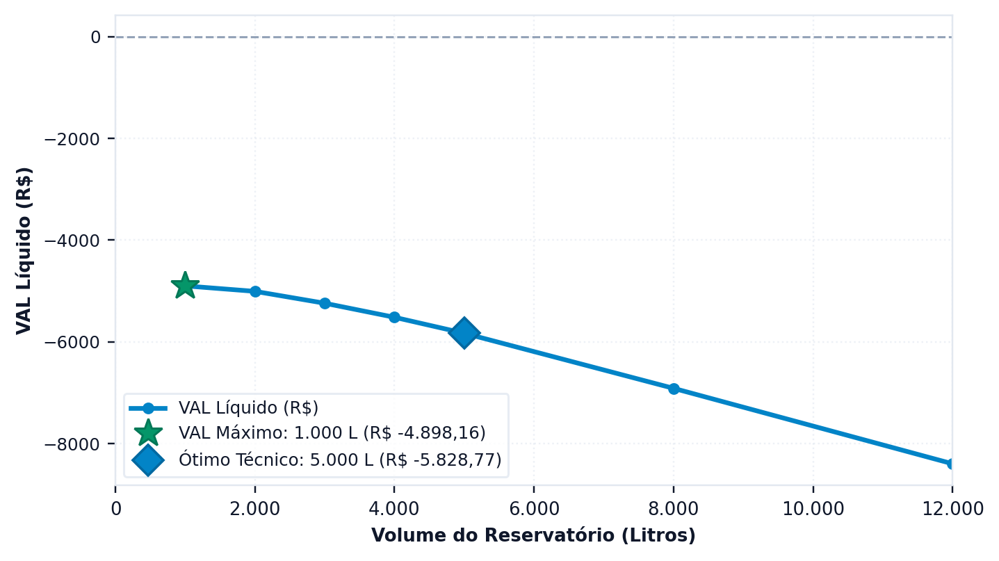

*Figura 15 — O gráfico do separador económico: o valor atual líquido de cada volume da varredura, com o máximo económico e o ótimo técnico marcados. Quando os dois coincidem, o programa assinala-os com um único símbolo. Todos os custos são ilustrativos, não são preços de mercado. Figura gerada pelo próprio programa.*

---

### 4.7.6. O que entra no custo de exploração (OPEX)

Também aqui o programa não pré-preenche preços. O custo de exploração de um projeto novo soma a energia da eletrobomba, o cloro, a linha de tratamento e as rotinas de manutenção, e **todos esses preços partem de zero**: a tarifa de eletricidade, o preço do cloro e o custo de cada rotina. As três rotinas de manutenção existem como roteiro, com periodicidade de 12 meses, e o utilizador dá-lhes o custo.

O que o programa calcula sozinho são as quantidades: a energia anual da eletrobomba, pela cadeia da secção 2.6 (volume O método), e os quilogramas de cloro, pela dose e pela pureza da pastilha. O custo é a quantidade vezes o preço que o utilizador introduzir. Com preço zero, o custo é zero, e não um valor omitido.

**As rotinas pesam mais que o resto.** O campo de custo anual que o resumo da análise mostra soma só a energia, o cloro e a linha de tratamento. As rotinas de manutenção entram no fluxo de caixa à parte, no fim de cada período, corrigidas pela inflação. No tutorial, com valores ilustrativos, elas movem o resultado:

<!-- tabela: **Tabela 29** — Efeito das três rotinas de manutenção ilustrativas sobre o custo do resumo e sobre o resultado do tutorial (custos ilustrativos, não são preços de mercado) -->
| Projeto do tutorial (custos ilustrativos, não são preços de mercado) | Com as rotinas | Sem rotinas |
| :--- | ---: | ---: |
| rotinas de manutenção por ano | 90,00 € | 0,00 € |
| custo anual do resumo: energia, cloro e tratamento | 1,75 € | 1,75 € |
| valor atual líquido | −5 828,77 € | −4 418,13 € |

**Energia.** Hoje a tarifa de eletricidade é um campo vazio. O exemplo do Funchal traz 0,1673 €/kWh, a Tarifa Base da Empresa de Eletricidade da Madeira, sem IVA, recolhida num comparador de preços e por isso de fonte secundária; Lisboa e Porto ficam a zero. Para um estudo, use a sua fatura.

Recolheram-se séries públicas que servirão de ponto de partida, mas **ainda não estão ligadas ao programa**: nenhum valor da tabela seguinte é inserido sozinho. O preço do Eurostat é a média de um domicílio inteiro, na banda de 2 500 a 4 999 kWh por ano, e não o preço marginal de uma eletrobomba; a fatura do utilizador prevalece sempre.

<!-- tabela: **Tabela 30** — Séries públicas recolhidas fora do programa, ainda não ligadas a ele, com a data de acesso e o início da soma de verificação -->
| Série pública | Portugal | Espanha | Acesso | SHA-256 (início) |
| :--- | ---: | ---: | :--- | :--- |
| eletricidade doméstica, com impostos (2026-S1) | 0,2367 €/kWh | 0,2509 €/kWh | 2026-10-22 | `b92782d29f15` |
| eletricidade doméstica, sem impostos (2026-S1) | 0,1576 €/kWh | 0,1782 €/kWh | 2026-10-22 | `c9ad0130f1ef` |
| inflação anual (IPCH) (2025) | 2,2 % ao ano | 2,7 % ao ano | 2026-10-22 | `ad3c84f4b19c` |
| taxa de refinanciamento do BCE (2026-09-16) | 2,65 % | zona euro: o mesmo valor | 2026-10-22 | `0dedb876aea5` |

O plano é pré-preencher a tarifa com o valor do Eurostat do país, rotulado como média de um domicílio inteiro e editável, a inflação com o IPCH e a taxa de atualização com uma referência do BCE. **Não está implementado.** O cloro e as manutenções continuarão sem custo até haver fonte aberta para eles, e o índice de custos de construção, que serviria para atualizar preços já recolhidos, ainda nem foi localizado na fonte oficial.

**O que não entra.** O fluxo de caixa não traz reposição de equipamentos ao longo dos 20 anos, valor residual, análises laboratoriais da água nem seguro. Se a eletrobomba ou o filtro forem substituídos no período, acrescente a substituição como uma rotina em *3. Outros Custos Operacionais*.

**Como alterar ou desligar.** As rotinas editam-se, excluem-se ou acrescentam-se no botão *3. Outros Custos Operacionais*. A dose de cloro e o descarte físico escolhem-se na etapa **3. Qualidade & ETAP**. A tarifa e os impostos da eletricidade ficam em *2. Eletrobomba e Custo de Energia*.

---
### 4.7.7. O que a projeção assume

Vinte anos são muito tempo, e a projeção depende de premissas que convém declarar:

<!-- tabela: **Tabela 31** — Premissas da projeção económica e o peso de cada uma no resultado -->
| Premissa | Valor adotado | Onde pesa |
| :--- | ---: | :--- |
| taxa de atualização | 0,4% ao mês | desconta o fluxo; quanto maior, pior o VAL |
| inflação dos custos | 0,2% ao mês | incide só sobre o custo de exploração |
| atualização da tarifa da água | 3% ao ano | incide sobre a poupança |
| atualização da tarifa do saneamento | 3% ao ano | idem, e é indexada à parte |
| intervalo de atualização | 12 meses | em degraus, não de forma contínua |
| período de análise | 20 anos | a vida útil adotada; declare-a e justifique-a |

Todos estes valores são escolhas ilustrativas do tutorial, não dados de um país.

> **As atualizações da água e do saneamento são separadas**, e não um índice único sobre a fatura agregada. As duas parcelas são muitas vezes atualizadas por decisões diferentes das entidades que as cobram, e tratá-las em conjunto indexa parte da conta pelo índice errado.

A atualização da tarifa é a premissa mais frágil da lista. Três por cento ao ano durante vinte anos multiplicam a tarifa por 1,81. Se a tarifa real subir mais do que isso, o projeto rende mais; se subir menos, rende menos. Um estudo sério declara o valor adotado e mostra a sensibilidade — a secção 3.7 (volume Guias de uso) ensina como.

---

### 4.7.8. O que temos até aqui

<!-- tabela: **Tabela 32** — Estado do projeto do tutorial depois da análise económica (ilustrativo, não é preço de mercado) -->
| Projeto até aqui (ilustrativo, não é preço de mercado) | |
| :--- | ---: |
| volume | 5 000 L, betão |
| arranjo | elevação para reservatório superior de 1 000 L |
| investimento | 6 650 € |
| poupança anual | 134,28 € |
| VAL a 20 anos | −5 828,77 € |
| período de recuperação | sem recuperação em 20 anos |

O dinheiro diz não.

Falta ouvir o carbono. E ele não vai simplesmente concordar.

---

## 4.8. Quanto carbono evita

> No fim desta secção, tem o balanço de carbono do sistema e uma surpresa: com a cisterna que escolhemos, o projeto **emite mais do que evita** ao longo da vida útil. E a troca de material, ao contrário do que seria de esperar, não resolve o problema.

---

### 4.8.1. A conta

Um sistema de aproveitamento pluvial evita emissões porque cada metro cúbico que entrega deixa de ser captado, tratado e bombeado pela entidade gestora, e estas três operações consomem energia. O mesmo sistema, porém, emite carbono em três frentes próprias: o fabrico dos seus componentes, a energia consumida na bombagem interior e os consumíveis de tratamento aplicados à água.

O saldo ambiental do sistema é a diferença entre o que evita e o que emite, e a pergunta que organiza esta secção é em quantos anos o crédito anual líquido amortiza a dívida contraída no fabrico. Esse prazo é o **retorno do carbono**, e desempenha na dimensão ambiental o papel que o período de recuperação desempenha na dimensão económica.

> **Os fatores são ilustrativos.** A Edição Ibérica não traz fatores de emissão: a avaliação ambiental não é calculada até introduzir os do local do projeto (apêndice C (volume Apêndices)). O tutorial usa dois números redondos, **0,40 kg CO₂e por quilowatt-hora** de eletricidade da rede e **0,50 kg CO₂e por metro cúbico** de água da rede evitada. São ilustrativos, não são dados de nenhum país, escolhidos para se poder seguir o método; a lição está na forma do resultado, não nos dígitos. [A COMPLETAR: se se quiser fatores portugueses, indicar a fonte oficial aberta (fator de emissão da eletricidade da rede e intensidade carbónica do abastecimento de água em Portugal) e o ano; este manual não os cita.]

Para o nosso projeto, uma cisterna de betão de 5 000 L com elevação para o reservatório superior de 1 000 L:

<!-- tabela: **Tabela 33** — Balanço de carbono do projeto do tutorial com cisterna de betão (fatores ilustrativos) -->
| Parcela | Valor |
| :--- | ---: |
| carbono incorporado no sistema | 1 026 kg CO₂e |
| emissão evitada por ano | 19,6 kg CO₂e |
| emissão anual de bombagem e tratamento | 2,2 kg CO₂e |
| saldo líquido anual | 17,4 kg CO₂e |
| **retorno do carbono** | **59,0 anos** |
| saldo ao fim de 20 anos | **+678 kg CO₂e** |

São 59 anos para amortizar a dívida de carbono, contra uma vida útil adotada de vinte. ==O sistema não se paga, portanto, do ponto de vista ambiental:== quando for desativado, terá emitido 678 kg CO₂e a mais do que evitou durante toda a operação.

E o resultado financeiro do mesmo projeto também foi negativo (secção 4.7). Os dois veredictos coincidem, mas por razões diferentes, e as secções seguintes mostram-no: o carbono é decidido pela massa da cisterna, o dinheiro pela tarifa. É por isso que as dimensões de análise devem ser mantidas separadas até ao momento da decisão.

---

### 4.8.2. Porque a poupança de carbono é tão pequena

Dezanove quilogramas e meio de CO₂e por ano parecem pouco para 39,2 metros cúbicos de água poupada, e com estes fatores são: 0,50 kg CO₂e por metro cúbico substituído, descontada a energia para o bombear.

A explicação está na natureza do produto substituído. A água tratada não é um bem intensivo em carbono. Captar, tratar e distribuir a água custa uma fração de quilograma de CO₂e por metro cúbico entregue, conforme o mix elétrico local e a origem da água, e isso é modesto quando comparado com o carbono do betão, do aço ou dos combustíveis. Substituir um produto de baixa intensidade de carbono por outro que exige o fabrico de um reservatório não produz, portanto, o ganho ambiental que a intuição sugere.

> **A fronteira importa.** O fator do programa é por metro cúbico **entregue** ao edifício, e não por metro cúbico produzido na estação. As perdas na distribuição fazem com que um metro cúbico produzido entregue menos de um: usar o fator à saída da estação subestimaria a emissão evitada. A secção 2.8 (volume O método) detalha.

---

O separador ambiental apresenta o mesmo balanço em forma gráfica, com as parcelas de emissão e o crédito da água evitada separados (Figura 16).

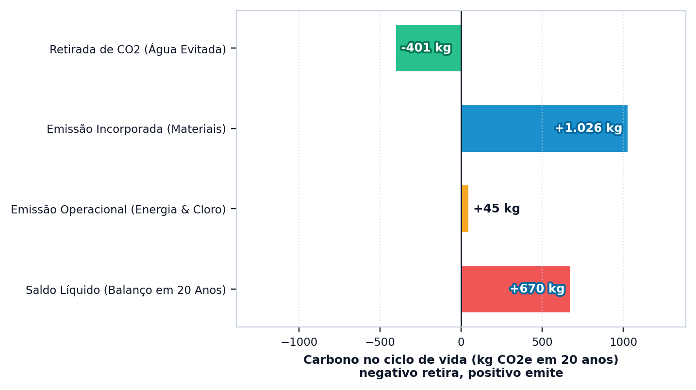

*Figura 16 — O gráfico do separador ambiental para o mesmo projeto, com cisterna de betão: as parcelas do balanço de carbono em vinte anos, com fatores ilustrativos. O sinal segue a convenção adotada em todo este capítulo: emissões positivas, água evitada negativa. Figura gerada pelo próprio programa.*

---
### 4.8.3. O material muda a dimensão, não o sinal

A dívida de carbono está quase toda na cisterna. E uma cisterna de 5 000 L pode pesar 75 kg ou 6 000 kg, conforme o material. A tabela seguinte e a Figura 17 mostram a trajetória das emissões líquidas ao longo da vida útil, e a Figura 18 o resultado final de cada material.

==Em todo este capítulo, **positivo emite e negativo retira**. É a convenção do gráfico de balanço do separador ambiental do programa, e a que mantém intuitiva a leitura de um gráfico de emissões: a linha que desce é a que melhora.==

<!-- tabela: **Tabela 34** — Emissões líquidas de carbono do projeto do tutorial conforme o material do reservatório (os preços são ilustrativos, não são preços de mercado) -->
| Material da cisterna | Massa | Carbono incorporado | Retorno do carbono | Emissões líquidas em 20 anos | Preço (ilustrativo, não é preço de mercado) |
| :--- | ---: | ---: | ---: | ---: | ---: |
| Polietileno (PEAD) | 110 kg | 363 kg CO₂e | 20,9 anos | 15 kg | 2 850 € |
| Betão armado | 6 000 kg | 1 026 kg CO₂e | 59,0 anos | 678 kg | 2 600 € |
| Fibra de vidro | 75 kg | 429 kg CO₂e | 24,7 anos | 81 kg | 3 370 € |
| Aço inoxidável | 190 kg | 889 kg CO₂e | 51,1 anos | 541 kg | 10 300 € |

<!-- tabela: **Tabela 35** — Efeito do volume da cisterna de betão nas emissões líquidas de carbono -->
| Volume em betão | Retorno do carbono | Emissões líquidas em 20 anos |
| ---: | ---: | ---: |
| 2 000 L | 37,1 anos | 240 kg CO₂e |
| 3 000 L | 44,4 anos | 379 kg CO₂e |
| 5 000 L | 59,0 anos | 678 kg CO₂e |
| 8 000 L | 80,0 anos | 1 147 kg CO₂e |

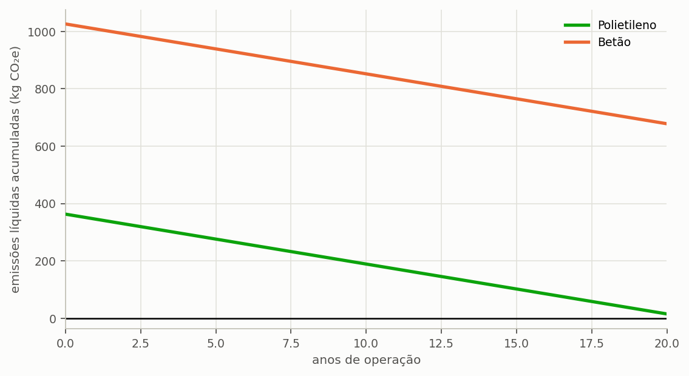

*Figura 17 — Emissões líquidas acumuladas da cisterna de 5 000 L ao longo da vida útil, para polietileno e betão, com fatores ilustrativos. A curva parte do carbono incorporado no fabrico, acima de zero, e desce com o crédito anual da água potável evitada; o polietileno cruza o zero aos 20,9 anos, logo depois do horizonte de vinte anos adotado, e o betão aos 59,0 anos.*

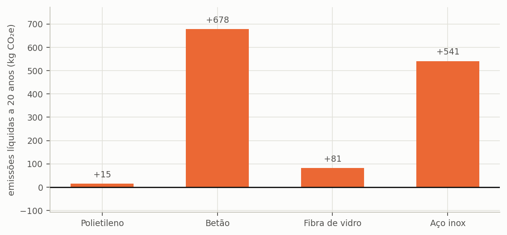

*Figura 18 — Emissões líquidas em vinte anos da cisterna de 5 000 L, por material, com fatores ilustrativos. Os quatro materiais encerram a vida útil a emitir mais do que evitaram; o polietileno fica praticamente na fronteira (+15 kg) e o betão, o mais pesado, longe dela (+678 kg).*

**A escolha do material muda a dimensão do problema, mas aqui não inverte o sinal.**

Com a chuva de Lisboa, que dá pouca água poupada, nenhum material paga o próprio fabrico em vinte anos. O polietileno leva 20,9 anos e termina os vinte anos a emitir ainda 15 kg: está praticamente na fronteira. A fibra de vidro leva 24,7 anos e termina com +81 kg. O aço inoxidável leva 51,1 anos e termina com +541 kg. O betão leva 59,0 anos e termina com +678 kg. Com 28% de fração atendível e 39,2 m³ poupados por ano, só os materiais leves chegam perto de pagar o fabrico.

A segunda tabela mostra o outro lado da mesma moeda: em betão, **quanto maior a cisterna, pior o carbono**. A de 2 000 L fecha os vinte anos a emitir 240 kg; a de 8 000 L, 1 147 kg, e o seu retorno do carbono estica-se até 80,0 anos. Cada metro cúbico de betão acrescenta cerca de 150 kg CO₂e e rende cada vez menos água.

---
### 4.8.4. Existe um volume ambientalmente ótimo

A observação anterior vale para o betão, mas é um caso particular de algo mais geral. O carbono incorporado cresce de forma quase afim com o volume; a água evitada cresce com o atendimento, que satura. A soma das duas parcelas tem um **mínimo interior**: existe um volume a partir do qual cada litro a mais de armazenamento emite mais do que evita. A Figura 19 mostra as duas curvas.

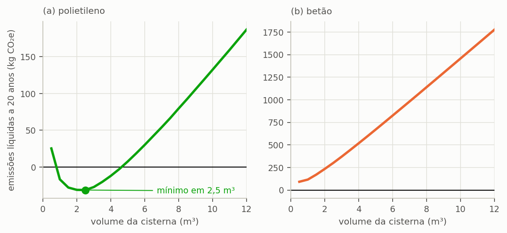

*Figura 19 — Emissões líquidas em vinte anos contra o volume da cisterna, para (a) polietileno e (b) betão, no projeto do tutorial, com fatores ilustrativos. Em polietileno (com o reservatório superior de 1 000 L), o balanço é o melhor, entre os volumes testados, aos 2 000 L, onde retira 25 kg; passa a emissão entre 4 000 e 5 000 L (retira 5 kg aos 4 000 L e emite 15 kg aos 5 000 L) e emite 194 kg aos 12 000 L. Em betão, as emissões líquidas são positivas em toda a gama.*

==Mais armazenamento não é monotonicamente melhor para o clima.== É o contrário do que a intuição corrente sugere, e decorre de uma propriedade simples: a saturação do atendimento. O volume que minimiza as emissões (2 000 L) não é o que maximiza a poupança de água, nem o que o critério do ganho marginal escolheu (5 000 L) — e a secção 4.9 trata de como decidir entre eles.

> **O material mais leve é também o melhor para o carbono, a um preço próximo.** Com os preços ilustrativos, o polietileno custa 2 850 € contra 2 600 € do betão (ilustrativo, não são preços de mercado) — o preço mal os separa —, mas pesa cerca de cinquenta e cinco vezes menos e é o material que fecha os vinte anos com as menores emissões líquidas dos quatro.
>
> Isto não é sorte. Massa é carbono, e o betão armado é, de longe, o material mais maciço da lista.

---

### 4.8.5. Quando o betão ainda faz sentido

A tabela não condena o betão. Diz que precisa de justificação.

- **Vida útil maior.** O programa adota 20 anos para todos os materiais. É um piso, não uma previsão: uma cisterna de betão bem executada pode durar muito mais, e num horizonte superior a 59 anos o retorno do carbono paga-se, embora sem folga. Se adotar uma vida útil diferente, **declare-a** e justifique-a. [A COMPLETAR: se se quiser fundamentar a vida útil por norma, indicar a fonte portuguesa ou europeia aberta; este manual não cita nenhuma.]
- **Volumes grandes.** Para volumes muito grandes, os reservatórios de polietileno de fábrica deixam de ser práticos e o betão moldado no local pode ser a única opção viável.
- **Restrição de espaço.** Uma cisterna enterrada de betão adapta-se ao terreno; a de polietileno vem em formatos fixos.
- **Estrutura já existente.** Um reservatório de betão reaproveitado de outra finalidade tem carbono incorporado **zero** para efeito deste projeto.

---

### 4.8.6. A decisão do tutorial

**Trocamos para polietileno.**

É o que um projetista faria perante esta tabela, e é o que torna este tutorial honesto: um estudo muda de rumo quando a análise mostra que o rumo estava errado. A troca não faz o sistema pagar-se, nem em dinheiro nem em carbono, mas faz a diferença onde ela importa:

<!-- tabela: **Tabela 36** — Efeito da troca de betão por polietileno nas três dimensões de análise (ilustrativo, não é preço de mercado) -->
| (ilustrativo, não é preço de mercado) | Betão | Polietileno |
| :--- | ---: | ---: |
| preço da cisterna | 2 600 € | 2 850 € |
| investimento total | 6 650 € | 6 900 € |
| período de recuperação | sem recuperação | sem recuperação |
| VAL a 20 anos | −5 829 € | −6 079 € |
| retorno do carbono | 59,0 anos | 20,9 anos |
| emissões líquidas em 20 anos | +678 kg | +15 kg |

A troca custa 250 € a mais e empurra o VAL para −6 079 €, mas reduz o retorno do carbono de 59,0 para 20,9 anos e as emissões líquidas de 678 para 15 kg. O potencial de poupança não muda.

<!-- tabela: **Tabela 37** — Estado do projeto do tutorial depois da análise ambiental (ilustrativo, não é preço de mercado) -->
| Projeto até aqui (ilustrativo, não é preço de mercado) | |
| :--- | ---: |
| volume | 5 000 L |
| **material** | **polietileno** |
| investimento | 6 900 € |
| VAL | −6 079 € |
| período de recuperação | sem recuperação |
| retorno do carbono | 20,9 anos |

---

### 4.8.7. O que declarar

A avaliação do ciclo de vida do Triton é de **triagem**, não um inventário completo. Todos os fatores predefinidos têm proveniência declarada, mas alguns são aproximações, como o da eletrobomba e o do hipoclorito, e um fator escrito sem fonte recebe uma etiqueta de triagem, que o programa mostra. Num estudo publicado:

- declare a **fronteira** adotada, água entregue e não produzida;
- declare a **vida útil** e justifique-a;
- declare quais os fatores que são aproximações e quais foram introduzidos sem fonte;
- declare a **base da rede elétrica** e o ano.

O apêndice C (volume Apêndices) traz a proveniência de cada fator, e a secção 2.8 (volume O método) explica as sete etapas do inventário.

Temos agora três respostas. O potencial diz um volume, o dinheiro diz outro, o carbono diz um terceiro. É hora de escolher.

---

## 4.9. Que volume escolher, afinal

> No fim desta secção, tem um volume recomendado e sabe que ele depende de pesos que **o utilizador** declarou — e não de uma verdade que o programa descobriu.

---

### 4.9.1. Três critérios, três respostas

As secções anteriores deste tutorial fizeram ao mesmo projeto três perguntas distintas — quanta água entrega, quanto dinheiro rende e quanto carbono evita — e receberam três respostas que não coincidem. Esta discordância não é defeito da análise nem inconsistência dos dados: mostra que os três critérios medem coisas diferentes e se comportam de maneira diferente em relação ao volume do reservatório.

<!-- tabela: **Tabela 38** — Matriz de decisão multicritério: cada volume da varredura avaliado nas três dimensões de análise (os custos são ilustrativos, não são preços de mercado) -->
| Volume | Potencial | VAL (ilustrativo, não é preço de mercado) | Período de recuperação | Saldo de carbono em 20 anos | Investimento (ilustrativo, não é preço de mercado) |
| ---: | ---: | ---: | ---: | ---: | ---: |
| 1 000 L | 11,91% | −4 548 € | sem recuperação | 9 kg | 4 700 € |
| 2 000 L | 14,52% | −4 805 € | sem recuperação | 25 kg | 5 250 € |
| 3 000 L | 16,00% | −5 189 € | sem recuperação | 19 kg | 5 800 € |
| 4 000 L | 17,10% | −5 615 € | sem recuperação | 5 kg | 6 350 € |
| 5 000 L | 17,88% | −6 079 € | sem recuperação | −15 kg | 6 900 € |
| 8 000 L | 19,65% | −7 611 € | sem recuperação | −87 kg | 8 550 € |
| 12 000 L | 21,43% | −9 694 € | sem recuperação | −194 kg | 10 750 € |

<!-- tabela: **Tabela 39** — Volume vencedor segundo cada critério isolado -->
| Critério isolado | Volume vencedor |
| :--- | ---: |
| maior potencial de poupança | 12 000 L |
| menor período de recuperação descontado, desempate pelo VAL | 1 000 L |
| maior saldo de carbono | 2 000 L |
| **compromisso, pesos iguais** | **5 000 L** |

A primeira tabela é o retrato do problema. Repare em como as colunas discordam:

- O **potencial** cresce monotonicamente: quanto maior a cisterna, mais água. Máximo em 12 000 L (21,43%).
- O **VAL** é negativo em todos os volumes (os custos são ilustrativos, não são preços de mercado). O seu melhor valor, a menor perda, está em 1 000 L, e piora a cada volume acrescentado, porque cada metro cúbico adicional de reservatório custa mais do que a poupança que traz. Nenhum volume tem período de recuperação.
- O **carbono** sobe e cai muito mais cedo: máximo em 2 000 L (retira 25 kg em vinte anos). Depois disso, cada metro cúbico de polietileno acrescenta mais dívida do que crédito, e aos 5 000 L o saldo já passa a emissão.

==Não existe um volume que vença nos três critérios em simultâneo.== Cada um tem o seu ótimo num ponto diferente da curva, e a escolha entre eles não é uma questão técnica com resposta única: é uma questão de prioridade, que tem de ser declarada por quem decide e não pode ser descoberta pelo programa. É exatamente essa a lacuna que os métodos multicritério vêm preencher.

---

### 4.9.2. Como o TOPSIS resolve

O programa usa o TOPSIS sobre **sete critérios**:

<!-- tabela: **Tabela 40** — Os sete critérios do multicritério e o sentido de preferência de cada um -->
| Critério | Sentido |
| :--- | :--- |
| potencial de economia | maximizar |
| extravasamento | minimizar |
| valor atual líquido | maximizar |
| período de recuperação descontado | minimizar |
| taxa interna de rentabilidade | maximizar |
| CO₂e no fim da vida | minimizar |
| consumo de água potável | minimizar |

O método funciona em quatro passos encadeados. Primeiro, normaliza a matriz de decisão, para que critérios medidos em unidades incomparáveis — pontos percentuais, euros, quilogramas de dióxido de carbono equivalente e anos — passem a ocupar a mesma escala. Depois, aplica os pesos declarados. Calcula então, para cada alternativa de volume, a distância euclidiana à solução ideal, formada pelos melhores valores de cada critério, e à solução anti-ideal, formada pelos piores. Por fim, ordena as alternativas pela proximidade relativa ao ideal, conforme a formulação da secção 2.10 (volume O método).

Aplicado ao projeto do tutorial com pesos iguais entre as três dimensões, repartidos igualmente pelos critérios de cada uma, o método indica o volume de 5 000 L.

> **Três declarações que um estudo publicado tem de fazer.**
>
> A normalização do programa é uma **variante** de Hwang e Yoon: translada por `x − min(x)` antes da normalização vetorial, para admitir um VAL negativo. É uma escolha deliberada, e apresentá-la como TOPSIS canónico seria incorreto.
>
> O SMAA-VIKOR, disponível ao lado, sorteia pesos e devolve a probabilidade de cada volume ocupar cada posição. É a resposta certa quando não há consenso sobre os pesos.
>
> As condições C1 e C2 de Opricovic, de vantagem aceitável e de estabilidade, **não estão implementadas**. A secção 2.10 (volume O método) detalha.

---

O separador de decisão apresenta o escore de cada volume candidato (Figura 20).

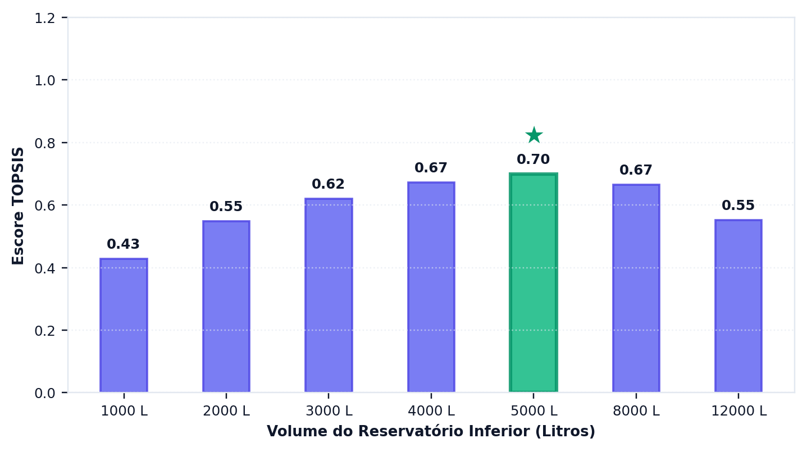

*Figura 20 — O gráfico do separador de decisão: o escore de proximidade ao ideal de cada volume candidato, com o vencedor destacado. Escores próximos entre si significam alternativas tecnicamente equivalentes, e nesse caso a escolha passa a depender do peso declarado. Figura gerada pelo próprio programa.*

---
### 4.9.3. O peso muda a resposta

A tabela seguinte mostra o que acontece ao deslocar o peso.

<!-- tabela: **Tabela 41** — Volume escolhido pelo TOPSIS conforme a dimensão com peso dominante, e o segundo classificado -->
| Peso dominante | Volume | Segundo classificado |
| :--- | ---: | ---: |
| pesos iguais | 5 000 L | 4 000 L |
| técnico, 60% | 8 000 L | 12 000 L |
| económico, 60% | 5 000 L | 4 000 L |
| ambiental, 60% | 5 000 L | 4 000 L |

Privilegiar o critério técnico desloca a recomendação para 8 000 L, o que era de esperar: o potencial de economia cresce monotonicamente com o volume, e um peso dominante nessa dimensão empurra a escolha para cima. Os critérios económico e ambiental, por seu lado, ficam ambos nos 5 000 L dos pesos iguais.

Esta convergência, contudo, não é regra geral, e lê-la como tal seria generalizar indevidamente um caso particular. Isoladamente, o critério financeiro prefere 1 000 L e o ambiental 2 000 L; o ordenamento cai em 5 000 L porque o TOPSIS pesa também os restantes critérios de cada dimensão, entre os quais os hídricos (potencial, extravasamento, consumo de água potável), que favorecem volumes maiores. Com outro tarifário ou outros custos, o ótimo económico deslocar-se-ia, e a divergência entre os critérios apareceria com clareza.

O ordenamento multicritério escolhe um volume; não diz se se deve construir. Neste tutorial, todos os volumes têm VAL negativo e nenhum período de recuperação, com os custos ilustrativos, pelo que a dimensão financeira argumenta contra construir seja o que for. Se o projeto avançar, é pelas razões que as outras dimensões apresentam ou por um fim que o fluxo de caixa não mede, e o relatório tem de o dizer.

> **Declare os pesos.** «Volume ótimo pelo TOPSIS» sem os pesos é uma afirmação impossível de reproduzir. Dois artigos com pesos diferentes chegam a volumes diferentes, e ambos estão certos.

---

Uma solução de compromisso cede em alguma coisa, e convém saber em quê. O programa desdobra o escore único em sete, um por critério, e mostra a distância que separa a alternativa escolhida do melhor valor alcançado em cada um (Figura 21).

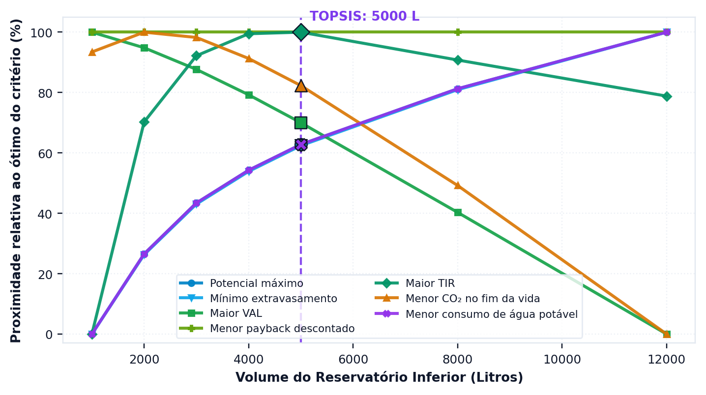

*Figura 21 — O segundo gráfico do separador de decisão: o quanto o volume escolhido se aproxima do melhor valor possível em cada um dos sete critérios. É a figura que mostra o que a solução de compromisso está a ceder, e em que dimensão. Figura gerada pelo próprio programa.*

---
### 4.9.4. A recomendação do tutorial

A recomendação do tutorial, se o projeto for construído, é o reservatório de **5 000 L em polietileno**, e a razão para a adotar não é só vencer com pesos iguais. É o volume de compromisso, não o ótimo financeiro, que está em 1 000 L, nem o ótimo ambiental, que está em 2 000 L. Vence também com um peso económico dominante e com um peso ambiental dominante, e perde para os 8 000 L apenas com um peso técnico dominante. Sob a incerteza simulada dos pesos (SMAA), fica em primeiro lugar em 34,1% dos sorteios, contra 30,6% para 8 000 L e 15,6% para 4 000 L. ==Uma recomendação que sobrevive a três ponderações diferentes é robusta justamente porque não depende de nenhuma delas==, embora a margem do SMAA seja estreita.

Vale registar ainda que este é o mesmo volume que o critério hidráulico da secção 4.4 tinha indicado, com um limiar de ganho marginal de 1 %/m³. Duas vias metodologicamente independentes — uma que olha só para a curva de aproveitamento e outra que pondera sete critérios de três dimensões — chegaram ao mesmo resultado, e essa concordância reforça a confiança na recomendação.

A concordância, porém, não está garantida em nenhum outro caso, e é por isso que o tutorial fez o caminho longo em vez de parar na secção 4.4. O propósito não era chegar mais depressa ao volume, mas saber que as duas vias concordam **neste** projeto, em vez de supor que concordam sempre.

---

### 4.9.5. O projeto, fechado

<!-- tabela: **Tabela 42** — Resumo do projeto do tutorial, com todos os parâmetros e resultados -->
| Triton · moradia unifamiliar em Lisboa (custos ilustrativos, não são preços de mercado) | |
| :--- | ---: |
| série de precipitação | Lisboa, 30 anos, 719 mm/ano |
| área de captação | 150 m² |
| coeficiente de escoamento | 0,85 |
| descarte das primeiras águas | 2,0 mm, todas as chuvadas |
| moradores | 4 |
| procura total | 600 L/dia |
| fração atendível pela chuva | 28% |
| reservatório inferior | 5 000 L, polietileno |
| arranjo de abastecimento | elevação para reservatório superior |
| reservatório superior | 1 000 L, limiar de acionamento de 100 L |
| classe de qualidade | 1, cloragem por pastilhas |
| descarte inicial | câmara de 300 L |
| **potencial de economia de água potável** | **17,88%** |
| dias de atendimento pleno | 62,8% |
| água da chuva consumida | 39,2 m³/ano |
| energia da elevação | 5,1 kWh/ano |
| investimento (ilustrativo) | 6 900 € |
| **valor atual líquido a 20 anos (ilustrativo)** | **−6 079 €** |
| período de recuperação descontado | sem recuperação |
| **emissões líquidas em 20 anos** | **+15 kg CO₂e** |
| retorno do carbono | 20,9 anos |

Resta uma etapa, que é comunicar o resultado: um estudo que não é relatado de forma verificável não se distingue, para quem o lê, de um palpite bem apresentado. É o assunto da secção seguinte.

---

## 4.10. O relatório, e o que declarar num artigo

> No fim desta secção, tem o relatório emitido e, se pretende publicar, a lista do que tem de constar no método do artigo. Essa lista é a parte mais curta e mais importante do manual.

---

### 4.10.1. Os três relatórios

O programa emite três relatórios distintos, e a distinção não é de extensão, mas de público e de finalidade. Escolher o relatório errado para o destinatário certo é a forma mais comum de produzir um documento que ninguém lê: um cliente não percorre um inventário de ciclo de vida item a item, e um avaliador de certificação não se satisfaz com uma conclusão de quatro páginas.

O **relatório executivo** tem de quatro a seis páginas e reúne o resultado técnico, o investimento, o retorno e uma conclusão objetiva. É o documento de entrega ao cliente, e a sua virtude é caber numa só leitura, sem exigir que o leitor conheça o método.

O **relatório ambiental e ESG** apresenta o inventário de ciclo de vida discriminado por componente, o saldo de carbono ao longo da vida útil e o enquadramento do projeto nos referenciais tratados na secção 2.9 (volume O método) — LEED, EDGE e GRI 303. É o documento que se anexa a um processo de certificação, e a discriminação por componente existe justamente porque um avaliador confere item a item.

O **relatório científico** traz o método completo, as premissas declaradas, a série utilizada e os resultados com a precisão que um artigo exige. É a base sobre a qual se redige uma publicação, e é o único dos três que inclui as figuras analíticas.

Além dos três, a etapa **10. Exportação** gera o desenho esquemático em DXF, o modelo BIM em JSON e folhas de cálculo com a série diária completa e com a varredura de volumes, como detalha a secção 3.9 (volume Guias de uso).

---

### 4.10.2. O que o relatório não decide por si

==O relatório traz os números; o contexto que os torna reproduzíveis é seu.== Nenhum documento gerado automaticamente pode declarar porque se escolheu aquela série de precipitação, se o consumo per capita adotado foi medido ou tirado da literatura, ou o que justifica a vida útil considerada na avaliação ambiental. É esta informação que permite a um terceiro repetir o estudo e chegar ao mesmo resultado, e é dela que trata o resto desta secção.

---

### 4.10.3. A lista de declaração

Um estudo feito no Triton que deixe de declarar qualquer dos itens abaixo não é reproduzível por terceiros e, o que costuma ser pior, não é comparável com outro estudo feito no mesmo programa — porque duas simulações com premissas diferentes produzem números que parecem comparáveis e não são. A lista está organizada pela ordem em que as decisões aparecem no trabalho, e pode seguir-se como roteiro de redação do método.

#### 4.10.3.1. Programa e versão

- **Versão do Triton**, com o número completo, e a **edição** (Portugal). As correções de cálculo entre versões deslocam resultados, e sem a versão declarada não há como saber que cálculo produziu o número publicado.

#### 4.10.3.2. Série de precipitação

- **Origem**: estação, base de concelhos (E-OBS) ou reanálise.
- Se for a base de concelhos: **concelho, versão da E-OBS e janela temporal**; se for reanálise ou modelo: **produto, cenário, janela temporal** e a resolução da grelha.
- **Recorte**: datas de início e fim, e número de anos.
- **Tratamento de falhas** e critério para descartar um ano incompleto.

#### 4.10.3.3. Edifício e procura

- Área de captação e **como foi obtida** — projeção horizontal.
- Coeficiente de escoamento e a sua origem.
- Consumo per capita, e se é **medido ou de referência**.
- **Fração atendível pela água da chuva** e os usos finais que a compõem. É o teto do resultado, e sem ela o potencial não se interpreta.
- Se algum uso está fora da lista que a norma aplicável admite, como a máquina de lavar roupa, e que critério de qualidade foi adotado para ele.

#### 4.10.3.4. Arranjo de abastecimento

- **Arranjo**: elevação para reservatório superior, pressurização direta ou gravidade. Define a energia e as eletrobombas no custo e no carbono.
- Na elevação: volume do reservatório, limiar de acionamento e altura manométrica.
- Na pressurização direta: pressão de trabalho e arranques por pessoa e por dia.

#### 4.10.3.5. Descarte das primeiras águas

- Lâmina adotada e **modo**, entre os três.
- **O tratamento da lâmina**, se o estudo comparar o Triton com outra ferramenta: algumas ferramentas tratam a lâmina como limiar do evento, o Triton subtrai-a à chuva do dia, e os dois dão resultados diferentes.

#### 4.10.3.6. Volume e critério de escolha

- Se veio de uma varredura: **o limiar de ganho marginal adotado**. Sem ele, «volume ideal» não significa nada.
- Se veio do multicritério: **os pesos dos sete critérios** e o método, TOPSIS ou SMAA-VIKOR.
- Que a normalização do TOPSIS é uma **variante**, com translação por `x − min(x)`.

#### 4.10.3.7. Análise económica

- **Concelho e entidade gestora**, com a data de entrada em vigor do tarifário.
- **Regime de mínimo**, entre os seis. É o que mais altera resultados entre entidades gestoras.
- Percentagem do saneamento, e que incide sobre a **parcela da água** da fatura.
- Taxa de atualização, inflação, período de análise.
- **Atualizações tarifárias** da água, do saneamento e da energia, com o intervalo.
- Se os custos são orçamentos ou valores ilustrativos.

#### 4.10.3.8. Avaliação do ciclo de vida

- **Fronteira**: água entregue, e não produzida.
- **Vida útil** adotada e a sua justificação.
- **Material** do reservatório. Pesa muito no resultado, como a secção 4.8 mostra.
- Base do fator de emissão da rede elétrica, **com o ano**.
- Que fatores são **aproximações** e quais levam **etiqueta de triagem**.

#### 4.10.3.9. Certificações

- Que as classes 2 a 4 de qualidade são **adaptações do programa**, e não de uma norma.
- No caso do LEED, a **versão** do referencial: v4/v4.1 ou v5.
- No caso do EDGE, que o programa avalia **apenas a barra da água**, e que o caso de base usado é o declarado ou a procura modelada.

---

### 4.10.4. O parágrafo pronto

Para o nosso projeto, o método ficaria assim:

> A simulação foi conduzida no Triton 0.1.0, Edição Ibérica, com um modelo comportamental de passo diário (extravasamento calculado antes da retirada da procura, com a chuva do dia disponível para o consumo do dia, uma ordem intermédia entre YAS e YBS), sobre uma série de precipitação de 30 anos para Lisboa (E-OBS, concelho de Lisboa, 1991 a 2020; 10 958 dias, média de 719 mm/ano). Adotou-se uma área de captação de 150 m² em projeção horizontal, um coeficiente de 0,85, valor redondo para a eficiência de captação combinada, e um descarte das primeiras águas de 2,0 mm em todas as chuvadas, subtraído à lâmina diária. A procura total adotada foi de 600 L/dia (4 moradores, 150 L/hab·dia), com uma fração atendível pela água da chuva de 28%, correspondente ao autoclismo e aos usos exteriores. O volume de 5 000 L resultou do critério do ganho marginal com limiar de 1 %/m³ e foi confirmado por uma análise multicritério TOPSIS com sete critérios e pesos iguais entre as dimensões técnica, económica e ambiental, com normalização numa variante de Hwang e Yoon transladada por x − min(x). Os pontos de uso são abastecidos por elevação para um reservatório superior de 1 000 L, com limiar de acionamento de 100 L, duas eletrobombas de 0,5 cv e o rendimento de motor predefinido do programa. A análise económica usou o tarifário de Lisboa em vigor desde 01/01/2026 (água da EPAL com o adicional da Câmara Municipal, saneamento e resíduos da Câmara), uma taxa de atualização de 0,4% ao mês, uma inflação de 0,2% ao mês, atualizações de 3% ao ano com intervalos de 12 meses e um período de 20 anos; todos os custos foram valores redondos ilustrativos, não são preços de mercado. A avaliação do ciclo de vida adotou a fronteira da água entregue, fatores de emissão ilustrativos de 0,40 kg CO₂e/kWh e 0,50 kg CO₂e/m³, um reservatório de polietileno e uma vida útil de 20 anos.

São cerca de trezentas palavras, e são a diferença entre um estudo que outro investigador consegue repetir e um número solto que ninguém pode verificar. A extensão é modesta perante o que se ganha: um método assim redigido responde antecipadamente à maior parte das perguntas que um revisor faria.

---

### 4.10.5. O fim do tutorial

Dez secções, um único projeto acompanhado do princípio ao fim, e um estudo completo: partiu de uma moradia sem sistema e chegou a uma recomendação de volume, material, classe de qualidade e a um veredicto sobre a viabilidade económica e ambiental — negativo em ambas, com os custos ilustrativos e a tarifa de Lisboa, mesmo depois de trocar o material —, com cada decisão justificada pelo número que a sustentou. O quadro da secção 4.9 reúne o resultado consolidado.

O caminho a seguir depende do que pretende fazer a seguir:

- **Resolver um caso diferente do tutorial** — o capítulo 3, os guias de tarefa.
- **Perceber de onde vem cada número** — o capítulo 2, o método.
- **Não cometer os erros que o programa não impede** — a secção 5.1 (volume Enganos, limitações e confiabilidade).
- **Defender o estudo perante um revisor** — o capítulo 5.

---

# Apêndices

---

## Apêndice G — Glossário

Termos técnicos e siglas, em português europeu, com o equivalente em inglês quando ele é usado na
literatura, acompanhados das diretrizes de padronização terminológica do Triton.

---

**AAC** (*aproveitamento de água de chuva*). Emprego da água precipitada sobre coberturas
para usos não potáveis em edifícios; a EN 16941-1 trata os sistemas de utilização de água
da chuva no local. Prefira-se o termo «aproveitamento» a «reutilização», porque a água de chuva captada
na cobertura é um recurso primário, e não um efluente gerado por um uso anterior.

**ACV** (*life cycle assessment*). Avaliação de ciclo de vida. Método que contabiliza os
impactos ambientais de um produto ao longo de toda a sua existência, da extração das
matérias-primas ao descarte. A do programa é de **triagem**, e não um inventário completo
conforme a ISO 14040.

**Água de chuva** (*rainwater*). Precipitação atmosférica recolhida diretamente em
superfícies impermeáveis de cobertura (telhados e lajes impermeabilizadas), antes de atingir
o solo ou as redes públicas. Designa o recurso natural e a fonte hídrica captada; evite-se a
forma coloquial «água da chuva».

**Água não potável** (*non-potable water*). Água que não se destina ao consumo humano direto,
mas cumpre os requisitos de qualidade exigidos para os usos admitidos: descargas de autoclismos e
mictórios, lavagem de veículos, pavimentos e roupa, rega de jardins e torres de arrefecimento.

**Água pluvial** (*stormwater*, *pluvial water*). Água de chuva que escoa superficialmente
por superfícies urbanas ou é conduzida por canalizações e sistemas prediais de drenagem. No Triton,
o termo aplica-se de preferência à infraestrutura predial e aos componentes de engenharia: *sistema
de aproveitamento de água pluvial (SAAP)*, *rede pluvial*, *procura pluvial*, *consumo de água pluvial*
e *extravasamento pluvial*.

**Água potável** (*potable water*, *drinking water*). Água que cumpre integralmente os
requisitos de qualidade da água para consumo humano em vigor no local do projeto, destinada à
ingestão direta, à preparação de alimentos e à higiene pessoal.

**Área de captação** (*catchment area*). Área projetada na **horizontal** da superfície
impermeável da cobertura onde a água é captada. Não é a área inclinada do telhado, nem a área
de contribuição usada para dimensionar caleiras e tubos de queda.

**BD+C** (*Building Design and Construction*). Família de referenciais do LEED
para projeto e construção de edificações novas ou em grande reforma. É a família
tratada neste manual, nas versões 4, 4.1 e 5.

**BIM** (*building information modeling*). Modelagem da informação da construção.
Representação digital da edificação em que cada componente carrega propriedades além da
geometria, o que permite compatibilizar projetos de disciplinas diferentes.

**CAD** (*computer-aided design*). Desenho assistido por computador. O programa exporta o
esquema hidráulico em DXF, formato de intercâmbio aceito pelos programas de CAD.

**CAOP** (*Carta Administrativa Oficial de Portugal*). Carta com os limites administrativos oficiais, publicada pela Direção-Geral do Território. A versão CAOP2025 define os limites dos 308 concelhos usados para calcular a série de chuva de cada concelho.

**CAPEX** (*capital expenditure*). Investimento inicial.

**CDD** (*consecutive dry days*). Maior sequência de dias consecutivos com chuva
abaixo de 1 mm.

**Coeficiente de escoamento** (*runoff coefficient*). Fração da chuva que
efetivamente chega ao reservatório, descontadas perdas por absorção, evaporação e
molhamento inicial da cobertura.

**Comprimento representativo de série de precipitação** (*representative rainfall time series length*, $N_{rep}$).
Menor período contínuo em anos de dados diários de chuva necessário para estabilizar
estatisticamente o dimensionamento e o desempenho do sistema (reproduzindo o volume ideal
e o potencial de economia da série completa sob confiança $\ge 90\%$), segundo a
metodologia de Geraldi e Ghisi (2017, 2018, 2019). O comprimento necessário não é uma
constante geográfica fixa: cresce com a fração atendível e com o nível de procura da edificação.

**E-OBS**. Conjunto europeu de dados meteorológicos diários em grelha, construído a partir de observações de estações (projeto ECA&D, serviço Copernicus de alterações climáticas). A Edição Ibérica usa a versão v33.0e da precipitação diária, em grelha de 0,1°, de 1950 a 2025, e obtém a série de cada concelho pela média das células dentro do seu limite (apêndice E (volume Apêndices)).

**ERA5**. Reanálise global do Centro Europeu de Previsões Meteorológicas de Médio Prazo (ECMWF), produzida pelo serviço Copernicus de alterações climáticas. Combina um modelo atmosférico com observações e dá uma série contínua em grelha. Usa-se no exemplo do Funchal; é uma média de área, e não um registo de udómetro.

**Fiabilidade temporal** ($C_t$). Percentual de dias em que o sistema atendeu
plenamente ($V_{con,t} = D_{pl,t}$), parcialmente ou não atendeu a procura pluvial.

**Fiabilidade volumétrica** ($C_v$). Fração da procura **pluvial** que o sistema atendeu
($C_v = \sum V_{con} / \sum D_{pl} = E_{pot} / f$). Não confundir com o potencial de economia,
que tem no denominador a procura total da edificação.

**CSV** (*comma-separated values*). Formato de ficheiro de texto em que cada linha é um
registo e as colunas são separadas por um caractere, tipicamente vírgula ou ponto e
vírgula. É o formato das séries de precipitação.

**cv**. Cavalo-vapor, unidade de potência equivalente a 0,7355 kW, usada na indicação de
eletrobombas. Uma eletrobomba de meio cv tem 0,37 kW de potência de eixo.

**CWD** (*consecutive wet days*). Maior sequência de dias consecutivos com chuva
igual ou superior a 1 mm.

**IVA**. Imposto sobre o valor acrescentado. Na fatura de água, cada parcela leva a taxa que o respetivo tarifário declara (6% na água de Lisboa e do Porto, 4% no Funchal, este último por confirmar); o programa não fixa nenhuma taxa no código (apêndice D (volume Apêndices)).

**Procura estocástica** (*stochastic water demand*). Modelagem do consumo diário de água como
variável probabilística que varia dia a dia e entre realizações (Silva e Ghisi, 2016),
permitindo avaliar o escalão de incerteza do dimensionamento e dos indicadores de desempenho
sob variabilidade real de uso.

**Procura pluvial** (*pluvial demand*, $D_{pl}$). Parcela da procura diária de água da
edificação que pode ser suprida pelo sistema de aproveitamento ($D_{pl,t} = D_{tot,t} \times f$).
Corresponde aos pontos de consumo não potável interligados à rede pluvial.

**Descarte de primeiras águas** (*first flush*). Lâmina inicial de chuva desviada do
sistema, que arrasta a sujidade depositada na cobertura (o programa parte de 2 mm, que o utilizador
deve ajustar à sua cobertura). No Triton é **subtraída** da chuva do dia.

**Disponibilidade**. Regime tarifário em que um valor fixo **soma** por cima do
consumo medido. Cada metro cúbico economizado desconta.

**DN** (*diâmetro nominal*). Designação comercial do diâmetro de um tubo ou conexão, em
milímetros. Não corresponde exatamente ao diâmetro interno nem ao externo: é um número de
referência do qual decorrem as dimensões reais, tabeladas por norma.

**DXF** (*drawing exchange format*). Formato de intercâmbio de desenhos técnicos, lido
por praticamente todos os programas de CAD.

**EDGE** (*excellence in design for greater efficiencies*). Referencial de certificação
da International Finance Corporation, do Banco Mundial. Mede economia percentagem contra
um caso-base local em três dimensões independentes e exige que cada uma cruze o limiar.

**EN** (*Europäische Norm*, norma europeia). Norma publicada pelo Comitê Europeu de
Normalização. Neste manual, a EN 15978, que define os módulos do ciclo de vida da
edificação, e a EN 15804, que rege as declarações ambientais de produtos de construção.

**EPD** (*Environmental Product Declaration*). Declaração ambiental de produto: documento
verificado por terceiros, conforme a ISO 14025 e, na construção, a EN 15804, que publica
os impactos do ciclo de vida de um produto por unidade declarada. É a fonte preferida para
fatores de emissão de materiais e equipamentos.

**ESG** (*environmental, social and governance*). Conjunto de critérios ambientais,
sociais e de governança usado na avaliação de empresas e de empreendimentos. O programa
alimenta indicadores ambientais desse conjunto.

**ETAP**. Estação de tratamento de água pluvial. No programa, o conjunto de filtro
de entrada, desinfeção e filtro de polimento.

**ETCCDI** (*Expert Team on Climate Change Detection and Indices*). Grupo de trabalho
internacional que padronizou os índices de extremos climáticos, dos quais o programa
calcula oito.

**Extravasamento** (*spillage*, *overflow*). Volume que excede a capacidade do reservatório
e é conduzido pelo extravasor quando ele já está cheio.

**Fração atendível por água pluvial** (*non-potable demand share*, $f$). Percentual da procura
total de água da edificação ($D_{tot}$) passível de suprimento por água de chuva ($f = D_{pl} / D_{tot}$).
Representa o **teto assintótico intransponível** do potencial de economia de água potável
($E_{pot} \le f$): mesmo sob capacidade infinita de armazenamento e precipitação ilimitada,
a economia de potável nunca ultrapassa a fração atendível, pois o restante ($1 - f$) é
reservado aos usos nobres e potáveis. Distingue-se da fiabilidade volumétrica ($C_v = E_{pot} / f$),
que avalia o atendimento da parcela pluvial.

**Franquia no mínimo**. Regime tarifário em que o valor fixo já inclui um volume de
consumo. Economizar **abaixo** da franquia não reduz a fatura.

**Ganho marginal**. Variação do potencial de economia por metro cúbico acrescentado
ao reservatório, em %/m³ ($\Delta E_{pot} / \Delta V$). Critério de escolha do volume ideal.

**GRI** (*Global Reporting Initiative*). Padrão internacional de divulgação corporativa
de desempenho socioambiental. Sua série 303 trata de água e efluentes.

**IBE**. Sigla da Edição Ibérica do programa («Triton IBE», para a Península Ibérica): abre em português europeu, em euros, com a chuva E-OBS por concelho e os tarifários transcritos de Lisboa, Porto e Funchal. Hoje só os concelhos de Portugal têm dados; a linha de cobertura do programa diz quantos locais há em cada país (Espanha: 0). Os custos e os fatores de emissão são indicados pelo utilizador.

**IFC**. A sigla designa duas coisas distintas. Em certificação, é a *International
Finance Corporation*, do Banco Mundial, que desenvolve o EDGE. No contexto BIM, é o
*Industry Foundation Classes*, formato aberto de intercâmbio que o programa **não**
exporta: a exportação BIM do programa é um ficheiro JSON de propriedades.

**IPCC** (*Intergovernmental Panel on Climate Change*). Painel intergovernamental que
sintetiza o conhecimento científico sobre mudança do clima e organiza os relatórios de
avaliação a que as projeções climáticas se referem.

**ISO 14040**. Norma internacional que estabelece os princípios e a estrutura da
avaliação de ciclo de vida. Um inventário conforme a ISO 14040 exige rastreabilidade de
cada fluxo e revisão crítica externa, requisitos que uma avaliação de triagem não cumpre.

**JSON** (*JavaScript object notation*). Formato de ficheiro de texto estruturado, legível
por pessoas e por programas. É o formato interno do ficheiro `.triton`.

**LCOW** (*levelized cost of water*). Custo nivelado da água: razão entre o valor presente
de todos os custos do ciclo de vida do sistema (CAPEX, substituições, O&M, energia e
produtos químicos) e o volume descontado de água pluvial consumida ao longo do horizonte
de análise, em €/m³. Permite confrontar a viabilidade económica do sistema diretamente
com a tarifa da entidade gestora.

**LEED** (*leadership in energy and environmental design*). Referencial de certificação
ambiental de edificações do *U.S. Green Building Council*, o mais difundido
internacionalmente. Trata eficiência hídrica na categoria *Water Efficiency*: na versão 4,
pelos créditos WEc1 e WEc2; na versão 5, pelo crédito WEc2, *Enhanced Water Efficiency*.

**m.c.a.** Metro de coluna d'água, unidade de pressão equivalente à exercida por uma
coluna de água de um metro de altura, cerca de 9,81 kPa. É a unidade usual em instalações
prediais.

**Micromedição**. Medição individualizada por unidade habitacional em edifício
multifamiliar. Informada ao programa como número de economias.

**Manuais do Triton** (*Triton manual suite*). A documentação do programa, montada
das mesmas fontes em três formatos: o manual completo, oito volumes avulsos, cada um com
uma parte dele, e o sítio Web de documentação. Os volumes servem a quem precisa de uma parte
só, para consultar ou enviar:

1. **Manual completo**: todos os capítulos e apêndices.
   
2. **Volume 1 — Comece aqui**: o que o programa faz, como instalá-lo e por onde entrar
   conforme o seu objetivo.
   
3. **Volume 2 — O método**: as equações, os critérios e as fontes por trás de cada número
   que o programa publica.
   
4. **Volume 3 — Guias de uso**: outras cidades, clima futuro, tarifas, procura variável,
   lote, sensibilidade e exportação.
   
5. **Volume 4 — Tutorial**: um projeto de moradia em Lisboa, do primeiro dado ao
   volume recomendado.
   
6. **Volume 5 — Erros, limitações e fiabilidade**: os erros mais comuns, os limites
   do modelo e como o programa é verificado.
   
7. **Volume 6 — Correções, erros e versões**: o que mudou entre versões, as
   mensagens de erro e como relatar um problema.
   
8. **Volume 7 — Modulação probabilística**: o estudo refeito com premissas sorteadas —
   variáveis, distribuições, leitura dos resultados e limites do método.
   
9. **Volume 8 — Apêndices**: parâmetros, processos, fatores de emissão, tarifas, base
   climática, formatos, glossário e referências.
   

Os PDFs acompanham o programa e abrem pela etapa 9. Documentação.

**Payback de carbono**. Tempo para a economia anual líquida de emissões pagar o
carbono incorporado na fabricação do sistema.

**Payback descontado**. Tempo para o fluxo de caixa descontado acumulado cruzar zero.

**PB**. Preço-base, em €/m³, da fórmula exponencial `PB × Cⁿ`, em que `C` é o consumo do mês e
`n` o expoente da tabela exponencial para esse consumo. É um dos seis regimes que o programa reconhece; os
tarifários transcritos para Portugal não o usam.

**PEAD**. Polietileno de alta densidade, material dos reservatórios de plástico mais comuns.
É o código do material no ficheiro de projeto.

**Piso de pagamento**. Regime tarifário em que a fatura **não fica** abaixo de um
valor. Diferente de disponibilidade: o piso limita por baixo, a disponibilidade soma
por cima.

**Potencial de economia de água potável** (*potable water saving potential*, $E_{pot}$).
Fração da procura **total** da edificação suprida por água pluvial ($E_{pot} = \sum V_{con} / \sum D_{tot} \times 100\%$).
É o indicador central do programa, limitado superiormente pela fração atendível ($E_{pot} \le f$).

**pp**. Pontos percentuais. Usado para exprimir a diferença entre dois percentuais: de
35% para 37% vão dois pontos percentuais, e não dois por cento.

**PRCPTOT**. Precipitação total anual em dias úmidos.

**PRFV**. Plástico reforçado com fibra de vidro, material de reservatórios de médio e
grande porte. Aparece no programa sob a designação «fibra».

**PRT**. Nome antigo da Edição Ibérica (IBE), de quando ela se chamava Edição Portugal. Projetos e scripts que ainda usam «PRT» (ou «POR») abrem como IBE.

**PVC**. Policloreto de vinilo, material das tubagens prediais de água fria e das colunas de
desvio do descarte inicial.

**R95p**. Soma da precipitação dos dias acima do percentil 95 dos dias úmidos.

**Rendimento da bomba**. Razão entre a potência hidráulica entregue à água e a
potência mecânica no eixo. Não inclui o motor.

**Rendimento do motor**. Razão entre a potência mecânica no eixo e a potência
elétrica consumida da rede.

**RX1day**, **RX5day**. Maior precipitação em um e em cinco dias consecutivos, no
ano.

**SAAP**. Sistema de aproveitamento de água pluvial. Conjunto integrado de componentes
prediais — área de captação, condutores, descarte inicial (*first flush*), estação de
tratamento (ETAP), cisterna inferior, reservatório superior, eletrobomba ou sobrepressor
e rede de distribuição independente — concebido para recolher, tratar, armazenar e fornecer
água não potável.

**SB**. Serviço básico: a parcela fixa mensal da fatura de água da fórmula exponencial, somada ao
resultado dessa fórmula.

**SDII** (*simple daily intensity index*). Precipitação média dos dias úmidos.

**SI** (*seasonality index*). Índice de sazonalidade de Walsh e Lawler. Zero quando a
chuva é uniforme ao longo do ano.

**SMAA** (*stochastic multicriteria acceptability analysis*). Método que sorteia
pesos e devolve a probabilidade de cada alternativa vencer.

**SSP** (*shared socioeconomic pathways*). Trajetórias socioeconómicas partilhadas,
que descrevem hipóteses coerentes de desenvolvimento global e as emissões correspondentes.
Combinam-se com os modelos climáticos para produzir projeções.

**TIR**. Taxa interna de retorno. A taxa de desconto que zera o valor presente
líquido.

**taxa de atualização**. Taxa de atualização. A taxa de desconto adotada.

**TOPSIS** (*technique for order of preference by similarity to ideal solution*).
Método de ordenação multicritério de Hwang e Yoon.

**TRH** (*taxa de recursos hídricos*). Taxa por m³ que acresce à fatura de água e de águas residuais. No tarifário do Porto, a TRH da água é devida à Agência Portuguesa do Ambiente (APA) e leva IVA; no de Lisboa, a TRH do saneamento acresce por m³ recolhido.

**UV**. Radiação ultravioleta, empregada na desinfeção de água por inativação de
microrganismos. Atua apenas no instante da passagem pelo reator e não deixa residual, ao
contrário da cloragem.

**VIKOR**. Método de decisão multicritério proposto por Opricovic, que busca uma solução
de compromisso entre critérios conflitantes. Ver também *SMAA*.

**Volume ideal** (*optimal tank volume*). Menor volume de reservatório da grade de simulação
a partir do qual o ganho marginal de economia de água potável ($\Delta E_{pot} / \Delta V$)
cai abaixo de um limiar declarado (tipicamente $1,0\%/\text{m}^3$ ou $0,5\%/\text{m}^3$).
Evita o superdimensionamento de reservatórios, assegurando a melhor relação custo-benefício.

**VAL**. Valor atual líquido.

**WEM**. Codificação das medidas de eficiência hídrica do EDGE. A WEM14 é o sistema
de aproveitamento de água pluvial.

**XLSX**. Formato de pasta de trabalho do Microsoft Excel, baseado em XML compactado. É um
dos formatos de exportação de folhas de cálculo e de resultados da linha de comando.

**YAS** (*yield after spillage*). Regra de operação em que o extravasamento é
calculado **antes** da retirada da procura e, na forma estrita, a retirada do dia sai
só do volume guardado na véspera. O programa calcula o extravasamento antes, como a
YAS, mas deixa a chuva do dia atender a procura do dia; fica entre a YAS e a YBS
(secção 2.1 (volume O método)).

**YBS** (*yield before spillage*). Regra de operação em que a procura é retirada **antes**
do cálculo do extravasamento. Supõe consumo anterior à chuva do dia e sobrestima o
aproveitamento; o programa não a adota, e o resultado dele fica entre a YAS e a YBS.

---

### G.1. Diretrizes de Padronização e Nomenclatura no Triton

A padronização terminológica é indispensável para assegurar a consistência e o rigor técnico
em artigos científicos, relatórios técnicos, na interface gráfica e na documentação do Triton.
As convenções a seguir detalham a distinção de termos correlatos frequentemente confundidos:

#### G.1.1. 1. Água de Chuva versus Água Pluvial versus «Água da Chuva»

<!-- tabela: **Tabela 43** — Padronização terminológica de água de chuva e água pluvial -->
| Termo | Definição e Contexto de Aplicação | Situação no Triton | Referência |
| :--- | :--- | :--- | :--- |
| **Água de chuva** (*rainwater*) | Precipitação atmosférica recolhida diretamente na cobertura (telhado/laje impermeabilizada), antes de atingir o solo ou as redes públicas. Refere-se à **fonte hídrica** e ao recurso ambiental. | **Canónico e preferencial** para o recurso captado («aproveitamento de água de chuva», «precipitação de água de chuva»). | Prática de redação técnica e científica. |
| **Água pluvial** (*stormwater* / *pluvial water*) | Água de chuva após escoamento superficial urbano ou quando conduzida por canalizações e sistemas prediais de drenagem e armazenamento. Aplica-se à **infraestrutura física** e aos componentes de engenharia. | **Canónico e preferencial** para sistemas, redes e balanço («sistema predial de água pluvial - SAAP», «rede pluvial», «procura pluvial», «extravasamento pluvial»). | Prática de redação técnica e científica. |
| **«Água da chuva»** | Expressão coloquial e informal. | **Desaconselhada**. Não deve ser empregada em publicações, textos normativos, relatórios do Triton ou código. | Prática de redação técnica e científica. |

#### G.1.2. 2. Fração Atendível, Procura Pluvial, Potencial e Fiabilidade

Para evitar ambiguidades matemáticas e conceituais frequentemente encontradas na literatura:

<!-- tabela: **Tabela 44** — Grandezas fundamentais do balanço hídrico e relações entre fração e potencial -->
| Grandeza | Símbolo / Código | Definição | Fórmula | Relação / Teto |
| :--- | :--- | :--- | :--- | :--- |
| **Fração atendível por água pluvial** | $f$ / `rainwater_share` | Proporção da procura total da edificação correspondente a pontos de consumo não potável conectáveis ao SAAP. | $f = D_{pl} / D_{tot}$ | Parâmetro de projeto ($0 \le f \le 1$). Constitui o **teto assintótico** de $E_{pot}$. |
| **Procura pluvial** | $D_{pl}$ / `rainwater_demand` | Volume de água requerido pelos pontos não potáveis da edificação em um intervalo de tempo. | $D_{pl,t} = D_{tot,t} \times f$ | Em L/dia ou m³/ano. |
| **Volume de água pluvial consumido** | $V_{con}$ / `pluvial_consumed` | Volume de água não potável efetivamente suprido pelo reservatório pluvial aos pontos de consumo. | Determinado pelo balanço diário (secção 2.1 (volume O método)) | $V_{con,t} \le D_{pl,t}$ e $V_{con,t} \le S_{t-1} + C_t$. |
| **Potencial de economia de água potável** | $E_{pot}$ / `potential_potable_savings_pct` | Percentual da procura **total** da edificação economizado pelo aproveitamento pluvial. | $E_{pot} = \frac{\sum V_{con}}{\sum D_{tot}} \times 100\%$ | **Indicador central**. Sempre $E_{pot} \le f$. |
| **Fiabilidade volumétrica** | $C_v$ / `volumetric_reliability_pct` | Percentual da procura **pluvial** suprido pela água de chuva armazenada. | $C_v = \frac{\sum V_{con}}{\sum D_{pl}} \times 100\%$ | $C_v = \frac{E_{pot}}{f}$. Pode atingir 100% mesmo quando $E_{pot} < 100\%$. |
| **Fiabilidade temporal** | $C_t$ / `temporal_reliability_pct` | Percentual de dias da série em que a procura pluvial foi 100% atendida ($V_{con,t} = D_{pl,t}$). | $C_t = \frac{N_{dias\_plenos}}{N_{total}} \times 100\%$ | Mede a segurança de abastecimento diário sem suplementação potável. |

#### G.1.3. 3. Síntese de Nomenclatura Recomendada para Artigos e Relatórios

- Utilize **«aproveitamento de água de chuva»** (e não «reutilização de água da chuva» — a água de chuva não é um efluente; o seu uso é *aproveitamento*, não *reutilização*).
- Utilize **«área de captação»** para o plano horizontal da cobertura e reserve **«área de contribuição»** para o dimensionamento hidráulico de caleiras e tubos de queda.
- Utilize **«descarte de primeiras águas»** ou *first flush* para a lâmina inicial desviada, e não «limiar de descarte».
- Utilize **«fração atendível»** (e não «procura relativa» ou «fração de economia») para expressar a partição de usos não potáveis no consumo total.
- Utilize **«comprimento representativo de série»** para a extensão mínima em anos necessária para estabilização estatística da simulação (metodologia de Geraldi e Ghisi).
- Utilize **«LCOW»** ou **«custo nivelado da água»** para a métrica de custo unitário ao longo do ciclo de vida descontado à taxa de atualização.

---

## Apêndice I — Fichas de uma página

Resumos destacáveis. Cada ficha cabe numa página e serve de consulta rápida ao lado
do computador.

---

### I.1. Ficha 1 — O fluxo de um estudo completo

<!-- tabela: **Tabela 45** — Ficha de consulta: os dez passos de um estudo completo e a secção que trata de cada um -->
| # | Passo | O que se decide nele | Secção |
| ---: | :--- | :--- | ---: |
| 1 | Projeto e chuva | série, área, coeficiente, descarte | 4.1 |
| 2 | Edificação | tipologia, procura, fração atendível | 4.2 |
| 3 | Primeira simulação | um volume de palpite, para ver | 4.3 |
| 4 | Varrimento | curva de retorno, volume ideal | 4.4 |
| 5 | Arranjo | precisa de reservatório superior? | 4.5 |
| 6 | Qualidade | classe, desinfeção, filtros | 4.6 |
| 7 | Economia | tarifa real, CAPEX, fluxo de caixa | 4.7 |
| 8 | Carbono | inventário, material, período de recuperação | 4.8 |
| 9 | Decisão | sete critérios, pesos declarados | 4.9 |
| 10 | Relatório | saídas e lista de declaração | 4.10 |

**Antes de publicar:** secção 4.10, a lista de declaração. Secção 5.1 (volume Enganos, limitações e confiabilidade), os dez erros. Secção 5.2 (volume Enganos, limitações e confiabilidade), as limitações que afetam o seu caso.

---

### I.2. Ficha 2 — As armadilhas, em uma linha cada

<!-- tabela: **Tabela 46** — Ficha de consulta: as dez armadilhas de projeto e onde cada uma é tratada -->
| Armadilha | Onde |
| :--- | :--- |
| área **inclinada** em vez da projeção horizontal | 5.1.1 (volume Enganos, limitações e confiabilidade) |
| chuva **média mensal** em vez da série diária | 5.1.2 (volume Enganos, limitações e confiabilidade) |
| descarte em **litros** quando o campo quer milímetros | 5.1.3 (volume Enganos, limitações e confiabilidade) |
| **regime de mínimo** tarifário ignorado | 5.1.4 (volume Enganos, limitações e confiabilidade) |
| escola ou hospital com **tarifa residencial** | 5.1.5 (volume Enganos, limitações e confiabilidade) |
| esperar mais **água** do reservatório superior | 5.1.6 (volume Enganos, limitações e confiabilidade) |
| **série curta** demais | 5.1.7 (volume Enganos, limitações e confiabilidade) |
| classe de qualidade escolhida pelo **custo** | 5.1.8 (volume Enganos, limitações e confiabilidade) |
| comparar com **outro programa** sem declarar as diferenças de método | 5.1.9 (volume Enganos, limitações e confiabilidade) |
| publicar o volume de **maior economia** como recomendado | 5.1.10 (volume Enganos, limitações e confiabilidade) |

---

### I.3. Ficha 3 — Os seis regimes tarifários

<!-- tabela: **Tabela 47** — Ficha de consulta: os seis regimes tarifários e o efeito de poupar -->
| Regime | Ao poupar |
| :--- | :--- |
| sem mínimo | cada m³ desconta |
| tarifa de disponibilidade | cada m³ desconta; a parte fixa mantém-se |
| fórmula exponencial | cada m³ desconta; a conta é PB × Cⁿ + serviço básico |
| **franquia no mínimo** | **abaixo da franquia não desconta nada** |
| franquia retroativa | passando-a, cobra tudo desde zero |
| piso de pagamento | a fatura não fica abaixo do piso |

**Teste rápido:** simule dois consumos, um dentro e outro fora do escalão mínimo, e compare-os com uma fatura
real. Se só um coincidir, o regime está errado.

Os tarifários de Lisboa, do Porto e do Funchal têm a estrutura da tarifa de disponibilidade com escalões
progressivos (apêndice D (volume Apêndices)).

---

### I.4. Ficha 4 — Os indicadores, e o que cada um responde

<!-- tabela: **Tabela 48** — Ficha de consulta: os indicadores e a pergunta que cada um responde -->
| Indicador | Denominador | Responde |
| :--- | :--- | :--- |
| potencial de economia | procura **total** | quanto do consumo de água potável cai |
| fiabilidade volumétrica | procura **pluvial** | quanto do pretendido se atendeu |
| dias plenos, parciais, nulos | dias da série | com que frequência se pode contar |
| extravasamento | — | o reservatório é pequeno? |
| ganho marginal | — | vale ampliar? |

`Epot = fiabilidade volumétrica × fração atendível`

---

### I.5. Ficha 5 — A cadeia de energia da eletrobomba

```
elevação:  e = ρ · g · H ÷ (η_bomba · η_motor)      kWh/m³
partidas:  E = placa × tempo ÷ η_motor              kWh
```

A placa é a potência **no eixo**. O rendimento do motor separa o eixo da tomada. Se o deixar
em branco, vale o valor típico para a potência nominal; introduza o rendimento do seu motor quando
tiver a ficha técnica.

---

### I.6. Ficha 6 — A lista de declaração, resumida

**Programa:** versão, com revisão.

**Chuva:** origem, recorte, anos; se projeção, modelo, cenário e janela.

**Edificação:** área e como foi obtida, coeficiente, per capita e origem, **fração
atendível** e os usos que a compõem.

**Descarte:** lâmina e modo; e a diferença de método, se comparar programas.

**Volume:** critério de escolha — limiar de ganho marginal, ou pesos do
multicritério.

**Economia:** concelho, entidade gestora, vigência da tabela, **regime de mínimo**,
regra do saneamento, taxas de IVA de cada parcela, taxa de atualização, inflação, atualizações e período, e a moeda.

**Carbono:** fronteira (água entregue), vida útil, material do reservatório, base da
rede com o ano, fatores **aproximados** ou com **rótulo de triagem**.

**Certificação:** que as classes 2 a 4 são adaptações do programa; no LEED, a versão; no EDGE, que só a
barra de água foi avaliada.

---

## Apêndice J — Ficheiros de exemplo

O manual imprime resultados; estes ficheiros são o que se abre para
reproduzi-los. Ficam na pasta `casos` do programa, e cada um traz a série de chuva
incorporada: abrem sem o CSV de origem, em qualquer computador. A chuva provém da base
E-OBS por concelho (1991–2020) para Lisboa e Porto, e da reanálise ERA5 para o Funchal,
que acompanham o programa (apêndice E (volume Apêndices)); cada ficheiro traz o tarifário oficial da
sua localidade (apêndice D (volume Apêndices)).

**Os custos são ilustrativos, não são preços de mercado.** Apenas os ficheiros do
tutorial de Lisboa (01, 04, 06, 09 e 10) trazem custos, em euros, com valores
arredondados que permitem acompanhar o método. Os restantes comparam chuva, procura e
tarifário, mantendo o investimento a zero. Antes de extrair qualquer conclusão económica,
introduza os seus próprios custos na etapa 5.

---

### J.1. Os casos do manual

<!-- tabela: **Tabela 49** — Os casos de exemplo e o que cada um demonstra -->
| Ficheiro | Secção | O que demonstra |
| :--- | :--- | :--- |
| `01_tutorial_lisboa.triton` | 4.1 a 4.10 | o projeto fechado do tutorial em Lisboa: cisterna de 5.000 L em polietileno e elevação para um reservatório superior de 1.000 L (custos ilustrativos, não são preços de mercado) |
| `02_porto.triton` | 3.1 | a moradia do tutorial levada ao Porto, com a chuva E-OBS do Porto e o tarifário da Águas e Energia do Porto (sem custos definidos) |
| `03_funchal.triton` | 3.1 | a moradia do tutorial levada ao Funchal, com a chuva ERA5 do Funchal, o tarifário da Câmara Municipal do Funchal e a eletricidade da EEM (sem custos definidos) |
| `04_tutorial_varredura.triton` | 4.4 e 2.2 | o projeto antes do reservatório superior, em modo varredura, de 0 a 20.000 L em passos de 1.000 L (Lisboa) |
| `05_dez_dias.triton` | 2.1 | o caso didático de dez dias, 11 a 20 de dezembro de 2019 da série de Lisboa, que cabe numa folha de cálculo |
| `06_reservatorio_superior.triton` | 4.5 | 5.000 L em baixo mais 1.000 em cima, a comparação da secção 4.5 contra os 6.000 L de um reservatório só (Lisboa) |
| `07_escola_semanal.triton` | 3.4 e 3.5 | uma escola do Porto, com 300 alunos e procura modulada por dia da semana |
| `08_hotel_mensal.triton` | 3.4 | um hotel de Lisboa com ocupação mensal ilustrativa, concentrada no verão seco |
| `09_modulacao_tutorial.triton` | 7.3 e 7.4 | a varredura do tutorial com a Modulação Probabilística montada: as três variáveis de consumo, a chuva, o tarifário e o investimento, mil realizações, semente 42 |
| `10_modulacao_captacao.triton` | 7.4 | a mesma varredura com a incerteza na captação (área, coeficiente de escoamento, descarte), o fator de chuva sobre a série de Lisboa, o tarifário e o investimento; mil realizações, semente 42 |

### J.2. O que cada um produz

Os valores abaixo são obtidos **relendo o ficheiro gravado** e simulando o
que foi relido, e não a configuração que o gerou. É a diferença que
importa: um parâmetro que não sobreviva à gravação aparece aqui como
número errado, em vez de passar despercebido.

<!-- tabela: **Tabela 50** — Resultado que cada caso de exemplo produz ao ser relido e simulado -->
| Ficheiro | Modo | Volume | Potencial | Pluvial consumida |
| :--- | :--- | ---: | ---: | ---: |
| `01_tutorial_lisboa.triton` | volume fixo | 5.000 L | 17,88% | 107,3 L/dia |
| `02_porto.triton` | volume fixo | 5.000 L | 22,04% | 132,3 L/dia |
| `03_funchal.triton` | volume fixo | 5.000 L | 12,98% | 77,9 L/dia |
| `04_tutorial_varredura.triton` | varredura | ideal: 5.000 L | 17,49% | 21 volumes |
| `05_dez_dias.triton` | volume fixo | 2.000 L | 24,43% | 48,9 L/dia |
| `06_reservatorio_superior.triton` | volume fixo | 5.000 L | 17,88% | 107,3 L/dia |
| `07_escola_semanal.triton` | volume fixo | 30.000 L | 23,03% | 2.076,2 L/dia |
| `08_hotel_mensal.triton` | volume fixo | 25.000 L | 10,36% | 866,7 L/dia |
| `09_modulacao_tutorial.triton` | varredura | ideal: 5.000 L | 17,49% | 21 volumes |
| `10_modulacao_captacao.triton` | varredura | ideal: 5.000 L | 17,49% | 21 volumes |

O caso 01 inclui o reservatório superior de 1.000 L, e o caso 06 compara-o com um único reservatório de 6.000 L, que obtém 18,19% (secção 4.5).

---

### J.3. Como abrir e simular

**Ficheiro, Abrir projeto**, escolha o ficheiro pretendido, e o programa carrega tudo:
a precipitação, a edificação, o tarifário, os custos e a configuração dos módulos de análise.
Percorra as etapas de resultado na barra lateral para analisar cada dimensão.

Os casos 09 e 10 abrem com a **Modulação Probabilística** configurada — as
variáveis, distribuições, número de realizações (1.000) e semente determinística (42) da
secção 7.4 (volume Modulação probabilística): vá à etapa 13 e clique em **Simular**. Ambos estão em modo varredura,
que permite traçar as curvas por volume; num caso de volume fixo, o módulo apresenta
apenas o volume de dimensionamento.

Os ficheiros situam-se na pasta `casos`, no diretório de instalação do programa.
Para modificá-los, **grave com outro nome**: dessa forma o ficheiro original continua a
reproduzir exatamente os números apresentados no manual.

---

### J.4. Os estudos de `exemplos`

Além dos casos didáticos do manual, o programa disponibiliza em `examples/portugal/` os
projetos de referência para Lisboa, Porto e Funchal. Permitem explorar a aplicação direta
dos tarifários locais em moradias unifamiliares completas.

---

### J.5. O que estes ficheiros não são

Não são modelos fechados de projeto de execução. São **casos de demonstração metodológica**:
os custos do tutorial são estritamente ilustrativos, o tarifário de base é o de Lisboa e as
categorias refletem as condições domésticas convencionais. Num projeto real de engenharia,
introduza a série pluviométrica local, os orçamentos reais de fornecedores e a tabela tarifária
em vigor do município.
