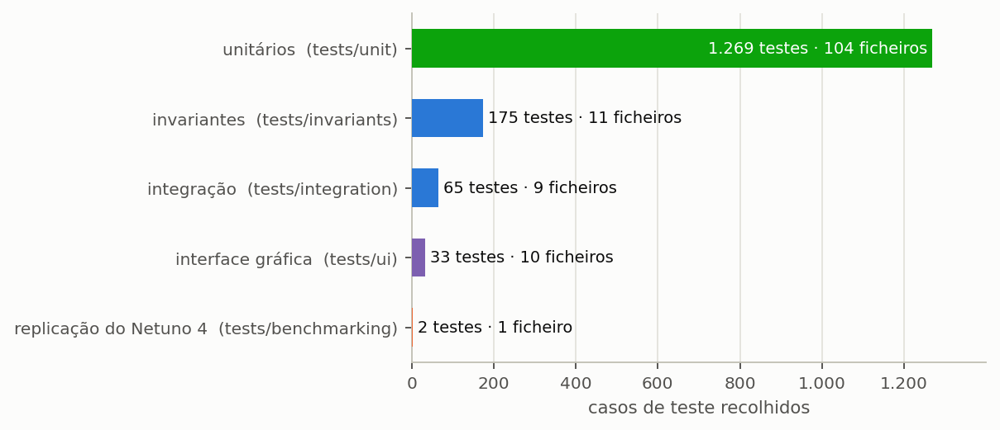
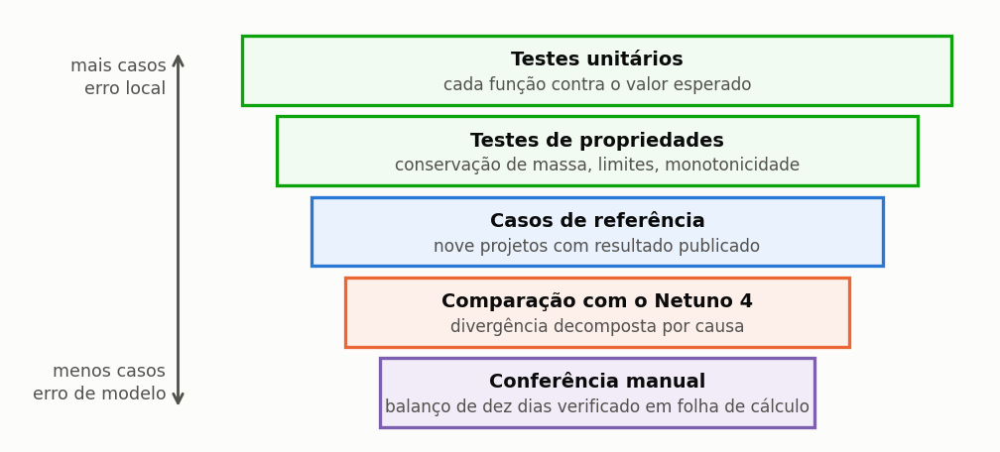

# Triton IBE

## Manual do Utilizador — Enganos, limitações e confiabilidade

Igor Catão Martins Vaz e Enedir Ghisi

Grupo de Pesquisa em Ambientes Sustentáveis
Universidade Federal de Santa Catarina

2026

---

### Sobre este volume

Este é um dos oito volumes em que o manual do Triton pode ser distribuído, e
reúne o capítulo 5 (Enganos, limitações e confiabilidade) e os apêndices G e H do manual completo. Serve para enviar
apenas a parte que interessa: o método a um revisor, o tutorial a uma turma, os guias
a quem já utiliza o programa.

A numeração das secções e das equações é a mesma do manual completo, de modo que
uma remissão vale nos dois. Quando o texto remete para uma secção que está noutro
volume, o nome do volume vem entre parênteses.

| Volume | Conteúdo |
| :--- | :--- |
| Comece aqui | o capítulo 1 (Comece aqui) e o apêndice G |
| O método | o capítulo 2 (O método) e os apêndices A, B, C, E, G e H |
| Guias de uso | o capítulo 3 (Guias disponíveis no programa) e os apêndices D, F e G |
| Tutorial | o capítulo 4 (Tutorial: um exemplo do começo ao fim) e os apêndices G, I e J |
| **Enganos, limitações e confiabilidade** | o capítulo 5 (Enganos, limitações e confiabilidade) e os apêndices G e H |
| Correções, bugs e versionamento | o capítulo 6 (Correções, bugs e versionamento) |
| Modulação probabilística | o capítulo 7 (Modulação probabilística) e os apêndices G e H |
| Apêndices | os apêndices |

### Como citar

> VAZ, Igor Catão Martins; GHISI, Enedir. **Triton: manual do utilizador**.
> Enganos, limitações e confiabilidade. Versão 0.2.0. Universidade Federal de Santa
> Catarina, 2026.

---

## Índice

**5 Enganos, limitações e confiabilidade**

5.1 Dez enganos que o programa não impede

5.2 Limitações conhecidas

5.3 Como o programa é verificado

**Apêndices**

Apêndice G — Glossário

Apêndice H — Referências

## Lista de figuras

Figura 1 — Área de captação como projeção horizontal da cobertura

Figura 2 — Número de testes e de ficheiros de cada família da suíte de verificação, conforme a recolha da suíte nesta versão

Figura 3 — As cinco camadas de verificação do programa, dos testes unitários, numerosos e dirigidos a erros locais, à conferência manual, pontual e dirigida a erros de modelo

---

## Lista de tabelas

Tabela 1 — Padronização terminológica de água de chuva e água pluvial

Tabela 2 — Grandezas fundamentais do balanço hídrico e relações entre fração e potencial

---

---
# 5. Enganos, limitações e confiabilidade

---

## 5.1. Dez enganos que o programa não impede

> Estes não são defeitos do programa. São erros de **engenharia** que ele aceita sem reclamar,
> porque não tem como os conhecer. Cada um traz o engano, por que razão é tentador, o que faz ao
> resultado e como evitá-lo.

---

### 5.1.1. Usar a área inclinada da cobertura

**O engano.** Introduzir a área da superfície da cobertura em vez da projeção horizontal.

**Porque é tentador.** É a área que aparece nas medições de telha e a que o empreiteiro conhece.

**O que faz ao resultado.** Sobrestima a captação na razão `1 ÷ cos(inclinação)`. Numa cobertura
com 30% de pendente, 4,4% de água que não existe; com 60%, 16,6%.

**Como evitar.** A prática do aproveitamento de águas pluviais toma como área de captação a
projeção horizontal da cobertura. Não use a área de contribuição com que se dimensionam as
caleiras, que soma metade da altura da cobertura e as paredes. A chuva cai na vertical, e o que
ela vê é a sombra da cobertura no chão. Se tem a área inclinada, multiplique-a por
`cos(inclinação)`, como na Figura 1.

---

*Figura 1 — Área de captação como projeção horizontal da cobertura. Para uma pendente de 30%, θ = 16,7° e a área inclinada é 4,4% maior do que a projeção horizontal; usar a área inclinada sobrestima o volume captado nessa proporção em todos os dias da série.*

---

### 5.1.2. Dimensionar pela chuva média mensal

**O engano.** Usar a precipitação média mensal num cálculo de folha de cálculo, em vez da série
diária.

**Porque é tentador.** A média mensal é o dado publicado nas normais climatológicas, e a folha de
cálculo cabe numa página.

**O que faz ao resultado.** Sobrestima de forma sistemática. A média esconde que a chuva chega
concentrada: um mês com 200 mm repartidos por cinco eventos enche a cisterna e faz com que
extravase cinco vezes, ao passo que o cálculo por médias supõe um fluxo contínuo que a cisterna
absorveria por inteiro. Em Lisboa o efeito é ainda mais marcante, porque o verão é seco: o mês mais
chuvoso tem 22,7 vezes a chuva do menos chuvoso, e uma média anual não vê nada disto.

**Como evitar.** É a razão de existir deste programa. A secção 2.1 (volume O método) mostra o extravasamento a
acontecer dia a dia; o cálculo por médias não o vê.

---

### 5.1.3. Confundir a lâmina de descarte com o volume do dispositivo

**O engano.** Introduzir no campo do descarte o volume do reservatório de autolimpeza, em litros.

**Porque é tentador.** O dispositivo dimensiona-se em litros, e o campo pede um número.

**O que faz ao resultado.** O campo espera **milímetros**. Introduzir 300, a pensar nos 300 litros
do dispositivo, produz um descarte de 300 mm — maior do que qualquer chuva diária da série de
Lisboa do tutorial, cujo máximo é 109,9 mm. O sistema capta **praticamente nada**.

**Como evitar.** `d_f` é uma lâmina. O volume do dispositivo é `A × d_f`: no projeto do tutorial,
150 m² × 2 mm = 300 litros. São a mesma decisão expressa em duas unidades, e o programa quer a
primeira.

---

### 5.1.4. Ignorar a estrutura do tarifário

**O engano.** Montar o tarifário com um preço único por metro cúbico e esquecer a parte fixa, os
escalões e a forma como a entidade gestora trata cada componente da fatura.

**Porque é tentador.** O preço do metro cúbico é o que vem em destaque. A tarifa fixa e a forma
como o saneamento e os resíduos acompanham o consumo estão em quadros à parte, quando estão.

**O que faz ao resultado.** A poupança só incide sobre a parte variável da fatura, e cada metro
cúbico poupado vale o preço do escalão em que cai. Em Lisboa, a fatura do tutorial passa de
46,25 € por mês sem o sistema (18,26 m³) para 34,93 € com ele (14,92 m³): uma poupança de
3,34 m³ e de 11,32 € por mês. Um estudo que suponha um desconto linear sobre a fatura total produz
um período de recuperação que não existe.

**Como evitar.** A secção 3.3 (volume Guias de uso). E o teste prático: simule dois consumos, um num escalão e outro
noutro, e compare com uma fatura real do edifício.

---

### 5.1.5. Simular uma escola ou um hospital com tarifa doméstica

**O engano.** Usar a tarifa doméstica para um edifício que não é de habitação.

**Porque é tentador.** O tarifário doméstico é o que está à mão, e o programa não impede a sua
utilização noutra tipologia. Os tarifários que a edição traz transcritos (Lisboa, Porto e Funchal)
são de utilizador doméstico.

**O que faz ao resultado.** Subestima, em regra, a poupança, porque as categorias não domésticas
costumam ser mais caras do que a doméstica; o preço de cada entidade gestora é que decide.

**Como evitar.** O programa **avisa** quando a tipologia não é residencial e diz o sentido do erro.
Escolha a categoria do edifício no tarifário da entidade gestora e introduza a sua estrutura em
modo personalizado. A secção 3.5 (volume Guias de uso) trata do assunto.

---

### 5.1.6. Esperar que o reservatório superior aumente a poupança

**O engano.** Adotar o reservatório elevado à espera de mais água.

**Porque é tentador.** É um arranjo corrente, e «mais reservatório» soa a «mais água».

**O que faz ao resultado.** Com o mesmo armazenamento total, o arranjo com reservatório elevado
entrega **menos**: a cisterna extravasa enquanto o reservatório de cima ainda tem espaço, porque a
elevação só acontece quando há consumo. No tutorial, 0,32 pontos percentuais a menos (18,28%
contra 18,59% com um único reservatório de 6 000 L), mais 5,3 kWh por ano de energia.

**Como evitar.** Decida o reservatório por critério **hidráulico** — pressão por gravidade, reserva
contra falhas de energia — e não hídrico. A secção 4.5 (volume Tutorial) faz a comparação justa.

---

### 5.1.7. Adotar uma série curta demais

**O engano.** Simular com dois ou três anos de série.

**Porque é tentador.** É o que se consegue depressa a partir de um posto próximo.

**O que faz ao resultado.** Dois efeitos somados. O **viés do reservatório vazio**, porque a
simulação começa com a cisterna seca e os primeiros meses penalizam o resultado; e a
**dependência do troço**, porque uma série curta pode cair num período atipicamente seco ou
chuvoso.

**Como evitar.** Trinta anos é confortável, dez é o mínimo defensável. Abaixo disso, declare a
limitação e apresente o resultado como uma gama.

---

### 5.1.8. Escolher a classe de qualidade pelo custo

**O engano.** Adotar a classe 1 por ser a mais barata, para um uso que exigiria mais.

**Porque é tentador.** O programa deixa, e a diferença de custo vê-se logo.

**O que faz ao resultado.** Não muda o número; muda a **validade** do projeto. Um sistema que
alimenta uma máquina de lavar roupa com água tratada ao mínimo é uma decisão de qualidade, não de
orçamento.

**Como evitar.** Escolha pela **exigência do uso**. E lembre que as classes 2 a 4 são adaptações
do programa, e não requisitos de uma norma: use-as como critério declarado, e não como norma.

---

### 5.1.9. Comparar com outra ferramenta sem declarar o método

**O engano.** Apresentar lado a lado os resultados de dois programas de aproveitamento pluvial
como se fossem comparáveis.

**Porque é tentador.** Ambos simulam o mesmo reservatório com as mesmas equações de balanço.

**O que faz ao resultado.** As ferramentas diferem em decisões de modelação que movem o número: se
o descarte das primeiras águas se subtrai à chuva do dia ou funciona como limiar do evento, como se
escolhe o volume ideal, que regra de operação se aplica. Uma diferença de alguns pontos percentuais
pode vir de qualquer uma delas, e nenhuma é um erro.

**Como evitar.** Declare a divergência e compare com um descarte igual a zero, em que as duas
regras de descarte coincidem. As secções 3.8 (volume Guias de uso) e 6.1 (volume Correções, bugs e versionamento) detalham o assunto.

---

### 5.1.10. Publicar o volume de maior poupança como recomendado

**O engano.** Escolher da varredura o volume de maior potencial.

**Porque é tentador.** É a coluna que o estudo de aproveitamento pluvial reporta, e mais é melhor.

**O que faz ao resultado.** No tutorial de Lisboa a curva não satura: 20 000 L dão o maior
potencial da varredura, 24,35%. Custam também **3,3 vezes mais** do que 5 000 L, em betão
(ilustrativo, não é preço de mercado: 8 600 € contra 2 600 €), e carregam **3,5 vezes mais carbono
incorporado** (3 546 contra 1 026 kg CO₂e), para entregar 6,47 pontos percentuais a mais. Escolher
o maior volume testado é escolher o limite da varredura, e não um ótimo.

**Como evitar.** Declare o critério de escolha. Se for hidráulico, o limiar de ganho marginal; se
for multicritério, os quatro pesos de eixo, as partes no eixo e os volumes candidatos. E reporte os vencedores de cada critério isolado, porque a divergência
entre eles **é** o resultado.

---

### 5.1.11. O engano de fundo

Os dez acima têm uma raiz comum: **tratar o programa como uma calculadora em vez de um modelo**.

Uma calculadora recebe números e devolve números. Um modelo recebe premissas e devolve as
consequências dessas premissas. Todo o resultado do Triton é condicional ao que foi declarado, e a
qualidade do estudo está na qualidade e na explicitação dessas declarações.

É por isso que a secção 4.10 (volume Tutorial) traz a lista do que declarar, e é por isso que a secção 5.2
traz as limitações conhecidas. Um estudo que não declara as premissas não é reproduzível, por mais
correto que seja o cálculo.

---

## 5.2. Limitações conhecidas

> Onde o programa não serve, e porquê. Um programa que declara os próprios limites é mais
> fiável do que um que aparenta servir para tudo, porque o segundo deixa ao utilizador a tarefa de
> os descobrir por conta própria.

Esta secção deriva do registo de pendências que o grupo de investigação mantém, e reflete o estado
da versão beta atual, a 0.2.0. Uma limitação sai desta lista quando é efetivamente resolvida, e
não quando deixa de ser mencionada — distinção que parece óbvia e que a documentação dos programas
científicos muitas vezes não observa.

As limitações estão agrupadas por origem, porque a providência que cada grupo admite é diferente.
As do modelo decorrem de escolhas de representação e só mudam com uma revisão do próprio modelo.
As dos dados dependem de levantamento, e podem ser supridas pelo utilizador. As metodológicas são
desvios declarados em relação a uma formulação de referência. E as de implementação são trabalho
pendente, sem obstáculo conceptual.

---

### 5.2.1. Limitações do modelo

**Não há subpasso horário.** Uma chuva de 40 mm concentrada em duas horas e a mesma lâmina
repartida por vinte e quatro horas produzem o mesmo resultado. Para reservatórios muito pequenos
face à área de captação, isto subestima o extravasamento.

**Não há perdas no reservatório.** A evaporação e as fugas não são modeladas.

**A condição inicial é o reservatório vazio.** Em séries de menos de um ano, isto penaliza o
resultado de forma sensível.

**O coeficiente de escoamento é único e constante.** Não varia com a intensidade da chuva nem com o
tempo decorrido desde o último evento, quando na realidade o primeiro evento após uma estiagem tem
um coeficiente menor.

**O descarte é uma lâmina, e não um dispositivo.** O programa calcula o volume e o custo do
dispositivo, `A × d_f`, mas não o seu arranjo hidráulico, que exige um projeto à parte.

---

### 5.2.2. Limitações dos dados de chuva e de tarifário

**A chuva por concelho é uma média de grelha.** Em Lisboa e no Porto, a série é a média diária das
células da grelha (Iberia01 ou E-OBS, 0,1°) do município, e não o registo de um posto. O Iberia01 vai só até 2015; Canárias, Madeira e Açores são ERA5 de 0,25° (nível C), que subestima a chuva; Ceuta e Melilla não têm série. Nas tarifas, Espanha só tem a média regional do INE (indicativa) e Portugal, três concelhos transcritos. O Iberia01 cobre 278 dos 308
concelhos de Portugal; os 30 das ilhas (Madeira e Açores) estão fora do seu domínio e usam a reanálise
ERA5. O Funchal usa um nó de 0,25° (cerca de 25 km), com chuva em 42% dos dias, e é a série menos fiável das três. Para um
projeto real, use a série medida.

**O tarifário cobre três cidades e só o utilizador doméstico.** Estão transcritos os tarifários de
Lisboa (EPAL e Câmara Municipal de Lisboa), do Porto (Águas e Energia do Porto) e do Funchal
(Câmara Municipal do Funchal), todos do escalão geral de utilizador doméstico, com contador até
25 mm (no Funchal, até 15 mm). Noutros concelhos, ou noutras categorias, a estrutura tem de ser
introduzida à mão pelo utilizador, e a sua exatidão é dele. Um estudo de escola, comércio ou
indústria calcula a poupança com a estrutura que estiver introduzida; se for a doméstica, o
resultado é em regra **subestimado**: o erro é conservador e tem sentido conhecido, mas precisa de
ser declarado. O programa avisa quando a tipologia não é residencial, e a secção 3.3 (volume Guias de uso) descreve
como se introduz a estrutura da categoria certa.

**Há hipóteses de transcrição por confirmar.** No Funchal, a taxa de IVA de 4% não foi confirmada
(com 5%, a fatura de 10 m³ passaria de 17,0872 € para 17,2515 €), e o primeiro escalão (até 5 m³)
do saneamento e dos resíduos não tem valor impresso e foi tratado como zero. No Porto, a
disponibilidade de água de 0,1242 € por dia foi lida da página dos utilizadores domésticos, e a
taxa de recursos hídricos das águas residuais não foi incluída. Em Lisboa, o adicional da Câmara
foi tratado sem IVA. As hipóteses estão registadas junto dos exemplos da edição.

**O saneamento é aproximado.** O saneamento faturado por escalões próprios representa-se por uma
percentagem única da fatura da água, por um valor fixo ou por um preço por metro cúbico. É uma
aproximação declarada.

**Não há tarifa social nem sobretaxas sazonais ou de escassez.** Uma classe de baixos rendimentos,
uma sobretaxa de seca ou um preço sazonal não são modelados, a menos que o utilizador os incorpore
na estrutura introduzida. Num estudo de habitação social, a diferença pode inverter a conclusão.

**A eletricidade só tem tarifa registada no Funchal**, e de fonte secundária (a confirmar na
entidade). Em Lisboa e no Porto, o custo da bombagem depende do preço do quilowatt-hora que o
utilizador introduzir; os casos do manual usam um valor ilustrativo, que não é preço de mercado.

---

### 5.2.3. Limitações da avaliação de ciclo de vida

**É uma avaliação de triagem**, e não um inventário conforme a ISO 14040.

**Uma única categoria de impacto.** Só carbono. Não há eutrofização, acidificação, uso do solo nem
toxicidade.

**A emissão de fabrico da eletrobomba é uma aproximação por massa.** O programa multiplica a massa
de catálogo de cada potência pela intensidade por quilograma de uma declaração ambiental de produto
de uma bomba de outra classe. A ordem de grandeza é defensável; o valor de cada potência não é uma
medição.

**A pressurização direta é modelada por valores médios.** A energia usa uma pressão de trabalho
única, a média da gama do pressostato, e não o ciclo de ligar e desligar de cada uso; e não se
soma energia de arranque nem consumo em vazio, que um sobrepressor com variador de frequência
teria. Os projetos antigos sem reservatório superior abrem com o arranjo «não informado» e não
recebem energia até que um seja escolhido.

**Não há fim de vida.** Nem crédito por reciclagem, nem encargo por deposição.

**Não há manutenção.** As substituições de componentes ao longo da vida útil não entram.

---

### 5.2.4. Limitações da qualidade da água

**As classes 2 a 4 são adaptações do programa**, e não classes de uma norma. A matriz de
parâmetros por uso é uma convenção interna; declare-a como tal.

**As constantes do modelo de lavagem da cobertura não estão calibradas.** A qualidade da água que
daí resulta é uma **premissa**, e não uma medição. O programa não substitui o ensaio laboratorial.

---

### 5.2.5. Limitações metodológicas declaradas

**O percentil do R95p é calculado sobre a série inteira**, e não sobre o período-base fixo
1961–1990 do ETCCDI. As séries de comprimentos diferentes não são diretamente comparáveis neste
índice.

**As condições C1 e C2 de Opricovic não estão implementadas** no VIKOR. A solução de compromisso
deve ser lida com a análise de sensibilidade aos pesos ao lado.

**A normalização do TOPSIS é uma variante**, com translação por `x − min(x)`, para admitir um
valor atual líquido negativo.

**O resultado do TOPSIS depende do conjunto de candidatos.** O ideal e o anti-ideal saem dos
volumes avaliados: no tutorial, sete candidatos elegem 3 000 L, e a varredura de 1 a 20 m³ elege
1 000 L (secção 2.10 (volume O método)). Declare os candidatos junto com os pesos.

**Os limiares do peso do sistema são do programa**, e não de norma: 500 kg na cobertura com o
reservatório cheio, 1 500 L de reservatório superior e 3 000 kg de cisterna a seco servem para
pedir a confirmação do projeto estrutural ou de fundações, e não para a dispensar.

**A atualização das tarifas é uma percentagem única** ao longo de todo o período de análise, o que
torna frágil a projeção a vinte anos. É a premissa que mais move o resultado económico.

---

### 5.2.6. Limitações de implementação

**Seis campos são gravados no ficheiro e nunca lidos.** Entre eles o **mês de instalação**, pelo
que o fluxo de caixa começa sempre no mês 1.

**O tempo de arranque da eletrobomba, de 108 s por acionamento**, representa o tempo de
escorvamento de uma bomba cuja linha de aspiração se esvaziou, e é aplicado a **todo** o arranque.
É conservador.

**Não há opção para tratar o descarte como limiar do evento**, como fazem algumas outras
ferramentas. Para comparar com uma delas, use um descarte igual a zero, em que as duas regras
coincidem, ou a transformação da série da secção 6.1 (volume Correções, bugs e versionamento).

---

### 5.2.7. O que fazer com esta lista

Num trabalho publicado, cite as limitações que afetam o seu caso — não todas, o que transformaria a
secção de método numa lista defensiva, mas as que incidem de facto sobre as conclusões
apresentadas. ==Uma limitação declarada é uma ressalva; uma limitação omitida, quando descoberta,
é um erro.==

Três exemplos orientam a seleção. Um estudo conduzido numa escola precisa de citar a questão da
categoria tarifária, porque ela desloca todo o resultado económico. Um estudo de desempenho
ambiental precisa de citar a categoria única de impacto e a aproximação por massa do fator de
emissão da eletrobomba. E um estudo em habitação social precisa de citar a ausência de tarifa
social, que nesse contexto pode inverter a conclusão.

Um parecerista que encontre uma destas limitações silenciada tem toda a razão em cobrá-la, e a
cobrança costuma custar mais tempo do que a declaração teria custado.

---

## 5.3. Como o programa é verificado

> Esta secção descreve a suíte de verificação do Triton, para que um revisor disponha dos
> elementos necessários para julgar o grau de confiança de um resultado produzido pelo programa.

Um programa científico cuja verificação não é declarada equivale a uma afirmação sem evidência:
pode estar correto, mas quem o utiliza não tem como o saber, e quem avalia um trabalho feito com
ele não tem como o julgar. Esta secção é a evidência que sustenta os números apresentados no resto
do manual, e foi escrita para ser lida por quem precisa de decidir se confia neles.

---

### 5.3.1. A suíte

A verificação do programa consiste em mais de mil testes automatizados, organizados em cinco
famílias que se complementam (Figura 2): testes unitários, testes de invariantes,
testes de integração, testes da interface gráfica e testes de referência contra resultados
independentes. A separação não é meramente organizativa: cada família apanha uma classe distinta
de defeito, e a ausência de qualquer uma delas deixaria um flanco a descoberto.

*Figura 2 — Número de testes e de ficheiros de cada família da suíte de verificação, conforme a recolha da suíte nesta versão. Os testes unitários respondem por mais de quatro quintos do total, por serem de execução rápida e localizarem o erro perto da origem.*

A suíte inteira é executada a cada alteração do código, e nenhuma alteração é incorporada enquanto
houver um teste a falhar. Esta disciplina é o que permite afirmar que um defeito corrigido não
regressa: a correção acompanha o teste que o vigia.

---

As camadas de verificação do programa formam uma hierarquia, e cada uma responde por um tipo de
erro que as restantes não alcançariam. Um teste unitário não deteta um erro de modelo, porque
confere a função com o que dela se espera; e uma conferência manual, que detetaria esse erro, não
cobre mil combinações de entrada (Figura 3).

*Figura 3 — As cinco camadas de verificação do programa, dos testes unitários, numerosos e dirigidos a erros locais, à conferência manual, pontual e dirigida a erros de modelo. Nenhuma camada substitui outra: é a sobreposição das cinco que sustenta o resultado publicado.*

---

### 5.3.2. As invariantes

As invariantes constituem a família mais importante da suíte, e a razão está na natureza do que
verificam. Um teste de valor confere se o programa produz um número específico perante uma entrada
específica; uma invariante confere se uma **propriedade** vale para qualquer entrada admissível. O
primeiro deteta que uma conta mudou; a segunda deteta que o modelo deixou de ser fisicamente
consistente.

A **conservação de massa** exige que, em séries de dez anos, o volume captado iguale a soma do
extravasado, do consumido e do que permaneceu armazenado. O resíduo medido é da ordem de 10⁻¹⁴ por
cento do captado, isto é, o próprio erro de arredondamento da aritmética de vírgula flutuante. O
**fecho do balanço da procura** faz o mesmo do lado do consumo: a procura total tem de ser
exatamente a soma de três parcelas, que são a água da chuva consumida, a água potável comprada e a
procura não satisfeita.

A **gama do potencial** verifica que o potencial de poupança permaneça entre zero e cem por cento
para toda a combinação de volume, coeficiente de escoamento e área, o que se confere sobre
sessenta combinações. O **teto da fração satisfazível** é mais específico e mais revelador: o
potencial nunca pode ultrapassar a fração da procura que a chuva pode satisfazer, e a verificação
estende-se até volumes de cem metros cúbicos, muito além de qualquer aplicação predial plausível.

A **paridade entre motores** compara o núcleo compilado com o ciclo de referência e exige que
ambos devolvam o mesmo número, para reservatório único e duplo, com e sem fornecimento de reserva
da rega, dentro de uma tolerância de 10⁻⁹. A **monotonia**, por fim, exige que mais volume nunca
reduza o potencial e que mais procura nunca o aumente — duas propriedades que qualquer
implementação correta satisfaz e que uma implementação defeituosa viola de modo evidente.

---

### 5.3.3. Casos analíticos

Um conjunto à parte reúne casos de **solução fechada**, isto é, situações em que o resultado
correto se conhece por dedução, sem necessidade de simular: chuva constante, procura constante,
reservatório de capacidade infinita e reservatório de capacidade nula. ==São o teste mais forte de
que se dispõe, porque não dependem de nenhum valor de referência produzido pelo próprio programa.==
Um teste que compara a saída atual com a de ontem deteta regressão, mas perpetua um erro que já
existisse em ambas; um caso analítico não tem como o fazer.

---

### 5.3.4. Testes de percurso

Esta família nasceu do defeito mais persistente que este programa apresentou ao longo da sua
história: um valor calculado corretamente que não chega a quem o deveria consumir. É uma classe de
erro que escapa por inteiro aos testes de fórmula, porque cada parte isolada está correta — a
origem calcula bem, o destino calcularia bem se recebesse, e o que falha é o troço entre os dois.
Só um teste de percurso o apanha: alterar a entrada no ecrã e verificar que o resultado final se
move de facto.

Cinco defeitos reais encontrados por esta família, e hoje vigiados por ela, ilustram o padrão: a
escolha da tecnologia de desinfeção não chegava à avaliação de ciclo de vida; desmarcar o filtro de
polimento não surtia efeito nas classes 2 a 4; os quatro campos de imposto eram repostos a zero
pelo próprio ecrã ao ser fechado; a opção de fornecimento de reserva da rega não chegava aos
núcleos compilados; e trinta dos oitenta e sete campos de então não sobreviviam a guardar e
reabrir o projeto.

---

### 5.3.5. Os números do manual

Com a redação deste manual criou-se uma família própria de verificação, destinada a impedir que o
documento e o programa divirjam: **cada valor impresso tem uma asserção correspondente**. Estão
cobertos os números da secção 2.1 (volume O método), os do tutorial inteiro (Lisboa), cada linha da tabela dos
dez dias e ainda a exigência de que certas secções declarem certas ressalvas. Quando o programa
muda, o teste falha e indica qual a página a corrigir.

É o mecanismo que impede um manual inteiro de envelhecer em silêncio, que é o destino habitual da
documentação dos programas científicos.

---

### 5.3.6. Verificação contra referências independentes

A verificação estende-se a resultados que o programa não produziu: os casos analíticos acima e
comparações com cálculos de referência independentes. A secção 6.1 (volume Correções, bugs e versionamento) apresenta essa comparação e
o que ela pode e não pode mostrar.

---

### 5.3.7. O que a verificação **não** prova

A distinção entre verificação e validação é exigida por qualquer revisor competente, e com toda a
razão, porque as duas respondem a perguntas diferentes e só uma delas está ao alcance de uma suíte
de testes.

A **verificação** responde se o programa resolve corretamente as equações que implementa, e é
exatamente isso que a suíte descrita nesta secção testa. A **validação** responde se as equações
implementadas representam adequadamente a realidade física, e isso exige medição no terreno:
sistemas instalados, monitorizados ao longo do tempo e comparados com o que a simulação previu.

O Triton é verificado. A validação do modelo comportamental de base diária apoia-se na literatura
da área, e não em medição própria conduzida pelo grupo que desenvolve o programa. ==Um estudo que
apresentasse resultados do programa como se fossem medição estaria a incorrer num erro de
método.==

---

### 5.3.8. O relatório de verificação na interface

O menu **Ajuda → Relatório de Verificação** abre, dentro do programa, o relatório de verificação da
versão: a distinção entre verificação e validação, os núcleos exercitados, as invariantes, os casos
analíticos e a comparação com referências independentes. É a referência a citar quando um estudo
precisa de declarar como o programa foi verificado.

---

### 5.3.9. Quem executa a suíte, e quando

A suíte acompanha o código-fonte do programa, e não a instalação: é executada pelo grupo de
investigação a cada alteração, antes de qualquer versão ser publicada. O que isto significa para
quem usa o programa instalado é que a versão presente no seu computador passou pelos testes aqui
descritos, incluindo os que conferem cada número impresso neste manual.

> **Aprofundamento: verificar por conta própria.** O código-fonte é público, sob uma licença
> académica (uso não comercial; `LICENSE.md`), e a suíte executa-se com um único comando no
> ambiente de desenvolvimento. Um revisor que queira conferir as invariantes — fecho de massa,
> monotonia, paridade entre os dois motores de cálculo — encontra os ficheiros de teste organizados
> por tema, e o apêndice B (volume Apêndices) liga cada processo do programa ao que o verifica.

---

# Apêndices

---

## Apêndice G — Glossário

Termos técnicos e siglas, em português europeu, com o equivalente em inglês quando ele é usado na
literatura, acompanhados das diretrizes de padronização terminológica do Triton.

---

**AAC** (*aproveitamento de água de chuva*). Emprego da água precipitada sobre coberturas
para usos não potáveis em edifícios; a EN 16941-1 trata os sistemas de utilização de água
da chuva no local. Prefira-se o termo «aproveitamento» a «reutilização», porque a água de chuva captada
na cobertura é um recurso primário, e não um efluente gerado por um uso anterior.

**ACV** (*life cycle assessment*). Avaliação de ciclo de vida. Método que contabiliza os
impactos ambientais de um produto ao longo de toda a sua existência, da extração das
matérias-primas ao descarte. A do programa é de **triagem**, e não um inventário completo
conforme a ISO 14040.

**Água de chuva** (*rainwater*). Precipitação atmosférica recolhida diretamente em
superfícies impermeáveis de cobertura (telhados e lajes impermeabilizadas), antes de atingir
o solo ou as redes públicas. Designa o recurso natural e a fonte hídrica captada; evite-se a
forma coloquial «água da chuva».

**Água não potável** (*non-potable water*). Água que não se destina ao consumo humano direto,
mas cumpre os requisitos de qualidade exigidos para os usos admitidos: descargas de autoclismos e
mictórios, lavagem de veículos, pavimentos e roupa, rega de jardins e torres de arrefecimento.

**Água pluvial** (*stormwater*, *pluvial water*). Água de chuva que escoa superficialmente
por superfícies urbanas ou é conduzida por canalizações e sistemas prediais de drenagem. No Triton,
o termo aplica-se de preferência à infraestrutura predial e aos componentes de engenharia: *sistema
de aproveitamento de água pluvial (SAAP)*, *rede pluvial*, *procura pluvial*, *consumo de água pluvial*
e *extravasamento pluvial*.

**Água potável** (*potable water*, *drinking water*). Água que cumpre integralmente os
requisitos de qualidade da água para consumo humano em vigor no local do projeto, destinada à
ingestão direta, à preparação de alimentos e à higiene pessoal.

**Área de captação** (*catchment area*). Área projetada na **horizontal** da superfície
impermeável da cobertura onde a água é captada. Não é a área inclinada do telhado, nem a área
de contribuição usada para dimensionar caleiras e tubos de queda.

**BD+C** (*Building Design and Construction*). Família de referenciais do LEED
para projeto e construção de edificações novas ou em grande reforma. É a família
tratada neste manual, nas versões 4, 4.1 e 5.

**BIM** (*building information modeling*). Modelagem da informação da construção.
Representação digital da edificação em que cada componente carrega propriedades além da
geometria, o que permite compatibilizar projetos de disciplinas diferentes.

**CAD** (*computer-aided design*). Desenho assistido por computador. O programa exporta o
esquema hidráulico em DXF, formato de intercâmbio aceito pelos programas de CAD.

**CAOP** (*Carta Administrativa Oficial de Portugal*). Carta com os limites administrativos oficiais, publicada pela Direção-Geral do Território. A versão CAOP2025 define os limites dos 308 concelhos usados para calcular a série de chuva de cada concelho.

**CAPEX** (*capital expenditure*). Investimento inicial.

**CDD** (*consecutive dry days*). Maior sequência de dias consecutivos com chuva
abaixo de 1 mm.

**Coeficiente de escoamento** (*runoff coefficient*). Fração da chuva que
efetivamente chega ao reservatório, descontadas perdas por absorção, evaporação e
molhamento inicial da cobertura.

**Comprimento representativo de série de precipitação** (*representative rainfall time series length*, $N_{rep}$).
Menor período contínuo em anos de dados diários de chuva necessário para estabilizar
estatisticamente o dimensionamento e o desempenho do sistema (reproduzindo o volume ideal
e o potencial de economia da série completa sob confiança $\ge 90\%$), segundo a
metodologia de Geraldi e Ghisi (2017, 2018, 2019). O comprimento necessário não é uma
constante geográfica fixa: cresce com a fração atendível e com o nível de procura da edificação.

**E-OBS**. Conjunto europeu de dados meteorológicos diários em grelha, construído a partir de observações de estações (projeto ECA&D, serviço Copernicus de alterações climáticas). A Edição Ibérica usa a versão v33.0e da precipitação diária, em grelha de 0,1°, de 1950 a 2025, e obtém a série de cada concelho pela média das células dentro do seu limite (apêndice E (volume Apêndices)).

**ERA5**. Reanálise global do Centro Europeu de Previsões Meteorológicas de Médio Prazo (ECMWF), produzida pelo serviço Copernicus de alterações climáticas. Combina um modelo atmosférico com observações e dá uma série contínua em grelha. Usa-se no exemplo do Funchal; é uma média de área, e não um registo de udómetro.

**Fiabilidade temporal** ($C_t$). Percentual de dias em que o sistema atendeu
plenamente ($V_{con,t} = D_{pl,t}$), parcialmente ou não atendeu a procura pluvial.

**Fiabilidade volumétrica** ($C_v$). Fração da procura **pluvial** que o sistema atendeu
($C_v = \sum V_{con} / \sum D_{pl} = E_{pot} / f$). Não confundir com o potencial de economia,
que tem no denominador a procura total da edificação.

**CSV** (*comma-separated values*). Formato de ficheiro de texto em que cada linha é um
registo e as colunas são separadas por um caractere, tipicamente vírgula ou ponto e
vírgula. É o formato das séries de precipitação.

**cv**. Cavalo-vapor, unidade de potência equivalente a 0,7355 kW, usada na indicação de
eletrobombas. Uma eletrobomba de meio cv tem 0,37 kW de potência de eixo.

**CWD** (*consecutive wet days*). Maior sequência de dias consecutivos com chuva
igual ou superior a 1 mm.

**IVA**. Imposto sobre o valor acrescentado. Na fatura de água, cada parcela leva a taxa que o respetivo tarifário declara (6% na água de Lisboa e do Porto, 4% no Funchal, este último por confirmar); o programa não fixa nenhuma taxa no código (apêndice D (volume Apêndices)).

**Procura estocástica** (*stochastic water demand*). Modelagem do consumo diário de água como
variável probabilística que varia dia a dia e entre realizações (Silva e Ghisi, 2016),
permitindo avaliar o escalão de incerteza do dimensionamento e dos indicadores de desempenho
sob variabilidade real de uso.

**Procura pluvial** (*pluvial demand*, $D_{pl}$). Parcela da procura diária de água da
edificação que pode ser suprida pelo sistema de aproveitamento ($D_{pl,t} = D_{tot,t} \times f$).
Corresponde aos pontos de consumo não potável interligados à rede pluvial.

**Descarte de primeiras águas** (*first flush*). Lâmina inicial de chuva desviada do
sistema, que arrasta a sujidade depositada na cobertura (o programa parte de 2 mm, que o utilizador
deve ajustar à sua cobertura). No Triton é **subtraída** da chuva do dia.

**Disponibilidade**. Regime tarifário em que um valor fixo **soma** por cima do
consumo medido. Cada metro cúbico economizado desconta.

**DN** (*diâmetro nominal*). Designação comercial do diâmetro de um tubo ou conexão, em
milímetros. Não corresponde exatamente ao diâmetro interno nem ao externo: é um número de
referência do qual decorrem as dimensões reais, tabeladas por norma.

**DXF** (*drawing exchange format*). Formato de intercâmbio de desenhos técnicos, lido
por praticamente todos os programas de CAD.

**EDGE** (*excellence in design for greater efficiencies*). Referencial de certificação
da International Finance Corporation, do Banco Mundial. Mede economia percentagem contra
um caso-base local em três dimensões independentes e exige que cada uma cruze o limiar.

**EN** (*Europäische Norm*, norma europeia). Norma publicada pelo Comitê Europeu de
Normalização. Neste manual, a EN 15978, que define os módulos do ciclo de vida da
edificação, e a EN 15804, que rege as declarações ambientais de produtos de construção.

**EPD** (*Environmental Product Declaration*). Declaração ambiental de produto: documento
verificado por terceiros, conforme a ISO 14025 e, na construção, a EN 15804, que publica
os impactos do ciclo de vida de um produto por unidade declarada. É a fonte preferida para
fatores de emissão de materiais e equipamentos.

**ESG** (*environmental, social and governance*). Conjunto de critérios ambientais,
sociais e de governança usado na avaliação de empresas e de empreendimentos. O programa
alimenta indicadores ambientais desse conjunto.

**ETAP**. Estação de tratamento de água pluvial. No programa, o conjunto de filtro
de entrada, desinfeção e filtro de polimento.

**ETCCDI** (*Expert Team on Climate Change Detection and Indices*). Grupo de trabalho
internacional que padronizou os índices de extremos climáticos, dos quais o programa
calcula oito.

**Eficiência de armazenamento** (*storage efficiency*). Água de chuva entregue por dia
dividida pelo volume da cisterna inferior, em %: a renovação diária do volume construído. Cai
com o volume e trava o sobredimensionamento. Não é a ocupação média da cisterna.

**Extravasamento** (*spillage*, *overflow*). Volume que excede a capacidade do reservatório
e é conduzido pelo extravasor quando ele já está cheio.

**Fração atendível por água pluvial** (*non-potable demand share*, $f$). Percentual da procura
total de água da edificação ($D_{tot}$) passível de suprimento por água de chuva ($f = D_{pl} / D_{tot}$).
Representa o **teto assintótico intransponível** do potencial de economia de água potável
($E_{pot} \le f$): mesmo sob capacidade infinita de armazenamento e precipitação ilimitada,
a economia de potável nunca ultrapassa a fração atendível, pois o restante ($1 - f$) é
reservado aos usos nobres e potáveis. Distingue-se da fiabilidade volumétrica ($C_v = E_{pot} / f$),
que avalia o atendimento da parcela pluvial.

**Franquia no mínimo**. Regime tarifário em que o valor fixo já inclui um volume de
consumo. Economizar **abaixo** da franquia não reduz a fatura.

**Ganho marginal**. Variação do potencial de economia por metro cúbico acrescentado
ao reservatório, em %/m³ ($\Delta E_{pot} / \Delta V$). Critério de escolha do volume ideal.

**GRI** (*Global Reporting Initiative*). Padrão internacional de divulgação corporativa
de desempenho socioambiental. Sua série 303 trata de água e efluentes.

**IBE**. Sigla da Edição Ibérica do programa («Triton IBE», para a Península Ibérica): abre em português europeu, em euros, com a chuva do Iberia01 por município e os tarifários transcritos de Lisboa, Porto e Funchal. A linha de cobertura do programa diz quantos locais há em cada país. Os custos e os fatores de emissão são indicados pelo utilizador.

**IFC**. A sigla designa duas coisas distintas. Em certificação, é a *International
Finance Corporation*, do Banco Mundial, que desenvolve o EDGE. No contexto BIM, é o
*Industry Foundation Classes*, formato aberto de intercâmbio que o programa **não**
exporta: a exportação BIM do programa é um ficheiro JSON de propriedades.

**IPCC** (*Intergovernmental Panel on Climate Change*). Painel intergovernamental que
sintetiza o conhecimento científico sobre mudança do clima e organiza os relatórios de
avaliação a que as projeções climáticas se referem.

**ISO 14040**. Norma internacional que estabelece os princípios e a estrutura da
avaliação de ciclo de vida. Um inventário conforme a ISO 14040 exige rastreabilidade de
cada fluxo e revisão crítica externa, requisitos que uma avaliação de triagem não cumpre.

**JSON** (*JavaScript object notation*). Formato de ficheiro de texto estruturado, legível
por pessoas e por programas. É o formato interno do ficheiro `.triton`.

**LCOW** (*levelized cost of water*). Custo nivelado da água: razão entre o valor presente
dos custos do sistema (o investimento e os custos de exploração: energia, manutenção,
cloro e linha de tratamento) e o volume atualizado de água pluvial entregue ao longo do
horizonte de análise, à mesma taxa, em €/m³. É um dos oito critérios do multicritério. Permite confrontar a viabilidade económica do sistema diretamente
com a tarifa da entidade gestora.

**LEED** (*leadership in energy and environmental design*). Referencial de certificação
ambiental de edificações do *U.S. Green Building Council*, o mais difundido
internacionalmente. Trata eficiência hídrica na categoria *Water Efficiency*: na versão 4,
pelos créditos WEc1 e WEc2; na versão 5, pelo crédito WEc2, *Enhanced Water Efficiency*.

**m.c.a.** Metro de coluna d'água, unidade de pressão equivalente à exercida por uma
coluna de água de um metro de altura, cerca de 9,81 kPa. É a unidade usual em instalações
prediais.

**Micromedição**. Medição individualizada por unidade habitacional em edifício
multifamiliar. Informada ao programa como número de economias.

**Manuais do Triton** (*Triton manual suite*). A documentação do programa, montada
das mesmas fontes em três formatos: o manual completo, oito volumes avulsos, cada um com
uma parte dele, e o sítio Web de documentação. Os volumes servem a quem precisa de uma parte
só, para consultar ou enviar:

1. **Manual completo**: todos os capítulos e apêndices.
   
2. **Volume 1 — Comece aqui**: o que o programa faz, como instalá-lo e por onde entrar
   conforme o seu objetivo.
   
3. **Volume 2 — O método**: as equações, os critérios e as fontes por trás de cada número
   que o programa publica.
   
4. **Volume 3 — Guias de uso**: outras cidades, clima futuro, tarifas, procura variável,
   lote, sensibilidade e exportação.
   
5. **Volume 4 — Tutorial**: um projeto de moradia em Lisboa, do primeiro dado ao
   volume recomendado.
   
6. **Volume 5 — Erros, limitações e fiabilidade**: os erros mais comuns, os limites
   do modelo e como o programa é verificado.
   
7. **Volume 6 — Correções, erros e versões**: o que mudou entre versões, as
   mensagens de erro e como relatar um problema.
   
8. **Volume 7 — Modulação probabilística**: o estudo refeito com premissas sorteadas —
   variáveis, distribuições, leitura dos resultados e limites do método.
   
9. **Volume 8 — Apêndices**: parâmetros, processos, fatores de emissão, tarifas, base
   climática, formatos, glossário e referências.
   

Os PDFs acompanham o programa e abrem pela etapa 9. Documentação.

**Payback de carbono**. Tempo para a economia anual líquida de emissões pagar o
carbono incorporado na fabricação do sistema.

**Payback descontado**. Tempo para o fluxo de caixa descontado acumulado cruzar zero.

**Partes no eixo**. A repartição do peso de um eixo do multicritério pelos seus critérios.
Só a proporção dentro do eixo importa; por omissão, as partes são iguais.

**Peso do sistema**. Massa a seco, carga de água e carga em operação do sistema, em kg e kN,
no subsolo, na cobertura e nas prumadas e rede. Os alertas usam limiares de atenção do
programa, e não de norma.

**PB**. Preço-base, em €/m³, da fórmula exponencial `PB × Cⁿ`, em que `C` é o consumo do mês e
`n` o expoente da tabela exponencial para esse consumo. É um dos seis regimes que o programa reconhece; os
tarifários transcritos para Portugal não o usam.

**PEAD**. Polietileno de alta densidade, material dos reservatórios de plástico mais comuns.
É o código do material no ficheiro de projeto.

**Piso de pagamento**. Regime tarifário em que a fatura **não fica** abaixo de um
valor. Diferente de disponibilidade: o piso limita por baixo, a disponibilidade soma
por cima.

**Potencial de economia de água potável** (*potable water saving potential*, $E_{pot}$).
Fração da procura **total** da edificação suprida por água pluvial ($E_{pot} = \sum V_{con} / \sum D_{tot} \times 100\%$).
É o indicador central do programa, limitado superiormente pela fração atendível ($E_{pot} \le f$).

**pp**. Pontos percentuais. Usado para exprimir a diferença entre dois percentuais: de
35% para 37% vão dois pontos percentuais, e não dois por cento.

**PRCPTOT**. Precipitação total anual em dias úmidos.

**PRFV**. Plástico reforçado com fibra de vidro, material de reservatórios de médio e
grande porte. Aparece no programa sob a designação «fibra».

**PRT**. Nome antigo da Edição Ibérica (IBE), de quando ela se chamava Edição Portugal. Projetos e scripts que ainda usam «PRT» (ou «POR») abrem como IBE.

**PVC**. Policloreto de vinilo, material das tubagens prediais de água fria e das colunas de
desvio do descarte inicial.

**R95p**. Soma da precipitação dos dias acima do percentil 95 dos dias úmidos.

**Rendimento da bomba**. Razão entre a potência hidráulica entregue à água e a
potência mecânica no eixo. Não inclui o motor.

**Rendimento do motor**. Razão entre a potência mecânica no eixo e a potência
elétrica consumida da rede.

**RX1day**, **RX5day**. Maior precipitação em um e em cinco dias consecutivos, no
ano.

**SAAP**. Sistema de aproveitamento de água pluvial. Conjunto integrado de componentes
prediais — área de captação, condutores, descarte inicial (*first flush*), estação de
tratamento (ETAP), cisterna inferior, reservatório superior, eletrobomba ou sobrepressor
e rede de distribuição independente — concebido para recolher, tratar, armazenar e fornecer
água não potável.

**SB**. Serviço básico: a parcela fixa mensal da fatura de água da fórmula exponencial, somada ao
resultado dessa fórmula.

**SDII** (*simple daily intensity index*). Precipitação média dos dias úmidos.

**SI** (*seasonality index*). Índice de sazonalidade de Walsh e Lawler. Zero quando a
chuva é uniforme ao longo do ano.

**SMAA** (*stochastic multicriteria acceptability analysis*). Método que sorteia
pesos — no programa, oito, um por critério — e devolve a probabilidade de cada alternativa
vencer.

**SSP** (*shared socioeconomic pathways*). Trajetórias socioeconómicas partilhadas,
que descrevem hipóteses coerentes de desenvolvimento global e as emissões correspondentes.
Combinam-se com os modelos climáticos para produzir projeções.

**TIR**. Taxa interna de retorno. A taxa de desconto que zera o valor presente
líquido.

**taxa de atualização**. Taxa de atualização. A taxa de desconto adotada.

**TOPSIS** (*technique for order of preference by similarity to ideal solution*).
Método de ordenação multicritério de Hwang e Yoon. No programa, ordena os volumes por oito
critérios em quatro eixos: técnico, económico, ambiental e estrutural.

**TRH** (*taxa de recursos hídricos*). Taxa por m³ que acresce à fatura de água e de águas residuais. No tarifário do Porto, a TRH da água é devida à Agência Portuguesa do Ambiente (APA) e leva IVA; no de Lisboa, a TRH do saneamento acresce por m³ recolhido.

**UV**. Radiação ultravioleta, empregada na desinfeção de água por inativação de
microrganismos. Atua apenas no instante da passagem pelo reator e não deixa residual, ao
contrário da cloragem.

**VIKOR**. Método de decisão multicritério proposto por Opricovic, que busca uma solução
de compromisso entre critérios conflitantes. Ver também *SMAA*.

**Volume ideal** (*optimal tank volume*). Menor volume de reservatório da grade de simulação
a partir do qual o ganho marginal de economia de água potável ($\Delta E_{pot} / \Delta V$)
cai abaixo de um limiar declarado (tipicamente $1,0\%/\text{m}^3$ ou $0,5\%/\text{m}^3$).
Evita o superdimensionamento de reservatórios, assegurando a melhor relação custo-benefício.

**VAL**. Valor atual líquido.

**WEM**. Codificação das medidas de eficiência hídrica do EDGE. A WEM14 é o sistema
de aproveitamento de água pluvial.

**XLSX**. Formato de pasta de trabalho do Microsoft Excel, baseado em XML compactado. É um
dos formatos de exportação de folhas de cálculo e de resultados da linha de comando.

**YAS** (*yield after spillage*). Regra de operação em que o extravasamento é
calculado **antes** da retirada da procura e, na forma estrita, a retirada do dia sai
só do volume guardado na véspera. O programa calcula o extravasamento antes, como a
YAS, mas deixa a chuva do dia atender a procura do dia; fica entre a YAS e a YBS
(secção 2.1 (volume O método)).

**YBS** (*yield before spillage*). Regra de operação em que a procura é retirada **antes**
do cálculo do extravasamento. Supõe consumo anterior à chuva do dia e sobrestima o
aproveitamento; o programa não a adota, e o resultado dele fica entre a YAS e a YBS.

---

### G.1. Diretrizes de Padronização e Nomenclatura no Triton

A padronização terminológica é indispensável para assegurar a consistência e o rigor técnico
em artigos científicos, relatórios técnicos, na interface gráfica e na documentação do Triton.
As convenções a seguir detalham a distinção de termos correlatos frequentemente confundidos:

#### G.1.1. 1. Água de Chuva versus Água Pluvial versus «Água da Chuva»

<!-- tabela: **Tabela 1** — Padronização terminológica de água de chuva e água pluvial -->
| Termo | Definição e Contexto de Aplicação | Situação no Triton | Referência |
| :--- | :--- | :--- | :--- |
| **Água de chuva** (*rainwater*) | Precipitação atmosférica recolhida diretamente na cobertura (telhado/laje impermeabilizada), antes de atingir o solo ou as redes públicas. Refere-se à **fonte hídrica** e ao recurso ambiental. | **Canónico e preferencial** para o recurso captado («aproveitamento de água de chuva», «precipitação de água de chuva»). | Prática de redação técnica e científica. |
| **Água pluvial** (*stormwater* / *pluvial water*) | Água de chuva após escoamento superficial urbano ou quando conduzida por canalizações e sistemas prediais de drenagem e armazenamento. Aplica-se à **infraestrutura física** e aos componentes de engenharia. | **Canónico e preferencial** para sistemas, redes e balanço («sistema predial de água pluvial - SAAP», «rede pluvial», «procura pluvial», «extravasamento pluvial»). | Prática de redação técnica e científica. |
| **«Água da chuva»** | Expressão coloquial e informal. | **Desaconselhada**. Não deve ser empregada em publicações, textos normativos, relatórios do Triton ou código. | Prática de redação técnica e científica. |

#### G.1.2. 2. Fração Atendível, Procura Pluvial, Potencial e Fiabilidade

Para evitar ambiguidades matemáticas e conceituais frequentemente encontradas na literatura:

<!-- tabela: **Tabela 2** — Grandezas fundamentais do balanço hídrico e relações entre fração e potencial -->
| Grandeza | Símbolo / Código | Definição | Fórmula | Relação / Teto |
| :--- | :--- | :--- | :--- | :--- |
| **Fração atendível por água pluvial** | $f$ / `rainwater_share` | Proporção da procura total da edificação correspondente a pontos de consumo não potável conectáveis ao SAAP. | $f = D_{pl} / D_{tot}$ | Parâmetro de projeto ($0 \le f \le 1$). Constitui o **teto assintótico** de $E_{pot}$. |
| **Procura pluvial** | $D_{pl}$ / `rainwater_demand` | Volume de água requerido pelos pontos não potáveis da edificação em um intervalo de tempo. | $D_{pl,t} = D_{tot,t} \times f$ | Em L/dia ou m³/ano. |
| **Volume de água pluvial consumido** | $V_{con}$ / `pluvial_consumed` | Volume de água não potável efetivamente suprido pelo reservatório pluvial aos pontos de consumo. | Determinado pelo balanço diário (secção 2.1 (volume O método)) | $V_{con,t} \le D_{pl,t}$ e $V_{con,t} \le S_{t-1} + C_t$. |
| **Potencial de economia de água potável** | $E_{pot}$ / `potential_potable_savings_pct` | Percentual da procura **total** da edificação economizado pelo aproveitamento pluvial. | $E_{pot} = \frac{\sum V_{con}}{\sum D_{tot}} \times 100\%$ | **Indicador central**. Sempre $E_{pot} \le f$. |
| **Fiabilidade volumétrica** | $C_v$ / `volumetric_reliability_pct` | Percentual da procura **pluvial** suprido pela água de chuva armazenada. | $C_v = \frac{\sum V_{con}}{\sum D_{pl}} \times 100\%$ | $C_v = \frac{E_{pot}}{f}$. Pode atingir 100% mesmo quando $E_{pot} < 100\%$. |
| **Fiabilidade temporal** | $C_t$ / `temporal_reliability_pct` | Percentual de dias da série em que a procura pluvial foi 100% atendida ($V_{con,t} = D_{pl,t}$). | $C_t = \frac{N_{dias\_plenos}}{N_{total}} \times 100\%$ | Mede a segurança de abastecimento diário sem suplementação potável. |

#### G.1.3. 3. Síntese de Nomenclatura Recomendada para Artigos e Relatórios

- Utilize **«aproveitamento de água de chuva»** (e não «reutilização de água da chuva» — a água de chuva não é um efluente; o seu uso é *aproveitamento*, não *reutilização*).
- Utilize **«área de captação»** para o plano horizontal da cobertura e reserve **«área de contribuição»** para o dimensionamento hidráulico de caleiras e tubos de queda.
- Utilize **«descarte de primeiras águas»** ou *first flush* para a lâmina inicial desviada, e não «limiar de descarte».
- Utilize **«fração atendível»** (e não «procura relativa» ou «fração de economia») para expressar a partição de usos não potáveis no consumo total.
- Utilize **«comprimento representativo de série»** para a extensão mínima em anos necessária para estabilização estatística da simulação (metodologia de Geraldi e Ghisi).
- Utilize **«LCOW»** ou **«custo nivelado da água»** para a métrica de custo unitário ao longo do ciclo de vida descontado à taxa de atualização.

---

## Apêndice H — Referências

Normas, publicações e bases que sustentam as decisões do programa. A lista da Edição Ibérica só traz normas
internacionais e europeias e publicações de alcance geral, mais os documentos portugueses de que o programa
depende. A lista completa, com a proveniência de cada citação, está no módulo de bibliografia do programa e no
separador Documentação.

---

### H.1. Normas de aproveitamento de água de chuva

**EN 16941-1:2024** — On-site non-potable water systems — Part 1: Systems for the use of rainwater.
Bruxelas: CEN, 2024.

---

### H.2. Referenciais de certificação

**LEED v4 / v4.1 BD+C** — USGBC. Categoria *Water Efficiency*, créditos WEc1 e WEc2. Registo de projetos
comerciais até 30 jun. 2027.

**LEED v5 BD+C** — U.S. GREEN BUILDING COUNCIL. *LEED v5 Building Design and Construction: rating system*.
Washington, DC: USGBC, nov. 2025. Pré-requisitos WEp1 (*Water Metering and Reporting*) e WEp2 (*Minimum Water
Efficiency*), créditos WEc2 (*Enhanced Water Efficiency*) e SSc3 (*Rainwater Management*).

**EDGE** — IFC, Grupo Banco Mundial. *EDGE Certification Process*, e a codificação WEM das medidas de eficiência
hídrica. Administrado pelo GBCI em mais de 120 países.

**GRI 303** — Global Reporting Initiative. Água e efluentes, indicadores 303-3 e 303-5.

---

### H.3. Métodos

**Hwang, C.-L.; Yoon, K.** (1981). *Multiple Attribute Decision Making: Methods and Applications*. A formulação
original do TOPSIS.

**Opricovic, S.; Tzeng, G.-H.** O método VIKOR e as condições C1 e C2 de vantagem aceitável e estabilidade.

**Lahdelma, R.; Hokkanen, J.; Salminen, P.** (1998), e **Tervonen, T.; Figueira, J.** (2008). SMAA e SMAA-2.

**Walsh, R. P. D.; Lawler, D. M.** (1981). O índice de sazonalidade.

**ETCCDI** — *Expert Team on Climate Change Detection and Indices*, da OMM. Os índices de extremos climáticos.

---

### H.4. Usos finais da água

**Mayer, P. W.; DeOreo, W. B. et al.** (1999). *Residential End Uses of Water*. Denver: AWWA Research
Foundation. Frequência de uso dos aparelhos: 5,05 descargas e 0,37 ciclos de máquina de lavar roupa por pessoa
por dia; as descargas são a base dos acionamentos da pressurização direta.

---

### H.5. Normas de avaliação de ciclo de vida

**ISO 14040:2006** — Environmental management: life cycle assessment, principles and framework. As quatro fases
da avaliação.

**ISO 14044:2006** — Environmental management: life cycle assessment, requirements and guidelines.

**EN 15978:2011** — Sustainability of construction works: assessment of environmental performance of buildings,
calculation method. Os módulos A a D do ciclo de vida do edifício.

**EN 15804:2012+A2:2019** — Sustainability of construction works: environmental product declarations, core rules
for the product category of construction products.

---

### H.6. Dimensionamento e desempenho de sistemas de aproveitamento pluvial

**SOUZA, E. L.; GHISI, E.** (2012). Potable water savings by using rainwater for non-potable uses in houses.
*Water*, v. 4, n. 3, p. 607-628. doi:10.3390/w4030607.

**CAMPISANO, A. et al.** (2017). Urban rainwater harvesting systems: research, implementation and future
perspectives. *Water Research*, v. 115. doi:10.1016/j.watres.2017.02.056.

**CAMPISANO, A.; MODICA, C.** (2015). Appropriate resolution timescale to evaluate water saving and retention
potential of rainwater harvesting for toilet flushing in single houses. *Journal of Hydroinformatics*, v. 17,
n. 3. doi:10.2166/hydro.2015.022.

**FEWKES, A.; BUTLER, D.** (2000). Simulating the performance of rainwater collection and reuse systems using
behavioural models. *Building Services Engineering Research and Technology*, v. 21, n. 2, p. 99-106.
doi:10.1177/014362440002100204.

**GHISI, E.** (2010). Parameters influencing the sizing of rainwater tanks for use in houses. *Water Resources
Management*, v. 24, n. 10, p. 2381-2403. doi:10.1007/s11269-009-9557-4.

**HASHIMOTO, T.; STEDINGER, J. R.; LOUCKS, D. P.** (1982). Reliability, resiliency, and vulnerability criteria
for water resource system performance evaluation. *Water Resources Research*, v. 18, n. 1, p. 14-20.
doi:10.1029/WR018i001p00014.

**MATOS, C.; SANTOS, C.; PEREIRA, S. et al.** (2013). Rainwater storage tank sizing: case study of a commercial
building. *International Journal of Sustainable Built Environment*, v. 2, n. 2, p. 109-118.
doi:10.1016/j.ijsbe.2014.04.004.

**SEMAAN, M. et al.** (2020). Optimal sizing of rainwater harvesting systems for domestic water usages: a
systematic literature review. *Resources, Conservation & Recycling: X*, v. 6, 100033.
doi:10.1016/j.rcrx.2020.100033.

---

### H.7. Clima futuro

**HAWKINS, E.; SUTTON, R.** (2011). The potential to narrow uncertainty in projections of regional precipitation
change. *Climate Dynamics*, v. 37, p. 407-418. doi:10.1007/s00382-010-0810-6.

**KISAKYE, V.; VAN DER BRUGGEN, B.** (2018). Effects of climate change on water savings and water security from
rainwater harvesting systems. *Resources, Conservation and Recycling*. doi:10.1016/j.resconrec.2018.07.009.

**LASH, D. et al.** (2014). Robust rainwater harvesting: probabilistic tank sizing for climate change
adaptation. *Journal of Water and Climate Change*. doi:10.2166/wcc.2014.080.

**MARAUN, D.** (2016). Bias correcting climate change simulations: a critical review. *Current Climate Change
Reports*, v. 2, n. 4, p. 211-220. doi:10.1007/s40641-016-0050-x.

---

### H.8. Ciclo de vida e energia de sistemas pluviais

**GHIMIRE, S. R. et al.** (2014). Life cycle assessment of domestic and agricultural rainwater harvesting
systems. *Environmental Science & Technology*, v. 48. doi:10.1021/es500189f.

**GHIMIRE, S. R. et al.** (2017). Life cycle assessment of a commercial rainwater harvesting system compared
with a municipal water supply system. *Journal of Cleaner Production*. doi:10.1016/j.jclepro.2017.02.025.

**VAZ, I. C. M. et al.** (2023). Sustainable rainwater management and life cycle assessment: challenges and
perspectives. *Sustainability*, v. 15, n. 16, 12133. doi:10.3390/su151612133.

**VIEIRA, A. S. et al.** (2014). Energy intensity of rainwater harvesting systems: a review. *Renewable and
Sustainable Energy Reviews*, v. 34, p. 225-242. doi:10.1016/j.rser.2014.03.012.

**WARD, S.; BUTLER, D.; MEMON, F. A.** (2012). Benchmarking energy consumption and CO2 emissions from
rainwater-harvesting systems: an improved method by proxy. *Water and Environment Journal*, v. 26, n. 2,
p. 184-190. doi:10.1111/j.1747-6593.2011.00279.x.

---

### H.9. Incerteza e simulação de Monte Carlo

**SILVA, A. S.; GHISI, E.** (2016). Uncertainty analysis of daily potable water demand on the performance
evaluation of rainwater harvesting systems in residential buildings. *Journal of Environmental Management*,
v. 180, p. 82-93. doi:10.1016/j.jenvman.2016.05.028.

**WILSON, E. B.** (1927). Probable inference, the law of succession, and statistical inference. *Journal of the
American Statistical Association*, v. 22, n. 158, p. 209-212. doi:10.1080/01621459.1927.10502953.

**SPEARMAN, C.** (1904). The proof and measurement of association between two things. *The American Journal of
Psychology*, v. 15, n. 1, p. 72-101. doi:10.2307/1412159.

**SALTELLI, A.; RATTO, M.; ANDRES, T.; CAMPOLONGO, F.; CARIBONI, J.; GATELLI, D.; SAISANA, M.; TARANTOLA, S.**
(2008). *Global Sensitivity Analysis: The Primer*. Chichester: Wiley. doi:10.1002/9780470725184.

---

### H.10. Dados de precipitação

**CORNES, R. C.; VAN DER SCHRIER, G.; VAN DEN BESSELAAR, E. J. M.; JONES, P. D.** (2018). An ensemble version
of the E-OBS temperature and precipitation data sets. *Journal of Geophysical Research: Atmospheres*, v. 123,
n. 17, p. 9391-9409. doi:10.1029/2017JD028200. A base de precipitação por concelho (apêndice E (volume Apêndices)).

**DIREÇÃO-GERAL DO TERRITÓRIO.** *Carta Administrativa Oficial de Portugal (CAOP2025)*. Aviso n.º 3502/2026/2,
Diário da República, 2.ª série, n.º 34, de 18/02/2026. Os limites dos concelhos.

**HERSBACH, H. et al.** (2020). The ERA5 global reanalysis. *Quarterly Journal of the Royal Meteorological
Society*, v. 146, p. 1999-2049. A reanálise da série de exemplo do Funchal.

**Open-Meteo.com.** Weather data by Open-Meteo.com, licença CC BY 4.0, com base na reanálise ERA5 do ECMWF
(Copernicus Climate Change Service). Interface de arquivo consultada em 14/10/2026.

---

### H.11. Fatores de emissão

As fontes que o programa regista para os fatores de triagem do apêndice C (volume Apêndices). A sua reverificação para esta
edição está pendente.

**FRANKLIN ASSOCIATES** para o American Chemistry Council (2020). *Cradle-to-Gate Life Cycle Analysis of
High-Density Polyethylene (HDPE) Resin*. Tabela 6.

**HAMMOND, G. P.; JONES, C. I.** (2008). Embodied energy and carbon in construction materials. *Proceedings of
the Institution of Civil Engineers: Energy*, v. 161, n. 2, p. 87-98. doi:10.1680/ener.2008.161.2.87.

**EPD Australasia.** *Environmental product declaration: PVC pipes*, S-P-05503, 25/11/2022, EN 15804+A2.

**Grundfos.** *Environmental Product Declaration*, EPD-GRU-20250340-CBA1-EN, 2025, módulos A1 a A3.

**worldstainless** (World Steel Association). Relatório de emissões de CO₂, 24/09/2024.

**Composites UK.** *Embodied carbon data for composites*.

---

### H.12. Tarifários

Os documentos das entidades gestoras de onde se transcreveram os tarifários do apêndice D (volume Apêndices), com o endereço
de origem e a impressão digital SHA-256 registados em `tarifas_portugal/fontes/FONTES.tsv`:

**EPAL.** *Preços de venda de água*, 1.ª edição 2026 (Lisboa, água).

**Câmara Municipal de Lisboa.** *Tarifário do saneamento 2026* e *Tarifário dos resíduos urbanos 2026*,
Regulamento CML n.º 569-A/2014.

**Águas e Energia do Porto, EM.** *Tarifário Geral 2026*.

**Câmara Municipal do Funchal.** *Tabela de Taxas e Outras Receitas Municipais 2026*.

---

### H.13. Como citar o programa

Ao publicar um estudo feito com o Triton, cite o programa **com a versão** e a edição, e declare os itens da
secção 4.10 (volume Tutorial). Um estudo que cita o programa sem versão não é reproduzível: as correções entre versões mudam
resultados, e a secção 2.6 (volume O método) traz o exemplo do consumo da eletrobomba, que mudou 65% entre duas versões
consecutivas.

O programa está depositado no Zenodo. O DOI de todas as versões, 10.5281/zenodo.23402915, aponta sempre para a
mais recente; a versão 0.1.0 tem o DOI próprio 10.5281/zenodo.23402916, e a 0.2.0 ainda não tem DOI próprio.
Num estudo, cite o DOI de todas as versões e escreva a versão usada: para reproduzir um estudo feito com a
0.1.0, use a 0.1.0, porque o multicritério da 0.2.0 ordena os volumes de outra maneira (secção 6.3 (volume Correções, bugs e versionamento)).
