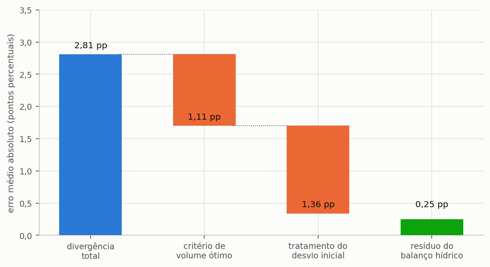

# Triton IBE

## Manual do Utilizador — Correções, bugs e versionamento

Igor Catão Martins Vaz e Enedir Ghisi

Grupo de Pesquisa em Ambientes Sustentáveis
Universidade Federal de Santa Catarina

2026

---

### Sobre este volume

Este é um dos oito volumes em que o manual do Triton pode ser distribuído, e
reúne o capítulo 6 (Correções, bugs e versionamento) do manual completo. Serve para enviar
apenas a parte que interessa: o método a um revisor, o tutorial a uma turma, os guias
a quem já utiliza o programa.

A numeração das secções e das equações é a mesma do manual completo, de modo que
uma remissão vale nos dois. Quando o texto remete para uma secção que está noutro
volume, o nome do volume vem entre parênteses.

| Volume | Conteúdo |
| :--- | :--- |
| Comece aqui | o capítulo 1 (Comece aqui) e o apêndice G |
| O método | o capítulo 2 (O método) e os apêndices A, B, C, E, G e H |
| Guias de uso | o capítulo 3 (Guias disponíveis no programa) e os apêndices D, F e G |
| Tutorial | o capítulo 4 (Tutorial: um exemplo do começo ao fim) e os apêndices G, I e J |
| Enganos, limitações e confiabilidade | o capítulo 5 (Enganos, limitações e confiabilidade) e os apêndices G e H |
| **Correções, bugs e versionamento** | o capítulo 6 (Correções, bugs e versionamento) |
| Modulação probabilística | o capítulo 7 (Modulação probabilística) e os apêndices G e H |
| Apêndices | os apêndices |

### Como citar

> VAZ, Igor Catão Martins; GHISI, Enedir. **Triton: manual do utilizador**.
> Correções, bugs e versionamento. Versão 0.1.0. Universidade Federal de Santa
> Catarina, 2026.

---

## Índice

**6 Correções, bugs e versionamento**

6.1 Comparação com o Netuno 4

6.2 Mensagens de erro e o que fazer

6.3 Histórico de versões e o que mudou

6.4 Como relatar um problema

6.5 Roteiro de evolução


## Lista de figuras

Figura 1 — Decomposição da divergência média entre o programa e uma referência independente

---

## Lista de tabelas

Tabela 1 — Variáveis da Equação 51

Tabela 2 — Mensagens de validação física da entrada e a providência de cada uma

Tabela 3 — Mensagens da fração atendível e a providência de cada uma

Tabela 4 — Mensagens de erro da série de precipitação e a providência de cada uma

Tabela 5 — Mensagens de erro da varredura de volumes

Tabela 6 — Mensagens de erro dos parâmetros de cloragem

Tabela 7 — Mensagens de erro da análise económica e a providência de cada uma

Tabela 8 — Mensagens de erro da decisão multicritério e a providência de cada uma

Tabela 9 — Mensagens de erro dos parâmetros da eletrobomba

Tabela 10 — Situações de erro na leitura e na gravação de ficheiros

Tabela 11 — Avisos que não interrompem o cálculo e têm de constar do estudo

Tabela 12 — **Tabela 99** — Panorama das versões publicadas

Tabela 13 — Correções que alteram resultados na versão 0.1.0

Tabela 14 — Itens previstos para a versão 1.1

Tabela 15 — Itens previstos para a versão 2.0

---

## Lista de equações

Equação 51 — Transformação da série para emular o Netuno 4

---


---
# 6. Correções, bugs e versionamento

---

## 6.1. Verificação contra soluções analíticas e referências

> Esta secção mostra como o motor é conferido contra resultados que não produziu: soluções de
> forma fechada, um caso que se confere à mão, regras de dimensionamento publicadas e programas
> independentes, e o que cada conferência pode e não pode provar.

---

### 6.1.1. O papel da comparação

Uma comparação com outra ferramenta não é um alvo de fidelidade. ==Dois programas que coincidem até
à última casa decimal podem partilhar o mesmo erro; dois programas que diferem podem diferir por
boas razões.== O que a comparação oferece é um conjunto independente de resultados, produzido por
outras mãos, e a oportunidade de explicar cada diferença por uma causa. Sem uma referência externa
desta natureza, a verificação limitar-se-ia às propriedades internas da secção 5.3 (volume Enganos, limitações e confiabilidade) —
necessárias, e incapazes de detetar um erro sistemático que as respeitasse todas.

As conferências abaixo vão da mais forte à mais fraca. As mais fortes dispensam qualquer programa
de referência.

---

### 6.1.2. Soluções de forma fechada

Em algumas situações a resposta correta decorre das equações, sem simulação. Com chuva constante e
procura constante, o reservatório enche até um nível conhecido; um reservatório de capacidade nula
só pode fornecer o que cai nesse dia; um reservatório de capacidade ilimitada satisfaz a procura
sempre que a oferta média a excede, e o potencial é então a totalidade da fração satisfazível. A
suíte afirma cada uma destas soluções dentro da tolerância numérica. Como o valor esperado vem da
dedução, e não de uma execução anterior do programa, um erro não se pode esconder em ambos.

---

### 6.1.3. Um caso que se confere à mão

O caso dos dez dias da secção 2.1 (volume O método) é pequeno o bastante para se acompanhar com papel e lápis:
100 m², coeficiente de escoamento 0,85, descarte de 2,0 mm, reservatório de 2 000 L, procura
pluvial de 80 L/dia, e a chuva de Lisboa de 11 a 20 de dezembro de 2019. O programa dá 6 732 L
captados, dos quais 4 324 L extravasam, 488 L são consumidos e 1 920 L ficam no reservatório. As
três saídas somam exatamente a entrada (6 732 − 4 324 − 488 = 1 920), e o resíduo do balanço é
zero. Repetir dois dias à mão — o dia de 35,7 mm, que capta 2 865 L e extravasa 2 380 L por
exceder o reservatório, e o dia de 1,2 mm, que fica abaixo da lâmina de descarte e não capta nada —
é a maneira mais rápida de aprender o que o programa faz com cada regra.

---

### 6.1.4. Regras de dimensionamento publicadas como referência

As regras práticas de dimensionamento não são exatas, mas delimitam a resposta. A moradia do
tutorial (150 m², 600 L/dia, 28% satisfazível) foi dimensionada por cinco métodos, e cada volume
foi depois passado pela simulação diária para obter o potencial que efetivamente entrega, com a
chuva de Lisboa.

- regra prática de 6% da procura anual (método alemão): 3 750 L, potencial 16,32%;
- simulação diária com critério de ganho marginal: 5 000 L, potencial 17,49%;
- regra prática de 0,05 vezes a precipitação vezes a área (método britânico): 5 500 L, potencial
  17,85%;
- diagrama de Rippl mensal: 47 000 L, potencial 26,78%;
- diagrama de Rippl diário: 51 500 L, potencial 26,92%.

Os métodos discordam por um fator superior a treze no volume. A dispersão é o resultado útil. As
duas regras práticas e a simulação ficam entre 3 750 e 5 500 L; o diagrama de Rippl pede 47 000 a
51 500 L, porque dimensiona contra o verão seco de Lisboa para garantir o fornecimento, e a curva da
secção 4.4 (volume Tutorial) não satura nesse intervalo. Uma regra que dê um volume muito fora desta gama para as
mesmas entradas merece uma segunda análise, e a diferença entre o ótimo hidráulico e o volume de
Rippl é uma decisão de projeto, não um erro de nenhum dos dois.

---

### 6.1.5. Comparar com outro programa

Comparar com uma ferramenta independente responde a outra pergunta: duas implementações do mesmo
modelo conceptual concordam? A concordância só se espera quando as decisões de modelação
coincidem. Duas há que diferem com frequência suficiente para importar.

A primeira é o **descarte das primeiras águas**. Subtrair a lâmina à chuva do dia, como faz o
Triton, é fisicamente fiel, porque a água desviada nunca chega à cisterna. Algumas ferramentas
tratam, em vez disso, a lâmina como um limiar do evento: abaixo dele nada se capta, acima dele
capta-se a chuva inteira. A segunda é o **critério do volume**: as ferramentas escolhem o volume
ideal por ganho marginal sobre grelhas diferentes, e por isso elegem volumes diferentes. Comparar
ótimos mistura, pois, a diferença de critério com a diferença de motor; compare potenciais no
**mesmo** volume.

#### 6.1.5.1. Emular uma regra de limiar sem alterar o motor

A regra antiga emula-se transformando a série de precipitação de entrada, e não alterando o código
do balanço hídrico. Medir uma divergência com código modificado verificaria um programa que não é
o distribuído ao utilizador.

```equacao:emulacao:51
P′ = P + d_f se P ≥ d_f ; P′ = 0 caso contrário
```

<!-- tabela: **Tabela 1** — Variáveis da Equação 51 -->
| Símbolo | Significado | Unidade |
| :--- | :--- | :--- |
| `P′` | precipitação transformada, a fornecer ao Triton | mm |
| `P` | precipitação observada no dia | mm |
| `d_f` | lâmina de descarte das primeiras águas | mm |

Aplicada esta transformação, o cálculo `P_ef = max(0, P′ − d_f)` do Triton reproduz exatamente a
semântica do limiar. O programa não tem nenhuma opção que o faça automaticamente; use a
transformação da série, ou compare com um descarte igual a zero, em que as duas regras coincidem.

A Figura 1 ilustra como se decompõe, por causas, a divergência total entre dois
programas, até um resíduo.



*Figura 1 — Decomposição da divergência média entre o programa e uma referência independente. A primeira barra é o total observado; as barras intermédias são diferenças de método declaradas, como o critério do volume ótimo e o tratamento do descarte; a última é o resíduo do balanço hídrico, que é o número que verifica efetivamente o motor.*

---

### 6.1.6. Linhas de referência com resultado nulo

As ferramentas de referência exportam por vezes zero onde o Triton calcula um valor positivo,
tipicamente porque a ferramenta não encontrou um volume ótimo pelo seu próprio critério. Tais
linhas apontam para uma característica dos **dados de referência**, e não para um erro do programa.
Mantenha-as à parte das estatísticas, para não deixar que dominem a média.

---

### 6.1.7. O que declarar num estudo comparativo

- os **dois números**: a divergência total e o resíduo depois da decomposição;
- as diferenças deliberadas de método, nomeadas;
- se a comparação usou descarte zero, emulação de limiar, ou nenhuma neutralização;
- a versão de cada programa.

Apresentar apenas a divergência total, sem a decompor, sugere um erro de motor que pode não
existir.

---

## 6.2. Mensagens de erro e o que fazer

> O que cada mensagem significa, o que a provocou e como a resolver.

O programa segue uma política deliberada perante entradas impossíveis: recusa-as em vez de as
corrigir em silêncio. A razão é que uma área de captação negativa não é uma preferência do
utilizador a acomodar, mas um erro de digitação que precisa de ser visto por quem o cometeu.
==Corrigir em silêncio produziria um resultado plausível a partir de uma entrada errada, que é a
pior combinação possível num programa de simulação.==

> **As mensagens do núcleo de cálculo são emitidas tal como o código as escreve.** As verificações
> que correm dentro do cálculo levantam as suas mensagens em português, por vezes sem acentos e com
> um vocabulário que pode diferir do deste manual (por exemplo, «motobomba» onde o manual diz
> «eletrobomba»). As tabelas abaixo citam cada mensagem com acentos, para facilitar a leitura, e
> explicam-na em seguida; reconhece-a pelo sentido e pelo nome do campo.

---

### 6.2.1. Validação física da entrada

As mensagens abaixo são emitidas antes de qualquer cálculo começar, e todas nomeiam o campo
responsável e o valor recebido, de modo que a correção não exija procura.

<!-- tabela: **Tabela 2** — Mensagens de validação física da entrada e a providência de cada uma -->
| Mensagem | O que a provocou | O que fazer |
| :--- | :--- | :--- |
| «Volume do reservatório inferior negativo» | volume menor do que zero | corrija; **zero é válido** e representa o cenário sem sistema |
| «Volume do reservatório superior negativo» | idem, no reservatório elevado | corrija; zero significa sem reservatório superior |
| «Área de captação negativa» | área menor do que zero | corrija; use a projeção horizontal em m² |
| «Coeficiente de escoamento fora de [0, 1]» | coeficiente negativo ou acima de 1 | acima de 1 a cobertura entregaria mais água do que a chuva traz; as coberturas usuais ficam entre 0,80 e 0,95 |
| «Lâmina de descarte negativa» | descarte menor do que zero | o descarte retira água à captação, não a acrescenta |
| «Demanda diária negativa» | procura menor do que zero | corrija |
| «Fração atendível por água pluvial fora de [0, 1]» | fração maior do que 1 | introduza 0,4 para 40%, e não 40 |
| «… não é um número finito» | campo que chegou ao cálculo vazio, como texto ou infinito | preencha o campo indicado com um número |
| «Modo de descarte desconhecido» | modo diferente de 1, 2 ou 3 | escolha um dos três modos; para não descartar, introduza uma lâmina zero |
| «Intervalo de descarte inválido» | modo 3 com um intervalo menor do que 1 dia | introduza o intervalo em dias inteiros |
| «Nível de acionamento da motobomba negativo» | nível menor do que zero | corrija; zero significa acionar com o reservatório vazio |

> A fração atendível é a mensagem mais frequente, e a regra que a evita é uma só: onde se digita,
> uma percentagem de 0 a 100; onde se guarda, uma fração de 0 a 1. A secção 4.2 (volume Tutorial) justifica a
> divisão. Quando a mensagem surge, o valor chegou como 40 num sítio que guarda 0,4 — tipicamente
> um ficheiro de parâmetros editado à mão ou uma chamada de automação.

<!-- tabela: **Tabela 3** — Mensagens da fração atendível e a providência de cada uma -->
| Mensagem | O que a provocou | O que fazer |
| :--- | :--- | :--- |
| «… parece estar em percentual» | fração entre 1 e 100 no ficheiro, no vetor semanal, mensal ou diário, ou na automação | introduza 0,4 para 40% |
| «… fora de [0, 100]» | percentagem negativa ou acima de 100 no ecrã, na tabela de cenários, na folha de cálculo ou em `--share` | corrija; 40 significa 40% |
| campo laranja, ou pergunta «Simular mesmo assim?» | percentagem entre 0 e 1 | se queria 40%, digite 40; se queria mesmo menos de 1%, confirme |

---

### 6.2.2. Série de precipitação

O programa não distingue um dia seco de um dia sem registo, e por isso não adivinha: uma falha na
série interrompe o cálculo, com a indicação de onde está. Preencher a falha, ou recortar a série
para um período sem falhas, é uma decisão de quem conduz o estudo, e a decisão tem de constar do
estudo.

<!-- tabela: **Tabela 4** — Mensagens de erro da série de precipitação e a providência de cada uma -->
| Mensagem | Causa | O que fazer |
| :--- | :--- | :--- |
| «A série de precipitação está vazia» | ficheiro sem nenhuma linha numérica | confira se o ficheiro tem uma coluna de valores diários, um por linha |
| «… dia(s) sem valor numérico, o primeiro no dia N» | falha de registo: linha vazia ou texto a meio da série | preencha as falhas ou recorte a série, e declare o tratamento |
| «… valor(es) negativo(s), o primeiro de X mm no dia N» | sentinela de falha, como −999 | trate-o como falha: preencha ou recorte |

Uma linha de cabeçalho antes dos dados, como «Data;Precipitação», não é erro: é ignorada e a
leitura começa na primeira linha numérica.

---

### 6.2.3. Varredura

<!-- tabela: **Tabela 5** — Mensagens de erro da varredura de volumes -->
| Mensagem | Causa | Solução |
| :--- | :--- | :--- |
| «O volume máximo da varredura deve ser finito e não negativo» | campo vazio ou negativo | introduza o volume máximo em litros |
| «O passo de varredura deve ser finito e maior que zero» | passo zero ou vazio | introduza o passo; será arredondado para o múltiplo de 250 L |

Há ainda um aviso que não é um erro e convém não confundir com um: quando o passo da varredura é
ajustado para o múltiplo de 250 L, ou quando o limite de quarenta volumes obriga a alargá-lo, o
programa regista o ajuste e prossegue normalmente. O que esse aviso exige do utilizador é apenas
que declare no estudo o passo efetivamente utilizado, e não o passo originalmente pedido.

---

### 6.2.4. Cloragem

<!-- tabela: **Tabela 6** — Mensagens de erro dos parâmetros de cloragem -->
| Mensagem | Causa | Solução |
| :--- | :--- | :--- |
| «Pureza deve ficar em (0, 1]» | pureza introduzida como percentagem | introduza 0,65 para 65%, e não 65 |
| «A dose não pode ser negativa» | dose menor do que zero | corrija |
| «O fator de emissão não pode ser negativo» | fator de emissão do produto menor do que zero | corrija; o fator é por quilograma de produto comercial |

---

### 6.2.5. Análise económica

<!-- tabela: **Tabela 7** — Mensagens de erro da análise económica e a providência de cada uma -->
| Mensagem | Causa | Solução |
| :--- | :--- | :--- |
| «… deve ser um número finito e não negativo» | investimento, tarifa, custo, potência ou volume vazio, negativo ou infinito | a mensagem nomeia o campo; preencha-o com um número igual ou maior do que zero |
| «O período de análise deve ser um número inteiro de anos» | período fracionário, zero ou negativo | introduza o período em anos inteiros |
| «… deve ser um número finito e maior que -100%» | atualização, inflação ou taxa de atualização de −100% ou menos | confira o sinal da taxa |
| «… parece estar em percentual» | taxa anual introduzida como 5 numa função que espera uma fração decimal | introduza 0,05 para 5% |

> **Unidade das taxas.** Na interface e no ficheiro de projeto, toda a taxa é introduzida em
> percentagem, com a unidade ao lado do campo: a taxa de atualização e a inflação em % por mês ou
> em % por ano, conforme o botão ao lado, e as atualizações tarifárias em % por período de
> atualização, cujo comprimento em meses está no campo vizinho. O projeto grava a taxa de
> atualização e a inflação em % por mês. A conversão entre mês e ano é composta, (1 + i)^12 − 1, e
> não uma multiplicação por doze: 1% por mês equivale a 12,68% por ano. Na automação, as funções
> de cálculo anual recebem as taxas como fração decimal, 0,05 para 5%, e recusam um valor que
> pareça uma percentagem em vez de o reinterpretar.

---

### 6.2.6. Decisão multicritério

<!-- tabela: **Tabela 8** — Mensagens de erro da decisão multicritério e a providência de cada uma -->
| Mensagem | Causa | Solução |
| :--- | :--- | :--- |
| «Informe 3 pesos de eixo ou 7 pesos de critérios TOPSIS» | número de pesos diferente de 3 ou de 7 | introduza um peso por eixo ou um por critério |
| «Os pesos TOPSIS devem ser finitos e não negativos» | peso vazio ou negativo | corrija; o peso zero é válido e exclui o critério |
| «Ao menos um peso TOPSIS deve ser maior que zero» | todos os pesos a zero | atribua peso a pelo menos um critério |
| «O critério TOPSIS … da alternativa N não é finito» | indicador indefinido numa alternativa, tipicamente um período de recuperação sem retorno | confira a alternativa indicada antes de decidir |

---

### 6.2.7. Eletrobomba

<!-- tabela: **Tabela 9** — Mensagens de erro dos parâmetros da eletrobomba -->
| Mensagem | Causa | Solução |
| :--- | :--- | :--- |
| «Rendimento deve ficar em (0, 1]» | rendimento como percentagem no núcleo | use 0,55 para 55% |
| «Rendimento do motor deve ficar em (0, 1]» | idem, no campo do motor | deixe em branco para o programa adotar a sua tabela de rendimentos predefinida |

---

### 6.2.8. Ficheiros

<!-- tabela: **Tabela 10** — Situações de erro na leitura e na gravação de ficheiros -->
| Situação | O que acontece | O que fazer |
| :--- | :--- | :--- |
| série de chuva ilegível | a leitura é interrompida com uma mensagem | confira o formato: uma leitura por linha, em mm, coluna única |
| ficheiro `.triton` com JSON inválido | a abertura é interrompida | o ficheiro pode estar truncado; recorra à cópia de segurança |
| secção em falta no ficheiro | os campos assumem o valor por omissão da classe | esperado ao abrir um ficheiro de versão anterior; reveja o separador correspondente |
| base de chuva por concelho não encontrada | o separador oferece só um ficheiro próprio | veja a secção 1.2 (volume Comece aqui) |

---

### 6.2.9. Avisos que não interrompem

Os avisos reunidos nesta tabela não impedem o cálculo e não indicam defeito: são observações que o
programa faz sobre as condições em que o resultado foi produzido. Todas têm de ser transportadas
para o texto do estudo, porque todas afetam a interpretação do número e nenhuma é evidente no
resultado isolado.

<!-- tabela: **Tabela 11** — Avisos que não interrompem o cálculo e têm de constar do estudo -->
| Aviso | O que significa |
| :--- | :--- |
| tipologia não residencial com tarifa residencial | o resultado económico está **subestimado**; veja a secção 3.5 (volume Guias de uso) |
| a classe-alvo recomenda filtração fina e esta foi dispensada | decisão registada no relatório |
| fator de emissão com etiqueta de triagem | o fator não tem fonte primária; declare-o |
| estrutura tarifária incompleta | a estrutura introduzida tem uma lacuna; confira-a com o tarifário publicado |
| passo de varredura ajustado | o passo efetivo difere do pedido |
| extrapolação de preço com R² baixo | o volume está fora da tabela de preços e a regressão não é fiável |

---

### 6.2.10. Quando o resultado parece errado

Antes de suspeitar de um defeito do programa, três conferências resolvem a maior parte dos casos em
que o resultado surpreende, e cada uma corresponde a um erro de entrada com assinatura própria.

Quando o **potencial sai maior do que o esperado**, o suspeito imediato é a fração satisfazível: é
o teto de todo o resultado, e uma fração demasiado generosa infla tudo o que vem depois sem que
nada no relatório denuncie a origem.

Quando o **potencial sai muito menor**, confira a lâmina de descarte. O engano correspondente está
descrito na secção 5.1.3 (volume Enganos, limitações e confiabilidade), e consiste em introduzir o descarte em litros quando o campo pede
milímetros — o que descarta, tipicamente, a chuva inteira de todos os dias.

Quando o **retorno do investimento sai absurdo**, em qualquer das duas direções, confira a
estrutura tarifária (parte fixa, escalões, saneamento). É a causa mais frequente de um resultado
económico implausível, e a secção 3.3 (volume Guias de uso) traz o teste que a identifica em dois minutos.

Vale ainda percorrer as quatro etapas de entrada antes de aceitar qualquer resultado. A barra
lateral assinala as que continuam com pendência, e conferir quatro ecrãs custa menos tempo do que
descobrir o engano depois de o relatório estar emitido.

---

## 6.3. Histórico de versões e o que mudou

Esta secção regista o que mudou entre as versões do programa e, sobretudo, **que mudanças alteram
resultados já publicados**. A distinção importa mais do que parece: uma correção de interface não
afeta nenhum estudo anterior, ao passo que uma correção de cálculo pode deslocar cada número de um
trabalho já submetido. Quem publicou com o Triton precisa de saber em que categoria cai cada
alteração, e é por isso que o histórico abaixo separa as duas coisas de forma explícita.

==A regra que orienta toda esta secção é simples: uma correção de cálculo obriga a declarar a
versão usada; uma correção de interface, não.==

---

### 6.3.1. A versão que está a usar

O número da versão aparece na barra lateral, no rodapé e no menu **Sobre o Triton**. É também
gravado dentro de cada ficheiro de projeto e impresso em cada relatório, de modo que um estudo
antigo leva sempre consigo a identificação do programa que o produziu. Esta redundância é
deliberada: os relatórios circulam separados dos ficheiros, e a pergunta «com que versão foi isto
feito?» costuma surgir meses depois, quando já ninguém se lembra.

O esquema de numeração segue a convenção corrente em engenharia de software. O primeiro número
indica a geração do programa, e a sua mudança significa uma reformulação do modelo conceptual; o
segundo indica um conjunto de funcionalidades novas; e o terceiro indica correções e ajustes que
não alteram a arquitetura. Um primeiro número igual a zero marca uma versão beta: o programa é
utilizável e está verificado como a secção 5.3 (volume Enganos, limitações e confiabilidade) descreve, mas a interface, o formato de
ficheiro e os valores por omissão ainda podem mudar, e uma mudança pode alterar resultados.

A versão atual é a beta **0.1.0**. Nenhuma versão anterior circulou, e nenhum estudo foi feito com
alguma.

---

### 6.3.2. Como este histórico é mantido

A partir daqui, cada versão publicada ganha uma entrada própria nesta secção, com a data de
lançamento e o que mudou, sempre separado em duas listas: ==o que altera os resultados de estudos
já feitos e o que não altera.== A entrada mais recente vem primeiro.

Cada entrada segue o mesmo modelo, para que duas versões se possam comparar sem reler: uma frase
de resumo, as novidades, as correções que alteram resultados, as que não alteram, e o que mudou na
documentação. As secções sem conteúdo nessa versão simplesmente não aparecem.

A mesma lista é distribuída com o código, no ficheiro `CHANGELOG.md` da raiz do repositório, e
alimenta a página de versões do sítio de documentação. Não é escrita três vezes: as três saem
desta secção, e uma verificação automática recusa a montagem se divergirem. Quem acompanha o
programa pelo repositório, pelo sítio ou pelo manual lê o mesmo registo.

<!-- tabela: **Tabela 12** — **Tabela 99** — Panorama das versões publicadas -->
| Versão | Data | O que trouxe | Correções que alteram resultados |
| :--- | :--- | :--- | ---: |
| **0.1.0** | 24 de outubro de 2026 | Primeira versão beta do Triton, com nome próprio para cada edição, no mesmo repositório e com a mesma numeração. | 0 |

---

### 6.3.3. Versão 0.1.0 (beta) — 24 de outubro de 2026

> **Numa frase.** Primeira versão beta do Triton, com nome próprio para cada edição, no mesmo repositório e com a mesma numeração.

#### 6.3.3.1. Novidades

O Triton simula o aproveitamento de águas pluviais dia a dia e inclui o motor de simulação, a
avaliação de ciclo de vida, a linha de tratamento, a decisão multicritério e a modulação
probabilística. Esta é a primeira versão da Edição Ibérica (IBE, antes Edição Portugal), que tem nome e logótipo próprios e partilha o repositório e a numeração das outras edições, com a chuva E-OBS por concelho, os tarifários de Lisboa, do Porto e do Funchal
e os valores em euros. A regra de operação de Fewkes (φ) está disponível como opção em todos os
módulos.

**O que a Edição Ibérica traz nesta versão.**

- **Chuva.** A precipitação diária de 278 concelhos de Portugal continental, de 1950 a 2025, calculada a partir da grelha E-OBS v33.0e, numa base de 5,74 MiB identificada por `PT-EOBS-v33.0e-37fcba20` e por SHA-256. Cada concelho tem um nível de qualidade, A, B ou C: 45 de nível A, 159 de B e 74 de C.
- **Licença da chuva.** No primeiro arranque, o aviso da licença da E-OBS (só uso não comercial, em investigação e educação) e a declaração do uso pretendido, que fica registada nos laudos. Por decisão do titular (25/10/2026), o uso comercial da chuva E-OBS é bloqueado e os relatórios avisam, em vermelho e em tamanho grande, que não pode ser usada comercialmente.
- **Tarifários.** Água, saneamento e resíduos de Lisboa, do Porto e do Funchal, transcritos de documentos oficiais com endereço e SHA-256 registados; a entidade gestora de cada serviço em 280 concelhos, a partir da ERSAR; e um estado de confiança por concelho e por serviço.
- **Valores e língua.** Euros, IVA tratado em cada tarifário, português europeu na interface, nos laudos e no manual.
- **Estudos em lote por JSON.** O subcomando `triton estudo` organiza um estudo num `estudo.json` (projeto base, casos por tipologia, substituições de parâmetros por apelidos, análise e saídas), roda todos os casos em ordem estável, com retomada e execução paralela, e grava tabelas para artigos: CSV tidy, JSON com proveniência (versão, edição, SHA-256, fonte e licença da chuva), Markdown, LaTeX (booktabs) e XLSX. Um modelo de texto com marcadores recebe os números reais e deixa «XX» onde faltar resultado. Há um estudo de exemplo em `examples/estudos/`.
- **Documentação.** O manual completo, o sítio de documentação, volumes curtos e `docs/DADOS.md`, que descreve cada conjunto de dados com fonte, licença e qualidade.

**O que a versão ainda não tem.**

- **Espanha.** Nenhum local: a linha de cobertura diz «Espanha: 0 locais». Há um ensaio com as 52 capitais de província (39 em nível B, 9 em C, 4 sem série), feito fora do programa; falta o limite municipal e a licença da E-OBS, que limita o uso à investigação e à educação.
- **Ilhas.** Os 30 concelhos da Madeira e dos Açores não têm série na base (os Açores estão fora do domínio da E-OBS e a Madeira falha em mais de 1% dos dias). O exemplo do Funchal usa uma reanálise ERA5, e não nível A, B ou C.
- **Tarifários nos restantes concelhos.** Só três estão transcritos; nenhum concelho está em verde, porque falta a verificação independente (42 amarelos e 238 cinzentos na água e no saneamento).
- **Preços e CAPEX.** O programa não calcula preços de Portugal: reservatórios, tubagem, eletrobombas, mão de obra e manutenção partem de zero, e a tarifa de eletricidade e o preço do cloro também. Os resultados económicos dos exemplos não são resultados.
- **Fator de emissão da rede.** Sem valor: é zero até o utilizador indicar o da rede do projeto.
- **Correção de escala da chuva.** A correção calibrada com o Iberia01 não faz parte desta versão.

**Limitações conhecidas.**

- A licença da E-OBS é omissa quanto à redistribuição da base derivada; por decisão do titular (25/10/2026) o uso comercial é bloqueado e avisado, e quem usa a chuva E-OBS assume o uso não comercial. A tabela de qualidade, derivada do Iberia01 (ODbL), vai para um ficheiro separado sob a ODbL, com atribuição. O aviso da licença só existe em português europeu, e o texto ainda precisa de revisão.
- O diálogo do CAPEX não tem campo para o preço da cisterna e repõe-no a zero ao confirmar; a secção 4.7 (volume Tutorial) dá o contorno.
- Em espanhol e em chinês, a interface está traduzida em parte (as traduções do nível de qualidade da chuva não foram revistas por um falante nativo) e os laudos saem com trechos em português; o português e o inglês estão completos.
- Em inglês, alguns textos do catálogo da linha de tratamento e a proveniência do tarifário aparecem em português.
- Os termos de reutilização dos sítios das entidades gestoras não foram verificados (no do Porto não se encontrou nenhum).
- Referências a rever antes de citar: a edição da EN 16941-1 em vigor e a sua transposição, a revisão da ETA 0701 da ANQIP (as secções 1.1 (volume Comece aqui) e 4.6 (volume Tutorial) marcam o que falta).

#### 6.3.3.2. Correções que alteram resultados

Nenhuma: esta é a primeira versão beta, e não há versão anterior a corrigir.

<!-- tabela: **Tabela 13** — Correções que alteram resultados na versão 0.1.0 -->
| O que foi corrigido | Efeito no resultado |
| :--- | :--- |

#### 6.3.3.3. Correções que não alteram resultados

Nenhuma.

#### 6.3.3.4. Documentação

O manual ganhou as secções «Particularidades de região e país» e «Descrição dos dados e sua qualidade» no apêndice E (volume Apêndices).

---

### 6.3.4. Como saber se a sua versão tem uma correção

O procedimento é direto e não depende de consultar ninguém: abra um dos ficheiros de exemplo que
acompanham o programa, descritos no apêndice J (volume Apêndices), execute-o e compare o resultado obtido com o
valor impresso neste manual. Cada caso de exemplo foi gerado pela mesma versão do programa que
gerou este manual, e cada número publicado tem a verificação automática correspondente, como a
secção 5.3 (volume Enganos, limitações e confiabilidade) descreve. Uma divergência, portanto, indica que o programa instalado não é o da
versão deste manual.

==Se os números coincidirem, a sua instalação corresponde exatamente ao manual que tem em mãos.==
Se não coincidirem, a diferença não é um defeito da sua instalação, mas uma diferença de versão que
é preciso identificar antes de qualquer estudo.

---

### 6.3.5. O que declarar num trabalho publicado

A boa prática de reprodutibilidade computacional exige que um trabalho identifique de forma
inequívoca o programa que produziu os resultados. No caso do Triton, bastam quatro informações, e
todas estão disponíveis sem esforço: a versão do programa, que aparece no relatório; a origem da
série de precipitação, com o período utilizado; a estrutura tarifária adotada, com a data de
entrada em vigor; e a declaração de quais os parâmetros alterados em relação aos valores por
omissão. A secção 4.10 (volume Tutorial) traz a lista completa, com um parágrafo de método pronto a adaptar.

Anexar o ficheiro `.triton` ao material suplementar resolve as quatro de uma só vez, porque o
ficheiro é autocontido: traz a série de chuva dentro dele ou, com a chuva E-OBS por concelho, a
referência da série e a sua impressão digital, que o programa recompõe a partir da base. É a forma
mais económica de tornar um estudo verificável por terceiros, e custa um pequeno anexo.

---

## 6.4. Como relatar um problema

Os programas de simulação têm defeitos, e o Triton não é exceção. A revisão conduzida antes desta
versão beta encontrou uma dúzia de defeitos de cálculo, nenhum acompanhado de mensagem de erro, e a
maioria descoberta não pela leitura do código mas pela comparação entre dois pontos do próprio
programa que deviam concordar e não concordavam. A lição prática é que o utilizador atento é a
melhor fonte de deteção de que um programa científico dispõe, e é por essa razão que esta secção
existe.

==Um bom relato é aquele que permite reproduzir o problema sem a sua presença.== Tudo o que se pede
abaixo serve esse único objetivo.

---

### 6.4.1. O que enviar

Um relato útil tem quatro componentes, e a ausência de qualquer um deles costuma transformar a
investigação numa troca de mensagens que consome mais tempo a todos do que a própria correção.

**O ficheiro do projeto.** É o item mais importante, e por si só substitui páginas de descrição. O
`.triton` é autocontido: traz todos os parâmetros e a série de chuva inteira dentro dele — ou,
com a chuva E-OBS por concelho, a referência exata da série e a sua impressão digital, que o
programa recompõe a partir da base —, de modo que quem o receber reproduz exatamente a sua
simulação, no mesmo computador ou noutro qualquer. Sem ele, a investigação começa por tentar
adivinhar as entradas, e adivinhar entradas é a maneira mais eficiente de não encontrar um defeito.

**O que esperava e o que obteve.** Esta é a parte que só o utilizador pode fornecer. Descreva o
número que apareceu e o número que devia ter aparecido, com a justificação do segundo — seja um
cálculo à mão, um resultado de uma versão anterior, um valor da literatura ou simplesmente a ordem
de grandeza que a experiência sugere. Um relato que diz apenas «o resultado está errado» deixa ao
destinatário a tarefa de descobrir qual dos quarenta números do ecrã é o errado.

**A versão do programa.** Aparece na barra lateral, no rodapé e no menu **Sobre o Triton**, e já
está gravada dentro do ficheiro de projeto e de qualquer relatório exportado. Indique-a mesmo
assim, porque é o primeiro filtro da investigação: metade dos problemas relatados em programas
científicos são defeitos já corrigidos numa versão posterior à que o utilizador tem instalada.
Indique também a edição.

**A mensagem de erro, se a houver.** Copie o texto integral, e não um resumo. A secção 6.2
lista as mensagens que o programa emite deliberadamente, com o significado e a providência de cada
uma; se a sua mensagem lá estiver, o problema é provavelmente de entrada e tem solução imediata.

---

### 6.4.2. O que conferir antes de relatar

Uma parte considerável dos resultados que parecem errados são resultados corretos de entradas
erradas, e a conferência abaixo leva poucos minutos. Não existe para desencorajar o relato, mas
para que o seu tempo e o de quem investiga sejam gastos no que é, de facto, um defeito.

Comece pela secção 5.1 (volume Enganos, limitações e confiabilidade), que reúne os dez enganos de projeto que o programa não tem como
impedir. Três deles respondem pela maioria dos resultados inesperados: a área de captação
introduzida como a área inclinada da cobertura em vez da projeção horizontal, a lâmina de descarte
introduzida em litros em vez de milímetros, e a estrutura do tarifário tratada como um preço único
por metro cúbico quando tem parte fixa e escalões.

Confira em seguida se o comportamento observado não é uma limitação declarada. A secção 5.2 (volume Enganos, limitações e confiabilidade)
relaciona o que o programa reconhecidamente não faz, e algumas dessas limitações dão exatamente a
impressão de defeito. O caso mais frequente envolve a categoria tarifária: os tarifários que a
edição traz transcritos são os de utilizador doméstico de Lisboa, do Porto e do Funchal, pelo que
um estudo de escola ou de comércio sai com a tarifa doméstica enquanto o utilizador não introduzir
a da categoria correta. O programa avisa disso em vez de corrigir por conta própria, porque a
tabela certa é pública e específica de cada entidade gestora.

---

### 6.4.3. Para onde enviar

O Triton é desenvolvido por um grupo de investigação universitário. O contacto indicado no menu do
programa e no repositório é o canal de relato, e serve tanto para defeitos como para sugestões de
funcionalidades e pedidos de esclarecimento sobre o método. Os relatos podem ser escritos em
português ou em inglês.

Os relatos que vêm acompanhados do ficheiro de projeto entram diretamente na suíte de verificação
descrita na secção 5.3 (volume Enganos, limitações e confiabilidade): um caso que reproduz um defeito transforma-se num teste, e o teste
passa a impedir que o defeito volte. É a razão pela qual o ficheiro importa tanto, e é também a
resposta mais completa que se pode dar a quem relatou — o problema não só foi corrigido, como
passou a ser vigiado.

> **Aprofundamento: o que torna um defeito difícil de encontrar.** Os defeitos que sobrevivem anos
> num programa científico têm todos a mesma assinatura: produzem números plausíveis. Um erro que
> gera um valor negativo, ou mil vezes maior do que o esperado, encontra-se à primeira execução. Já
> um fator de rendimento aplicado duas vezes, ou uma unidade convertida uma vez a mais do que o
> necessário, produz um número que passa em qualquer inspeção visual e atravessa anos de uso. É por
> isso que a verificação do programa se apoia em invariantes — o balanço de massa que tem de
> fechar, a monotonia que tem de valer, o teto que a curva não pode cruzar — e não apenas em
> valores esperados. Quando suspeitar de um número, a maneira mais rápida de confirmar a suspeita é
> procurar uma dessas identidades que ele viola.

---

## 6.5. Roteiro de evolução

> Para onde o programa deve ir, e com que evidência. Um roteiro que separa o que está decidido do
> que é intenção permite ao utilizador planear o estudo com a versão que tem hoje, e não com a que
> gostaria de ter.

Esta secção resume o `ROADMAP.md` da raiz do repositório do Triton, que vale para as três edições e
reflete o estado da versão beta 0.1.0. Nada do que está abaixo da linha «Estável» existe nesta
versão: são intenções do grupo de investigação, sem data de entrega. Quando um item é
implementado, sai daqui e entra no histórico de versões, com a indicação de se muda os resultados
de estudos já feitos.

A direção vem de duas fontes. A primeira é a revisão sistemática da literatura que o grupo conduz
sobre a simulação do aproveitamento de águas pluviais; mostra onde os estudos publicados omitem a
regra de operação, a definição de fiabilidade e os parâmetros económicos. A segunda é o registo de
pendências do próprio programa, descrito na secção «Limitações conhecidas».

---

### 6.5.1. O que já é estável na 0.1.0

**Série climática.** Chuva diária E-OBS por concelho (278 concelhos de Portugal, com base de 1950 a
2025), a série ERA5 do Funchal e séries diárias fornecidas pelo utilizador. **Tarifas.** Os
tarifários transcritos de Lisboa, do Porto e do Funchal, e estruturas introduzidas pelo utilizador,
com escalões progressivos, partes fixas e atualização. **Balanço hídrico.** Simulação diária pela
regra do Triton, com a YAS estrita, a YBS e o parâmetro φ de Fewkes (2000b) como opções para
reservatório único. **Decisão.** Multicritério por TOPSIS e por SMAA-VIKOR. **Incerteza.**
Modulação probabilística das premissas (secção «O que é a modulação probabilística»).
**Edição.** Portugal.

A versão 1.0 será a primeira versão oficial, depois dos ajustes das versões 0.x.

---

### 6.5.2. Versão 1.1: consolidação e fiabilidade

Os três primeiros itens vêm do roteiro comum e dizem respeito sobretudo à Edição Internacional.

<!-- tabela: **Tabela 14** — Itens previstos para a versão 1.1 -->
| Eixo | Item | Método |
| :--- | :--- | :--- |
| Dados e tarifas | Fornecedores globais de chuva | Reanálises ERA5-Land e NOAA GHCN-Daily |
| Dados e tarifas | Unidades métricas e imperiais | Conversão sem resíduo, com a conservação de massa conferida nas duas |
| Dados e tarifas | Tarifas sazonais e de escassez | Escalões dinâmicos, sobretaxa de seca, saneamento separado |
| Decisão multicritério | Ordenação completa com plano GAIA | PROMETHEE II |
| Decisão multicritério | Limiares de veto e classes de viabilidade | ELECTRE Tri |
| Decisão multicritério | Pesos mais consistentes | Best-Worst Method (BWM) |
| Probabilidade e risco | Dependência entre chuva e procura | Cópulas bivariadas (Clayton, Gumbel) |
| Probabilidade e risco | Que variáveis governam o resultado | Índices de Sobol de primeira ordem e totais |
| Probabilidade e risco | Chuva sintética | Bootstrap em blocos, com os dias secos consecutivos preservados |
| Custos e engenharia | Custo de instalação por material e por solo | Curvas paramétricas por tecnologia e por classe de solo |
| Custos e engenharia | Custo de exploração detalhado | Filtros, desinfeção, curva de degradação da bomba |

### 6.5.3. Versão 2.0: fronteira metodológica

<!-- tabela: **Tabela 15** — Itens previstos para a versão 2.0 -->
| Eixo | Item | Método |
| :--- | :--- | :--- |
| Física do sistema | Passo de tempo horário | Modelo horário com dados de udógrafo |
| Física do sistema | Balanço hídrico na zona radicular | FAO-56 Penman-Monteith, para a rega |
| Física do sistema | Coeficiente de escoamento variável | Depende da lâmina e da estiagem antecedente |
| Territorial | Escala de bacia urbana | Vetores GeoJSON |

---

### 6.5.4. Como ler este roteiro

**A ordem não é um compromisso de datas.** A ordem segue a consequência sobre o resultado de um
estudo. O passo horário, por exemplo, só chega na 2.0 porque exige dados de udógrafo que a maioria
dos concelhos não tem.

**Um item entra pela evidência.** Cada método listado responde a uma lacuna medida na revisão da
literatura, e não a uma preferência de implementação.

**Uma alteração que muda resultados é declarada.** Quem publica com o programa tem de registar a
versão usada. Por isso o histórico de versões separa a correção que muda um número de um estudo
já feito da que muda só a interface.
