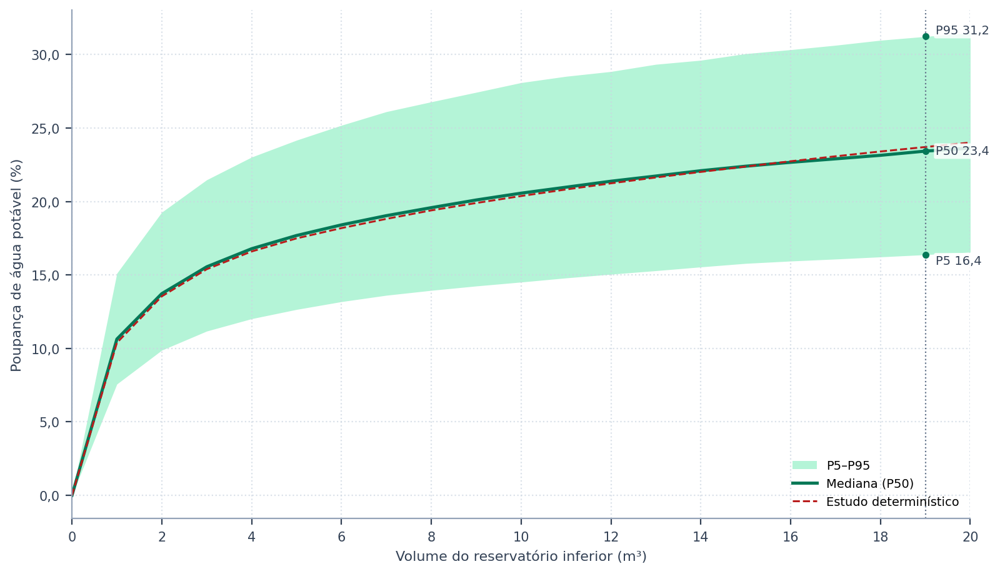
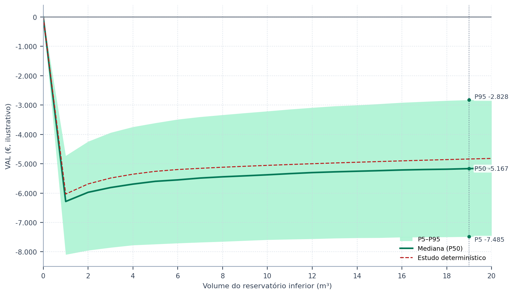
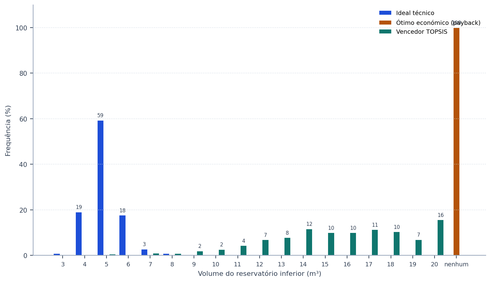
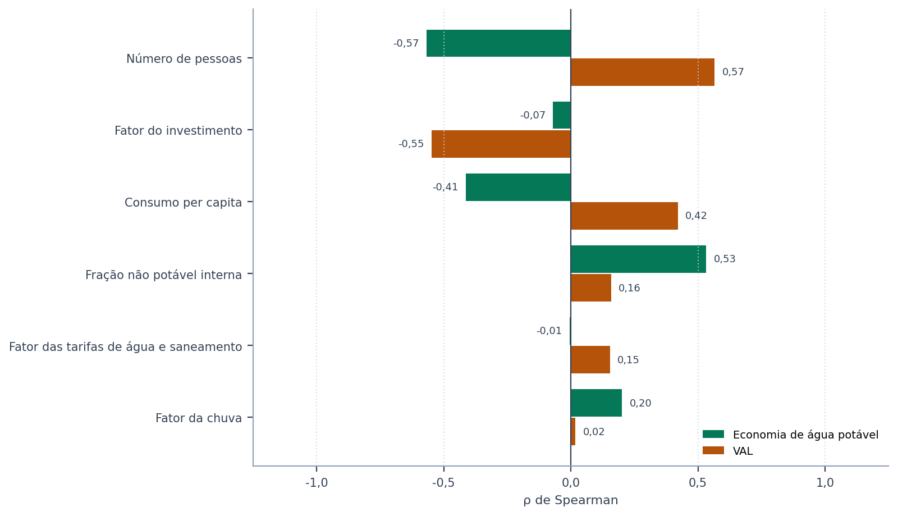
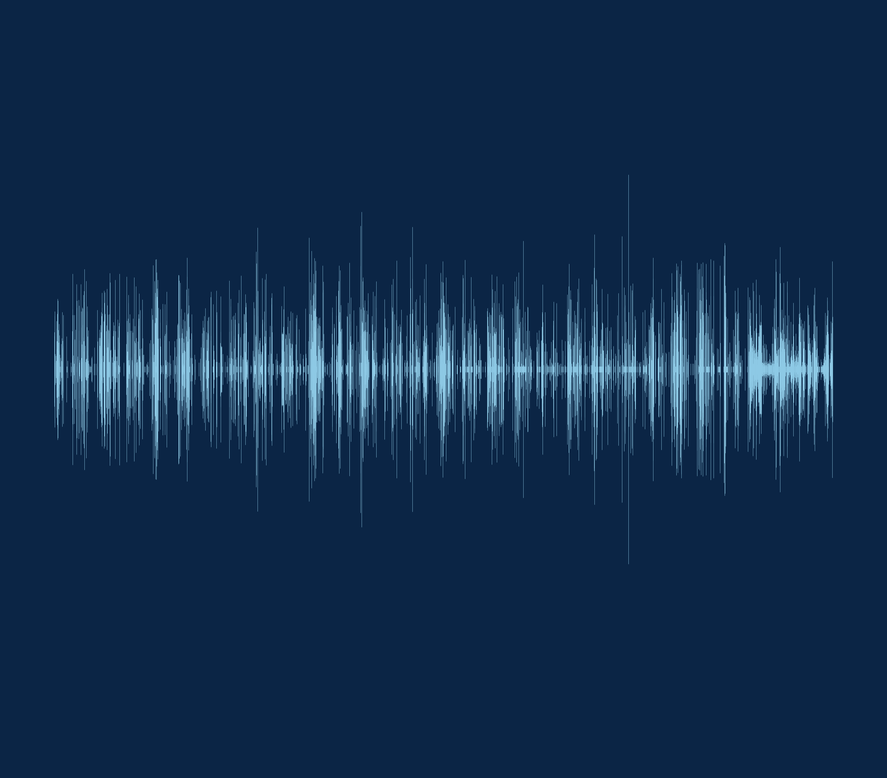
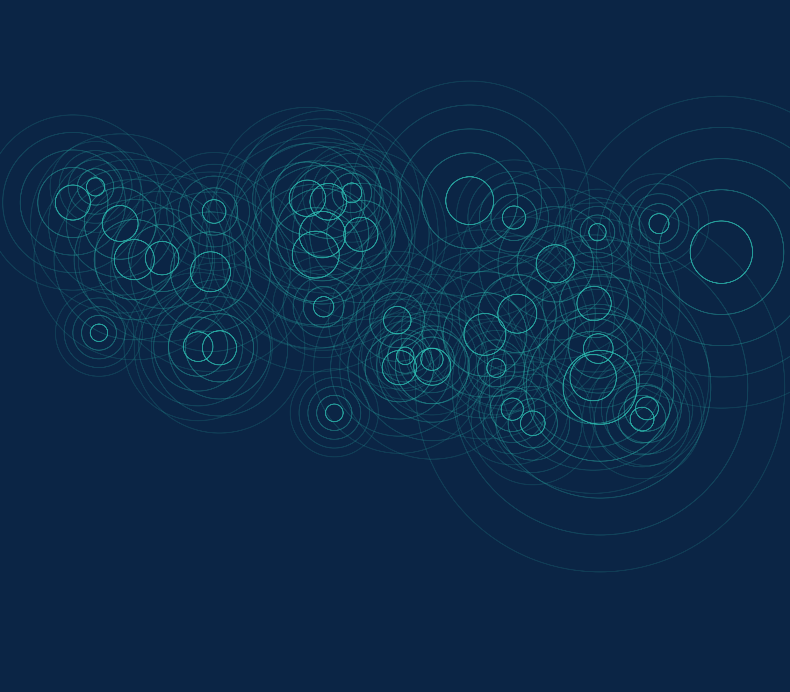
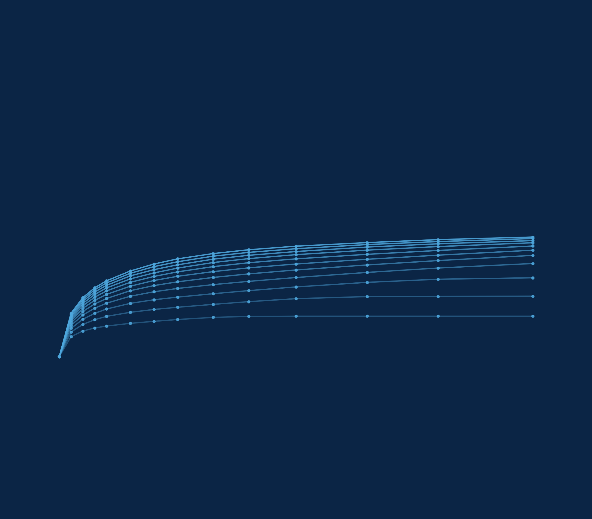
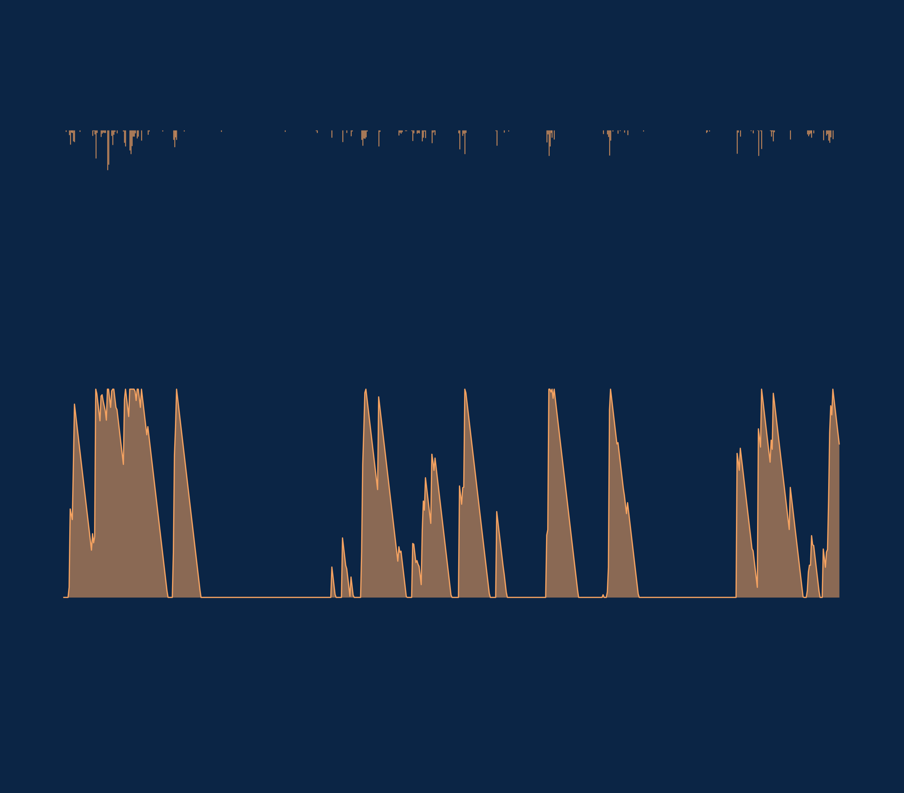
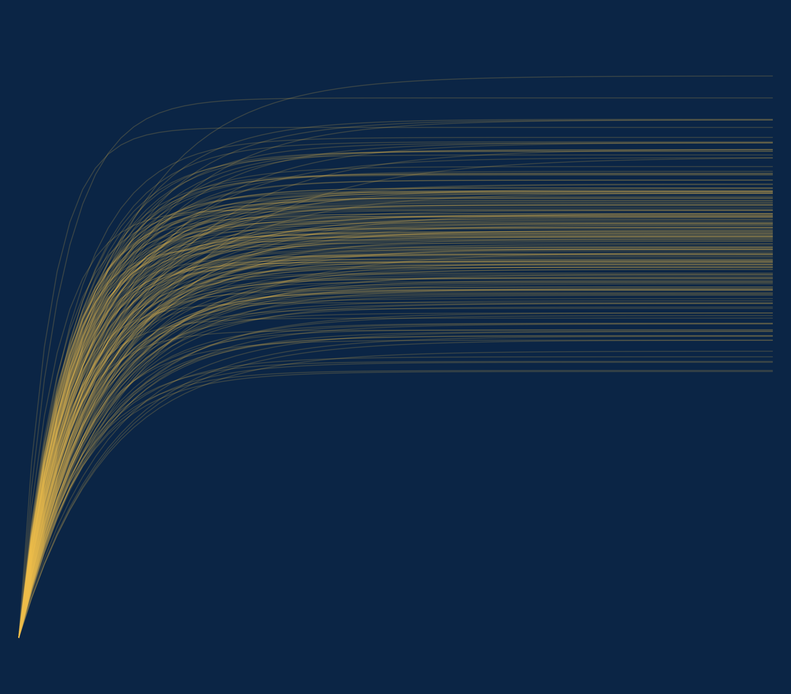

# Triton IBE

## Manual do Utilizador — Modulação probabilística

Igor Catão Martins Vaz e Enedir Ghisi

Grupo de Pesquisa em Ambientes Sustentáveis
Universidade Federal de Santa Catarina

2026

---

### Sobre este volume

Este é um dos oito volumes em que o manual do Triton pode ser distribuído, e
reúne o capítulo 7 (Modulação probabilística) e os apêndices G e H do manual completo. Serve para enviar
apenas a parte que interessa: o método a um revisor, o tutorial a uma turma, os guias
a quem já utiliza o programa.

A numeração das secções e das equações é a mesma do manual completo, de modo que
uma remissão vale nos dois. Quando o texto remete para uma secção que está noutro
volume, o nome do volume vem entre parênteses.

| Volume | Conteúdo |
| :--- | :--- |
| Comece aqui | o capítulo 1 (Comece aqui) e o apêndice G |
| O método | o capítulo 2 (O método) e os apêndices A, B, C, E, G e H |
| Guias de uso | o capítulo 3 (Guias disponíveis no programa) e os apêndices D, F e G |
| Tutorial | o capítulo 4 (Tutorial: um exemplo do começo ao fim) e os apêndices G, I e J |
| Enganos, limitações e confiabilidade | o capítulo 5 (Enganos, limitações e confiabilidade) e os apêndices G e H |
| Correções, bugs e versionamento | o capítulo 6 (Correções, bugs e versionamento) |
| **Modulação probabilística** | o capítulo 7 (Modulação probabilística) e os apêndices G e H |
| Apêndices | os apêndices |

### Como citar

> VAZ, Igor Catão Martins; GHISI, Enedir. **Triton: manual do utilizador**.
> Modulação probabilística. Versão 0.2.0. Universidade Federal de Santa
> Catarina, 2026.

---

## Índice

**7 Modulação probabilística**

7.1 O que é a modulação probabilística

7.2 As variáveis e as distribuições

7.3 Como rodar

7.4 Como ler os resultados

7.5 Método, estatística e limites


**Apêndices**

Apêndice G — Glossário

Apêndice H — Referências


## Lista de figuras

Figura 1 — Poupança de água potável por volume do reservatório inferior no exemplo do tutorial: gama entre os percentis 5 e 95 das realizações, mediana e estudo determinístico

Figura 2 — Valor atual líquido por volume do reservatório inferior no mesmo exemplo (custos ilustrativos, não são preços de mercado). Uma gama que atravessa o zero em todos os volumes indica que nenhum deles se paga com certeza; uma mediana abaixo do estudo determinístico, que o caso-base é otimista

Figura 3 — Frequência, em percentagem das realizações, com que cada volume é o ideal técnico, o ótimo económico e o vencedor do TOPSIS no exemplo do tutorial

Figura 4 — Correlação de postos de Spearman de cada variável sorteada com a poupança de água potável e com o valor atual líquido no volume escolhido pelo estudo do tutorial, da maior para a menor influência no valor atual líquido

---

## Lista de tabelas

Tabela 1 — As variáveis que a modulação probabilística pode sortear, com a distribuição de triagem que o ecrã propõe

Tabela 2 — O que cada variável económica e ambiental faz no cálculo, e o que não toca

Tabela 3 — As quatro distribuições que a ferramenta oferece, os seus parâmetros e quando usar cada uma

Tabela 4 — As variáveis sorteadas no exemplo do tutorial: distribuição declarada e estatísticas das realizações

Tabela 5 — Resultados no volume escolhido pelo estudo do tutorial: estudo determinístico e estatísticas das realizações (valores em €, ilustrativos, não são preços de mercado)

Tabela 6 — Probabilidades no volume escolhido, com o intervalo de confiança de 95% de Wilson

Tabela 7 — Frequência com que cada volume é escolhido nas realizações do exemplo, por critério (%)

Tabela 8 — Sensibilidade no volume escolhido: força e sentido da influência de cada variável sorteada sobre os resultados do tutorial

Tabela 9 — Parte da variância do resultado explicada por cada variável sorteada no exemplo do tutorial, no volume escolhido (η²; as variáveis contínuas agrupadas em decis)

Tabela 10 — Padronização terminológica de água de chuva e água pluvial

Tabela 11 — Grandezas fundamentais do balanço hídrico e relações entre fração e potencial

---


---
# 7. Modulação probabilística

---

## 7.1. O que é a modulação probabilística

> **Pergunta a que este capítulo responde:** o volume que o estudo escolheu continua a ser uma boa
> escolha quando as premissas não são exatamente as que declarei?

O estudo do Triton responde com um número por volume. Esse número vale para as premissas
declaradas: um consumo per capita, um número de pessoas, uma fração não potável, uma área de
captação, uma tarifa, uma taxa de atualização. Nenhuma delas é conhecida com exatidão na fase de
projeto. O consumo per capita de uma casa que ainda não existe é estimado; a ocupação muda ao longo
da vida útil; a chuva dos próximos vinte anos não repete a dos últimos trinta; os tarifários são
revistos.

A ferramenta **13. Modulação Probabilística** mede quanto dessas incertezas chega ao resultado.
Refaz o estudo pronto muitas vezes — mil, por omissão —, de cada vez com as premissas escolhidas
sorteadas a partir de distribuições declaradas pelo utilizador, e devolve a **distribuição** do
resultado em vez de um valor único: gamas de poupança e de valor atual líquido por volume, a
probabilidade de o investimento se pagar e a frequência com que cada volume seria o escolhido.

==O estudo determinístico não muda.== As etapas 5 a 9, os relatórios e a linha de comandos
continuam com ele. A modulação é uma camada de robustez por cima do estudo: não escolhe outro
volume, diz até que ponto a escolha resiste.

---

### 7.1.1. Quando usar

A modulação responde a três perguntas a que o estudo determinístico não responde:

1. **Quão largo é o resultado?** Com que margem vale a poupança do estudo? A gama entre os
   percentis 5 e 95 das realizações é o número que deve acompanhar o resultado publicado.
2. **Com que probabilidade se paga o investimento?** Um valor atual líquido positivo no caso-base
   pode esconder uma probabilidade considerável de prejuízo; a modulação dá essa probabilidade e o
   respetivo intervalo de confiança. No tutorial de Lisboa, com os custos ilustrativos (não são
   preços de mercado) e a tarifa de Lisboa, o valor atual líquido do caso-base já é negativo, e a
   pergunta passa a ser outra: haverá alguma gama de premissas plausível em que o sistema se pague?
3. **A decisão de projeto é estável?** Se o volume escolhido vence numa minoria das realizações,
   ao lado de vizinhos com frequências parecidas, a escolha é frágil e o texto tem de o dizer.

No exemplo do tutorial, na secção 7.4, mostra-se como se leem as três respostas.

É a continuação natural da análise de sensibilidade da secção 3.7 (volume Guias de uso). A sensibilidade varia uma
premissa de cada vez; a modulação varia em simultâneo todas as escolhidas, com pesos que vêm das
distribuições, e permite ver combinações que um gráfico de tornado não mostra.

### 7.1.2. O que ela não faz

A modulação não substitui um dado medido. Uma distribuição larga em torno de um valor errado
continua centrada no valor errado: quando houver medição de consumo, ela vale mais do que qualquer
sorteio. As distribuições iniciais que o ecrã propõe são **de triagem** — centradas no projeto,
com larguras genéricas — e têm de ser ajustadas ao que se sabe do edifício. A secção 7.5
discute os limites do método.

---

## 7.2. As variáveis e as distribuições

> **Pergunta a que esta secção responde:** o que posso sortear, e como descrevo a incerteza de cada
> premissa?

### 7.2.1. O catálogo de variáveis

A ferramenta sorteia vinte premissas, organizadas em sete grupos. Ao abrir, só as três de consumo
vêm marcadas — o consumo per capita, o número de pessoas e a fração não potável —, porque são as
mais incertas num projeto novo e as que a literatura mostra moverem o resultado (Silva e Ghisi,
2016). As restantes ficam com o valor do estudo até o utilizador as marcar.

<!-- tabela: **Tabela 1** — As variáveis que a modulação probabilística pode sortear, com a distribuição de triagem que o ecrã propõe -->
| Grupo | Variável | Unidade | Distribuição de triagem | Marcada ao abrir |
| :--- | :--- | :--- | :--- | :--- |
| Procura | Consumo per capita | L/hab.dia | lognormal, média do projeto, CV de 20% | sim |
| Procura | Número de pessoas | pessoas | normal, média do projeto, desvio de 1 pessoa; inteiro de 1 ao dobro | sim |
| Procura | Fração não potável interior | % | normal, média do projeto, desvio de 5 pontos; 0 a 100% | sim |
| Procura | Procura exterior | L/dia | normal, média do projeto, CV de 30% | não |
| Captação | Área de captação | m² | normal, média do projeto, CV de 5% | não |
| Captação | Coeficiente de escoamento | — | triangular, do projeto −0,10 ao projeto +0,05; 0 a 1 | não |
| Captação | Lâmina de descarte | mm | uniforme, do projeto −1 mm ao projeto +1 mm | não |
| Chuva | Fator da chuva | × | normal, média 1, desvio de 0,10 | não |
| Tarifas | Fator das tarifas de água e saneamento | × | normal, média 1, desvio de 0,10 | não |
| Tarifas | Fator do saneamento | × | normal, média 1, desvio de 0,10 | não |
| Tarifas | Atualização tarifária | % por período | normal, média do projeto, desvio de 2 pontos | não |
| Tarifas | Tarifa de energia | €/kWh | normal, média do projeto, CV de 10% | não |
| Tarifas | Atualização da energia | % por período | normal, média do projeto, desvio de 2 pontos | não |
| Custos | Fator do investimento | × | lognormal, média 1, desvio de 0,15 | não |
| Custos | Fator do preço da cisterna | × | lognormal, média 1, desvio de 0,15 | não |
| Custos | Fator do custo de exploração (O&M) | × | lognormal, média 1, desvio de 0,25 | não |
| Custos | Inflação do custo de exploração | % por mês | normal, média do projeto, desvio de 0,10 ponto | não |
| Fluxo de caixa | Taxa de atualização | % por mês | normal, média do projeto, desvio de 0,25 ponto | não |
| Fluxo de caixa | Período de análise | anos | triangular, do projeto −5 ao projeto +5 anos; inteiro, pelo menos 1 | não |
| Ambiente | Fator da emissão da água potável | × | normal, média 1, desvio de 0,20 | não |
| Ambiente | Fator da emissão da rede elétrica | × | normal, média 1, desvio de 0,20 | não |

Cada grupo atua num ponto diferente da cadeia de cálculo:

- **Procura** muda o consumo diário e a fração que a água da chuva pode satisfazer. A fração
  satisfazível total é recalculada a cada sorteio a partir da fração interior e da procura
  exterior, pela mesma regra do estudo (secção 4.2 (volume Tutorial)). Nos modos semanal, mensal e diário, as
  séries recebem o fator sorteado: o perfil do calendário mantém-se, e o nível muda.
- **Captação** muda o volume de chuva que chega à cisterna: área, coeficiente de escoamento e
  lâmina de descarte.
- **Chuva** multiplica toda a série diária por um fator. É a forma mais simples de representar uma
  chuva futura mais seca ou mais húmida do que a histórica.
- **Tarifas** muda o preço da água, do saneamento e da energia e as respetivas atualizações.
- **Custos** muda o investimento inicial e o custo anual de exploração e manutenção.
- **Fluxo de caixa** muda a taxa de atualização e o horizonte da análise.
- **Ambiente** muda os fatores de emissão da avaliação de ciclo de vida.

### 7.2.2. O que cada variável económica multiplica ou substitui

As variáveis económicas são de dois tipos. As que têm unidade própria — atualizações, taxa,
inflação, tarifa de energia, período — **substituem** o valor do projeto pelo sorteado. Os
**fatores** (×) multiplicam um valor do projeto e valem 1 no estudo: um fator sorteado de 1,15
representa um custo 15% acima do orçamentado. A tabela diz sobre o que atua cada um e o que deixa
de fora.

<!-- tabela: **Tabela 2** — O que cada variável económica e ambiental faz no cálculo, e o que não toca -->
| Variável | Atua sobre | Não toca |
| :--- | :--- | :--- |
| Fator das tarifas de água e saneamento | todos os valores monetários da estrutura da água — escalões, parcela fixa, fatura mínima, preço-base da curva exponencial — e o saneamento cobrado em euros (fixo ou por m³) | o expoente da curva exponencial; o saneamento em % da água, que já acompanha a água |
| Fator do saneamento | a tarifa de saneamento, no modo declarado no projeto: a percentagem, o valor fixo ou o preço por m³ | a tarifa da água |
| Atualização tarifária | a atualização da água e do saneamento em cada período de atualização, no lugar da declarada | a atualização da energia |
| Tarifa de energia | o preço do kWh da bombagem, no lugar do declarado | — |
| Atualização da energia | a atualização da tarifa de energia em cada período | — |
| Fator do investimento | o investimento inicial **inteiro** de cada volume: cisterna, reservatório superior, eletrobomba, tubagem, acessórios, mão de obra e linha de tratamento | o custo anual de exploração |
| Fator do preço da cisterna | só o preço da cisterna de cada volume, a parte do investimento que cresce com o volume; com a mão de obra automática, esta acompanha-o, pela regra do programa | os restantes itens do investimento |
| Fator do custo de exploração (O&M) | o custo anual de exploração e manutenção: os itens declarados na etapa económica, o custo de exploração da linha de tratamento e o cloro | a energia da bombagem, que tem variáveis próprias |
| Inflação do custo de exploração | a atualização anual do custo de exploração, no lugar da declarada | as tarifas |
| Taxa de atualização | a taxa de desconto do fluxo de caixa | — |
| Período de análise | o horizonte do fluxo de caixa e da avaliação ambiental, em anos inteiros | a série de chuva, que continua a ser a do estudo |
| Fator da emissão da água potável | a emissão por m³ da água da rede que a cisterna evita | o carbono incorporado dos materiais |
| Fator da emissão da rede elétrica | o fator de emissão da energia da bombagem | o carbono incorporado dos materiais |

Os dois fatores de investimento combinam-se. Marcados em conjunto, a cisterna recebe o produto dos
dois, e o resto do investimento só o fator do investimento. Na prática, o fator do investimento
representa a incerteza do orçamento como um todo — região, época, imprevistos —, e o fator da
cisterna a do item que define o ótimo: como o preço da cisterna é a parte do custo que cresce com
o volume, é ele que desloca o volume de menor período de recuperação.

### 7.2.3. A incerteza da chuva

A Edição Ibérica não tem base de séries de modelos climáticos, pelo que a incerteza da chuva
entra pelo **fator da chuva**. O fator multiplica toda a série diária do projeto — a série do Iberia01
do município, a ERA5 de uma ilha ou um ficheiro do utilizador — e por isso mantém a sua estrutura
temporal: a sequência de estiagens e de dias chuvosos não muda, só o nível. Um fator sorteado com
média 1 e desvio de 0,10 representa uma chuva 10% mais húmida ou mais seca do que o registo, que
é a maneira de representar um clima futuro mais seco ou mais húmido do que o passado. Para testar
uma sequência diferente de estiagens, execute o estudo uma vez com cada série alternativa e
compare.

### 7.2.4. As quatro distribuições

Cada variável marcada recebe uma distribuição e os respetivos parâmetros:

<!-- tabela: **Tabela 3** — As quatro distribuições que a ferramenta oferece, os seus parâmetros e quando usar cada uma -->
| Distribuição | Parâmetros | Quando usar |
| :--- | :--- | :--- |
| normal | média e desvio-padrão | incerteza simétrica em torno de um valor provável |
| lognormal | média e desvio-padrão | grandeza positiva com cauda para cima, como o consumo e o preço da obra |
| triangular | mínimo, moda e máximo | quando se conhecem o intervalo e o valor mais provável, mas não a forma |
| uniforme | mínimo e máximo | quando só se conhece o intervalo |

Na lognormal, a média e o desvio introduzidos são os da própria variável, e não os do seu
logaritmo: o programa calcula os parâmetros da lognormal que devolvem exatamente a média e o
desvio pedidos. Qualquer distribuição pode ser **truncada** por um limite inferior e um superior;
o valor sorteado fora deles é sorteado de novo. O número de pessoas e o período de análise são
arredondados para inteiro e nunca ficam abaixo de 1; a fração não potável e o coeficiente de
escoamento ficam entre 0 e 100% e entre 0 e 1; fatores, preços, áreas e consumos nunca ficam
negativos.

Cada cartão do ecrã mostra a curva da distribuição escolhida, desenhada com 4 000 sorteios, e os
respetivos percentis 5 e 95. É a maneira mais rápida de verificar se a largura declarada é
plausível: um P95 de 400 L/hab.dia para uma habitação indica um desvio exagerado.

### 7.2.5. O nível, e não o ruído do dia

As variáveis são sorteadas **uma vez por realização**: em cada realização, a casa tem um consumo
per capita, uma ocupação e uma fração, válidos para toda a série de chuva. Isto representa a
incerteza sobre **quanto** o edifício consome, que é a que importa. A variação de um dia para o
outro em torno desse nível, opcional (campo «Variação diária»), quase não move o resultado:
sorteada de forma independente a cada dia, anula-se ao longo de trinta anos de série (Silva e
Ghisi, 2016; secção 3.6 (volume Guias de uso), subcomando `stochastic-demand`).

---

## 7.3. Como executar

> **Pergunta a que esta secção responde:** quais são os passos, no ecrã e na linha de comandos?

### 7.3.1. Na interface

A ferramenta fica no fim da barra lateral, em **13. Modulação Probabilística**. Parte do estudo que
as etapas 1 a 4 descrevem — a mesma configuração que o programa grava no ficheiro `.triton` —,
com os pesos do TOPSIS e as premissas ambientais do ecrã. Sem série de chuva carregada, a
ferramenta avisa e não executa. Para começar, abra o caso `09_modulacao_tutorial.triton` ou o
`10_modulacao_captacao.triton` (apêndice J): ambos são estudos de Lisboa que chegam com a
ferramenta montada, e basta carregar em **Simular**.

As distribuições partem da triagem do estudo aberto. Ao abrir outro projeto, ou ao mudar uma
premissa nas etapas 1 a 4, os cartões que não foram editados acompanham o novo valor; os editados
ficam como estão. Num estudo de volume fixo, a ferramenta mostra só o volume do estudo: as figuras
e a tabela por volume pedem a varredura da etapa 4.

O ecrã tem quatro blocos, de cima para baixo:

1. **O que variar.** As vinte variáveis, em sete grupos, com caixas de seleção. Passar o cursor
   sobre uma delas mostra o que representa. A secção 7.2 descreve cada grupo.
2. **Distribuições.** Um cartão por variável marcada, com o valor do estudo, a distribuição, os
   parâmetros, os limites e a curva. O botão **Valores de triagem** devolve todas as distribuições
   ao padrão centrado no projeto.
3. **Execução.** O número de realizações (1 000 por omissão), a semente (42) e a variação diária
   opcional. **Simular** executa em segundo plano, com barra de progresso, tempo restante e botão
   **Cancelar**; se for cancelada, a análise mostra as realizações já feitas.
4. **Resultados.** Tabelas e figuras numeradas, explicadas na secção 7.4.

A disposição reorganiza-se com a largura da janela — três, duas ou uma coluna —, e não há
deslocamento lateral. As distribuições, o número de realizações e a semente são gravados no
projeto e regressam ao reabri-lo; os resultados não, porque se refazem iguais com a mesma semente.

O tempo cresce com o número de realizações, de volumes e de anos de chuva. Cada realização refaz a
cadeia técnica, económica, ambiental e TOPSIS para todos os volumes; a aceitabilidade SMAA-VIKOR
(secção 2.10 (volume O método)), que sorteia vinte mil vetores de pesos, fica de fora das realizações, porque a
modulação só usa o vencedor do TOPSIS. No tutorial, com 21 volumes e trinta anos de chuva, a barra
de progresso estima o tempo restante a partir das primeiras realizações. O botão **Exportar
(CSV + JSON)** grava as amostras, uma linha por realização, e o resumo completo, com a semente e as
distribuições.

### 7.3.2. Na linha de comandos

O comando `probabilistic-study` usa o mesmo núcleo do ecrã e dá os mesmos números com o mesmo
projeto e a mesma semente:

```
triton probabilistic-study 04_tutorial_varredura.triton --samples 1000 --seed 42
triton probabilistic-study 04_tutorial_varredura.triton --list-variables
triton probabilistic-study projeto.triton --var fator_chuva=normal:1:0.1 --var fator_investimento=lognormal:1:0.15
triton probabilistic-study projeto.triton --var fator_cisterna=lognormal:1:0.15 --var fator_om=lognormal:1:0.25

triton probabilistic-study projeto.triton --format json --output modulacao.json
```

Sem opções de distribuição, o comando lê as que o ecrã gravou no projeto ou, na falta delas, os
valores de triagem. `--var VARIÁVEL=DISTRIBUIÇÃO` liga qualquer variável do catálogo e pode ser
repetida; as distribuições escrevem-se `normal:média:desvio`, `lognormal:média:desvio`,
`triangular:mínimo:moda:máximo`, `uniforme:mínimo:máximo` ou `fixo`. Os atalhos `--per-capita`,
`--people` e `--non-potable` valem para as três variáveis de consumo, e `--daily-cv` para a
variação diária. `--list-variables` lista as variáveis do catálogo. O formato `csv` grava as
amostras; o `json`, o resultado inteiro. O nome antigo do comando, `stochastic-study`, continua a
ser aceite.

---

## 7.4. Como ler os resultados

> **Pergunta a que esta secção responde:** o que diz cada tabela e cada figura, e o que declarar num
> relatório ou num artigo?

O exemplo desta secção é o projeto do tutorial de Lisboa, gravado com a ferramenta já montada no
ficheiro `09_modulacao_tutorial.triton` (apêndice J), com seis variáveis sorteadas: as três de
consumo, o fator da chuva, o fator das tarifas e o fator do investimento, com as distribuições de
triagem, em mil realizações e semente 42. Os números das tabelas são os que o programa calcula;
executar a ferramenta com o mesmo projeto e a mesma semente reproduz-os. Os custos do projeto são
ilustrativos, não são preços de mercado.

### 7.4.1. O que entrou

A primeira tabela do ecrã diz o que foi de facto sorteado: o valor do estudo, a distribuição
declarada e as estatísticas da amostra. É a primeira a ler, porque confirma que as distribuições
produziram o que se pretendia — a média da amostra deve ficar perto da média declarada, e o
intervalo entre P5 e P95 deve ser plausível para o edifício.

<!-- tabela: **Tabela 4** — As variáveis sorteadas no exemplo do tutorial: distribuição declarada e estatísticas das realizações -->
| Variável | No estudo | Distribuição | Média | Desvio-padrão | P5 | P95 |
| :--- | ---: | :--- | ---: | ---: | ---: | ---: |
| Consumo per capita (L/hab.dia) | 150,0 | lognormal (150,0; 30,0) | 149,1 | 29,4 | 105,3 | 202,6 |
| Número de pessoas (pessoas) | 4 | normal (4; 1) | 3,9 | 1,0 | 2 | 6 |
| Fração não potável interior (%) | 28,0 | normal (28,0; 5,0) | 28,2 | 5,1 | 19,3 | 36,3 |
| Fator da chuva (×) | 1,00 | normal (1,00; 0,10) | 1,00 | 0,10 | 0,84 | 1,16 |
| Fator das tarifas de água e saneamento (×) | 1,00 | normal (1,00; 0,10) | 1,00 | 0,10 | 0,83 | 1,16 |
| Fator do investimento (×) | 1,00 | lognormal (1,00; 0,15) | 1,01 | 0,15 | 0,77 | 1,27 |

### 7.4.2. O resultado no volume escolhido

A segunda tabela resume o volume que o estudo escolheu — o vencedor do TOPSIS do caso-base —,
comparando o estudo determinístico com a média, o desvio-padrão, o coeficiente de variação e os
percentis das realizações.

<!-- tabela: **Tabela 5** — Resultados no volume escolhido pelo estudo do tutorial: estudo determinístico e estatísticas das realizações (valores em €, ilustrativos, não são preços de mercado) -->
| Grandeza | Estudo determinístico | Média | Desvio-padrão | CV (%) | P5 | P50 | P95 |
| :--- | ---: | ---: | ---: | ---: | ---: | ---: | ---: |
| Poupança de água potável (%) | 13,9 | 14,5 | 3,0 | 20,5 | 10,1 | 14,1 | 19,7 |
| VAL (€, ilustrativo, não é preço de mercado) | −5 648 | −5 986 | 1 133 | 18,9 | −7 932 | −5 947 | −4 178 |
| Período de recuperação descontado (anos) | — | — | — | — | — | — | — |
| Saldo de CO₂ no ciclo de vida (kg) | −198 | −198 | 0 | 0,2 | −199 | −198 | −197 |

Duas leituras importam. A primeira é a **largura**: o intervalo entre P5 e P95 contém 90% das
realizações e é o número que deve acompanhar o resultado publicado. A segunda é a **posição do
estudo determinístico** em relação à mediana. Quando a mediana fica abaixo do caso-base, as
não linearidades do sistema — a tarifa por escalões, a parte fixa da fatura, a cisterna que
transborda — fazem as realizações desfavoráveis pesar mais do que as favoráveis, e o caso-base é
otimista.

O período de recuperação descontado só existe quando o investimento se paga; a tabela calcula-o
sobre as realizações em que isso acontece, e o ecrã diz quantas foram. Com a tarifa de Lisboa e os
custos ilustrativos do tutorial, o caso-base não recupera o investimento (secção 4.7 (volume Tutorial)), e o
que a tabela de probabilidades acrescenta é a medida de quão perto, ou quão longe, as premissas
sorteadas levam esse resultado de uma recuperação.

<!-- tabela: **Tabela 6** — Probabilidades no volume escolhido, com o intervalo de confiança de 95% de Wilson -->
| Evento | Probabilidade (%) | IC 95%, limite inferior (%) | IC 95%, limite superior (%) |
| :--- | ---: | ---: | ---: |
| o investimento recupera-se (VAL > 0) | 0,0 | 0,0 | 0,4 |
| o saldo de CO₂ no ciclo de vida é positivo | 0,0 | 0,0 | 0,4 |

A probabilidade de o investimento se pagar é a proporção de realizações com valor atual líquido
positivo. O intervalo de confiança de 95% ao lado é o de Wilson (1927), adequado a amostras
pequenas e a proporções perto de 0% ou de 100%. Mede a incerteza do **sorteio**, e não a das
premissas: com mais realizações estreita-se; a probabilidade em si, não.

### 7.4.3. As gamas por volume

As figuras seguintes mostram a gama entre os percentis 5 e 95, a mediana e o estudo determinístico
ao longo de todos os volumes. A linha a tracejado marca o volume escolhido, e os valores escritos
são os dele (Figura 1 e Figura 2).



*Figura 1 — Poupança de água potável por volume do reservatório inferior no exemplo do tutorial: gama entre os percentis 5 e 95 das realizações, mediana e estudo determinístico. Os valores marcados são os do volume escolhido pelo estudo (linha a tracejado).*



*Figura 2 — Valor atual líquido por volume do reservatório inferior no mesmo exemplo (custos ilustrativos, não são preços de mercado). Uma gama que atravessa o zero em todos os volumes indica que nenhum deles se paga com certeza; uma mediana abaixo do estudo determinístico, que o caso-base é otimista.*

### 7.4.4. A estabilidade da escolha

A tabela e a figura de frequência contam, em cada realização, qual volume seria o ideal técnico,
qual seria o ótimo económico — o de menor período de recuperação descontado, critério do programa
(secção 4.9 (volume Tutorial)) — e qual venceria o TOPSIS (Figura 3). Uma realização
em que nenhum volume se paga aparece como «nenhum se paga» na coluna económica.

<!-- tabela: **Tabela 7** — Frequência com que cada volume é escolhido nas realizações do exemplo, por critério (%) -->
| Volume (m³) | Ideal técnico | Ótimo económico (recuperação) | Vencedor TOPSIS |
| :--- | ---: | ---: | ---: |
| 1 | 0 | 0 | 50 |
| 2 | 0 | 0 | 47 |
| 3 | 1 | 0 | 3 |
| 4 | 19 | 0 | 0 |
| 5 | 59 | 0 | 0 |
| 6 | 18 | 0 | 0 |
| 7 | 3 | 0 | 0 |
| 8 | 1 | 0 | 0 |
| 9 | 0 | 0 | 0 |
| 10 | 0 | 0 | 0 |
| 11 | 0 | 0 | 0 |
| 20 | 0 | 0 | 0 |
| nenhum se paga | 0 | 100 | 0 |



*Figura 3 — Frequência, em percentagem das realizações, com que cada volume é o ideal técnico, o ótimo económico e o vencedor do TOPSIS no exemplo do tutorial.*

A leitura é a mesma da aceitabilidade SMAA-VIKOR (secção 2.10 (volume O método)): um volume que vence na maioria
das realizações é uma recomendação robusta; um que vence numa minoria, ao lado de vizinhos com
frequências parecidas, é uma preferência que depende das premissas, e o texto tem de o dizer.

### 7.4.5. O que mais pesa

A sensibilidade (Figura 4) mede-se pela correlação de postos de
Spearman (1904) entre cada variável sorteada e o resultado no volume escolhido. O coeficiente ρ
vai de −1 a 1: o sinal diz o sentido do efeito, e o módulo a sua força. Por usar postos, e não
valores, capta relações monótonas não lineares — como a da tarifa por escalões — e não é
distorcido por realizações extremas.

<!-- tabela: **Tabela 8** — Sensibilidade no volume escolhido: força e sentido da influência de cada variável sorteada sobre os resultados do tutorial -->
| Variável | ρ com a poupança | ρ com o VAL | ρ com o saldo de CO₂ |
| :--- | ---: | ---: | ---: |
| Fator do investimento | −0,07 | −0,74 | −0,05 |
| Número de pessoas | −0,68 | 0,41 | −0,68 |
| Consumo per capita | −0,46 | 0,33 | −0,46 |
| Fração não potável interior | 0,43 | 0,14 | −0,48 |
| Fator das tarifas de água e saneamento | −0,01 | 0,12 | −0,04 |
| Fator da chuva | 0,18 | 0,00 | −0,19 |



*Figura 4 — Correlação de postos de Spearman de cada variável sorteada com a poupança de água potável e com o valor atual líquido no volume escolhido pelo estudo do tutorial, da maior para a menor influência no valor atual líquido.*

A correlação de postos pode mostrar um efeito que a análise de uma premissa de cada vez esconde. A
fração não potável define a procura que a água da chuva pode satisfazer, pelo que é a candidata
natural a mover mais a poupança **percentual**. O número de pessoas e o consumo per capita
aumentam o consumo total: tendem a mover pouco a percentagem, e em sentido contrário, mas podem
mover muito o valor atual líquido, porque mais consumo empurra a fatura para os escalões mais
caros de uma tarifa por escalões e cada metro cúbico poupado passa a valer mais. Leia a tabela para
o seu caso, e verifique qual destes efeitos o tarifário que introduziu permite.

### 7.4.6. Quanto da incerteza vem de cada fonte

O ρ diz o sentido e a força de uma relação monótona, mas não diz que parte da incerteza do
resultado vem de cada variável. Essa parte é a razão de correlação, η²: a variância das médias do
resultado entre classes da variável, dividida pela variância total. As variáveis contínuas são
agrupadas em decis, e o número de pessoas pelos seus próprios valores. O η² estima o índice de
sensibilidade de primeira ordem (Saltelli et al., 2008), vai de 0 a 1 e capta também relações não
monótonas.

<!-- tabela: **Tabela 9** — Parte da variância do resultado explicada por cada variável sorteada no exemplo do tutorial, no volume escolhido (η²; as variáveis contínuas agrupadas em decis) -->
| Fonte de incerteza | η² da poupança | η² do VAL | η² do saldo de CO₂ |
| :--- | ---: | ---: | ---: |
| Fator do investimento | 0,01 | 0,57 | 0,01 |
| Número de pessoas | 0,50 | 0,16 | 0,51 |
| Consumo per capita | 0,22 | 0,12 | 0,23 |
| Fração não potável interior | 0,21 | 0,03 | 0,22 |
| Fator das tarifas de água e saneamento | 0,01 | 0,02 | 0,01 |
| Fator da chuva | 0,04 | 0,00 | 0,04 |
| Soma | 0,99 | 0,91 | 1,02 |

No exemplo, compare as colunas: as variáveis que dominam a variância da poupança raramente são as
que dominam a variância do valor atual líquido, e os fatores sorteados com larguras de triagem
estreitas, como os das tarifas, do investimento e da chuva, costumam pesar pouco. Com variáveis
independentes e efeitos aditivos, a soma fica perto de 1; uma soma bem abaixo de 1 indica
interação entre as variáveis. A estimativa por classes tem um pequeno viés para cima, da ordem do
número de classes dividido pelo número de realizações, e por isso a soma pode exceder ligeiramente
1.

### 7.4.7. A captação e a chuva

O segundo exemplo, gravado no ficheiro `10_modulacao_captacao.triton`, usa a mesma varredura de
Lisboa mas sorteia a incerteza da **captação** — área, coeficiente de escoamento e lâmina de
descarte — em conjunto com o fator da chuva, o fator das tarifas e o fator do investimento, em mil
realizações e semente 42. A Edição Ibérica não tem tabela por modelo climático, porque não tem
base de modelos climáticos: a incerteza da chuva entra pelo fator da chuva sobre a série do Iberia01 de
Lisboa, e a tabela da variância lista as variáveis sorteadas, entre elas o fator da chuva.

Leia este exemplo pelo que separa. Um coeficiente de escoamento ou uma área errados em alguns por
cento alteram todos os dias da série na mesma proporção, pelo que estas variáveis deslocam a
poupança aproximadamente ao ritmo do fator da chuva; um descarte mais profundo atua sobretudo nas
chuvas pequenas, que são os dias que enchem um reservatório vazio. A tabela de η² mostra a quais
delas a poupança e o valor atual líquido respondem de facto.

### 7.4.8. O que declarar

Num relatório ou num artigo, declare: as variáveis sorteadas e as suas distribuições (a primeira
tabela), o número de realizações e a semente, a gama P5–P95 e a mediana do resultado no volume
escolhido, a probabilidade de o investimento se pagar com o respetivo intervalo, a frequência com
que o volume escolhido vence e a parte da variância que cada fonte explica. O botão **Exportar**
grava tudo isto em JSON, e o CSV das amostras permite refazer qualquer estatística fora do
programa.

---

## 7.5. Método, estatística e limites

> **Pergunta a que esta secção responde:** como calcula a modulação, e até onde se pode confiar
> nela?

### 7.5.1. O procedimento

A modulação é uma simulação de Monte Carlo sobre a cadeia completa do programa. Para N realizações
com a semente s:

1. o programa executa o caso-base, com as premissas do estudo;
2. sorteia, de uma só vez, N valores de cada variável marcada, com o gerador pseudoaleatório
   iniciado pela semente;
3. para cada realização, copia o projeto, troca as premissas pelos valores sorteados e refaz a
   cadeia técnica, económica, ambiental e TOPSIS para **todos** os volumes da varredura;
4. reúne as N realizações em estatísticas por volume e no volume escolhido.

A comparação entre volumes é **emparelhada**: numa realização, todos os volumes enfrentam as mesmas
premissas sorteadas, e a diferença entre dois deles é efeito do volume, e não do sorteio. É o que
permite contar com que frequência cada volume vence. A grelha de volumes é a do estudo, e o
programa interrompe a análise se ela mudar entre realizações.

### 7.5.2. As estatísticas

Os percentis são empíricos, calculados sobre as realizações; o desvio-padrão é o amostral, e o
coeficiente de variação a razão entre ele e o módulo da média. As probabilidades vêm com o
intervalo de 95% de Wilson (1927). A sensibilidade é o ρ de Spearman (1904), com os empates no
posto médio. A parte da variância explicada é a razão de correlação η², a variância entre as
médias de classe dividida pela variância total; as classes são os decis da variável sorteada, ou
os seus próprios valores quando ela tem até dez valores distintos, como o número de pessoas. É o
estimador por classes do índice de primeira ordem (Saltelli et al., 2008), calculado com as mesmas
realizações, sem custo adicional.

A convergência acompanha-se pela média acumulada do valor atual líquido no volume escolhido e pelo
respetivo intervalo de 95%, cuja meia largura é igual a 1,96 vezes o desvio-padrão dividido pela
raiz quadrada do número de realizações. A faixa estreita-se com o inverso da raiz de N: quadruplicar
as realizações reduz para metade a incerteza do sorteio. Se a faixa ainda oscilar no fim da curva,
aumente N antes de publicar.

### 7.5.3. Limites

- **As variáveis são independentes.** O programa não impõe correlação entre elas. Em muitos
  projetos isso é razoável; quando duas premissas andam juntas — mais pessoas e mais procura
  exterior, por exemplo —, sortear de forma independente alarga a gama para além do real em
  algumas combinações e estreita-a noutras.
- **A incerteza é a declarada.** A gama de saída nunca é mais fiável do que as distribuições de
  entrada. Os valores de triagem são genéricos; ajuste-os com dados do edifício, de medição ou da
  literatura, e declare a fonte.
- **A chuva varia por fator.** O fator da chuva escala a série inteira e preserva a sua estrutura
  temporal — a sequência de dias secos e chuvosos. Uma alteração dessa estrutura, ou um cenário
  climático diferente, não é sorteada: compare-os executando a modulação uma vez para cada série.
  O efeito do comprimento da série tem estudo próprio (secção 2.2 (volume O método)).
- **O que não está no catálogo fica fixo.** O preço de cada material em separado, os parâmetros da
  eletrobomba, a dose de cloro e as restantes premissas seguem o estudo. A análise de
  sensibilidade da secção 3.7 (volume Guias de uso) cobre as que faltam, uma de cada vez.
- **O η² por classes tem viés.** Com k classes e N realizações, sobrestima a parte explicada em
  cerca de (k − 1)/N — 0,009 com dez classes e mil realizações. Valores desta ordem não distinguem
  uma variável sem efeito.

A modulação probabilística dá a incerteza do resultado a partir da incerteza das premissas; não é
uma validação do modelo, que a secção 5.3 (volume Enganos, limitações e confiabilidade) discute. Para uma introdução ao método e às suas
variantes — amostragem estratificada, índices de sensibilidade baseados na variância —, ver
Saltelli et al. (2008).

---

# Apêndices

---

## Apêndice G — Glossário

Termos técnicos e siglas, em português europeu, com o equivalente em inglês quando ele é usado na
literatura, acompanhados das diretrizes de padronização terminológica do Triton.

---

**AAC** (*aproveitamento de água de chuva*). Emprego da água precipitada sobre coberturas
para usos não potáveis em edifícios; a EN 16941-1 trata os sistemas de utilização de água
da chuva no local. Prefira-se o termo «aproveitamento» a «reutilização», porque a água de chuva captada
na cobertura é um recurso primário, e não um efluente gerado por um uso anterior.

**ACV** (*life cycle assessment*). Avaliação de ciclo de vida. Método que contabiliza os
impactos ambientais de um produto ao longo de toda a sua existência, da extração das
matérias-primas ao descarte. A do programa é de **triagem**, e não um inventário completo
conforme a ISO 14040.

**Água de chuva** (*rainwater*). Precipitação atmosférica recolhida diretamente em
superfícies impermeáveis de cobertura (telhados e lajes impermeabilizadas), antes de atingir
o solo ou as redes públicas. Designa o recurso natural e a fonte hídrica captada; evite-se a
forma coloquial «água da chuva».

**Água não potável** (*non-potable water*). Água que não se destina ao consumo humano direto,
mas cumpre os requisitos de qualidade exigidos para os usos admitidos: descargas de autoclismos e
mictórios, lavagem de veículos, pavimentos e roupa, rega de jardins e torres de arrefecimento.

**Água pluvial** (*stormwater*, *pluvial water*). Água de chuva que escoa superficialmente
por superfícies urbanas ou é conduzida por canalizações e sistemas prediais de drenagem. No Triton,
o termo aplica-se de preferência à infraestrutura predial e aos componentes de engenharia: *sistema
de aproveitamento de água pluvial (SAAP)*, *rede pluvial*, *procura pluvial*, *consumo de água pluvial*
e *extravasamento pluvial*.

**Água potável** (*potable water*, *drinking water*). Água que cumpre integralmente os
requisitos de qualidade da água para consumo humano em vigor no local do projeto, destinada à
ingestão direta, à preparação de alimentos e à higiene pessoal.

**Área de captação** (*catchment area*). Área projetada na **horizontal** da superfície
impermeável da cobertura onde a água é captada. Não é a área inclinada do telhado, nem a área
de contribuição usada para dimensionar caleiras e tubos de queda.

**BD+C** (*Building Design and Construction*). Família de referenciais do LEED
para projeto e construção de edificações novas ou em grande reforma. É a família
tratada neste manual, nas versões 4, 4.1 e 5.

**BIM** (*building information modeling*). Modelagem da informação da construção.
Representação digital da edificação em que cada componente carrega propriedades além da
geometria, o que permite compatibilizar projetos de disciplinas diferentes.

**CAD** (*computer-aided design*). Desenho assistido por computador. O programa exporta o
esquema hidráulico em DXF, formato de intercâmbio aceito pelos programas de CAD.

**CAOP** (*Carta Administrativa Oficial de Portugal*). Carta com os limites administrativos oficiais, publicada pela Direção-Geral do Território. A versão CAOP2025 define os limites dos 308 concelhos usados para calcular a série de chuva de cada concelho.

**CAPEX** (*capital expenditure*). Investimento inicial.

**CDD** (*consecutive dry days*). Maior sequência de dias consecutivos com chuva
abaixo de 1 mm.

**Coeficiente de escoamento** (*runoff coefficient*). Fração da chuva que
efetivamente chega ao reservatório, descontadas perdas por absorção, evaporação e
molhamento inicial da cobertura.

**Comprimento representativo de série de precipitação** (*representative rainfall time series length*, $N_{rep}$).
Menor período contínuo em anos de dados diários de chuva necessário para estabilizar
estatisticamente o dimensionamento e o desempenho do sistema (reproduzindo o volume ideal
e o potencial de economia da série completa sob confiança $\ge 90\%$), segundo a
metodologia de Geraldi e Ghisi (2017, 2018, 2019). O comprimento necessário não é uma
constante geográfica fixa: cresce com a fração atendível e com o nível de procura da edificação.

**E-OBS**. Conjunto europeu de dados meteorológicos diários em grelha, construído a partir de observações de estações (projeto ECA&D, serviço Copernicus de alterações climáticas). A Edição Ibérica usa a versão v33.0e da precipitação diária, em grelha de 0,1°, de 1950 a 2025, e obtém a série de cada concelho pela média das células dentro do seu limite (apêndice E (volume Apêndices)).

**ERA5**. Reanálise global do Centro Europeu de Previsões Meteorológicas de Médio Prazo (ECMWF), produzida pelo serviço Copernicus de alterações climáticas. Combina um modelo atmosférico com observações e dá uma série contínua em grelha. Usa-se no exemplo do Funchal; é uma média de área, e não um registo de udómetro.

**Fiabilidade temporal** ($C_t$). Percentual de dias em que o sistema atendeu
plenamente ($V_{con,t} = D_{pl,t}$), parcialmente ou não atendeu a procura pluvial.

**Fiabilidade volumétrica** ($C_v$). Fração da procura **pluvial** que o sistema atendeu
($C_v = \sum V_{con} / \sum D_{pl} = E_{pot} / f$). Não confundir com o potencial de economia,
que tem no denominador a procura total da edificação.

**CRITIC** (*criteria importance through intercriteria correlation*). Método de pesos objetivos
de Diakoulaki, Mavrotas e Papayannakis (1995): cada critério pesa pelo contraste entre as
alternativas e pela independência em relação aos outros critérios, calculados dos próprios
resultados. No programa, uma opção de ponderação (`--weights critic`), e não o padrão; os pesos
mudam com o conjunto de volumes avaliado e não exprimem a preferência de ninguém.

**CSV** (*comma-separated values*). Formato de ficheiro de texto em que cada linha é um
registo e as colunas são separadas por um caractere, tipicamente vírgula ou ponto e
vírgula. É o formato das séries de precipitação.

**cv**. Cavalo-vapor, unidade de potência equivalente a 0,7355 kW, usada na indicação de
eletrobombas. Uma eletrobomba de meio cv tem 0,37 kW de potência de eixo.

**CWD** (*consecutive wet days*). Maior sequência de dias consecutivos com chuva
igual ou superior a 1 mm.

**IVA**. Imposto sobre o valor acrescentado. Na fatura de água, cada parcela leva a taxa que o respetivo tarifário declara (6% na água de Lisboa e do Porto, 4% no Funchal, este último por confirmar); o programa não fixa nenhuma taxa no código (apêndice D (volume Apêndices)).

**Procura estocástica** (*stochastic water demand*). Modelagem do consumo diário de água como
variável probabilística que varia dia a dia e entre realizações (Silva e Ghisi, 2016),
permitindo avaliar o escalão de incerteza do dimensionamento e dos indicadores de desempenho
sob variabilidade real de uso.

**Procura pluvial** (*pluvial demand*, $D_{pl}$). Parcela da procura diária de água da
edificação que pode ser suprida pelo sistema de aproveitamento ($D_{pl,t} = D_{tot,t} \times f$).
Corresponde aos pontos de consumo não potável interligados à rede pluvial.

**Descarte de primeiras águas** (*first flush*). Lâmina inicial de chuva desviada do
sistema, que arrasta a sujidade depositada na cobertura (o programa parte de 2 mm, que o utilizador
deve ajustar à sua cobertura). No Triton é **subtraída** da chuva do dia.

**Disponibilidade**. Regime tarifário em que um valor fixo **soma** por cima do
consumo medido. Cada metro cúbico economizado desconta.

**DN** (*diâmetro nominal*). Designação comercial do diâmetro de um tubo ou conexão, em
milímetros. Não corresponde exatamente ao diâmetro interno nem ao externo: é um número de
referência do qual decorrem as dimensões reais, tabeladas por norma.

**DXF** (*drawing exchange format*). Formato de intercâmbio de desenhos técnicos, lido
por praticamente todos os programas de CAD.

**EDGE** (*excellence in design for greater efficiencies*). Referencial de certificação
da International Finance Corporation, do Banco Mundial. Mede economia percentagem contra
um caso-base local em três dimensões independentes e exige que cada uma cruze o limiar.

**EN** (*Europäische Norm*, norma europeia). Norma publicada pelo Comitê Europeu de
Normalização. Neste manual, a EN 15978, que define os módulos do ciclo de vida da
edificação, e a EN 15804, que rege as declarações ambientais de produtos de construção.

**EPD** (*Environmental Product Declaration*). Declaração ambiental de produto: documento
verificado por terceiros, conforme a ISO 14025 e, na construção, a EN 15804, que publica
os impactos do ciclo de vida de um produto por unidade declarada. É a fonte preferida para
fatores de emissão de materiais e equipamentos.

**ESG** (*environmental, social and governance*). Conjunto de critérios ambientais,
sociais e de governança usado na avaliação de empresas e de empreendimentos. O programa
alimenta indicadores ambientais desse conjunto.

**ETAP**. Estação de tratamento de água pluvial. No programa, o conjunto de filtro
de entrada, desinfeção e filtro de polimento.

**ETCCDI** (*Expert Team on Climate Change Detection and Indices*). Grupo de trabalho
internacional que padronizou os índices de extremos climáticos, dos quais o programa
calcula oito.

**Eficiência de armazenamento** (*storage efficiency*). Água de chuva entregue por dia
dividida pelo volume da cisterna inferior, em %: a renovação diária do volume construído. Cai
com o volume e trava o sobredimensionamento. Não é a ocupação média da cisterna.

**Extravasamento** (*spillage*, *overflow*). Volume que excede a capacidade do reservatório
e é conduzido pelo extravasor quando ele já está cheio.

**Faixa de escolha** (*choice band*). Os volumes com resultado multicritério semelhante ao do
volume de maior pontuação: aqueles cuja medida, normalizada entre a pior (0) e a melhor (1) dos
volumes avaliados, fica a até a tolerância da melhor (por omissão, 5% da amplitude). Depende da
tolerância e da grade de volumes avaliada; num estudo, relata-se a faixa com a tolerância, e não um
volume só.

**Fração atendível por água pluvial** (*non-potable demand share*, $f$). Percentual da procura
total de água da edificação ($D_{tot}$) passível de suprimento por água de chuva ($f = D_{pl} / D_{tot}$).
Representa o **teto assintótico intransponível** do potencial de economia de água potável
($E_{pot} \le f$): mesmo sob capacidade infinita de armazenamento e precipitação ilimitada,
a economia de potável nunca ultrapassa a fração atendível, pois o restante ($1 - f$) é
reservado aos usos nobres e potáveis. Distingue-se da fiabilidade volumétrica ($C_v = E_{pot} / f$),
que avalia o atendimento da parcela pluvial.

**Franquia no mínimo**. Regime tarifário em que o valor fixo já inclui um volume de
consumo. Economizar **abaixo** da franquia não reduz a fatura.

**Ganho marginal**. Variação do potencial de economia por metro cúbico acrescentado
ao reservatório, em %/m³ ($\Delta E_{pot} / \Delta V$). Critério de escolha do volume ideal.

**GRI** (*Global Reporting Initiative*). Padrão internacional de divulgação corporativa
de desempenho socioambiental. Sua série 303 trata de água e efluentes.

**IBE**. Sigla da Edição Ibérica do programa («Triton IBE», para a Península Ibérica): abre em português europeu, em euros, com a chuva do Iberia01 por município e os tarifários transcritos de Lisboa, Porto e Funchal. A linha de cobertura do programa diz quantos locais há em cada país. Os custos e os fatores de emissão são indicados pelo utilizador.

**IFC**. A sigla designa duas coisas distintas. Em certificação, é a *International
Finance Corporation*, do Banco Mundial, que desenvolve o EDGE. No contexto BIM, é o
*Industry Foundation Classes*, formato aberto de intercâmbio que o programa **não**
exporta: a exportação BIM do programa é um ficheiro JSON de propriedades.

**IPCC** (*Intergovernmental Panel on Climate Change*). Painel intergovernamental que
sintetiza o conhecimento científico sobre mudança do clima e organiza os relatórios de
avaliação a que as projeções climáticas se referem.

**ISO 14040**. Norma internacional que estabelece os princípios e a estrutura da
avaliação de ciclo de vida. Um inventário conforme a ISO 14040 exige rastreabilidade de
cada fluxo e revisão crítica externa, requisitos que uma avaliação de triagem não cumpre.

**JSON** (*JavaScript object notation*). Formato de ficheiro de texto estruturado, legível
por pessoas e por programas. É o formato interno do ficheiro `.triton`.

**LCOW** (*levelized cost of water*). Custo nivelado da água: razão entre o valor presente
dos custos do sistema (o investimento e os custos de exploração: energia, manutenção,
cloro e linha de tratamento) e o volume atualizado de água pluvial entregue ao longo do
horizonte de análise, à mesma taxa, em €/m³. É um dos oito critérios do multicritério. Permite confrontar a viabilidade económica do sistema diretamente
com a tarifa da entidade gestora.

**LEED** (*leadership in energy and environmental design*). Referencial de certificação
ambiental de edificações do *U.S. Green Building Council*, o mais difundido
internacionalmente. Trata eficiência hídrica na categoria *Water Efficiency*: na versão 4,
pelos créditos WEc1 e WEc2; na versão 5, pelo crédito WEc2, *Enhanced Water Efficiency*.

**m.c.a.** Metro de coluna d'água, unidade de pressão equivalente à exercida por uma
coluna de água de um metro de altura, cerca de 9,81 kPa. É a unidade usual em instalações
prediais.

**Micromedição**. Medição individualizada por unidade habitacional em edifício
multifamiliar. Informada ao programa como número de economias.

**Manuais do Triton** (*Triton manual suite*). A documentação do programa, montada
das mesmas fontes em três formatos: o manual completo, oito volumes avulsos, cada um com
uma parte dele, e o sítio Web de documentação. Os volumes servem a quem precisa de uma parte
só, para consultar ou enviar:

1. **Manual completo**: todos os capítulos e apêndices.
   
2. **Volume 1 — Comece aqui**: o que o programa faz, como instalá-lo e por onde entrar
   conforme o seu objetivo.
   
3. **Volume 2 — O método**: as equações, os critérios e as fontes por trás de cada número
   que o programa publica.
   
4. **Volume 3 — Guias de uso**: outras cidades, clima futuro, tarifas, procura variável,
   lote, sensibilidade e exportação.
   
5. **Volume 4 — Tutorial**: um projeto de moradia em Lisboa, do primeiro dado ao
   volume recomendado.
   
6. **Volume 5 — Erros, limitações e fiabilidade**: os erros mais comuns, os limites
   do modelo e como o programa é verificado.
   
7. **Volume 6 — Correções, erros e versões**: o que mudou entre versões, as
   mensagens de erro e como relatar um problema.
   
8. **Volume 7 — Modulação probabilística**: o estudo refeito com premissas sorteadas —
   variáveis, distribuições, leitura dos resultados e limites do método.
   
9. **Volume 8 — Apêndices**: parâmetros, processos, fatores de emissão, tarifas, base
   climática, formatos, glossário e referências.
   

Os PDFs acompanham o programa e abrem pela etapa 9. Documentação.

**Payback de carbono**. Tempo para a economia anual líquida de emissões pagar o
carbono incorporado na fabricação do sistema.

**Payback descontado**. Tempo para o fluxo de caixa descontado acumulado cruzar zero.

**Partes no eixo**. A repartição do peso de um eixo do multicritério pelos seus critérios.
Só a proporção dentro do eixo importa; por omissão, as partes são iguais.

**Peso do sistema**. Massa a seco, carga de água e carga em operação do sistema, em kg e kN,
no subsolo, na cobertura e nas prumadas e rede. Os alertas usam limiares de atenção do
programa, e não de norma.

**PB**. Preço-base, em €/m³, da fórmula exponencial `PB × Cⁿ`, em que `C` é o consumo do mês e
`n` o expoente da tabela exponencial para esse consumo. É um dos seis regimes que o programa reconhece; os
tarifários transcritos para Portugal não o usam.

**PEAD**. Polietileno de alta densidade, material dos reservatórios de plástico mais comuns.
É o código do material no ficheiro de projeto.

**Piso de pagamento**. Regime tarifário em que a fatura **não fica** abaixo de um
valor. Diferente de disponibilidade: o piso limita por baixo, a disponibilidade soma
por cima.

**Potencial de economia de água potável** (*potable water saving potential*, $E_{pot}$).
Fração da procura **total** da edificação suprida por água pluvial ($E_{pot} = \sum V_{con} / \sum D_{tot} \times 100\%$).
É o indicador central do programa, limitado superiormente pela fração atendível ($E_{pot} \le f$).

**pp**. Pontos percentuais. Usado para exprimir a diferença entre dois percentuais: de
35% para 37% vão dois pontos percentuais, e não dois por cento.

**PRCPTOT**. Precipitação total anual em dias úmidos.

**PRFV**. Plástico reforçado com fibra de vidro, material de reservatórios de médio e
grande porte. Aparece no programa sob a designação «fibra».

**PRT**. Nome antigo da Edição Ibérica (IBE), de quando ela se chamava Edição Portugal. Projetos e scripts que ainda usam «PRT» (ou «POR») abrem como IBE.

**PVC**. Policloreto de vinilo, material das tubagens prediais de água fria e das colunas de
desvio do descarte inicial.

**R95p**. Soma da precipitação dos dias acima do percentil 95 dos dias úmidos.

**Rendimento da bomba**. Razão entre a potência hidráulica entregue à água e a
potência mecânica no eixo. Não inclui o motor.

**Rendimento do motor**. Razão entre a potência mecânica no eixo e a potência
elétrica consumida da rede.

**RX1day**, **RX5day**. Maior precipitação em um e em cinco dias consecutivos, no
ano.

**SAAP**. Sistema de aproveitamento de água pluvial. Conjunto integrado de componentes
prediais — área de captação, condutores, descarte inicial (*first flush*), estação de
tratamento (ETAP), cisterna inferior, reservatório superior, eletrobomba ou sobrepressor
e rede de distribuição independente — concebido para recolher, tratar, armazenar e fornecer
água não potável.

**SB**. Serviço básico: a parcela fixa mensal da fatura de água da fórmula exponencial, somada ao
resultado dessa fórmula.

**SDII** (*simple daily intensity index*). Precipitação média dos dias úmidos.

**SI** (*seasonality index*). Índice de sazonalidade de Walsh e Lawler. Zero quando a
chuva é uniforme ao longo do ano.

**SMAA** (*stochastic multicriteria acceptability analysis*). Método que sorteia
pesos — no programa, oito, um por critério, com 25% esperado em cada eixo — e devolve a
probabilidade de cada alternativa vencer.

**SSP** (*shared socioeconomic pathways*). Trajetórias socioeconómicas partilhadas,
que descrevem hipóteses coerentes de desenvolvimento global e as emissões correspondentes.
Combinam-se com os modelos climáticos para produzir projeções.

**TIR**. Taxa interna de retorno. A taxa de desconto que zera o valor presente
líquido.

**taxa de atualização**. Taxa de atualização. A taxa de desconto adotada.

**TOPSIS** (*technique for order of preference by similarity to ideal solution*).
Método de ordenação multicritério de Hwang e Yoon. No programa, ordena os volumes por oito
critérios em quatro eixos: técnico, económico, ambiental e estrutural.

**TRH** (*taxa de recursos hídricos*). Taxa por m³ que acresce à fatura de água e de águas residuais. No tarifário do Porto, a TRH da água é devida à Agência Portuguesa do Ambiente (APA) e leva IVA; no de Lisboa, a TRH do saneamento acresce por m³ recolhido.

**UV**. Radiação ultravioleta, empregada na desinfeção de água por inativação de
microrganismos. Atua apenas no instante da passagem pelo reator e não deixa residual, ao
contrário da cloragem.

**VIKOR**. Método de decisão multicritério proposto por Opricovic, que busca uma solução
de compromisso entre critérios conflitantes. Ver também *SMAA*.

**Volume ideal** (*optimal tank volume*). Menor volume de reservatório da grade de simulação
a partir do qual o ganho marginal de economia de água potável ($\Delta E_{pot} / \Delta V$)
cai abaixo de um limiar declarado (tipicamente $1,0\%/\text{m}^3$ ou $0,5\%/\text{m}^3$).
Evita o superdimensionamento de reservatórios, assegurando a melhor relação custo-benefício.

**VAL**. Valor atual líquido.

**WEM**. Codificação das medidas de eficiência hídrica do EDGE. A WEM14 é o sistema
de aproveitamento de água pluvial.

**XLSX**. Formato de pasta de trabalho do Microsoft Excel, baseado em XML compactado. É um
dos formatos de exportação de folhas de cálculo e de resultados da linha de comando.

**YAS** (*yield after spillage*). Regra de operação em que o extravasamento é
calculado **antes** da retirada da procura e, na forma estrita, a retirada do dia sai
só do volume guardado na véspera. O programa calcula o extravasamento antes, como a
YAS, mas deixa a chuva do dia atender a procura do dia; fica entre a YAS e a YBS
(secção 2.1 (volume O método)).

**YBS** (*yield before spillage*). Regra de operação em que a procura é retirada **antes**
do cálculo do extravasamento. Supõe consumo anterior à chuva do dia e sobrestima o
aproveitamento; o programa não a adota, e o resultado dele fica entre a YAS e a YBS.

---

### G.1. Diretrizes de Padronização e Nomenclatura no Triton

A padronização terminológica é indispensável para assegurar a consistência e o rigor técnico
em artigos científicos, relatórios técnicos, na interface gráfica e na documentação do Triton.
As convenções a seguir detalham a distinção de termos correlatos frequentemente confundidos:

#### G.1.1. 1. Água de Chuva versus Água Pluvial versus «Água da Chuva»

<!-- tabela: **Tabela 10** — Padronização terminológica de água de chuva e água pluvial -->
| Termo | Definição e Contexto de Aplicação | Situação no Triton | Referência |
| :--- | :--- | :--- | :--- |
| **Água de chuva** (*rainwater*) | Precipitação atmosférica recolhida diretamente na cobertura (telhado/laje impermeabilizada), antes de atingir o solo ou as redes públicas. Refere-se à **fonte hídrica** e ao recurso ambiental. | **Canónico e preferencial** para o recurso captado («aproveitamento de água de chuva», «precipitação de água de chuva»). | Prática de redação técnica e científica. |
| **Água pluvial** (*stormwater* / *pluvial water*) | Água de chuva após escoamento superficial urbano ou quando conduzida por canalizações e sistemas prediais de drenagem e armazenamento. Aplica-se à **infraestrutura física** e aos componentes de engenharia. | **Canónico e preferencial** para sistemas, redes e balanço («sistema predial de água pluvial - SAAP», «rede pluvial», «procura pluvial», «extravasamento pluvial»). | Prática de redação técnica e científica. |
| **«Água da chuva»** | Expressão coloquial e informal. | **Desaconselhada**. Não deve ser empregada em publicações, textos normativos, relatórios do Triton ou código. | Prática de redação técnica e científica. |

#### G.1.2. 2. Fração Atendível, Procura Pluvial, Potencial e Fiabilidade

Para evitar ambiguidades matemáticas e conceituais frequentemente encontradas na literatura:

<!-- tabela: **Tabela 11** — Grandezas fundamentais do balanço hídrico e relações entre fração e potencial -->
| Grandeza | Símbolo / Código | Definição | Fórmula | Relação / Teto |
| :--- | :--- | :--- | :--- | :--- |
| **Fração atendível por água pluvial** | $f$ / `rainwater_share` | Proporção da procura total da edificação correspondente a pontos de consumo não potável conectáveis ao SAAP. | $f = D_{pl} / D_{tot}$ | Parâmetro de projeto ($0 \le f \le 1$). Constitui o **teto assintótico** de $E_{pot}$. |
| **Procura pluvial** | $D_{pl}$ / `rainwater_demand` | Volume de água requerido pelos pontos não potáveis da edificação em um intervalo de tempo. | $D_{pl,t} = D_{tot,t} \times f$ | Em L/dia ou m³/ano. |
| **Volume de água pluvial consumido** | $V_{con}$ / `pluvial_consumed` | Volume de água não potável efetivamente suprido pelo reservatório pluvial aos pontos de consumo. | Determinado pelo balanço diário (secção 2.1 (volume O método)) | $V_{con,t} \le D_{pl,t}$ e $V_{con,t} \le S_{t-1} + C_t$. |
| **Potencial de economia de água potável** | $E_{pot}$ / `potential_potable_savings_pct` | Percentual da procura **total** da edificação economizado pelo aproveitamento pluvial. | $E_{pot} = \frac{\sum V_{con}}{\sum D_{tot}} \times 100\%$ | **Indicador central**. Sempre $E_{pot} \le f$. |
| **Fiabilidade volumétrica** | $C_v$ / `volumetric_reliability_pct` | Percentual da procura **pluvial** suprido pela água de chuva armazenada. | $C_v = \frac{\sum V_{con}}{\sum D_{pl}} \times 100\%$ | $C_v = \frac{E_{pot}}{f}$. Pode atingir 100% mesmo quando $E_{pot} < 100\%$. |
| **Fiabilidade temporal** | $C_t$ / `temporal_reliability_pct` | Percentual de dias da série em que a procura pluvial foi 100% atendida ($V_{con,t} = D_{pl,t}$). | $C_t = \frac{N_{dias\_plenos}}{N_{total}} \times 100\%$ | Mede a segurança de abastecimento diário sem suplementação potável. |

#### G.1.3. 3. Síntese de Nomenclatura Recomendada para Artigos e Relatórios

- Utilize **«aproveitamento de água de chuva»** (e não «reutilização de água da chuva» — a água de chuva não é um efluente; o seu uso é *aproveitamento*, não *reutilização*).
- Utilize **«área de captação»** para o plano horizontal da cobertura e reserve **«área de contribuição»** para o dimensionamento hidráulico de caleiras e tubos de queda.
- Utilize **«descarte de primeiras águas»** ou *first flush* para a lâmina inicial desviada, e não «limiar de descarte».
- Utilize **«fração atendível»** (e não «procura relativa» ou «fração de economia») para expressar a partição de usos não potáveis no consumo total.
- Utilize **«comprimento representativo de série»** para a extensão mínima em anos necessária para estabilização estatística da simulação (metodologia de Geraldi e Ghisi).
- Utilize **«LCOW»** ou **«custo nivelado da água»** para a métrica de custo unitário ao longo do ciclo de vida descontado à taxa de atualização.

---

## Apêndice H — Referências

Normas, publicações e bases que sustentam as decisões do programa. A lista da Edição Ibérica só traz normas
internacionais e europeias e publicações de alcance geral, mais os documentos portugueses de que o programa
depende. A lista completa, com a proveniência de cada citação, está no módulo de bibliografia do programa e no
separador Documentação.

---

### H.1. Normas de aproveitamento de água de chuva

**EN 16941-1:2024** — On-site non-potable water systems — Part 1: Systems for the use of rainwater.
Bruxelas: CEN, 2024.

---

### H.2. Referenciais de certificação

**LEED v4 / v4.1 BD+C** — USGBC. Categoria *Water Efficiency*, créditos WEc1 e WEc2. Registo de projetos
comerciais até 30 jun. 2027.

**LEED v5 BD+C** — U.S. GREEN BUILDING COUNCIL. *LEED v5 Building Design and Construction: rating system*.
Washington, DC: USGBC, nov. 2025. Pré-requisitos WEp1 (*Water Metering and Reporting*) e WEp2 (*Minimum Water
Efficiency*), créditos WEc2 (*Enhanced Water Efficiency*) e SSc3 (*Rainwater Management*).

**EDGE** — IFC, Grupo Banco Mundial. *EDGE Certification Process*, e a codificação WEM das medidas de eficiência
hídrica. Administrado pelo GBCI em mais de 120 países.

**GRI 303** — Global Reporting Initiative. Água e efluentes, indicadores 303-3 e 303-5.

---

### H.3. Métodos

**Hwang, C.-L.; Yoon, K.** (1981). *Multiple Attribute Decision Making: Methods and Applications*. A formulação
original do TOPSIS.

**Opricovic, S.; Tzeng, G.-H.** O método VIKOR e as condições C1 e C2 de vantagem aceitável e estabilidade.

**Lahdelma, R.; Hokkanen, J.; Salminen, P.** (1998), e **Tervonen, T.; Figueira, J.** (2008). SMAA e SMAA-2.

**Diakoulaki, D.; Mavrotas, G.; Papayannakis, L.** (1995). Determining objective weights in multiple criteria
problems: The CRITIC method. *Computers & Operations Research*, 22(7), 763–770. doi:10.1016/0305-0548(94)00059-H.
Os pesos objetivos pelo CRITIC.

**Walsh, R. P. D.; Lawler, D. M.** (1981). O índice de sazonalidade.

**ETCCDI** — *Expert Team on Climate Change Detection and Indices*, da OMM. Os índices de extremos climáticos.

---

### H.4. Usos finais da água

**Mayer, P. W.; DeOreo, W. B. et al.** (1999). *Residential End Uses of Water*. Denver: AWWA Research
Foundation. Frequência de uso dos aparelhos: 5,05 descargas e 0,37 ciclos de máquina de lavar roupa por pessoa
por dia; as descargas são a base dos acionamentos da pressurização direta.

---

### H.5. Normas de avaliação de ciclo de vida

**ISO 14040:2006** — Environmental management: life cycle assessment, principles and framework. As quatro fases
da avaliação.

**ISO 14044:2006** — Environmental management: life cycle assessment, requirements and guidelines.

**EN 15978:2011** — Sustainability of construction works: assessment of environmental performance of buildings,
calculation method. Os módulos A a D do ciclo de vida do edifício.

**EN 15804:2012+A2:2019** — Sustainability of construction works: environmental product declarations, core rules
for the product category of construction products.

---

### H.6. Dimensionamento e desempenho de sistemas de aproveitamento pluvial

**SOUZA, E. L.; GHISI, E.** (2012). Potable water savings by using rainwater for non-potable uses in houses.
*Water*, v. 4, n. 3, p. 607-628. doi:10.3390/w4030607.

**CAMPISANO, A. et al.** (2017). Urban rainwater harvesting systems: research, implementation and future
perspectives. *Water Research*, v. 115. doi:10.1016/j.watres.2017.02.056.

**CAMPISANO, A.; MODICA, C.** (2015). Appropriate resolution timescale to evaluate water saving and retention
potential of rainwater harvesting for toilet flushing in single houses. *Journal of Hydroinformatics*, v. 17,
n. 3. doi:10.2166/hydro.2015.022.

**FEWKES, A.; BUTLER, D.** (2000). Simulating the performance of rainwater collection and reuse systems using
behavioural models. *Building Services Engineering Research and Technology*, v. 21, n. 2, p. 99-106.
doi:10.1177/014362440002100204.

**GHISI, E.** (2010). Parameters influencing the sizing of rainwater tanks for use in houses. *Water Resources
Management*, v. 24, n. 10, p. 2381-2403. doi:10.1007/s11269-009-9557-4.

**HASHIMOTO, T.; STEDINGER, J. R.; LOUCKS, D. P.** (1982). Reliability, resiliency, and vulnerability criteria
for water resource system performance evaluation. *Water Resources Research*, v. 18, n. 1, p. 14-20.
doi:10.1029/WR018i001p00014.

**MATOS, C.; SANTOS, C.; PEREIRA, S. et al.** (2013). Rainwater storage tank sizing: case study of a commercial
building. *International Journal of Sustainable Built Environment*, v. 2, n. 2, p. 109-118.
doi:10.1016/j.ijsbe.2014.04.004.

**SEMAAN, M. et al.** (2020). Optimal sizing of rainwater harvesting systems for domestic water usages: a
systematic literature review. *Resources, Conservation & Recycling: X*, v. 6, 100033.
doi:10.1016/j.rcrx.2020.100033.

---

### H.7. Clima futuro

**HAWKINS, E.; SUTTON, R.** (2011). The potential to narrow uncertainty in projections of regional precipitation
change. *Climate Dynamics*, v. 37, p. 407-418. doi:10.1007/s00382-010-0810-6.

**KISAKYE, V.; VAN DER BRUGGEN, B.** (2018). Effects of climate change on water savings and water security from
rainwater harvesting systems. *Resources, Conservation and Recycling*. doi:10.1016/j.resconrec.2018.07.009.

**LASH, D. et al.** (2014). Robust rainwater harvesting: probabilistic tank sizing for climate change
adaptation. *Journal of Water and Climate Change*. doi:10.2166/wcc.2014.080.

**MARAUN, D.** (2016). Bias correcting climate change simulations: a critical review. *Current Climate Change
Reports*, v. 2, n. 4, p. 211-220. doi:10.1007/s40641-016-0050-x.

---

### H.8. Ciclo de vida e energia de sistemas pluviais

**GHIMIRE, S. R. et al.** (2014). Life cycle assessment of domestic and agricultural rainwater harvesting
systems. *Environmental Science & Technology*, v. 48. doi:10.1021/es500189f.

**GHIMIRE, S. R. et al.** (2017). Life cycle assessment of a commercial rainwater harvesting system compared
with a municipal water supply system. *Journal of Cleaner Production*. doi:10.1016/j.jclepro.2017.02.025.

**VAZ, I. C. M. et al.** (2023). Sustainable rainwater management and life cycle assessment: challenges and
perspectives. *Sustainability*, v. 15, n. 16, 12133. doi:10.3390/su151612133.

**VIEIRA, A. S. et al.** (2014). Energy intensity of rainwater harvesting systems: a review. *Renewable and
Sustainable Energy Reviews*, v. 34, p. 225-242. doi:10.1016/j.rser.2014.03.012.

**WARD, S.; BUTLER, D.; MEMON, F. A.** (2012). Benchmarking energy consumption and CO2 emissions from
rainwater-harvesting systems: an improved method by proxy. *Water and Environment Journal*, v. 26, n. 2,
p. 184-190. doi:10.1111/j.1747-6593.2011.00279.x.

---

### H.9. Incerteza e simulação de Monte Carlo

**SILVA, A. S.; GHISI, E.** (2016). Uncertainty analysis of daily potable water demand on the performance
evaluation of rainwater harvesting systems in residential buildings. *Journal of Environmental Management*,
v. 180, p. 82-93. doi:10.1016/j.jenvman.2016.05.028.

**WILSON, E. B.** (1927). Probable inference, the law of succession, and statistical inference. *Journal of the
American Statistical Association*, v. 22, n. 158, p. 209-212. doi:10.1080/01621459.1927.10502953.

**SPEARMAN, C.** (1904). The proof and measurement of association between two things. *The American Journal of
Psychology*, v. 15, n. 1, p. 72-101. doi:10.2307/1412159.

**SALTELLI, A.; RATTO, M.; ANDRES, T.; CAMPOLONGO, F.; CARIBONI, J.; GATELLI, D.; SAISANA, M.; TARANTOLA, S.**
(2008). *Global Sensitivity Analysis: The Primer*. Chichester: Wiley. doi:10.1002/9780470725184.

---

### H.10. Dados de precipitação

**CORNES, R. C.; VAN DER SCHRIER, G.; VAN DEN BESSELAAR, E. J. M.; JONES, P. D.** (2018). An ensemble version
of the E-OBS temperature and precipitation data sets. *Journal of Geophysical Research: Atmospheres*, v. 123,
n. 17, p. 9391-9409. doi:10.1029/2017JD028200. A base de precipitação por concelho (apêndice E (volume Apêndices)).

**DIREÇÃO-GERAL DO TERRITÓRIO.** *Carta Administrativa Oficial de Portugal (CAOP2025)*. Aviso n.º 3502/2026/2,
Diário da República, 2.ª série, n.º 34, de 18/02/2026. Os limites dos concelhos.

**HERSBACH, H. et al.** (2020). The ERA5 global reanalysis. *Quarterly Journal of the Royal Meteorological
Society*, v. 146, p. 1999-2049. A reanálise da série de exemplo do Funchal.

**Open-Meteo.com.** Weather data by Open-Meteo.com, licença CC BY 4.0, com base na reanálise ERA5 do ECMWF
(Copernicus Climate Change Service). Interface de arquivo consultada em 14/10/2026.

---

### H.11. Fatores de emissão

As fontes que o programa regista para os fatores de triagem do apêndice C (volume Apêndices). A sua reverificação para esta
edição está pendente.

**FRANKLIN ASSOCIATES** para o American Chemistry Council (2020). *Cradle-to-Gate Life Cycle Analysis of
High-Density Polyethylene (HDPE) Resin*. Tabela 6.

**HAMMOND, G. P.; JONES, C. I.** (2008). Embodied energy and carbon in construction materials. *Proceedings of
the Institution of Civil Engineers: Energy*, v. 161, n. 2, p. 87-98. doi:10.1680/ener.2008.161.2.87.

**EPD Australasia.** *Environmental product declaration: PVC pipes*, S-P-05503, 25/11/2022, EN 15804+A2.

**Grundfos.** *Environmental Product Declaration*, EPD-GRU-20250340-CBA1-EN, 2025, módulos A1 a A3.

**worldstainless** (World Steel Association). Relatório de emissões de CO₂, 24/09/2024.

**Composites UK.** *Embodied carbon data for composites*.

---

### H.12. Tarifários

Os documentos das entidades gestoras de onde se transcreveram os tarifários do apêndice D (volume Apêndices), com o endereço
de origem e a impressão digital SHA-256 registados em `tarifas_portugal/fontes/FONTES.tsv`:

**EPAL.** *Preços de venda de água*, 1.ª edição 2026 (Lisboa, água).

**Câmara Municipal de Lisboa.** *Tarifário do saneamento 2026* e *Tarifário dos resíduos urbanos 2026*,
Regulamento CML n.º 569-A/2014.

**Águas e Energia do Porto, EM.** *Tarifário Geral 2026*.

**Câmara Municipal do Funchal.** *Tabela de Taxas e Outras Receitas Municipais 2026*.

---

### H.13. Como citar o programa

Ao publicar um estudo feito com o Triton, cite o programa **com a versão** e a edição, e declare os itens da
secção 4.10 (volume Tutorial). Um estudo que cita o programa sem versão não é reproduzível: as correções entre versões mudam
resultados, e a secção 2.6 (volume O método) traz o exemplo do consumo da eletrobomba, que mudou 65% entre duas versões
consecutivas.

O programa está depositado no Zenodo. O DOI de todas as versões, 10.5281/zenodo.23402915, aponta sempre para a
mais recente; a versão 0.1.0 tem o DOI próprio 10.5281/zenodo.23402916, e a 0.2.0 ainda não tem DOI próprio.
Num estudo, cite o DOI de todas as versões e escreva a versão usada: para reproduzir um estudo feito com a
0.1.0, use a 0.1.0, porque o multicritério da 0.2.0 ordena os volumes de outra maneira (secção 6.3 (volume Correções, bugs e versionamento)).
