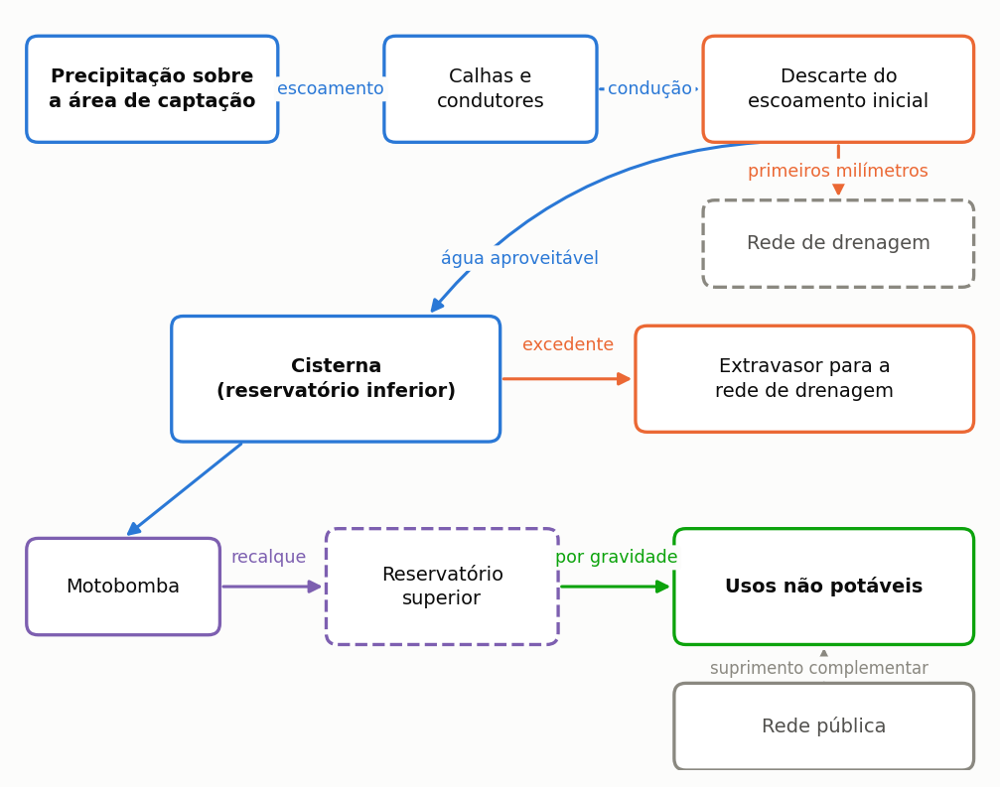
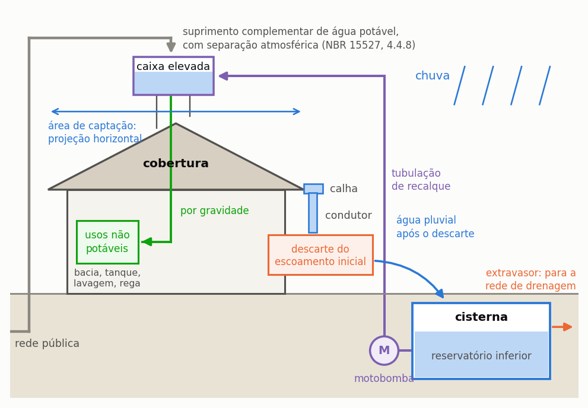
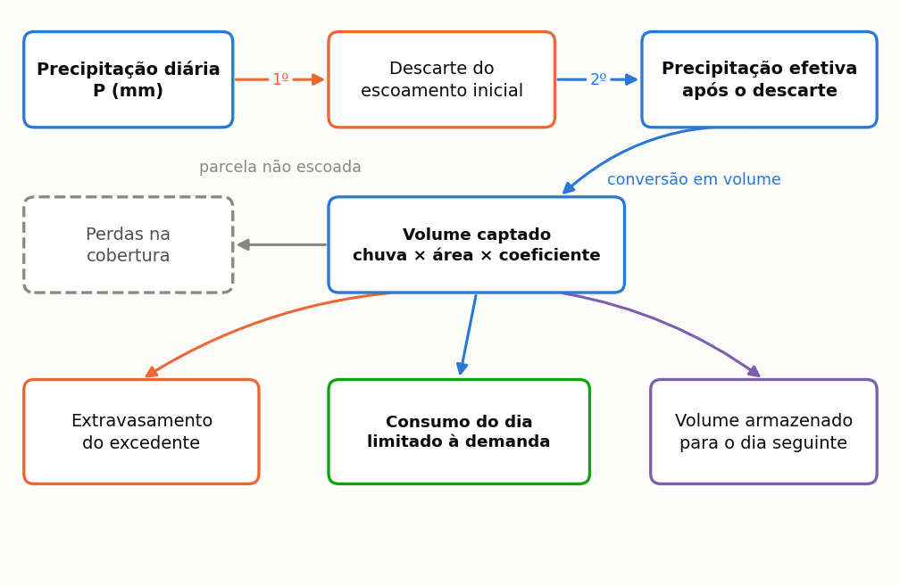
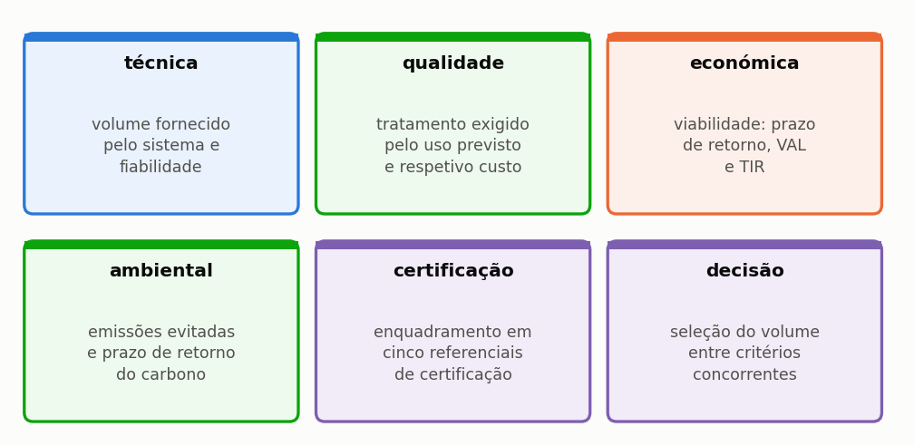
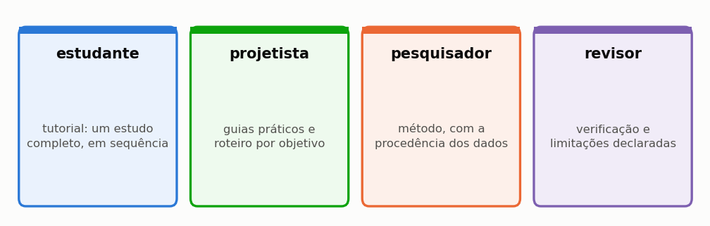

# O que o Triton faz, e o que não faz

O Triton simula sistemas de aproveitamento de água da chuva em edifícios. Dado o regime de chuva de um lugar, a cobertura de um edifício e o consumo de quem o ocupa, responde **quanta água potável o sistema substitui**, a que custo, com que qualidade e com que impacto de carbono.

Esta secção começa pelo princípio. As duas primeiras subsecções tratam do próprio objeto, antes do programa. Quem já projeta redes prediais de água acha-as elementares e pode ir direto às seis dimensões de análise, onde o Triton aparece. Quem chega agora ao assunto encontra aí o vocabulário que o resto do manual usa sem o explicar de novo.

---

## O que é um sistema de aproveitamento de água da chuva

É um sistema que **recolhe a chuva que cai na cobertura e a usa no lugar da água da rede pública**, nos usos que não exigem água potável.

A ideia é velha e simples. Só uma coisa a torna difícil: a chuva não cai quando é precisa. Por isso o sistema precisa de um reservatório, e por isso o tamanho desse reservatório é a pergunta central de todo o projeto — e deste manual. A {{fig:fig00_sistema}} mostra os componentes do sistema e o percurso da água, da captação ao ponto de uso.

*Figura 99 — Componentes de um sistema predial de aproveitamento de água da chuva e percurso da água, da captação ao ponto de uso. O reservatório superior aparece a tracejado porque é opcional: num edifício de um só piso, a eletrobomba pode pressurizar diretamente os pontos de uso, e o reservatório superior altera o momento em que a água é fornecida, não o volume disponível.*

Da esquerda para a direita:

**A cobertura** é a área de captação. Conta a **projeção horizontal** do telhado, não a área inclinada: é a sombra do telhado no chão que recebe a chuva. Errar aqui é o primeiro dos dez enganos da secção {{n:33}}.

**As caleiras e os tubos de queda** levam a água até à cisterna. O programa não os dimensiona. Isso é projeto de drenagem pluvial predial e segue a regulamentação portuguesa aplicável (ver o fim desta secção).

**O dispositivo de descarte das primeiras águas** desvia os primeiros milímetros de cada chuvada, que arrastam o pó, as folhas e os dejetos de aves acumulados na cobertura. É a medida de controlo de qualidade mais barata. A secção {{n:9}} mostra quanto muda a água que chega ao reservatório.

**A cisterna**, ou reservatório inferior, armazena a água captada. Quando a afluência excede a capacidade, o excedente **extravasa** para a rede de drenagem. Este extravasamento não é desperdício por descuido: é a consequência inevitável de guardar um recurso que chega concentrado.

**A eletrobomba e o reservatório superior** distribuem a água. Num edifício de um só piso, a eletrobomba pode pressurizar diretamente os pontos de uso. Em edifícios de dois ou mais pisos, costuma adotar-se um reservatório elevado: a água é elevada até ele e distribuída por gravidade.

**Os usos não potáveis** são o destino: autoclismos e urinóis, lavagem de pavimentos e de veículos, rega de jardins. Quando a água da chuva não chega, a **rede pública** fornece o complemento, e o abastecimento nunca é interrompido.

O diagrama da {{fig:fig00_sistema}} mostra o encadeamento das peças, que é o que interessa para seguir o cálculo. Falta-lhe a informação que decide metade das dúvidas de projeto: onde fica cada peça em relação às outras, e a que altura. O corte da {{fig:fig00d_corte}} repõe essa geometria. O desnível decide se a água desce por gravidade ou precisa de bomba, e a posição da cisterna em relação ao terreno é uma decisão de obra, não de cálculo.

*Figura 2 — O mesmo sistema visto em corte. A área de captação é a projeção horizontal da cobertura, não a área inclinada do telhado. O reservatório elevado recebe a água elevada da cisterna e devolve-a aos pontos de uso por gravidade; a rede pública alimenta-o, com separação atmosférica, no volume que a água da chuva não cobre. O extravasor da cisterna conduz o excedente à rede de drenagem.*

> **Vocabulário que o manual usa o tempo todo.** *Cisterna* e *reservatório inferior* designam o mesmo componente. *Extravasamento* é o volume excedente que o extravasor conduz à rede de drenagem. *Procura pluvial* é a parte do consumo que a água da chuva pode atender; *procura total* é o consumo inteiro do edifício. O apêndice {{n:G}} traz o glossário completo.

---

## O que o programa calcula, num dia

O programa faz uma conta de entradas e saídas, todos os dias, para cada dia da série de chuva. A {{fig:fig00b_destino}} mostra como a precipitação de um dia se reparte. A conta é esta:

*Figura 99 — Destino da precipitação de um dia. Cada caixa é uma parcela do balanço, e a soma do volume extravasado, do volume consumido e do volume armazenado é igual ao volume captado. O extravasamento é calculado antes do consumo do dia, e a chuva do dia já pode atender o consumo do dia: uma ordem intermédia entre as regras YAS e YBS, explicada na secção do balanço diário.*

Lendo o desenho:

1. **Desconta-se o descarte.** Com 12 mm de precipitação e 2 mm de descarte, restam 10 mm de precipitação efetiva.
2. **Converte-se em volume.** Dez milímetros sobre 100 m² de telhado, com coeficiente de escoamento de 0,85, dão 850 litros. A conta é `mm × m² × coeficiente` e sai diretamente em litros, porque um milímetro sobre um metro quadrado é exatamente um litro.
3. **Soma-se ao volume armazenado na cisterna.** O que exceder a capacidade **extravasa** para a rede de drenagem.
4. **Retira-se o consumo do dia**, até ao limite da procura pluvial.
5. **O volume remanescente passa para o dia seguinte.** É esta dependência entre dias consecutivos que torna necessária a simulação diária.

Os cinco passos formam um ciclo, não uma lista: o volume que sobra no fim do quinto passo é exatamente o volume de que o terceiro parte no dia seguinte. Esta ligação entre um dia e o outro é a única coisa que uma conta sobre a média anual não reproduz, e é a razão de a simulação ser diária. A {{fig:fig00e_balanco_do_dia}} representa a sequência na notação das equações do balanço diário.

*Figura 99 — Sequência de operações do balanço diário, na ordem em que o programa as executa, na notação das equações da secção do balanço diário. A ligação a roxo, que contorna o desenho, representa a dependência entre dias consecutivos: o volume remanescente V_res,t é o volume inicial do dia seguinte.*

> **Aprofundamento: porque não basta a média anual.** É tentador dividir a chuva anual por 365 e fazer a conta de uma vez. O resultado é sempre otimista, e por vezes muito. A chuva chega **concentrada**: enche a cisterna num dia, extravasa, e depois falta durante duas semanas. A média não representa nem o extravasamento nem o défice, e ambos reduzem o aproveitamento. A secção {{n:23}} mostra isto numa tabela de dez dias que pode refazer numa folha de cálculo, e a secção {{n:7}} mostra o tamanho do erro.

Repetida ao longo de trinta anos de série, esta conta produz a resposta central do programa: o **potencial de economia de água potável**, a fração do consumo total do edifício que a chuva conseguiu substituir.

---

## As seis dimensões

O volume de água fornecido é a primeira questão de um projeto, mas não a única. O programa avalia o sistema em seis dimensões, que em geral conduzem a volumes ótimos distintos ({{fig:fig26_dimensoes}}).

*Figura 99 — As seis dimensões de análise e a questão avaliada em cada uma. O programa percorre-as por esta ordem, e cada uma é tratada numa secção própria do capítulo do método.*

Cada dimensão tem tratamento próprio no capítulo do método: a técnica nas secções {{n:23}} a {{n:26}}, a qualidade na {{n:27}}, a económica na {{n:29}}, a ambiental na {{n:30}}, a certificação na {{n:31}} e a decisão na {{n:32}}.

A sexta dimensão distingue o programa de uma folha de cálculo. As cinco primeiras dão resultados **divergentes**: o volume de maior poupança de água raramente é o de maior retorno financeiro, e nenhum dos dois costuma ser o de melhor desempenho ambiental. A decisão multicritério torna explícitos os pesos atribuídos a cada critério.

---

## O que o programa **não** faz

Começar pelos limites é invulgar, e deliberado. Poupa tempo a quem abriu o programa à espera de outra coisa.

**Não dimensiona a instalação hidráulica.** Não calcula o traçado, o diâmetro de cada troço nem a inclinação da rede. O assistente de eletrobomba estima o diâmetro e a perda de carga da conduta de elevação para escolher o equipamento, mas não substitui o projeto da instalação. O esquema exportado em DXF é um esquema; o projeto de execução é do projetista.

**Não detalha o dispositivo de descarte.** O programa calcula o volume do reservatório de descarte, igual à área de captação vezes a lâmina, e orça-o com o separador de folhas. A disposição das ligações, a purga e a ligação à drenagem são projeto hidráulico à parte.

**Não substitui ensaios de qualidade da água.** Dimensiona o equipamento de tratamento a partir de premissas. As constantes do modelo de lavagem da cobertura não estão calibradas com medições, e a qualidade resultante é uma premissa, não um resultado.

**Não modela o passo horário.** Uma chuva de 40 mm em duas horas e a mesma lâmina em vinte e quatro horas dão o mesmo resultado.

**Não faz o inventário completo do ciclo de vida.** A avaliação é de **triagem**, numa única categoria de impacto — o carbono. Não há eutrofização, acidificação, uso do solo nem toxicidade.

**Não certifica.** Mostra onde o projeto se enquadraria. A certificação cabe ao organismo certificador, com a documentação completa do empreendimento.

**Não conhece o local.** Não sabe se o volume cabe no terreno, se o nível freático é alto, nem se a estrutura aguenta o reservatório elevado.

A secção {{n:36}} traz a lista completa das limitações conhecidas, com as consequências de cada uma.

---

## Para quem serve

O manual serve quatro perfis de leitor, com percursos de leitura independentes entre si ({{fig:fig27_leitores}}).

*Figura 99 — Os quatro percursos de leitura do manual. São independentes entre si, e o manual foi organizado para que cada um se possa seguir isoladamente.*

Em números de secção: o estudante segue o capítulo {{c:2}}, o tutorial do princípio ao fim; o projetista usa os guias do capítulo {{c:3}} e o roteiro da secção {{n:3}}; o investigador vai ao método do capítulo {{c:4}}; e o revisor encontra no capítulo {{c:6}} a verificação e os limites declarados.

Quem começa agora deve percorrer o capítulo {{c:2}} inteiro, pela ordem em que está escrito. Constrói um projeto de raiz, em Lisboa, e acompanha-o até à decisão final. Cada secção termina a mostrar onde o projeto chegou, para o leitor ver o estudo a formar-se em vez de o receber concluído.

---

## Normas e entidades de referência

A norma europeia de referência para estes sistemas é a EN 16941-1, sobre sistemas de água não potável no local (sistemas de aproveitamento de água da chuva). Cobre o projeto, o dimensionamento, a instalação, a identificação, a colocação em serviço e a manutenção, com exclusão da água para beber e para a preparação de alimentos. A edição de 2018 foi retirada em 22 de março de 2024 (BSI, https://knowledge.bsigroup.com/products/on-site-non-potable-water-systems-systems-for-the-use-of-rainwater, consultado em 16/10/2026). Não verificado nesta versão: o ano da edição em vigor da EN 16941-1 e a transposição para a norma portuguesa NP EN 16941-1 (catálogo do IPQ).

Em Portugal, a especificação técnica ETA 0701 da ANQIP (Associação Nacional para a Qualidade nas Instalações Prediais) estabelece critérios para estes sistemas em edifícios, para fins que não o consumo humano. Recomenda o desvio de um volume correspondente a 2 mm de precipitação, e remete o projeto de redes prediais para o Regulamento Geral dos Sistemas Públicos e Prediais de Distribuição de Água e de Drenagem de Águas Residuais (Decreto Regulamentar n.º 23/95, de 23 de agosto). A versão consultada é a 7, com validade indicada de 23/01/2009 a 23/01/2014 (cópia no repositório do IPL, https://repositorio.ipl.pt/bitstreams/27266c84-d607-4ad7-9c68-9b51a215314f/download). Não verificado nesta versão: a revisão em vigor da ETA 0701 no sítio da ANQIP e se o Decreto Regulamentar n.º 23/95 mantém a redação aplicável a este uso.

---

## Uma palavra sobre os resultados

Todo o número que o programa produz é **condicional às premissas declaradas**. O programa não descobre verdades; calcula consequências.

Por isso o manual insiste tanto na declaração. A secção {{n:13}} traz a lista do que deve constar num artigo, a secção {{n:33}} os dez enganos que o programa não impede, e a secção {{n:36}} o que ele não cobre.

Um estudo que declara as suas premissas e os seus limites é mais útil — e mais defensável — do que um que apresenta um número isolado.
