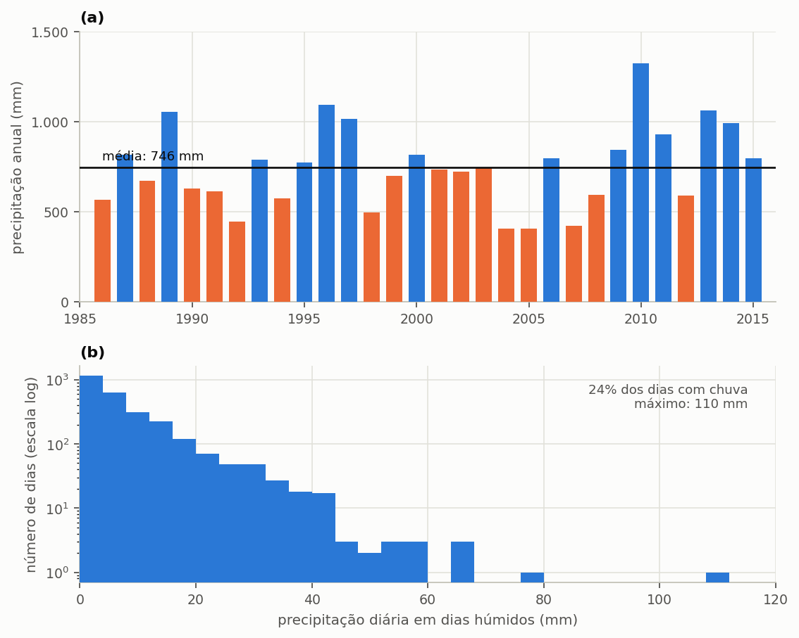
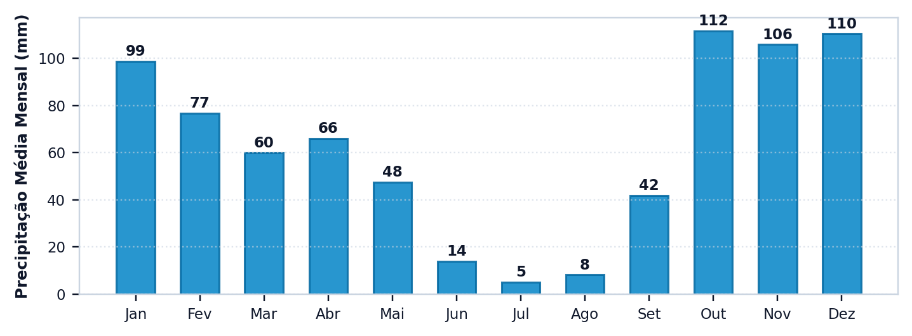

# O projeto e a chuva

> No fim desta secção, tem um projeto criado, uma série de precipitação carregada e a captação definida. E sabe porque cada um destes três números importa mais do que parece.

As dez secções deste capítulo constroem **um só projeto**, do princípio ao fim. A cada secção o estudo ganha uma camada, e o resultado muda. Guarde o ficheiro: é o mesmo até à secção {{n:13}}.

## O projeto

Uma moradia unifamiliar em Lisboa. Quatro moradores, cobertura de 150 m², cisterna enterrada no logradouro. É um caso deliberadamente comum, para que o método se destaque, e não o edifício.

Lisboa tem três razões a favor. A série de precipitação é longa e completa: 30 anos de valores diários, de 1991 a 2020. O tarifário da água é público e verificável: a EPAL fornece a água e a Câmara Municipal cobra o saneamento e os resíduos. E o regime de chuva tem um verão muito seco, o que — como a secção {{n:7}} mostrará — decide a escolha do volume. A secção {{n:14}} leva a mesma moradia ao Porto e ao Funchal e mostra quanto muda só pelo clima.

> **O seu local.** O tutorial corre sobre a série de Lisboa e o tarifário que acompanham o programa. Num projeto real, substitua-os pela série medida no local e pela tarifa que paga, como explica a secção {{n:10}}. O método hidráulico é o mesmo.

---

## A série de precipitação

Abra a etapa **1. Projeto e Chuva**. Há dois caminhos para a chuva.

**Ficheiro próprio.** Um CSV com uma leitura diária por linha, em milímetros, numa só coluna. É o caminho de quem tem dados de uma estação concreta. A ETA 0701 da ANQIP recomenda dados de fontes oficiais, de preferência séries históricas de pelo menos 10 anos, e indica o Sistema Nacional de Informação de Recursos Hídricos (SNIRH) para as precipitações médias mensais de estações do país (item 4.1, versão 7 da ETA; ver a secção {{n:1}}).

**Base ibérica (Iberia01), a fonte por defeito.** Escolha o país e a região (distrito, comunidade autónoma, ilha) e o município, ou escreva o nome ou o código (INE de cinco dígitos em Espanha, DTMN de quatro em Portugal) na caixa de busca. A série de um município é a média das células de 0,1° do Iberia01 que o servem, de 1971 a 2015; o período padrão é 1986–2015, porque a normal 1991–2020 não existe nesta fonte. O Iberia01 é de licença ODbL (uso comercial permitido, com atribuição, que o laudo leva). Canárias, Madeira e Açores usam a reanálise ERA5, sempre com nível C e um aviso; Ceuta e Melilla não têm série e o programa pede a sua. O nível A, B ou C descreve a representação do município pela grelha, e não uma validação com pluviómetros. Os exemplos e o tutorial deste manual usam a série E-OBS de 1991 a 2020, que dá menos chuva do que o Iberia01 (cerca de 8% em Portugal): os números do tutorial não se repetem com o Iberia01.

**Base de concelhos (E-OBS), fonte opcional.** O programa traz a precipitação diária de 278 concelhos do Continente, de 1950 a 2025, extraída da E-OBS v33.0e. A série de um concelho é a média das células da grelha com centro dentro dos seus limites. É o caminho de quem estuda outros concelhos, e a secção {{n:15}} mostra como testar um cenário climático.

Para o nosso projeto, escolha o concelho de **Lisboa** e recorte os **30 anos** de 1991 a 2020.

<!-- inclui: _tabelas/cap04_serie.md -->

Três números desta tabela decidem o projeto, e vale a pena olhar para eles antes de qualquer simulação.

**719 mm por ano** é pouca chuva para esta cobertura, e muito concentrada no inverno. A oferta bruta, cerca de 92 m³ por ano, é 1,5 vez a procura pluvial da casa (61 m³ por ano, secção {{n:5}}). Há água a mais no ano, mas no momento errado: o fator limitante será o verão seco e o tamanho do reservatório, não o total anual.

**Chove em 22% dos dias.** Chuva rara obriga a cisterna a atravessar longas estiagens. Compare com o Porto, na secção {{n:14}}, onde chove em 31% dos dias e a mesma casa poupa mais. Em Lisboa, o mês mais chuvoso recebe 47,3 vezes o que recebe o mais seco.

**Quatro por cento dos dias têm chuva, mas abaixo de 2 mm.** Esses dias serão descartados por inteiro, e o ponto sobre o descarte das primeiras águas, mais adiante, explica porquê.

> **Quantos anos de série usar.** Trinta é confortável. Abaixo de dez, o resultado começa a depender do troço escolhido; abaixo de cinco, o viés do reservatório vazio no início da simulação passa a pesar de forma sensível. A secção {{n:33}} trata este engano em pormenor.

---

Vale a pena olhar para uma série inteira antes de a usar. Trinta anos de Lisboa não são trinta anos parecidos: os totais variam de ano para ano, e é essa variação que a média anual apaga. A distribuição diária conta o resto da história — a maior parte dos dias não tem chuva nenhuma, e o volume anual é entregue por um número pequeno de dias intensos ({{fig:fig15_serie}}).

*Figura 99 — Série de precipitação de Lisboa usada em todo o tutorial (E-OBS, concelho de Lisboa, 1991 a 2020): (a) precipitação total de cada ano, com a média dos trinta anos em linha contínua e os anos acima da média a azul e abaixo dela a laranja; (b) distribuição de frequência da precipitação diária nos dias de chuva, em escala logarítmica, que mostra como poucos dias respondem pelos maiores volumes. O maior dia da série tem 91,2 mm.*

---

## A área de captação

O projeto do tutorial adota 150 m² de área de captação, e este é o primeiro campo em que se erra com frequência.

A área de captação é a **projeção horizontal** da cobertura, não a área inclinada do telhado. Um telhado com 30% de inclinação sobre uma planta de 150 m² tem cerca de 157 m² de superfície de telha e capta, ainda assim, os mesmos 150 m² de chuva: a precipitação cai na vertical, e o que encontra é a sombra da cobertura projetada no chão. A ETA 0701 da ANQIP define-a assim: a projeção em planta do local onde é recolhida a água da chuva. É esta área `A` que entra na equação da disponibilidade.

> **Área de captação não é área de contribuição.** O dimensionamento de caleiras e tubos de queda usa outra área, para outro fim. Para dimensionar a drenagem pelo caudal de ponta de uma chuvada curta e intensa, acrescentam-se à projeção os acréscimos devidos à inclinação da cobertura e às paredes que intercetam a chuva empurrada pelo vento. Essa área sobrestima o volume que a cobertura capta ao longo do ano. No Triton, indique a projeção horizontal; a área de contribuição fica para o projeto das caleiras, que o programa não faz. A ETA 0701 remete as caleiras e os tubos de queda para o Regulamento Geral português ou para a norma europeia EN 12056-3. Não verificado nesta versão: os artigos do Decreto Regulamentar n.º 23/95 aplicáveis ao cálculo de caudais pluviais, que por isso não se citam por número.

> **Atenção.** Usar a área inclinada sobrestima a captação na razão `1/cos(inclinação)`. Num telhado de 30% dá 4,4% a mais de água que não existe. Em telhados mais inclinados, o erro cresce depressa.

---

Carregada a série, o programa já mostra o regime que ela descreve. Vale a pena conferir este desenho antes de seguir: uma série trocada de concelho, ou com a unidade errada, costuma aparecer no ciclo sazonal da {{fig:fig55_programa_sazonal}} antes de aparecer em qualquer resultado.

*Figura 99 — O ciclo sazonal médio da série, calculado e desenhado pelo programa assim que a precipitação é carregada. Em Lisboa, o mês mais chuvoso recebe cerca de 47 vezes o que recebe o mais seco (47,3), e é esta diferença que o reservatório tem de atravessar: o verão é quase sem chuva. Figura gerada pelo próprio programa.*

---
## O coeficiente de escoamento

O tutorial escreve 0,85 no campo do coeficiente. O programa, por seu lado, abre com a telha cerâmica selecionada e aplica 0,75, o valor que a lista de materiais lhe atribui, e que é também o valor que assume quando nenhum material é indicado. ==Atenção ao reproduzir o tutorial: para chegar aos números deste manual, escolha «Outro / Personalizado» e escreva 0,85.==

A origem do 0,85 merece rigor, porque é citado com frequência como coeficiente de escoamento e não o é. Em Portugal, a ETA 0701 da ANQIP escreve o volume anual aproveitável como o produto da precipitação média anual, da área de captação, de um coeficiente de escoamento inicial da cobertura `C` e da eficiência hidráulica da filtragem `ηf`. Recomenda `C` = 0,8 para coberturas impermeáveis (telha, betão, etc.), 0,6 para coberturas planas com gravilha, 0,3 para coberturas verdes extensivas e 0,5 para as intensivas, e admite `ηf` = 0,9 em filtros com manutenção e limpeza regulares (itens 4.3.1 a 4.3.3 da versão 7). O 0,85 do tutorial é, assim, um valor redondo entre estes, e não um valor de norma. O Triton tem um só campo para a fração da chuva que chega à cisterna e modela o descarte à parte, em milímetros. Escrever aí um valor que já inclua a perda do escoamento inicial e aplicar também o descarte de 2 mm conta essa perda duas vezes. Num estudo, declare o valor adotado no campo, a sua origem e o descarte, e não atribua a uma norma um coeficiente que ela não fixa.

> **A norma europeia.** A EN 16941-1 também escreve o rendimento da captação como produto de um coeficiente da superfície da cobertura e de uma eficiência do filtro. Não verificado nesta versão: os valores tabelados da edição em vigor da EN 16941-1, que o manual não reproduz. O Triton mantém a sua lista de coeficientes e o descarte inicial; para se aproximar de uma norma, escreva o produto como valor personalizado e ajuste a lâmina de descarte.

O coeficiente de escoamento representa a fração da chuva incidente que chega, de facto, à cisterna, e a diferença até à unidade é o que se perde no caminho. As perdas têm quatro origens: a absorção pelo material da cobertura, a evaporação na superfície aquecida, o salpico para fora da caleira e a molhagem inicial da telha em cada nova chuvada. A {{fig:fig35_escoamento}} mostra o coeficiente que o programa atribui a cada material de cobertura.

*Figura 99 — O coeficiente de escoamento que o programa atribui a cada material da cobertura. A linha a tracejado marca 0,85, o fator de captação adotado no tutorial. A cobertura verde é a única que se afasta do grupo, porque retém parte da chuva no substrato.*

O programa aceita qualquer valor entre zero e um, e recusa valores fora deste intervalo, indicando o campo — um coeficiente maior do que a unidade significaria que a cobertura entrega mais água do que a chuva lhe traz. A etapa **11. Documentação** traz a mesma tabela, com a fonte dos valores. Para uma cobertura mista, o coeficiente a escrever é a média dos coeficientes de cada material, ponderada pelas respetivas áreas.

---

## O descarte das primeiras águas

O tutorial descarta 2,0 mm em todas as chuvadas.

A primeira água que lava a cobertura leva pó, folhas, dejetos de aves e tudo o que se depositou desde a chuva anterior. Descartá-la, em vez de a conduzir à cisterna, é a medida de qualidade mais barata e mais eficaz de que um sistema pluvial dispõe, e por isso é praticamente universal em projetos bem conduzidos. Em Portugal, a ETA 0701 recomenda um dispositivo automático de desvio do escoamento inicial, tendo em conta as longas estiagens de verão, e, na falta de dados ou de estudos locais, o desvio de um volume correspondente a 2 mm de precipitação, podendo adotar-se um valor inferior em casos justificados (itens 4.2.2 e 4.2.4). É esse o valor adotado aqui. Num estudo, justifique a lâmina que adotar.

O programa oferece três modos de aplicar o descarte, que correspondem a três tipos de dispositivo de autolimpeza.

<!-- tabela: Os três modos de aplicação do descarte de primeiras águas -->
| Modo | Quando descarta | Quando usar |
| :--- | :--- | :--- |
| 1 | em todas as chuvadas | o padrão, e o mais conservador |
| 2 | só na primeira chuvada após uma estiagem | dispositivo que não se esvazia sozinho entre chuvas próximas |
| 3 | de X em X dias | dispositivo com esvaziamento programado |

> **Atenção, e este é o ponto que mais surpreende.** Quando o descarte se aplica e a chuva do dia **não excede** a lâmina, perde-se o dia **inteiro**, não a diferença. Um dia de 1,6 mm com descarte de 2,0 mm capta **zero**.
>
> Na série de Lisboa, isto atinge 4% dos dias. Em climas de chuvisco frequente, a parcela é maior.

A razão deste comportamento é física, não convencional: o dispositivo de autolimpeza tem de encher por completo antes de qualquer água seguir para a cisterna. Quando a chuva do dia não chega para o encher, nada passa, e o volume retido perde-se para a drenagem, juntamente com a sujidade que lavou.

> **A lâmina não é o dispositivo.** `d_f` é uma lâmina em milímetros. O volume hidráulico do reservatório de autolimpeza é `A × d_f`, que no nosso projeto dá 150 × 2 = **300 litros**. A etapa **3. Qualidade & ETAP** dimensiona e orça esse reservatório (secção {{n:27}}), e a secção {{n:10}} mostra o seu custo no investimento.

---

## O que temos até aqui

<!-- tabela: Estado do projeto do tutorial no fim da definição da chuva e da captação -->
| Dado | Valor |
| :--- | ---: |
| série | Lisboa, 30 anos |
| área de captação | 150 m² |
| coeficiente de escoamento | 0,85 |
| lâmina de descarte | 2,0 mm, todas as chuvadas |

Com isto, o programa já sabe **quanta água entra**. Falta dizer quanta sai, o que é a secção {{n:5}}.

Uma conta de algibeira, para calibrar a expectativa: 719 mm por ano sobre 150 m² com coeficiente de 0,85 dão cerca de 92 m³ por ano de água bruta, antes do descarte. A secção {{n:6}} mostra quanto desse volume se converte em poupança efetiva — e a diferença entre os dois números é a lição mais importante do tutorial.
