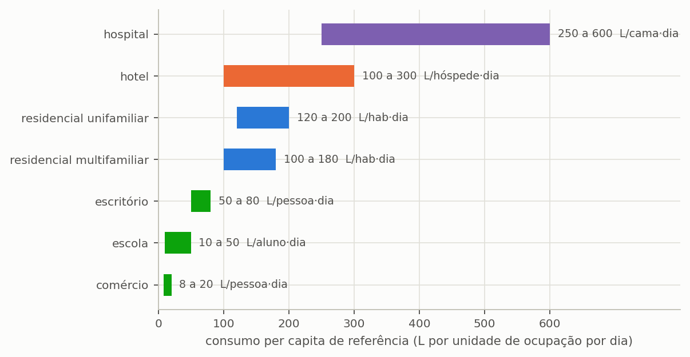
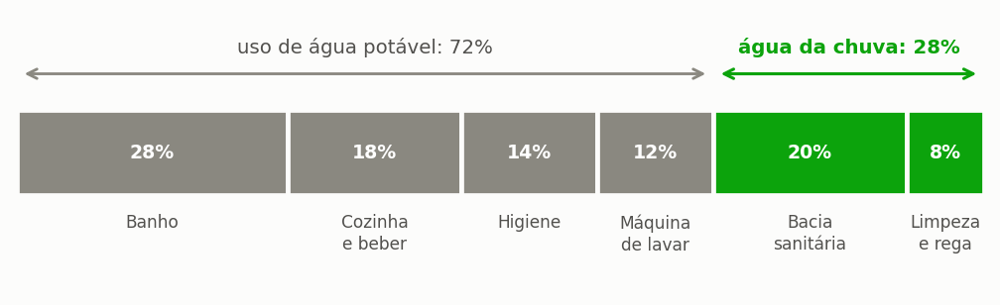
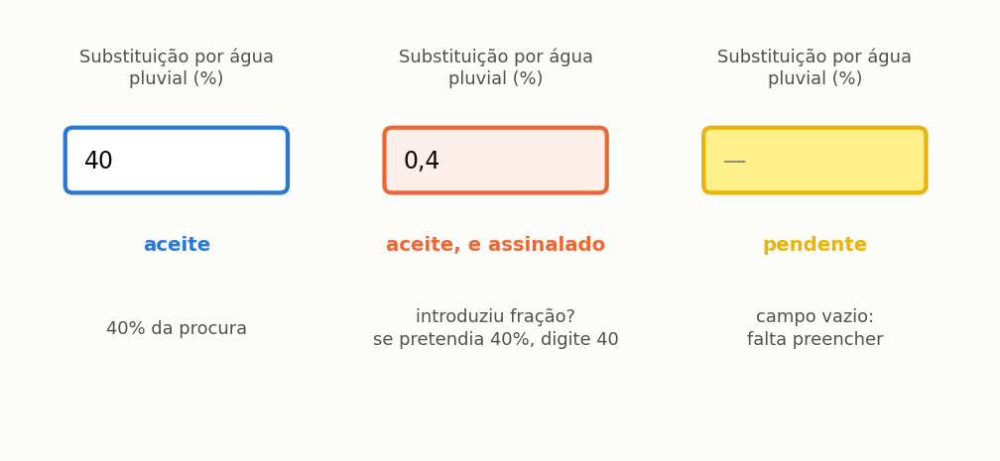

# A edificação e a procura

> No fim desta secção, o programa sabe **quanta água sai** e, mais importante, **que parte dela a chuva pode atender**. Essa fração é o teto de tudo o que vem a seguir.

A secção {{n:4}} definiu a oferta. Esta define a procura. E há uma assimetria que convém perceber desde já: **a chuva não pode atender toda a procura**, por mais água que haja. Existe um teto, é definido aqui, e nenhum reservatório o ultrapassa.

---

## A tipologia

Na etapa **2. Edificação e Consumo**, escolha *Residencial unifamiliar*. O programa traz oito tipologias, cada uma com o consumo per capita de referência ({{fig:fig38_per_capita}}) e a repartição habitual dos usos finais. A indústria não tem gama de referência, porque o consumo depende do processo produtivo e não da ocupação: nesse caso, o valor tem de vir de medição.



*Figura 99 — As gamas habituais de consumo per capita por tipologia de edifício. A amplitude de cada gama é grande de propósito: são valores de referência para quem ainda não mediu, e a medição, quando existe, prevalece sempre.*


A tipologia é um ponto de partida, não uma imposição: o valor continua editável. A secção {{n:18}} trata dos casos não residenciais, que têm uma armadilha própria na tarifa.

---

## Os moradores e o consumo

**Quatro moradores, 150 L/hab·dia.** Total de **600 L/dia**.

O valor de 150 L/hab·dia é uma referência redonda para uma moradia com abastecimento regular, não uma medição. Se tem a fatura da água e do saneamento do edifício, use-a: divida o consumo mensal, em litros, por trinta e pelo número de moradores. O número medido vale mais do que qualquer referência.

O programa aceita procura **constante** ou modulada por semana, mês ou dia. O tutorial usa a constante; a secção {{n:17}} mostra a modulação, que importa em escolas, hotéis e em qualquer edifício com sazonalidade.

---

## A fração que a chuva pode atender

**28%.** É o número mais importante desta secção.

A água da chuva não vai para o duche, para a pia da cozinha nem para beber. Numa moradia, vai para o autoclismo, a lavagem de pavimentos, a rega do jardim e a lavagem do automóvel. O peso destes usos no consumo total é o **teto do potencial de economia**.

A repartição adotada no tutorial está representada na {{fig:fig00c_fracao}}, com os usos que a chuva atende assinalados. O autoclismo pesa 20% do consumo e a limpeza e a rega 8%; o duche, a pia da cozinha, o lavatório e a máquina de lavar roupa, que pesam o resto, ficam com a água potável.

Somando os dois usos que a chuva atende, chega-se aos 28% do tutorial. É um valor conservador para uma moradia sem jardim grande, e é conservador de propósito: limita-se aos usos que a orientação sobre águas pluviais admite com mais facilidade.

> **A máquina de lavar roupa é uma escolha que o tutorial não faz.** A ETA 0701 da ANQIP (versão 12) inclui a lavagem em máquinas de lavar roupa entre os usos possíveis da água da chuva, ao lado das descargas de autoclismo, da lavagem de pavimentos e automóveis, da rega de zonas verdes e de outros usos (torres de arrefecimento, redes de incêndio, AVAC). Para a máquina de lavar sem tratamento específico, o item 4.6.6 só a admite quando a água de lavagem atinge pelo menos 55 °C, e pede um microfiltro de malha mínima de 100 µm. O uso na máquina é comum na literatura e na prática, e por isso muitos estudos trabalham com frações atendíveis maiores do que a deste tutorial. O tutorial **não** o adota: a máquina fica com a água potável, e a fração atendível fica nos 28% do autoclismo e dos usos exteriores. Um projeto que inclua a lavagem de roupa tem de declarar essa escolha e o critério de qualidade adotado, e confrontá-la com a norma em vigor no local do edifício. Não verificado nesta versão: a revisão em vigor da ETA 0701 e o que a EN 16941-1 diz sobre a lavagem de roupa.



*Figura 99 — Repartição típica do consumo de uma moradia por uso final. A cinzento, os usos que exigem água potável; a verde, os que podem usar água da chuva, cuja soma é a fração atendível e o teto do potencial de economia: nenhum reservatório, por maior que seja, poupa mais do que esta fração.*

> **Este número é o teto.** Com 28% de fração atendível, o potencial de economia **nunca** passa de 28%, por maior que seja o reservatório e por mais que chova. A tabela da secção {{n:7}} mostra a curva a aproximar-se desse limite sem o atingir: em Lisboa, a 20.000 L ainda só chega a 24,01%.
>
> Quem quer passar dos 28% tem de mudar o **uso**, não o reservatório: acrescentar um uso, como a lavagem de roupa, com o critério de qualidade declarado, ou reduzir o consumo potável.

### Percentagem no ecrã, fração no ficheiro

A mesma grandeza aparece com duas grafias, e cada uma tem o seu lugar. Em todos os campos em que se escreve — as frações do ecrã da edificação, as tabelas semanal e mensal, as tabelas de cenários, a folha de cálculo de lote e o argumento `--share` da linha de comandos — a fração é uma **percentagem, de 0 a 100**: 28 significa 28%. No ficheiro de projeto, no ficheiro de parâmetros e em `rainwater_share` e `non_potable_indoor_share`, é uma **fração, de 0 a 1**: 0,28.

A divisão não é arbitrária. A percentagem é a forma em que a grandeza circula entre projetistas, normas e faturas da água, e é a forma em que menos se erra ao escrever. A fração é a forma em que entra na equação do balanço, a multiplicar a procura interior (secção {{n:23}}), e é a forma que dispensa conversões a quem lê o ficheiro com outro programa.

O que não se admite é a mistura. Até esta versão, doze pontos do programa aceitavam as duas grafias e decidiam pela regra «acima de 1 é percentagem». A regra falha justamente nos valores pequenos, onde o erro não se vê: 1 passava a 100%, e não a 1%; 0,5 escrito numa coluna em percentagem passava a 50%. ==Agora a unidade é fixada pelo lugar, nunca adivinhada pelo valor.== Uma percentagem acima de 100 é recusada; uma fração acima de 1 é recusada com a indicação de que parece uma percentagem. A {{fig:fig46b_percentual}} mostra os três estados do campo na interface.



*Figura 99 — Estados do campo de fração atendível na interface. O campo recebe uma percentagem de 0 a 100; no ficheiro de projeto e nos parâmetros de cálculo a grandeza é guardada como fração de 0 a 1. Um valor entre 0 e 1 escrito no campo fica assinalado a laranja, sem bloquear o cálculo, porque 0,4% é possível, embora raro.*

> **O marcador laranja.** Um valor entre 0 e 1 num campo em percentagem é aceite, porque uma substituição inferior a 1% é possível, mas o campo fica laranja e a dica explica o que foi entendido. Nas tabelas de cenários e na folha de cálculo de lote, o programa pergunta antes de simular.

---

## Discriminar os usos, ou não

O programa aceita dois níveis de pormenor na descrição da procura, e a escolha depende do que o estudo quer responder.

No **modo simplificado**, indicam-se duas coisas: a fração não potável do consumo interior — autoclismos e lavagem de roupa — e, se existir, a procura exterior em litros por dia. A fração atendível **total** sai das duas,

```text
f = (fração interior × procura interior + procura exterior) ÷ (procura interior + procura exterior)
```

e aparece num campo que não se edita, porque é resultado e não dado. Sem procura exterior, a total é a própria fração interior: os 28% deste tutorial. É o modo adotado aqui, e chega para a maior parte dos estudos.

> **Porque a total não se escreve.** Em versões anteriores, o campo da fração total era editável, mas a simulação usava a fração interior; e, ao abrir um projeto, o ecrã repunha a interior em 35% e a exterior em zero, fossem quais fossem as guardadas. Um projeto que declarava 28% era simulado com 35%. Hoje o ecrã restaura as duas, a total é calculada, e um ficheiro antigo cujas frações discordem abre com a total que declara, com um aviso.

No **modo discriminado**, a procura divide-se em três parcelas: a potável interior, que a chuva nunca atende; a não potável interior, que é a prioridade do sistema; e a rega, atendida em último lugar. A divisão muda duas coisas. Altera a ordem de atendimento nos dias de escassez, em que o uso interior tem precedência sobre o jardim; e permite distinguir o uso interior do exterior nos créditos de certificação, distinção que o LEED exige em créditos separados, como descreve a secção {{n:31}}.

Vale a pena discriminar quando há um jardim de área relevante, quando a certificação está no horizonte do projeto, ou quando a rega pode ser suprimida nos dias de chuva — situação que o ponto seguinte trata.

---

## A rega e a supressão por chuva

Declarado um volume de rega, o programa oferece um limiar de supressão por chuva: nos dias em que a precipitação excede esse limiar, o jardim não é regado. O comportamento reproduz o de qualquer programador de rega com sensor de chuva, equipamento corrente e barato, e ignorá-lo sobrestimaria a procura exterior ao longo do ano inteiro. O limiar predefinido é de 2 mm por dia.

> **A série de chuva é lida duas vezes.** Uma leitura converte-se em volume captado, depois do descarte. A outra decide se o jardim é regado. As duas são independentes: um dia pode suprimir a rega **e** render captação.

Resta uma escolha que merece atenção particular, porque altera o resultado económico e não é neutra: o **fornecimento de reserva** da rega. Com ele ligado, a rede pública rega o jardim nos dias secos em que a cisterna não chega, e esse volume entra na fatura da água e do saneamento como consumo potável. Com ele desligado, o jardim simplesmente não é regado nesse dia, o edifício não compra essa água, e o volume correspondente aparece no balanço como *procura não atendida* — a terceira parcela tratada na secção {{n:23}}.

==A distinção entre as duas configurações é conceptual antes de ser numérica.== Um jardim que tem de ser regado todos os dias representa uma procura real, que alguém pagará; um jardim que aceita não ser regado num dia seco representa uma comodidade, e tratá-lo como procura infla tanto o consumo como a poupança aparente do sistema.

---

## O que temos até aqui

<!-- tabela: Estado do projeto do tutorial no fim da definição da procura -->
| Dado | Valor |
| :--- | ---: |
| tipologia | residencial unifamiliar |
| moradores | 4 |
| consumo per capita | 150 L/hab·dia |
| procura total | 600 L/dia |
| fração atendível pela chuva | 28% |
| **procura pluvial** | **168 L/dia** |

O programa sabe agora a oferta e a procura. Antes de simular, uma comparação que vale a pena guardar:

<!-- tabela: Comparação entre a oferta anual de água da chuva e a procura atendível -->
| | m³/ano |
| :--- | ---: |
| oferta bruta de água da chuva (precipitação × área × coeficiente) | 92 |
| **procura pluvial do ano** | **61** |

A oferta excede a procura: o volume bruto é **1,5 vez** o que se pretende usar, antes de deduzir o descarte. Se a oferta fosse o único limite, o sistema atenderia 100% da procura pluvial e chegaria ao teto de 28%.

Não chega, e a secção {{n:6}} mostra porquê.
