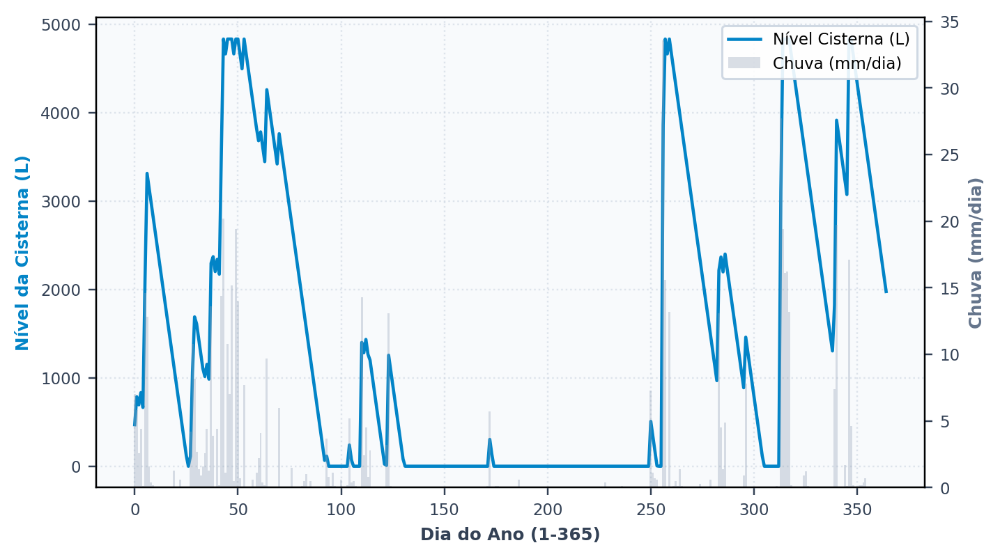

# A primeira simulação

> No fim desta secção, tem o primeiro resultado no ecrã e sabe **ler** os quatro números que importam. Ler é a parte difícil: o programa entrega muitos números, e três deles respondem a perguntas diferentes.

Falta um dado para simular: o volume do reservatório. Vamos arriscar um palpite.

**3 000 litros.** Uma cisterna de betão de 3 m³ é um tamanho comum de logradouro e é o que um projetista proporia sem pensar muito. A secção {{n:7}} vai perguntar se é o volume certo. Aqui só queremos ver o programa a correr.

Na etapa **4. Reservatório & Custos**, escolha volume fixo, indique 3 000 L, deixe o reservatório superior por assinalar e simule.

---

## O resultado

<!-- inclui: _tabelas/cap06_primeira_simulacao.md -->

O ecrã devolve várias dezenas de valores, e quatro bastam para julgar o projeto nesta etapa. Cada um responde a uma pergunta distinta, e é justamente por isso que não se substituem: um projeto pode ser bom pelo primeiro e mau pelo terceiro, e a leitura conjunta é o que evita conclusões apressadas.

---

## O potencial de economia: 15,77%

Este indicador responde à pergunta que motiva a maior parte dos projetos: quanto da fatura da água e do saneamento deixa de se pagar. É o valor central do programa e o que consta do resumo de qualquer estudo. Corresponde à razão entre a água da chuva consumida e a procura total do edifício ao longo de toda a série, como na Equação {{eq:potencial}}.

O denominador merece atenção, porque dele decorre tudo o resto: é a procura **total**, não a procura pluvial. É esta escolha que fixa o teto do indicador nos 28%, a fração atendível definida na secção {{n:5}}, e não em cem por cento.

O sistema alcançou 15,77% contra um teto de 28%, o que significa que entrega 56% do que se propunha entregar (94,6 L/dia de chuva consumida, contra 168 L/dia de procura pluvial). Os 44% em falta correspondem aos dias em que a cisterna não tinha água suficiente para atender à procura pluvial do dia.

> **Não confunda as duas percentagens.** «Economia de 16%» e «atendimento de 56% da procura pluvial» descrevem o mesmo sistema e são números diferentes. Estudos publicados trocam por vezes um pelo outro. Declare qual está a usar.

---

## O extravasamento: 100,3 L/dia

**Responde: o reservatório é suficientemente grande?**

Em média, ao longo dos trinta anos, extravasam da cisterna 100,3 litros por dia, que seguem para a rede de drenagem. Menos do que os 168 L/dia que o sistema pretende consumir, mas ainda assim muita água a perder.

Parece o argumento definitivo a favor de aumentar o reservatório, e é um argumento fraco. A cobertura oferece 1,6 vez o que a casa consome (secção {{n:5}}), e boa parte desse excedente extravasaria de qualquer cisterna: a secção {{n:7}} mostra que nem 20 000 L o reduzem abaixo de 48 L/dia. O extravasamento só diz algo sobre o volume quando comparado com o de outros volumes, e é essa comparação que a secção {{n:7}} faz.

> Um extravasamento elevado não é defeito do programa nem do projeto. É a assinatura do desencontro entre a chuva, que chega concentrada em poucos dias, e a procura, que é constante. O reservatório existe para amortecer isso, e todo o reservatório finito falha em algum episódio.

---

## Os dias de atendimento: 54,7% plenos

**Responde: com que frequência posso contar com o sistema?**

É a fiabilidade **temporal** do sistema, e responde a uma pergunta que o potencial de economia não alcança: com que frequência se pode contar com a água da chuva. Cada dia da simulação recebe uma de três classificações, conforme o grau de atendimento alcançado.

<!-- tabela: Classificação de cada dia da simulação quanto ao grau de atendimento -->
| Classe | O que significa |
| :--- | :--- |
| pleno | a chuva atendeu **toda** a procura pluvial do dia |
| parcial | atendeu parte, e a rede completou |
| nulo | a cisterna estava vazia; tudo veio da rede |

Em 54,7% dos dias o sistema deu conta sozinho da procura pluvial. Nos restantes 45,3%, a rede pública entrou, total ou parcialmente: 3,0% dos dias foram parciais e 42,3% nulos. A distinção tem consequência direta no projeto hidráulico. Um sistema com muitos dias de atendimento nulo exige um abastecimento automático de reserva bem dimensionado, e o utilizador nota a alternância entre as duas origens ao longo do ano. Um sistema com 99% de dias plenos é, na prática, independente da rede para os usos que atende.

> **Potencial e fiabilidade não andam juntos.** É possível ter um potencial alto com fiabilidade baixa: um reservatório que enche na estação chuvosa e seca na estiagem entrega muito volume no ano e falha metade dos dias. A tabela da secção {{n:7}} mostra as duas colunas a divergir.

---

## O volume anual poupado

**Responde: quanto vale isto em dinheiro e em carbono?**

É o valor que passa para as secções {{n:10}} e {{n:11}}, porque tanto a poupança na fatura da água e do saneamento como a emissão de carbono evitada se calculam a partir dele. Vale 34,6 m³/ano, bem menos de metade dos 95 m³/ano que a cobertura disponibiliza antes do descarte; o descarte e o extravasamento explicam a diferença.

---

Antes de discutir porque o potencial não chega aos 28%, convém ver o reservatório a trabalhar. O separador de resultados traz a série diária do nível da cisterna, e é nela que se veem de uma só vez os dois regimes que limitam o aproveitamento: o extravasamento e a falta ({{fig:fig48_programa_serie_diaria}}).

*Figura 99 — O nível da cisterna ao longo do primeiro ano da série de Lisboa, com a chuva diária ao fundo. Os planaltos no topo são os dias em que o reservatório está cheio e extravasa; os vales no zero são os dias em que secou e a rede atendeu tudo. Em Lisboa, os vales concentram-se no verão. Figura gerada pelo próprio programa.*

---
## Porque não chegamos aos 28%

A secção {{n:5}} terminou com uma comparação aparentemente favorável: 92 m³ anuais de oferta contra 61 m³ de procura pluvial, isto é, 1,5 vez o necessário. Perante este excedente, seria razoável esperar atendimento integral, e no entanto o sistema entrega apenas 55% do pretendido.

A explicação está inteiramente no **tempo**. O excedente não ocorre quando a água faz falta: a precipitação chega concentrada, enche a cisterna de 3 000 L num único dia de chuva intensa, extravasa no mesmo dia, e falta duas semanas depois. Em Lisboa, a falta é longa: o verão quase não tem chuva. O excedente anual e o atendimento diário são grandezas que não comunicam, e é precisamente esta incomunicabilidade que torna a simulação diária indispensável.

A cisterna de 3 000 L armazena o equivalente a dezoito dias de procura pluvial. Qualquer estiagem mais longa esvazia-a, e a partir daí o sistema depende inteiramente da rede até à chuva seguinte.

É por isso que aumentar o reservatório funciona — e é por isso que aumentar tem limite. A secção {{n:7}} mede exatamente onde fica esse limite.

---

## O que temos até aqui

<!-- tabela: Estado do projeto do tutorial depois da primeira simulação -->
| Resultado com 3 000 L | |
| :--- | ---: |
| potencial de economia | 15,77% |
| de um teto de | 28% |
| extravasamento | 100,3 L/dia |
| dias de atendimento pleno | 54,7% |

Um resultado defensável, mas longe do teto. E escolhemos 3 000 L por palpite: pode ser pouco, e pode ser demais.

Quanto seria o certo?
