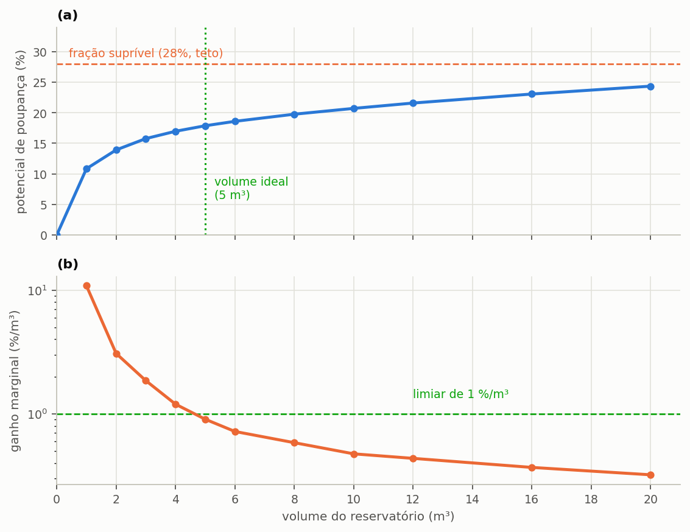
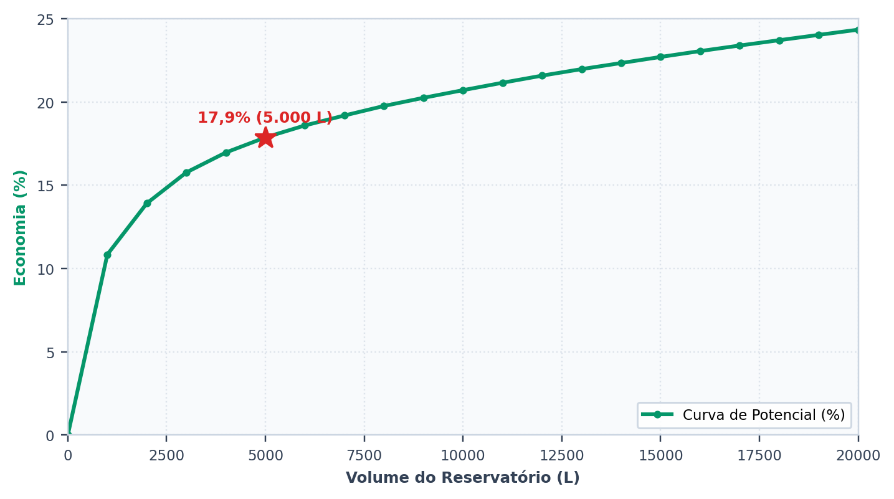
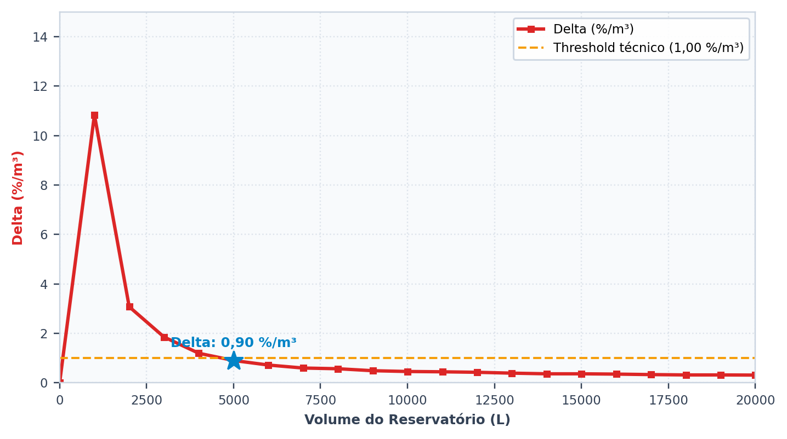
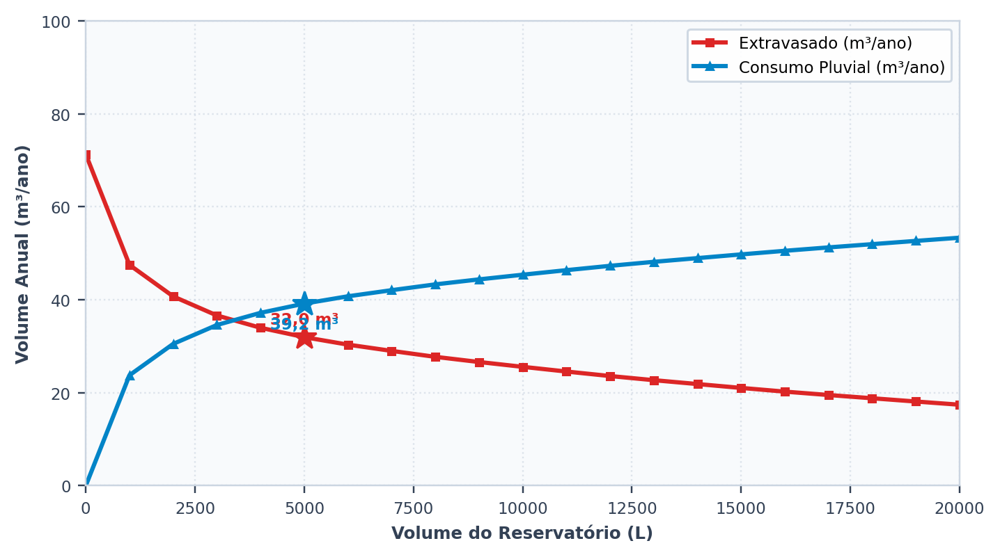
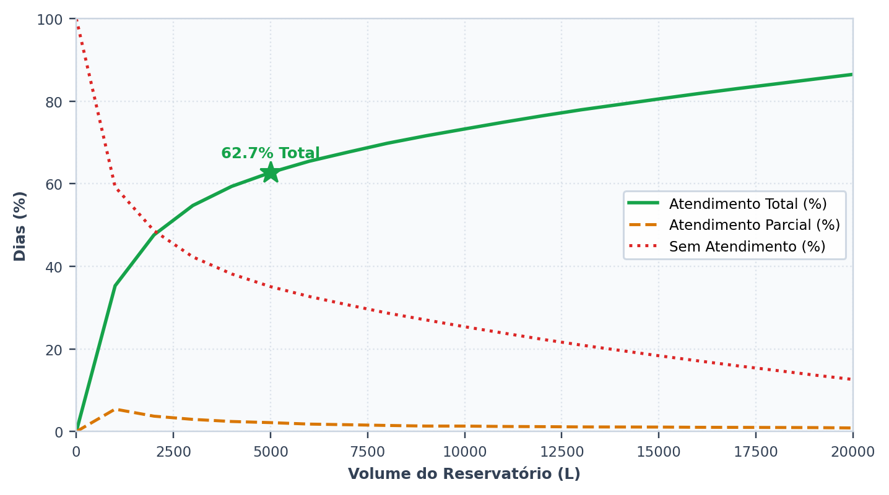
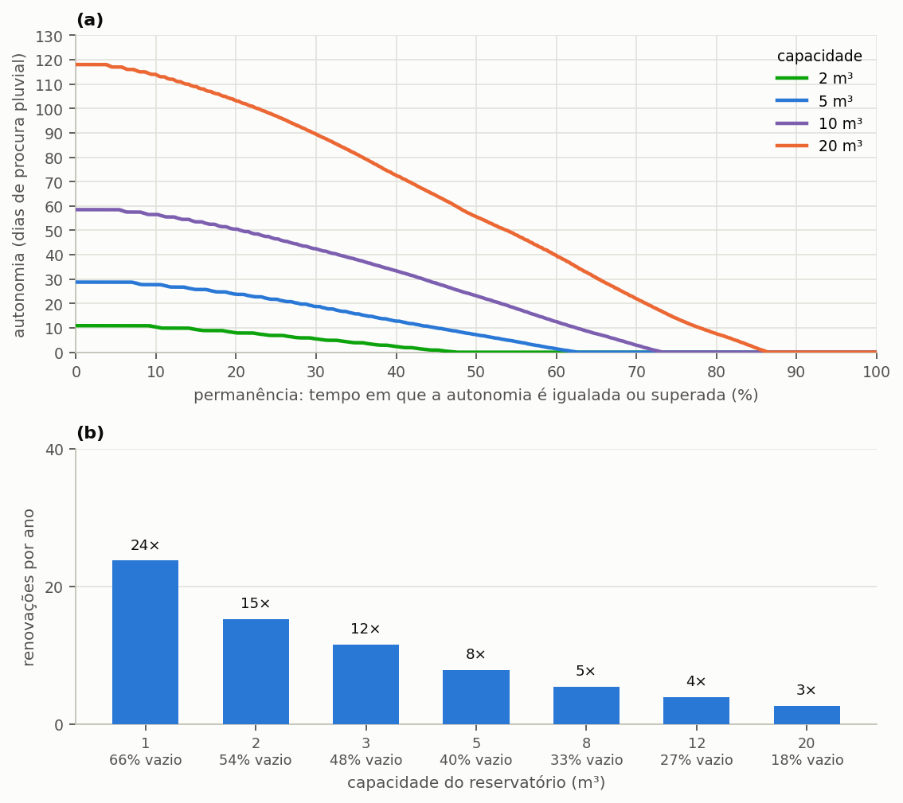

# Escolher o volume

> No fim desta secção, tem a curva de retorno do reservatório, sabe onde deixa de compensar, e percebe porque **não existe** um volume ótimo absoluto — existe um volume ótimo para um critério declarado.

A secção {{n:6}} adotou 3 000 L como primeiro palpite e encontrou 100,3 L/dia a extravasar e um atendimento pleno em apenas 54,7% dos dias. A pergunta que se impõe é quanto reservatório vale a pena ter. Não se responde com uma tentativa isolada: responde-se simulando o mesmo projeto para muitos volumes e vendo como o resultado evolui. É o que o programa chama **varredura**.

---

## Executar a varredura

Na etapa **4. Reservatório & Custos**, escolha o modo varredura e indique o volume máximo e o passo. Para o nosso projeto: máximo de 20 000 L, passo de 1 000 L.

Há duas particularidades na montagem da grelha que convém conhecer antes de interpretar o resultado. A primeira é que o passo indicado é arredondado para cima até ao múltiplo de 250 L, o quantum comercial dos reservatórios — ninguém compra uma cisterna de 1 300 L, e um ótimo apontado para esse volume seria inexequível. Quando o passo pedido não é múltiplo de 250, o programa ajusta-o e regista o ajuste, para que o relatório possa declarar o passo realmente usado.

A segunda é que a grelha se limita a quarenta volumes positivos. Uma varredura de 0 a 50 000 L com passo de 100 L exigiria quinhentas simulações de trinta anos cada, e o ganho de informação não compensa o tempo de cálculo, porque a curva é suave e quarenta pontos descrevem-na com folga. O volume máximo indicado é sempre mantido como último ponto da grelha, pelo que só o último intervalo pode ser menor do que o passo efetivo.

O volume zero faz parte da grelha como alternativa de referência: representa o cenário sem sistema, com o qual todos os outros se comparam.

---

## A curva

<!-- inclui: _tabelas/cap07_varredura.md -->

A {{fig:fig02_curva_de_retorno}} traça os resultados da tabela: o potencial de economia sobe em direção à fração atendível sem a atingir, e o ganho marginal cai mais de trinta vezes ao longo da varredura.

*Figura 99 — (a) Potencial de economia em função do volume do reservatório, que continua a subir aos 20 000 L (24,35%) sem alcançar o teto de 28%, com o volume ideal marcado; (b) ganho marginal, em escala logarítmica, com o limiar de 1 %/m³ adotado no tutorial.*

A coluna decisiva da tabela é a do **ganho por metro cúbico acrescentado**, a derivada discreta da curva de potencial, que exprime quanto cada metro cúbico adicional de reservatório acrescenta de economia. A tabela abaixo destaca alguns intervalos, e o padrão que revela é o argumento central desta secção.

<!-- tabela: Ganho marginal de economia por cada metro cúbico acrescentado ao reservatório -->
| De → para | Ganho por m³ |
| :--- | ---: |
| 0 → 1 000 L | 10,84 %/m³ |
| 1 000 → 2 000 L | 3,08 %/m³ |
| 2 000 → 3 000 L | 1,85 %/m³ |
| 3 000 → 4 000 L | 1,20 %/m³ |
| 4 000 → 5 000 L | 0,90 %/m³ |
| 10 000 → 12 000 L | 0,44 %/m³ |
| 16 000 → 20 000 L | 0,32 %/m³ |

==O primeiro metro cúbico de reservatório entrega mais de 10 pontos percentuais de economia; os de 16 para 20 m³ entregam menos de um terço de ponto cada um.== A diferença é de mais de trinta vezes, e os metros cúbicos custam o mesmo betão, a mesma escavação e a mesma mão de obra.

Aqui Lisboa difere de um clima de chuva bem repartida. A curva **não satura**: a 20 000 L ainda sobe, e só 86,5% dos dias são plenos. A razão é o verão seco. O mês mais chuvoso recebe 22,7 vezes o que recebe o mais seco, e uma cisterna maior continua a ganhar, porque guarda mais inverno para atravessar mais verão. O ganho é pequeno, mas não chega a zero.

O comportamento tem, ainda assim, a forma característica de toda a curva de aproveitamento pluvial, e decorre de dois factos que atuam em conjunto. Os primeiros litros de armazenamento captam os episódios pequenos e frequentes, que são a maioria das chuvas em qualquer regime; e o teto imposto pela fração atendível, de 28% neste projeto, puxa a curva para a horizontal à medida que o sistema dele se aproxima, de modo que o espaço restante para ganho se vai esgotando.

---

### Os quatro gráficos que o ecrã mostra

A varredura não devolve apenas a curva de potencial. O separador de resultados traz quatro gráficos que respondem a perguntas diferentes sobre o mesmo conjunto de simulações, reproduzidos a seguir com os dados deste tutorial: o potencial de economia ({{fig:fig10_programa_potencial}}), o ganho marginal ({{fig:fig11_programa_delta}}), os volumes extravasado e consumido ({{fig:fig12_programa_extravasamento}}) e a classificação dos dias ({{fig:fig13_programa_dias}}).

*Figura 28 — O primeiro gráfico do separador de resultados: o potencial de economia de água potável em função do volume do reservatório inferior. A estrela marca o volume selecionado. Figura gerada pelo próprio programa, com os dados do tutorial.*

*Figura 29 — O segundo gráfico: o ganho marginal, em pontos percentuais por metro cúbico acrescentado. É a derivada da curva anterior, e é sobre ela que opera o critério do volume ideal. Figura gerada pelo próprio programa.*

*Figura 30 — O terceiro gráfico: o volume extravasado e o volume pluvial consumido, ambos anuais, na mesma escala. As duas curvas explicam-se uma à outra, porque toda a água que deixa de extravasar passa a ser consumida. Figura gerada pelo próprio programa.*

*Figura 31 — O quarto gráfico: a repartição dos dias do período em atendidos por inteiro, atendidos em parte e não atendidos. É a leitura temporal da mesma varredura, e a única que responde à pergunta com que frequência se pode contar com o sistema. Figura gerada pelo próprio programa.*

---

## O volume ideal

Perante uma curva cujo rendimento decai desta forma, a pergunta «qual é o volume ideal?» só admite resposta depois de se estabelecer o que significa deixar de compensar. O Triton adota para isso o critério do ganho marginal: o volume ideal é o menor volume cujo ganho por metro cúbico acrescentado já desceu abaixo de um limiar declarado pelo utilizador, conforme a formulação da secção {{n:24}}.

O programa abre com um limiar de 5 %/m³, e o tutorial adota um mais exigente, de 1 %/m³. A diferença não é um pormenor: com o valor predefinido, o volume ideal deste projeto seria de 2 000 L (ganho de 3,08 %/m³); com o limiar do tutorial, o primeiro volume a descer abaixo dele é o de 5 000 L, com um ganho marginal de 0,90 %/m³. Quem refizer o tutorial tem, por isso, de alterar o limiar no programa antes de executar a varredura.

<!-- tabela: Indicadores do volume ideal obtido com o limiar de 1 %/m³ adotado no tutorial -->
| Indicador | Valor |
| :--- | ---: |
| volume ideal, limiar de 1 %/m³ | 5 000 L |
| potencial nesse volume | 17,87% |
| de um teto de | 28% |
| dias de atendimento pleno | 62,7% |

O limiar, contudo, é uma escolha do analista, e decide o resultado tanto como os dados de entrada. A tabela abaixo mostra o volume ideal que cada limiar plausível produziria para este mesmo projeto.

<!-- inclui: _tabelas/cap07_limiar_e_custo.md -->

O programa não emite opinião sobre qual seria o limiar correto, e não poderia: a escolha depende do custo do reservatório, do valor da água no concelho e do espaço disponível no terreno, nenhum dos quais é um dado hidrológico. O que o programa faz é aplicar fielmente o limiar declarado e registá-lo no relatório.

> **Num estudo publicado, declare o limiar.** Dois artigos com «volume ideal» de limiares diferentes não são comparáveis. Entre o primeiro e o último limiares da tabela, a diferença é de 6 000 L de reservatório, que compram 4,48 pontos percentuais de economia.

---

## Porque o critério do ganho marginal não basta

O critério do ganho marginal é puramente hidráulico: olha para a curva de aproveitamento e para mais nada. Não sabe quanto custa o reservatório, quanto vale o metro cúbico de água no concelho em causa, nem quanto carbono traz consigo o material escolhido. Desta cegueira decorrem três consequências, e cada uma pode deslocar a recomendação num sentido diferente.

- Se a água for muito cara, o ganho de 0,90 %/m³ do quinto metro cúbico pode pagar-se bem, e o volume económico será **maior** do que o hidráulico.
- Se a cisterna for cara ou o espaço escasso, o inverso.
- Uma cisterna de betão de 20 m³ pesa 24 toneladas e traz, com o resto do sistema, cerca de **3,5 toneladas de CO₂e** incorporado (3 546 kg), contra cerca de uma tonelada na de 5 m³ (1 026 kg). Os últimos metros cúbicos acrescentam pouca economia, e não têm como compensar a diferença.

São três critérios e três respostas diferentes para a mesma pergunta, e nenhuma é mais legítima do que as outras em abstrato. É por isso que o tutorial não acaba aqui: as secções {{n:10}} e {{n:11}} acrescentam à análise, respetivamente, o dinheiro e o carbono, e a secção {{n:12}} põe as três dimensões na mesma mesa, com pesos declarados, para chegar a um volume de compromisso que se possa defender.

> **O engano mais comum, e está na secção {{n:33}}.** Publicar o volume de maior economia de água como se fosse o volume recomendado. Pela tabela, 20 000 L dão o maior potencial, 24,35%. A cisterna de betão custa **3,3 vezes mais** do que a de 5 000 L (2 600 € contra 8 600 €; preços ilustrativos, não são preços de mercado) e traz **3,5 vezes mais carbono incorporado**, para entregar 6,47 pontos percentuais a mais.

---

A varredura tem ainda uma leitura que a tabela não mostra: quanto da capacidade o consumo realmente usa. Medir o reservatório pelo nível engana, porque a cisterna grande parece sempre cheia justamente por guardar água que a procura nunca chega a retirar. A {{fig:fig47_permanencia}} mede a capacidade pelo consumo, de duas maneiras. A primeira é a **autonomia armazenada**, o volume no fim de cada dia dividido pela procura pluvial diária de 168 L, apresentada como curva de permanência. A segunda é o número de **renovações por ano**, a razão entre o consumo pluvial anual e a capacidade, que diz quantas vezes o volume da cisterna é realmente consumido e reposto.

A cisterna pequena renova o seu volume muitas vezes por ano e termina o dia vazia com frequência: a capacidade é inteiramente usada, e falta água. A grande renova-o poucas vezes e raramente se esvazia, mas guarda, na maior parte dos dias, semanas de procura, mais do que a estiagem registada exigiria. Essa reserva que o consumo não chega a mobilizar é o que o investimento adicional compra, e é a leitura física do retorno decrescente da curva de potencial. Em Lisboa, onde o verão é longo, esta leitura é menos severa do que numa chuva bem repartida: parte da reserva é de facto consumida em agosto.

*Figura 99 — Uso da capacidade do reservatório inferior no projeto do tutorial, com procura pluvial de 168 L/dia: (a) curvas de permanência da autonomia armazenada no fim de cada dia, em dias de procura pluvial, para vários volumes; (b) renovações anuais do volume, dadas pela razão entre o consumo pluvial anual e a capacidade, com a fração de dias em que o reservatório termina vazio (até 5% da capacidade) indicada sob cada volume.*

---
## Mais duas leituras da tabela

**O extravasamento não chega a zero.** Parte de 195 L/dia sem reservatório e desce para 48 L/dia com vinte metros cúbicos, e ainda não estabilizou. Parte da água que a cobertura capta continuará a ir para a drenagem, por uma razão que nenhum aumento do reservatório resolve: a procura simplesmente não a consome. Os sistemas de aproveitamento pluvial não retêm água por reter, e quem procura amortecer cheias precisa de um reservatório de retenção, que é outro projeto, com outro critério de dimensionamento.

**A fiabilidade cresce mais depressa do que o potencial.** Ao passar de 3 000 para 4 000 L, o potencial de economia ganha 1,20 pontos percentuais, ao passo que os dias de atendimento pleno sobem de 54,7% para 59,4%. Quando o critério de projeto é o conforto de uso — não faltar água da chuva nos pontos que a utilizam — e não a poupança na fatura, a leitura da mesma tabela leva a outra escolha.

---

## O que temos até aqui

O tutorial adota 5 000 L e segue. É o volume ideal pelo critério hidráulico com o limiar de 1 %/m³, e é o valor que o projeto leva até à secção {{n:12}}, onde será posto em causa outra vez, agora com o dinheiro e o carbono incorporados na análise.

<!-- tabela: Estado do projeto do tutorial depois da escolha do volume -->
| Projeto até aqui | |
| :--- | ---: |
| série | Lisboa, 30 anos |
| área de captação | 150 m² |
| procura total | 600 L/dia |
| fração atendível | 28% |
| **volume do reservatório** | **5 000 L** |
| potencial de economia | 17,87% |
| dias de atendimento pleno | 62,7% |

Resta uma decisão hidráulica antes de se poder falar de dinheiro: esta água precisa de subir para um reservatório elevado, ou pode ser pressurizada diretamente a partir da cisterna? É o assunto da secção {{n:8}}.
