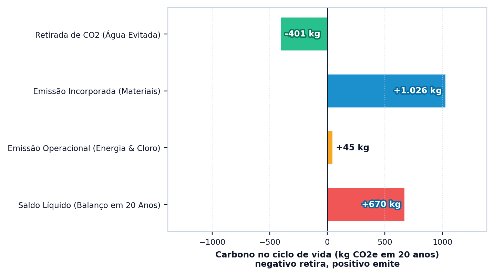
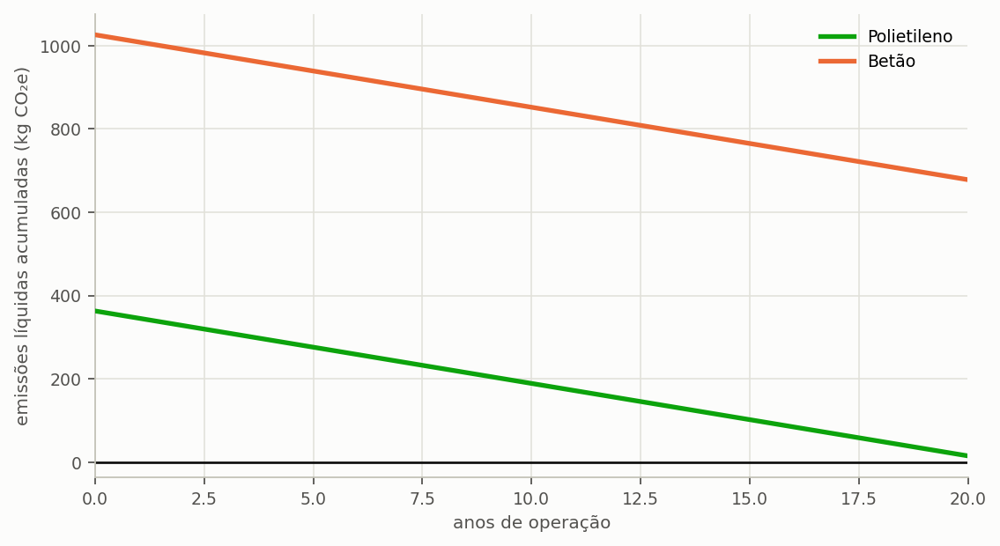
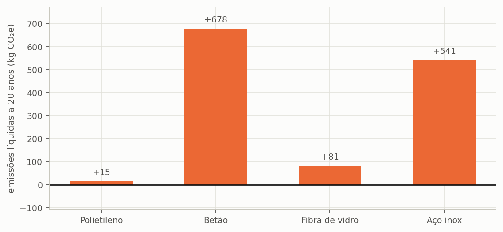
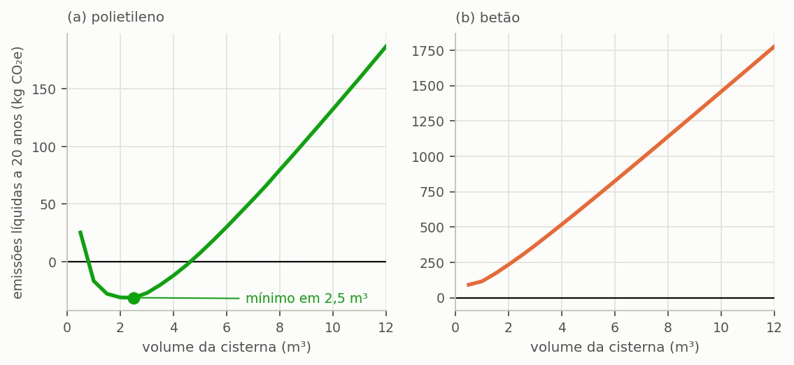

# Quanto carbono evita

> No fim desta secção, tem o balanço de carbono do sistema e uma surpresa: com a cisterna que escolhemos, o projeto **emite mais do que evita** ao longo da vida útil. E a troca de material, ao contrário do que seria de esperar, não resolve o problema.

---

## A conta

Um sistema de aproveitamento pluvial evita emissões porque cada metro cúbico que entrega deixa de ser captado, tratado e bombeado pela entidade gestora, e estas três operações consomem energia. O mesmo sistema, porém, emite carbono em três frentes próprias: o fabrico dos seus componentes, a energia consumida na bombagem interior e os consumíveis de tratamento aplicados à água.

O saldo ambiental do sistema é a diferença entre o que evita e o que emite, e a pergunta que organiza esta secção é em quantos anos o crédito anual líquido amortiza a dívida contraída no fabrico. Esse prazo é o **retorno do carbono**, e desempenha na dimensão ambiental o papel que o período de recuperação desempenha na dimensão económica.

> **Os fatores são ilustrativos.** A Edição Ibérica não traz fatores de emissão: a avaliação ambiental não é calculada até introduzir os do local do projeto (apêndice {{n:C}}). O tutorial usa dois números redondos, **0,40 kg CO₂e por quilowatt-hora** de eletricidade da rede e **0,50 kg CO₂e por metro cúbico** de água da rede evitada. São ilustrativos, não são dados de nenhum país, escolhidos para se poder seguir o método; a lição está na forma do resultado, não nos dígitos. Este manual não cita fatores portugueses: quem os introduzir deve indicar a fonte oficial aberta e o ano do fator de emissão da eletricidade da rede e da intensidade carbónica do abastecimento de água.

Para o nosso projeto, uma cisterna de betão de 5 000 L com elevação para o reservatório superior de 1 000 L:

<!-- tabela: Balanço de carbono do projeto do tutorial com cisterna de betão (fatores ilustrativos) -->
| Parcela | Valor |
| :--- | ---: |
| carbono incorporado no sistema | 1 026 kg CO₂e |
| emissão evitada por ano | 19,6 kg CO₂e |
| emissão anual de bombagem e tratamento | 2,2 kg CO₂e |
| saldo líquido anual | 17,4 kg CO₂e |
| **retorno do carbono** | **59,0 anos** |
| saldo ao fim de 20 anos | **+678 kg CO₂e** |

São 59 anos para amortizar a dívida de carbono, contra uma vida útil adotada de vinte. ==O sistema não se paga, portanto, do ponto de vista ambiental:== quando for desativado, terá emitido 678 kg CO₂e a mais do que evitou durante toda a operação.

E o resultado financeiro do mesmo projeto também foi negativo (secção {{n:10}}). Os dois veredictos coincidem, mas por razões diferentes, e as secções seguintes mostram-no: o carbono é decidido pela massa da cisterna, o dinheiro pela tarifa. É por isso que as dimensões de análise devem ser mantidas separadas até ao momento da decisão.

---

## Porque a poupança de carbono é tão pequena

Dezanove quilogramas e meio de CO₂e por ano parecem pouco para 39,2 metros cúbicos de água poupada, e com estes fatores são: 0,50 kg CO₂e por metro cúbico substituído, descontada a energia para o bombear.

A explicação está na natureza do produto substituído. A água tratada não é um bem intensivo em carbono. Captar, tratar e distribuir a água custa uma fração de quilograma de CO₂e por metro cúbico entregue, conforme o mix elétrico local e a origem da água, e isso é modesto quando comparado com o carbono do betão, do aço ou dos combustíveis. Substituir um produto de baixa intensidade de carbono por outro que exige o fabrico de um reservatório não produz, portanto, o ganho ambiental que a intuição sugere.

> **A fronteira importa.** O fator do programa é por metro cúbico **entregue** ao edifício, e não por metro cúbico produzido na estação. As perdas na distribuição fazem com que um metro cúbico produzido entregue menos de um: usar o fator à saída da estação subestimaria a emissão evitada. A secção {{n:30}} detalha.

---

O separador ambiental apresenta o mesmo balanço em forma gráfica, com as parcelas de emissão e o crédito da água evitada separados ({{fig:fig50_programa_balanco_ambiental}}).

*Figura 99 — O gráfico do separador ambiental para o mesmo projeto, com cisterna de betão: as parcelas do balanço de carbono em vinte anos, com fatores ilustrativos. O sinal segue a convenção adotada em todo este capítulo: emissões positivas, água evitada negativa. Figura gerada pelo próprio programa.*

---
## O material muda a dimensão, não o sinal

A dívida de carbono está quase toda na cisterna. E uma cisterna de 5 000 L pode pesar 75 kg ou 6 000 kg, conforme o material. A tabela seguinte e a {{fig:fig06_carbono_no_tempo}} mostram a trajetória das emissões líquidas ao longo da vida útil, e a {{fig:fig04_materiais}} o resultado final de cada material.

==Em todo este capítulo, **positivo emite e negativo retira**. É a convenção do gráfico de balanço do separador ambiental do programa, e a que mantém intuitiva a leitura de um gráfico de emissões: a linha que desce é a que melhora.==

<!-- inclui: _tabelas/cap11_materiais.md -->

*Figura 99 — Emissões líquidas acumuladas da cisterna de 5 000 L ao longo da vida útil, para polietileno e betão, com fatores ilustrativos. A curva parte do carbono incorporado no fabrico, acima de zero, e desce com o crédito anual da água potável evitada; o polietileno cruza o zero aos 20,9 anos, logo depois do horizonte de vinte anos adotado, e o betão aos 59,0 anos.*

*Figura 99 — Emissões líquidas em vinte anos da cisterna de 5 000 L, por material, com fatores ilustrativos. Os quatro materiais encerram a vida útil a emitir mais do que evitaram; o polietileno fica praticamente na fronteira (+15 kg) e o betão, o mais pesado, longe dela (+678 kg).*

**A escolha do material muda a dimensão do problema, mas aqui não inverte o sinal.**

Com a chuva de Lisboa, que dá pouca água poupada, nenhum material paga o próprio fabrico em vinte anos. O polietileno leva 20,9 anos e termina os vinte anos a emitir ainda 15 kg: está praticamente na fronteira. A fibra de vidro leva 24,7 anos e termina com +81 kg. O aço inoxidável leva 51,1 anos e termina com +541 kg. O betão leva 59,0 anos e termina com +678 kg. Com 28% de fração atendível e 39,2 m³ poupados por ano, só os materiais leves chegam perto de pagar o fabrico.

A segunda tabela mostra o outro lado da mesma moeda: em betão, **quanto maior a cisterna, pior o carbono**. A de 2 000 L fecha os vinte anos a emitir 240 kg; a de 8 000 L, 1 147 kg, e o seu retorno do carbono estica-se até 80,0 anos. Cada metro cúbico de betão acrescenta cerca de 150 kg CO₂e e rende cada vez menos água.

---
## Existe um volume ambientalmente ótimo

A observação anterior vale para o betão, mas é um caso particular de algo mais geral. O carbono incorporado cresce de forma quase afim com o volume; a água evitada cresce com o atendimento, que satura. A soma das duas parcelas tem um **mínimo interior**: existe um volume a partir do qual cada litro a mais de armazenamento emite mais do que evita. A {{fig:fig06b_otimizacao_ambiental}} mostra as duas curvas.

*Figura 99 — Emissões líquidas em vinte anos contra o volume da cisterna, para (a) polietileno e (b) betão, no projeto do tutorial, com fatores ilustrativos. Em polietileno (com o reservatório superior de 1 000 L), o balanço é o melhor, entre os volumes testados, aos 2 000 L, onde retira 25 kg; passa a emissão entre 4 000 e 5 000 L (retira 5 kg aos 4 000 L e emite 15 kg aos 5 000 L) e emite 194 kg aos 12 000 L. Em betão, as emissões líquidas são positivas em toda a gama.*

==Mais armazenamento não é monotonicamente melhor para o clima.== É o contrário do que a intuição corrente sugere, e decorre de uma propriedade simples: a saturação do atendimento. O volume que minimiza as emissões (2 000 L) não é o que maximiza a poupança de água, nem o que o critério do ganho marginal escolheu (5 000 L) — e a secção {{n:12}} trata de como decidir entre eles.

> **O material mais leve é também o melhor para o carbono, a um preço próximo.** Com os preços ilustrativos, o polietileno custa 2 850 € contra 2 600 € do betão (ilustrativo, não são preços de mercado) — o preço mal os separa —, mas pesa cerca de cinquenta e cinco vezes menos e é o material que fecha os vinte anos com as menores emissões líquidas dos quatro.
>
> Isto não é sorte. Massa é carbono, e o betão armado é, de longe, o material mais maciço da lista.

---

## Quando o betão ainda faz sentido

A tabela não condena o betão. Diz que precisa de justificação.

- **Vida útil maior.** O programa adota 20 anos para todos os materiais. É um piso, não uma previsão: uma cisterna de betão bem executada pode durar muito mais, e num horizonte superior a 59 anos o retorno do carbono paga-se, embora sem folga. Se adotar uma vida útil diferente, **declare-a** e justifique-a. Este manual não cita nenhuma norma para a vida útil; se fundamentar a sua por norma, indique a fonte aberta.
- **Volumes grandes.** Para volumes muito grandes, os reservatórios de polietileno de fábrica deixam de ser práticos e o betão moldado no local pode ser a única opção viável.
- **Restrição de espaço.** Uma cisterna enterrada de betão adapta-se ao terreno; a de polietileno vem em formatos fixos.
- **Estrutura já existente.** Um reservatório de betão reaproveitado de outra finalidade tem carbono incorporado **zero** para efeito deste projeto.

---

## A decisão do tutorial

**Trocamos para polietileno.**

É o que um projetista faria perante esta tabela, e é o que torna este tutorial honesto: um estudo muda de rumo quando a análise mostra que o rumo estava errado. A troca não faz o sistema pagar-se, nem em dinheiro nem em carbono, mas faz a diferença onde ela importa:

<!-- tabela: Efeito da troca de betão por polietileno nas três dimensões de análise (ilustrativo, não é preço de mercado) -->
| (ilustrativo, não é preço de mercado) | Betão | Polietileno |
| :--- | ---: | ---: |
| preço da cisterna | 2 600 € | 2 850 € |
| investimento total | 6 650 € | 6 900 € |
| período de recuperação | sem recuperação | sem recuperação |
| VAL a 20 anos | −5 829 € | −6 079 € |
| retorno do carbono | 59,0 anos | 20,9 anos |
| emissões líquidas em 20 anos | +678 kg | +15 kg |

A troca custa 250 € a mais e empurra o VAL para −6 079 €, mas reduz o retorno do carbono de 59,0 para 20,9 anos e as emissões líquidas de 678 para 15 kg. O potencial de poupança não muda.

<!-- tabela: Estado do projeto do tutorial depois da análise ambiental (ilustrativo, não é preço de mercado) -->
| Projeto até aqui (ilustrativo, não é preço de mercado) | |
| :--- | ---: |
| volume | 5 000 L |
| **material** | **polietileno** |
| investimento | 6 900 € |
| VAL | −6 079 € |
| período de recuperação | sem recuperação |
| retorno do carbono | 20,9 anos |

---

## O que declarar

A avaliação do ciclo de vida do Triton é de **triagem**, não um inventário completo. Todos os fatores predefinidos têm proveniência declarada, mas alguns são aproximações, como o da eletrobomba e o do hipoclorito, e um fator escrito sem fonte recebe uma etiqueta de triagem, que o programa mostra. Num estudo publicado:

- declare a **fronteira** adotada, água entregue e não produzida;
- declare a **vida útil** e justifique-a;
- declare quais os fatores que são aproximações e quais foram introduzidos sem fonte;
- declare a **base da rede elétrica** e o ano.

O apêndice {{n:C}} traz a proveniência de cada fator, e a secção {{n:30}} explica as sete etapas do inventário.

Temos agora três respostas. O potencial diz um volume, o dinheiro diz outro, o carbono diz um terceiro. É hora de escolher.
