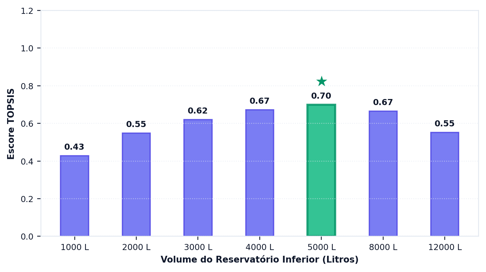
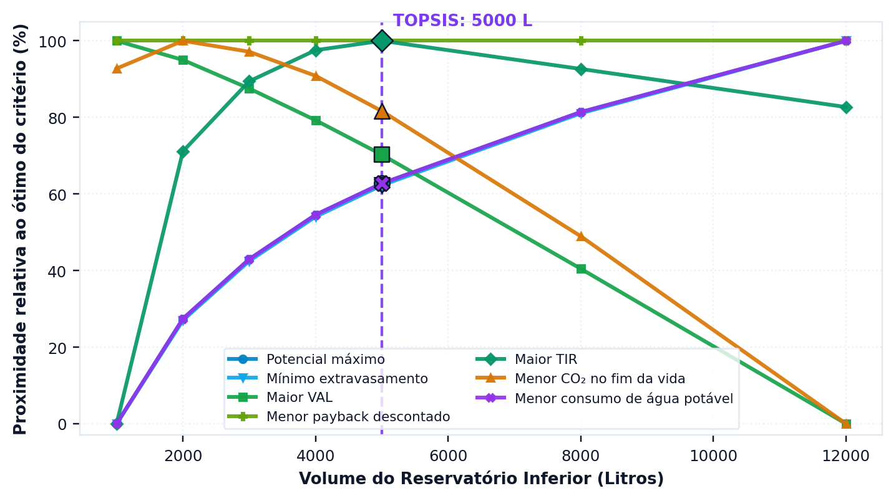

# Que volume escolher, afinal

> No fim desta secção, tem um volume recomendado e sabe que ele depende de pesos que **o utilizador** declarou — e não de uma verdade que o programa descobriu.

---

## Três critérios, três respostas

As secções anteriores deste tutorial fizeram ao mesmo projeto três perguntas distintas — quanta água entrega, quanto dinheiro rende e quanto carbono evita — e receberam três respostas que não coincidem. Esta discordância não é defeito da análise nem inconsistência dos dados: mostra que os três critérios medem coisas diferentes e se comportam de maneira diferente em relação ao volume do reservatório.

<!-- inclui: _tabelas/cap12_multicriterio.md -->

A primeira tabela é o retrato do problema. Repare em como as colunas discordam:

- O **potencial** cresce monotonicamente: quanto maior a cisterna, mais água. Máximo em 12 000 L (21,43%).
- O **VAL** é negativo em todos os volumes (os custos são ilustrativos, não são preços de mercado). O seu melhor valor, a menor perda, está em 1 000 L, e piora a cada volume acrescentado, porque cada metro cúbico adicional de reservatório custa mais do que a poupança que traz. Nenhum volume tem período de recuperação.
- O **carbono** sobe e cai muito mais cedo: máximo em 2 000 L (retira 25 kg em vinte anos). Depois disso, cada metro cúbico de polietileno acrescenta mais dívida do que crédito, e aos 5 000 L o saldo já passa a emissão.

==Não existe um volume que vença nos três critérios em simultâneo.== Cada um tem o seu ótimo num ponto diferente da curva, e a escolha entre eles não é uma questão técnica com resposta única: é uma questão de prioridade, que tem de ser declarada por quem decide e não pode ser descoberta pelo programa. É exatamente essa a lacuna que os métodos multicritério vêm preencher.

---

## Como o TOPSIS resolve

O programa usa o TOPSIS sobre **sete critérios**:

<!-- tabela: Os sete critérios do multicritério e o sentido de preferência de cada um -->
| Critério | Sentido |
| :--- | :--- |
| potencial de economia | maximizar |
| extravasamento | minimizar |
| valor atual líquido | maximizar |
| período de recuperação descontado | minimizar |
| taxa interna de rentabilidade | maximizar |
| CO₂e no fim da vida | minimizar |
| consumo de água potável | minimizar |

O método funciona em quatro passos encadeados. Primeiro, normaliza a matriz de decisão, para que critérios medidos em unidades incomparáveis — pontos percentuais, euros, quilogramas de dióxido de carbono equivalente e anos — passem a ocupar a mesma escala. Depois, aplica os pesos declarados. Calcula então, para cada alternativa de volume, a distância euclidiana à solução ideal, formada pelos melhores valores de cada critério, e à solução anti-ideal, formada pelos piores. Por fim, ordena as alternativas pela proximidade relativa ao ideal, conforme a formulação da secção {{n:32}}.

Aplicado ao projeto do tutorial com pesos iguais entre as três dimensões, repartidos igualmente pelos critérios de cada uma, o método indica o volume de 5 000 L.

> **Três declarações que um estudo publicado tem de fazer.**
>
> A normalização do programa é uma **variante** de Hwang e Yoon: translada por `x − min(x)` antes da normalização vetorial, para admitir um VAL negativo. É uma escolha deliberada, e apresentá-la como TOPSIS canónico seria incorreto.
>
> O SMAA-VIKOR, disponível ao lado, sorteia pesos e devolve a probabilidade de cada volume ocupar cada posição. É a resposta certa quando não há consenso sobre os pesos.
>
> As condições C1 e C2 de Opricovic, de vantagem aceitável e de estabilidade, **não estão implementadas**. A secção {{n:32}} detalha.

---

O separador de decisão apresenta o escore de cada volume candidato ({{fig:fig51_programa_topsis}}).

*Figura 99 — O gráfico do separador de decisão: o escore de proximidade ao ideal de cada volume candidato, com o vencedor destacado. Escores próximos entre si significam alternativas tecnicamente equivalentes, e nesse caso a escolha passa a depender do peso declarado. Figura gerada pelo próprio programa.*

---
## O peso muda a resposta

A tabela seguinte mostra o que acontece ao deslocar o peso.

<!-- inclui: _tabelas/cap12_pesos.md -->

Privilegiar o critério técnico desloca a recomendação para 8 000 L, o que era de esperar: o potencial de economia cresce monotonicamente com o volume, e um peso dominante nessa dimensão empurra a escolha para cima. Os critérios económico e ambiental, por seu lado, ficam ambos nos 5 000 L dos pesos iguais.

Esta convergência, contudo, não é regra geral, e lê-la como tal seria generalizar indevidamente um caso particular. Isoladamente, o critério financeiro prefere 1 000 L e o ambiental 2 000 L; o ordenamento cai em 5 000 L porque o TOPSIS pesa também os restantes critérios de cada dimensão, entre os quais os hídricos (potencial, extravasamento, consumo de água potável), que favorecem volumes maiores. Com outro tarifário ou outros custos, o ótimo económico deslocar-se-ia, e a divergência entre os critérios apareceria com clareza.

O ordenamento multicritério escolhe um volume; não diz se se deve construir. Neste tutorial, todos os volumes têm VAL negativo e nenhum período de recuperação, com os custos ilustrativos, pelo que a dimensão financeira argumenta contra construir seja o que for. Se o projeto avançar, é pelas razões que as outras dimensões apresentam ou por um fim que o fluxo de caixa não mede, e o relatório tem de o dizer.

> **Declare os pesos.** «Volume ótimo pelo TOPSIS» sem os pesos é uma afirmação impossível de reproduzir. Dois artigos com pesos diferentes chegam a volumes diferentes, e ambos estão certos.

---

Uma solução de compromisso cede em alguma coisa, e convém saber em quê. O programa desdobra o escore único em sete, um por critério, e mostra a distância que separa a alternativa escolhida do melhor valor alcançado em cada um ({{fig:fig52_programa_proximidade}}).

*Figura 99 — O segundo gráfico do separador de decisão: o quanto o volume escolhido se aproxima do melhor valor possível em cada um dos sete critérios. É a figura que mostra o que a solução de compromisso está a ceder, e em que dimensão. Figura gerada pelo próprio programa.*

---
## A recomendação do tutorial

A recomendação do tutorial, se o projeto for construído, é o reservatório de **5 000 L em polietileno**, e a razão para a adotar não é só vencer com pesos iguais. É o volume de compromisso, não o ótimo financeiro, que está em 1 000 L, nem o ótimo ambiental, que está em 2 000 L. Vence também com um peso económico dominante e com um peso ambiental dominante, e perde para os 8 000 L apenas com um peso técnico dominante. Sob a incerteza simulada dos pesos (SMAA), fica em primeiro lugar em 34,1% dos sorteios, contra 30,6% para 8 000 L e 15,6% para 4 000 L. ==Uma recomendação que sobrevive a três ponderações diferentes é robusta justamente porque não depende de nenhuma delas==, embora a margem do SMAA seja estreita.

Vale registar ainda que este é o mesmo volume que o critério hidráulico da secção {{n:7}} tinha indicado, com um limiar de ganho marginal de 1 %/m³. Duas vias metodologicamente independentes — uma que olha só para a curva de aproveitamento e outra que pondera sete critérios de três dimensões — chegaram ao mesmo resultado, e essa concordância reforça a confiança na recomendação.

A concordância, porém, não está garantida em nenhum outro caso, e é por isso que o tutorial fez o caminho longo em vez de parar na secção {{n:7}}. O propósito não era chegar mais depressa ao volume, mas saber que as duas vias concordam **neste** projeto, em vez de supor que concordam sempre.

---

## O projeto, fechado

<!-- tabela: Resumo do projeto do tutorial, com todos os parâmetros e resultados -->
| Triton · moradia unifamiliar em Lisboa (custos ilustrativos, não são preços de mercado) | |
| :--- | ---: |
| série de precipitação | Lisboa, 30 anos, 719 mm/ano |
| área de captação | 150 m² |
| coeficiente de escoamento | 0,85 |
| descarte das primeiras águas | 2,0 mm, todas as chuvadas |
| moradores | 4 |
| procura total | 600 L/dia |
| fração atendível pela chuva | 28% |
| reservatório inferior | 5 000 L, polietileno |
| arranjo de abastecimento | elevação para reservatório superior |
| reservatório superior | 1 000 L, limiar de acionamento de 100 L |
| classe de qualidade | 1, cloragem por pastilhas |
| descarte inicial | câmara de 300 L |
| **potencial de economia de água potável** | **17,88%** |
| dias de atendimento pleno | 62,8% |
| água da chuva consumida | 39,2 m³/ano |
| energia da elevação | 5,1 kWh/ano |
| investimento (ilustrativo) | 6 900 € |
| **valor atual líquido a 20 anos (ilustrativo)** | **−6 079 €** |
| período de recuperação descontado | sem recuperação |
| **emissões líquidas em 20 anos** | **+15 kg CO₂e** |
| retorno do carbono | 20,9 anos |

Resta uma etapa, que é comunicar o resultado: um estudo que não é relatado de forma verificável não se distingue, para quem o lê, de um palpite bem apresentado. É o assunto da secção seguinte.
