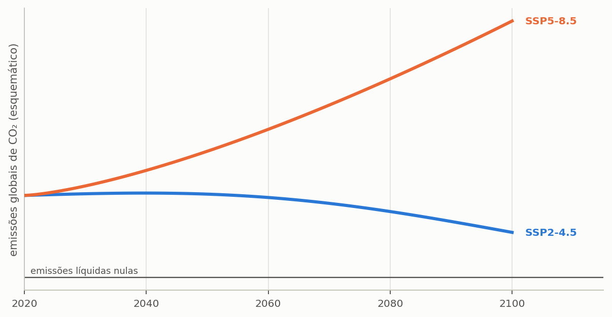

# Usar um cenário climático futuro

> **Pergunta a que este guia responde:** o sistema que dimensiono hoje ainda serve em 2060?

> **As suas projeções.** A Edição Ibérica não traz base de projeções climáticas. A base E-OBS que acompanha o programa é observada (1950 a 2025) e não contém futuro. O método deste guia aplica-se tal como está a séries projetadas que carregue como ficheiros de chuva: por exemplo, séries diárias com correção de viés de um serviço climático nacional ou de um estudo de regionalização. O guia diz o que pedir a essas séries e como compará-las. O sítio do Instituto Português do Mar e da Atmosfera (IPMA, https://www.ipma.pt, consultado em 16/10/2026) tem uma ligação para o «Portal do Clima». Não verificado nesta versão: o conteúdo do Portal do Clima (séries diárias de precipitação projetada, modelos, cenários, resolução e condições de utilização); este manual não afirma nada sobre ele.

Um reservatório de água da chuva dura trinta anos ou mais, e a chuva que cairá sobre o edifício durante esse período não será a mesma que caiu no passado recente. Dimensionar um sistema de vida longa só sobre a série histórica supõe, implicitamente, um clima estacionário — uma suposição que as projeções disponíveis não sustentam. O Triton não pode fornecer as projeções para o seu local, mas corre o mesmo projeto sobre qualquer série que lhe dê, para que o dimensionamento possa incorporar esta questão de forma explícita.

---

## O que a série projetada tem de ser

Verifique quatro coisas em qualquer série projetada antes de a carregar.

**Tem de ser diária e em milímetros.** O programa lê um valor por dia, como em qualquer ficheiro de chuva (apêndice {{n:F}}). Projeções mensais não servem: o reservatório responde à distribuição dos dias.

**Deve ter correção de viés.** Os modelos climáticos globais têm uma resolução de dezenas a centenas de quilómetros e reproduzem mal a chuva local: tendem a errar a frequência dos dias de chuva, a intensidade e os extremos. Uma série que não tenha sido ajustada à distribuição observada vai falsear o rendimento, normalmente num sentido que não se sabe prever. A correção melhora a estatística; não transforma um mau modelo num bom, e não consegue corrigir uma tendência implausível.

**Representa uma célula de grelha, não uma estação.** A série de um lugar é a da célula que o contém, pelo que descreve a chuva média de uma área e não a de um pluviómetro. Em relevo acidentado ou no litoral, a diferença entre a célula e o lote pode ser grande. A série do Funchal que acompanha o programa é deste tipo (reanálise ERA5, célula de cerca de 9 km), e a E-OBS é uma grelha de 0,1°.

**O seu histórico é simulado.** A parte histórica de uma série de modelo não é a chuva observada, mas a simulação do modelo para esse período, corrigida para ter a mesma **estatística** que a observação. A cronologia não coincide: um dia de chuva na série do modelo não corresponde a um dia de chuva real. Por isso, a comparação certa para um cenário futuro é com o **histórico do mesmo modelo**, não com a série observada. Misturar as duas atribuiria ao clima futuro a diferença entre a observação e o modelo.

---

## Escolher cenário e janela

O **cenário** representa a trajetória futura das emissões de gases com efeito de estufa. Os cenários não são previsões, mas hipóteses coerentes sobre o comportamento socioeconómico global ao longo do século ({{fig:fig44_cenarios}}). Uma trajetória intermédia estabiliza e depois reduz as emissões; uma trajetória intensiva em combustíveis fósseis supõe emissões altas e crescentes, sem mitigação efetiva.

*Figura 99 — A forma de duas trajetórias de emissão típicas. A trajetória intermédia tem emissões que se estabilizam e depois caem; a intensiva em combustíveis fósseis supõe emissões altas e crescentes, sem mitigação efetiva. A figura mostra a forma de cada uma, não valores projetados.*

A **janela temporal** é o recorte da série futura sobre o qual o estudo se faz. O programa deixa recortar qualquer período, nas datas inicial e final da etapa **1. Projeto e Chuva**. A convenção mais usada é tomar janelas de trinta anos, a mesma duração das normais climatológicas; a etapa avisa quando o recorte tem menos de dez anos. A escolha da janela deve ter relação com a vida útil pretendida do sistema: avaliar um reservatório de vinte anos, instalado agora, contra o fim do século avalia um período em que já terá sido substituído.

A escolha do **modelo climático** é a mais delicada das decisões, e dedica-se-lhe adiante uma subsecção própria.

---

## Como conduzir o estudo

O procedimento certo é correr o mesmo projeto em cada combinação de interesse e comparar os resultados entre si, em vez de dimensionar diretamente sobre a série projetada. Quatro passos resumem-no.

1. Feche o dimensionamento com a série **histórica**. É a referência.
2. Corra o mesmo projeto sobre o **histórico simulado** de cada modelo que for usar. É contra ele, e não contra a série observada, que o futuro se compara.
3. Mantenha todos os outros parâmetros e troque só a série, para cada cenário e janela.
4. Compare o **potencial de economia** e os **dias de atendimento pleno**, sempre como diferença entre o futuro e o histórico do mesmo modelo. O segundo costuma degradar-se mais do que o primeiro, porque o que muda primeiro é a distribuição, não o total.

> **Um exemplo de leitura.** Suponha que, com um modelo, o potencial é de 15% no histórico simulado e de 13% numa janela futura, e que a série observada dá 17%. A mudança atribuível ao clima é de dois pontos, e não de quatro: os dois pontos restantes são a diferença entre o modelo e a observação, que existe também no passado. (Os números são hipotéticos, para mostrar a aritmética.)

> **O que não fazer.** Dimensionar diretamente sobre a série futura e apresentar o resultado como projeto. A série futura é uma projeção com grande incerteza; serve para testar a **robustez** de um dimensionamento feito sobre o histórico, não para o substituir.

---

## A escolha do modelo, e porque pesa tanto

Modelos climáticos diferentes projetam futuros diferentes para a mesma cidade sob o mesmo cenário de emissões, e essa dispersão não é ruído a eliminar: é a expressão honesta da incerteza física do problema. Para a chuva, a dispersão entre modelos costuma ser maior do que a diferença entre cenários de emissão, o que significa que a escolha do modelo pode pesar mais no resultado do que a escolha do futuro socioeconómico. A consequência para o projeto é direta: correr os dois cenários com um só modelo informa menos do que correr um cenário com vários modelos.

Três condutas são defensáveis perante esta dispersão, apresentadas aqui por ordem decrescente de rigor.

**Conjunto.** Corra todos os modelos disponíveis e reporte a gama de resultados, com a mediana. É o mais rigoroso e o mais caro em tempo de cálculo. A secção {{n:19}} mostra como fazê-lo em lote.

**Subconjunto justificado.** Escolha alguns modelos com bom desempenho documentado para a sua região, e declare o critério de escolha e a fonte.

**Modelo único, declarado como tal.** Aceitável numa análise exploratória, desde que o texto não apresente o resultado como uma projeção robusta.

> **O que nunca fazer:** correr vários modelos, escolher o que dá o resultado mais conveniente e reportar só esse.

---

## O que as três cidades sugerem sobre um clima futuro

Os estudos que simulam sistemas de aproveitamento pluvial sob projeções climáticas tendem a concordar num ponto: a mudança no total anual de chuva importa menos do que a mudança na sua **distribuição**. A secção {{n:14}} mostra o mesmo no espaço: Lisboa tem 60% da chuva do Porto e uma razão de 47,3 entre o mês mais e o menos chuvoso, contra 9,8 no Porto, e o seu potencial é de 17,49% contra 22,04% com o mesmo reservatório de 5 000 L. Um clima futuro com estiagens mais longas comporta-se, para o reservatório, como uma mudança de cidade, e um reservatório adequado hoje pode precisar de ser maior para dar a mesma fiabilidade. Este manual não cita estudos específicos; quem queira apoiar esta afirmação em literatura deve indicar estudos com fonte aberta (DOI).

---

## O que declarar

Um estudo com cenário climático tem de indicar, no método:

- o **modelo ou modelos**, pelo nome, e o critério de seleção;
- o **cenário**;
- a **janela temporal**, com os anos;
- a **série histórica** usada como referência;
- se houve regionalização ou correção de viés, e com que método, contra que conjunto observado;
- a **origem da série**, com a versão;
- que o futuro foi comparado com o **histórico simulado do mesmo modelo**.

Sem isto, o resultado não é reproduzível.

---

## Uma ressalva de método

As projeções climáticas carregam duas incertezas sobrepostas, de natureza diferente: a do cenário, que é socioeconómica e diz respeito a escolhas humanas futuras, e a do modelo, que é física e diz respeito à representação do sistema climático. Nenhuma se reduz com mais simulações do mesmo material, porque não é uma incerteza de amostragem.

Um estudo conduzido com honestidade apresenta o resultado como uma gama, e não como um número único, e evita conclusões que dependam da terceira casa decimal de uma projeção para 2060.
