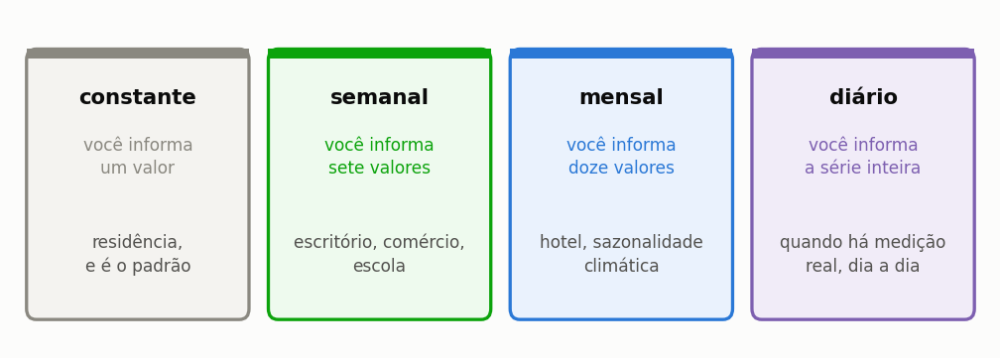
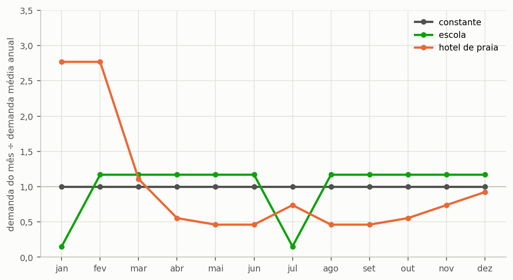
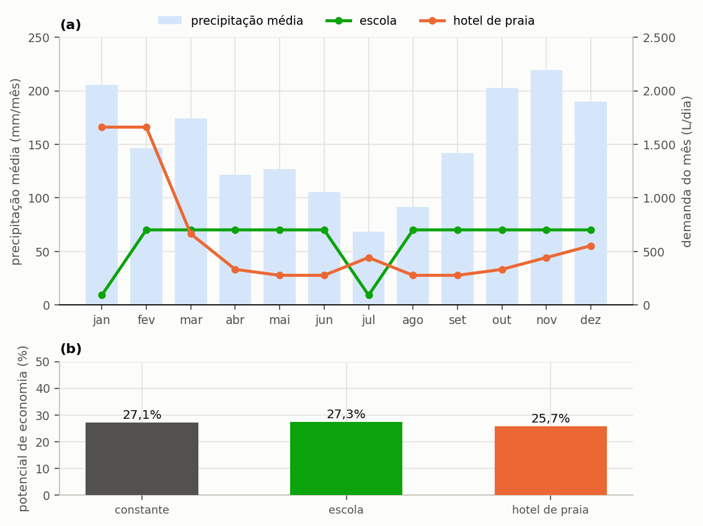

# Modular a procura por calendário

> **Pergunta que este guia responde:** e quando o consumo não é o mesmo todos os dias?

As escolas fecham para férias, os hotéis enchem no verão e os escritórios esvaziam ao fim de
semana. Tratar qualquer um destes edifícios como se tivesse um consumo uniforme erra nos dois
sentidos ao mesmo tempo: sobrestima a procura nos períodos vazios e subestima-a nos picos.
==O erro não se compensa ao longo do ano, porque o que importa ao sistema pluvial não é o total
consumido, e sim o encontro entre o consumo e a chuva disponível nesse dia.==

---

## Os quatro modos

O programa oferece quatro modos de modulação da procura, que diferem no número de valores que o
utilizador informa e na situação em que cada um se justifica ({{fig:fig40_modos}}).

*Figura 99 — Os quatro modos de modulação, o que cada um pede ao utilizador e a situação em que cada um se justifica. O modo diário só faz sentido quando existe medição real, porque inventar uma série diária acrescenta precisão aparente sem acrescentar informação.*

Em qualquer um deles pode modular três coisas de forma independente: a **procura per capita**, o
**número de ocupantes** e a **fração suprível por água da chuva**.

Modular a ocupação costuma ser mais fiel do que modular a procura: numa escola em férias, não é
o aluno que bebe menos água, é que não há aluno.

---

## Como preencher

Na etapa **2. Edificação e Consumo**, escolha o modo. Abre-se a tabela do período.

- Uma célula vazia ou a zero **cai para o valor constante**. É deliberado: permite modular só os
  meses que interessam e deixar o resto no valor de partida.
- Os valores podem ser digitados ou carregados de um ficheiro CSV.
- No modo diário, o primeiro dia da série de procura alinha com o primeiro dia da **série de
  chuva**. Se as duas tiverem comprimentos diferentes, a de procura é reciclada ciclicamente.

---

## Por que isto muda o resultado

Modular a procura não altera apenas o total anual consumido; altera o encontro no tempo entre
oferta e procura, que é precisamente o problema que o reservatório existe para resolver. Dois
casos do manual ilustram o alcance deste efeito.

**Uma escola com perfil semanal.** Na escola do Porto do manual (300 alunos, 40 L por aluno e por
dia, procura modulada por dia da semana, reservatório de 30 000 L), o perfil semanal rende 23,03%,
contra 23,16% para a mesma procura anual repartida por igual: 0,13 pontos percentuais. O ritmo
semanal de uma escola quase nada muda neste caso. O ganho que se imagina quando a escola fecha na estação seca
exigiria um perfil mensal de escola, com períodos letivos e férias, e o manual não tem esse caso.

**Um hotel com ocupação concentrada.** No hotel de Lisboa do manual (800 m² de cobertura, 60
hóspedes, 200 L por hóspede e por dia, 45% suprível por água da chuva, reservatório de 25 000 L),
a ocupação, ilustrativa, vai de 40% em janeiro a 100% em agosto e volta a 45% em dezembro. Com a
série de chuva de Lisboa, o perfil mensal rende 10,36%, contra 11,07% para a mesma procura anual
repartida por igual (média de 8 365,1 L/dia): menos 0,71 pontos percentuais. A procura concentra-se
de junho a setembro, o verão seco de Lisboa, enquanto a chuva cai sobretudo de outubro a março. O
reservatório enche no inverno, quando o hotel está meio vazio, e esvazia-se no verão, quando a
procura é máxima e já não chove.

Os dois casos parecem diferentes, e a regra que sustentam tem duas partes. ==Uma procura repartida
ao longo do ano aproveita melhor o mesmo reservatório; uma procura concentrada em poucos meses
perde rendimento, e perde mais quando esses meses são os secos.== O hotel de Lisboa junta os dois
efeitos, concentração e desfasamento: o pico cai na estação seca, e uma só simulação não consegue
separar um do outro. Para isolar o efeito da concentração, compare o mesmo perfil deslocado seis
meses, ou contra uma procura constante.

Uma diferença de 0,71 pontos é considerável para uma alteração que não muda um único litro do
consumo anual, e é totalmente invisível a qualquer cálculo feito sobre médias, que é justamente
por isso que o Triton simula dia a dia. Os perfis estão na {{fig:fig19_modulacao}}, e o rendimento
de cada um, na {{fig:fig20_tipologias}}.

*Figura 36 — Perfis de procura usados na comparação, expressos como a razão entre a procura do mês e a procura média. Todos têm exatamente o mesmo consumo anual; o que muda é a forma como se reparte pelos doze meses.*

*Figura 99 — (a) Perfis de procura da escola e do hotel sobre a precipitação média mensal da cidade de cada caso; (b) potencial de poupança de cada perfil contra a mesma procura anual repartida por igual. O perfil do hotel concentra a procura nos meses secos, e é essa concentração que lhe custa 0,71 pontos percentuais. A ocupação do hotel é ilustrativa.*

---

## A fração suprível também pode variar

Menos óbvio e, por vezes, mais importante. Numa escola, a percentagem de uso não potável muda
entre o período letivo e as férias: nas férias mantêm-se a lavagem de pavimentos e a rega do
jardim, que são usos **inteiramente** supríveis por chuva.

Modular a fração capta isto. Manter a fração constante subestima o aproveitamento no período de
baixa ocupação.

Na tabela, a coluna «Não Potável Interno (%)» é uma percentagem, como todos os campos digitados:
28 significa 28%. No ficheiro de projeto, a mesma coluna é guardada como fração, 0,28, e a secção
{{n:5}} explica porquê. Uma célula com um valor entre 0 e 1 fica laranja.

---

## Cuidados

**Não module o que não mediu.** Uma modulação inventada acrescenta precisão aparente sem
acrescentar informação alguma, e transmite ao leitor a impressão de um rigor que os dados não
têm. Na dúvida, uma procura constante declarada com clareza é mais honesta do que um perfil mensal
arbitrado. Foi o que se fez com a ocupação do hotel: está declarada como ilustrativa.

**Declare a origem do perfil.** Pode vir de medição própria, de doze faturas mensais de água, de
uma referência bibliográfica ou de uma estimativa, e estas quatro origens não têm o mesmo peso
como prova num estudo publicado.

**Confira o total anual depois de modular.** O programa mostra a procura média diária resultante
da modulação, e a divergência entre esse valor e o que se esperava é o indicador mais rápido de
um erro de preenchimento da tabela.

---

## O caminho mais simples, quando existe

Se tem **doze faturas de água** do edifício, tem o perfil mensal medido, que é a melhor fonte
possível. Divida o consumo de cada mês pelo número de dias e pelo número de ocupantes, e use o
modo mensal.

Doze faturas valem mais do que qualquer referência da literatura.
