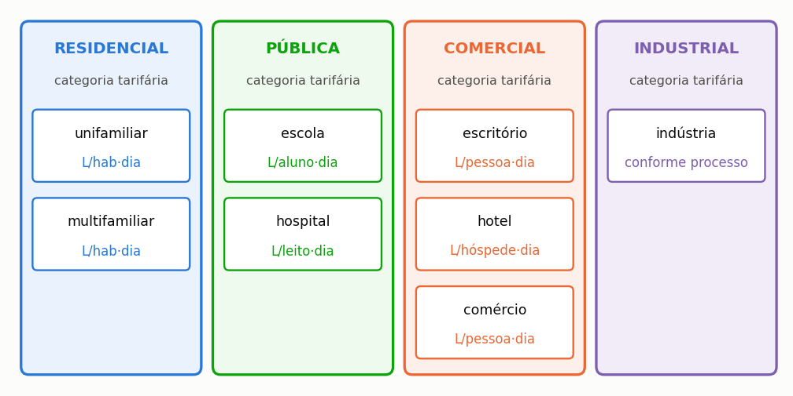

# Simular escola, hospital e comércio

> **Pergunta que este guia responde:** o programa serve para edifícios não residenciais?

Serve, e serve bem para a parte hídrica. Há, porém, uma ressalva de peso quanto à parte
económica, e é preciso conhecê-la antes de o estudo começar, e não depois de concluído.

---

## A ressalva: a categoria tarifária

As entidades gestoras cobram tarifários diferentes conforme a categoria do utilizador
(doméstico, comercial, industrial, Estado e outros), e as categorias não domésticas costumam
custar mais do que a doméstica. O tarifário transcrito de Lisboa, do Porto e do Funchal é o do
**utilizador doméstico**. É o certo para uma moradia e seria o errado para uma escola, um hotel ou
uma loja.

> **O que fazer, em cinco minutos.** Procure o tarifário em vigor da sua entidade gestora, que
> costuma estar no sítio dela, e localize a tabela da categoria que interessa. Lance os escalões
> no modo personalizado do diálogo do tarifário, na etapa **1. Projeto e Chuva**, com o regime de
> valor mínimo correspondente. A secção {{n:16}} descreve cada campo. Feito isto, o resultado
> económico passa a ser o do seu caso, e não uma aproximação doméstica.

Os dois casos não residenciais do manual, a escola do Porto e o hotel de Lisboa, mantêm o
tarifário doméstico do concelho respetivo e deixam os custos por definir: comparam chuva e
procura, não dinheiro. Tome as suas percentagens como resultados hídricos, e não leia nelas
nenhuma conclusão económica.

Declare a que categoria pertence o tarifário. Um estudo que aplica um tarifário doméstico a um
edifício não doméstico assume uma limitação, e o sentido do erro é, em regra, conservador,
porque as categorias não domésticas tendem a ser mais caras. Mas essa é uma propriedade do
documento tarifário, e tem de a verificar no seu.

---

## As tipologias disponíveis

As oito tipologias do programa agrupam-se pela categoria tarifária em que a entidade gestora as
enquadra, e cada uma tem uma unidade de consumo própria ({{fig:fig39_tipologias}}). A unidade de
consumo muda o significado do valor per capita informado, e a categoria decide a estrutura de
escalões da fatura: simular uma escola com tarifário doméstico é um dos enganos descritos na
secção {{n:33}}.

*Figura 99 — As oito tipologias disponíveis, agrupadas pela categoria tarifária que a entidade gestora cobra. A unidade de consumo muda com a tipologia, e é ela que dá sentido ao valor per capita informado.*

---

## O que muda em cada tipologia

**Escola.** É um caso favorável ao aproveitamento pluvial por duas razões que se somam. A fração
não potável do consumo é alta, porque o autoclismo domina o uso e muitas unidades não têm
duche nem cozinha. E a área de cobertura por aluno costuma ser grande, pelo que a oferta raramente
é o fator limitante.

A modulação por calendário tem, porém, um efeito que depende do clima, e convém simulá-la em vez
de supor o resultado. A escola do Porto do manual tem 1 200 m² de cobertura, 300 alunos, 40 L por
aluno e por dia, 70% suprível, uma procura modulada por dia da semana (40 L em cinco dias, 20 L e
5 L nos dias de fim de semana) e um reservatório de 30 000 L. Rende 23,03%, contra 23,16% para
uma procura constante com o mesmo total anual (média de 9 014,3 L/dia). O ritmo semanal, sozinho,
quase nada muda. Uma escola que fecha na estação seca comportar-se-ia de outro modo, e o perfil
mensal da secção {{n:17}} é a ferramenta para esse caso; o manual não tem um perfil mensal de
escola para citar. A secção {{n:14}} mostra como a distribuição da chuva muda de uma cidade para
outra.

**Hospital.** O caso mais delicado. Consumo alto e contínuo, sem sazonalidade relevante, o que é
bom para o aproveitamento. Mas a **exigência de qualidade** é outra: há usos que não admitem água
da chuva em circunstância alguma, e a torre de arrefecimento, que seria um uso ideal, exige
controlo microbiológico contra a legionela. Trate a classe de qualidade com cuidado, e não use as
classes 2 a 4 do programa como se fossem requisito normativo: são critérios adotados pelo
programa, e a exigência de cada caso é fixada pela autoridade de saúde e pela regulamentação
aplicável.

**Escritório e comércio.** Procura concentrada em dias úteis, cinco dias em sete. Module por
semana. A fração não potável é alta, porque quase todo o consumo é autoclismo, urinol e
limpeza. A fração suprível varia muito entre escritórios, mesmo dentro de uma cidade, e deve
vir do edifício estudado sempre que possível: meça-a, ou levante-a como se descreve adiante,
antes de tomar um valor de uma referência.

**Hotel.** Sazonalidade forte, e é o caso em que modular por mês mais importa. Veja o hotel de
Lisboa da secção {{n:17}}: com a ocupação concentrada no verão seco, rende 10,36%, contra 11,07%
para a mesma procura anual repartida por igual, uma perda de 0,71 pontos percentuais. Uma procura
concentrada desperdiça capacidade do reservatório, e a perda é maior quando a concentração cai na
estação seca. A ocupação desse hotel é ilustrativa.

---

## De onde tirar a fração não potável

A fração suprível é o teto do potencial de poupança, como a secção {{n:25}} mostra, e é por isso
o parâmetro que mais pesa no resultado de um edifício não residencial. Há três caminhos para a
obter, por ordem decrescente de fiabilidade.

**Medição dos usos finais.** Contadores setoriais ou registadores de caudal nos ramais, durante
algumas semanas representativas. É o único caminho que produz um número do edifício, e não de uma
média.

**Levantamento por entrevista e caudal.** Pergunte aos ocupantes a frequência e a duração de cada
uso e multiplique pelos caudais medidos dos aparelhos. Custa pouco e capta o comportamento real
do edifício, mas depende da memória dos entrevistados.

**Valor de referência da literatura.** Aceitável num estudo preliminar, desde que a referência
seja da mesma tipologia, do mesmo país e, idealmente, da mesma região. Evite transpor frações
residenciais para outras tipologias, e mesmo entre habitações a variação é grande: a quota do
autoclismo numa casa difere muito da de um escritório ou de uma escola.

> **Declare o caminho.** «Fração suprível de 60%, medida» e «fração suprível de 60%, de
> referência» são estudos diferentes, e o leitor precisa de saber qual dos dois está a ler.

---

## Contagem individual e o número de frações autónomas

Num edifício multifamiliar com contagem individual, informe o **número de frações autónomas**.
O programa avalia o consumo ao nível de **uma** unidade e multiplica pelo número de frações.

Isto importa por causa dos escalões progressivos: um prédio de vinte apartamentos com contagem
individual paga vinte faturas no primeiro escalão, e não uma fatura que soma todo o consumo e
cai no escalão mais caro. Tratar o prédio como uma só unidade sobrestimaria grosseiramente a
poupança.

---

## O que declarar

Além do que a secção {{n:13}} já pede:

- a **tipologia** e a unidade de consumo adotada;
- a **origem** do consumo per capita: medição, referência ou norma;
- a **categoria tarifária** introduzida, e se é aquela em que o edifício é faturado;
- o **perfil de modulação** e a sua origem;
- para um hospital, a classe de qualidade adotada e o que ela cobre.
