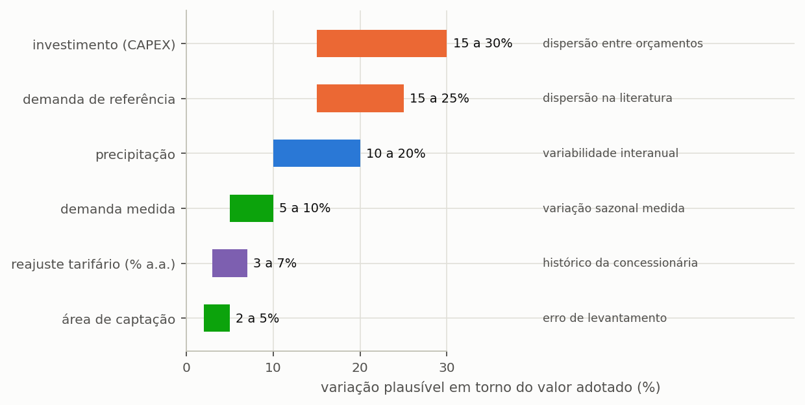
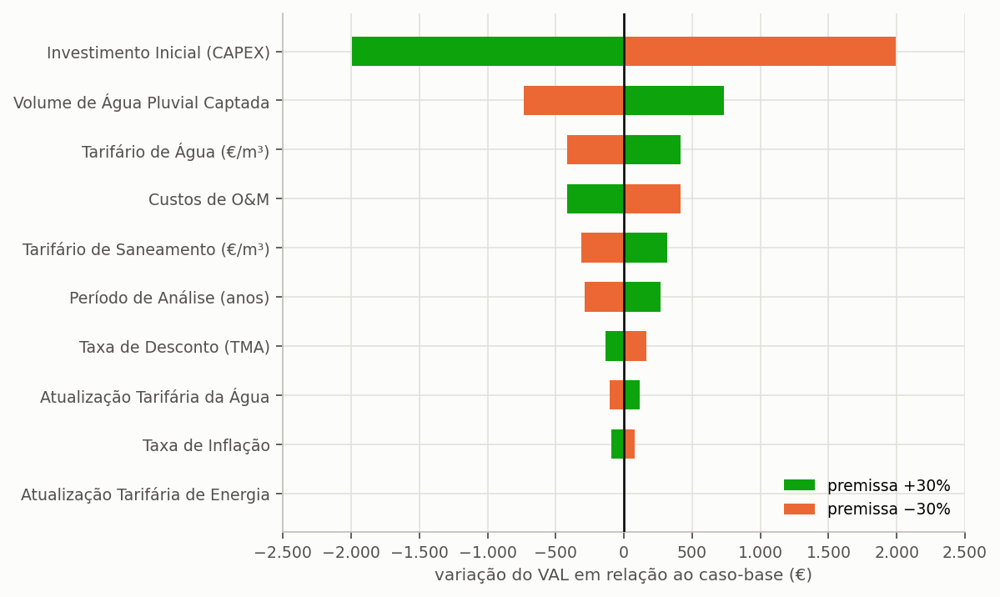

# Análise de sensibilidade

> **Pergunta que este guia responde:** que pressuposto mais move o meu resultado, e quanto aguenta
> ele?

Todo o estudo de aproveitamento pluvial assenta em pressupostos incertos, e os três mais
influentes são, em regra, justamente os menos verificáveis: o tarifário subirá mesmo 3% ao ano
durante vinte anos? A procura é de facto 150 litros por pessoa e por dia? A cisterna custará o
que o orçamento prevê?

A análise de sensibilidade mede quanto destas dúvidas chega ao resultado final. ==Não elimina a
incerteza, nem se propõe fazê-lo; mede o tamanho da incerteza,== que é exatamente a informação de
que o leitor precisa para decidir quanto confiar no número apresentado.

---

## O procedimento, em três passos

O procedimento não exige ferramenta especializada, e é o mesmo que se emprega em qualquer análise
de engenharia perante um parâmetro mal conhecido: varia-se uma coisa de cada vez e observa-se o
efeito.

1. **Escolha o pressuposto** que suspeita ser o mais influente.
2. **Corra o projeto três vezes**: com o valor provável, com um valor baixo e com um alto.
3. **Anote o resultado das três** e compare.

Repita o procedimento para cada pressuposto duvidoso. No fim, terá identificado quais deles movem
de facto o resultado e quais são irrelevantes, e essa separação vale mais do que qualquer
refinamento do valor central, porque indica onde investir o esforço de recolha de dados. A secção
{{n:19}} mostra como organizar os ficheiros para que o conjunto de execuções não se transforme em
confusão.

---

## Que intervalo adotar para cada pressuposto

O intervalo de variação a adotar para cada pressuposto não é matéria de palpite: decorre do que
se sabe sobre a origem do dado, e um dado medido admite um intervalo muito mais estreito do que um
dado tomado da literatura ({{fig:fig41_premissas}}). A atualização das tarifas exprime-se em
pontos percentuais por ano; os restantes intervalos, em percentagem do valor adotado.

*Figura 99 — Intervalo de variação plausível de cada pressuposto numa análise de sensibilidade, com a origem da incerteza. Os intervalos maiores correspondem a pressupostos adotados de referência, e não medidos no projeto.*

> **Não perturbe o que conhece.** Se a área foi medida num levantamento, o intervalo é estreito;
> alargá-lo produz uma incerteza artificial que dilui o resultado e esconde o pressuposto que
> realmente importa.

---

## Os pressupostos que dominam o resultado económico

Nos estudos económicos de aproveitamento pluvial, os pressupostos que mais movem o resultado são
os que atuam ao longo de todo o horizonte de análise: o próprio período de análise, o volume de
água da chuva efetivamente consumido, a taxa de atualização e a **atualização das tarifas**. A
atualização das tarifas merece atenção particular porque é a menos verificável e atua de forma
composta: cinco por cento ao ano durante vinte anos multiplicam a tarifa por 2,65; três por
cento, por 1,81; e sete por cento, por 3,87. A poupança dos últimos anos acompanha esse fator, e
a escolha da taxa pode decidir boa parte da conclusão económica do estudo.

Experimente no seu caso: na etapa **6. Resultados Económicos**, mude a atualização anual das
tarifas para 1%, anote o VAL, repita com 3% e com 5%. Três execuções, três minutos, e um
intervalo em vez de um número.

> **Num artigo, mostre esse intervalo.** Um valor atual líquido único, calculado com uma
> atualização de 3% ao ano e apresentado sem sensibilidade, sugere uma precisão que o pressuposto
> não tem.

### O tutorial, pressuposto a pressuposto

A tabela seguinte aplica o procedimento ao projeto final do tutorial, em Lisboa: 5 000 L em
polietileno, elevação para um reservatório superior de 1 000 L, com os custos ilustrativos do
manual (ilustrativos, não são preços de mercado). O VAL provável é negativo, de −6 053 €. A
tabela varia cinco pressupostos, um de cada vez, entre um valor baixo e um alto.

<!-- inclui: _tabelas/cap20_sensibilidade.md -->

A primeira coisa a ler é o que **não** acontece: nenhum pressuposto, no valor baixo ou no alto,
torna o VAL positivo, e nenhum produz período de recuperação. Com o tarifário de Lisboa e estes
custos, o sistema do tutorial não se paga em vinte anos, e nenhuma dúvida isolada sobre os dados
de entrada o altera. A razão é o preço da água, baixo face ao custo da obra; não é um defeito do
exemplo. Leia o resto da tabela com isto em mente: a pergunta não é que pressuposto torna o
projeto viável, mas qual deles mais move o resultado.

**O que mais move o VAL é o preço da cisterna.** De 70% a 130% do orçamento, o VAL passa de
−5 198 € a −6 908 €, a maior amplitude das cinco (1 710 €). Quando a poupança é pequena, quem
decide o saldo é o investimento: a cisterna de polietileno de 5 000 L, de 2 850 € (ilustrativo, não é preço de
mercado), pesa nele de forma direta, ao contrário do que acontece num caso em que o sistema se
paga com folga.

**O consumo per capita vem logo atrás.** De 120 a 180 L por pessoa e por dia, o potencial desce
de 20,09% para 16,55% enquanto o VAL sobe de −7 245 € para −5 567 €, uma amplitude de 1 678 €.
Com mais consumo, a fração suprível aplica-se a uma procura maior, a cisterna falta mais vezes,
o potencial desce um pouco e a poupança em dinheiro sobe.

**Os pressupostos decididos pelo mercado pesam menos.** A atualização das tarifas desloca o VAL de
−6 435 € (1% ao ano) para −5 570 € (5% ao ano), e a taxa de atualização de −5 839 € (0,2% ao mês)
para −6 210 € (0,6% ao mês); nenhuma toca no potencial.

**A fração suprível é o pressuposto que mais move o potencial.** De 20% a 40%, o potencial vai
de 14,98% a 21,33%, mas o VAL só vai de −6 403 € a −5 850 €, porque cada ponto percentual de
poupança vale pouco em euros ao preço da água de Lisboa. É o pressuposto que a secção {{n:5}}
fixou e que depende da decisão sobre usos, e não de medição: incluir ou não a máquina de lavar
roupa, face ao critério de qualidade aplicável ao caso, move o resultado hídrico mais do que
qualquer parâmetro económico.

O resultado contraria a intuição de quem orça antes de simular? Em parte. Aqui, cotar a cisterna
vale a pena, porque o investimento domina o saldo; mas nenhuma cotação, por favorável que seja,
inverte o sinal do VAL. Gastar tempo a definir os usos continua a ser o que mais melhora o
resultado hídrico.

---

## A sensibilidade que o programa faz sozinho

Há um caso em que a análise de sensibilidade já vem pronta e não exige execuções adicionais, e diz
respeito à decisão final do estudo: a escolha do volume em função dos pesos atribuídos aos
critérios.

Na etapa **8. Decisão Multicritério**, a coluna de **aceitabilidade SMAA-VIKOR** é já uma análise
de sensibilidade pronta. Responde: se os oito pesos dos critérios fossem sorteados em vez de
fixados, com que frequência ficaria cada volume em primeiro lugar?

Leia-a assim:

<!-- tabela: Leitura da aceitabilidade SMAA-VIKOR do volume vencedor -->
| Aceitabilidade do volume vencedor | O que significa |
| :--- | :--- |
| acima de 70% | recomendação robusta; os pesos quase não importam |
| entre 40 e 70% | recomendação razoável, e vale a pena declarar a segunda opção |
| abaixo de 40% | a escolha depende dos pesos, e o texto tem de o dizer |

A distinção que esta coluna permite é de natureza epistemológica, e não apenas estatística: um
volume que vence em 80% dos sorteios de pesos constitui uma recomendação, ao passo que um volume
que vence em 30% constitui uma preferência do analista, legítima desde que apresentada como tal.
No tutorial de Lisboa, o volume mais aceite, 5 000 L, vence em 22,2% dos sorteios, com 3 000 L
em segundo, com 22,0%, e 2 000 L em terceiro, com 19,3%: abaixo de 40%, a escolha depende dos
pesos, e o texto tem de o dizer. A secção {{n:32}} expõe o método que produz este número.

---

O gráfico de tornado ({{fig:fig24_tornado}}) é a forma consagrada de apresentar este conjunto:
uma barra por pressuposto, ordenada pela amplitude, com as duas variações em cores distintas.
Lido de cima para baixo, responde à pergunta que o revisor fará primeiro, que é de que pressuposto
depende o resultado.

*Figura 41 — A variação do valor atual líquido quando cada pressuposto é alterado em 30% para mais e para menos, mantidos os restantes. A cor identifica a variação aplicada, e não o sinal do efeito: é o que permite ver que subir a taxa de atualização reduz o valor atual, ao passo que subir a tarifa o aumenta. O caso de base desta figura sai do modelo económico simplificado do programa, que desconta um fluxo anual com tarifa marginal única e atualização declarada; por isso o valor atual do caso de base não coincide com o do fluxo de caixa mensal do tutorial. O que o tornado mede é a sensibilidade relativa, e não o valor absoluto.*

---

## Como apresentar

Três formas, da mais simples à mais completa:

**Tabela de cenários.** Pessimista, provável e otimista, com os pressupostos de cada um
declarados. Simples, honesta e suficiente para a maior parte dos trabalhos.

**Gráfico de tornado.** Uma barra por pressuposto, mostrando quanto o resultado varia quando ele
varia sozinho. Ordena os pressupostos por importância e é a apresentação mais informativa por
área de página.

**Distribuição.** O intervalo completo do resultado, quando todos os pressupostos variam
juntos. Exige declarar as distribuições adotadas, e não apenas os intervalos.

> **Aprofundamento: propagação por Monte Carlo.** A terceira forma faz-se sorteando milhares de
> combinações de pressupostos e acumulando a distribuição do resultado. O programa faz esta
> propagação com o subcomando `uncertainty` da linha de comandos, descrito na secção {{n:19}}.
> Para um estudo de curso ou de projeto, a tabela de cenários do primeiro item responde à mesma
> pergunta com uma fração do esforço, e é mais fácil de defender, porque cada cenário tem
> pressupostos que se podem ler.

---

## O que declarar

- os **intervalos** adotados e a origem de cada um;
- quantas execuções foram feitas, e com que valores;
- para a escolha do volume, a **aceitabilidade** do vencedor;
- **que pressupostos não foram perturbados**, e porquê.

O último é o que mais se esquece, e o que um revisor mais cobra.
