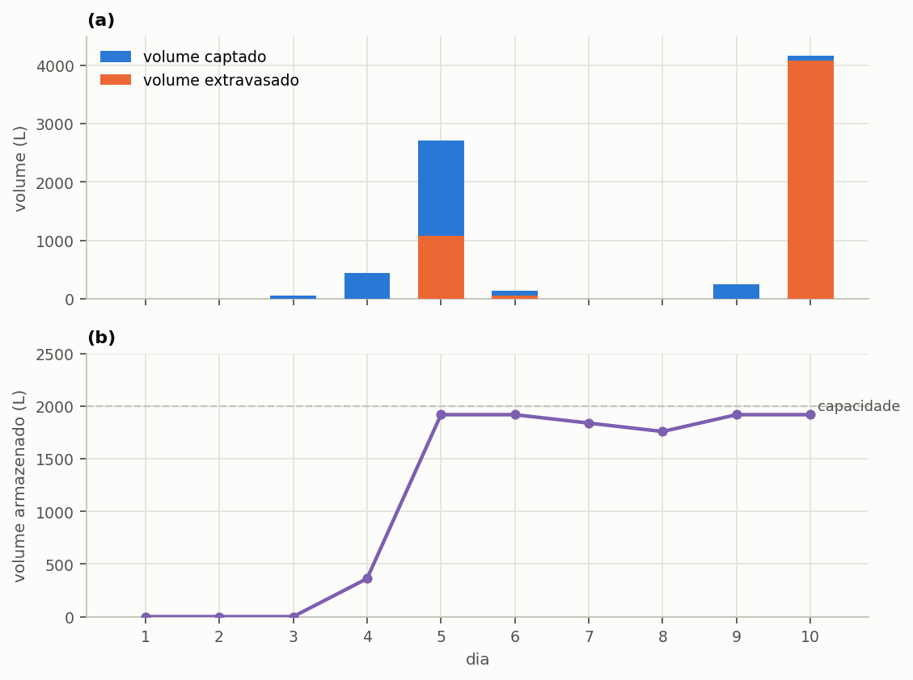
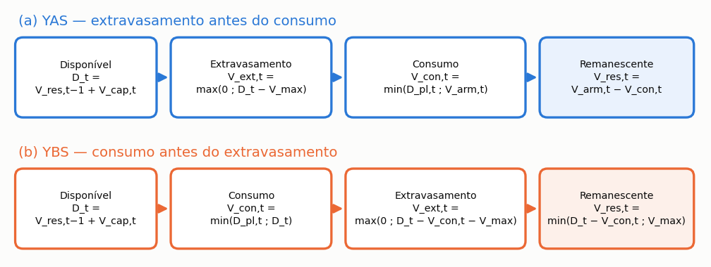

# O balanço hídrico diário

> No fim desta secção, será capaz de refazer, numa folha de cálculo, exatamente o que o Triton
> faz em cada dia da série, e de dizer por que razão o programa chegou ao número a que chegou.

> **Antes de começar.** O capítulo {{c:4}} é a camada técnica do manual: mostra as contas por
> dentro. Não precisa dele para usar o programa, porque o capítulo {{c:2}} basta, mas precisa
> dele para **defender** um resultado, seja perante um júri, numa revisão ou diante de um cliente
> que perguntou de onde saiu o número.

Esta é a secção de que todas as outras dependem. O potencial de poupança, o fluxo de caixa, a
emissão evitada e a ordenação multicritério saem, todos, dos números que o balanço diário produz.
Quem entende esta secção entende o programa.

O Triton usa um **modelo comportamental de passo diário**: para cada dia da série de precipitação,
o programa resolve o que entra no reservatório, o que sai, o que extravasa e o que fica
armazenado. Não há distribuição de probabilidade nem valor médio anual. Há a série, dia após dia,
e a mesma conta repetida.

---

## A ordem das operações

O programa executa, para cada dia `t`, sempre por esta ordem:

1. **decide se descarta** a primeira chuva, conforme o modo escolhido;
2. **converte a lâmina em volume** captado, com a área e o coeficiente;
3. **soma ao que sobrou de ontem** e verifica o extravasamento;
4. **satisfaz a procura pluvial** com o que está armazenado;
5. **reparte** o abastecimento entre uso interior e rega;
6. **completa com água da rede** o que a chuva não satisfez;
7. **classifica** o dia como de abastecimento pleno, parcial ou nulo.

A ordem não é arbitrária, e trocar dois passos muda o resultado. O item {{n:23.4}} volta a este
ponto.

---

## O caso resolvido

Dez dias, uma moradia, sem reservatório superior. A chuva é a de Lisboa, de 15 a 24 de dezembro
de 2013, no Iberia01 (município PT-1106). A janela foi escolhida por busca determinística entre os
trinta anos da série (a mais recente que começa com um dia seco e reúne os fenómenos abaixo), por
reunir num só período os cinco fenómenos que a secção ensina. Os números cabem numa folha de cálculo.

<!-- inclui: _tabelas/cap23_entrada.md -->

Sem procura exterior, a procura pluvial diária é a procura interior vezes a fração não potável
interior, que aqui coincide com a fração suprível total: 200 × 0,40 = **80 L/dia**. É este o
volume que o sistema tenta entregar todos os dias.

### A tabela, dia a dia

<!-- inclui: _tabelas/cap23_dez_dias.md -->

---

## Ler a tabela

Cinco coisas acontecem nestes dez dias, e cada uma ensina uma regra do programa.

### O dia 1: reservatório vazio

A simulação começa com o reservatório **vazio**. No dia 1 não chove, não há nada armazenado, e a
procura pluvial de 80 L não é satisfeita por uma gota: o dia é de abastecimento **nulo**, e os
200 L do dia inteiro vêm da rede.

Isto não é um defeito da série escolhida. É a condição inicial do modelo, e conta: em séries
curtas, os primeiros dias penalizam o resultado. Com trinta anos de série o efeito desaparece;
com dez dias, é uma das razões por que o potencial obtido, 30,6%, fica abaixo da fração
suprível de 40%. O dia 2 junta mais um dia de abastecimento nulo, e são 20% dos dez.

### Os dias 2 e 3: o descarte em ação

No dia 2 choveu 0,6 mm, menos do que a lâmina de descarte de 2,0 mm. O programa não subtrai 0,6 e
capta zero: **descarta o dia inteiro**, e o dia é de abastecimento nulo. O mesmo se passa nos dias 7
e 8, com 0,9 e 0,1 mm, e a diferença é que nesses dias o reservatório tem água de reserva e o
abastecimento é pleno à mesma.

No dia 3 choveu 2,6 mm. Depois do descarte de 2,0 mm, ficam 0,6 mm, que sobre 100 m² com o
coeficiente de 0,85 dão 51 L. Os 51 L são consumidos, e o dia é de abastecimento **parcial**: 51 L
dos 80 L pretendidos.

> **Atenção.** Quando a regra de descarte se aplica e a chuva do dia não excede a lâmina, perde-se
> o dia **inteiro**, e não a diferença. A conta é `P_ef = P − d_f` quando `P > d_f`, e **zero**
> no caso contrário.

A razão é física: o dispositivo de descarte tem de encher antes de a água chegar à cisterna. Se a
chuva não enche o dispositivo, nada passa. Em climas de chuva fraca e frequente, isto pesa muito
mais do que a intuição sugere, e é por isso que o modo de descarte merece atenção na secção
{{n:4}}. Na série de Lisboa do tutorial, chove em 35% dos dias, e 16% dos dias ficam abaixo da lâmina de
descarte.

> **Uma nota para quem compara ferramentas.** Algumas ferramentas de simulação tratam `d_f` como
> **limiar do evento**: abaixo dele nada é captado, acima dele capta-se a chuva **inteira**, sem
> subtração. O Triton subtrai a lâmina. A diferença é deliberada, baixa a poupança estimada, e os
> estudos que comparem as duas regras têm de a declarar. A secção {{n:35}} trata da comparação.

### O dia 5: o extravasamento vem antes do consumo

Choveu 33,9 mm. Descontados os 2,0 mm de descarte, restam 31,9 mm efetivos, que sobre 100 m² com
o coeficiente de 0,85 dão 2 712 L captados.

O reservatório tinha 362 L e comporta 2 000 L, pelo que **extravasam 1 074 L**. Só depois disso o
programa retira os 80 L da procura, deixando 1 920 L para o dia seguinte.

> **Atenção.** Esta ordem define o modelo. O extravasamento é calculado **antes** da retirada da
> procura, como na regra **YAS** (*yield after spillage*), mas a chuva do próprio dia já pode
> satisfazer a procura do dia, como na regra **YBS**. O Triton fica, por isso, entre as duas, e a
> subsecção «YAS, YBS e a ordem do Triton», adiante, mostra porquê.
>
> Se o consumo viesse antes do extravasamento, o reservatório aceitaria água que fisicamente já
> teria extravasado, e o programa sobrestimaria o aproveitamento. A diferença aparece justamente
> nos dias de chuva forte, que são os que mais pesam no total anual.

Num único dia, o sistema deitou fora o equivalente a mais de treze dias de procura pluvial. É o
retrato do desencontro entre a chuva, que chega concentrada, e a procura, que é constante.

### O dia 6: o reservatório já está cheio

Choveu 3,7 mm, e o sistema captou 145 L. O reservatório começava o dia com 1 920 L, de modo que
**extravasam 64 L**: quase metade do que foi captado, por uma chuva que, só por si, daria menos de
dois dias de procura. O mesmo se repete no dia 9, com 4,9 mm: captam-se 247 L e extravasam 6.

### O dia 10: o extravasamento maior do que o reservatório

Choveu 50,9 mm, e o sistema captou 4 156 L. O reservatório começava o dia com 1 920 L, de modo que
**extravasam 4 076 L**: quase tudo o que foi captado, e mais do dobro do que o reservatório inteiro
comporta (2 000 L). Nos dez dias, a cisterna perdeu 5 221 L, mais de sessenta dias de procura
pluvial. Aumentar o reservatório recupera parte disto, e é exatamente esta a pergunta a que a
varredura de volumes da secção {{n:24}} responde. A {{fig:fig01_dez_dias}}
resume os dez dias.



*Figura 1 — Os dez dias do caso resolvido, com a chuva de Lisboa de 15 a 24 de dezembro de 2013: (a) volume captado, a azul, e volume extravasado, a laranja, por dia; no dia 5 o extravasamento é cerca de 40% do captado e no dia 10 é quase igual ao captado; (b) volume armazenado no reservatório inferior no fim de cada dia, depois do consumo, com a capacidade de 2 000 L a tracejado; a partir do dia 5 o reservatório atinge a capacidade e termina o dia com 1 920 L (menos nos dias 7 e 8, sem chuva útil).*

### A soma: o balanço fecha

A última linha da tabela e o quadro de verificação mostram o fecho:

```equacao:fechamento
V_cap = V_ext + V_con + V_res
```

| Símbolo | Significado | Unidade |
| :--- | :--- | :--- |
| `V_cap` | volume total captado no período | L |
| `V_ext` | volume total extravasado no período | L |
| `V_con` | volume total de água da chuva consumido no período | L |
| `V_res` | volume remanescente no reservatório no fim do período | L |

Nos dez dias do caso resolvido, a Equação {{eq:fechamento}} verifica-se com 7 752 L captados,
5 221 L extravasados, 611 L consumidos e 1 920 L remanescentes.

Resíduo zero. O programa não cria nem perde água, e esta verificação é feita automaticamente pela
bateria de testes a cada alteração do código, sobre séries de dez anos, com um resíduo da ordem
de 10⁻¹⁴ por cento do captado.

---

## As equações

O balanço diário escreve-se em cinco equações encadeadas, que o programa resolve por esta ordem
para cada dia da série. A notação segue a da secção {{n:4}} para a parte da captação, e o índice
`t` designa sempre o dia corrente da simulação, de modo que `t−1` é o dia imediatamente anterior.

### O volume captado

A conversão da lâmina precipitada em volume é a primeira operação do dia, e a mais simples de
todas: multiplica-se a chuva efetiva pela área de captação e pelo coeficiente de escoamento
superficial.

```equacao:volume_captado
V_cap,t = P_ef,t × A × C
```

| Símbolo | Significado | Unidade |
| :--- | :--- | :--- |
| `V_cap,t` | volume captado no dia `t` | L |
| `P_ef,t` | chuva efetiva no dia `t`, já descontada a lâmina de descarte | mm |
| `A` | área de captação, em projeção horizontal | m² |
| `C` | coeficiente de escoamento superficial da cobertura | adimensional |

O resultado da Equação {{eq:volume_captado}} sai diretamente em litros, sem fator de conversão,
porque um milímetro de lâmina sobre um metro quadrado de superfície corresponde exatamente a um
litro de água. É a única simplificação dimensional do modelo, e é exata.

### O extravasamento e o armazenamento

O volume disponível antes de qualquer consumo é a soma do que sobrou no reservatório no fim do
dia anterior com o que foi captado hoje, como na Equação {{eq:disponivel}}. Desta soma decorrem
duas parcelas, calculadas por esta ordem: o excedente que não cabe no reservatório e por isso
extravasa, e o volume que fica efetivamente armazenado.

```equacao:disponivel
D_t = V_res,t−1 + V_cap,t
```

```equacao:extravasado
V_ext,t = max(0 ; D_t − V_max)
```

```equacao:armazenado
V_arm,t = min(D_t ; V_max)
```

| Símbolo | Significado | Unidade |
| :--- | :--- | :--- |
| `D_t` | volume disponível no dia `t`, antes do consumo | L |
| `V_res,t−1` | volume que sobrou no reservatório no fim do dia anterior | L |
| `V_cap,t` | volume captado no dia `t`, da Equação {{eq:volume_captado}} | L |
| `V_ext,t` | volume extravasado no dia `t` | L |
| `V_arm,t` | volume armazenado no dia `t`, antes do consumo | L |
| `V_max` | capacidade útil do reservatório inferior | L |

==A ordem em que as Equações {{eq:extravasado}} e {{eq:armazenado}} aparecem define o modelo.== O
extravasamento é calculado **antes** da retirada do consumo do dia, e é por isso que o programa
costuma ser descrito pela regra YAS, do inglês *yield after spillage*, isto é, rendimento
posterior ao extravasamento. A descrição é aproximada, e a subsecção seguinte diz em que falha.
Inverter a ordem faria o reservatório aceitar, sob a forma de consumo, água que fisicamente já
teria extravasado, e sobrestimaria o aproveitamento justamente nos dias de chuva intensa, que são
os que mais pesam no total anual.

A diferença entre as duas ordens é invisível na maior parte dos dias e decisiva nos poucos que
importam. Enquanto o reservatório não enche, extravasar antes ou depois de consumir dá exatamente
o mesmo resultado, porque não há extravasamento algum; nos dias de chuva intensa, em que o
reservatório atinge a capacidade, a ordem determina se uma parcela de água é contabilizada como
consumida ou como perdida. São justamente estes os dias que mais pesam no total anual, e por isso
uma escolha que parece formalidade desloca o resultado inteiro. A {{fig:fig00f_yas}} compara as
duas sequências na notação das equações desta secção.



*Figura 99 — Sequência de operações do balanço diário: (a) a ordem adotada pelo programa, com o extravasamento calculado antes do consumo; (b) a ordem invertida (YBS), com o consumo retirado antes do extravasamento. As duas sequências só divergem nos dias em que o reservatório atinge a capacidade, e a YBS supõe um consumo anterior à chuva do dia, o que sobrestima o aproveitamento.*

### YAS, YBS e a ordem do Triton

Na literatura, a YAS e a YBS têm definição precisa (Fewkes e Butler, 2000). Com `Y_t` o volume
retirado no dia, `Q_t` o volume captado, `S_t` o volume armazenado no fim do dia e `V_max` a
capacidade:

<!-- tabela: Retirada do dia e volume armazenado no fim do dia nas regras YAS e YBS estritas e no Triton -->
| Regra | Retirada do dia | Armazenado no fim do dia |
| :--- | :--- | :--- |
| YAS estrita | `Y_t = min(D_pl,t ; S_t−1)` | `S_t = min(S_t−1 + Q_t − Y_t ; V_max − Y_t)` |
| YBS estrita | `Y_t = min(D_pl,t ; S_t−1 + Q_t)` | `S_t = min(S_t−1 + Q_t − Y_t ; V_max)` |
| Triton | `Y_t = min(D_pl,t ; min(S_t−1 + Q_t ; V_max))` | `S_t = min(S_t−1 + Q_t ; V_max) − Y_t` |

Na YAS estrita, a retirada do dia sai só do que estava guardado na véspera: a chuva de hoje só
serve amanhã. Na YBS estrita, a chuva de hoje satisfaz a procura antes de o reservatório
extravasar. O Triton faz primeiro o extravasamento, como a YAS, e depois deixa a chuva do dia,
até ao limite da capacidade, satisfazer a procura do dia.

Daqui decorre uma desigualdade que vale para qualquer série: o volume consumido pelo Triton nunca
é menor do que o da YAS estrita nem maior do que o da YBS estrita. O resultado fica **entre as
duas**, mais perto da YAS nos reservatórios grandes, em que a véspera quase sempre basta, e mais
longe dela nos pequenos, em que a chuva do dia pesa. Quem compara o Triton com um programa ou com
uma norma que use a YAS estrita deve esperar do Triton um potencial de poupança ligeiramente
maior para o mesmo volume.

O programa mantém esta ordem por decisão: garante a continuidade com os estudos anteriores do
grupo de investigação, e uma mudança aqui deslocaria todos os resultados publicados.

### A satisfação da procura

Estabelecido quanto há no reservatório, o programa retira dele o menor valor entre a procura
pluvial do dia e o volume disponível, e devolve ao dia seguinte o que restar.

```equacao:consumido
V_con,t = min(D_pl,t ; V_arm,t)
```

```equacao:sobra
V_res,t = V_arm,t − V_con,t
```

| Símbolo | Significado | Unidade |
| :--- | :--- | :--- |
| `V_con,t` | volume de água da chuva consumido no dia `t` | L |
| `D_pl,t` | procura pluvial do dia `t`, montada como na secção {{n:5}} | L |
| `V_arm,t` | volume armazenado no dia `t`, da Equação {{eq:armazenado}} | L |
| `V_res,t` | volume remanescente, transferido para o dia seguinte | L |

A Equação {{eq:sobra}} é o que torna a simulação diária necessária e insubstituível: liga cada
dia ao seguinte e faz do reservatório uma memória do que aconteceu antes. Nenhum cálculo baseado
em médias mensais ou anuais consegue representar este encadeamento, e é dele que decorre todo o
desencontro entre a oferta concentrada e a procura distribuída.

### O complemento da rede pública

O que a chuva não satisfez é comprado à entidade gestora, e esta parcela reúne três origens
distintas.

```equacao:potavel
V_pot,t = D_pot,t + ΔD_int,t + ΔD_irr,t
```

| Símbolo | Significado | Unidade |
| :--- | :--- | :--- |
| `V_pot,t` | volume de água potável consumido da rede no dia `t` | L |
| `D_pot,t` | procura que exige água potável pela natureza do uso | L |
| `ΔD_int,t` | défice do uso interior não potável, não satisfeito pela chuva | L |
| `ΔD_irr,t` | défice da rega, **somente** se o abastecimento de reserva estiver ligado | L |

A terceira parcela da Equação {{eq:potavel}} merece atenção porque depende de uma escolha do
utilizador. Com o abastecimento de reserva ligado, a rede socorre a rega nos dias em que a
cisterna seca, e o défice é suprido com água potável; com ele desligado, o jardim simplesmente
não é regado, o edifício não compra essa água, e o volume correspondente é contabilizado como
**procura não satisfeita**, que é a terceira parcela do balanço da procura tratada adiante nesta
secção.

### A classificação do dia

Por fim, cada dia recebe uma classificação segundo o grau de abastecimento alcançado, e é a partir
dessa classificação que se calculam as percentagens de dias de abastecimento pleno, parcial e
nulo relatadas na secção {{n:25}}.

```equacao:classificacao
pleno: V_con,t = D_pl,t ; parcial: 0 < V_con,t < D_pl,t ; nulo: V_con,t = 0
```

| Símbolo | Significado | Unidade |
| :--- | :--- | :--- |
| `V_con,t` | volume de água da chuva consumido no dia `t` | L |
| `D_pl,t` | procura pluvial do dia `t` | L |

A comparação da Equação {{eq:classificacao}} é feita com tolerância de 10⁻⁵ L, e não por igualdade
exata. A razão é aritmética e não conceptual: o balanço trabalha com números de vírgula
flutuante, e uma diferença da ordem do erro de arredondamento classificaria como parcial um dia
que foi plenamente abastecido.

## O balanço da procura tem três parcelas

A procura total de um dia reparte-se em três, e não em duas:

```equacao:demanda_tres
D_t = V_con,t + V_pot,t + V_nao,t
```

| Símbolo | Significado | Unidade |
| :--- | :--- | :--- |
| `D_t` | procura total do edifício no dia `t` | L |
| `V_con,t` | parcela satisfeita com água da chuva | L |
| `V_pot,t` | parcela comprada à rede pública | L |
| `V_nao,t` | parcela que ninguém forneceu, isto é, procura não satisfeita | L |

As três parcelas são o consumo de água da chuva, o consumo da rede pública e a **procura não
satisfeita**. A terceira é zero na configuração de partida, em que a rede socorre a rega nos
dias secos. Deixa de ser zero quando o utilizador desliga esse socorro, e então o programa tem de
a mostrar: sem ela, o balanço fecharia por construção, escondendo a água que ninguém forneceu.

---

## Com reservatório superior

Quando o projeto tem reservatório superior, o passo 4 muda. Em vez de consumir diretamente do
reservatório inferior, o programa:

1. consome do reservatório superior o que estiver **acima do limiar de acionamento**;
2. se ainda falta e há água em baixo, **aciona a eletrobomba**: transfere o menor valor entre o
   que há no inferior e o espaço livre em cima, e conta **um ciclo**;
3. consome de novo do que acabou de chegar;
4. repete até satisfazer a procura ou acabar a água.

O limiar de acionamento é o volume de reserva que não se consome, e serve para a bomba não ligar a
cada litro. Está limitado ao volume do reservatório superior: informar um limiar maior do que o
reservatório não faz o programa recusá-lo, faz com que adote o reservatório cheio.

> **O reservatório superior não aumenta a poupança de água.** Muda **quando** a água é entregue,
> não **quanta**. O que acrescenta é custo: o investimento no reservatório e na bomba, a energia da
> elevação e a emissão associada. A secção {{n:8}} mostra-o com números.

O número de ciclos e o volume elevado saem daqui e alimentam o cálculo de energia da secção
{{n:28}}.

---

## O que o modelo não representa

- **Não há subpasso horário.** Uma chuva de 40 mm concentrada em duas horas e a mesma lâmina
  repartida por vinte e quatro horas produzem o mesmo resultado. Para reservatórios muito
  pequenos em relação à área de captação, isto subestima o extravasamento.
- **Não há perda por evaporação ou fuga** no reservatório.
- **A condição inicial é reservatório vazio.** Em séries com menos de um ano, isto penaliza
  sensivelmente o resultado.
- **O coeficiente de escoamento é único e constante.** Não varia com a intensidade da chuva nem
  com o tempo desde o último evento.
- **No balanço, o descarte é uma lâmina, e não um dispositivo com dinâmica própria.** O
  reservatório de descarte é dimensionado e orçamentado pelo volume `A × d_f` (secção {{n:27}}),
  mas o seu esvaziamento entre eventos não é simulado: a lâmina é aplicada conforme o modo de
  descarte escolhido.

A secção {{n:36}} reúne estas e as restantes limitações conhecidas.

---

## Para conferir

O caso resolvido desta secção está no ficheiro `05_dez_dias.triton`, na pasta de casos que
acompanha o programa. Abra-o, execute-o e compare com a tabela impressa.

Se algum número divergir, é o manual que está desatualizado em relação ao programa. E nesse caso a
verificação automática já terá avisado, porque cada número desta tabela tem uma asserção
correspondente na bateria de testes descrita na secção {{n:34}}.
