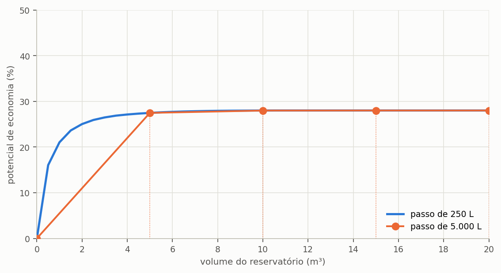
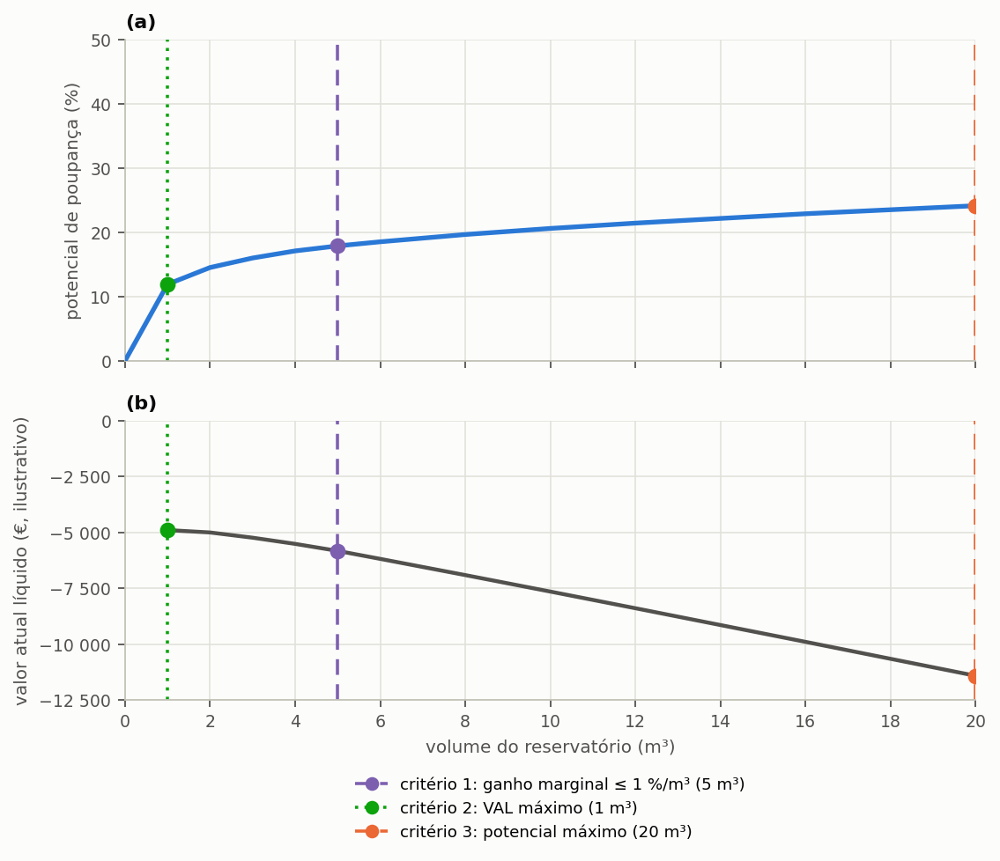

# Volume ideal e a varredura

> Esta secção formaliza o que a secção {{n:7}} fez na prática: como o programa constrói a grelha
> de volumes e como aplica o critério de volume ideal.

---

## A grelha discreta

A varredura simula um conjunto **finito** de volumes, e a construção desse conjunto obedece a
três regras.

**O passo é arredondado por excesso ao múltiplo de 250 litros.** É o quantum comercial: os
reservatórios vendem-se em volumes normalizados, e um ótimo de 1 300 L não se compra. Quando o
passo pedido não é múltiplo de 250, o programa ajusta-o e regista o ajuste em `step_adjusted`,
para que o relatório possa declarar o passo efetivo.

**O número de volumes positivos está limitado a 40.** Uma varredura de 0 a 50 000 L com passo de
100 L seriam 500 simulações de trinta anos, e o ganho de informação não paga o custo. Quando o
limite é atingido, o passo efetivo cresce.

**O volume máximo informado é sempre preservado** como último ponto da grelha. Só o último
intervalo pode, portanto, ser menor do que o passo efetivo.

O volume **zero** entra na grelha como alternativa de referência: é o cenário sem sistema, contra
o qual os restantes se comparam.

---

A consequência prática aparece na {{fig:fig14_grade}}. Com um passo fino, a curva mostra o
joelho onde o retorno começa a decair; com um passo grosseiro, o joelho cai entre dois pontos da
grelha e o critério elege o primeiro volume tabelado depois dele, que pode estar vários metros
cúbicos além do volume que de facto interessa.



*Figura 99 — Curva de potencial de poupança do mesmo edifício, varrida com passo de 250 L e com passo de 5 000 L. A grelha grossa calcula corretamente cada ponto que contém, mas não contém o troço de maior curvatura, entre 1 e 5 m³.*

---

## O ganho marginal

A curva de potencial de poupança contra o volume é monótona e côncava: cada metro cúbico
acrescentado ao reservatório rende menos do que o anterior, e o rendimento tende para zero à
medida que o sistema se aproxima do teto imposto pela fração suprível. O programa quantifica este
rendimento decrescente pela derivada discreta da curva, calculada para cada volume da grelha a
partir do segundo.

```equacao:ganho_marginal
Δ(V_i) = [ Epot(V_i) − Epot(V_i−1) ] ÷ [ (V_i − V_i−1) ÷ 1000 ]
```

| Símbolo | Significado | Unidade |
| :--- | :--- | :--- |
| `Δ(V_i)` | ganho marginal do volume `V_i` em relação ao anterior | %/m³ |
| `Epot(V_i)` | potencial de poupança de água potável obtido com o volume `V_i` | % |
| `Epot(V_i−1)` | potencial de poupança obtido com o volume imediatamente menor | % |
| `V_i` | volume do reservatório na posição `i` da grelha | L |
| `V_i−1` | volume imediatamente menor da grelha | L |
| `1000` | conversão de litros para metros cúbicos | L/m³ |

A divisão por mil no denominador da Equação {{eq:ganho_marginal}} existe para que o resultado saia
em pontos percentuais por metro cúbico acrescentado, que é a unidade em que a decisão se toma:
os reservatórios compram-se e orçamentam-se em metros cúbicos, não em litros.

==Por ser uma derivada discreta, o ganho marginal depende do passo da grelha.== Uma grelha fina
produz um valor mais local, próximo da derivada verdadeira nesse ponto; uma grelha grossa produz
a média do rendimento ao longo de um intervalo maior. A subsecção sobre a sensibilidade ao passo,
adiante, mede o tamanho deste efeito.

---

## O critério de volume ideal

O volume ideal define-se como o menor volume positivo da grelha cujo ganho marginal já caiu abaixo
de um limiar declarado pelo utilizador.

```equacao:volume_ideal
V_ideal = min { V_i > 0 : Δ(V_i) ≤ Δ_lim }
```

| Símbolo | Significado | Unidade |
| :--- | :--- | :--- |
| `V_ideal` | volume ideal pelo critério do ganho marginal | L |
| `V_i` | volume do reservatório na posição `i` da grelha | L |
| `Δ(V_i)` | ganho marginal do volume `V_i`, da Equação {{eq:ganho_marginal}} | %/m³ |
| `Δ_lim` | limiar de ganho marginal declarado pelo utilizador; o programa abre com 5,0, e o tutorial adota 1,0 | %/m³ |

Quando nenhum volume da grelha satisfaz a condição da Equação {{eq:volume_ideal}}, o que acontece
quando a gama varrida termina antes de a curva achatar, o programa adota o maior volume da grelha
e regista essa circunstância no relatório, para que o leitor saiba que o ótimo encontrado é um
limite da busca e não um ponto de inflexão da curva.

### Um exemplo, passo a passo

A tabela da varredura do tutorial, na secção {{n:7}}, permite refazer a conta à mão. Entre
3 000 L e 4 000 L o potencial sobe de 15,39% para 16,60%, isto é, 1,21 pontos percentuais por
mais um metro cúbico. Como 1,21 é maior do que o limiar de 1,0 %/m³, o volume não é ainda o ideal.
Entre 4 000 L e 5 000 L o potencial sobe de 16,60% para 17,49%, isto é, 0,89 pontos por metro
cúbico, já abaixo do limiar: o primeiro volume a cruzá-lo é 5 000 L, e é ele o volume ideal. Com o
limiar mais folgado de 3 %/m³, o volume ideal seria 3 000 L (15,39%), e com o mais exigente de
0,5 %/m³ seria 10 000 L (20,37%).

Repare no que se passa logo a seguir. Entre 6 000 L e 8 000 L o potencial sobe 1,20 pontos, mais
do que os 0,70 do intervalo anterior, de 5 000 para 6 000 L, e no entanto o ganho **por metro
cúbico** desce, de 0,70 para 0,60 %/m³, porque o intervalo tem dois metros cúbicos. É por isso que
o critério usa o ganho por metro cúbico, e não o ganho entre pontos consecutivos da grelha: o
segundo depende do passo, e o primeiro muito menos.

Em Lisboa, a escolha do limiar pesa mais do que noutros climas. A curva não satura: sobe ainda
de 20,37% a 10 000 L para 24,01% a 20 000 L, por causa do verão seco, e o ganho marginal desce
devagar, de 1,84 %/m³ aos 3 000 L para 0,32 %/m³ aos 20 000 L. O volume ideal sai do limiar
declarado, e não de um patamar da curva: declare o limiar junto do volume.

> **O critério é hidráulico e só hidráulico.** Ignora custo, tarifário e carbono. Um volume ideal
> por este critério não é uma recomendação de projeto; é o ponto em que a curva de aproveitamento
> deixa de compensar **em água**. A secção {{n:32}} trata da escolha com os restantes critérios,
> que muitas vezes apontam para volumes diferentes.

---

Este é um critério entre outros igualmente defensáveis, e convém dizê-lo com clareza. Um
projetista que queira o máximo desempenho hídrico escolherá o maior volume da varredura; um que
responda por um orçamento escolherá o volume de maior valor atual líquido; o critério do ganho
marginal fica entre os dois, por ser o que identifica onde a curva deixa de compensar. Os três
leem a mesma varredura e não têm de coincidir: neste projeto apontam volumes muito diferentes, de
1 000 L pelo critério financeiro a 12 000 L pelo técnico, com 5 000 L pelo ganho marginal.
Nenhum dos três está errado; errado é não dizer qual deles se usou. A {{fig:fig09_criterios}}
marca o volume eleito por cada critério, com o valor anotado na legenda do gráfico.



*Figura 99 — Varredura do projeto do tutorial lida por três critérios: (a) potencial de poupança e (b) valor atual líquido do mesmo conjunto de volumes. As linhas verticais marcam o volume eleito pelo ganho marginal abaixo de 1 %/m³, pelo VAL máximo e pelo potencial máximo; o volume de cada um vai anotado na legenda, porque depende da grelha varrida e dos pressupostos económicos em vigor.*

---

## Por que o programa simula: os métodos empíricos

Normas e manuais oferecem há muito um conjunto de métodos para dimensionar o reservatório: o de
Rippl, a simulação e várias regras práticas, como a alemã e a britânica. Continuam em uso corrente
em projetos e em trabalhos académicos, e convém perceber o que cada um responde antes de os
comparar com a varredura do programa. Algumas normas trazem ainda um método simplificado do mesmo
género, um número de dias do menor valor entre a produção anual e a procura, a par da simulação
diária detalhada.

**O método de Rippl** é o diagrama de massas aplicado ao reservatório: acumula, período a período,
a diferença entre a procura e a chuva aproveitável, e adota como volume o maior défice acumulado
da série. O volume resultante é o que satisfaria **toda** a procura mesmo na pior estiagem
registada, e por isso cresce com o comprimento da série e com a sua resolução: com dados diários,
as sequências secas aparecem inteiras; com dados mensais, parte delas dilui-se na média do mês.

**Os métodos práticos** são regras de bolso. O alemão toma 6% do menor valor entre a chuva
aproveitável anual e a procura anual; o britânico toma 5% do produto `P × A`, com `P` a
precipitação média anual e `A` a área de captação. Nenhum dos dois usa a distribuição da chuva no
tempo, e o britânico nem sequer usa a procura.

A tabela seguinte aplica cinco abordagens de dimensionamento ao projeto do tutorial de Lisboa,
arredonda cada volume a um múltiplo de 250 L e simula, no próprio programa, o potencial que cada
uma produz.

<!-- inclui: _tabelas/cap24_metodos.md -->

A primeira tabela mostra o que a curva côncava da secção {{n:7}} já anunciava, com uma diferença
de peso: em Lisboa, o verão seco faz do método de Rippl um pedido enorme. Com série diária, pede
51 500 L, e com série mensal, 47 000 L: perto de dez vezes os 5 000 L da simulação. Esses
reservatórios entregam de facto mais, 26,92% e 26,78% contra 17,49%, e chegam perto do teto de
28%, porque são dimensionados para que quase nunca falte água. Mas cada metro cúbico acima de
5 000 L rende pouco, e uma cisterna de 47 a 52 m³ é impraticável numa moradia como a do tutorial. As regras práticas ficam do outro lado: a alemã (3 750 L, 16,32%) dá menos do que a
simulação, e a britânica (5 500 L, 17,85%) acerta a ordem de grandeza por coincidência, porque
nenhuma das duas tem como saber que a chuva de Lisboa se concentra no inverno, e dariam o mesmo
volume a uma cidade de chuva bem repartida.

==A diferença essencial é que os métodos empíricos respondem a uma pergunta fixa, e a simulação
responde à pergunta que o projetista declara.== Rippl pergunta que volume nunca falha; o método
britânico pergunta que fração da chuva guardar; a varredura com ganho marginal pergunta a partir
de que volume o metro cúbico seguinte deixa de compensar. O volume adequado varia com a chuva
local, a área de cobertura, o número de moradores e as procuras, e dimensionar reservatórios pela
tradição local, sem simulação, pode levar a sistemas de baixa eficiência. Nas três cidades de
exemplo, a varredura dá volumes ideais diferentes, 5 000 L em Lisboa e no Porto e 4 000 L no
Funchal, com a mesma moradia e o mesmo limiar: a diferença vem só da chuva.

---

## O passo de tempo e a fração de armazenamento

O programa simula dia a dia, e esta escolha tem uma gama de validade conhecida. Fewkes e Butler
(2000) compararam modelos comportamentais com passos de um minuto, uma hora, um dia e um mês,
tomaram como referência o modelo horário com a regra YAS, descrita na secção {{n:23}}, e
mostraram que o passo adequado depende de uma grandeza adimensional, a **fração de
armazenamento**.

```equacao:fracao_de_armazenamento
F_S = S ÷ (A × R)
```

| Símbolo | Significado | Unidade |
| :--- | :--- | :--- |
| `F_S` | fração de armazenamento | adimensional |
| `S` | capacidade do reservatório | m³ |
| `A` | área de captação em projeção horizontal | m² |
| `R` | precipitação média anual | m |

Pelos resultados daqueles autores, o modelo horário é o indicado para frações até 0,01; o diário,
para frações entre 0,01 e 0,125; e o mensal, só acima de 0,125. A razão física é simples: quanto
menor o reservatório relativamente à chuva que recebe, mais enche e extravasa **dentro** de um
mesmo dia chuvoso, enquanto a procura é retirada ao longo das horas; um passo diário soma numa só
entrada o que, hora a hora, teria entrado e saído aos poucos.

A segunda tabela calcula a fração para os volumes da varredura do tutorial. A cisterna escolhida,
de 5 000 L, tem uma fração de cerca de 0,046, dentro da gama do modelo diário; o reservatório de
1 000 L (0,0093) fica abaixo de 0,01, e para ele o resultado diário deve ler-se como uma
aproximação. Fewkes e Butler recomendam o passo horário para esse volume e o diário para os
outros. Campisano e Modica (2015), que simularam um sistema residencial com passos diários e
subdiários a partir de caudais medidos, chegaram a uma conclusão complementar: o passo diário é
fiável para estimar a **poupança de água**, mas são precisos passos de, no máximo, uma hora quando
o objetivo é a **retenção de águas pluviais**, sobretudo em reservatórios pequenos e com procura
alta.

> **Na prática.** Para a poupança de água potável em edifícios, o passo diário do programa é
> adequado na gama habitual de projeto. Se a fração de armazenamento do seu estudo ficar abaixo de
> 0,01, declare a limitação; e se o objetivo for amortecer caudais de ponta na drenagem urbana, o
> programa não é a ferramenta adequada.

---

## O que a literatura diz sobre o volume ideal

Não há uma definição única de volume ideal, e a revisão sistemática de Semaan et al. (2020) ajuda
a situar o critério do programa. Examinando estudos de otimização de sistemas domésticos, os
autores observaram que o dimensionamento do reservatório é o objetivo de otimização mais
importante, mas que o custo é o critério mais usado; que o subdimensionamento produz sistemas
incapazes de fornecer um volume fiável; e que o sobredimensionamento eleva o investimento com um
benefício marginal pequeno e pode até comprometer a qualidade da água, que fica armazenada por
mais tempo.

Campisano et al. (2017), numa revisão ampla sobre sistemas urbanos de aproveitamento pluvial,
reúnem critérios de três famílias: os de **eficiência hídrica**, como o potencial de poupança e a
fiabilidade; os **económicos**, como o valor atual líquido e o período de recuperação; e os de
**desempenho na drenagem**, como a retenção. O programa cobre as duas primeiras famílias e declara
não cobrir a terceira.

O critério do ganho marginal pertence à primeira família e tem uma vantagem sobre a fiabilidade
fixa, como a de Rippl: não exige que o projetista escolha um nível de falha aceitável, que
raramente tem justificação técnica, mas sim um nível de retorno decrescente, que se lê
diretamente em metros cúbicos de reservatório. A desvantagem é simétrica: o limiar de 1 %/m³, ou
de 5 %/m³, também é uma escolha, e tem de ser declarado.

---

## A sensibilidade ao passo

O volume ideal depende do passo da varredura, e convém saber quanto.

Um passo grosso salta o joelho da curva: com um passo de 5 000 L, o primeiro ponto avaliado depois
do zero já tem o ganho marginal médio de todo o intervalo, que é alto, e o segundo pode já estar
abaixo do limiar. O ideal sai deslocado para cima.

Um passo fino resolve melhor o joelho, ao custo de tempo.

**Recomendação prática:** passo entre 500 e 1 000 L para reservatórios residenciais, e entre
2 000 e 5 000 L para edifícios de grande porte, declarando sempre o passo adotado junto do volume
ideal.

---

## Por que a curva tem esta forma

A curva de aproveitamento pluvial é côncava e assintótica, sempre. Duas razões:

**Os eventos pequenos são a maioria.** Os primeiros litros de armazenamento captam as chuvas
frequentes e pequenas, que respondem pela maior parte dos dias. Os últimos litros só servem para
os poucos eventos extremos.

**A fração suprível é um teto.** O potencial não pode ultrapassar a fração da procura que a chuva
satisfaz, definida na secção {{n:5}}. A curva aproxima-se desse teto e nunca o cruza, invariante
que a bateria de testes verifica até volumes de 100 m³. Em Lisboa, o teto é de 28% e a curva
chega a 24,01% aos 20 000 L: ainda longe dele.

---

## A série é suficientemente longa?

Todo o resultado desta secção depende da série de chuva carregada, e a pergunta que o revisor faz
primeiro é se ela basta. Geraldi e Ghisi responderam-lhe em três artigos: extraem-se subséries de
uma série longa, simula-se cada uma e conta-se com que frequência reproduzem o resultado da série
inteira. O comprimento representativo é o menor que reproduz o resultado na maior parte das
janelas, e que **continua a reproduzi-lo** nos comprimentos maiores: um acerto isolado numa
subsérie curta não vale como recomendação.

O programa tem esta análise na etapa da varredura, no botão «a série de chuva é suficientemente
longa?». Usa a mesma grelha de volumes e o mesmo limiar de ganho marginal da varredura, porque a
resposta depende deles, e devolve o veredicto numa frase, com a tabela de frequência por
comprimento.

==A resposta é deste projeto, e não da cidade.== É o ponto que os artigos não isolam e que a
análise torna visível: o comprimento de série necessário depende de quanto da procura se pede à
chuva. Quanto maior a parte a cobrir, mais a cisterna depende das estiagens raras, e mais longa
tem de ser a série que as contém. Uma série curta não erra o potencial médio; erra o volume, que é
o que se compra.

O programa devolve o veredicto para o seu projeto, com a sua cobertura, a sua procura e a sua
fração suprível. Execute-o para cada cidade de uma comparação: as três cidades de exemplo, com
trinta anos de dados diários cada uma, são um bom teste. [A COMPLETAR: o comprimento de série
representativo para Lisboa, Porto e Funchal ainda não foi calculado para esta edição; correr a
análise nos três projetos de exemplo e tabelar aqui.]

> **Atenção: uma série curta não se torna longa por tirar médias.** Se a análise disser que o
> projeto precisa de mais anos do que a série tem, o volume ideal calculado é provisório, e é isso
> que se declara no trabalho. Repetir a simulação com outra janela dos mesmos dados não resolve: o
> que falta é registo, não processamento. Algumas normas fixam um número mínimo de anos de dados
> diários; o Triton mantém a análise de Geraldi e Ghisi, que responde para cada projeto em vez de
> fixar um mínimo.

---

## O que a varredura não responde

- **Que volume comprar.** Os reservatórios existem em volumes comerciais; o ideal calculado deve
  ser arredondado para o volume disponível mais próximo, e a varredura já ajuda ao trabalhar em
  múltiplos de 250 L.
- **Se o sistema compensa.** Isso é a secção {{n:29}}.
- **Se o volume cabe no terreno.** O programa não conhece o local.
- **Quanto a cisterna amortece a drenagem.** O passo diário não representa os caudais de ponta, e
  a retenção exige um passo horário ou menor, como mostram Campisano e Modica (2015).
