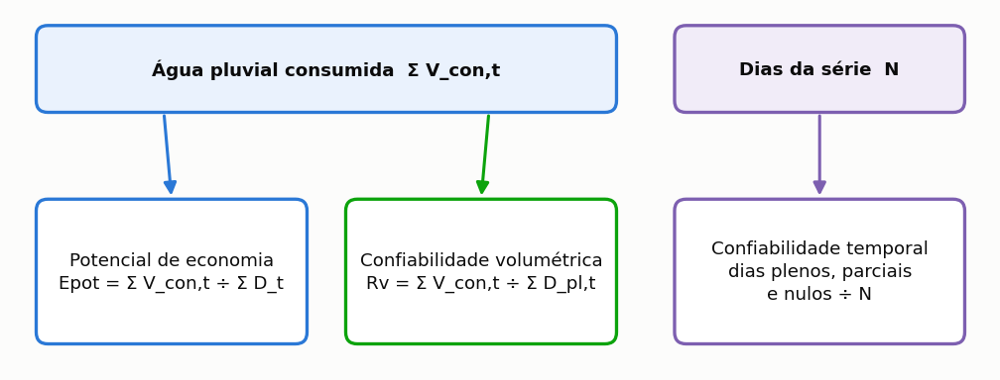
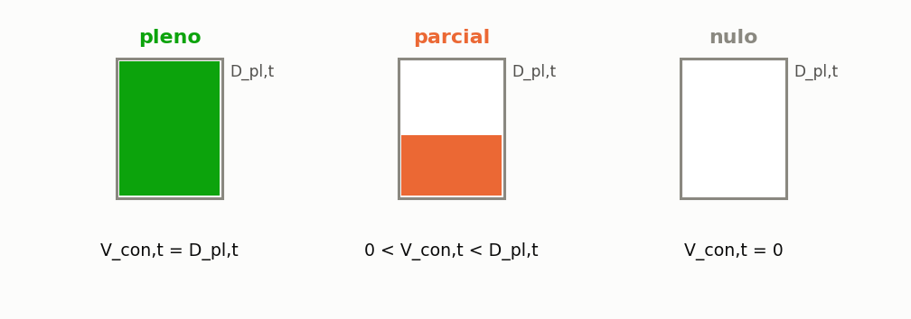

# Indicadores de eficiência

> Esta secção define formalmente cada indicador que o programa reporta, com a sua unidade, e diz
> **o que cada um não mede**.

Um indicador mal interpretado é pior do que nenhum, e os desta secção confundem-se com frequência
na literatura. Os dois primeiros partem do mesmo numerador, a água da chuva efetivamente
consumida, e diferem apenas no denominador: uma diferença aritmética pequena e uma diferença de
significado grande, porque cada denominador formula uma pergunta distinta. O terceiro não é uma
razão entre volumes, e sim uma contagem de dias, e responde a uma pergunta que nenhum dos outros
dois alcança: com que frequência se pode contar com o sistema ({{fig:fig00g_indicadores}}).



*Figura 99 — Os três indicadores de eficiência e o que cada um conta. O potencial de poupança e a fiabilidade volumétrica partilham o numerador e relacionam-se pela identidade Epot = Rv × f, em que f é a fração suprível; a fiabilidade temporal conta dias, e não litros.*

---

## Potencial de poupança de água potável

O potencial de poupança de água potável é o indicador central do programa e o que figura no
resumo de qualquer estudo. Exprime a fração do consumo **total** do edifício que a água da chuva
conseguiu substituir ao longo de toda a série simulada, e não apenas da parte que a chuva poderia
satisfazer.

```equacao:potencial
Epot = ( Σ V_con,t ÷ Σ D_t ) × 100
```

| Símbolo | Significado | Unidade |
| :--- | :--- | :--- |
| `Epot` | potencial de poupança de água potável | % |
| `V_con,t` | volume de água da chuva consumido no dia `t` | L |
| `D_t` | procura total do edifício no dia `t` | L |
| `Σ` | somatório sobre todos os dias da série simulada | — |

O denominador da Equação {{eq:potencial}} é a procura **total**, e esta escolha é a origem da
confusão mais comum na leitura dos resultados. Um sistema que satisfizesse integralmente toda a
procura que lhe cabe, sem falhar um único dia, ainda assim apresentaria um potencial de poupança
igual à fração suprível declarada, e não cem por cento. O teto, portanto, não é uma limitação do
sistema: é uma consequência aritmética da definição do indicador.

---

## Fiabilidade volumétrica

A fiabilidade volumétrica responde a uma pergunta diferente e complementar: da água que o sistema
**devia** fornecer, quanto forneceu de facto? O denominador aqui é a procura pluvial, e não a
procura total.

```equacao:confiabilidade
Rv = ( Σ V_con,t ÷ Σ D_pl,t ) × 100
```

| Símbolo | Significado | Unidade |
| :--- | :--- | :--- |
| `Rv` | fiabilidade volumétrica do sistema | % |
| `V_con,t` | volume de água da chuva consumido no dia `t` | L |
| `D_pl,t` | procura pluvial do dia `t`, isto é, a parte suprível pela chuva | L |
| `Σ` | somatório sobre todos os dias da série simulada | — |

As Equações {{eq:potencial}} e {{eq:confiabilidade}} diferem apenas no denominador, e essa
diferença basta para que se relacionem por uma identidade exata, útil como conferência rápida de
qualquer resultado.

```equacao:relacao_indicadores
Epot = Rv × f
```

| Símbolo | Significado | Unidade |
| :--- | :--- | :--- |
| `Epot` | potencial de poupança de água potável | % |
| `Rv` | fiabilidade volumétrica | % |
| `f` | fração da procura total suprível por água da chuva | adimensional |

==Um sistema com 55% de fiabilidade e 28% de fração suprível poupa 15,4% do consumo total, e os
três números dizem a mesma coisa de três maneiras.== É o caso da moradia de Lisboa do tutorial com
uma cisterna de 3 000 L, a primeira simulação da secção {{n:6}}: o potencial de poupança é de
15,39%, e dividindo pela fração suprível de 0,28 obtém-se uma fiabilidade volumétrica de cerca de
55,0%. Relatar apenas um deles, sem declarar a fração suprível adotada, torna o resultado
impossível de comparar com o de outro estudo, e é a causa mais frequente de comparações indevidas
na literatura da área.

A literatura usa nomes diferentes para a mesma razão. Fewkes e Butler (2000) chamam **eficiência
de poupança de água** ao quociente entre o volume de água da chuva fornecido e a procura que o
sistema devia satisfazer, que é a fiabilidade volumétrica desta secção. Outros autores chamam
eficiência ao que aqui é potencial de poupança; algumas normas chamam-lhe taxa de cobertura. Ao
comparar com outro trabalho, confira o denominador, e não o nome.

---

## Fiabilidade temporal

A fiabilidade temporal classifica cada dia da série numa de três classes mutuamente exclusivas,
conforme a relação entre o volume de água da chuva consumido e a procura pluvial do dia, definida
na Equação {{eq:classificacao}}. O dia é **pleno** quando a água da chuva satisfaz integralmente a
procura pluvial; **parcial**, quando satisfaz parte dela e a rede pública fornece o resto; e
**nulo**, quando o reservatório está vazio e a rede fornece toda a procura
({{fig:fig29_atendimento}}). As três percentagens somam 100%. A classificação conta dias, e não
volume: um dia em que faltou um litro para satisfazer a procura é parcial, e não quase pleno, e
por isso a fiabilidade temporal não se converte diretamente em volume poupado.



*Figura 99 — Classes de abastecimento diário: pleno (V_con,t = D_pl,t), parcial (0 < V_con,t < D_pl,t) e nulo (V_con,t = 0). A altura preenchida representa a fração da procura pluvial do dia satisfeita por água da chuva.*

Formalmente, o dia é **pleno** quando `V_con,t = D_pl,t`, com tolerância de 10⁻⁵ L; **parcial**
quando `0 < V_con,t < D_pl,t`; e **nulo** quando `V_con,t = 0`.


No tutorial de Lisboa com a cisterna de 3 000 L, 53,3% dos dias são plenos, 2,9% parciais e 43,8%
nulos. Repare que a fiabilidade temporal, 53,3%, é menor do que a volumétrica, cerca de 55,0%.
Não há contradição: os dias parciais não contam como plenos, mas contribuem com volume, e é essa
água que a fiabilidade volumétrica soma e a temporal não. A diferença entre as duas é, por isso,
uma medida indireta de quanto as falhas são falhas parciais. Com uma cisterna de 4 000 L os dias
plenos sobem para 58,0%, e com 5 000 L para 61,3%.

**O que mede:** com que frequência o utilizador pode contar com o sistema.

**O que não mede:** o volume. Um sistema pode ter 95% de dias plenos e um potencial baixo se a
procura pluvial for pequena, e o contrário também acontece.

> A fiabilidade temporal é o indicador que mais importa para o **projeto de águas**. Muitos dias
> nulos exigem uma alimentação automática de reserva bem dimensionada, e o utilizador nota a
> alternância entre as duas fontes.

---

## Extravasamento

```equacao:extravasamento_medio
V_ext,med = ( Σ V_ext,t ) ÷ n
```

| Símbolo | Significado | Unidade |
| :--- | :--- | :--- |
| `V_ext,med` | extravasamento médio diário | L/dia |
| `V_ext,t` | volume extravasado no dia `t` | L |
| `n` | número de dias da série simulada | dia |

**O que mede:** quão pequena é a cisterna em relação aos eventos de chuva.

**O que não mede:** desperdício. A água que extravasa vai para a drenagem urbana, como iria sem o
sistema. Não há perda em relação ao cenário sem sistema; há apenas uma oportunidade não
aproveitada.

> O extravasamento **nunca se anula** num sistema real. Tende para um piso que é a diferença entre
> o que a cobertura capta e o que a procura consome. No tutorial de Lisboa, a oferta bruta da
> cobertura é 1,5 vez a procura pluvial, e mesmo com 20 000 L o extravasamento médio ainda é de
> 54 L/dia. Quem quer retenção de cheias precisa de um reservatório de detenção, que é outro
> projeto com outra lógica.

---

## Eficiência de uso da água captada

O programa não imprime este indicador, mas ele sai diretamente dos anteriores e ajuda a perceber o
extravasamento. É a fração da água que chegou à cisterna, já descontado o descarte das primeiras
águas, que acabou consumida.

```equacao:uso_da_captacao
η_cap = ( Σ V_con,t ÷ Σ V_cap,t ) × 100
```

| Símbolo | Significado | Unidade |
| :--- | :--- | :--- |
| `η_cap` | eficiência de uso da água captada | % |
| `V_con,t` | volume de água da chuva consumido no dia `t` | L |
| `V_cap,t` | volume captado no dia `t`, depois do descarte | L |
| `Σ` | somatório sobre todos os dias da série simulada | — |

Na cisterna de 3 000 L do tutorial, o sistema consome 33,7 m³ por ano e extravasa em média
106,4 L/dia, cerca de 39 m³ por ano; as duas parcelas, com o pouco que fica no reservatório,
fecham o balanço de massa. Chegam assim à cisterna cerca de 73 m³ por ano, e é consumido pouco
menos de metade, cerca de 46%. O número explica por que aumentar a cisterna rende tão pouco a
partir de certo ponto: a água não falta na cobertura, falta **procura** para a consumir. A oferta
bruta da cobertura, de 92 m³ por ano, é 1,5 vez a procura pluvial de 61 m³ por ano; quando a
oferta excede largamente a procura pluvial, a eficiência de uso da água captada é
necessariamente baixa, qualquer que seja o volume.

---

## Duração e intensidade das falhas

Os indicadores anteriores dizem quanto e com que frequência o sistema falha, mas não **como**
falha. Hashimoto, Stedinger e Loucks (1982) propuseram, para sistemas de recursos hídricos em
geral, três critérios complementares que hoje se usam também no aproveitamento pluvial: a
**fiabilidade**, que é a probabilidade de o sistema estar num estado satisfatório; a
**resiliência**, que mede a rapidez com que recupera de uma falha; e a **vulnerabilidade**, que
mede a gravidade das falhas quando ocorrem.

O programa reporta a primeira e não reporta as outras duas, mas ambas podem calcular-se a partir
da série diária detalhada, exportada para folha de cálculo: conte as sequências de dias não
plenos e tome a sua duração média, cujo inverso é uma medida de resiliência; e tome o défice
médio nos dias de falha como fração da procura pluvial, uma medida de vulnerabilidade.

A leitura para o projeto é direta. Se as falhas são longas e quase totais, o abastecimento de
reserva pela rede pública tem de ser automático e dimensionado para o caudal total dos pontos de
utilização pluviais, e não apenas para completar pequenas faltas. Os dias nulos do tutorial
(43,8% com 3 000 L) são deste tipo: a cisterna está vazia, e não ligeiramente em falta.

---

## Volume anual poupado

```equacao:volume_poupado
V_poup = ( V_con,med × 365,25 ) ÷ 1000
```

| Símbolo | Significado | Unidade |
| :--- | :--- | :--- |
| `V_poup` | volume de água potável poupado por ano | m³/ano |
| `V_con,med` | consumo médio diário de água da chuva | L/dia |
| `365,25` | duração do ano médio, incluindo os bissextos | dia/ano |
| `1000` | conversão de litros para metros cúbicos | L/m³ |

**O que mede:** a base de cálculo da análise económica e da avaliação de ciclo de vida.

> **Aprofundamento: o 365,25 não é descuido.** A conversão usa o ano médio, incluindo os
> bissextos, porque as séries longas os contêm. Usar 365 introduziria um viés sistemático de
> 0,07%, pequeno, mas gratuito.

---

## Ganho marginal

A definição formal do ganho marginal, com a grelha de volumes explicitada, está na Equação
{{eq:ganho_marginal}}, na secção {{n:24}}.

Definido na secção {{n:24}}. É o indicador que decide o volume ideal, e **só existe numa
varredura**: uma simulação de volume único não o produz.

---

## Procura não satisfeita

```equacao:nao_atendida
V_nao,med = ( Σ V_nao,t ) ÷ n
```

| Símbolo | Significado | Unidade |
| :--- | :--- | :--- |
| `V_nao,med` | procura média diária não satisfeita por nenhuma fonte | L/dia |
| `V_nao,t` | procura não satisfeita no dia `t` | L |
| `n` | número de dias da série simulada | dia |

Terceira parcela do balanço da procura. É zero na configuração de partida e deixa de ser zero
quando o abastecimento de reserva da rega está desligado.

**Por que existe:** sem ela, o balanço fecharia por construção, atribuindo à rede toda a procura
que a chuva não satisfez. A secção {{n:23}} detalha.

---

## Quadro-resumo

<!-- tabela: Quadro-resumo dos indicadores, com o denominador e a pergunta a que cada um responde -->
| Indicador | Unidade | Denominador | Responde |
| :--- | :--- | :--- | :--- |
| potencial de poupança | % | procura total | quanto do consumo de água potável desce |
| fiabilidade volumétrica | % | procura pluvial | quanto do pretendido foi satisfeito |
| dias plenos, parciais, nulos | % | dias da série | com que frequência se pode contar com ele |
| extravasamento | L/dia | — | o reservatório é pequeno? |
| volume poupado | m³/ano | — | base do dinheiro e do carbono |
| ganho marginal | %/m³ | — | vale a pena ampliar? |
| procura não satisfeita | L/dia | — | o que ninguém forneceu |
