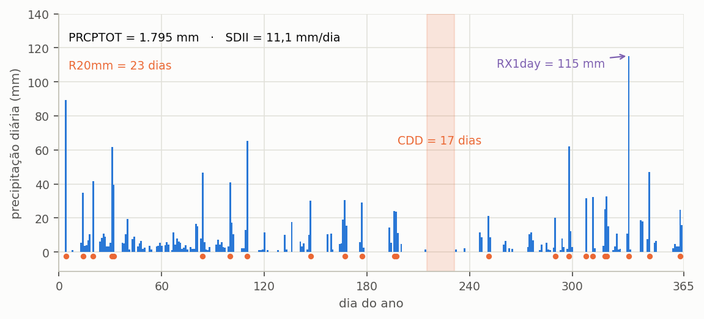
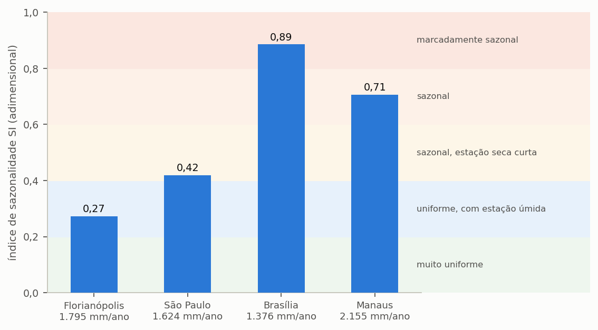
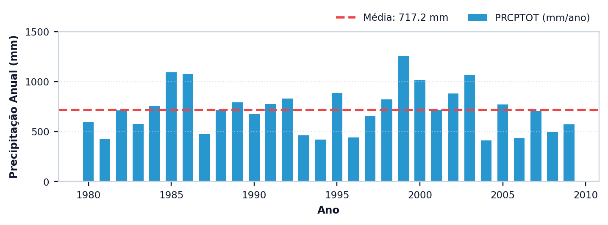
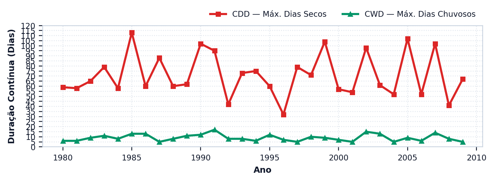

# Índices pluviométricos

> Esta secção traz a equação de cada um dos nove índices que o programa calcula, e declara três
> divergências em relação ao padrão ETCCDI.

Os índices pluviométricos não participam no balanço hídrico e não alteram nenhum resultado de
simulação. A sua função é caracterizar a série de precipitação, e uma caracterização honesta é o
que permite comparar estudos de cidades diferentes.

---

## Os nove índices

Os índices calculam-se **ano a ano** sobre a série carregada, e o programa reporta a média e a
dispersão do conjunto de anos. Em toda esta secção, `P_i` designa a precipitação do dia `i` do
ano, e um **dia húmido** é aquele em que `P_i ≥ 1 mm`, convenção do ETCCDI adotada porque lâminas
inferiores a um milímetro são da ordem do erro de medição dos udómetros convencionais.

### Precipitação total anual, PRCPTOT

Soma da precipitação de todos os dias húmidos do ano. Difere do total anual bruto por excluir os
dias de lâmina desprezável, o que evita que o ruído do instrumento se acumule no total.

```equacao:prcptot
PRCPTOT = Σ P_i , para P_i ≥ 1 mm
```

| Símbolo | Significado | Unidade |
| :--- | :--- | :--- |
| `PRCPTOT` | precipitação total dos dias húmidos do ano | mm |
| `P_i` | precipitação do dia `i` | mm |
| `Σ` | somatório sobre os dias do ano que satisfazem a condição | — |

### Precipitação em dias muito húmidos, R95p

Soma da precipitação dos dias cuja lâmina excede o percentil 95 dos dias húmidos. Mede quanto do
total anual chega nos eventos extremos, e é o índice mais diretamente ligado ao extravasamento das
cisternas.

```equacao:r95p
R95p = Σ P_i , para P_i > q_95
```

| Símbolo | Significado | Unidade |
| :--- | :--- | :--- |
| `R95p` | precipitação acumulada nos dias muito húmidos | mm |
| `P_i` | precipitação do dia `i` | mm |
| `q_95` | percentil 95 da precipitação dos dias húmidos da série | mm |

### Máxima precipitação num dia, RX1day

O maior valor diário registado no ano. É o índice que dimensiona o ladrão e a caleira, e não o
reservatório.

```equacao:rx1day
RX1day = max ( P_i )
```

| Símbolo | Significado | Unidade |
| :--- | :--- | :--- |
| `RX1day` | maior precipitação diária do ano | mm |
| `P_i` | precipitação do dia `i` | mm |
| `max` | valor máximo sobre todos os dias do ano | — |

### Máxima precipitação em cinco dias, RX5day

O maior acumulado de cinco dias consecutivos no ano. Importa mais ao aproveitamento pluvial do
que o RX1day, porque um reservatório enche ao longo de um evento prolongado e não apenas no pico
diário.

```equacao:rx5day
RX5day = max ( Σ P_j ) , para j de i a i + 4
```

| Símbolo | Significado | Unidade |
| :--- | :--- | :--- |
| `RX5day` | maior acumulado de cinco dias consecutivos no ano | mm |
| `P_j` | precipitação do dia `j` da janela | mm |
| `i` | primeiro dia de cada janela de cinco dias | — |
| `max` | valor máximo sobre todas as janelas do ano | — |

### Índice simples de intensidade diária, SDII

Precipitação média dos dias húmidos. Separa dois regimes que o total anual confunde: muita chuva
em poucos dias e pouca chuva em muitos dias podem produzir o mesmo PRCPTOT e SDII muito
diferentes.

```equacao:sdii
SDII = PRCPTOT ÷ n_húmidos
```

| Símbolo | Significado | Unidade |
| :--- | :--- | :--- |
| `SDII` | intensidade média dos dias húmidos | mm/dia |
| `PRCPTOT` | precipitação total dos dias húmidos, da Equação {{eq:prcptot}} | mm |
| `n_húmidos` | número de dias húmidos do ano | dia |

### Dias de precipitação intensa, R20mm

Contagem dos dias em que a lâmina atinge ou excede vinte milímetros. Num sistema de aproveitamento
pluvial, são tipicamente os dias de extravasamento.

```equacao:r20mm
R20mm = # { i : P_i ≥ 20 mm }
```

| Símbolo | Significado | Unidade |
| :--- | :--- | :--- |
| `R20mm` | número de dias com precipitação intensa no ano | dia |
| `P_i` | precipitação do dia `i` | mm |
| `# { }` | contagem dos dias que satisfazem a condição | — |

### Dias secos consecutivos, CDD

Maior sequência de dias consecutivos com precipitação inferior a um milímetro. ==É o índice que
melhor prevê o desempenho de um sistema pluvial,== porque a estiagem mais longa é o que esvazia a
cisterna.

```equacao:cdd
CDD = max ( L ) , com P_i < 1 mm em toda a sequência L
```

| Símbolo | Significado | Unidade |
| :--- | :--- | :--- |
| `CDD` | maior sequência de dias secos consecutivos no ano | dia |
| `L` | comprimento de uma sequência de dias secos consecutivos | dia |
| `P_i` | precipitação do dia `i` | mm |

### Dias húmidos consecutivos, CWD

Maior sequência de dias consecutivos com precipitação igual ou superior a um milímetro.
Caracteriza a persistência da chuva, e as sequências longas favorecem o enchimento completo do
reservatório.

```equacao:cwd
CWD = max ( L ) , com P_i ≥ 1 mm em toda a sequência L
```

| Símbolo | Significado | Unidade |
| :--- | :--- | :--- |
| `CWD` | maior sequência de dias húmidos consecutivos no ano | dia |
| `L` | comprimento de uma sequência de dias húmidos consecutivos | dia |
| `P_i` | precipitação do dia `i` | mm |

### Índice de sazonalidade, SI

Mede o afastamento entre a distribuição mensal real da chuva e a distribuição perfeitamente
uniforme ao longo do ano. Ao contrário dos oito anteriores, não pertence ao conjunto ETCCDI: foi
proposto por Walsh e Lawler em 1981.

```equacao:sazonalidade
SI = ( 1 ÷ R ) × Σ | X_m − R ÷ 12 |
```

| Símbolo | Significado | Unidade |
| :--- | :--- | :--- |
| `SI` | índice de sazonalidade de Walsh e Lawler | adimensional |
| `R` | precipitação total do ano | mm |
| `X_m` | precipitação total do mês `m`, com `m` de 1 a 12 | mm |
| `R ÷ 12` | precipitação mensal que haveria se a chuva fosse uniforme | mm |
| `Σ` | somatório sobre os doze meses do ano | — |
| `\| \|` | valor absoluto da diferença | — |

O índice da Equação {{eq:sazonalidade}} vale zero quando todos os meses recebem a mesma lâmina e
tende para 1,83 quando toda a chuva do ano cai num único mês. Entre estes extremos, Walsh e
Lawler (1981) classificam o regime em muito uniforme (abaixo de 0,20), uniforme com estação
húmida definida (0,20 a 0,39), sazonal com estação seca curta (0,40 a 0,59), sazonal (0,60 a
0,79), marcadamente sazonal com estação seca longa (0,80 a 0,99), com a maior parte da chuva em
até três meses (1,00 a 1,19) e extremo (1,20 ou mais).

O índice de sazonalidade é o que mais importa ao aproveitamento pluvial, e a secção {{n:14}}
mostra porquê: é a distribuição da chuva ao longo do ano, e não o total precipitado, que decide o
rendimento do sistema.

---

Os nove índices ficam abstratos enquanto permanecem em forma de tabela, e a {{fig:fig16_indices}}
posiciona-os sobre um ano da série. Postos sobre um ano real de série, cada um passa a apontar um
troço identificável do registo: o dia mais intenso, os dias acima do limiar, a maior estiagem, o
total acumulado.



*Figura 99 — Quatro dos nove índices marcados sobre um ano da série de Lisboa: PRCPTOT e SDII, no alto; RX1day, o maior valor diário do ano; CDD, a maior sequência de dias secos, na faixa sombreada; e R20mm, os dias com 20 mm ou mais, marcados na base.*

A sazonalidade é o índice que menos se parece com os restantes, porque não descreve intensidade
nem frequência: descreve quanto a chuva do ano se concentra numa parte dele. É também o índice que
mais separa cidades com totais anuais semelhantes, e o que melhor prevê se um reservatório terá de
atravessar uma estiagem longa ({{fig:fig17_sazonalidade}}).



*Figura 99 — Índice de sazonalidade de Walsh e Lawler (1981) nas três cidades de exemplo (Lisboa, Porto e Funchal), com as classes do índice ao fundo e a precipitação média anual sob o nome de cada cidade. Precipitação anual elevada e distribuição uniforme ao longo do ano são propriedades independentes.*

---

## Três divergências que têm de ser declaradas

O programa chama ao conjunto «ETCCDI mais sazonalidade», e a precisão da expressão importa.

**Primeira: o conjunto não é ETCCDI puro.** O índice de sazonalidade é de Walsh e Lawler, e não
pertence ao conjunto do *Expert Team on Climate Change Detection and Indices*. Em compensação, o
**R10mm**, que é ETCCDI, **não** está implementado.

Oito dos nove índices são ETCCDI; o nono não é; e falta um que seria.

**Segunda: o período de base do percentil.** O R95p exige um percentil 95 dos dias húmidos. O
ETCCDI define o período de base fixo de 1961 a 1990. O programa calcula o percentil sobre **toda a
série carregada**.

A consequência é que o R95p de duas séries de comprimentos diferentes **não é diretamente
comparável**, porque o limiar de cada uma é próprio. Para uma comparação estrita com a literatura
ETCCDI, corte a série no período de base.

O programa calcula o percentil **apenas sobre os dias húmidos**, o que está correto: incluir os
dias secos deslocaria o percentil para baixo em séries sazonais.

**Terceira: as janelas incompletas do RX5day.** A soma móvel de cinco dias usa janelas parciais no
início de cada ano, de modo que as primeiras janelas têm de um a quatro dias. O efeito é pequeno e
vai sempre no sentido de subestimar o RX5day dos primeiros dias do ano.

---

O separador de índices do programa apresenta cada indicador ano a ano: a precipitação total anual
({{fig:fig53_programa_prcptot}}) e as maiores sequências de dias secos e chuvosos
({{fig:fig54_programa_cdd_cwd}}).



*Figura 99 — Precipitação total anual (PRCPTOT) da série de Lisboa, com a média do período a tracejado, no separador de índices. Figura gerada pelo próprio programa.*

---


*Figura 99 — Maior sequência anual de dias secos (CDD) e de dias chuvosos (CWD) da série de Lisboa, no separador de índices. São os dois índices mais diretamente ligados ao volume de reservatório que o regime de chuva exige. Figura gerada pelo próprio programa.*

---
## Para que servem no estudo

**Caracterizar a série** no método do artigo. PRCPTOT, SDII e SI descrevem o regime melhor do que
a média anual sozinha.

**Explicar o resultado.** Um CDD alto, ou um regime fortemente sazonal, explica um desempenho
inferior ao que o total anual sugere: na secção {{n:14}}, Lisboa recebe chuva em 22% dos dias, o
seu mês mais chuvoso tem 47,3 vezes a chuva do mais seco, e a mesma moradia rende 17,49% com
5 000 L, contra 22,04% no Porto, onde chove em 31% dos dias e a razão entre o mês mais e o menos
chuvoso é de 9,8.

**Comparar cenários climáticos.** Entre a série histórica e a projetada, o que costuma mudar
primeiro é o SDII e o CDD, e não o PRCPTOT. Reportar só o total anual esconde a mudança que mais
afeta o sistema.

---

## O que os índices não fazem

Não entram no balanço. Não alteram o dimensionamento. Não substituem a simulação diária, que é
justamente o argumento do programa contra os métodos por valores médios.

Um índice é um resumo. O balanço usa a série inteira.
