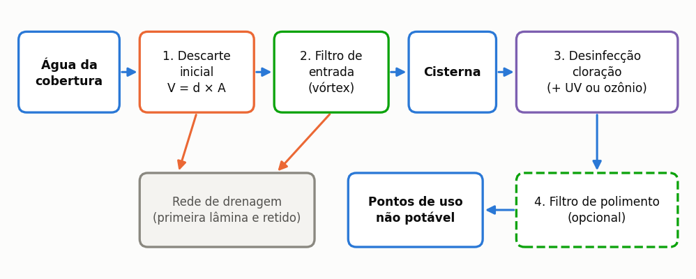
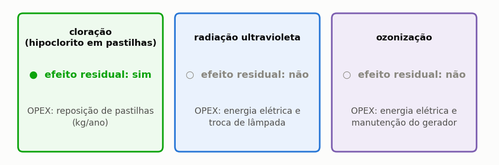

# Dimensionamento da ETAP

> Esta secção formaliza como o programa dimensiona a estação de tratamento de água
> pluvial (ETAP) e explica a **regra incremental**, que impede o tratamento de ser contado
> duas vezes no orçamento e no fluxo de caixa.

A água que escoa de uma cobertura transporta poeiras, folhas, partículas e dejetos de aves, e
nenhum uso — nem mesmo a alimentação de autoclismos — admite que chegue ao ponto de consumo
tal como sai do telhado. A estação de tratamento de água pluvial, abreviada como ETAP, é o
conjunto de equipamentos que realiza essa adequação, e o programa dimensiona-a a partir
de três entradas: a classe de qualidade exigida pelo uso, a área de captação e o volume
pluvial anual efetivamente consumido, este último resultante do balanço diário
apresentado na secção {{n:23}}.

A linha de tratamento dimensionada pelo programa possui quatro componentes em série: o **descarte inicial** desvia a primeira lâmina de cada evento de precipitação, que transporta as impurezas acumuladas na cobertura; o **filtro mecânico de entrada** retém folhas e sólidos grosseiros antes que cheguem ao reservatório; a **desinfeção** é o estágio obrigatório, do qual depende a segurança microbiológica da água armazenada; e o **filtro de polimento** é opcional, destinando-se a utilizações em que a limpidez ou a ausência de resíduos dissolvidos é requerida.

---

A linha de tratamento é uma sequência, e a ordem dos estágios não é arbitrária: cada
um remove aquilo que tornaria o seguinte ineficaz. Convém ter o encadeamento inteiro à vista antes de discutir cada componente ({{fig:fig00j_etap}}). A ordem não é intercambiável: desinfetar antes de filtrar consome o reagente na matéria orgânica em suspensão e deixa microrganismos protegidos no interior das partículas. A turbidez é, por isso, condição de eficácia da desinfeção, e não apenas um parâmetro estético.



*Figura 99 — Componentes da linha de tratamento dimensionada pelo programa, na ordem do escoamento, e destino do material retido. O descarte inicial e o filtro de entrada atuam antes da cisterna; a desinfeção atua depois deles porque o reagente seria consumido pela matéria orgânica em suspensão que os estágios anteriores removem; o filtro de polimento é opcional.*

---

## O filtro de entrada

O filtro de entrada é dimensionado pela área de cobertura, e não pela classe de
qualidade pretendida, porque tem de acomodar o caudal de ponta produzido pela cobertura
— grandeza independente do destino final da água. As três faixas adotadas pelo
programa correspondem às capacidades nominais que os fabricantes declaram para equipamentos
usuais de mercado (filtros mecânicos em linha e vórtex autolimpantes).

<!-- tabela: Filtro mecânico de entrada dimensionado pela área de cobertura -->
| Cobertura | Equipamento | Malha |
| :--- | :--- | ---: |
| até 200 m² | vórtex autolimpante DN 100 | 350 µm |
| até 500 m² | vórtex autolimpante DN 150 | 400 µm |
| acima de 500 m² | cesto ou ciclónico DN 200 | 500 µm |

> Os limites de faixa acompanham a área nominal que o fabricante declara atender, e não
> uma margem arbitrária. É a razão pela qual uma cobertura de 180 m² recebe o filtro de
> DN 100: o equipamento é suficiente para até 200 m², e impor
> o escalão seguinte encareceria a instalação sem fundamento técnico.

---

## A desinfeção

A desinfeção é o estágio que o programa nunca dispensa, e a razão reside no conceito de
residual desinfetante. Entre as três tecnologias disponíveis, apenas a cloração deixa na água um
agente desinfetante que permanece ativo após a passagem pelo equipamento; a radiação ultravioleta e a ozonização atuam no instante da passagem e nada deixam a jusante ({{fig:fig30_desinfeccao}}).



*Figura 99 — As três tecnologias de desinfeção, o efeito residual de cada uma e a composição do custeio anual (OPEX). O efeito residual distingue a cloração das restantes: protege a água armazenada na cisterna e na rede, enquanto a radiação ultravioleta e o ozono atuam apenas sobre a água que atravessa o reator.*


==A radiação ultravioleta e o ozono entram como barreira adicional à cloração, e não como
substitutos desta.== Sem residual, a água tratada volta a contaminar-se ao longo da rede
de distribuição interior, e as boas práticas de engenharia sanitária — em harmonia com a
norma EN 16941-1 e as recomendações técnicas da ANQIP (ETA 0701) — mantêm a cloração residual
livre para proteção do armazenamento e tubagens. A consequência económica é direta: as duas opções adicionais
somam o seu custo ao do cloro, e optar por qualquer uma delas não reduz o custeio operacional.

### A massa de cloro

O consumo de desinfetante é dimensionado pela massa de produto comercial necessária por metro
cúbico tratado, resultante da dosagem aplicada e do teor de cloro ativo do produto adquirido.

```equacao:massa_cloro
m_prod = ( C_Cl ÷ 1000 ) ÷ p
```

| Símbolo | Significado | Unidade |
| :--- | :--- | :--- |
| `m_prod` | massa de produto comercial consumida por metro cúbico tratado | kg/m³ |
| `C_Cl` | dose de cloro ativo aplicada à água | mg Cl₂/L |
| `1000` | conversão de miligramas por litro para quilogramas por metro cúbico | — |
| `p` | pureza do produto, em massa de cloro ativo por massa de produto | adimensional |

> **Adquire-se o produto comercial, e não o cloro puro.** As pastilhas de hipoclorito de
> cálcio contêm habitualmente cerca de 65% de cloro ativo, e o preço de mercado por quilograma refere-se
> ao produto embalado, não ao princípio ativo. Dimensionar o custo pela massa de cloro
> puro subestimaria a despesa na proporção inversa da concentração (~35%).

---

## O filtro de polimento

O filtro de polimento é opcional e constitui o único ponto do dimensionamento em que a
classe de qualidade pretendida orienta a escolha do equipamento. Para utilizações mais
exigentes, o programa recomenda a sua inclusão, variando também o
meio filtrante: usos que envolvam contacto próximo exigem carvão ativado em bloco, ao passo que
usos gerais se satisfazem com filtro de areia ou cartucho de polipropileno de vinte micrómetros.

<!-- tabela: Recomendação de filtro de polimento por classe de qualidade alvo -->
| Classe | Recomenda polimento? | Equipamento quando selecionado |
| :--- | :---: | :--- |
| 1 — Usos não potáveis gerais e autoclismos | não | filtro de areia ou cartucho de 20 µm |
| 2 — Rega e lavagem de pavimentos | sim | idem |
| 3 — Torres de arrefecimento e climatização | sim | idem |
| 4 — Lavagem de roupa | sim | **carvão ativado em bloco** |

A recomendação não é uma imposição cega: o filtro só integra o orçamento se o
utilizador o selecionar explicitamente. Quando a classe o recomenda e o utilizador não o seleciona,
o programa regista a opção no relatório técnico, garantindo a rastreabilidade da decisão.

---

## O descarte de primeiras águas

O descarte de primeiras águas entra no cálculo em duas vertentes. No balanço hídrico diário,
é a lâmina subtraída à precipitação de cada dia com chuva, descrita na secção {{n:23}}. No orçamento,
quando o dimensionamento físico do dispositivo de primeira lavagem está ativado na etapa
**3. Qualidade & ETAP**, constitui um subsistema com investimento, manutenção e pegada de carbono próprios,
composto pelo separador de folhas e pela câmara de desvio.

O volume da câmara de descarte é o produto da lâmina de desvio pela área de captação,
`V_desc = d × A`, em litros, com `d` em milímetros e `A` em metros quadrados. Para pequenos volumes,
o sistema prevê tubagem vertical de desvio com válvula de drenagem lenta; para volumes maiores,
uma câmara dedicada com boia de vedação. Na edição para Portugal, os custos de investimento e
manutenção do subsistema são parametrizáveis na interface ou adotam valores ilustrativos de referência.

<!-- tabela: Dimensionamento do descarte inicial no projeto do tutorial -->
| Parâmetro | Valor |
| :--- | ---: |
| lâmina de descarte | 2 mm |
| área de captação | 150 m² |
| volume da câmara de descarte | 300 L |
| carbono incorporado da câmara e separador | 21,1 kg CO₂e |

O investimento do subsistema integra o orçamento da linha de tratamento e entra no
fluxo de caixa através da regra incremental apresentada a seguir.

---

## A regra incremental

A regra incremental impede o erro frequente de duplicar parcelas de tratamento no orçamento
e no custeio operacional. Aplica-se em três níveis distintos:

**No investimento inicial.** O orçamento global de um sistema de aproveitamento de águas pluviais
já inclui habitualmente uma verba preliminar de filtragem e acessórios. Somar o custo da linha de
tratamento detalhada sem abater essa verba duplicaria a despesa. O programa calcula apenas o acréscimo:

```equacao:capex_etap
CAPEX_inc = CAPEX_linha − V_gen
```

| Símbolo | Significado | Unidade |
| :--- | :--- | :--- |
| `CAPEX_inc` | investimento incremental da linha de tratamento | € |
| `CAPEX_linha` | custo total dos equipamentos da linha dimensionada | € |
| `V_gen` | verba genérica de tratamento já incluída na rubrica de acessórios | € |

**No custeio anual.** O consumo de cloro já é contabilizado na linha de reagentes operacionais
do fluxo de caixa. O custeio incremental da ETAP deduz essa parcela para que o produto químico não seja
orçado duas vezes.

**Na avaliação de ciclo de vida.** A linha de tratamento detalhada **substitui** o termo expedito
de cloração, assegurando que o inventário de materiais reflita a configuração física exata sem sobreposições.

---

## Desativação da ETAP

O dimensionamento da linha de tratamento pode ser desligado na interface. Nesse caso,
nem o investimento nem os custos operacionais da ETAP incidem sobre a análise económica.
Essa opção destina-se a estudos em que a edificação já dispõe de tratamento pré-existente
ou em que se pretende isolar o custo hidráulico do armazenamento. Desativá-la no programa
não significa que a água pluvial dispense tratamento sanitário: significa unicamente que o tratamento
não está a ser imputado a este orçamento.

---

## Limites do dimensionamento

O dimensionamento automático do programa concentra-se nos equipamentos funcionais da linha.
Ficam sob responsabilidade do projetista: o traçado detalhado da tubagem de ligação e drenagem,
a verificação rigorosa das perdas de carga localizadas no circuito de tratamento, o plano
sistemático de manutenção preventiva (limpeza periódica de malhas, desobstrução de vórtex e calibração de dosadores)
e a monitorização analítica laboratorial da qualidade da água, conforme estipulado pela regulamentação
técnica e sanitária em vigor.
