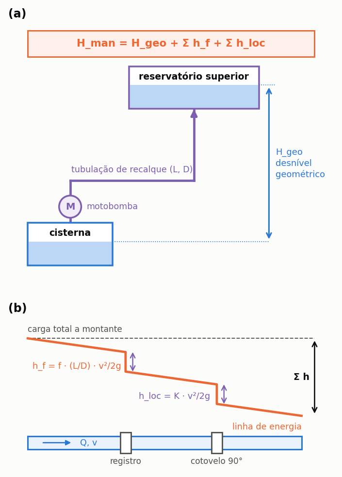

# Energia de bombagem

> Esta secção formaliza a cadeia energética completa do eixo à tomada elétrica e explica por que a
> potência nominal de placa **não** é o valor medido pelo contador de energia.

Três versões deste modelo existiram ao longo da evolução do programa, e as versões preliminares
cometiam os enganos descritos no item «Por que a cadeia completa importa»: tomar a potência mecânica
de placa como consumo elétrico e descontar o rendimento da bomba duas vezes. Quem consulta estudos
elaborados em versões antigas necessita de ter presente esta distinção.

---

## A potência de placa é a potência de eixo

As normas de motores elétricos (norma internacional IEC 60034-30-1 e norma europeia EN 60034-1)
estipulam que o **rendimento** venha expressamente indicado na placa de identificação do motor,
como grandeza distinta da potência nominal. Esta distinção reflete o facto físico de a potência
de placa representar a potência mecânica disponível **no veio (eixo)**.

A cadeia de bombagem integra, por conseguinte, dois rendimentos complementares:

<!-- tabela: Os dois rendimentos da cadeia de bombeamento e o que cada um converte -->
| Rendimento | Conversão efetuada |
| :--- | :--- |
| **da bomba**, `η_b` | potência mecânica no veio em potência hidráulica transmitida ao fluido |
| **do motor elétrico**, `η_m` | potência elétrica absorvida da rede em potência mecânica no veio |

O programa solicita ambos os parâmetros em campos diferenciados.

---

## As equações de cálculo

**Consumo específico de energia na elevação**, por metro cúbico bombeado:

```equacao:energia_especifica
e = ( ρ × g × H ) ÷ ( η_b × η_m )
```

| Símbolo | Significado | Unidade |
| :--- | :--- | :--- |
| `e` | consumo específico de energia por volume elevado | kWh/m³ |
| `ρ` | massa volúmica da água, adotada como 1.000 | kg/m³ |
| `g` | aceleração da gravidade, adotada como 9,81 | m/s² |
| `H` | altura manométrica total da instalação | m c.a. |
| `η_b` | rendimento hidráulico da bomba | adimensional |
| `η_m` | rendimento do motor elétrico | adimensional |

==A Equação {{eq:energia_especifica}} é independente do caudal de serviço e da potência instalada.==
Elevar um metro cúbico de água a uma dada altura manométrica requer a mesma quantidade de energia
teórica quer se utilize um grupo elevatório pequeno ou sobredimensionado; a variação na potência
determina o tempo necessário para completar a bombagem, não o consumo específico do processo.

**Quando o caudal de funcionamento é expressamente declarado:**

```equacao:energia_por_vazao
e = P ÷ ( Q × η_m )
```

| Símbolo | Significado | Unidade |
| :--- | :--- | :--- |
| `e` | consumo específico de energia por volume elevado | kWh/m³ |
| `P` | potência de placa da eletrobomba, medida no veio | kW |
| `Q` | caudal de bombagem introduzido ou deduzido | m³/h |
| `η_m` | rendimento do motor elétrico | adimensional |

O rendimento da bomba hidráulica não surge na Equação {{eq:energia_por_vazao}} porque
já está implicitamente refletido no facto de um veio com potência `P` permitir fornecer o caudal `Q`
à altura manométrica considerada. Dividir novamente por `η_b` duplicaria as perdas hidráulicas.

**Caudal deduzido, quando não declarado:**

```equacao:vazao_deduzida
Q = ( P × η_b ) ÷ ( ρ × g × H )
```

| Símbolo | Significado | Unidade |
| :--- | :--- | :--- |
| `Q` | caudal de bombagem deduzido | m³/h |
| `P` | potência de placa do grupo elevatório | kW |
| `η_b` | rendimento hidráulico da bomba | adimensional |
| `ρ` | massa volúmica da água (1.000) | kg/m³ |
| `g` | aceleração da gravidade (9,81) | m/s² |
| `H` | altura manométrica total | m c.a. |

**Energia consumida nos arranques:**

```equacao:energia_partida
E_part = ( P × t_part ) ÷ η_m
```

| Símbolo | Significado | Unidade |
| :--- | :--- | :--- |
| `E_part` | energia consumida nos arranques acumulados do período | kWh |
| `P` | potência nominal no veio | kW |
| `t_part` | tempo acumulado de arranque transitório no período | h |
| `η_m` | rendimento do motor elétrico | adimensional |

O rendimento da bomba hidráulica não intervém na Equação {{eq:energia_partida}} pelo facto
de durante o curto intervalo de arranque não existir débito útil estável, correspondendo
a energia consumida ao regime de transição do motor elétrico.

A energia elétrica anual total consumida pelo grupo de bombagem corresponde à soma do
consumo do volume efetivamente transferido com o dispêndio dos ciclos de arranque:

```equacao:energia_anual
E_ano = e × V_rec + ( P × t_part ) ÷ η_m
```

| Símbolo | Significado | Unidade |
| :--- | :--- | :--- |
| `E_ano` | energia elétrica anual consumida pela eletrobomba | kWh/ano |
| `e` | consumo específico de energia | kWh/m³ |
| `V_rec` | volume anual bombeado para o reservatório superior | m³/ano |
| `P` | potência nominal no veio | kW |
| `t_part` | tempo acumulado de arranques durante o ano | h/ano |
| `η_m` | rendimento do motor elétrico | adimensional |

---

A potência de placa de uma eletrobomba expressa a potência mecânica no veio, e não o consumo elétrico
registado no contador ({{fig:fig00k_energia}}). A título de exemplo, uma eletrobomba de 0,37 kW (0,5 cv)
com motor elétrico de rendimento 60,5% absorve da rede cerca de 0,61 kW: calcular a despesa energética
apenas com a potência de placa subestimaria o consumo em cerca de 40%, distorcendo a análise económica.


*Figura 99 — Cadeia energética da bombagem predial. A potência nominal indicada na placa é a potência no veio, posicionada no centro da cadeia: entre esta e o contador elétrico situa-se o rendimento do motor (η_m); entre o veio e a potência hidráulica útil entregue à água situa-se o rendimento da bomba (η_b).*

A potência hidráulica necessária é determinada pela altura manométrica total, que combina
o desnível geométrico real com as perdas de carga contínuas e singulares da instalação ({{fig:fig00l_manometrica}}).
As perdas de carga contínuas na tubagem são calculadas pela formulação universal de Darcy-Weisbach
(`h_f = f · (L/D) · v²/2g`), e as perdas localizadas em válvulas, curvas e uniões pela equação
geral `h_loc = K · v²/2g`. Em circuitos prediais habituais de elevação, as perdas somam tipicamente entre 10% e 30% do desnível geométrico.



*Figura 99 — (a) Altura manométrica de um sistema elevatório predial: desnível geométrico entre os níveis da cisterna e do reservatório superior somado às perdas de carga totais; (b) linha piezométrica ao longo de um troço de tubagem com perda de carga contínua por atrito e singularidades localizadas.*

---

## O rendimento do motor elétrico

Caso o utilizador não especifique o rendimento no projeto, o programa adota valores de
referência baseados na classe de eficiência standard (IE1) da IEC 60034-30-1 para pequenos
motores de indução monofásicos de dois polos (~2.900 rpm / 50 Hz em Portugal) ({{fig:fig31_motores}}):


*Figura 99 — Rendimento indicativo de motores de indução por escalão de potência e classe de eficiência. O programa adota valores conservadores da classe standard quando o utilizador não insere dados específicos da ficha técnica.*

Os dois valores mais frequentes em instalações residenciais são 0,5 cv (0,37 kW),
com cerca de **60,5%** de rendimento standard, e 1,0 cv (0,75 kW), com cerca de **69,3%**.
A diferença de quase nove pontos percentuais repercute-se de modo direto no custeio energético.

---

## Por que a cadeia completa importa

O consumo específico do sistema do tutorial (0,5 cv, 12 m c.a. de altura manométrica,
com reservatório superior) situa-se em torno de 0,11 kWh/m³. Descurar o rendimento
do motor ou descontar indevidamente o rendimento da bomba altera esse resultado em dezenas de pontos percentuais.

A formulação transparente adotada pelo programa visa exatamente evidenciar cada elo
físico da conversão de energia, permitindo auditorias técnicas consistentes.

---

## O assistente de dimensionamento de eletrobombas

Quando o utilizador não dispõe das especificações exatas de catálogo da eletrobomba,
o botão *Assistente de Dimensionamento de Eletrobomba* (na etapa **4. Reservatório & Custos**)
permite estimar os parâmetros a partir dos dados do edifício:

1. **Caudal de elevação.** `Q = V_sup ÷ t_ench`, considerando o volume do reservatório superior e o tempo de enchimento de referência (habitualmente 45 minutos).
2. **Diâmetro económico.** Estimado por formulações hidráulicas usuais para regimes descontínuos em tubagem de polietileno de alta densidade (PEAD) ou PVC.
3. **Velocidade de escoamento.** Mantida na faixa de boa prática técnica (entre 0,6 m/s e 2,0 m/s).
4. **Perdas de carga.** Estimadas com base no comprimento do traçado e acessórios da instalação.
5. **Altura manométrica e potência.** Determinação do ponto de funcionamento de projeto `(Q, H_man)`.
6. **Seleção de equipamento.** Cruzamento do ponto de funcionamento com curvas de modelos comerciais integrados.

---

## Pressurização hidropneumática direta

Nos sistemas sem reservatório superior, em que a distribuição não potável é efetuada
por bombagem direta com grupo sobrepressor hidropneumático, o ciclo de funcionamento difere
substancialmente. A bomba arranca em cada abertura de torneira ou descarga de autoclismo,
sendo o caudal limitado pelo ponto de utilização e não pela capacidade máxima do equipamento.

O programa calcula o consumo da pressurização direta considerando o tempo efetivo de funcionamento:

```equacao:energia_pressurizador
E = (P ÷ η_m) · [V ÷ min(Q_b(H), Q_p) + N · t_r]
```

| Símbolo | Significado | Unidade |
| :--- | :--- | :--- |
| `E` | energia elétrica anual do sobrepressor | kWh/ano |
| `P` | potência nominal no veio | kW |
| `η_m` | rendimento do motor elétrico | adimensional |
| `V` | volume pluvial consumido no ano | m³/ano |
| `Q_b(H)` | caudal fornecido pela bomba à pressão de serviço `H` | m³/h |
| `Q_p` | caudal do dispositivo de utilização | m³/h |
| `N` | número anual de acionamentos | 1/ano |
| `t_r` | tempo de pós-circulação / retardo eletrónico de desligamento | h |

<!-- inclui: _tabelas/cap28_pressurizadores.md -->

A comparação dos regimes evidencia que a pressurização hidropneumática direta consome
significativamente mais energia por metro cúbico fornecido do que a elevação pontual para
um reservatório superior por gravidade. Embora o custo financeiro absoluto da eletricidade
possa ser reduzido em moradias unifamiliares, a energia operacional constitui uma parcela
relevante na pegada ecológica do ciclo de vida analisada na secção {{n:30}}.
