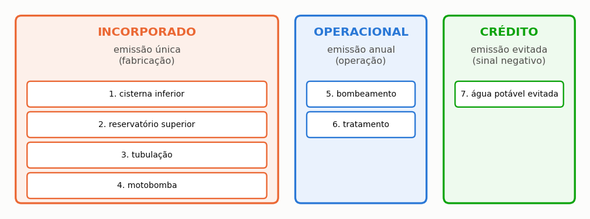

# Avaliação de ciclo de vida e pegada de carbono

> Esta secção descreve as etapas do inventário ambiental, a fronteira do sistema adotada e
> explicita as premissas de triagem da pegada de carbono.

A avaliação de ciclo de vida (ACV) contabiliza os impactes ambientais de um produto ou
sistema ao longo do seu ciclo existencial, desde a extração das matérias-primas até ao descarte
ou reciclagem. Aplicada a um sistema de aproveitamento de águas pluviais, permite verificar
se as emissões de gases com efeito de estufa associadas ao fabrico e montagem dos reservatórios,
tubagens e eletrobombas são efetivamente compensadas pelas emissões evitadas ao prescindir do
fornecimento convencional de água potável da rede pública.

==A avaliação integrada no programa é uma ACV de triagem (*screening*), e não um estudo exaustivo de conformidade normativa.==
A sua finalidade é ordenar alternativas de dimensionamento (por exemplo, comparar o polietileno com o betão armado)
e identificar os processos dominantes, permitindo escolhas técnicas informadas em fase de projeto.

---

## Estrutura da ACV segundo as normas internacionais

Em conformidade com a NP EN ISO 14040 e a NP EN ISO 14044, a avaliação estrutura-se em quatro fases:

1. **Definição do objetivo e âmbito.** Estabelece a finalidade do estudo, as fronteiras do sistema e a **unidade funcional**. A unidade funcional de referência no programa é o sistema completo concebido para responder às necessidades de um dado edifício ao longo da sua vida útil de projeto (tipicamente 20 anos), comparado com o abastecimento pela rede pública.
2. **Análise de inventário (ICV).** Quantifica os fluxos de matéria e energia: massa de componentes fabricados, consumo de eletricidade na bombagem, produtos químicos de desinfeção e volume de água potável evitado.
3. **Avaliação do impacte.** Converte os fluxos do inventário em indicadores ambientais. O programa calcula a categoria das **alterações climáticas**, expressa em quilogramas de dióxido de carbono equivalente (kg CO₂e), através dos fatores de emissão documentados no apêndice {{n:C}}.
4. **Interpretação dos resultados.** Analisa a robustez dos resultados e a sensibilidade do balanço de emissões face ao material do reservatório e à intensidade carbónica da rede elétrica.

---

## Módulos do ciclo de vida segundo a norma EN 15978

Para instalações no setor da construção, a norma europeia EN 15978 define a partição temporal do ciclo de vida:

<!-- tabela: Módulos do ciclo de vida da EN 15978 e o que a avaliação do programa cobre em cada um -->
| Módulo | Etapa do ciclo de vida | Cobertura pelo programa |
| :--- | :--- | :--- |
| A1 a A3 | Fabrico: extração de matérias-primas, transporte à fábrica e produção | Sim: reservatórios, tubagens, eletrobombas, descarte inicial e acessórios |
| A4 e A5 | Construção: transporte até à obra e instalação no edifício | Não considerado (a escavação e movimentação de terras não estão incluídas) |
| B1 a B5 | Uso, manutenção, reparação e substituição de componentes | Não considerado |
| B6 | Consumo de energia operacional | Sim: eletricidade consumida na bombagem |
| B7 | Consumo de água operacional | Sim: crédito ambiental da água potável evitada e reagentes da ETAP |
| C1 a C4 | Fim de vida: demolição, transporte, valorização e deposição final | Não considerado |
| D | Benefícios e encargos potenciais para além da fronteira (reciclagem) | Não considerado |

A fronteira de análise do programa classifica-se, assim, como **do berço ao portão da fábrica somada à fase de exploração (*cradle-to-gate with operational stage*)**.

---

## As sete etapas do inventário de emissões

O inventário de emissões do programa reparte-se em sete parcelas funcionais ({{fig:fig34_inventario}}):



*Figura 99 — As sete componentes do inventário de ciclo de vida do programa: as quatro primeiras correspondem ao carbono incorporado nos materiais; as duas seguintes às emissões operacionais anuais; e a sétima ao crédito ambiental anual pela água evitada (único termo dedutivo).*

---

## Carbono incorporado nos materiais

```equacao:emissao_componente
E_comp = m_comp × FE_mat
```

| Símbolo | Significado | Unidade |
| :--- | :--- | :--- |
| `E_comp` | emissão de carbono incorporado no componente | kg CO₂e |
| `m_comp` | massa estimada do componente | kg |
| `FE_mat` | fator de emissão do material (*cradle-to-gate*) | kg CO₂e/kg |

<!-- tabela: Massa por metro cúbico útil de cada material de reservatório -->
| Material | Massa indicativa por m³ útil | Massa para 5 m³ |
| :--- | ---: | ---: |
| Polietileno de alta densidade (PEAD) | 22 kg/m³ | 110 kg |
| Fibra de vidro (PRFV) | 15 kg/m³ | 75 kg |
| Aço inoxidável | 38 kg/m³ | 190 kg |
| Betão armado | 1.200 kg/m³ | 6.000 kg |

> **A massa condiciona o balanço de carbono.** O betão armado é o material mais massivo da lista. Em sistemas de pequena escala, um reservatório de betão de capacidade excessiva pode acumular uma dívida carbónica que não chega a ser amortizada ao longo dos 20 anos de vida útil do projeto.

### Inventário do projeto do tutorial

A tabela seguinte ilustra a repartição das emissões para o caso de estudo do tutorial (Lisboa, cisterna de 5.000 L em polietileno com reservatório superior de 1.000 L):

<!-- inclui: _tabelas/cap30_inventario.md -->

---

## Emissões operacionais e crédito ambiental

**Bombagem:**

```equacao:emissao_energia
E_ener = C_ano × FE_rede
```

| Símbolo | Significado | Unidade |
| :--- | :--- | :--- |
| `E_ener` | emissões anuais associadas à energia de bombagem | kg CO₂e/ano |
| `C_ano` | consumo anual de eletricidade da instalação | kWh/ano |
| `FE_rede` | fator de emissão da rede elétrica | kg CO₂e/kWh |

No estudo do tutorial, adotam-se fatores ilustrativos consistentes de referência (0,40 kg CO₂e/kWh para a rede e 0,50 kg CO₂e/m³ para a água potável evitada).

---

## Fronteiras e processos excluídos

A {{fig:fig00h_fronteira}} sintetiza os limites da análise ambiental efetuada pelo programa:


*Figura 99 — Delimitação da fronteira da avaliação ambiental: (a) processos incluídos — carbono incorporado dos reservatórios, tubagens e eletrobombas, emissões elétricas operacionais, produtos de tratamento e crédito da água potável poupada; (b) processos excluídos — movimentos de terras em obra civil, manutenção corretiva, fim de vida e outras categorias de impacte.*

---

## Indicadores de desempenho ambiental

**Saldo líquido anual:**

```equacao:saldo_liquido
E_liq = E_evit − E_ener − E_trat
```

| Símbolo | Significado | Unidade |
| :--- | :--- | :--- |
| `E_liq` | saldo líquido anual de emissões evitadas | kg CO₂e/ano |
| `E_evit` | emissão evitada pela água potável substituída | kg CO₂e/ano |
| `E_ener` | emissão associada ao consumo elétrico da bombagem | kg CO₂e/ano |
| `E_trat` | emissões devidas aos consumíveis de tratamento | kg CO₂e/ano |

**Período de recuperação carbónica (Payback ambiental):**

```equacao:payback_carbono
PB_amb = E_inc ÷ E_liq
```

| Símbolo | Significado | Unidade |
| :--- | :--- | :--- |
| `PB_amb` | período de recuperação ambiental do sistema | ano |
| `E_inc` | carbono incorporado total no fabrico dos componentes | kg CO₂e |
| `E_liq` | saldo líquido anual de emissões evitadas | kg CO₂e/ano |

**Saldo acumulado ao fim da vida útil:**

```equacao:saldo_vida
S_vida = ( E_liq × n_anos ) − E_inc
```

```equacao:emissao_especifica
E_esp = S_vida ÷ V_vida
```

| Símbolo | Significado | Unidade |
| :--- | :--- | :--- |
| `S_vida` | saldo líquido total acumulado na vida útil | kg CO₂e |
| `n_anos` | vida útil de projeto adotada (tipicamente 20 anos) | ano |
| `E_inc` | carbono incorporado inicial | kg CO₂e |
| `E_esp` | emissão específica líquida evitada por volume | g CO₂e/L |
| `V_vida` | volume total de água pluvial fornecido na vida útil | m³ |

Caso o saldo anual não seja positivo (quando a energia de bombagem ou o tratamento superam o crédito da água evitada), a dívida de fabrico não é amortizada. O programa assinala essa ocorrência devolvendo o código convencional de 999 anos para permitir a ordenação comparativa em varreduras de projeto.
