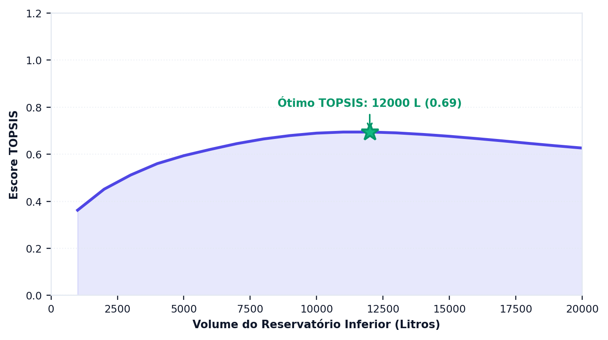
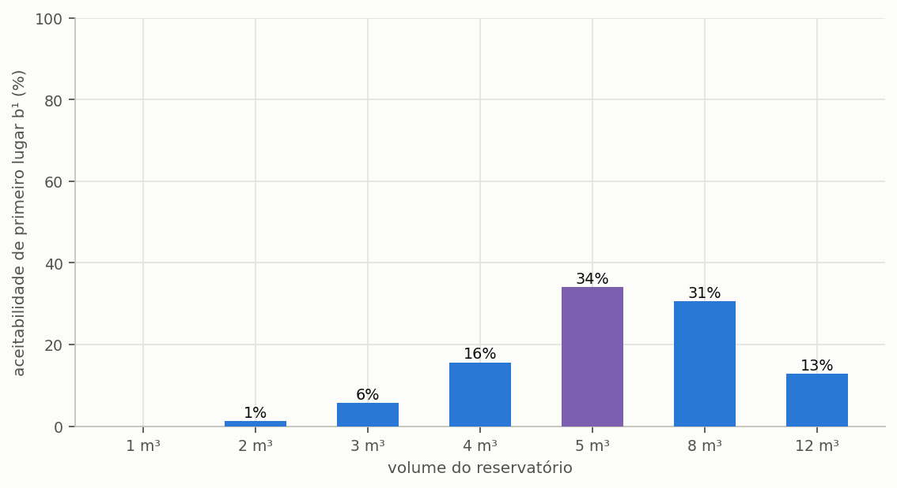

# Decisão multicritério

> Esta secção formaliza os dois métodos de ordenação que o programa oferece e declara três
> desvios em relação à formulação canónica que um estudo publicado precisa de citar.

A análise multicritério é o ramo da investigação operacional que trata de escolher entre
alternativas quando os critérios de avaliação discordam entre si e não se podem reduzir a um único
número sem que alguém declare o que vale mais. É exatamente a situação de um projeto de
aproveitamento pluvial: o volume que entrega mais água não é o que rende mais dinheiro, e nenhum
dos dois costuma ser o de menor impacto de carbono.

O que os métodos desta secção fazem não é descobrir a resposta certa. ==Tornam explícita a
ponderação que, de outro modo, ficaria implícita na escolha de quem decide.== É essa a diferença
toda entre um estudo que declara os seus valores e um que os esconde atrás de um resultado
aparentemente objetivo.

---

## Os sete critérios

O programa avalia cada volume da varredura segundo sete critérios, agrupados em três dimensões.
Cada critério tem uma direção de preferência: em uns, mais é melhor; noutros, menos.

<!-- tabela: Os sete critérios de decisão, a direção de preferência e o grupo de cada um -->
| # | Critério | Direção | Grupo |
| :-- | :--- | :--- | :--- |
| 1 | potencial de poupança | maximizar | técnico |
| 2 | extravasamento | minimizar | técnico |
| 3 | valor atual líquido | maximizar | económico |
| 4 | período de recuperação descontado | minimizar | económico |
| 5 | taxa interna de rentabilidade | maximizar | económico |
| 6 | CO₂e no fim da vida | minimizar | ambiental |
| 7 | consumo de água potável | minimizar | ambiental |

As alternativas submetidas à ordenação são os volumes simulados na varredura, e cada uma
comparece com os sete valores acima, calculados nas secções {{n:23}}, {{n:29}} e {{n:30}}. Não há
critério inventado nesta etapa: o método limita-se a ordenar o que as dimensões anteriores já
produziram.

---

## TOPSIS

O TOPSIS — *Technique for Order of Preference by Similarity to Ideal Solution*, proposto por Hwang
e Yoon em 1981 — parte de uma ideia geométrica simples. Se cada alternativa é um ponto num espaço
de sete dimensões, uma por critério, existem dois pontos de referência: a **solução ideal**,
composta pelo melhor valor de cada critério, e a **solução anti-ideal**, composta pelos piores.
Nenhuma alternativa real ocupa qualquer deles, porque nenhuma vence em tudo nem perde em tudo, e a
melhor alternativa é a que está em simultâneo mais perto do ideal e mais longe do pior caso.

O método executa cinco passos. Monta a matriz de decisão, com as alternativas nas linhas e os
critérios nas colunas; normaliza essa matriz, para que critérios medidos em euros, em pontos
percentuais e em quilogramas passem a ocupar escalas comparáveis; aplica os pesos declarados;
identifica as soluções ideal e anti-ideal; e ordena as alternativas pela proximidade relativa ao
ideal.

```equacao:topsis
C_i = d_i⁻ ÷ ( d_i⁺ + d_i⁻ )
```

| Símbolo | Significado | Unidade |
| :--- | :--- | :--- |
| `C_i` | coeficiente de proximidade da alternativa `i`, entre 0 e 1 | adimensional |
| `d_i⁺` | distância euclidiana da alternativa `i` à solução ideal | adimensional |
| `d_i⁻` | distância euclidiana da alternativa `i` à solução anti-ideal | adimensional |

O coeficiente da Equação {{eq:topsis}} valeria 1 para uma alternativa que coincidisse com a
solução ideal em todos os critérios, e 0 para uma que coincidisse com a anti-ideal. Como nenhuma
alternativa real ocupa esses extremos, o que interessa não é o valor absoluto do coeficiente, mas a
ordenação que ele produz.

---

Aplicado à varredura completa do projeto do tutorial (Lisboa), de 1 a 20 m³ em passos de 1 m³ e com
pesos iguais, o escore cresce até um máximo interior e decresce nos volumes maiores, em que o
investimento e o carbono incorporado passam a pesar mais do que o ganho de água
({{fig:fig22_topsis}}). O máximo da varredura completa pode diferir do volume obtido na secção
{{n:12}} com sete candidatos, porque o ideal e o anti-ideal se constroem a partir do conjunto
avaliado: acrescentar ou retirar alternativas desloca os pontos de referência e pode alterar a
ordenação, fenómeno conhecido como inversão de ordem (*rank reversal*).



*Figura 99 — Escore TOPSIS de cada volume da varredura do projeto do tutorial, de 1 a 20 m³, com cisterna de polietileno e pesos iguais entre os sete critérios; a estrela marca o volume de maior escore. Os custos que alimentam os critérios económicos são ilustrativos, não são preços de mercado. Figura gerada pelo próprio programa.*

---

## Três desvios a declarar

A implementação do programa afasta-se da formulação canónica em três pontos, todos deliberados, e
um estudo publicado precisa de os declarar para não atribuir aos métodos originais um
comportamento que é do programa.

**A normalização é uma variante.** A formulação canónica de Hwang e Yoon emprega a normalização
vetorial, que pressupõe valores não negativos em todos os critérios. O valor atual líquido, porém,
é com frequência negativo nos volumes pequenos, em que o investimento não se paga. O programa
contorna a restrição transladando cada critério por `x − min(x)` antes de normalizar. A escolha é
necessária e deliberada, mas apresentar o resultado como TOPSIS canónico seria incorreto: declare
a variante.

**As condições de Opricovic não estão implementadas.** O método VIKOR, na formulação de Opricovic,
exige duas verificações sobre a solução de compromisso encontrada — a de vantagem aceitável e a de
estabilidade aceitável — e, quando qualquer uma falha, devolve um **conjunto** de soluções
equivalentes em vez de um único vencedor. O programa devolve sempre a melhor alternativa, sem
realizar o teste. Na prática, isto significa que a solução de compromisso do VIKOR deve ser lida
ao lado da análise de sensibilidade aos pesos, e nunca sozinha.

**A atribuição do código.** A implementação do VIKOR e do SMAA-VIKOR foi escrita de forma
independente e verificada contra a biblioteca `crispyn`, de Aleksandra Bączkiewicz. O TOPSIS foi
verificado contra a formulação original de Hwang e Yoon num caso de valores todos positivos, em que
a translação descrita acima é inócua e as duas formulações têm de coincidir.

---

## SMAA-VIKOR

O SMAA — *Stochastic Multicriteria Acceptability Analysis* — existe para responder à pergunta a
que o TOPSIS não responde: e se os pesos fossem outros? Em vez de exigir um conjunto de pesos
definido de antemão, o método sorteia milhares de combinações de pesos e devolve, para cada
alternativa, a probabilidade de ocupar cada posição da ordenação.

A leitura do resultado é direta e informativa. Um volume que vence em 80% dos sorteios é uma
recomendação robusta, que não depende de uma ponderação específica para se sustentar. Um volume
que vence em 30% é uma recomendação frágil, e o texto do estudo tem de o dizer em vez de
apresentar o vencedor como se fosse consensual.

> É a ferramenta certa quando não há consenso sobre os pesos — que é o caso normal em projetos
> reais, nos quais o cliente, o projetista e a entidade licenciadora costumam valorizar dimensões
> diferentes.

---

A leitura mais útil da análise estocástica não é o vencedor, mas a margem com que vence. Um volume
que fica em primeiro lugar em três quartos dos sorteios de pesos é uma escolha estável, que
sobrevive a uma mudança de prioridades do decisor; dois volumes tecnicamente empatados indicam o
contrário, e nesse caso declarar o peso adotado deixa de ser formalidade e passa a ser a única
informação que sustenta a recomendação ({{fig:fig23_smaa}}).



*Figura 99 — Aceitabilidade de primeiro lugar (b¹) de cada volume candidato, obtida com cinco mil vetores de pesos sorteados no simplex. O volume destacado é o que mais vezes fica em primeiro lugar, e os restantes repartem o resto.*

### O tutorial, pelos dois métodos

A tabela põe lado a lado o escore TOPSIS, com pesos iguais entre as três dimensões, e a
aceitabilidade de primeiro lugar do SMAA-VIKOR, com cinco mil vetores de pesos sorteados, para os
sete volumes do tutorial de Lisboa em polietileno com reservatório superior. O investimento e o
carbono por trás dos escores são os valores ilustrativos da secção {{n:10}} (ilustrativo, não é
preço de mercado).

<!-- inclui: _tabelas/cap32_decisao.md -->

Os dois métodos concordam no vencedor, 5 000 L, e discordam na margem. O TOPSIS separa o primeiro
do segundo classificado (4 000 L) por 0,026 de escore, diferença que nenhum dado de entrada
sustenta. O SMAA mede essa fragilidade: 5 000 L vence em 34,1% dos sorteios e 8 000 L em 30,6%,
quase empatados, e com os 4 000 L (15,6%) os três somam quatro em cada cinco sorteios. Pela régua
desta secção, a recomendação é frágil, e o estudo deve declarar 8 000 L e 4 000 L como as
alternativas. Os extremos não fazem melhor: 1 000 L não vence em sorteio algum, e 2 000 L em 1,2%
deles. Nenhuma ponderação plausível recomenda o menor volume, e isso também é resultado.

---

## Os pesos

O programa aceita um peso por dimensão, técnica, económica e ambiental, ou um peso por critério.
Com pesos iguais entre as dimensões, cada uma vale um terço, repartido igualmente pelos seus
critérios: os dois técnicos e os dois ambientais valem um sexto cada, e os três económicos, um
nono cada. A escolha, contudo, não é técnica: é uma declaração de valor, e por isso tem de constar
do texto do estudo. ==A afirmação «volume ótimo pelo TOPSIS», sem os pesos, é impossível de
reproduzir,== e dois estudos com pesos diferentes chegam a volumes diferentes sem que nenhum dos
dois esteja errado.

No tutorial, a escolha dos pesos desloca o resultado. Com pesos iguais, o TOPSIS recomenda 5 000 L
(com 4 000 L em segundo); com 60% no peso técnico, recomenda 8 000 L (com 12 000 L em segundo); com
60% no económico ou no ambiental, volta a 5 000 L (com 4 000 L em segundo).

Três condutas são defensáveis, e a escolha entre elas depende do que se sabe sobre as prioridades
de quem decide. Pesos iguais, declarados explicitamente como ausência de preferência, constituem a
posição neutra. Pesos justificados, com a razão de cada um, são preferíveis quando as prioridades
são conhecidas. E o SMAA, que reporta a gama de resultados em vez de um vencedor único, é a conduta
mais completa quando não há consenso.

---

## Os melhores por critério isolado

Além da ordenação ponderada, o programa identifica o vencedor de cada grupo de critérios — técnico,
financeiro e ambiental — e reporta os três em separado. São números que vale a pena publicar em
conjunto, porque cada um responde a uma pergunta legítima e diferente.

Quando os três coincidem, a recomendação é forte e a decisão dispensa ponderação. Quando divergem,
que é o caso comum e o do tutorial, ==a divergência **é** o resultado:== escondê-la atrás de um
único número ponderado empobrece o estudo e transfere para o leitor uma conclusão que ele não tem
como avaliar. No tutorial de Lisboa, o critério técnico escolhe 12 000 L, o ambiental 2 000 L e o
financeiro 1 000 L (nenhum volume recupera o investimento com a tarifa de Lisboa e estes custos
ilustrativos, pelo que o critério financeiro se decide pelo valor atual líquido menos mau); o
compromisso de pesos iguais escolhe 5 000 L.

---

## O que o método não faz

Convém terminar pelos limites, porque os métodos multicritério são frequentemente apresentados com
uma autoridade que não têm.

**Não escolhem os pesos.** A ponderação é do analista, e é uma decisão de valor, não de técnica.
Nenhum procedimento estatístico a substitui.

**Não validam os critérios.** Se o valor atual líquido estiver errado porque a estrutura tarifária
foi mal introduzida, o TOPSIS ordenará o erro com precisão impecável. O método ordena o que recebe.

**Não incorporam restrições.** O espaço disponível no terreno, o orçamento máximo, uma exigência
regulamentar: tudo isso são filtros anteriores à ordenação, aplicados pelo projetista ao decidir
quais volumes chegam sequer a entrar na comparação.
