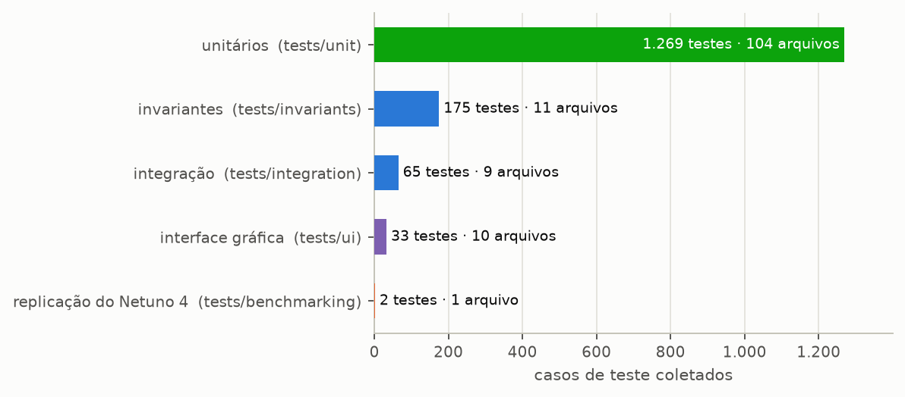
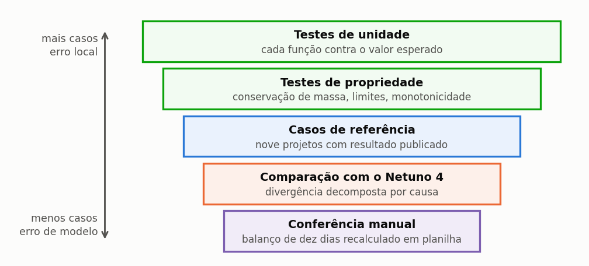

# Como o programa é verificado

> Esta secção descreve a suíte de verificação do Triton, para que um revisor disponha dos
> elementos necessários para julgar o grau de confiança de um resultado produzido pelo programa.

Um programa científico cuja verificação não é declarada equivale a uma afirmação sem evidência:
pode estar correto, mas quem o utiliza não tem como o saber, e quem avalia um trabalho feito com
ele não tem como o julgar. Esta secção é a evidência que sustenta os números apresentados no resto
do manual, e foi escrita para ser lida por quem precisa de decidir se confia neles.

---

## A suíte

A verificação do programa consiste em mais de mil testes automatizados, organizados em cinco
famílias que se complementam ({{fig:fig45_suite}}): testes unitários, testes de invariantes,
testes de integração, testes da interface gráfica e testes de referência contra resultados
independentes. A separação não é meramente organizativa: cada família apanha uma classe distinta
de defeito, e a ausência de qualquer uma delas deixaria um flanco a descoberto.

*Figura 99 — Número de testes e de ficheiros de cada família da suíte de verificação, conforme a recolha da suíte nesta versão. Os testes unitários respondem por mais de quatro quintos do total, por serem de execução rápida e localizarem o erro perto da origem.*

A suíte inteira é executada a cada alteração do código, e nenhuma alteração é incorporada enquanto
houver um teste a falhar. Esta disciplina é o que permite afirmar que um defeito corrigido não
regressa: a correção acompanha o teste que o vigia.

---

As camadas de verificação do programa formam uma hierarquia, e cada uma responde por um tipo de
erro que as restantes não alcançariam. Um teste unitário não deteta um erro de modelo, porque
confere a função com o que dela se espera; e uma conferência manual, que detetaria esse erro, não
cobre mil combinações de entrada ({{fig:fig00m_verificacao}}).

*Figura 99 — As cinco camadas de verificação do programa, dos testes unitários, numerosos e dirigidos a erros locais, à conferência manual, pontual e dirigida a erros de modelo. Nenhuma camada substitui outra: é a sobreposição das cinco que sustenta o resultado publicado.*

---

## As invariantes

As invariantes constituem a família mais importante da suíte, e a razão está na natureza do que
verificam. Um teste de valor confere se o programa produz um número específico perante uma entrada
específica; uma invariante confere se uma **propriedade** vale para qualquer entrada admissível. O
primeiro deteta que uma conta mudou; a segunda deteta que o modelo deixou de ser fisicamente
consistente.

A **conservação de massa** exige que, em séries de dez anos, o volume captado iguale a soma do
extravasado, do consumido e do que permaneceu armazenado. O resíduo medido é da ordem de 10⁻¹⁴ por
cento do captado, isto é, o próprio erro de arredondamento da aritmética de vírgula flutuante. O
**fecho do balanço da procura** faz o mesmo do lado do consumo: a procura total tem de ser
exatamente a soma de três parcelas, que são a água da chuva consumida, a água potável comprada e a
procura não satisfeita.

A **gama do potencial** verifica que o potencial de poupança permaneça entre zero e cem por cento
para toda a combinação de volume, coeficiente de escoamento e área, o que se confere sobre
sessenta combinações. O **teto da fração satisfazível** é mais específico e mais revelador: o
potencial nunca pode ultrapassar a fração da procura que a chuva pode satisfazer, e a verificação
estende-se até volumes de cem metros cúbicos, muito além de qualquer aplicação predial plausível.

A **paridade entre motores** compara o núcleo compilado com o ciclo de referência e exige que
ambos devolvam o mesmo número, para reservatório único e duplo, com e sem fornecimento de reserva
da rega, dentro de uma tolerância de 10⁻⁹. A **monotonia**, por fim, exige que mais volume nunca
reduza o potencial e que mais procura nunca o aumente — duas propriedades que qualquer
implementação correta satisfaz e que uma implementação defeituosa viola de modo evidente.

---

## Casos analíticos

Um conjunto à parte reúne casos de **solução fechada**, isto é, situações em que o resultado
correto se conhece por dedução, sem necessidade de simular: chuva constante, procura constante,
reservatório de capacidade infinita e reservatório de capacidade nula. ==São o teste mais forte de
que se dispõe, porque não dependem de nenhum valor de referência produzido pelo próprio programa.==
Um teste que compara a saída atual com a de ontem deteta regressão, mas perpetua um erro que já
existisse em ambas; um caso analítico não tem como o fazer.

---

## Testes de percurso

Esta família nasceu do defeito mais persistente que este programa apresentou ao longo da sua
história: um valor calculado corretamente que não chega a quem o deveria consumir. É uma classe de
erro que escapa por inteiro aos testes de fórmula, porque cada parte isolada está correta — a
origem calcula bem, o destino calcularia bem se recebesse, e o que falha é o troço entre os dois.
Só um teste de percurso o apanha: alterar a entrada no ecrã e verificar que o resultado final se
move de facto.

Cinco defeitos reais encontrados por esta família, e hoje vigiados por ela, ilustram o padrão: a
escolha da tecnologia de desinfeção não chegava à avaliação de ciclo de vida; desmarcar o filtro de
polimento não surtia efeito nas classes 2 a 4; os quatro campos de imposto eram repostos a zero
pelo próprio ecrã ao ser fechado; a opção de fornecimento de reserva da rega não chegava aos
núcleos compilados; e trinta dos oitenta e sete campos de então não sobreviviam a guardar e
reabrir o projeto.

---

## Os números do manual

Com a redação deste manual criou-se uma família própria de verificação, destinada a impedir que o
documento e o programa divirjam: **cada valor impresso tem uma asserção correspondente**. Estão
cobertos os números da secção {{n:23}}, os do tutorial inteiro (Lisboa), cada linha da tabela dos
dez dias e ainda a exigência de que certas secções declarem certas ressalvas. Quando o programa
muda, o teste falha e indica qual a página a corrigir.

É o mecanismo que impede um manual inteiro de envelhecer em silêncio, que é o destino habitual da
documentação dos programas científicos.

---

## Verificação contra referências independentes

A verificação estende-se a resultados que o programa não produziu: os casos analíticos acima e
comparações com cálculos de referência independentes. A secção {{n:35}} apresenta essa comparação e
o que ela pode e não pode mostrar.

---

## O que a verificação **não** prova

A distinção entre verificação e validação é exigida por qualquer revisor competente, e com toda a
razão, porque as duas respondem a perguntas diferentes e só uma delas está ao alcance de uma suíte
de testes.

A **verificação** responde se o programa resolve corretamente as equações que implementa, e é
exatamente isso que a suíte descrita nesta secção testa. A **validação** responde se as equações
implementadas representam adequadamente a realidade física, e isso exige medição no terreno:
sistemas instalados, monitorizados ao longo do tempo e comparados com o que a simulação previu.

O Triton é verificado. A validação do modelo comportamental de base diária apoia-se na literatura
da área, e não em medição própria conduzida pelo grupo que desenvolve o programa. ==Um estudo que
apresentasse resultados do programa como se fossem medição estaria a incorrer num erro de
método.==

---

## O relatório de verificação na interface

O menu **Ajuda → Relatório de Verificação** abre, dentro do programa, o relatório de verificação da
versão: a distinção entre verificação e validação, os núcleos exercitados, as invariantes, os casos
analíticos e a comparação com referências independentes. É a referência a citar quando um estudo
precisa de declarar como o programa foi verificado.

---

## Quem executa a suíte, e quando

A suíte acompanha o código-fonte do programa, e não a instalação: é executada pelo grupo de
investigação a cada alteração, antes de qualquer versão ser publicada. O que isto significa para
quem usa o programa instalado é que a versão presente no seu computador passou pelos testes aqui
descritos, incluindo os que conferem cada número impresso neste manual.

> **Aprofundamento: verificar por conta própria.** O código-fonte é público, sob uma licença
> académica (uso não comercial; `LICENSE.md`), e a suíte executa-se com um único comando no
> ambiente de desenvolvimento. Um revisor que queira conferir as invariantes — fecho de massa,
> monotonia, paridade entre os dois motores de cálculo — encontra os ficheiros de teste organizados
> por tema, e o apêndice {{n:B}} liga cada processo do programa ao que o verifica.
