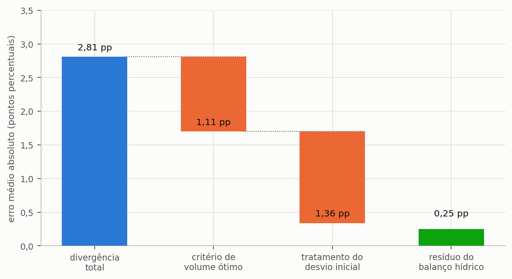

# Verificação contra soluções analíticas e referências

> Esta secção mostra como o motor é conferido contra resultados que não produziu: soluções de
> forma fechada, um caso que se confere à mão, regras de dimensionamento publicadas e programas
> independentes, e o que cada conferência pode e não pode provar.

---

## O papel da comparação

Uma comparação com outra ferramenta não é um alvo de fidelidade. ==Dois programas que coincidem até
à última casa decimal podem partilhar o mesmo erro; dois programas que diferem podem diferir por
boas razões.== O que a comparação oferece é um conjunto independente de resultados, produzido por
outras mãos, e a oportunidade de explicar cada diferença por uma causa. Sem uma referência externa
desta natureza, a verificação limitar-se-ia às propriedades internas da secção {{n:34}} —
necessárias, e incapazes de detetar um erro sistemático que as respeitasse todas.

As conferências abaixo vão da mais forte à mais fraca. As mais fortes dispensam qualquer programa
de referência.

---

## Soluções de forma fechada

Em algumas situações a resposta correta decorre das equações, sem simulação. Com chuva constante e
procura constante, o reservatório enche até um nível conhecido; um reservatório de capacidade nula
só pode fornecer o que cai nesse dia; um reservatório de capacidade ilimitada satisfaz a procura
sempre que a oferta média a excede, e o potencial é então a totalidade da fração satisfazível. A
suíte afirma cada uma destas soluções dentro da tolerância numérica. Como o valor esperado vem da
dedução, e não de uma execução anterior do programa, um erro não se pode esconder em ambos.

---

## Um caso que se confere à mão

O caso dos dez dias da secção {{n:23}} é pequeno o bastante para se acompanhar com papel e lápis:
100 m², coeficiente de escoamento 0,85, descarte de 2,0 mm, reservatório de 2 000 L, procura
pluvial de 80 L/dia, e a chuva de Lisboa de 15 a 24 de dezembro de 2013. O programa dá 7 752 L
captados, dos quais 5 221 L extravasam, 611 L são consumidos e 1 920 L ficam no reservatório. As
três saídas somam exatamente a entrada (7 752 − 5 221 − 611 = 1 920), e o resíduo do balanço é
zero. Repetir dois dias à mão — o dia de 50,9 mm, que capta 4 156 L e extravasa 4 076 L por
exceder o reservatório, e o dia de 0,6 mm, que fica abaixo da lâmina de descarte e não capta nada —
é a maneira mais rápida de aprender o que o programa faz com cada regra.

---

## Regras de dimensionamento publicadas como referência

As regras práticas de dimensionamento não são exatas, mas delimitam a resposta. A moradia do
tutorial (150 m², 600 L/dia, 28% satisfazível) foi dimensionada por cinco métodos, e cada volume
foi depois passado pela simulação diária para obter o potencial que efetivamente entrega, com a
chuva de Lisboa.

- regra prática de 6% da procura anual (método alemão): 3 750 L, potencial 16,71%;
- simulação diária com critério de ganho marginal: 5 000 L, potencial 17,87%;
- regra prática de 0,05 vezes a precipitação vezes a área (método britânico): 5 500 L, potencial
  18,26%;
- diagrama de Rippl mensal: 47 500 L, potencial 27,02%;
- diagrama de Rippl diário: 50 250 L, potencial 27,10%.

Os métodos discordam por um fator superior a treze no volume. A dispersão é o resultado útil. As
duas regras práticas e a simulação ficam entre 3 750 e 5 500 L; o diagrama de Rippl pede 47 500 a
50 250 L, porque dimensiona contra o verão seco de Lisboa para garantir o fornecimento, e a curva da
secção {{n:7}} não satura nesse intervalo. Uma regra que dê um volume muito fora desta gama para as
mesmas entradas merece uma segunda análise, e a diferença entre o ótimo hidráulico e o volume de
Rippl é uma decisão de projeto, não um erro de nenhum dos dois.

---

## Comparar com outro programa

Comparar com uma ferramenta independente responde a outra pergunta: duas implementações do mesmo
modelo conceptual concordam? A concordância só se espera quando as decisões de modelação
coincidem. Duas há que diferem com frequência suficiente para importar.

A primeira é o **descarte das primeiras águas**. Subtrair a lâmina à chuva do dia, como faz o
Triton, é fisicamente fiel, porque a água desviada nunca chega à cisterna. Algumas ferramentas
tratam, em vez disso, a lâmina como um limiar do evento: abaixo dele nada se capta, acima dele
capta-se a chuva inteira. A segunda é o **critério do volume**: as ferramentas escolhem o volume
ideal por ganho marginal sobre grelhas diferentes, e por isso elegem volumes diferentes. Comparar
ótimos mistura, pois, a diferença de critério com a diferença de motor; compare potenciais no
**mesmo** volume.

### Emular uma regra de limiar sem alterar o motor

A regra antiga emula-se transformando a série de precipitação de entrada, e não alterando o código
do balanço hídrico. Medir uma divergência com código modificado verificaria um programa que não é
o distribuído ao utilizador.

```equacao:emulacao
P′ = P + d_f se P ≥ d_f ; P′ = 0 caso contrário
```

| Símbolo | Significado | Unidade |
| :--- | :--- | :--- |
| `P′` | precipitação transformada, a fornecer ao Triton | mm |
| `P` | precipitação observada no dia | mm |
| `d_f` | lâmina de descarte das primeiras águas | mm |

Aplicada esta transformação, o cálculo `P_ef = max(0, P′ − d_f)` do Triton reproduz exatamente a
semântica do limiar. O programa não tem nenhuma opção que o faça automaticamente; use a
transformação da série, ou compare com um descarte igual a zero, em que as duas regras coincidem.

A {{fig:fig25_cascata}} ilustra como se decompõe, por causas, a divergência total entre dois
programas, até um resíduo.



*Figura 42 — Decomposição da divergência média entre o programa e uma referência independente. A primeira barra é o total observado; as barras intermédias são diferenças de método declaradas, como o critério do volume ótimo e o tratamento do descarte; a última é o resíduo do balanço hídrico, que é o número que verifica efetivamente o motor.*

---

## Linhas de referência com resultado nulo

As ferramentas de referência exportam por vezes zero onde o Triton calcula um valor positivo,
tipicamente porque a ferramenta não encontrou um volume ótimo pelo seu próprio critério. Tais
linhas apontam para uma característica dos **dados de referência**, e não para um erro do programa.
Mantenha-as à parte das estatísticas, para não deixar que dominem a média.

---

## O que declarar num estudo comparativo

- os **dois números**: a divergência total e o resíduo depois da decomposição;
- as diferenças deliberadas de método, nomeadas;
- se a comparação usou descarte zero, emulação de limiar, ou nenhuma neutralização;
- a versão de cada programa.

Apresentar apenas a divergência total, sem a decompor, sugere um erro de motor que pode não
existir.
