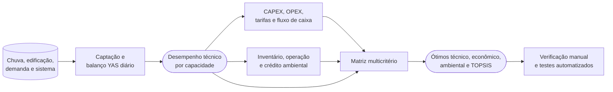

# Triton

> Plataforma para dimensionamento de sistemas prediais de aproveitamento de água de chuva, com simulação diária, análise econômico-financeira, ACV simplificada e apoio à decisão multicritério.

O Triton é uma aplicação desktop voltada a estudos de viabilidade e apoio ao projeto de sistemas não potáveis de aproveitamento de água pluvial. A ferramenta organiza o fluxo de trabalho desde a série de precipitação até relatórios para stakeholders e pesquisa. Ela não substitui projeto executivo, orçamento local, verificação normativa ou responsabilidade técnica profissional.

## Destaques

- Simulação diária pelo balanço hídrico YAS (*Yield After Spillage*).
- Varredura de volumes de cisterna e análise de ganho marginal.
- Configuração de reservatório superior, motobomba, recalque, energia e OPEX.
- Avaliação financeira com CAPEX, economia tarifária, VPL, TIR, payback simples e descontado e sensibilidade.
- ACV simplificada: impactos incorporados, operação, emissões evitadas e balanço de CO2e.
- TOPSIS para comparar alternativas pelos eixos técnico, econômico e ambiental.
- Gráficos interativos, exportação de figuras e relatórios em PDF/HTML.
- Interface em Português (Brasil), Inglês (US), Espanhol e Chinês simplificado, com temas claro e escuro de alto contraste.

## Comece por aqui

| Quero... | Caminho recomendado |
| --- | --- |
| Fazer meu primeiro estudo | siga a [instalação](#instalação-e-execução) e o [primeiro uso](#primeiro-uso-na-interface-desktop) |
| Entender ou auditar as equações | leia a [metodologia](#metodologia-equações-e-fronteiras-do-modelo) e o estudo de caso manual |
| Automatizar estudos ou processar lotes | use o [guia completo da CLI](CLI_USAGE.md) |
| Executar ou ampliar a suíte de testes | consulte o [guia de testes](../tests/README.md) |
| Planejar Monte Carlo, Pareto e outras extensões | consulte os [próximos passos](../triton/docs/proximos_passos_decisao_robusta.md) |

### Escopo atual do produto

| Componente | Situação na versão atual | Observação |
| --- | --- | --- |
| Aplicação desktop PySide6 | suportada | é a interface gráfica oficial e executa localmente |
| CLI | suportada | adequada a automação, rastreabilidade e estudos em lote |
| Interface em navegador | não implementada | requer frontend web e uma API sobre o motor de cálculo |
| Imagem Docker oficial | não fornecida | uma implantação futura deve priorizar API e trabalhadores de cálculo, não encapsular a janela Qt |

A antiga aplicação web 4.1 foi descontinuada e não faz parte deste repositório. Referências a “Netuno 4” nos documentos atuais significam somente compatibilidade metodológica ou de formato com o algoritmo histórico, não uma interface web ativa.

## Primeiro uso na interface desktop

1. Inicie com `python main.py` e escolha o idioma na primeira execução.
2. Em **Projeto e chuva**, importe uma série diária, confira período, unidade e regra de descarte inicial.
3. Em **Edificação**, informe área de captação, coeficiente de escoamento, usuários, consumo per capita e fração não potável.
4. Em **Reservatórios**, revise a faixa de volumes. O programa pode ajustar o passo para simular no máximo 40 capacidades positivas, sempre preservando o volume máximo informado.
5. Execute a varredura e examine resultados técnicos antes de preencher custos, tarifas, inventário ambiental e pesos TOPSIS.
6. Compare os ótimos técnico, econômico, ambiental e multicritério; trate divergências como informação sobre as concessões do projeto.
7. Salve o projeto `.triton` com as premissas e exporte os relatórios necessários à revisão.

Antes de aceitar uma decisão, confirme a origem da chuva, a unidade de cada entrada, a data-base dos custos, os fatores ambientais e a justificativa dos pesos. Campos automáticos são pontos de partida editáveis, não escolhas impostas pelo programa.

### Quem decide o quê

| Responsável | Decisões e verificações |
| --- | --- |
| Usuário ou pesquisador | dados climáticos, demanda, intervalo de capacidades, custos locais, horizonte, inventário ambiental, pesos e critérios de aceitação |
| Motor do Triton | balanço diário, grade efetiva, indicadores por alternativa, fluxos financeiros, ACV de triagem e ranking matemático |
| Revisor técnico | qualidade e representatividade dos dados, normas aplicáveis, coerência física, incerteza e adequação da alternativa ao projeto real |

## Fluxo de trabalho

| Etapa | Objetivo | Resultado principal |
| --- | --- | --- |
| 1. Projeto e chuva | Importar a série diária e definir o descarte inicial | Base climática para a simulação |
| 2. Edificação | Informar área, ocupantes, consumo e fração não potável | Demanda de água pluvial |
| 3. Reservatórios | Configurar volumes e executar a varredura | Balanço diário para cada alternativa |
| 4. Resultados técnicos | Interpretar economia, extravasamento e atendimento | Volume técnico de referência |
| 5. Economia | Configurar custos, tarifas e horizonte de análise | VPL, TIR, CAPEX e payback |
| 6. Ambiental | Configurar inventário e fatores de emissão | Indicadores de ACV simplificada |
| 7. TOPSIS | Definir pesos e comparar alternativas | Alternativas ótima técnica, econômica, ambiental e consolidada |
| 8–9. Documentação e relatórios | Registrar método e exportar resultados | Laudo gerencial e dossiê de pesquisa |

### Mapa visual da cadeia de cálculo



### Guia da documentação metodológica

| Documento | Use para |
| --- | --- |
| [Atlas de fluxogramas](../triton/docs/fluxogramas_metodologicos.md) | acompanhar cálculos, decisões lógicas e fronteiras dos modelos |
| Parâmetros dependentes do volume | distinguir relações diretas, endógenas e independentes |
| Detalhamento dos três modelos | comparar entradas e resultados de todas as capacidades |
| Estudo de caso e verificação manual | auditar equações, fluxos e resíduos item a item |
| [Próximos passos para decisão robusta](../triton/docs/proximos_passos_decisao_robusta.md) | acompanhar a evolução planejada de premissas, Monte Carlo, Pareto e robustez |

## Metodologia, equações e fronteiras do modelo

Esta seção foi transferida para [`../docs/metodologia.md`](../docs/metodologia.md), que é
agora a fonte única das equações, premissas e fronteiras do modelo — chuva efetiva,
balanço YAS, CAPEX, bombeamento e cloração, economia, ACV, TOPSIS e reprodutibilidade.

O índice completo da documentação está em [`../docs/README.md`](../docs/README.md).

## Relatórios

### Relatório econômico para stakeholders

PDF em A4 paisagem, focado exclusivamente no cenário de maior VPL da varredura. Apresenta volume ótimo econômico, CAPEX, economia anual, VPL, TIR e payback com valores coerentes para a mesma alternativa.

### Relatório técnico-científico de pesquisa

Dossiê em PDF/HTML com premissas, tabelas de varredura, indicadores hidráulicos, econômicos e ambientais. Os gráficos disponíveis nas etapas de resultados, economia, TOPSIS e ACV são incorporados ao documento junto com textos de interpretação e limitações de uso.

## Requisitos

- Python 3.10 ou superior; Python 3.11 é recomendado.
- Windows, Linux ou macOS com suporte ao Qt.
- Dependências Python: `PySide6`, `numpy`, `pandas`, `matplotlib`, `openpyxl`, `reportlab`, `numpy-financial` e `pytest`.

## Instalação e execução

```powershell
# Crie e ative um ambiente virtual (Windows PowerShell)
python -m venv .venv
.\.venv\Scripts\Activate.ps1

# Instale as dependências
python -m pip install --upgrade pip
python -m pip install PySide6 numpy pandas matplotlib openpyxl reportlab numpy-financial pytest

# Inicie a interface desktop
python main.py
```

No Linux/macOS, ative o ambiente com `source .venv/bin/activate`.

## Interfaces disponíveis

| Interface | Comando | Uso |
| --- | --- | --- |
| Aplicação desktop | `python main.py` | Fluxo completo de simulação, análise e relatórios |
| Linha de comando | `python -m triton.cli run <projeto.csv>` | Simulação técnica compatível com o fluxo legado |
| Linha de comando completa | `python -m triton.cli analyze <projeto.csv> --analysis all` | Cadeia técnica, econômica, ambiental e TOPSIS |

### Janela, navegador e implantação

A aplicação desktop abre maximizada no monitor principal. A janela ocupa a área de trabalho disponível, mas preserva a barra de título e os controles do sistema operacional para minimizar, restaurar e fechar. O comportamento é aplicado somente à janela principal; diálogos e seletores continuam usando as regras normais do sistema operacional.

Chrome e Edge não executam diretamente a interface PySide6. Para acesso em navegador, o caminho sustentável é conservar `triton/core` como motor independente, publicar operações controladas por uma API e construir um frontend web. Em um site já dockerizado, essa API pode ser um serviço separado, com fila de trabalhos para estudos longos e armazenamento explícito de projetos e resultados. Isso evita recriar a aplicação web 4.1 e permite migrar uma função de cada vez.

Uma imagem Docker contendo toda a interface Qt seria possível, mas acrescentaria servidor gráfico ou acesso remoto e ofereceria pouca vantagem. Para uma implantação web futura, recomenda-se uma imagem sem PySide6 para o serviço de cálculo; a geração de PDF que hoje usa Qt precisaria ser desacoplada ou executada em um trabalhador específico.

## Verificação

```powershell
# Verificação rápida por unidade, sem relatório de cobertura
python scripts/qa_runner.py --layer unit --no-cov

# Suíte completa com cobertura (requer pytest-cov)
python scripts/qa_runner.py --layer all

# Verifica a sintaxe dos módulos principais
python -m py_compile main.py triton\core\simulation.py triton\core\economic.py
```

Os testes gráficos são configurados automaticamente para execução sem monitor por `tests/conftest.py`. O número de testes não é fixado na documentação: use o resumo da execução como evidência da revisão corrente. Consulte [tests/README.md](../tests/README.md) para camadas, comandos seletivos, cobertura e diagnóstico de falhas.

## Linha de comando: projetos estruturados, simulação e análises integradas

Esta seção apresenta o percurso essencial. Parâmetros, matrizes de projetos e estudos massivos estão documentados no [guia da CLI](CLI_USAGE.md); `python -m triton.cli <comando> --help` é a referência da versão instalada.

A CLI aceita o CSV legado e o formato **`.triton`**, um JSON estruturado. O `.triton` preserva as entradas técnicas, financeiras, sazonalidade mensal, critérios ambientais e pesos TOPSIS. Se a chuva for incorporada, o arquivo também se torna autocontido e reproduzível em outro computador.

Um modelo editável está disponível em [examples/triton-cli-template.triton](../examples/triton-cli-template.triton). Para criar outro modelo:

```powershell
# Referencia uma chuva existente no diretório data/rainfall
python -m triton.cli init .\meu-projeto.triton --rainfall Florianopolis1.csv

# Incorpora a série diária de chuva ao próprio arquivo .triton
python -m triton.cli init .\meu-projeto-autocontido.triton --rainfall Florianopolis1.csv --embed-rainfall
```

O comando `run` preserva o comportamento técnico tradicional. Use `analyze` para aplicar as análises econômica, ambiental e TOPSIS às mesmas alternativas de reservatório, sem trocar de arquivo ou recalcular parâmetros em fluxos separados.

```powershell
# Simulação técnica: respeita o modo fixo ou a varredura gravada no projeto
python -m triton.cli run .\projeto.triton

# Cadeia completa; retorna a melhor alternativa em cada eixo e no TOPSIS
python -m triton.cli analyze .\projeto.triton --analysis all

# Somente uma alternativa, com saída estruturada para automação
python -m triton.cli run .\projeto.triton --volume 5000 --analysis all --format json --output .\resultado.json

# Pesos TOPSIS: técnico, econômico, ambiental (a soma é normalizada automaticamente)
python -m triton.cli analyze .\projeto.triton --analysis topsis --weights 0.40,0.35,0.25

# Robustez da decisão TOPSIS para combinações distintas de pesos
python -m triton.cli analyze .\projeto.triton --analysis topsis --weight-sensitivity 1000 --seed 42 --format json --output .\robustez-pesos.json

# Incerteza de chuva, demanda, área e CAPEX para o volume escolhido/indicado
python -m triton.cli uncertainty .\projeto.triton --samples 1000 --rainfall-cv 10 --demand-cv 15 --capex-cv 20 --format json --output .\monte-carlo.json
```

`--analysis` aceita `technical`, `economic`, `environmental`, `topsis` e `all`. As análises econômica e ambiental usam, para cada volume, respectivamente o fluxo de caixa e o inventário de ciclo de vida associados àquela alternativa; o TOPSIS recebe os três indicadores já calculados. A seção `analysis.environmental` no `.triton` permite registrar materiais, tubulações, bomba e fatores de emissão específicos.

Use `validate` antes de processar um projeto e `--set` para substituir uma premissa sem alterar o arquivo:

```powershell
python -m triton.cli validate .\projeto.triton
python -m triton.cli analyze .\projeto.triton --set area=150 --set rainwater_share=0.5 --format html --output .\relatorio.html
python -m triton.cli batch .\cenarios.xlsx --base .\projeto.triton --analysis all --format xlsx --output .\lote.xlsx
```

Além de `text`, a saída pode ser `json`, `csv`, `html` ou `xlsx` (XLSX requer `pandas` e `openpyxl`). O atalho legado `python -m triton.cli econ <projeto.csv>` continua disponível.

Há uma planilha CSV de exemplo em [examples/triton-cli-scenarios.csv](../examples/triton-cli-scenarios.csv). A opção `batch` aceita CSV ou XLSX; `--base` reutiliza do projeto-base as premissas econômicas e ambientais que não constam da planilha.

`--weight-sensitivity N` sorteia `N` combinações de pesos e informa a frequência vencedora de cada volume. O comando `uncertainty` executa Monte Carlo em um volume concreto: aplica distribuições normais truncadas às premissas de chuva, área, demanda e CAPEX e reporta percentis P05/P50/P95 e probabilidades de VPL positivo e de viabilidade ambiental. Fixe `--seed` para reproduzir exatamente a amostra.

### Matriz de edifícios × climas

Para comparar várias cidades com os mesmos edifícios — ou vários edifícios com as mesmas cidades — use **dois catálogos independentes**:

- [examples/triton-premises-catalog.json](../examples/triton-premises-catalog.json): cada item em `premises` contém um `id`, um nome, todos os campos `config` do edifício/sistema e, opcionalmente, `analysis` com ACV e pesos TOPSIS.
- [examples/triton-climate-catalog.json](../examples/triton-climate-catalog.json): cada item em `climates` contém `id`, nome, `rainfall_file` e `start_date`. Como alternativa a `rainfall_file`, é possível usar `precipitation_mm` para incorporar uma série diária diretamente no catálogo.

```powershell
# Cria catálogos editáveis a partir dos modelos internos
python -m triton.cli init-catalog premises .\premissas.json
python -m triton.cli init-catalog climates .\climas.json

# Executa todas as combinações e estima o tempo restante no terminal
python -m triton.cli matrix .\premissas.json .\climas.json --analysis all --output-dir .\resultados-matriz
```

O progresso apresenta barra, combinações concluídas, tempo decorrido e ETA. Ao final, a pasta de saída contém:

| Arquivo | Conteúdo |
| --- | --- |
| `triton-matriz-resumo.csv` | Uma alternativa selecionada por combinação edifício × clima, pronta para comparação. |
| `triton-matriz-alternativas.csv` | Todos os volumes simulados de cada combinação. |
| `triton-matriz-detalhado.json` | Resultados completos, premissas e rastreabilidade para auditoria/automação. |
| `triton-matriz-painel.html` | Painel HTML leve para leitura consolidada. |

## Estrutura do projeto

```text
triton_int/
├── main.py                  # Inicialização da aplicação desktop
├── build_exe.py             # Empacotamento com PyInstaller
├── triton/
│   ├── core/                # Simulação, economia, ACV, TOPSIS e relatórios
│   ├── ui/                  # Interface PySide6, gráficos e diálogos
│   ├── cli.py               # Interface de linha de comando
│   └── docs/                # Conteúdo técnico complementar
├── data/                    # Séries pluviométricas e dados de trabalho
└── tests/                   # Testes automatizados
```

## Limitações e responsabilidade técnica

- A qualidade dos resultados depende da série diária de chuva, das premissas de demanda, dos custos e dos fatores de emissão informados.
- A ACV é uma estimativa simplificada e deve ser refinada com dados locais, fornecedores e inventários apropriados quando necessário.
- O relatório é um documento de apoio à decisão; dimensionamento final, normas aplicáveis, instalações, materiais e quantitativos devem ser validados por profissional habilitado.

## Citação

> VAZ, I. C. M.; GHISI, E. Triton 0.1.0: programa computacional para simulação de aproveitamento de água de chuva em edificações. Florianópolis: Universidade Federal de Santa Catarina, Grupo de Pesquisa em Ambientes Sustentáveis, 2026. Software de computador, versão 0.1.0.

```bibtex
@software{triton_0_1,
  author  = {Vaz, Igor Catão Martins and Ghisi, Enedir},
  title   = {Triton 0.1.0: programa computacional para simulação de aproveitamento de água de chuva em edificações},
  year    = {2026},
  publisher = {Universidade Federal de Santa Catarina},
  address = {Florianópolis},
  version = {0.1.0}
}
```

Consulte também a licença em [license.txt](license.txt).
