# Triton

## User Manual

Igor Catão Martins Vaz and Enedir Ghisi

Sustainable Environments Research Group
Federal University of Santa Catarina

International Edition · 2026

Version 0.1.0 · revised 2026-10-16

---

### Publication record

| Element | Content |
| :--- | :--- |
| **Title** | Triton: user manual |
| **Authors** | Igor Catão Martins Vaz; Enedir Ghisi |
| **Edition** | Version 0.1.0, International Edition |
| **Publisher** | Federal University of Santa Catarina |
| **Research group** | Sustainable Environments |
| **Year** | 2026 |
| **Licence** | Academic source-available (non-commercial use), see LICENSE.md |

### How to cite

**Author-date style**

> Vaz, I. C. M., & Ghisi, E. (2026). *Triton: user manual*
> (Version 0.1.0). Federal University of Santa Catarina.

**BibTeX**

```
@manual{tritonmanual2026en,
  title     = {Triton: user manual},
  author    = {Vaz, Igor Catão Martins and Ghisi, Enedir},
  edition   = {Version 0.1.0},
  publisher = {Federal University of Santa Catarina},
  year      = {2026}
}
```

When citing results obtained with the program, also state the version used and
the source of the rainfall series, following the list in section 4.10.

---

### About this edition

This is the manual of the **International Edition (INT)** of Triton. It is written in
English and is self-contained: the section numbers, figures, tables and equations are
those of this edition.

The International Edition ships no national data. You supply the rainfall series, the
water and sewage tariff, the costs and the emission factors, in the currency you choose,
and the program calculates in the same way wherever the project is. Three example cities
(New York, London and Cape Town) come with the program, with ERA5 reanalysis rainfall
and the published tariff of each city, so that every case of the manual can be reproduced
(appendices D, E and J).

**Costs in the examples are illustrative.** Where a case of the manual prints a cost, it
is a rounded figure that lets you follow the method, labelled as illustrative, not a
market price. Replace it with your own before drawing any economic conclusion.

Numbers follow the English convention (a point for decimals, a comma for
thousands).

---

### How to use this manual

It was not written to be read from cover to cover. Section 1.3 tells you where
to enter, depending on what you want to do.

| You want to | Read |
| :--- | :--- |
| learn to use the program | chapter 4, the tutorial |
| solve a case | chapter 3, the guides |
| publish a study | chapter 2, the method; and section 4.10 |
| review a study | chapter 5, and appendices A and B |
| avoid mistakes | section 5.1 |

The manual assumes an engineering reader who does not yet know the subject: concepts
are introduced before they are used, and the vocabulary is in appendix G. Two
kinds of box appear throughout the text:

| The box | When it appears |
| :--- | :--- |
| with a **blue** rule | a warning or remark that changes what you do |
| with an **orange** rule, marked *In depth* | the technical detail behind it; can be skipped on a first reading |

> **Every number printed in this manual is calculated by the program.** The tables
> and figures were not typed: they are produced by running Triton with the input
> data each section declares. Each published value has a matching automatic check,
> so that a fix in the program cannot leave the manual lying. Section 5.3
> explains how this is done.

---

## Contents

**1 Start here**

1.1 What Triton does, and what it does not

1.2 Installation and first run

1.3 Where to start, depending on your goal


**2 The method**

2.1 The daily water balance

2.2 Ideal volume and the sweep

2.3 Efficiency indicators

2.4 Rainfall indices

2.5 Sizing the treatment line

2.6 Pumping energy

2.7 Economic analysis and tariff regimes

2.8 Life cycle assessment

2.9 Certifications

2.10 Multi-criteria decision


**3 Guides available in the program**

3.1 Comparing cities

3.2 Using a future climate scenario

3.3 Adjusting the tariff of your site

3.4 Modulating the demand by calendar

3.5 Simulating schools, hospitals and shops

3.6 Comparing many cases at once

3.7 Sensitivity analysis

3.8 Importing a legacy project

3.9 Exporting to CAD, BIM and spreadsheets


**4 Tutorial: one example from start to finish**

4.1 The project and the rain

4.2 The building and the demand

4.3 The first simulation

4.4 Choosing the volume

4.5 Is an upper tank needed?

4.6 What quality the use requires

4.7 What it costs and how fast it pays back

4.8 How much carbon it avoids

4.9 Which volume to choose, after all

4.10 The report, and what to declare in a paper


**5 Mistakes, limitations and reliability**

5.1 Ten mistakes the program does not prevent

5.2 Known limitations

5.3 How the program is verified


**6 Fixes, bugs and versioning**

6.1 Checking the results against other tools

6.2 Error messages and what to do

6.3 Version history and what changed

6.4 How to report a problem

6.5 Roadmap


**7 Probabilistic modulation**

7.1 What probabilistic modulation is

7.2 The variables and the distributions

7.3 How to run it

7.4 How to read the results

7.5 Method, statistics and limits


**Appendices**

Appendix A — The project parameters

Appendix B — The program's processes

Appendix C — Emission factors

Appendix D — Tariff regimes

Appendix E — Climate database

Appendix F — Files, folders and formats

Appendix G — Glossary

Appendix H — References

Appendix I — One-page summaries

Appendix J — Example files


## List of figures

Figure 1 — Components of a building rainwater harvesting system and the path of the water, from collection to the point of use

Figure 2 — The same system seen in section

Figure 3 — Destination of the precipitation of one day

Figure 4 — Sequence of operations of the daily balance, in the order the program runs them, in the notation of the equations of the daily balance section

Figure 5 — The six dimensions of analysis and the question assessed in each one

Figure 6 — The four reading paths of the manual

Figure 7 — Which part of the total consumption rainwater can supply, depending on the uses the project intends

Figure 8 — The twelve steps of the program, grouped by nature

Figure 9 — The ten days of the worked case: (a) collected volume, in blue, and overflowed volume, in orange, by day: on day 8 the overflow almost equals the collection; (b) volume stored in the lower tank at the end of each day, after consumption, with the 2,000 L capacity dashed; on days 5 to 8 the tank reaches capacity, overflows and ends the day with 1,920 L

Figure 10 — Sequence of operations of the daily balance: (a) the order adopted by the program, with the overflow calculated before consumption; (b) the reversed order (YBS), with consumption withdrawn before the overflow

Figure 11 — Saving potential curve of the same building, swept with a 250 L step and with a 5,000 L step

Figure 12 — Sweep of the tutorial project read by three criteria: (a) saving potential and (b) net present value of the same set of volumes

Figure 13 — The three efficiency indicators and what each one counts

Figure 14 — Daily supply classes: full (V_con,t = D_pl,t), partial (0 < V_con,t < D_pl,t) and none (V_con,t = 0). The filled height represents the fraction of the day's rainwater demand supplied by rainwater

Figure 15 — Four of the nine indices marked over one year of the New York series: PRCPTOT and SDII, at the top; RX1day, the largest daily value of the year; CDD, the longest sequence of dry days, in the shaded band; and R20mm, the days with 20 mm or more, marked at the bottom

Figure 16 — Walsh and Lawler (1981) seasonality index in the three example cities (New York, London and Cape Town), with the classes of the index in the background and the mean annual precipitation under the name of each city

Figure 17 — Total annual precipitation (PRCPTOT) of the New York series, with the mean of the period as a dashed line, in the indices tab

Figure 18 — Longest annual sequence of dry days (CDD) and of wet days (CWD) of the New York series, in the indices tab

Figure 19 — Components of the treatment line sized by the program, in the order of the flow, and destination of the material retained

Figure 20 — The three disinfection technologies, the residual effect of each one and the make-up of the annual running cost (OPEX). The residual effect distinguishes chlorination from the others: it protects the stored water, while ultraviolet radiation and ozone act only on the water passing through the equipment

Figure 21 — Energy chain of pumping

Figure 22 — (a) Manometric head of a building rising main: geometric difference in level between the water surfaces of the cistern and the upper tank, plus the head losses; (b) energy line along a stretch of pipe, with the continuous friction loss (h_f) and the local losses at a valve and an elbow (h_loc)

Figure 23 — Illustrative efficiency of induction motors by power for a standard and a high-efficiency class: efficiency rises with power

Figure 24 — Monthly water and sewage bill of the tutorial project, broken down into parts, without and with the system

Figure 25 — The six tariff block codes and the effect of each one on the monthly water and sewage bill

Figure 26 — Distribution of the example tariffs among the six tariff regimes

Figure 27 — Initial investment broken down into the seven items the program adds up, for three volumes of polyethylene tank

Figure 28 — Cash flow of the tutorial project over twenty years: annual saving on the water and sewage bill and annual costs, with the initial investment in year zero, in nominal values; and cumulative balance discounted at the minimum attractive rate of return, which does not cross zero within the twenty years: there is no payback

Figure 29 — The seven stages of the inventory, grouped by the nature of the emission

Figure 30 — Boundary of the program's environmental assessment: (a) processes included — embodied carbon of the tanks, the piping and the pump set, operational emissions of pumping and of treatment consumables, and the credit for the potable water avoided; (b) processes excluded — civil works, maintenance and replacement, end of life and impact categories beyond global warming

Figure 31 — The thresholds of reduction in potable water consumption with which the program places the project in LEED v4 (credits WEc1 and WEc2), LEED v5 (credit WEc2, options 1, 2 and 4) and EDGE, on the same scale

Figure 32 — TOPSIS score of each volume of the sweep of the tutorial project, with a polyethylene cistern and equal weights among the seven criteria; the star marks the volume with the highest score

Figure 33 — First-rank acceptability (b¹) of each candidate volume, obtained with five thousand weight vectors drawn on the simplex

Figure 34 — (a) Mean annual precipitation and (b) potable water saving potential of the tutorial project, with 150 m² of catchment, 600 L/day of demand, a 28% suppliable fraction and a 4,000 L cistern, in New York, London and Cape Town

Figure 35 — Mean monthly precipitation in (a) New York, (b) London and (c) Cape Town, on the same scale; the dashed line is the monthly mean of each series

Figure 36 — The shape of two typical emission pathways

Figure 37 — Water part of the monthly bill as a function of consumption, in three minimum-charge regimes

Figure 38 — The four modulation modes, what each one asks of the user and the situation in which each one is justified

Figure 39 — Demand profiles used in the comparison, expressed as the ratio between the month's demand and the mean demand

Figure 40 — (a) Demand profiles of the school and the hotel over the mean monthly precipitation of the city of each case; (b) saving potential of each profile against the same annual demand spread evenly

Figure 41 — The eight available building types, grouped by the tariff category the utility charges

Figure 42 — Plausible range of variation of each assumption in a sensitivity analysis, with the origin of the uncertainty

Figure 43 — The variation of the net present value when each assumption is changed by 30% up and down, keeping the others

Figure 44 — New York precipitation series used throughout the tutorial (ERA5 reanalysis, 1991 to 2020): (a) total precipitation of each year, with the thirty-year mean as a solid line and the years above the mean in blue and below it in orange; (b) frequency distribution of daily precipitation on wet days, on a logarithmic scale, which shows how few days account for the largest volumes

Figure 45 — The mean seasonal cycle of the series, calculated and drawn by the program as soon as the precipitation is loaded

Figure 46 — The runoff coefficient the program gives to each roof material, with the values the program uses

Figure 47 — The usual ranges of per capita consumption by building type

Figure 48 — Typical split of the consumption of a house by end use

Figure 49 — States of the suppliable-fraction field in the interface

Figure 50 — The level of the cistern over the first year of the series, with the daily rain in the background

Figure 51 — (a) Saving potential as a function of the tank volume, approaching the 28% ceiling without crossing it, with the ideal volume marked; (b) marginal gain, on a logarithmic scale, with the 1 %/m³ threshold adopted in the tutorial

Figure 52 — The first chart of the results tab: the potable water saving potential as a function of the lower tank volume

Figure 53 — The second chart: the marginal gain, in percentage points per added cubic metre

Figure 54 — The third chart: the overflowed volume and the rainwater volume consumed, both annual, on the same scale

Figure 55 — The fourth chart: the split of the days of the period into fully supplied, partly supplied and not supplied

Figure 56 — Use of the lower tank capacity in the tutorial project, with a rainwater demand of 168 L/day: (a) duration curves of the stored autonomy at the end of each day, in days of rainwater demand, for 2, 4, 10 and 20 m³; (b) annual turnovers of the volume, given by the ratio between the annual rainwater consumption and the capacity, with the fraction of days on which the tank ends empty (up to 5% of the capacity) shown under each volume

Figure 57 — The program's four quality classes and the status of each one

Figure 58 — The chart of the economic tab: the net present value of each volume of the sweep, with the economic maximum and the technical optimum marked

Figure 59 — The chart of the environmental tab for the same project, with a concrete cistern: the parts of the carbon balance over twenty years, with illustrative factors

Figure 60 — Cumulative net emissions of the 4,000 L cistern over the service life, for polyethylene and concrete, with illustrative factors

Figure 61 — Net emissions over twenty years of the 4,000 L cistern, by material, with illustrative factors

Figure 62 — Net emissions over twenty years against the cistern volume, for (a) polyethylene and (b) concrete, in the tutorial project, with illustrative factors

Figure 63 — The chart of the decision tab: the closeness-to-ideal score of each candidate volume, with the winner highlighted

Figure 64 — The second chart of the decision tab: how close the chosen volume comes to the best possible value on each of the seven criteria

Figure 65 — Catchment area as the horizontal projection of the roof

Figure 66 — Number of tests and of files in each family of the verification suite, as collected in this version

Figure 67 — The five verification layers of the program, from the unit tests, numerous and aimed at local errors, to the manual check, occasional and aimed at model errors

Figure 68 — Breakdown of the mean divergence between the program and an independent reference

Figure 69 — Potable water savings by lower-tank volume in the tutorial example: band between the 5th and 95th percentiles of the realisations, median and deterministic study

Figure 70 — Net present value by lower-tank volume in the same example

Figure 71 — Frequency, as a percentage of the realisations, with which each volume is the technical ideal, the economic optimum and the TOPSIS winner in the tutorial example

Figure 72 — Spearman rank correlation of each drawn variable with potable water savings and with the net present value at the volume chosen by the tutorial study, from the largest to the smallest influence on the net present value

---

## List of tables

Table 1 — System requirements to install and run the program

Table 2 — What the International Edition brings and what it leaves to you

Table 3 — File formats the program saves and the content of each one

Table 4 — Example files distributed with the program

Table 5 — Recommended reading path depending on the reader's goal

Table 6 — Choice between fixed volume and sweep depending on the question of the study

Table 7 — Hydraulic criteria to decide on the upper tank

Table 8 — Input data of the ten-day worked case

Table 9 — Precipitation series of the ten days of the worked case (New York, September 2018)

Table 10 — Daily water balance of the worked case, day by day, with collection, consumption, overflow and storage

Table 11 — Check of the mass balance closure over the ten days

Table 12 — Indicators of the ten-day worked case

Table 13 — Variables of Equation 1

Table 14 — Variables of Equation 2

Table 15 — Variables of Equation 5

Table 16 — Withdrawal of the day and volume stored at the end of the day under strict YAS, strict YBS and in Triton

Table 17 — Variables of Equation 7

Table 18 — Variables of Equation 8

Table 19 — Variables of Equation 9

Table 20 — Variables of Equation 10

Table 21 — Variables of Equation 11

Table 22 — Variables of Equation 12

Table 23 — Volumes given by classical sizing rules for the tutorial project, rounded to 250 L, and the potential each one yields in the daily simulation

Table 24 — Storage fraction of the sweep volumes and the simulation time step Fewkes and Butler (2000) recommend for each range

Table 25 — Variables of Equation 13

Table 26 — Variables of Equation 14

Table 27 — Variables of Equation 15

Table 28 — Variables of Equation 16

Table 29 — Variables of Equation 17

Table 30 — Variables of Equation 18

Table 31 — Variables of Equation 19

Table 32 — Variables of Equation 20

Table 33 — Summary of the indicators, with the denominator and the question each one answers

Table 34 — Variables of Equation 21

Table 35 — Variables of Equation 22

Table 36 — Variables of Equation 23

Table 37 — Variables of Equation 24

Table 38 — Variables of Equation 25

Table 39 — Variables of Equation 26

Table 40 — Variables of Equation 27

Table 41 — Variables of Equation 28

Table 42 — Variables of Equation 29

Table 43 — Mechanical inlet filter sized by the roof area

Table 44 — Variables of Equation 30

Table 45 — Polishing filter recommendation by target quality class

Table 46 — Sizing of the first flush in the tutorial project

Table 47 — Variables of Equation 31

Table 48 — The two efficiencies of the pumping chain and what each one converts

Table 49 — Variables of Equation 32

Table 50 — Variables of Equation 33

Table 51 — Variables of Equation 34

Table 52 — Variables of Equation 35

Table 53 — Variables of Equation 36

Table 54 — Fallback values adopted when the project does not declare them

Table 55 — Variables of Equation 37

Table 56 — Annual energy of six generic pressure pumps (illustrative curves, no brand) in the tutorial direct pressurisation, with the toilet flow limiting the pump flow

Table 57 — Variables of Equation 38

Table 58 — Variables of Equation 39

Table 59 — Variables of Equation 40

Table 60 — Coding and application of each minimum-charge regime in the calculation of the bill

Table 61 — Variables of Equation 41

Table 62 — Parts of the annual running cost and the origin of each one

Table 63 — Variables of Equation 42

Table 64 — Variables of Equation 44

Table 65 — Variables of Equation 45

Table 66 — Building life cycle modules and what the program's assessment covers in each one

Table 67 — Variables of Equation 46

Table 68 — Mass per useful cubic metre of each tank material

Table 69 — Carbon inventory of the final tutorial project, item by item, with the share of each component in the embodied carbon; negative annual values are credits (illustrative grid and water factors, not measured values)

Table 70 — Variables of Equation 47

Table 71 — Variables of Equation 48

Table 72 — Variables of Equation 49

Table 73 — Variables of Equation 50

Table 74 — Variables of Equation 51

Table 75 — Options of LEED v5 credit WEc2 to which rainwater harvesting contributes

Table 76 — The seven decision criteria, the direction of preference and the group of each one

Table 77 — Variables of Equation 52

Table 78 — TOPSIS closeness score with equal weights across the dimensions and first-rank acceptability in SMAA-VIKOR, with 5,000 random weight vectors, for the tutorial volumes

Table 79 — The same tutorial project simulated in New York, London and Cape Town

Table 80 — Ratio between the wettest and the driest month in the three cities

Table 81 — The six tariff block codes and the effect of each one on the bill

Table 82 — The six tariff regimes and what happens when saving in each one

Table 83 — Effect of the water saving on the bill in two opposite tariff regimes (hypothetical structures, in currency units)

Table 84 — The three ways of comparing alternatives depending on what varies between them

Table 85 — Subcommands of the command line and the purpose of each one

Table 86 — Potential, net present value and payback of the final tutorial project with each assumption varied alone, from the low to the high value (costs are illustrative, not market prices)

Table 87 — Reading the SMAA-VIKOR acceptability of the winning volume

Table 88 — Legacy-format data recovered by the import

Table 89 — Export formats and the purpose of each one

Table 90 — Spreadsheet export options and when to use each one

Table 91 — Characteristics of the New York precipitation series used in the tutorial

Table 92 — The three ways of applying the first flush

Table 93 — State of the tutorial project at the end of defining the rain and the catchment

Table 94 — State of the tutorial project at the end of defining the demand

Table 95 — Comparison between the annual rainwater supply and the suppliable demand

Table 96 — Result of the first tutorial simulation, with a 3,000 L tank

Table 97 — Classification of each day of the simulation by the degree of supply

Table 98 — State of the tutorial project after the first simulation

Table 99 — Volume sweep of the tutorial project, with the marginal gain of each added cubic metre

Table 100 — Marginal saving gain for each cubic metre added to the tank

Table 101 — Indicators of the ideal volume obtained with the 1 %/m³ threshold adopted in the tutorial

Table 102 — Ideal volume obtained with each marginal-gain threshold, for the same project

Table 103 — Cost and performance compared between the ideal volume and the largest volume swept (prices are illustrative, not market prices)

Table 104 — State of the tutorial project after choosing the volume

Table 105 — The three supply arrangements and what each one adds to the project

Table 106 — Single tank compared with two tanks, keeping the same total storage (energy cost is illustrative, not a market price)

Table 107 — Effect of the pump trigger level on the saving potential and on the number of starts

Table 108 — State of the tutorial project after the decision on the upper tank

Table 109 — Treatment line by disinfection technology adopted: stages, ultraviolet energy and annual carbon

Table 110 — Fine-filtration recommendation by quality class

Table 111 — Mechanical inlet filter sized by the roof area

Table 112 — State of the tutorial project after defining the quality class

Table 113 — Make-up of the New York water and sewer bill before and after the rainwater system

Table 114 — Economic indicators of the tutorial project over twenty years of analysis (all costs are illustrative, not market prices)

Table 115 — The six tariff regimes and the effect of each one on the saving

Table 116 — Make-up of the initial investment of the tutorial project (illustrative, not a market price)

Table 117 — Assumptions of the economic projection and the weight of each one in the result

Table 118 — State of the tutorial project after the economic analysis (illustrative, not a market price)

Table 119 — Carbon balance of the tutorial project with a concrete cistern (illustrative factors)

Table 120 — Net carbon emissions of the tutorial project according to the tank material (prices are illustrative, not market prices)

Table 121 — Effect of the concrete cistern volume on the net carbon emissions

Table 122 — Effect of switching from concrete to polyethylene on the three dimensions of analysis (illustrative, not a market price)

Table 123 — State of the tutorial project after the environmental analysis (illustrative, not a market price)

Table 124 — Multi-criteria decision matrix: each sweep volume assessed in the three dimensions of analysis (costs are illustrative, not market prices)

Table 125 — Winning volume under each criterion taken alone

Table 126 — The seven multi-criteria criteria and the direction of preference of each one

Table 127 — Volume chosen by TOPSIS according to the dimension given the dominant weight, and the runner-up

Table 128 — Summary of the tutorial project, with all the parameters and results

Table 129 — Variables of Equation 53

Table 130 — Physical input validation messages and the action for each one

Table 131 — Suppliable fraction messages and the action for each one

Table 132 — Precipitation series error messages and the action for each one

Table 133 — Volume sweep error messages

Table 134 — Chlorination parameter error messages

Table 135 — Economic analysis error messages and the action for each one

Table 136 — Multi-criteria decision error messages and the action for each one

Table 137 — Pump set parameter error messages

Table 138 — Error situations when reading and saving files

Table 139 — Warnings that do not stop the calculation and must be stated in the study

Table 140 — **Table 99** — Overview of the published versions

Table 141 — Fixes that change results in version 0.1.0

Table 142 — Items planned for version 1.1

Table 143 — Items planned for version 2.0

Table 144 — The variables that probabilistic modulation can draw, with the screening distribution the screen proposes

Table 145 — What each economic and environmental variable does in the calculation, and what it does not touch

Table 146 — The four distributions the tool offers, their parameters and when to use each

Table 147 — The variables drawn in the tutorial example: declared distribution and statistics of the realisations

Table 148 — Results at the volume chosen by the tutorial study: deterministic study and statistics of the realisations (money in US$, illustrative, not a market price)

Table 149 — Probabilities at the chosen volume, with the Wilson 95% confidence interval

Table 150 — Frequency with which each volume is chosen in the realisations of the example, by criterion (%)

Table 151 — Sensitivity at the chosen volume: strength and direction of the influence of each drawn variable on the tutorial results

Table 152 — Share of the variance of the result explained by each drawn variable in the tutorial example, at the chosen volume (η²; continuous variables grouped in deciles)

Table 153 — Project parameters: identification

Table 154 — Project parameters: rainfall

Table 155 — Project parameters: catchment

Table 156 — Project parameters: building

Table 157 — Project parameters: demand

Table 158 — Project parameters: irrigation

Table 159 — Project parameters: water quality

Table 160 — Project parameters: tanks

Table 161 — Project parameters: pump set

Table 162 — Project parameters: piping

Table 163 — Project parameters: investment

Table 164 — Project parameters: operation

Table 165 — Project parameters: tariffs

Table 166 — Project parameters: energy

Table 167 — Project parameters: financial

Table 168 — Project parameters: certifications

Table 169 — Project parameters: other

Table 170 — Emission factors that the user supplies, and what to declare for each

Table 171 — Emission factors of the tank materials, with mass and boundary

Table 172 — Reference recorded in the program for each tank-material factor, and its status

Table 173 — Emission factors of the treatment consumables

Table 174 — The block codes of the water tariff table

Table 175 — The four ways of entering the sewage charge

Table 176 — The six tariff regimes and what happens when saving

Table 177 — Tariff structure of the New York example

Table 178 — Tariff structure of the London example

Table 179 — Tariff structure of the Cape Town example

Table 180 — Rainfall series distributed with the International Edition

Table 181 — Formats the program reads and where each one is loaded

Table 182 — Formats the program writes and where each one is generated

Table 183 — The seven sections of the project file and what each one holds

Table 184 — Location of the program's files and of the user's files

Table 185 — Compatibility between versions of the project file

Table 186 — Terminology for rainwater and stormwater

Table 187 — Fundamental quantities of the water balance and relations between fraction and potential

Table 188 — Reference sheet: the ten steps of a complete study and the section that deals with each one

Table 189 — Reference sheet: the ten design pitfalls and where each one is dealt with

Table 190 — Reference sheet: the six tariff regimes and the effect of saving

Table 191 — Reference sheet: the indicators and the question each one answers

Table 192 — The example cases and what each one demonstrates

Table 193 — Result each example case produces when reread and simulated

---

## List of equations

Equation 1 — Mass balance closure

Equation 2 — Volume collected in the day

Equation 3 — Volume available before consumption

Equation 4 — Overflow volume

Equation 5 — Volume stored before consumption

Equation 6 — Rainwater volume consumed

Equation 7 — Volume left for the next day

Equation 8 — Potable mains top-up

Equation 9 — Classification of the day by supply

Equation 10 — The three parts of the daily demand

Equation 11 — Marginal gain per added cubic metre

Equation 12 — Ideal volume by the marginal-gain criterion

Equation 13 — Storage fraction

Equation 14 — Potable water saving potential

Equation 15 — Volumetric reliability

Equation 16 — Relation between potential and reliability

Equation 17 — Mean daily overflow

Equation 18 — Efficiency of use of the collected water

Equation 19 — Annual potable water volume saved

Equation 20 — Mean daily unmet demand

Equation 21 — Total annual precipitation, PRCPTOT

Equation 22 — Precipitation on very wet days, R95p

Equation 23 — Maximum one-day precipitation, RX1day

Equation 24 — Maximum five-day precipitation, RX5day

Equation 25 — Simple daily intensity index, SDII

Equation 26 — Days of heavy precipitation, R20mm

Equation 27 — Consecutive dry days, CDD

Equation 28 — Consecutive wet days, CWD

Equation 29 — Seasonality index, SI

Equation 30 — Mass of chlorine product per cubic metre

Equation 31 — Incremental investment of the treatment line

Equation 32 — Specific pumping energy

Equation 33 — Specific energy from the flow rate

Equation 34 — Pumping flow rate deduced from the power

Equation 35 — Energy used at start-ups

Equation 36 — Annual pump energy

Equation 37 — Annual energy of the pressure pump

Equation 38 — Monthly bill saving

Equation 39 — Exponential tariff formula

Equation 40 — Sewage part of the bill

Equation 41 — Total initial investment

Equation 42 — Cumulative inflation factor

Equation 43 — Number of tariff adjustments applied

Equation 44 — Cumulative tariff adjustment factor

Equation 45 — Net present value

Equation 46 — Embodied emission of a component

Equation 47 — Annual emission of the pumping energy

Equation 48 — Net annual emission balance

Equation 49 — Environmental payback time

Equation 50 — Carbon balance at the end of service life

Equation 51 — Specific emission per litre delivered

Equation 52 — TOPSIS closeness coefficient

Equation 53 — Series transformation for comparison with another program

---


---
# 1. Start here

---

## 1.1. What Triton does, and what it does not

Triton simulates rainwater harvesting systems in buildings. Given the rainfall regime
of a place, the roof of a building and the consumption of the people who use it, it
answers **how much potable water the system replaces**, and at what cost, with what
quality and with what carbon impact.

This section starts from the beginning, so the first two subsections deal with the
object itself before dealing with the program. Readers who already design building
water systems will find them elementary and can go straight to the six dimensions of
analysis, which is where Triton appears; readers who are new to the subject will find
there the vocabulary that the rest of the manual uses without explaining again.

---

### 1.1.1. What a rainwater harvesting system is

It is a system that **collects the rain falling on the roof and uses it instead of
mains water**, for the uses that do not need potable water.

The idea is old and simple. What makes it difficult is one thing only: rain does not
fall when you need it. That is why the system needs a tank, and that is why the size
of that tank is the central question of every project — and of this manual.
Figure 1 presents the components of the system and the path of the water,
from collection to the point of use.

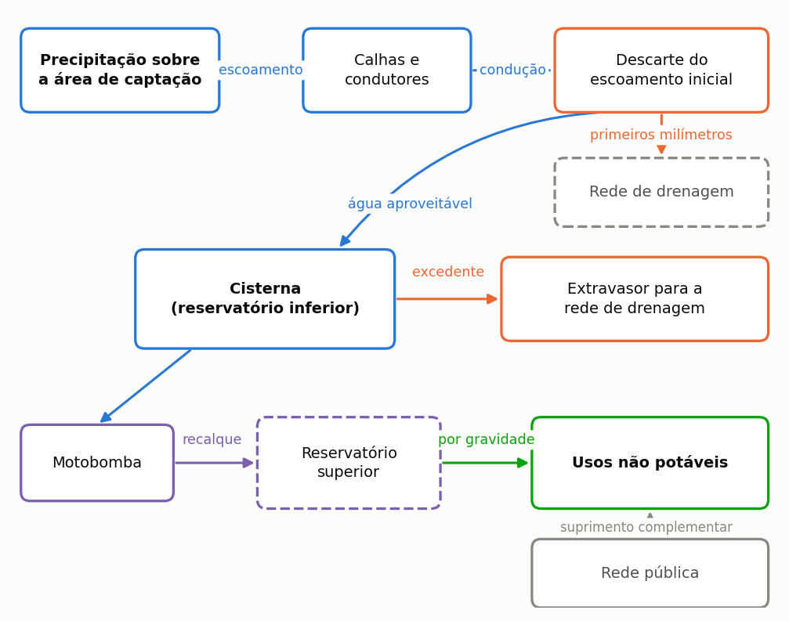

*Figure 1 — Components of a building rainwater harvesting system and the path of the water, from collection to the point of use. The upper tank is dashed because it is optional: in a single-storey building the pump can pressurise the points of use directly, and the upper tank changes when water is supplied, not the volume available.*

Following the drawing, from left to right:

**The roof** is the catchment area. What counts is the **horizontal projection** of the
roof, not the sloping area: it is the roof's shadow on the ground that receives the
rain. Getting this wrong is the first of
the ten mistakes in section 5.1.

**The gutters and downpipes** carry the water to the cistern. The program does not size
them; that is hydraulic design, and it follows the rainwater drainage standard that
applies where the building stands.

**The first-flush device** diverts the first millimetres of each event, which carry the
dust, leaves and bird droppings accumulated on the roof. It is the cheapest quality
control measure, and section 4.6 shows how much it changes the water that reaches
the tank.

**The cistern**, or lower tank, stores the collected water. When the inflow exceeds the
capacity, the surplus **overflows** to the drainage system. This overflow is not waste
through carelessness: it is the unavoidable consequence of storing a resource that
arrives concentrated.

**The pump and the upper tank** distribute the water. In a single-storey building the
pump can pressurise the points of use directly. In buildings of two or more storeys an
elevated tank is usually adopted: the water is pumped up to it and distributed by
gravity.

**The non-potable uses** are the destination: toilets and urinals, floor and vehicle
washing, landscape irrigation. When rainwater is not enough, the **mains** supplies the
rest, and supply is never interrupted.

The diagram of Figure 1 shows how the parts are linked, which is what
matters to follow the calculation. It lacks, however, the information that settles half
of the design questions: where each part sits in relation to the others, and at what
height. The section of Figure 2 restores that geometry, because the
difference in level is what determines whether water flows by gravity or needs a pump,
and because the position of the cistern relative to the ground is a construction
decision, not a calculation one.


*Figure 2 — The same system seen in section. The catchment area is the horizontal projection of the roof, not the sloping area of the roof. The elevated tank receives the water pumped from the cistern and returns it to the points of use by gravity; the mains feeds it, through an air gap, supplying the volume that rainwater does not cover. The cistern overflow carries the surplus to the drainage system.*

> **Vocabulary the manual uses all the time.** *Cistern* and *lower tank* designate the
> same component. *Overflow* is the surplus volume that the overflow pipe carries to the
> drainage system. *Rainwater demand* is the part of the consumption that rainwater can
> supply; *total demand* is the whole consumption of the building. Appendix G has
> the complete glossary.

---

### 1.1.2. What the program calculates, in one day

The program does an inflow and outflow account, every day, for each day of the
rainfall series. Figure 3 shows how the precipitation of one day is
split, and the account is this:

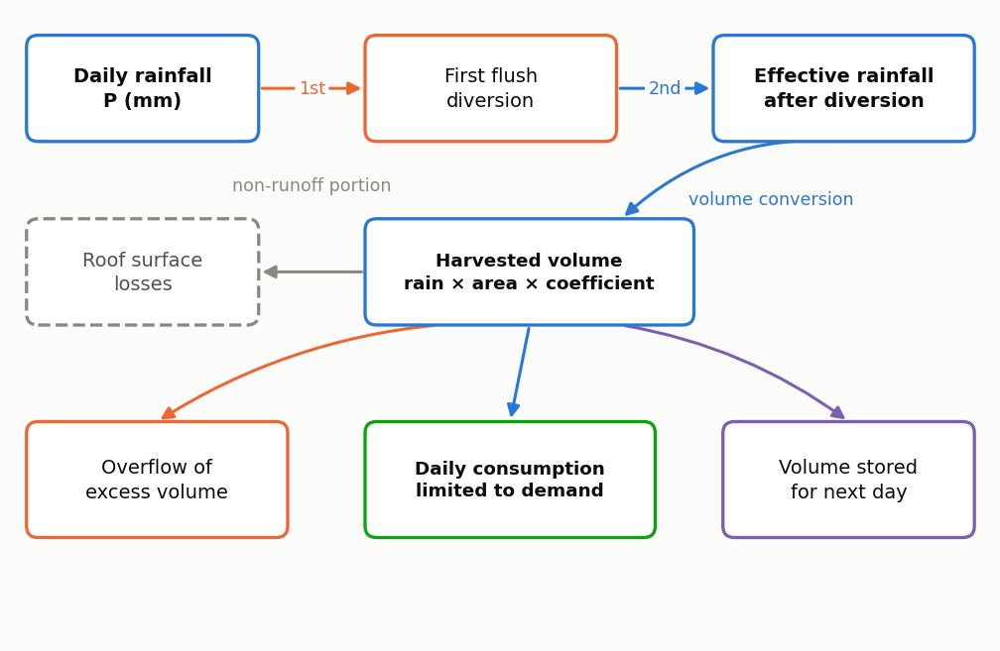

*Figure 3 — Destination of the precipitation of one day. Each box is a part of the balance, and the sum of the overflow, the consumption and the stored volume equals the collected volume. The overflow is calculated before the day's consumption, and the day's rain can already supply the day's consumption: an order between the YAS and YBS rules, explained in the section on the daily balance.*

Reading the drawing:

1. **The first flush is deducted.** With 12 mm of precipitation and a 2 mm first flush, 10 mm of effective precipitation remain.
2. **It is converted into volume.** Ten millimetres on 100 m² of roof, with a runoff
   coefficient of 0.85, give 850 litres. The calculation is `mm × m² × coefficient`, and
   it comes out directly in litres, because one millimetre on one square metre is
   exactly one litre.
3. **It is added to the volume stored in the cistern**, and whatever exceeds the
   capacity **overflows** to the drainage system.
4. **The day's consumption is withdrawn**, up to the rainwater demand.
5. **The remaining volume is carried to the next day** — and it is this dependence
   between consecutive days that makes a daily simulation necessary.

The five steps form a cycle, not a list: the volume left at the end of the fifth step
is exactly the volume from which the third step starts on the next day. This link
between one day and the next is the one thing that a calculation on the annual mean
cannot reproduce, and it is the reason the simulation is daily.
Figure 4 represents this sequence in the notation of the daily
balance equations.


*Figure 4 — Sequence of operations of the daily balance, in the order the program runs them, in the notation of the equations of the daily balance section. The purple link around the drawing represents the dependence between consecutive days: the remaining volume V_res,t is the starting volume of the next day.*

> **In depth: why the annual mean is not enough.** It is tempting to divide the annual
> rain by 365 and do the calculation in one go. The result is always optimistic, and
> sometimes very much so. The reason is that rain arrives **concentrated**: it fills the
> cistern in one day, overflows, and then is missing for two weeks. The mean represents
> neither the overflow nor the deficit, and both reduce the yield. Section 2.1 shows
> this happening in a ten-day table that you can redo in a spreadsheet, and section
> 4.4 shows the size of the error.

Repeated over thirty years of series, this calculation produces the program's central
answer: the **potable water saving potential**, the fraction of the building's total
consumption that rain managed to replace.

---

### 1.1.3. The six dimensions

The volume of water supplied is the first question of a project, but not the only one.
The program assesses the system in six dimensions, which generally lead to different
optimal volumes (Figure 5).

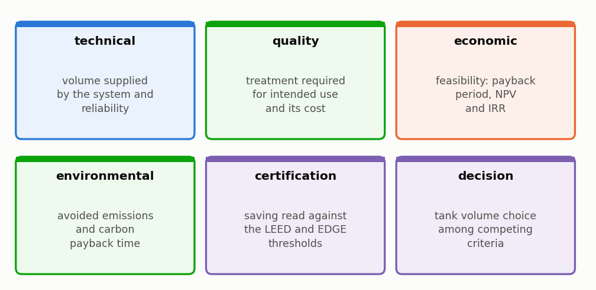

*Figure 5 — The six dimensions of analysis and the question assessed in each one. The program goes through them in this order, and each one is treated in a section of its own in the method chapter.*

Each dimension has its own treatment in the method chapter: the technical one in
sections 2.1 to 2.4, quality in 2.5, economics in 2.7, the
environment in 2.8, certification in 2.9 and the decision in 2.10.


The sixth dimension is what sets the program apart from a spreadsheet. The first five
produce **diverging** results: the volume with the largest water saving is rarely the
one with the best financial return, and neither is usually the one with the best
environmental performance. The multi-criteria decision makes explicit the weights given
to each criterion.

---

### 1.1.4. What the program does **not** do

Starting with the limits is unusual, and deliberate. It saves the time of anyone who
opened the program expecting something else.

**It does not size the plumbing.** It does not calculate the routing, the diameter of each run or the slope of the network. The pump wizard estimates the diameter and the head loss of the rising main to select the equipment, but it does not replace the plumbing design; the diagram exported in DXF is a diagram, and the construction design belongs to the designer.

**It does not detail the first-flush device.** The program calculates the volume of the first-flush chamber, equal to the catchment area times the depth, and prices it with the leaf separator; the arrangement of the fittings, the purge and the connection to the drainage are separate hydraulic design.

**It does not replace water quality testing.** It sizes treatment equipment from
assumptions. The constants of the roof wash-off model are not calibrated against
measurements, and the resulting quality is an assumption, not a result.

**It does not model an hourly sub-step.** A 40 mm rain in two hours and the same depth
over twenty-four hours give the same result.

**It does not do a complete life cycle inventory.** The assessment is a **screening**
one, in a single impact category — carbon. There is no eutrophication, acidification,
land use or toxicity.

**It does not certify.** It shows where the project would fit. Certification is decided
by the certification body, with the complete documentation of the development.

**It does not know the site.** It does not know whether the volume fits on the plot,
whether the water table is high, or whether the structure can carry the elevated tank.

Section 5.2 has the complete list of known limitations, with the consequences of
each one.

---

### 1.1.5. Who it is for

The manual serves four reader profiles, with reading paths independent of one another
(Figure 6).


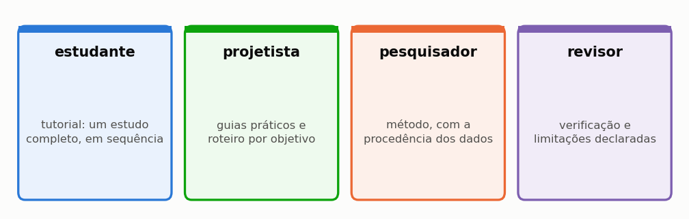

*Figure 6 — The four reading paths of the manual. They are independent of one another, and the manual was organised so that each one can be followed on its own.*

In section numbers: the student follows chapter 4, which is the tutorial from start to finish; the designer uses the guides of chapter 3 and the route of section 1.3; the researcher goes to the method of chapter 2; and the reviewer finds in chapter 5 the verification and the declared limits.


Anyone starting now should go through the whole of chapter 4, in the order in
which it is written. It builds a project from scratch and follows it to the final
decision, and each section ends by showing where the project has got to, so that the
reader sees the study taking shape instead of receiving it finished.

---

### 1.1.6. How the engine is checked

Triton is a daily behavioural balance with six dimensions of analysis built around it.
Section 5.3 describes how the engine is verified.

> **In depth: the first flush is subtracted, not used as a threshold.** Some tools treat
> the first-flush depth as an **event threshold**: below it nothing is collected, above
> it the whole rain is collected. Triton **subtracts** the depth from each day's
> precipitation, which is physically more faithful. Anyone comparing results with
> another tool must declare which treatment each one uses, together with the search
> grid of the optimal volume, because either choice changes the result.

---

### 1.1.7. A word about results

Every number the program produces is **conditional on the declared assumptions**. It
does not discover truths; it calculates consequences.

That is why the manual insists so much on declaration. Section 4.10 has the list of
what must appear in a paper, section 5.1 has the ten mistakes the program does not
prevent, and section 5.2 has what it does not cover.

A study that declares its assumptions and its limits is more useful — and more
defensible — than one that presents a number on its own.

---

## 1.2. Installation and first run

> By the end of this section you will have the program installed, open, and a
> simulation finished with a result you can check against this manual.

---

### 1.2.1. What you need

<!-- tabela: **Table 1** — System requirements to install and run the program -->
| Requirement | What is needed |
| :--- | :--- |
| system | Windows 10 or 11, 64-bit |
| disk space | about 0.7 GB |
| memory | 4 GB is enough; 8 GB makes the sweep more comfortable |
| privileges | administrator, to install for all users; without them, the installation goes to the user's folder |

Nothing else needs to be installed. The program is distributed already assembled, with
all the components it depends on to calculate, and does not require any prior
installation of interpreters, libraries or auxiliary packages. Nor does it need an
internet connection to work: everything it consults during a simulation is on the
computer itself.

---

### 1.2.2. The edition

This is the International Edition (INT). It carries no rainfall, tariff, price, standard
or emission factor of any one country: you enter those of your project, in the currency
you choose. The blue badge at the top of the sidebar, the window title and the footer of
every report and export say which edition the study came from.

<!-- tabela: **Table 2** — What the International Edition brings and what it leaves to you -->
| | International Edition (INT) |
| :--- | :--- |
| installer | `Triton_INT_Setup_1_0_0.exe` |
| language on opening | English |
| rainfall | your own series; three sample series (New York, London, Cape Town) ship with the program |
| water and sewage tariffs | typed in |
| electricity | typed in |
| currency and costs | no default currency: you choose it; costs typed in |
| grid and potable water emission factors | from the project's country, mandatory |
| certifications and incentives | LEED, EDGE |
| step 12 | Probabilistic Modulation |
| cost of piping and labour | typed in |
| manual the program opens | this English manual |
| stored preferences | `Triton-INT` |

Without the emission factors of the project's country, the program does not calculate
the environmental assessment: a factor from the wrong grid would give a wrong result
without any warning.

The method is the same whatever the country: the daily balance, the first flush, the
runoff coefficients, the economic analysis and the life cycle assessment are one engine.
What changes from one country to another is **data**, and the program leaves it to you.
Where a requirement of a national standard matters, this manual describes it in general
terms and asks you to check the standard that applies where the building stands.
---

### 1.2.3. Installation

1. Run **`Triton_INT_Setup_1_0_0.exe`**. The installer asks whether the installation is for all
   users, which requires administrator rights, or only for you.
2. Choose the installation language and read and accept the licence (academic source-available, non-commercial use).
3. Choose the installation type. The **standard** one brings the program, the manual,
   the cases, the examples and all the languages. The **custom** one lets you untick the
   Spanish and Chinese language packs.
4. Accept the suggested folder, `C:\Program Files\Triton International`, or choose
   another.
5. Tick, if you wish, **create a desktop icon**. The option **open .triton files with
   Triton** comes unticked, so as not to take over the project files of another Triton
   edition installed on the same computer; tick it if you want double-clicking a
   project to open it directly in the program.
6. When it finishes, the installer offers to open the program.

After that, the Start menu has two shortcuts: the program, and its manual in PDF
(this English manual). To uninstall, use Windows *Apps and features*, as with any program; your
projects stay where they were saved.

> **What the installer puts on the computer.** The program, the three sample rainfall
> series that come with the installation, the example files and this manual.
> Nothing is downloaded during use: Triton works without an internet connection.

---

### 1.2.4. Where your files go

The program never decides for you where to save. Every time you save a project, a
report or an export, it asks for the folder.

<!-- tabela: **Table 3** — File formats the program saves and the content of each one -->
| What you save | Extension | Contains |
| :--- | :--- | :--- |
| project | `.triton` | all the input data **and the rainfall series** |
| report | `.pdf` | the complete document of the study |
| results | `.xlsx`, `.csv` | the tables, for a spreadsheet |
| diagram | `.dxf` | the schematic drawing, for CAD |

Among these formats, `.triton` is the one that really matters to keep. It is
self-contained: it carries the whole rainfall series inside it, and therefore opens on
any other computer even without the files it came from. ==It is also the file to attach
to a paper so that someone else can reproduce the study,== and this property is what
separates a verifiable piece of work from one that is merely reported.

---

### 1.2.5. The rainfall series

The program brings three long historical series ready to use — New York, London and
Cape Town, 1991 to 2020, from the ERA5 reanalysis — and accepts any series of your own
in CSV: daily precipitation in millimetres, one value per day, as appendix F
describes. The sample series are reanalysis grid-point data, not rain-gauge records.
They serve as examples and starting points; for a real project, use the series measured
at the site.
---

### 1.2.6. The example files

The manual comes with ready-made projects that reproduce the results printed here.

<!-- tabela: **Table 4** — Example files distributed with the program -->
| File | What it is for |
| :--- | :--- |
| `casos_tutorial_new_york.triton` | the project that chapter 4 builds, ready |
| `casos_ten_days.triton` | the ten-day teaching case of section 2.1 |
| `casos_london.triton` and `casos_cape_town.triton` | the same building in other cities |
| `examples\*.triton` | three complete studies: New York, London and Cape Town |

They are in the program folder. Appendix J lists the ten cases of the manual,
with the chapter of each one and the result they produce.

It is worth starting with the ten-day case. Open it, run the simulation and compare the
result with the table printed in section 2.1. If the two match, the installation
corresponds exactly to this manual; if they differ, the manual and the program are of
different versions, and section 6.3 explains what to do in that case.

---

### 1.2.7. The first simulation, in five minutes

The program is organised in **steps**, in the left sidebar, in the order in which you
work. For the first simulation four of them are enough.

1. **Project & Rainfall.** Load the file
   `NewYork.csv` that comes with the program. Enter a catchment area of 150 m²,
   a runoff coefficient of 0.85 and a first flush of 2.0 mm.
2. **Building & Demand.** Choose a single-family house, 4 residents, 150 litres
   per person per day, and a rainwater-suppliable fraction of 28%.
3. **Reservoir & Costs.** Enter a fixed volume of 4,000 L.
4. Run it, and go to **Technical Results**.

You should get a saving potential of about **27%**.

Section 4.3 explains what this number means, and section 4.4 asks the next
question: is 4,000 L the right volume?

---

### 1.2.8. If something goes wrong

**The program does not open.** Check that the installation finished without errors and
reinstall over it; reinstalling keeps your files, because they are not in the program
folder.

**There is no list of cities.** The program does not carry a rainfall database. Load one
of the three sample series, or a rainfall file of your own.

**Some part of the program is missing, such as the 3D volumetry.** Run, in the Command
Prompt, `"C:\Program Files\Triton International\Triton_INT.exe" --diagnostico` (with
the default folder). The
program lists what the installation contains: the 3D viewer, the sample rainfall series and the manual. Each item is marked OK or FALTA (missing). The list is
also saved in `triton_diagnostico.txt`, in the Windows temporary folder. Send that file
with the problem report.

**The result does not match the manual.** Check, in this order: the rainfall series
loaded, the area, the coefficient, the first-flush depth, the demand and the
rainwater-suppliable fraction. A difference in result is almost always a difference in
input, and section 5.1 lists the most common mistakes.

**An error message appeared.** Section 6.2 has the program's messages, what each one
means and what to do.

---

## 1.3. Where to start, depending on your goal

This manual brings together fifty-four sections in eight chapters, and it was not
designed to be read from cover to cover. It works best as a reference work, in which
each reader enters at the point that matches what they need to do, and this section
exists precisely to show that entry point.

---

### 1.3.1. Route by goal

The table below lists the five most common purposes of people who open the program,
with the reading path for each one.

<!-- tabela: **Table 5** — Recommended reading path depending on the reader's goal -->
| You want to | Read |
| :--- | :--- |
| **learn to use** the program | the whole of chapter 4, sections 4.1 to 4.10, in order |
| **solve a case** today | the three questions below, and then the guide of chapter 3 that fits |
| **publish** a study | chapter 2, which has the method, and section 4.10, with the declaration list |
| **review** someone else's study | chapter 5, and appendices A and B |
| **export** to CAD, BIM or a spreadsheet | section 3.9 |
| **avoid mistakes** | section 5.1, with the ten most common mistakes |

Anyone with an hour and no previous familiarity should read the tutorial of chapter
4. It builds a complete study around a single project, and each section ends by
showing where that project has got to, so that the reader follows the construction
instead of receiving the finished result.

---

### 1.3.2. The three questions that define a study

Even before opening the program, it is worth answering three questions, because they
determine a good part of the later decisions and because answering them afterwards
usually means redoing work.

#### 1.3.2.1. Which uses will rainwater supply?

The answer defines the **rainwater-suppliable fraction**, and that fraction is the
ceiling of everything else: a system whose fraction is 28% will never save more than 28%
of the total consumption, however large the cistern and however much it rains. No later
design decision changes this limit, which is why it deserves to be set before anything
else. Figure 7 brings together the usual ranges of the suppliable
fraction depending on the intended uses.

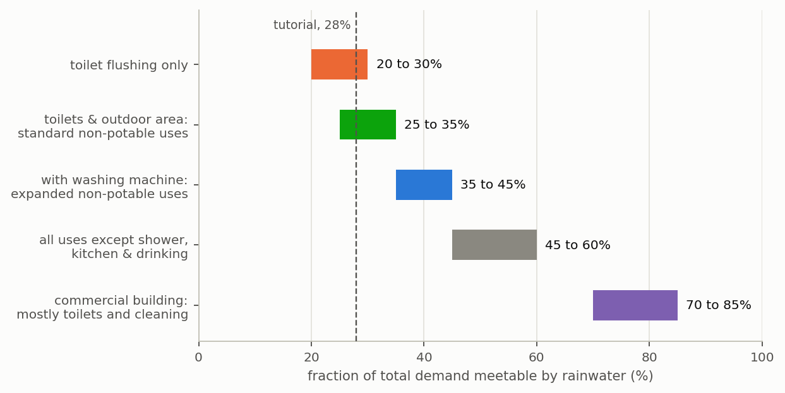

*Figure 7 — Which part of the total consumption rainwater can supply, depending on the uses the project intends. It is the ceiling of the saving potential: no tank, however large, exceeds this fraction.*

The residential cases are dealt with in section 4.2, and the commercial case in
section 3.5. The dashed line marks the 28% of the tutorial, which keeps to the
non-potable uses that rainwater guidance generally admits: toilet flushing, washing and
irrigation.


#### 1.3.2.2. Will you compare volumes or assess just one?

The distinction between assessing a known volume and looking for the right volume
determines the simulation mode and, with it, the computing time and the richness of the
result.

<!-- tabela: **Table 6** — Choice between fixed volume and sweep depending on the question of the study -->
| If you want to | Use | Where it is dealt with |
| :--- | :--- | :--- |
| assess a cistern that already exists | fixed volume | section 4.3 |
| find out which volume to buy | **sweep** | sections 4.4 and 2.2 |
| choose between criteria that disagree | sweep and multi-criteria | sections 4.9 and 2.10 |

==The sweep is almost always the right answer.== It costs more computing time, in the
order of seconds, and it produces the curve of diminishing returns, which is the
strongest argument any study can have when justifying a volume.

#### 1.3.2.3. Is an upper tank needed?

The third question is hydraulic, and the answer depends on the height of the building
and on the pressure required at the points of use.

<!-- tabela: **Table 7** — Hydraulic criteria to decide on the upper tank -->
| If the building | Then | Where it is dealt with |
| :--- | :--- | :--- |
| is single-storey and the points are close to the cistern | direct pressurisation, no tank | section 4.5 |
| is a two-storey house or a multi-storey building | elevated tank, for **pressure** | section 4.5 |
| needs a reserve against power cuts | elevated tank | section 4.5 |

> The elevated tank **does not increase** the water saving. Keeping the same total
> storage, it delivers slightly less and consumes pumping energy. The decision to adopt
> it must be hydraulic, and never based on the expectation of a larger yield.

---

### 1.3.3. The order of work in the program

The program's sidebar is numbered, and the numbering matches the order in which you
work. The first four steps are data input, the next four show results, and the last
four produce outputs or support the study (Figure 8).


*Figure 8 — The twelve steps of the program, grouped by nature. The first four are input and must be filled in order, because each one uses what the previous one defined; the next four are for reading results; the last four produce outputs or give support, and can be used at any time.*

Where this manual deals with each one: step 1 in section 4.1, step 2 in 4.2,
step 3 in 4.6, step 4 in sections 4.3, 4.4 and 4.7, step 5 in 4.3,
step 6 in 4.7, step 7 in 4.8, step 8 in 4.9, step 9 in 4.10, step 10
in 3.9 and step 12, Probabilistic Modulation, in sections 7.1 to 7.5. Step 11 is the documentation built into the program
itself, and has no corresponding section here. The International Edition carries no
tariff catalogue, so it has no tariff-manager step: you type the tariffs of your
project in the economic step, and the numbering has no gap.


It is worth saving the project at the end of each step. The parameters of appendix
A are saved and read back in full, and the resulting file is the documentary
evidence of the study, both for whoever will redo it in the future and for whoever will
assess it.

---

### 1.3.4. Before publishing

Three readings are mandatory for anyone who intends to publish results, and none of them
is long. Section 4.10 has the list of what to declare in a paper, together with a
method paragraph ready to adapt. Section 5.1 brings together the ten design
mistakes that the program has no way of preventing. And section 5.2 lists the known
limitations — of which it is worth reading not all, but those that affect the case in
hand.

Appendix I condenses the three into one-page summaries, for quick reference.

---

# 2. The method

---

## 2.1. The daily water balance

> By the end of this section you will be able to redo, in a spreadsheet, exactly what
> Triton does on each day of the series, and to say why the program reached the number it
> reached.

> **Before you start.** Chapter 2 is the technical layer of the manual: it shows the
> calculations from the inside. You do not need it to use the program — chapter 4 is
> enough — but you do need it to **defend** a result, whether before an examining board, in
> a review or in front of a client who asked where the number came from.

This is the section on which all the others depend. The saving potential, the cash flow, the
avoided emission and the multi-criteria ranking all come from the numbers the daily balance
produces. Whoever understands this section understands the program.

Triton uses a **daily-step behavioural model**: for each day of the precipitation series, the
program works out what enters the tank, what leaves it, what overflows and what stays stored.
There is no probability distribution and no annual mean. There is the series, day after day,
and the same calculation repeated.

---

### 2.1.1. The order of operations

For each day `t`, the program always runs, in this order:

1. **decides whether to divert** the first flush, according to the chosen mode;
2. **converts the depth into collected volume**, with the area and the coefficient;
3. **adds it to what was left from yesterday** and checks the overflow;
4. **supplies the rainwater demand** with what is stored;
5. **splits** the supply between indoor use and irrigation;
6. **tops up with mains water** what the rain did not supply;
7. **classifies** the day as one of full, partial or no supply.

The order is not arbitrary, and swapping two steps changes the result. Item 2.1.4 returns
to this.

---

### 2.1.2. The worked case

Ten days, one house, no upper tank. The numbers were chosen to fit in a spreadsheet.

<!-- tabela: **Table 8** — Input data of the ten-day worked case -->
| Input | Value |
| :--- | ---: |
| catchment area | 100 m² |
| runoff coefficient | 0.85 |
| first-flush depth | 2.0 mm, at every event |
| total demand | 200 L/day |
| fraction suppliable by rainwater | 40% = 80 L/day |
| lower tank volume | 2,000 L |
| upper tank | none |
| rainfall | New York, 21 to 30 September 2018 (ERA5 reanalysis) |

The ten-day rainfall series, in millimetres:

<!-- tabela: **Table 9** — Precipitation series of the ten days of the worked case (New York, September 2018) -->
| Day | 1 | 2 | 3 | 4 | 5 | 6 | 7 | 8 | 9 | 10 |
| ---: | ---: | ---: | ---: | ---: | ---: | ---: | ---: | ---: | ---: | ---: |
| Rain | 0.0 | 2.4 | 1.9 | 0.0 | 59.8 | 9.2 | 5.5 | 32.9 | 0.0 | 0.0 |

Without outdoor demand, the daily rainwater demand is the indoor demand times the indoor
non-potable fraction, which here coincides with the total suppliable fraction:
200 × 0.40 = **80 L/day**. That is the volume the system tries to deliver every day.

#### 2.1.2.1. The table, day by day

<!-- tabela: **Table 10** — Daily water balance of the worked case, day by day, with collection, consumption, overflow and storage -->
| Day | Rain | First flush | Effective rain | Collected | Rainwater demand | Consumed | Overflowed | In the tank | Supply |
| ---: | ---: | ---: | ---: | ---: | ---: | ---: | ---: | ---: | :---: |
| | mm | mm | mm | L | L | L | L | L | |
| 1 | 0.0 | 0.0 | 0.0 | 0 | 80 | 0 | 0 | 0 | none |
| 2 | 2.4 | 2.0 | 0.4 | 34 | 80 | 34 | 0 | 0 | partial |
| 3 | 1.9 | 1.9 | 0.0 | 0 | 80 | 0 | 0 | 0 | none |
| 4 | 0.0 | 0.0 | 0.0 | 0 | 80 | 0 | 0 | 0 | none |
| 5 | 59.8 | 2.0 | 57.8 | 4,913 | 80 | 80 | 2,913 | 1,920 | full |
| 6 | 9.2 | 2.0 | 7.2 | 612 | 80 | 80 | 532 | 1,920 | full |
| 7 | 5.5 | 2.0 | 3.5 | 298 | 80 | 80 | 218 | 1,920 | full |
| 8 | 32.9 | 2.0 | 30.9 | 2,626 | 80 | 80 | 2,546 | 1,920 | full |
| 9 | 0.0 | 0.0 | 0.0 | 0 | 80 | 80 | 0 | 1,840 | full |
| 10 | 0.0 | 0.0 | 0.0 | 0 | 80 | 80 | 0 | 1,760 | full |
| **sum** | | | | **8,483** | | **514** | **6,209** | 1,760 | |

<!-- tabela: **Table 11** — Check of the mass balance closure over the ten days -->
| Closure check | Litres |
| :--- | ---: |
| collected in the period | 8,483 |
| minus the overflow | −6,209 |
| minus the consumption | −514 |
| minus what stayed in the tank | −1,760 |
| **residual** | **0** |

<!-- tabela: **Table 12** — Indicators of the ten-day worked case -->
| Ten-day indicator | Value |
| :--- | ---: |
| potable water saving potential | 25.7% |
| daily mean of rainwater consumed | 51.4 L/day |
| daily mean of potable water consumed | 148.6 L/day |
| daily mean overflow | 620.9 L/day |
| days of full supply | 60% |
| days of partial supply | 10% |
| days of no supply | 30% |

---

### 2.1.3. Reading the table

Five things happen in these ten days, and each one teaches a rule of the program.

#### 2.1.3.1. Day 1: empty tank

The simulation starts with the tank **empty**. There is no rain on day 1, nothing is stored,
and the 80 L of rainwater demand are not met by a single drop: the day is one of **no**
supply, and the 200 L of the whole day come from the mains.

This is not a defect of the chosen series. It is the initial condition of the model, and it
matters: in short series, the first days penalise the result. With thirty years of series the
effect disappears; with ten days, it is one of the reasons the potential obtained, 25.7%,
falls so far below the suppliable fraction of 40%. Days 3 and 4 add two more days of no supply.

#### 2.1.3.2. Days 2 and 3: the first flush at work

On day 2 it rained 2.4 mm. After the 2.0 mm first flush, 0.4 mm remain, which on 100 m² at a
coefficient of 0.85 give 34 L. All 34 L are consumed, and the day is one of **partial**
supply: 34 L of the 80 L wanted.

On day 3 it rained 1.9 mm, less than the first-flush depth of 2.0 mm. The program does not
subtract 1.9 and collect zero: it **diverts the whole day**.

> **Warning.** When the first-flush rule applies and the day's rain does not exceed the depth,
> the **whole** day is lost, not the difference. The calculation is `P_ef = P − d_f` when
> `P > d_f`, and **zero** otherwise.

The reason is physical: the diversion device has to fill before the water reaches the
cistern. If the rain does not fill the device, nothing passes. In climates of light, frequent
rain, this weighs far more than intuition suggests: in the New York series of the tutorial,
17% of the days are below the first-flush depth, and that is why the first-flush mode
deserves attention in section 4.1.

> **A note for those who compare tools.** Some simulation tools treat `d_f` as an **event
> threshold**: below it nothing is collected, above it the **whole** rain is collected, without
> subtraction. Triton subtracts the depth. The difference is deliberate, it lowers the estimated
> saving, and studies comparing the two rules must declare it. Section 6.1 deals with the
> comparison.

#### 2.1.3.3. Day 5: overflow comes before consumption

It rained 59.8 mm. After the 2.0 mm first flush, 57.8 mm of effective rain remain, which on
100 m² at a coefficient of 0.85 give 4,913 L collected.

The tank was empty. The tank holds 2,000 L, so **2,913 L overflow**. Only after that does the
program withdraw the 80 L of demand, leaving 1,920 L for the next day.

> **Warning.** This order defines the model. The overflow is calculated **before** the demand
> is withdrawn, as in the **YAS** rule (*yield after spillage*), but the day's own rain can
> already supply the day's demand, as in the **YBS** rule. Triton therefore sits between the
> two, and the subsection «YAS, YBS and Triton's order», further on, shows why.
>
> If consumption came before the overflow, the tank would accept water that would physically
> have overflowed already, and the program would overestimate the yield. The difference shows
> up precisely on days of heavy rain, which are those that weigh most in the annual total.

Day 6 follows the same rule: the tank holds 1,920 L, receives 612 L, and 532 L overflow. On day 7
the tank is already full, and 218 L of a 298 L collection overflow.

#### 2.1.3.4. Day 8: a tank too small for the event

It rained 32.9 mm, and the system collected 2,626 L. The tank was already at 1,920 L and holds
2,000. **2,546 L overflowed**, nearly the whole collection.

In a single day, the system threw away the equivalent of almost thirty-two days of rainwater
demand. It is the portrait of the mismatch between the rain, which arrives concentrated, and the
demand, which is constant. Enlarging the tank recovers part of it, and that is exactly the
question the volume sweep of section 2.2 answers. Figure 9 sums up the ten
days.

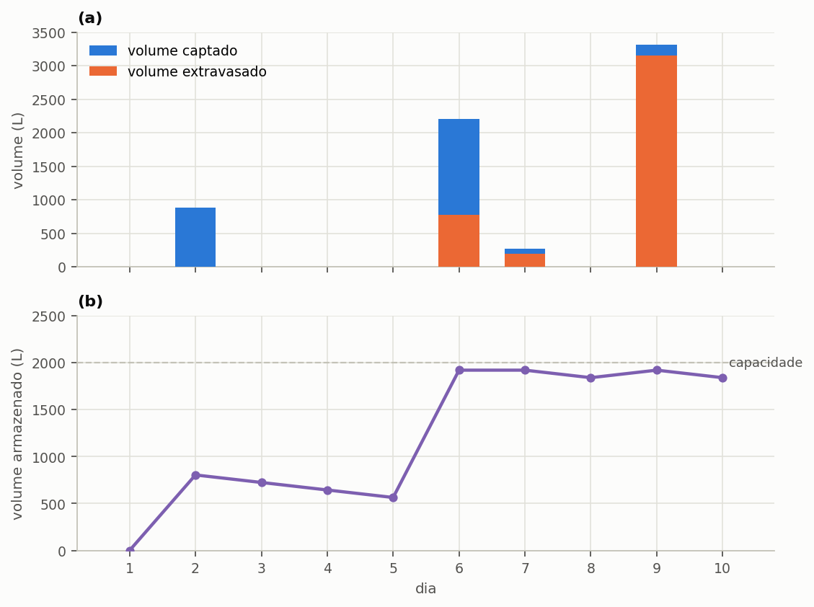

*Figure 9 — The ten days of the worked case: (a) collected volume, in blue, and overflowed volume, in orange, by day: on day 8 the overflow almost equals the collection; (b) volume stored in the lower tank at the end of each day, after consumption, with the 2,000 L capacity dashed; on days 5 to 8 the tank reaches capacity, overflows and ends the day with 1,920 L.*

#### 2.1.3.5. The sum: the balance closes

The last row of the table and the check table show the closure:

```equacao:fechamento:1
V_cap = V_ext + V_con + V_res
```

<!-- tabela: **Table 13** — Variables of Equation 1 -->
| Symbol | Meaning | Unit |
| :--- | :--- | :--- |
| `V_cap` | total volume collected in the period | L |
| `V_ext` | total volume overflowed in the period | L |
| `V_con` | total rainwater volume consumed in the period | L |
| `V_res` | volume left in the tank at the end of the period | L |

In the ten days of the worked case, Equation 1 holds with 8,483 L collected,
6,209 L overflowed, 514 L consumed and 1,760 L left.

Zero residual. The program neither creates nor loses water, and this check is made
automatically by the test suite at every change of the code, on ten-year series, with a
residual of the order of 10⁻¹⁴ per cent of the collection.

---

### 2.1.4. The equations

The daily balance is written in five chained equations, which the program solves in this
order for each day of the series. The notation follows that of section 4.1 for the
collection part, and the index `t` always designates the current day of the simulation, so
that `t−1` is the day immediately before.

#### 2.1.4.1. The collected volume

Converting the precipitated depth into volume is the first operation of the day, and the
simplest of all: the effective rain is multiplied by the catchment area and by the surface
runoff coefficient.

```equacao:volume_captado:2
V_cap,t = P_ef,t × A × C
```

<!-- tabela: **Table 14** — Variables of Equation 2 -->
| Symbol | Meaning | Unit |
| :--- | :--- | :--- |
| `V_cap,t` | volume collected on day `t` | L |
| `P_ef,t` | effective rain on day `t`, after deducting the first-flush depth | mm |
| `A` | catchment area, in horizontal projection | m² |
| `C` | surface runoff coefficient of the roof | dimensionless |

The result of Equation 2 comes out directly in litres, with no conversion
factor, because one millimetre of depth over one square metre of surface is exactly one litre
of water. It is the only dimensional simplification of the model, and it is exact.

#### 2.1.4.2. The overflow and the storage

The volume available before any consumption is the sum of what was left in the tank at the
end of the previous day and what was collected today, as in Equation 3. Two
parts follow from that sum, calculated in this order: the surplus that does not fit in the
tank and therefore overflows, and the volume actually stored.

```equacao:disponivel:3
D_t = V_res,t−1 + V_cap,t
```

```equacao:extravasado:4
V_ext,t = max(0 ; D_t − V_max)
```

```equacao:armazenado:5
V_arm,t = min(D_t ; V_max)
```

<!-- tabela: **Table 15** — Variables of Equation 5 -->
| Symbol | Meaning | Unit |
| :--- | :--- | :--- |
| `D_t` | volume available on day `t`, before consumption | L |
| `V_res,t−1` | volume left in the tank at the end of the previous day | L |
| `V_cap,t` | volume collected on day `t`, from Equation 2 | L |
| `V_ext,t` | volume overflowed on day `t` | L |
| `V_arm,t` | volume stored on day `t`, before consumption | L |
| `V_max` | useful capacity of the lower tank | L |

==The order in which Equations 4 and 5 appear defines the
model.== The overflow is calculated **before** the day's consumption is withdrawn, and that is
why the program is usually described by the YAS rule, from *yield after spillage*. The
description is approximate, and the next subsection says where it falls short. Reversing the
order would make the tank accept, as consumption, water that would physically have overflowed
already, and would overestimate the yield precisely on days of intense rain, which are those
that weigh most in the annual total.

The difference between the two orders is invisible on most days and decisive on the few that
matter. While the tank does not fill, overflowing before or after consuming gives exactly the
same result, because there is no overflow at all; on days of intense rain, when the tank
reaches capacity, the order determines whether a part of the water is counted as consumed or
as lost. Those are precisely the days that weigh most in the annual total, and that is why a
choice that looks like a formality shifts the whole result. Figure 10 compares the
two sequences in the notation of the equations of this section.

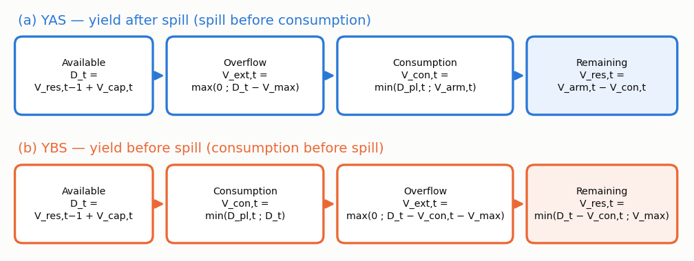

*Figure 10 — Sequence of operations of the daily balance: (a) the order adopted by the program, with the overflow calculated before consumption; (b) the reversed order (YBS), with consumption withdrawn before the overflow. The two sequences only diverge on days when the tank reaches capacity, and YBS assumes a consumption before the day's rain, which overestimates the yield.*

#### 2.1.4.3. YAS, YBS and Triton's order

In the literature, YAS and YBS have a precise definition (Fewkes and Butler, 2000). With `Y_t`
the volume withdrawn in the day, `Q_t` the collected volume, `S_t` the volume stored at the end
of the day and `V_max` the capacity:

<!-- tabela: **Table 16** — Withdrawal of the day and volume stored at the end of the day under strict YAS, strict YBS and in Triton -->
| Rule | Withdrawal of the day | Stored at the end of the day |
| :--- | :--- | :--- |
| strict YAS | `Y_t = min(D_pl,t ; S_t−1)` | `S_t = min(S_t−1 + Q_t − Y_t ; V_max − Y_t)` |
| strict YBS | `Y_t = min(D_pl,t ; S_t−1 + Q_t)` | `S_t = min(S_t−1 + Q_t − Y_t ; V_max)` |
| Triton | `Y_t = min(D_pl,t ; min(S_t−1 + Q_t ; V_max))` | `S_t = min(S_t−1 + Q_t ; V_max) − Y_t` |

Under strict YAS, the day's withdrawal comes only from what was stored the day before:
today's rain only serves tomorrow. Under strict YBS, today's rain supplies the demand before
the tank overflows. Triton does the overflow first, as YAS does, and then lets the day's rain,
up to the capacity, supply the day's demand.

An inequality follows that holds for any series: the volume consumed by Triton is never
smaller than that of strict YAS nor larger than that of strict YBS. The result lies **between
the two**, closer to YAS for large tanks, where the previous day almost always suffices, and
further from it for small ones, where the day's rain weighs. Anyone comparing Triton with a
program or a standard that uses strict YAS should expect from Triton a slightly higher saving potential for the same volume.

The program keeps this order by decision: it keeps continuity with the earlier studies of the
research group, and a change here would shift every published result.

#### 2.1.4.4. Supplying the demand

Once it is established how much is in the tank, the program withdraws the smaller of the day's
rainwater demand and the available volume, and passes on to the next day what is left.

```equacao:consumido:6
V_con,t = min(D_pl,t ; V_arm,t)
```

```equacao:sobra:7
V_res,t = V_arm,t − V_con,t
```

<!-- tabela: **Table 17** — Variables of Equation 7 -->
| Symbol | Meaning | Unit |
| :--- | :--- | :--- |
| `V_con,t` | rainwater volume consumed on day `t` | L |
| `D_pl,t` | rainwater demand of day `t`, built as in section 4.2 | L |
| `V_arm,t` | volume stored on day `t`, from Equation 5 | L |
| `V_res,t` | remaining volume, carried to the next day | L |

Equation 7 is what makes the daily simulation necessary and irreplaceable: it links
each day to the next and makes the tank a memory of what happened before. No calculation based
on monthly or annual means can represent this chaining, and the whole mismatch between the
concentrated supply and the spread-out demand follows from it.

#### 2.1.4.5. The mains top-up

What the rain did not supply is bought from the utility, and that part brings together three
different origins.

```equacao:potavel:8
V_pot,t = D_pot,t + ΔD_int,t + ΔD_irr,t
```

<!-- tabela: **Table 18** — Variables of Equation 8 -->
| Symbol | Meaning | Unit |
| :--- | :--- | :--- |
| `V_pot,t` | volume of potable water consumed from the mains on day `t` | L |
| `D_pot,t` | demand that requires potable water by the nature of the use | L |
| `ΔD_int,t` | deficit of the indoor non-potable use, not met by the rain | L |
| `ΔD_irr,t` | irrigation deficit, **only** if the backup supply is on | L |

The third part of Equation 8 deserves attention because it depends on a user
choice. With the backup supply on, the mains comes to the rescue of irrigation on days when the
cistern runs dry, and the deficit is met with potable water; with it off, the garden is simply
not watered, the building does not buy that water, and the corresponding volume is counted as
**unmet demand**, which is the third part of the demand balance dealt with later in this
section.

#### 2.1.4.6. Classifying the day

Finally, each day is classified by the degree of supply achieved, and it is from this
classification that the percentages of days of full, partial and no supply reported in section
2.3 are calculated.

```equacao:classificacao:9
full: V_con,t = D_pl,t ; partial: 0 < V_con,t < D_pl,t ; none: V_con,t = 0
```

<!-- tabela: **Table 19** — Variables of Equation 9 -->
| Symbol | Meaning | Unit |
| :--- | :--- | :--- |
| `V_con,t` | rainwater volume consumed on day `t` | L |
| `D_pl,t` | rainwater demand of day `t` | L |

In the equation, «full», «partial» and «none» are the three supply classes of a day. The comparison of Equation 9 is made with a tolerance of
10⁻⁵ L, not by exact equality. The reason is arithmetic, not conceptual: the balance works with
floating-point numbers, and a difference of the order of the rounding error would classify as
partial a day that was fully supplied.

### 2.1.5. The demand balance has three parts

The total demand of a day splits into three, not two:

```equacao:demanda_tres:10
D_t = V_con,t + V_pot,t + V_unmet,t
```

<!-- tabela: **Table 20** — Variables of Equation 10 -->
| Symbol | Meaning | Unit |
| :--- | :--- | :--- |
| `D_t` | total demand of the building on day `t` | L |
| `V_con,t` | part supplied with rainwater | L |
| `V_pot,t` | part bought from the mains | L |
| `V_unmet,t` | part nobody supplied, that is, unmet demand | L |

The three parts are the rainwater consumption, the mains consumption and the **unmet demand**.
The third is zero in the default configuration, in which the mains comes to the rescue of
irrigation on dry days. It stops being zero when the user switches that rescue off, and then
the program must show it: without it, the balance would close by construction, hiding the water
nobody supplied.

---

### 2.1.6. With an upper tank

When the project has an upper water tank, step 4 changes. Instead of consuming directly from
the lower tank, the program:

1. consumes from the upper tank what lies **above the trigger level**;
2. if something is still missing and there is water below, **starts the pump**: it transfers
   the smaller of what is in the lower tank and the free space above, and counts **one cycle**;
3. consumes again from what has just arrived;
4. repeats until the demand is met or the water runs out.

The trigger level is the reserve volume that is not consumed, and it serves to keep the pump
from starting for every litre. It is capped at the volume of the upper tank: entering a trigger
level larger than the tank does not make the program refuse it, it makes it adopt the full tank.

> **The upper tank does not increase the water saving.** It changes **when** the water is
> delivered, not **how much**. What it adds is cost: the investment in the tank and the pump,
> the pumping energy and the associated emission. Section 4.5 shows this with numbers.

The number of cycles and the volume pumped come from here and feed the energy calculation of
section 2.6.

---

### 2.1.7. What the model does not represent

- **There is no hourly sub-step.** A 40 mm rain concentrated in two hours and the same depth
  spread over twenty-four hours produce the same result. For tanks very small relative to the
  catchment area, this underestimates the overflow.
- **There is no loss by evaporation or leakage** in the tank.
- **The initial condition is an empty tank.** In series shorter than one year, this penalises
  the result noticeably.
- **The runoff coefficient is single and constant.** It does not vary with the intensity of
  the rain or with the time since the last event.
- **In the balance, the first flush is a depth, not a device with its own dynamics.** The
  first-flush chamber is sized and priced by the volume `A × d_f` (section 2.5), but its
  emptying between events is not simulated: the depth is applied according to the chosen
  first-flush mode.

Section 5.2 brings together these and the other known limitations.

---

### 2.1.8. To check

The worked case of this section is in the file `05_ten_days.triton`, in the cases folder that
comes with the program. Open it, run it, and compare with the printed table.

If any number differs, it is the manual that is out of date relative to the program. And in that
case the automatic check will already have warned, because every number in this table has a
corresponding assertion in the test suite described in section 5.3.

---

## 2.2. Ideal volume and the sweep

> This section formalises what section 4.4 did in practice: how the program builds the
> grid of volumes and how it applies the ideal-volume criterion.

---

### 2.2.1. The discrete grid

The sweep simulates a **finite** set of volumes, and building that set follows three rules.

**The step is rounded up to a multiple of 250 litres.** It is the commercial quantum: tanks
are sold in standard volumes, and an optimum at 1,300 L cannot be bought. When the step
asked for is not a multiple of 250, the program adjusts it and records the adjustment in
`step_adjusted`, so that the report can declare the effective step.

**The number of positive volumes is limited to 40.** A sweep from 0 to 50,000 L with a
100 L step would be 500 thirty-year simulations, and the gain in information does not pay
the cost. When the limit is reached, the effective step grows.

**The maximum volume entered is always kept** as the last point of the grid. Only the last
interval can therefore be smaller than the effective step.

Volume **zero** enters the grid as the reference alternative: it is the no-system scenario,
against which the others are compared.

---

The practical consequence appears in Figure 11. With a fine step, the curve shows
the knee where the return starts to fall off; with a coarse step, the knee falls between two
points of the grid and the criterion picks the first tabulated volume after it, which may lie
several cubic metres beyond the volume that really matters.

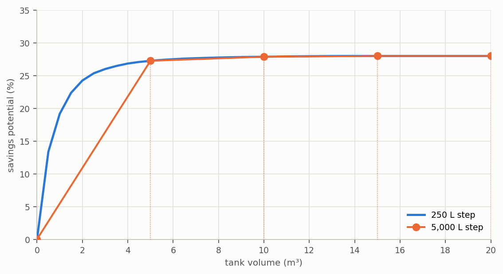

*Figure 11 — Saving potential curve of the same building, swept with a 250 L step and with a 5,000 L step. The coarse grid calculates each point it contains correctly, but it does not contain the stretch of greatest curvature, between 1 and 5 m³.*

---

### 2.2.2. The marginal gain

The curve of saving potential against volume is monotonic and concave: each cubic metre added
to the tank yields less than the previous one, and the yield tends to zero as the system
approaches the ceiling set by the suppliable fraction. The program quantifies this
diminishing yield by the discrete derivative of the curve, calculated for each volume of the
grid from the second one on.

```equacao:ganho_marginal:11
Δ(V_i) = [ Epot(V_i) − Epot(V_i−1) ] ÷ [ (V_i − V_i−1) ÷ 1000 ]
```

<!-- tabela: **Table 21** — Variables of Equation 11 -->
| Symbol | Meaning | Unit |
| :--- | :--- | :--- |
| `Δ(V_i)` | marginal gain of volume `V_i` relative to the previous one | %/m³ |
| `Epot(V_i)` | potable water saving potential obtained with volume `V_i` | % |
| `Epot(V_i−1)` | saving potential obtained with the next smaller volume | % |
| `V_i` | tank volume at position `i` of the grid | L |
| `V_i−1` | next smaller volume of the grid | L |
| `1000` | conversion from litres to cubic metres | L/m³ |

The division by one thousand in the denominator of Equation 11 is there so
that the result comes out in percentage points per added cubic metre, which is the unit in
which the decision is made — tanks are bought and priced in cubic metres, not in litres.

==Being a discrete derivative, the marginal gain depends on the grid step.== A fine grid
produces a more local value, close to the true derivative at that point; a coarse grid
produces the mean yield over a larger interval. The subsection on sensitivity to the step,
further on, measures the size of that effect.

---

### 2.2.3. The ideal-volume criterion

The ideal volume is defined as the smallest positive volume of the grid whose marginal gain has
already fallen below a threshold declared by the user.

```equacao:volume_ideal:12
V_ideal = min { V_i > 0 : Δ(V_i) ≤ Δ_lim }
```

<!-- tabela: **Table 22** — Variables of Equation 12 -->
| Symbol | Meaning | Unit |
| :--- | :--- | :--- |
| `V_ideal` | ideal volume by the marginal-gain criterion | L |
| `V_i` | tank volume at position `i` of the grid | L |
| `Δ(V_i)` | marginal gain of volume `V_i`, from Equation 11 | %/m³ |
| `Δ_lim` | marginal-gain threshold declared by the user; the program opens with 5.0, and the tutorial adopts 1.0 | %/m³ |

When no volume of the grid meets the condition of Equation 12 — which happens
when the swept range ends before the curve flattens — the program adopts the largest volume of
the grid and records that circumstance in the report, so that the reader knows that the optimum
found is a limit of the search and not a turning point of the curve.

#### 2.2.3.1. An example, step by step

The sweep table of the tutorial, in section 4.4, lets you redo the calculation by hand.
Between 3,000 L and 4,000 L the potential rises from 25.99% to 26.83%, that is, 0.84
percentage points for one more cubic metre. Since 0.84 is below the 1.0 %/m³ threshold, and
the previous gain, between 2,000 L and 3,000 L, was 1.75 %/m³, the first volume to cross the
threshold is 4,000 L, and it is the ideal volume. With the looser threshold of 3 %/m³ the ideal
volume would be 3,000 L (25.99%), and with the stricter 0.5 %/m³ it would be 5,000 L (27.24%).

Notice what happens further on. Between 6,000 L and 8,000 L the potential rises by 0.25
points, the same as in the previous interval, from 5,000 to 6,000 L, and yet the gain **per
cubic metre** halves, from 0.24 to 0.13 %/m³, because the interval spans two cubic metres. That
is why the criterion uses the gain per cubic metre, and not the gain between consecutive points
of the grid: the latter depends on the step, and the former much less.

> **The criterion is hydraulic and only hydraulic.** It ignores cost, tariff and carbon. An
> ideal volume by this criterion is not a design recommendation; it is the point at which the
> yield curve stops paying off **in water**. Section 2.10 deals with the choice with the
> other criteria, which often point to different volumes.

---

This is one criterion among others equally defensible, and it is worth making that explicit. A
designer who wants maximum water performance will choose the largest volume of the sweep; one
answering for a budget will choose the volume with the largest net present value; the
marginal-gain criterion lies between the two, as the one that identifies where the curve stops
paying off. The three read the same sweep and need not coincide: in this project they point to
three different volumes, and the maximum-performance one is the largest of the three. None of
the three is wrong — what is wrong is not saying which one was used. Figure 12
marks the volume chosen by each criterion, with the value noted in the chart legend.

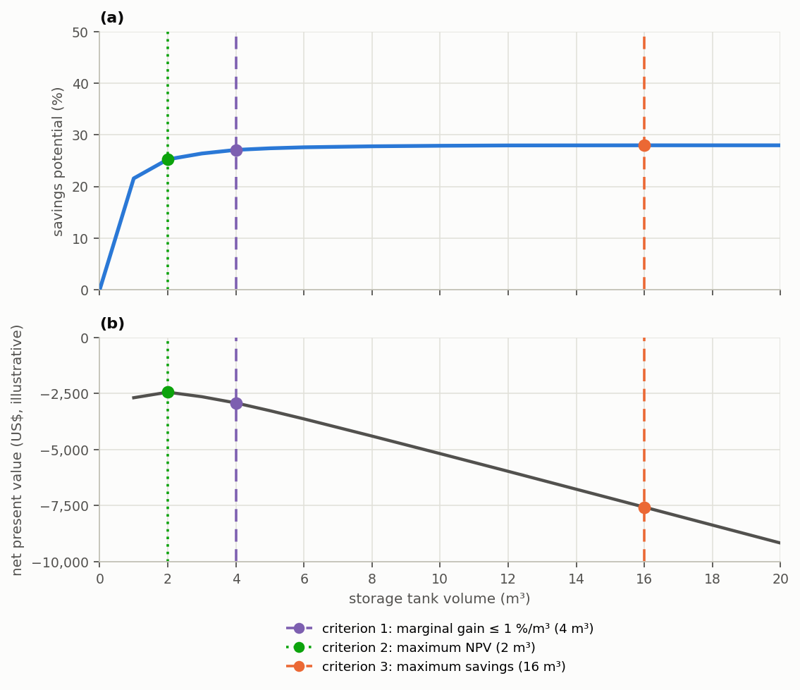

*Figure 12 — Sweep of the tutorial project read by three criteria: (a) saving potential and (b) net present value of the same set of volumes. The vertical lines mark the volume chosen by marginal gain below 1 %/m³, by maximum NPV and by maximum potential; the volume of each is noted in the legend, because it depends on the swept grid and on the economic assumptions in force.*

---

### 2.2.4. Why the program simulates: the empirical methods

Standards and handbooks have long offered a set of methods to size the tank: Rippl's, the
simulation, and several practical rules, such as the German, the British and the Australian.
They are still in common use in projects and academic work, and it is worth understanding what
each one answers before comparing them with the program's sweep. Some standards also have a
simplified method of the same kind, a number of days of the smaller of annual yield and demand,
next to the detailed daily simulation.

**Rippl's method** is the mass diagram applied to the tank: it accumulates, period by period,
the difference between demand and usable rain, and adopts as the volume the largest cumulative
deficit of the series. The resulting volume is the one that would meet **all** the demand even
in the worst dry spell on record, and so it grows with the length of the series and with its
resolution: with daily data, dry sequences appear whole; with monthly data, part of them is
diluted in the monthly mean.

**The practical methods** are rules of thumb. The German one takes 6% of the smaller of annual
usable rain and annual demand; the British one takes 5% of the product `P × A`, with `P` the mean
annual precipitation and `A` the collection area; the Australian one does a monthly balance by
trial until the desired confidence is reached. Neither of the first two uses the distribution of
rain over time, and the British one does not even use the demand.

The table below applies five sizing approaches to the New York tutorial project, rounds each
volume to a multiple of 250 L and simulates, in the program itself, the potential each one
produces.

<!-- tabela: **Table 23** — Volumes given by classical sizing rules for the tutorial project, rounded to 250 L, and the potential each one yields in the daily simulation -->
| Method | Rule | Volume | Simulated potential |
| :--- | :--- | ---: | ---: |
| German practical rule | 6% of the smaller of annual supply and demand | 3,750 L | 26.66% |
| Rippl, monthly series | largest accumulated deficit, months | 5,750 L | 27.43% |
| Rippl, daily series | largest accumulated deficit, days | 8,000 L | 27.74% |
| British practical rule | 0.05 × P × A | 8,500 L | 27.78% |
| **daily simulation, marginal gain of 1 %/m³** | sweep | **4,000 L** | **26.83%** |

<!-- tabela: **Table 24** — Storage fraction of the sweep volumes and the simulation time step Fewkes and Butler (2000) recommend for each range -->
| Volume | Storage fraction S/(A·R) | Time step recommended by Fewkes and Butler |
| ---: | ---: | :--- |
| 1,000 L | 0.0059 | hourly |
| 2,000 L | 0.0118 | daily |
| 3,000 L | 0.0178 | daily |
| 4,000 L | 0.0237 | daily |
| 8,000 L | 0.0474 | daily |
| 12,000 L | 0.0711 | daily |
| 20,000 L | 0.1185 | daily |

The first table shows what the concave curve of section 4.4 already announced. The methods
that size for the worst dry spell, such as Rippl with a daily series (8,000 L), and those that
ignore demand, such as the British one (8,500 L), lead to tanks of 8 to 8.5 m³, which deliver at
most 0.95 percentage points more than the 4,000 L of the simulation (27.78% against 26.83%) at
twice the volume. The German method (3,750 L, 26.66%) and Rippl with a monthly series
(5,750 L, 27.43%) get the order of magnitude right in this case, but by coincidence: the German
method has no way of knowing how the rain is distributed, and would give the same volume for a
city with six dry months.

==The essential difference is that the empirical methods answer a fixed question, and the
simulation answers the question the designer declares.== Rippl asks which volume never fails;
the British method asks what fraction of the rain to store; the sweep with marginal gain asks
from which volume on the next cubic metre stops paying off. The right volume varies with local
rain, roof area, number of residents and demands, and sizing tanks by local tradition, without
simulation, can lead to low-efficiency systems. In the three example cities the sweep happens to
give the same ideal volume, 4,000 L, but only because the tutorial house is the same in all
three and the marginal-gain threshold is the same; change the roof, the demand or the threshold
and the volume moves.

---

### 2.2.5. The time step and the storage fraction

The program simulates day by day, and that choice has a known range of validity. Fewkes and
Butler (2000) compared behavioural models with steps of one minute, one hour, one day and one
month, took the hourly model with the YAS rule (section 2.1) as the reference, and showed
that the right step depends on a dimensionless quantity, the **storage fraction**.

```equacao:fracao_de_armazenamento:13
F_S = S ÷ (A × R)
```

<!-- tabela: **Table 25** — Variables of Equation 13 -->
| Symbol | Meaning | Unit |
| :--- | :--- | :--- |
| `F_S` | storage fraction | dimensionless |
| `S` | tank capacity | m³ |
| `A` | catchment area in horizontal projection | m² |
| `R` | mean annual precipitation | m |

According to those authors' results, the hourly model is the one indicated for fractions up to
0.01; the daily one, for fractions between 0.01 and 0.125; and the monthly one, only above
0.125. The physical reason is simple: the smaller the tank relative to the rain it receives, the
more it fills and overflows **within** a single rainy day, while the demand is withdrawn over the
hours; a daily step adds up in a single inflow what, hour by hour, would have come in and gone
out little by little.

The second table calculates the fraction for the volumes of the tutorial sweep. The chosen
4,000 L cistern has a fraction of 0.0237, within the range of the daily model; the 1,000 L
tank (0.0059) falls below 0.01, and for it the daily result should be read as an
approximation. Fewkes and Butler recommend the hourly step for that volume and the daily step for the others. Campisano and Modica (2015), who simulated a residential system with daily and
sub-daily steps from measured discharges, reached a complementary conclusion: the daily step is
reliable for estimating **water saving**, but steps of at most one hour are needed when the
objective is **stormwater retention**, above all in small tanks with high demand.

> **In practice.** For potable water saving in buildings, the program's daily step is adequate
> in the usual design range. If the storage fraction of your study falls below 0.01, declare the
> limitation; and if the objective is to attenuate peak flows in urban drainage, the program is
> not the right tool.

---

### 2.2.6. What the literature says about the ideal volume

There is no single definition of ideal volume, and the systematic review by Semaan et al. (2020)
helps to place the program's criterion. Examining optimisation studies of domestic systems, the
authors observed that sizing the tank is the most important optimisation objective, but that cost
is the most used criterion; that undersizing produces systems unable to supply a reliable
volume; and that oversizing raises the investment for a small marginal benefit and may even
compromise water quality, as the water is stored for longer.

Campisano et al. (2017), in a broad review of urban rainwater harvesting systems, bring together
criteria from three families: **water efficiency**, such as saving potential and reliability;
**economic**, such as net present value and payback; and **drainage performance**, such as
retention. The program covers the first two families and declares that it does not cover the
third.

The marginal-gain criterion belongs to the first family and has an advantage over fixed
reliability, as in Rippl's: it does not require the designer to choose an acceptable failure
level, which rarely has a technical justification, but a level of diminishing return, which is
read directly in cubic metres of tank. The disadvantage is symmetrical: the 1 %/m³ threshold, or
the 5 %/m³ one, is also a choice, and must be declared.

---

### 2.2.7. Sensitivity to the step

The ideal volume depends on the sweep step, and it is worth knowing by how much.

A coarse step jumps over the knee of the curve: with a 5,000 L step, the first point assessed
after zero already has the mean marginal gain of the whole interval, and the second may already
be below the threshold. The ideal is shifted upwards.

A fine step resolves the knee better, at the cost of time.

**Practical recommendation:** a step between 500 and 1,000 L for residential tanks, and between
2,000 and 5,000 L for large buildings, always declaring the step adopted together with the ideal
volume.

---

### 2.2.8. Why the curve has this shape

The rainwater yield curve is concave and asymptotic, always. Two reasons:

**Small events are the majority.** The first litres of storage capture the frequent, small rains,
which account for most of the days. The last litres only serve the few extreme events.

**The suppliable fraction is a ceiling.** The potential cannot exceed the fraction of the demand
that rain supplies, defined in section 4.2. The curve approaches that ceiling and never
crosses it — an invariant the test suite checks up to volumes of 100 m³.

---

### 2.2.9. Is the series long enough?

Every result of this section depends on the rainfall series loaded, and the question the reviewer
asks first is whether it is enough. Geraldi and Ghisi answered it in three papers: sub-series
are extracted from a long series, each one is simulated, and it is counted how often they
reproduce the result of the whole series. The representative length is the shortest that
reproduces the result in most windows, and that **keeps reproducing** it at longer lengths — an
isolated hit in a short sub-series is not worth a recommendation.

The program has this analysis in the sweep step, in the «is the rainfall series long enough?»
button. It uses the same grid of volumes and the same marginal-gain threshold as the sweep,
because the answer depends on them, and it returns the verdict in one sentence, with the
frequency table by length.

==The answer belongs to this project, not to the city.== It is the point the papers do not
isolate and that the analysis makes visible: the length of series needed depends on how much of
the demand the rain is asked to supply. The larger the share to be covered, the more the cistern
depends on rare dry spells, and the longer the series that contains them must be. A short series
does not get the mean potential wrong; it gets the volume wrong, which is what is bought.

The program returns the verdict for your project, with its roof, demand and suppliable fraction.
Run it for each city of a comparison: the three example cities, with thirty years of daily data
each, are a good test. [A COMPLETAR: the representative series length for New York, London and
Cape Town has not yet been run for this edition; run the analysis on the three example projects
and tabulate it here.]

> **Warning: a short series does not become a long one by averaging.** If the analysis says the
> project needs more years than the series has, the ideal volume calculated is provisional, and
> that is what is declared in the work. Repeating the simulation with another window of the same
> data does not solve it: what is missing is record, not processing. Some standards fix a
> minimum number of years of daily data; Triton keeps the Geraldi and Ghisi analysis, which
> answers for each project instead of fixing a minimum.

---

### 2.2.10. What the sweep does not answer

- **Which volume to buy.** Tanks exist in commercial volumes; the ideal calculated must be
  rounded to the nearest available volume, and the sweep already helps by working in multiples of
  250 L.
- **Whether the system is worth it.** That is section 2.7.
- **Whether the volume fits on the plot.** The program does not know the site.
- **How much the cistern attenuates the drainage.** The daily step does not represent peak flows,
  and retention needs an hourly step or less, as Campisano and Modica (2015) show.

---

## 2.3. Efficiency indicators

> This section formally defines each indicator the program reports, with its unit, and says
> **what each one does not measure**.

A misread indicator is worse than none, and those of this section are often confused in the
literature. The first two start from the same numerator — the rainwater actually consumed —
and differ only in the denominator: a small arithmetic difference and a large difference in
meaning, because each denominator asks a different question. The third is not a ratio between
volumes but a count of days, and it answers a question neither of the other two reaches: how
often the system can be counted on (Figure 13).

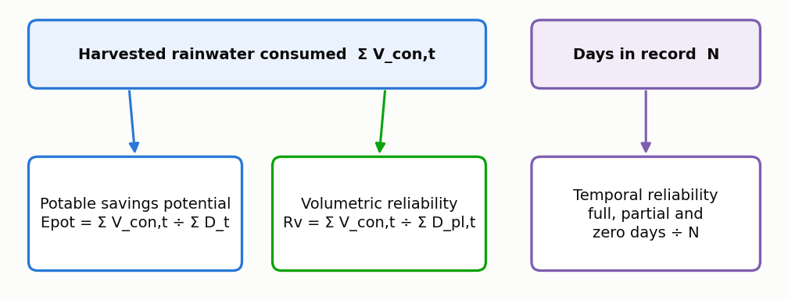

*Figure 13 — The three efficiency indicators and what each one counts. The saving potential and the volumetric reliability share the numerator and are related by the identity Epot = Rv × f, where f is the suppliable fraction; the time reliability counts days, not litres.*

---

### 2.3.1. Potable water saving potential

The potable water saving potential is the program's central indicator and the one that appears
in the summary of any study. It expresses the fraction of the **total** consumption of the
building that rainwater managed to replace over the whole simulated series, not only of the part
rain could supply.

```equacao:potencial:14
Epot = ( Σ V_con,t ÷ Σ D_t ) × 100
```

<!-- tabela: **Table 26** — Variables of Equation 14 -->
| Symbol | Meaning | Unit |
| :--- | :--- | :--- |
| `Epot` | potable water saving potential | % |
| `V_con,t` | rainwater volume consumed on day `t` | L |
| `D_t` | total demand of the building on day `t` | L |
| `Σ` | sum over all the days of the simulated series | — |

The denominator of Equation 14 is the **total** demand, and that choice is the
origin of the most common confusion when reading results. A system that fully met all the demand
assigned to it, without failing on a single day, would still show a saving potential equal to the
declared suppliable fraction, not one hundred per cent. The ceiling, therefore, is not a
limitation of the system: it is an arithmetic consequence of the definition of the indicator.

---

### 2.3.2. Volumetric reliability

Volumetric reliability answers a different, complementary question: of the water the system
**should** supply, how much did it actually supply? The denominator here is the rainwater demand,
not the total demand.

```equacao:confiabilidade:15
Rv = ( Σ V_con,t ÷ Σ D_pl,t ) × 100
```

<!-- tabela: **Table 27** — Variables of Equation 15 -->
| Symbol | Meaning | Unit |
| :--- | :--- | :--- |
| `Rv` | volumetric reliability of the system | % |
| `V_con,t` | rainwater volume consumed on day `t` | L |
| `D_pl,t` | rainwater demand of day `t`, that is, the part rain can supply | L |
| `Σ` | sum over all the days of the simulated series | — |

Equations 14 and 15 differ only in the denominator, and that
difference is enough for them to be related by an exact identity, useful as a quick check of any
result.

```equacao:relacao_indicadores:16
Epot = Rv × f
```

<!-- tabela: **Table 28** — Variables of Equation 16 -->
| Symbol | Meaning | Unit |
| :--- | :--- | :--- |
| `Epot` | potable water saving potential | % |
| `Rv` | volumetric reliability | % |
| `f` | fraction of the total demand suppliable by rainwater | dimensionless |

==A system with 93% reliability and a 28% suppliable fraction saves 26% of the total
consumption, and the three numbers say the same thing in three ways.== That is the case of the
New York tutorial with a 3,000 L cistern, the first simulation of section 4.3: the saving
potential is 25.99%, and dividing by the suppliable fraction of 0.28 gives a volumetric
reliability of about 92.8%. Reporting only one of them, without declaring the suppliable
fraction adopted, makes the result impossible to compare with that of another study, and it is
the most frequent cause of improper comparisons in the literature of the field.

The literature uses different names for the same ratio. Fewkes and Butler (2000) call **water
saving efficiency** the quotient between the rainwater volume supplied and the demand the system
should meet, which is the volumetric reliability of this section. Other authors call efficiency
what here is saving potential; some standards call it the coverage rate. When comparing with
another work, check the denominator, not the name.

---

### 2.3.3. Time reliability

Time reliability classifies each day of the series into one of three mutually exclusive classes,
according to the relation between the rainwater volume consumed and the day's rainwater demand,
defined in Equation 9. The day is **full** when rainwater fully meets the
rainwater demand; **partial**, when it meets part of it and the mains supplies the rest; and
**none**, when the tank is empty and the mains supplies all the demand
(Figure 14). The three percentages add up to 100%. The classification counts days,
not volume: a day on which one litre was missing to meet the demand is partial, not almost full,
and that is why time reliability does not convert directly into volume saved.

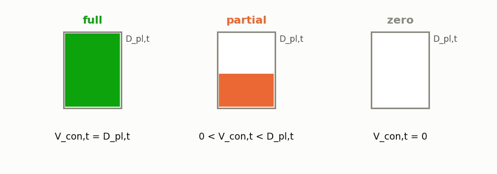

*Figure 14 — Daily supply classes: full (V_con,t = D_pl,t), partial (0 < V_con,t < D_pl,t) and none (V_con,t = 0). The filled height represents the fraction of the day's rainwater demand supplied by rainwater.*

Formally, the day is **full** when `V_con,t = D_pl,t`, with a tolerance of 10⁻⁵ L; **partial**
when `0 < V_con,t < D_pl,t`; and **none** when `V_con,t = 0`.


In the tutorial with a 3,000 L cistern, 91.9% of the days are full, 1.7% partial and 6.4% with no
supply. Notice that the time reliability, 91.9%, is lower than the volumetric one, about 92.8%.
There is no contradiction: partial days do not count as full, but they contribute volume, and it
is that water the volumetric reliability adds and the time reliability does not. The difference
between the two is therefore an indirect measure of how far the failure days are partial
failures. With a 4,000 L cistern the full days rise to 95.3%.

**What it measures:** how often the user can count on the system.

**What it does not measure:** volume. A system can have 95% full days and a low potential if the
rainwater demand is small, and the opposite also happens.

> Time reliability is the indicator that matters most for the **plumbing design**. Many days with
> no supply require a well-sized automatic backup supply, and the user notices the switching
> between the two sources.

---

### 2.3.4. Overflow

```equacao:extravasamento_medio:17
V_ext,avg = ( Σ V_ext,t ) ÷ n
```

<!-- tabela: **Table 29** — Variables of Equation 17 -->
| Symbol | Meaning | Unit |
| :--- | :--- | :--- |
| `V_ext,avg` | mean daily overflow | L/day |
| `V_ext,t` | volume overflowed on day `t` | L |
| `n` | number of days of the simulated series | day |

**What it measures:** how small the cistern is relative to the rain events.

**What it does not measure:** waste. The water that overflows goes to the urban drainage, as it
would without the system. There is no loss compared with the no-system scenario — only an
opportunity not taken.

> The overflow **never reaches zero** in a real system. It tends to a floor that is the difference
> between what the roof collects and what the demand consumes, and in the tutorial the roof supplies 2.3 times
> the rainwater demand, so that the floor is a large share of the water collected. Anyone who wants flood retention needs a detention tank,
> which is another project with another logic.

---

### 2.3.5. Efficiency of use of the collected water

The program does not print this indicator, but it follows directly from the previous ones and
helps to understand the overflow. It is the fraction of the water that reached the cistern, after
the first flush, that ended up consumed.

```equacao:uso_da_captacao:18
η_cap = ( Σ V_con,t ÷ Σ V_cap,t ) × 100
```

<!-- tabela: **Table 30** — Variables of Equation 18 -->
| Symbol | Meaning | Unit |
| :--- | :--- | :--- |
| `η_cap` | efficiency of use of the collected water | % |
| `V_con,t` | rainwater volume consumed on day `t` | L |
| `V_cap,t` | volume collected on day `t`, after the first flush | L |
| `Σ` | sum over all the days of the simulated series | — |

In the tutorial's 3,000 L cistern, the system consumes 57.0 m³ a year and overflows a mean of
150.8 L/day, about 55 m³ a year; the mass balance closes with what stays in the tank, which is
small. About half of the water that reached the cistern is therefore consumed. The number
explains why enlarging the cistern yields so little beyond a certain point: water is not
missing on the roof, **demand** to consume it is. The gross supply of the roof, 143 m³ a year,
is 2.3 times the rainwater demand of 61 m³ a year; when supply greatly exceeds the rainwater
demand, the efficiency of use of the collected water is necessarily low, whatever the volume.

---

### 2.3.6. Duration and intensity of failures

The previous indicators say how much and how often the system fails, but not **how** it fails.
Hashimoto, Stedinger and Loucks (1982) proposed, for water resource systems in general, three
complementary criteria that are now used in rainwater harvesting too: **reliability**, which is
the probability of the system being in a satisfactory state; **resilience**, which measures how
quickly it recovers from a failure; and **vulnerability**, which measures the severity of failures
when they occur.

The program reports the first and not the other two, but both can be calculated from the detailed
daily series, exported to a spreadsheet: count the sequences of days that are not full and take
their mean duration, whose inverse is a measure of resilience; and take the mean shortfall on the
failure days as a fraction of the rainwater demand, a measure of vulnerability.

The design reading is direct. If the failures are long and almost total, the backup supply from the
mains must be automatic and sized for the full flow of the rainwater points of use, not just to top
up small shortfalls. The tutorial's days of no supply (6.4% with 3,000 L)
are of this kind: the cistern is empty, not slightly short.

---

### 2.3.7. Annual volume saved

```equacao:volume_poupado:19
V_sav = ( V_con,avg × 365.25 ) ÷ 1000
```

<!-- tabela: **Table 31** — Variables of Equation 19 -->
| Symbol | Meaning | Unit |
| :--- | :--- | :--- |
| `V_sav` | volume of potable water saved per year | m³/year |
| `V_con,avg` | mean daily rainwater consumption | L/day |
| `365.25` | length of the mean year, including leap years (365.25) | day/year |
| `1000` | conversion from litres to cubic metres | L/m³ |

**What it measures:** the basis of calculation of the economic analysis and the life cycle
assessment.

> **In depth: the 365.25 is not carelessness.** The conversion uses the mean year, including leap
> years, because long series contain them. Using 365 would introduce a systematic bias of 0.07% —
> small, but for nothing.

---

### 2.3.8. Marginal gain

The formal definition of the marginal gain, with the grid of volumes made explicit, is in
Equation 11, in section 2.2.

Defined in section 2.2. It is the indicator that decides the ideal volume, and it **only
exists in a sweep** — a single-volume simulation does not produce it.

---

### 2.3.9. Unmet demand

```equacao:nao_atendida:20
V_unmet,avg = ( Σ V_unmet,t ) ÷ n
```

<!-- tabela: **Table 32** — Variables of Equation 20 -->
| Symbol | Meaning | Unit |
| :--- | :--- | :--- |
| `V_unmet,avg` | mean daily demand met by no source | L/day |
| `V_unmet,t` | unmet demand on day `t` | L |
| `n` | number of days of the simulated series | day |

The third part of the demand balance. It is zero in the default configuration and stops being zero
when the irrigation backup supply is off.

**Why it exists:** without it, the balance would close by construction, attributing to the mains
all the demand rain did not meet. Section 2.1 gives the details.

---

### 2.3.10. Summary table

<!-- tabela: **Table 33** — Summary of the indicators, with the denominator and the question each one answers -->
| Indicator | Unit | Denominator | Answers |
| :--- | :--- | :--- | :--- |
| saving potential | % | total demand | how much potable consumption falls |
| volumetric reliability | % | rainwater demand | how much of what was intended was supplied |
| full, partial, no-supply days | % | days of the series | how often it can be counted on |
| overflow | L/day | — | is the tank small? |
| volume saved | m³/year | — | basis of the money and the carbon |
| marginal gain | %/m³ | — | is it worth enlarging? |
| unmet demand | L/day | — | what nobody supplied |

---

## 2.4. Rainfall indices

> This section gives the equation of each of the nine indices the program calculates, and
> declares three divergences from the ETCCDI standard.

The rainfall indices do not take part in the water balance and do not change any simulation
result. Their role is to characterise the precipitation series — and an honest
characterisation is what makes it possible to compare studies of different cities.

---

### 2.4.1. The nine indices

The indices are calculated **year by year** over the loaded series, and the program reports the
mean and the spread of the set of years. Throughout this section, `P_i` designates the
precipitation of day `i` of the year, and a **wet day** is one on which `P_i ≥ 1 mm` — an ETCCDI
convention, adopted because depths below one millimetre are of the order of the measurement
error of conventional rain gauges.

#### 2.4.1.1. Total annual precipitation, PRCPTOT

Sum of the precipitation of all the wet days of the year. It differs from the gross annual total
by excluding days of negligible depth, which keeps instrument noise from accumulating in the
total.

```equacao:prcptot:21
PRCPTOT = Σ P_i , for P_i ≥ 1 mm
```

<!-- tabela: **Table 34** — Variables of Equation 21 -->
| Symbol | Meaning | Unit |
| :--- | :--- | :--- |
| `PRCPTOT` | total precipitation of the wet days of the year | mm |
| `P_i` | precipitation of day `i` | mm |
| `Σ` | sum over the days of the year that meet the condition | — |

#### 2.4.1.2. Precipitation on very wet days, R95p

Sum of the precipitation of the days whose depth exceeds the 95th percentile of the wet days. It
measures how much of the annual total arrives in extreme events, and it is the index most directly
linked to cistern overflow.

```equacao:r95p:22
R95p = Σ P_i , for P_i > q_95
```

<!-- tabela: **Table 35** — Variables of Equation 22 -->
| Symbol | Meaning | Unit |
| :--- | :--- | :--- |
| `R95p` | precipitation accumulated on very wet days | mm |
| `P_i` | precipitation of day `i` | mm |
| `q_95` | 95th percentile of the precipitation of the wet days of the series | mm |

#### 2.4.1.3. Maximum one-day precipitation, RX1day

The largest daily value recorded in the year. It is the index that sizes the overflow and the
gutter, not the tank.

```equacao:rx1day:23
RX1day = max ( P_i )
```

<!-- tabela: **Table 36** — Variables of Equation 23 -->
| Symbol | Meaning | Unit |
| :--- | :--- | :--- |
| `RX1day` | largest daily precipitation of the year | mm |
| `P_i` | precipitation of day `i` | mm |
| `max` | maximum value over all the days of the year | — |

#### 2.4.1.4. Maximum five-day precipitation, RX5day

The largest five-consecutive-day total of the year. It matters more to rainwater harvesting than
RX1day, because a tank fills over a prolonged event and not only at the daily peak.

```equacao:rx5day:24
RX5day = max ( Σ P_j ) , for j from i to i + 4
```

<!-- tabela: **Table 37** — Variables of Equation 24 -->
| Symbol | Meaning | Unit |
| :--- | :--- | :--- |
| `RX5day` | largest five-consecutive-day total of the year | mm |
| `P_j` | precipitation of day `j` of the window | mm |
| `i` | first day of each five-day window | — |
| `max` | maximum value over all the windows of the year | — |

#### 2.4.1.5. Simple daily intensity index, SDII

Mean precipitation of the wet days. It separates two regimes the annual total confuses: much rain
on few days and little rain on many days can produce the same PRCPTOT and very different SDII.

```equacao:sdii:25
SDII = PRCPTOT ÷ n_wet
```

<!-- tabela: **Table 38** — Variables of Equation 25 -->
| Symbol | Meaning | Unit |
| :--- | :--- | :--- |
| `SDII` | mean intensity of the wet days | mm/day |
| `PRCPTOT` | total precipitation of the wet days, from Equation 21 | mm |
| `n_wet` | number of wet days of the year | day |

#### 2.4.1.6. Days of heavy precipitation, R20mm

Count of the days on which the depth reaches or exceeds twenty millimetres. In a rainwater
harvesting system, these are typically the overflow days.

```equacao:r20mm:26
R20mm = # { i : P_i ≥ 20 mm }
```

<!-- tabela: **Table 39** — Variables of Equation 26 -->
| Symbol | Meaning | Unit |
| :--- | :--- | :--- |
| `R20mm` | number of days with heavy precipitation in the year | day |
| `P_i` | precipitation of day `i` | mm |
| `# { }` | count of the days that meet the condition | — |

#### 2.4.1.7. Consecutive dry days, CDD

Longest sequence of consecutive days with precipitation below one millimetre. ==It is the index
that best predicts the performance of a rainwater system,== because the longest dry spell is what
empties the cistern.

```equacao:cdd:27
CDD = max ( L ) , with P_i < 1 mm throughout the sequence L
```

<!-- tabela: **Table 40** — Variables of Equation 27 -->
| Symbol | Meaning | Unit |
| :--- | :--- | :--- |
| `CDD` | longest sequence of consecutive dry days in the year | day |
| `L` | length of a sequence of consecutive dry days | day |
| `P_i` | precipitation of day `i` | mm |

#### 2.4.1.8. Consecutive wet days, CWD

Longest sequence of consecutive days with precipitation equal to or above one millimetre. It
characterises the persistence of rain, and long sequences favour the complete filling of the tank.

```equacao:cwd:28
CWD = max ( L ) , with P_i ≥ 1 mm throughout the sequence L
```

<!-- tabela: **Table 41** — Variables of Equation 28 -->
| Symbol | Meaning | Unit |
| :--- | :--- | :--- |
| `CWD` | longest sequence of consecutive wet days in the year | day |
| `L` | length of a sequence of consecutive wet days | day |
| `P_i` | precipitation of day `i` | mm |

#### 2.4.1.9. Seasonality index, SI

It measures the departure of the actual monthly distribution of the rain from a perfectly uniform
distribution over the year. Unlike the previous eight, it does not belong to the ETCCDI set: it
was proposed by Walsh and Lawler in 1981.

```equacao:sazonalidade:29
SI = ( 1 ÷ R ) × Σ | X_m − R ÷ 12 |
```

<!-- tabela: **Table 42** — Variables of Equation 29 -->
| Symbol | Meaning | Unit |
| :--- | :--- | :--- |
| `SI` | Walsh and Lawler seasonality index | dimensionless |
| `R` | total precipitation of the year | mm |
| `X_m` | total precipitation of month `m`, with `m` from 1 to 12 | mm |
| `R ÷ 12` | monthly precipitation there would be if the rain were uniform | mm |
| `Σ` | sum over the twelve months of the year | — |
| `\| \|` | absolute value of the difference | — |

The index of Equation 29 is zero when all months receive the same depth and tends
to 1.83 when all the rain of the year falls in a single month. Between these extremes, Walsh and
Lawler (1981) classify the regime as very equable (below 0.20), equable with a definite wetter
season (0.20 to 0.39), rather seasonal with a short drier season (0.40 to 0.59), seasonal (0.60 to
0.79), markedly seasonal with a long drier season (0.80 to 0.99), most rain in three months or
less (1.00 to 1.19) and extreme (1.20 or more).

The seasonality index is the one that matters most to rainwater harvesting, and section 3.1
shows why: it is the distribution of rain over the year, not the total precipitated, that decides
the yield of the system.

---

The nine indices remain abstract while they stay in table form, and Figure 15 places
them over one year of the series. Placed over a real year of series, each one points to an
identifiable stretch of the record: the most intense day, the days above the threshold, the
longest dry spell, the accumulated total.

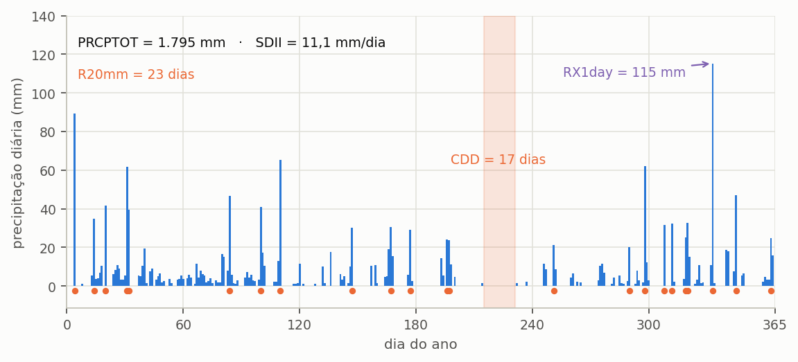

*Figure 15 — Four of the nine indices marked over one year of the New York series: PRCPTOT and SDII, at the top; RX1day, the largest daily value of the year; CDD, the longest sequence of dry days, in the shaded band; and R20mm, the days with 20 mm or more, marked at the bottom.*

Seasonality is the index least like the others, because it describes neither intensity nor
frequency: it describes how much the rain of the year concentrates in part of it. It is also the
index that most separates cities with similar annual totals, and the one that best predicts
whether a tank will have to get through a long dry spell (Figure 16).

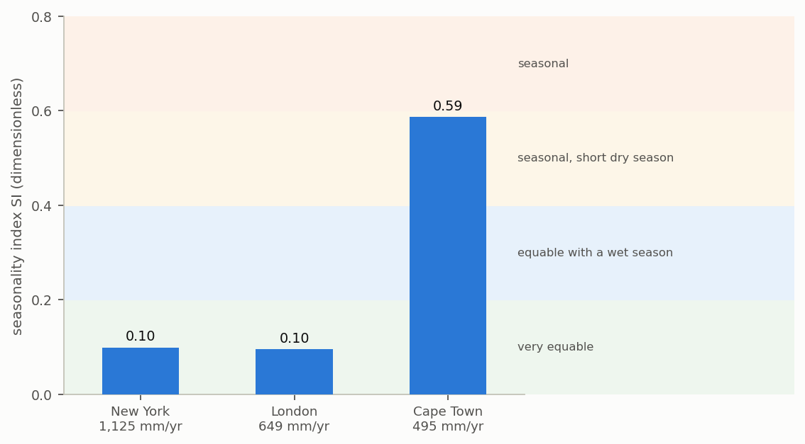

*Figure 16 — Walsh and Lawler (1981) seasonality index in the three example cities (New York, London and Cape Town), with the classes of the index in the background and the mean annual precipitation under the name of each city. High annual precipitation and an even distribution over the year are independent properties.*

---

### 2.4.2. Three divergences that must be declared

The program calls the set «ETCCDI plus seasonality», and the precision of the expression matters.

**First: the set is not pure ETCCDI.** The seasonality index is Walsh and Lawler's, and does not
belong to the set of the *Expert Team on Climate Change Detection and Indices*. Conversely,
**R10mm**, which is ETCCDI, is **not** implemented.

Eight of the nine indices are ETCCDI; the ninth is not; and one that would be is missing.

**Second: the base period of the percentile.** R95p requires a 95th percentile of the wet days.
ETCCDI defines the fixed base period of 1961 to 1990. The program calculates the percentile over
**the whole loaded series**.

The consequence is that the R95p of two series of different lengths is **not directly
comparable**, because each one has its own threshold. For strict comparison with ETCCDI
literature, trim the series to the base period.

The program calculates the percentile **only over the wet days**, which is correct: including dry
days would shift the percentile down in seasonal series.

**Third: the incomplete RX5day windows.** The five-day moving sum uses partial windows at the start
of each year, so that the first windows have one to four days. The effect is small and always in
the direction of underestimating the RX5day of the first days of the year.

---

The program's indices tab presents each indicator year by year: the total annual precipitation
(Figure 17) and the longest sequences of dry and wet days
(Figure 18).

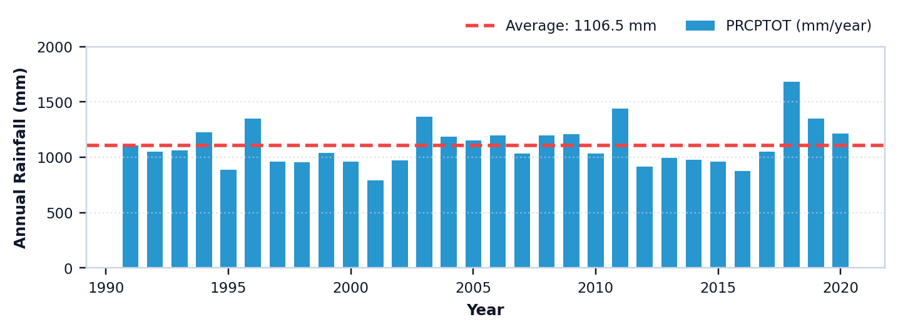

*Figure 17 — Total annual precipitation (PRCPTOT) of the New York series, with the mean of the period as a dashed line, in the indices tab. Figure generated by the program itself.*

---
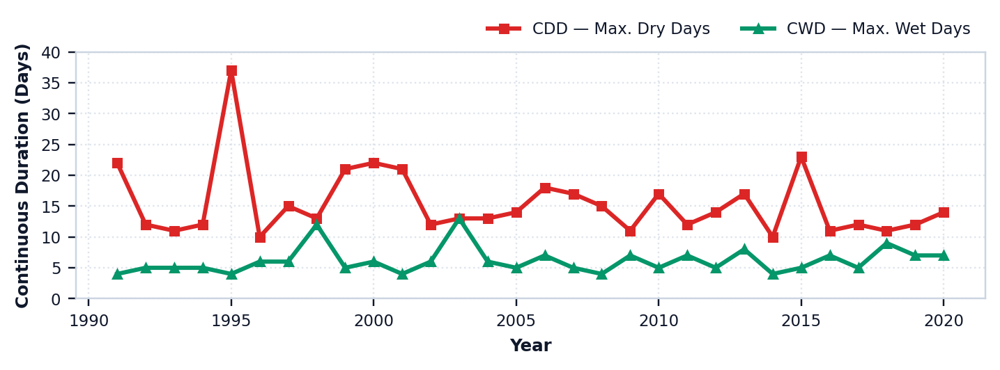

*Figure 18 — Longest annual sequence of dry days (CDD) and of wet days (CWD) of the New York series, in the indices tab. They are the two indices most directly linked to the tank volume the rainfall regime requires. Figure generated by the program itself.*

---
### 2.4.3. What they are for in the study

**Characterising the series** in the method of the paper. PRCPTOT, SDII and SI describe the regime
better than the annual mean alone.

**Explaining the result.** A high CDD, or a strongly seasonal regime, explains a performance below what the annual total suggests: in section 3.1, Cape Town receives rain on only 28%
of the days, its wettest month has 8.3 times the rain of its driest, and the same house yields
14.52% there against 26.83% in New York.

**Comparing climate scenarios.** Between the historical and the projected series, what usually
changes first is SDII and CDD, not PRCPTOT. Reporting only the annual total hides the change that
most affects the system.

---

### 2.4.4. What the indices do not do

They do not enter the balance. They do not change the sizing. They do not replace the daily
simulation — which is precisely the program's argument against methods based on mean values.

An index is a summary. The balance uses the whole series.

---

## 2.5. Sizing the treatment line

> This section formalises how the program sizes the rainwater treatment plant and explains the
> **incremental rule**, which keeps treatment from being counted twice in the budget and in the
> cash flow.

The water running off a roof carries dust, leaves, soot and bird droppings, and no use — not even
toilet flushing — admits it reaching the point of use as it left the roof. The rainwater
treatment plant of the program is the set of equipment that does this conditioning, and the program sizes it from three
inputs: the quality class the use requires, the roof area and the annual volume of rainwater
actually consumed, the latter a result of the daily balance presented in section 2.1.

The treatment line sized by the program has four components in series. The **first flush** diverts
the first depth of each rain, which carries the dirt accumulated on the roof; the **mechanical inlet
filter** removes leaves and coarse solids before they reach the tank; **disinfection** is the
mandatory stage, on which the microbiological safety of the stored water depends; and the
**polishing filter** is optional, and meant for uses where appearance or the absence of dissolved
residue matters.

---

The treatment line is a sequence, and the order of the stages is not arbitrary: each one removes
what would make the next one ineffective. It is worth having the whole chain in view before
discussing each part (Figure 19). The order is not interchangeable: disinfecting before
filtering consumes the reagent in suspended organic matter and leaves micro-organisms protected in
the particles. Turbidity is therefore a condition of the effectiveness of disinfection, not just an
aesthetic parameter.

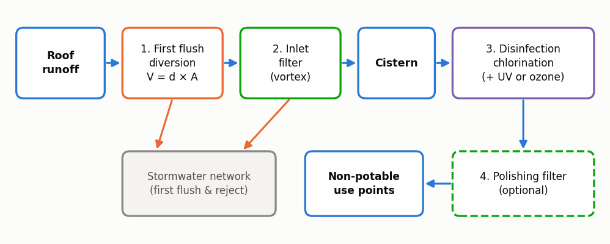

*Figure 19 — Components of the treatment line sized by the program, in the order of the flow, and destination of the material retained. The first flush and the inlet filter act before the cistern; disinfection acts after them because the reagent would be consumed by the suspended organic matter the previous stages remove; the polishing filter is optional.*

---

### 2.5.1. The inlet filter

The inlet filter is sized by the roof area, not by the intended quality class, because what it has
to cope with is the peak flow the roof produces — a quantity that does not depend on the final
destination of the water. The three ranges adopted by the program are generic reference ranges, one equipment class per
range; check the capacity declared by the manufacturer of the equipment you specify.

<!-- tabela: **Table 43** — Mechanical inlet filter sized by the roof area -->
| Roof | Equipment | Mesh |
| :--- | :--- | ---: |
| up to 200 m² | self-cleaning vortex DN 100 | 350 µm |
| up to 500 m² | self-cleaning vortex DN 150 | 400 µm |
| above 500 m² | basket or cyclonic DN 200 | 500 µm |

> The range limits follow the area a product of that class is declared to serve, not an
> arbitrary margin over it. That is why a 180 m² roof receives the DN 100 filter: the class is
> declared enough for up to 200 m², and imposing that of the next range would make the
> installation more expensive without technical grounds.

---

### 2.5.2. Disinfection

Disinfection is the stage the program never dispenses with, and the reason lies in the concept of
residual. Among the three technologies available, only chlorination leaves in the water a
disinfecting agent that remains active after treatment; ultraviolet radiation and ozonation act at
the moment of passage and leave nothing behind (Figure 20).

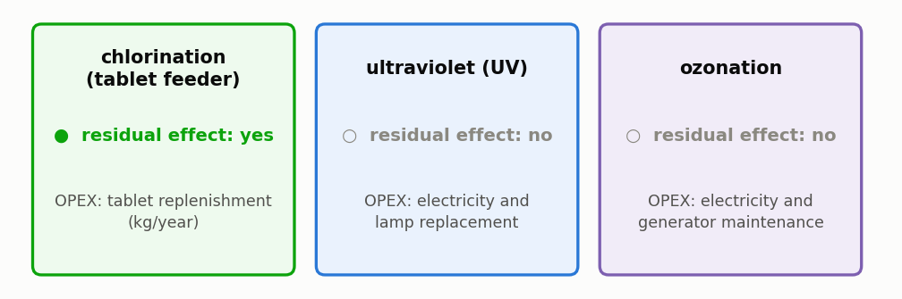

*Figure 20 — The three disinfection technologies, the residual effect of each one and the make-up of the annual running cost (OPEX). The residual effect distinguishes chlorination from the others: it protects the stored water, while ultraviolet radiation and ozone act only on the water passing through the equipment.*


==Ultraviolet and ozone come in as a barrier additional to chlorination, not as substitutes for
it.== Without a residual, the treated water becomes contaminated again on the way to the point of
use, and the right practice, which is to keep a free chlorine residual according to the applicable
guideline for the use, keeps chlorination to protect the tank and the internal network. The economic
consequence is direct: both options add the cost of chlorine to their own, and choosing either of
them never reduces the running cost. In the tutorial, tablet chlorination alone is a single stage
with no ultraviolet energy and 0.2 kg CO₂e a year; chlorination plus ultraviolet is two stages,
37.5 kWh a year and 18.2 kg CO₂e; chlorination plus ozonation is two stages and 15.2 kg CO₂e
(illustrative grid factor, not a measured value). The program carries no price catalogue for this
equipment in the International Edition, so these comparisons are about energy and carbon: enter
your own prices if you want cost.

#### 2.5.2.1. The mass of chlorine

The chlorination consumable is sized by the mass of commercial product consumed per cubic metre
treated, which follows from the dose applied and the purity of the product bought.

```equacao:massa_cloro:30
m_prod = ( C_Cl ÷ 1000 ) ÷ p
```

<!-- tabela: **Table 44** — Variables of Equation 30 -->
| Symbol | Meaning | Unit |
| :--- | :--- | :--- |
| `m_prod` | mass of commercial product consumed per cubic metre treated | kg/m³ |
| `C_Cl` | dose of active chlorine applied to the water | mg Cl₂/L |
| `1000` | conversion from milligrams per litre to kilograms per cubic metre | — |
| `p` | purity of the product, in mass of active chlorine per mass of product | dimensionless |

> **What is bought is the product, not pure chlorine.** The calcium hypochlorite tablet contains
> about 65% active chlorine, and the price per kilogram refers to the commercial product, not to
> the active ingredient. Calculating the cost by the mass of active chlorine would underestimate it
> by the inverse of the purity, that is, by about 35% — and it is a common mistake in budget
> spreadsheets.

---

### 2.5.3. The polishing filter

The polishing filter is optional and is the only point of the sizing where the target quality
class influences the choice of equipment. For the more demanding classes, the program recommends
including it, and the recommendation also varies in the type of filter medium: laundry, because it
involves contact with fabric and skin, requires block activated carbon, whereas the other uses are
satisfied with a sand filter or a twenty-micrometre cartridge.

<!-- tabela: **Table 45** — Polishing filter recommendation by target quality class -->
| Class | Polishing recommended? | Equipment when ticked |
| :--- | :---: | :--- |
| 1 — toilet flushing and general non-potable uses | no | sand filter or 20 µm cartridge |
| 2 — irrigation and washing | yes | likewise |
| 3 — cooling towers and boilers | yes | likewise |
| 4 — laundry | yes | **block activated carbon** |

The recommendation, however, is not an imposition: the filter only enters the sizing if the user
actually ticks it. When the class recommends it and the user declines, the program records the
refusal in a field of its own and the report shows it, so that the decision is documented instead
of disappearing.

> **Classes 2 to 4 are criteria adopted by the program, not by a standard.** The quality required
> for each end use is set by the health authority and the guideline that applies to the case. In a
> published study, present the classes as a criterion adopted by the author, never as a normative
> requirement.

---

### 2.5.4. The first flush

The first flush enters the program in two ways. In the water balance, it is the depth subtracted
from each day's precipitation, described in section 2.1. In the budget, when the physical sizing
of the first flush is enabled in step **3. Quality & Treatment** — the default in the interface —, it
is a subsystem with its own investment, running cost and embodied carbon, made up of the leaf
separator and the first-flush chamber.

The volume of the first-flush chamber is the product of the first-flush depth and the catchment
area, `V_ff = d × A`, in litres, with `d` in millimetres and `A` in square metres. The program
sizes a vertical diversion column for small volumes and a tank for larger ones, adds a leaf
separator sized by the catchment area, and gives the subsystem an annual running cost. In the
International Edition the prices are typed in; the manual's cases leave the first-flush subsystem
out of the cost table and count it in the carbon.

<!-- tabela: **Table 46** — Sizing of the first flush in the tutorial project -->
| Item | Value |
| :--- | ---: |
| first-flush depth | 2 mm |
| catchment area | 150 m² |
| volume of the first-flush chamber | 300 L |
| embodied carbon of the chamber and the leaf separator | 21.1 kg CO₂e (6.5% of the project's embodied carbon) |

The investment of the subsystem is part of the investment of the treatment line and therefore enters
the cash flow through the incremental rule below.

---

### 2.5.5. The incremental rule

The incremental rule is the part of the calculation most often got wrong in home-made
implementations, and the error is always the same: counting treatment twice. It applies on three
different fronts, and on each it takes its own form.

**In the investment.** The budget of a rainwater harvesting system already sets aside a generic
treatment allowance within the accessories item, because no designer prices a system without some
form of filtering. Adding the detailed line on top of that allowance would charge treatment twice,
and so the program deducts the generic allowance and adds only the increment.

```equacao:capex_etap:31
CAPEX_inc = CAPEX_line − V_gen
```

<!-- tabela: **Table 47** — Variables of Equation 31 -->
| Symbol | Meaning | Unit |
| :--- | :--- | :--- |
| `CAPEX_inc` | incremental investment of the treatment line | currency |
| `CAPEX_line` | total investment in the equipment of the sized line | currency |
| `V_gen` | generic treatment allowance already included in the accessories item | currency |

**In the running cost.** Chlorination is already paid in the chemical consumables line of the cash
flow, so the incremental running cost of the treatment line deducts that part and the hypochlorite
is paid once, not twice.

**In the life cycle assessment.** The treatment line **replaces** the chlorination term instead of
adding to it, and the different treatment between the cash flow and the emission inventory follows
from the two accounting for different quantities.

> The rule lives in a single module, consumed by **both** economic engines of the program. Two
> copies of the same rule diverge over time, and the divergence between them is invisible in the
> result: each engine responds consistently with itself.

---

### 2.5.6. Switching the treatment line off

The sizing of the treatment line can be switched off entirely, and in that case neither the
investment nor the running cost of treatment enters the economic analysis. The purpose of the switch
is to allow the study of the hypothesis of treatment already existing in the building — in which case
the cost should not be attributed to the rainwater system — and to compare scenarios with and
without the line. ==Switching it off does not mean the water needs no treatment:== it means the
treatment is not being priced here.

---

### 2.5.7. What the program does not size

The scope of the sizing ends at the equipment of the line, and four related items remain the
designer's responsibility. The **hydraulic arrangement of the first flush** — fittings, purge device
and connection to the drainage — is not designed: the program calculates only the volume of the
first-flush chamber and its cost. The **piping** of the treatment line and the head loss it imposes
are not calculated either. The **maintenance regime** — changing the filter element, cleaning the
vortex, replacing tablets — is not planned by the program, although it determines a good part of the
real running cost. And **quality control** remains entirely outside the scope: the program sizes
equipment from assumptions, and does not replace laboratory testing.

Standards for rainwater systems deal with control and maintenance, and the corresponding plan is
the designer's responsibility. Typical practice is to inspect and clean the pre-treatment, the
gutters, the filters and the pumps at intervals of months, and the tank at intervals of a year;
set the intervals from the manufacturer's instructions and the rule that applies to the building.

---

## 2.6. Pumping energy

> This section gives the complete chain from the shaft to the socket, and explains why the
> nameplate power is **not** what the meter records.

Three versions of this calculation have existed in the program, and the first two made the mistakes
described in the item «Why the complete chain matters»: treating the nameplate power as electrical
power and deducting the pump efficiency twice. Anyone reading a study made with an old version needs
to know this.

---

### 2.6.1. Nameplate power is shaft power

Motor standards require the **efficiency** to be marked on the motor's nameplate, as a quantity
separate from the power. That only makes sense if the nameplate power is the mechanical power
**at the shaft**.

Hence the chain has two efficiencies, not one:

<!-- tabela: **Table 48** — The two efficiencies of the pumping chain and what each one converts -->
| Efficiency | What it converts |
| :--- | :--- |
| **of the pump**, `η_b` | shaft power into hydraulic power delivered to the water |
| **of the motor**, `η_m` | electrical power from the socket into mechanical power at the shaft |

The program asks for both, in separate fields.

---

### 2.6.2. The equations

**Specific pumping energy**, per cubic metre lifted:

```equacao:energia_especifica:32
e = ( ρ × g × H ) ÷ ( η_b × η_m )
```

<!-- tabela: **Table 49** — Variables of Equation 32 -->
| Symbol | Meaning | Unit |
| :--- | :--- | :--- |
| `e` | specific energy consumption per volume pumped | kWh/m³ |
| `ρ` | density of water, taken as 1,000 | kg/m³ |
| `g` | acceleration of gravity, taken as 9.81 | m/s² |
| `H` | total manometric head of the pumping | m head |
| `η_b` | hydraulic efficiency of the pump | dimensionless |
| `η_m` | efficiency of the electric motor | dimensionless |

==Equation 32 does not depend on the flow rate or the installed power.==
Lifting one cubic metre of water to a given height costs the same energy with a large or a small
pump, because the work done is the same; what changes with the power is the time taken to do it, not
the specific consumption.

**When the operating flow rate is declared**, the equivalent form:

```equacao:energia_por_vazao:33
e = P ÷ ( Q × η_m )
```

<!-- tabela: **Table 50** — Variables of Equation 33 -->
| Symbol | Meaning | Unit |
| :--- | :--- | :--- |
| `e` | specific energy consumption per volume pumped | kWh/m³ |
| `P` | nameplate power of the pump set, which is shaft power | kW |
| `Q` | pumping flow rate entered or deduced | m³/h |
| `η_m` | efficiency of the electric motor | dimensionless |

The hydraulic efficiency of the pump does not appear in Equation 33, and the
absence is deliberate: it is already built into the fact that a motor of `P` kilowatts at the shaft
makes the pump deliver `Q` cubic metres per hour at that head. Dividing by it again would count the
hydraulic loss twice.

**Flow rate, when not declared:**

```equacao:vazao_deduzida:34
Q = ( P × η_b ) ÷ ( ρ × g × H )
```

<!-- tabela: **Table 51** — Variables of Equation 34 -->
| Symbol | Meaning | Unit |
| :--- | :--- | :--- |
| `Q` | deduced pumping flow rate | m³/h |
| `P` | nameplate power of the pump set, which is shaft power | kW |
| `η_b` | hydraulic efficiency of the pump | dimensionless |
| `ρ` | density of water, taken as 1,000 | kg/m³ |
| `g` | acceleration of gravity, taken as 9.81 | m/s² |
| `H` | total manometric head of the pumping | m head |

**Energy of the start-ups:**

```equacao:energia_partida:35
E_start = ( P × t_start ) ÷ η_m
```

<!-- tabela: **Table 52** — Variables of Equation 35 -->
| Symbol | Meaning | Unit |
| :--- | :--- | :--- |
| `E_start` | energy consumed by all the start-ups of the period | kWh |
| `P` | nameplate power of the pump set, which is shaft power | kW |
| `t_start` | total start-up time accumulated in the period | h |
| `η_m` | efficiency of the electric motor | dimensionless |

The pump efficiency is absent from Equation 35 for the physical reason that
distinguishes it from the previous ones: during start-up there is no useful flow, and therefore no
hydraulic loss to deduct. The motor draws energy from the socket, and that is all the utility's meter
records.

The annual energy of the pump set is the sum of the two parts: that of the actual pumping, which
depends on the volume lifted, and that of the start-ups, which depends on the number of starts.

```equacao:energia_anual:36
E_yr = e × V_pump + ( P × t_start ) ÷ η_m
```

<!-- tabela: **Table 53** — Variables of Equation 36 -->
| Symbol | Meaning | Unit |
| :--- | :--- | :--- |
| `E_yr` | electrical energy consumed by the pump set in the year | kWh/year |
| `e` | specific energy consumption per volume pumped | kWh/m³ |
| `V_pump` | volume pumped in the year | m³/year |
| `P` | nameplate power of the pump set, which is shaft power | kW |
| `t_start` | total start-up time accumulated in the year | h/year |
| `η_m` | efficiency of the electric motor | dimensionless |

---

The nameplate power of a pump set is the mechanical power at the shaft, not the electrical power
recorded by the meter (Figure 21). For illustration, a pump set of 0.37 kW (0.5 hp) at the shaft with a motor
of 60% efficiency draws about 0.62 kW from the mains: calculating the energy with the nameplate
power would underestimate consumption by about 40%, and the energy running cost is precisely the part that
reduces the saving of the system.

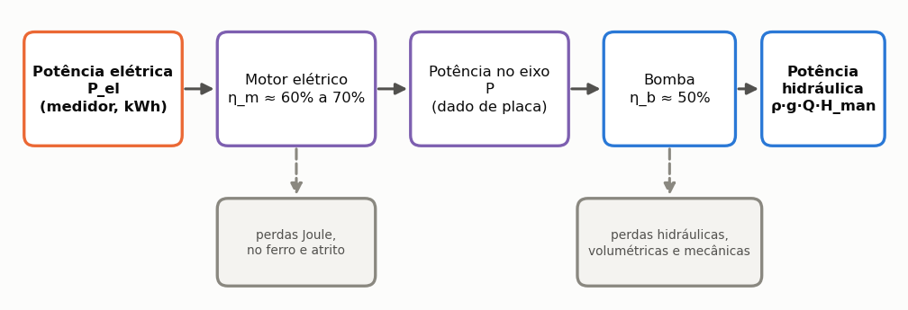

*Figure 21 — Energy chain of pumping. The nameplate power is the power at the shaft, in the middle of the chain: between it and the energy meter is the motor efficiency, η_m, and between it and the hydraulic power delivered to the water is the pump efficiency, η_b.*

The hydraulic power depends on the manometric head, which adds the head losses of the flow to the
geometric difference in level between the water surfaces (Figure 22). Head loss is
the energy dissipated per unit weight of fluid and has two parts: the continuous loss, along the
pipe, given by the Darcy-Weisbach equation, `h_f = f · (L/D) · v²/2g`, where `f` is the friction
factor, `L` the length, `D` the internal diameter and `v` the mean velocity; and the local losses in
fittings, valves and bends, `h_loc = K · v²/2g`, where `K` is the coefficient of the singularity. In
short building rising mains, the losses typically add 10% to 30% of the geometric difference in
level.

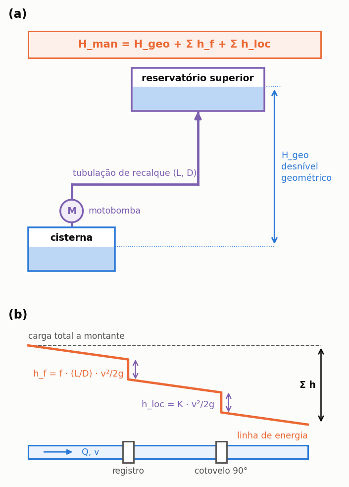

*Figure 22 — (a) Manometric head of a building rising main: geometric difference in level between the water surfaces of the cistern and the upper tank, plus the head losses; (b) energy line along a stretch of pipe, with the continuous friction loss (h_f) and the local losses at a valve and an elbow (h_loc).*

---

### 2.6.3. The motor efficiency

Enter the motor efficiency printed on the nameplate or on the manufacturer's data sheet. It
is the number that separates the shaft power from the power actually drawn from the mains, and
it carries over entirely to the energy running cost: between a standard small single-phase motor
and a high-efficiency one the difference can be several percentage points.

The program has a fallback value for the case in which the efficiency is not entered, a
conservative figure for small two-pole single-phase motors, which are what residential pump sets
use. In a published study, do not rely on it: declare the efficiency you used and its origin. If
your country sets minimum efficiency classes for motors, they are the natural reference for a
value taken from regulation rather than from the data sheet. Small motors are less efficient than large ones (Figure 23).


*Figure 23 — Illustrative efficiency of induction motors by power for a standard and a high-efficiency class: efficiency rises with power. The values are illustrative, not from a standard; use the data sheet of the motor or the classes of the rule that applies in your country.*

---

### 2.6.4. Why the complete chain matters

The tutorial's pumping to the upper tank, with the complete chain, pumps 59.4 m³ a year in 69
starts and uses 7.7 kWh a year: 0.13 kWh/m³. ==Ignoring the motor efficiency, or deducting the
pump efficiency twice, changes that number by tens of percentage points,== and those are precisely the
two most frequent mistakes in sizing spreadsheets.

The first mistake is to treat the nameplate power as the power consumed at the socket; the second, to
apply the hydraulic efficiency in a calculation that already starts from the flow actually delivered,
which counts it twice. The chain presented in this section is explicit precisely to make both visible.

---

### 2.6.5. The pump sizing wizard

When the power, flow rate and manometric head of the pump set are not known, the *Pump Sizing Wizard*
button, in step **4. Reservoir & Costs** and in the economic dialog, estimates the three values and
selects a commercial model. The wizard follows the usual sizing sequence of a building rising main:

1. **Pumping flow rate.** `Q = V_sup ÷ t_fill`, with the volume of the upper tank and the desired
   filling time, 45 minutes by default.
2. **Economic diameter.** By Forchheimer's formula, `D = 1.3 · (t_op ÷ 24)^0.25 · √Q`, with `D` in
   metres, `Q` in m³/s and `t_op` the daily operating time, 2 h by default. The diameter adopted is the
   smallest commercial solvent-weld PVC pipe whose internal diameter meets the calculated value, and
   never smaller than the outlet of the selected pump set; the suction gets one commercial size above the
   delivery.
3. **Velocity.** `v = Q ÷ (π · D_i² ÷ 4)`, highlighted when it falls outside the range of 0.6 m/s to
   2.5 m/s.
4. **Head loss.** By the Hazen-Williams formula, `J = 10.643 · Q^1.852 · C^−1.852 · D_i^−4.87`, with
   `C = 140` for PVC, multiplied by the length of the piping and increased by 30% for the local losses.
5. **Manometric head and power.** `H_man = H_geo + h_f` and `P = ρ · g · Q · H_man ÷ η`, with a set
   efficiency of 55% by default.
6. **Selection.** The calculated operating point is compared with the curve of a candidate
   model, with the pump curve plotted against the calculated point. The manual's cases use
   generic models, without brand (see below).

The calculated manometric head and head loss go back to the project and feed the energy calculation of
this section, in place of the fallback value.

---

### 2.6.6. The fallback values

Used when the project does not declare them:

<!-- tabela: **Table 54** — Fallback values adopted when the project does not declare them -->
| Parameter | Value | Origin |
| :--- | ---: | :--- |
| manometric head | 12 m head | two-storey house with a buried cistern: ~8 m of geometric level difference and ~30% of head loss give 10 to 12 m; the conservative end is adopted |
| pump efficiency | 55% | residential pump sets from half to one horsepower lie between 40% and 60% at the operating point |
| start-up time | 108 s | see the caveat below |

> **In depth: the manometric head is the parameter that weighs most.** Anyone who knows the project's
> level difference should enter it. Doubling the head doubles the energy.

> **In depth: the 108 s start-up time.** It represents the priming time of a self-priming pump whose
> suction line has drained. In an installation with a foot valve in working order, the line stays
> primed and the following starts are immediate. With the 108 s value, the start-ups can
> account for a large share of the annual consumption of a pump that starts often; with a 3 s
> transient they would be negligible. The value is conservative and is recorded as an open issue of
> the program.

---

### 2.6.7. Direct pressurisation: the energy is time switched on

Everything said so far applies to pumping to a tank, in which the pump fills the upper tank in one go,
at its own flow rate, and switches off. The pressure pump works another way. It starts at each flush
and stays on while the toilet cistern fills, and it is the cistern's float valve, not the pump, that
decides the flow. A larger pump does not fill the cistern faster: it stays on for the same time,
drawing more power.

That is why the program does not calculate the energy of the pressure pump by the specific energy
`ρ·g·H/(η_b·η_m)`, which assumes the pump at its best-efficiency point. It calculates it by the time
switched on:

```equacao:energia_pressurizador:37
E = (P ÷ η_m) · [V ÷ min(Q_b(H), Q_p) + N · t_r]
```

<!-- tabela: **Table 55** — Variables of Equation 37 -->
| Symbol | Meaning | Unit |
| :--- | :--- | :--- |
| `E` | annual energy of the pressure pump | kWh/year |
| `P` | nameplate power, at the shaft | kW |
| `η_m` | motor efficiency, from the data sheet | dimensionless |
| `V` | rainwater volume consumed | m³/year |
| `Q_b(H)` | flow rate of the model's curve at the working pressure `H` | m³/h |
| `Q_p` | flow rate of the point of use | m³/h |
| `N` | starts per year: residents × 5.05 flushes × 365.25 | 1/year |
| `t_r` | switch-off delay of the electronic control | h |

It is the form of the «simple method» Ward, Butler and Memon (2012) describe, power times operating
duration, with two corrections: the effective flow rate is the smaller of that of the pump and that of
the point, and the delay of electronic controls enters at each start. The nameplate power is that of
the nominal point, and at low flow the motor draws a little less; the estimate tends to overestimate
the energy, but it ranks the models among themselves.

The default point flow rate is 0.15 L/s, that is, 9 L/min, a typical figure for filling a toilet
cistern; anyone with the toilet manufacturer's figure, or with the flow rates the design rule of
the building sets for the points of use, should use it.

#### 2.6.7.1. The generic models

The manual does not use manufacturers' catalogues. It compares six **generic** pressure pumps,
named A to F, with illustrative curves that are not those of any product. Each is defined by its
nameplate power, its control (pressure switch, flow switch or electronic) and its flow × pressure
curve. For a real model, the «Custom» option asks for the nameplate power, the flow rate read on
the manufacturer's curve at the working pressure and the switch-off delay.

The table applies the six generic models to the tutorial's direct pressurisation: the 4,000 L cistern without an
upper tank, four residents and the toilet flow rate of 9 L/min.

<!-- tabela: **Table 56** — Annual energy of six generic pressure pumps (illustrative curves, no brand) in the tutorial direct pressurisation, with the toilet flow limiting the pump flow -->
| Model | Control | Curve flow at 18 m head | Hours per year | kWh per year | kWh/m³ | kWh per year at 24 m head |
| :--- | :--- | ---: | ---: | ---: | ---: | ---: |
| Model A, 0.25 hp | pressure switch | 10.1 L/min | 109 | 40.0 | 0.68 | 250.3 |
| Model B, 0.33 hp | flow switch | 18.0 L/min | 109 | 48.1 | 0.82 | not reached |
| Model C, 0.5 hp | pressure switch | 27.5 L/min | 109 | 66.2 | 1.13 | 66.2 |
| Model D, 0.5 hp | pressure switch | 26.0 L/min | 109 | 66.2 | 1.13 | 66.2 |
| Model F, 0.5 hp | electronic | 12.8 L/min | 109 | 66.2 | 1.13 | not reached |
| Model E, 0.5 hp | electronic | 7.0 L/min | 160 | 97.6 | 1.66 | not reached |

At 18 m head, five of the six models deliver more than the toilet's 9 L/min, and all stay on for the
same 109 hours a year. What separates them is the power: Model A, of 0.25 hp, uses 40.0 kWh, and
the 0.5 hp ones, 66.2 kWh. The sixth, Model E, delivers 7.0 L/min at 18 m, below the point flow
rate; it works at the end of its curve, stays on for 160 hours and uses 97.6 kWh a year.

At 24 m head the order reverses. Model A, the cheapest to run at 18 m, rises to 250.3 kWh a
year, because its flow falls and it stays on much longer; Models C and D stay at 66.2 kWh; and
Models B, E and F do not reach the pressure. The best becomes a 0.5 hp one. ==The rule the table
teaches is to choose the smallest model that delivers the point's flow rate at the working
pressure,== and it is what good practice asks for: that the energy consumption of pumping and
pressurisation be minimised by the choice of pump, among the alternatives considered. The screen
points to that model and shows the energy of all the others next to it.

> **Two pumps, not one.** Rules for pumping and pressurisation systems commonly call for at least
> two pumps, operating independently. The tutorial follows that practice, and the investment
> counts the duty pump and the standby (two pumps, at an illustrative US$ 250 each, not a market
> price).

---

### 2.6.8. Why the energy of pumping to a tank is small, and that of the pressure pump is not

Lifting one cubic metre twelve metres costs about 0.033 kWh of hydraulic energy. With the two
efficiencies and the start-ups, the tutorial's pumping to the upper tank comes to 0.13 kWh per cubic
metre (7.7 kWh for 59.4 m³ a year).

Direct pressurisation of the same project uses 0.68 to 1.66 kWh/m³, depending on the model: five to
thirteen times more. The numbers reproduce a difference the literature had already measured. In the
review by Vieira et al. (2014), the median of the theoretical studies was 0.20 kWh/m³, and that of the
empirical ones, 1.40 kWh/m³, because the former ignored the start-ups, standby mode and the real
efficiency of motor and pump. The same review reports 1.70 kWh/m³ to feed a toilet cistern directly
with a 450 W pump, and a mean of 1.52 kWh/m³ in nineteen Australian homes with direct feed.

The tutorial's pumping stays close to the theoretical median because it works as the theoretical
studies assume: few starts per year, at the pump's own flow rate. The pressure pump falls in the
empirical range because it works as the measured homes do: one start per use, at the flow rate of the
point.

Even so, the energy is small compared with the saving on the bill. At an illustrative electricity
price of US$ 0.20 per kWh (illustrative, not a market price), the 40.0 kWh of the smallest pressure
pump cost US$ 8 a year, and even the 250.3 kWh of the same pump at 24 m cost about US$ 50, against an
annual water saving of US$ 290.53 in the tutorial. The argument that «pumping uses more than it saves»
does not hold in small buildings, but the choice of arrangement and model can multiply the energy part
by ten, and it is that part that weighs in the carbon of section 2.8.

In a tall building, with thirty metres of pumping, the calculation changes, and it is worth redoing it.

---

## 2.7. Economic analysis and tariff regimes

> This section formalises the cash flow and details the six tariff regimes — the data that most
> decides the viability of a rainwater system.

---

### 2.7.1. The saving is the difference between two bills

The program does not calculate the saving by multiplying the volume saved by a mean tariff, and
the distinction is not one of refinement: it is one of order of magnitude. For each month of the
projection it builds two complete bills, one with the consumption the building would have without
the rainwater system and another with the potable water actually bought, and takes the difference
between them.

```equacao:economia_mensal:38
S_mo = F(V_tot) − F(V_pot)
```

<!-- tabela: **Table 57** — Variables of Equation 38 -->
| Symbol | Meaning | Unit |
| :--- | :--- | :--- |
| `S_mo` | saving obtained in the month | currency |
| `F(·)` | function that calculates the water and sewage bill for a volume | currency |
| `V_tot` | monthly volume the building would consume without the rainwater system | m³ |
| `V_pot` | monthly volume of potable water actually bought from the mains | m³ |

The reason for proceeding this way lies in the structure of the tariff: progressive blocks, a
sewage part that follows the water part, a standing charge that does not respond to
consumption. ==The cubic metre no longer consumed is always the last one on the bill, which is
the most expensive in a progressive tariff, and never the mean one.== In the New York tutorial, the
monthly saving of US$ 24.21 for 4.95 m³ is US$ 4.89 per cubic metre, because each cubic metre
saved earns both the water charge and the sewer charge, which is a percentage of it. Multiplying
the volume saved by the water price alone would understate the saving by more than half.

---

### 2.7.2. The water and sewage bill

The tariff structure of each city is represented in the program by a sequence of blocks,
and each block is a quadruple made up of the minimum volume, the maximum volume, a value and a
code. The code is what gives meaning to the value, because apparently similar structures charge in
very different ways.

Before the codes, it is worth seeing what the bill is made of. The monthly water and sewage bill
is the sum of parts that behave differently: a fixed part, which does not respond to consumption;
one or more consumption blocks, in which the price per volume applies to the volume allocated
within each block; and sewage, which is often a percentage of the water charge and
therefore follows everything it does. Saving water affects each of these parts in a different way,
and it is this asymmetry that Figure 24 shows.

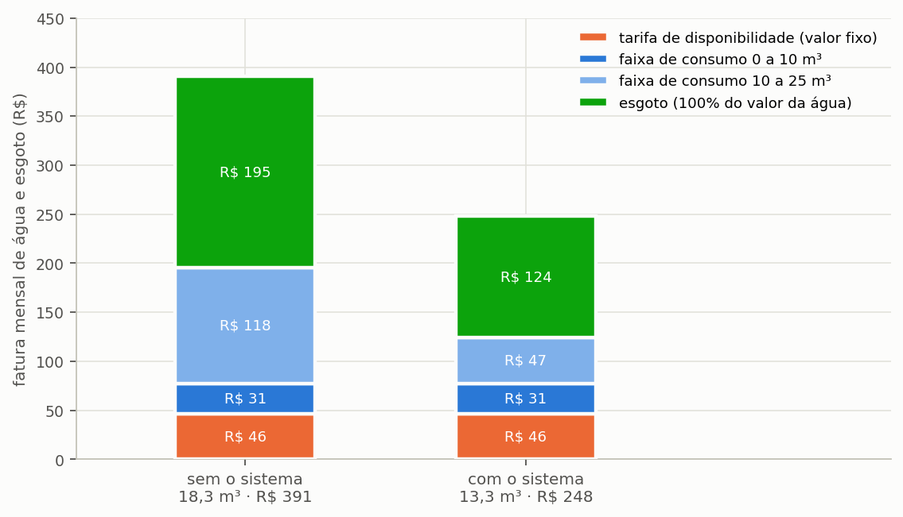

*Figure 24 — Monthly water and sewage bill of the tutorial project, broken down into parts, without and with the system. The availability charge is identical in both cases; the reduction occurs in the upper consumption blocks, which have the highest price per cubic metre, and extends to sewage, charged as a percentage of the water charge.*

The code of each block defines how its value is applied (Figure 25). In the
consumption blocks, code 1 or 0, the price per volume is charged on the volume allocated within
each block; in the availability charge, code −1, the fixed value is added to the consumption part;
in the retroactive allowance, code −2, consumption above the allowance makes the whole volume be
billed from 0 m³; in the payment floor, code −3, the declared value is the lower limit of the bill;
and in the exponential formula, code 2 holds the base price and the code 3 rows hold the table of
exponents.

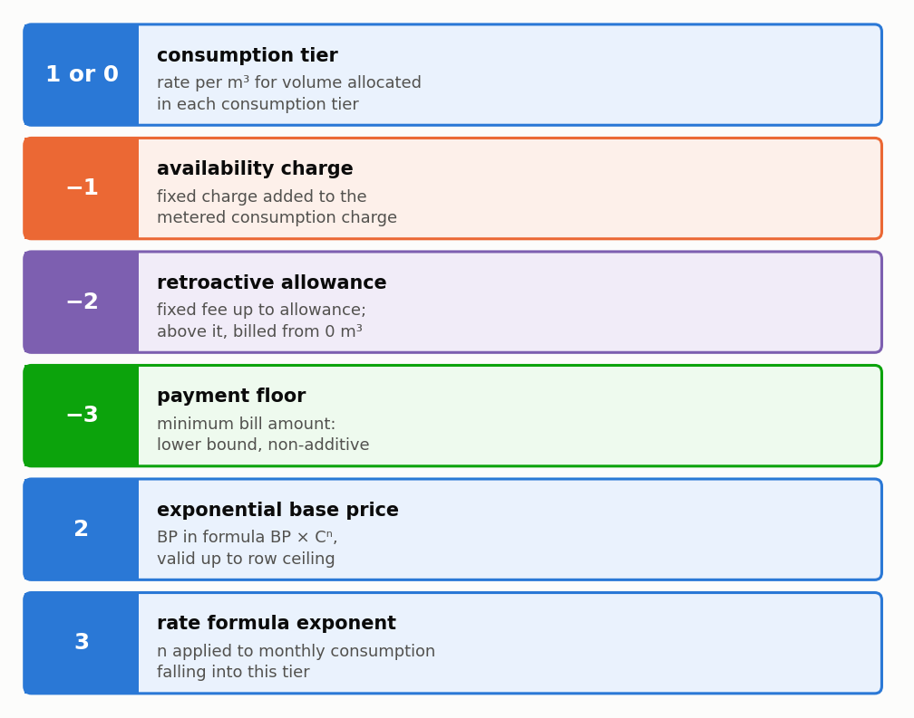

*Figure 25 — The six tariff block codes and the effect of each one on the monthly water and sewage bill. Two structures with the same numerical values result in different bills depending on the code of each block.*


Two of these regimes are often confused with each other, although they have opposite effects on
the viability of a rainwater system. It is worth examining them with numbers.

- **The availability charge adds.** A consumption part of 55 currency units plus 46 of availability charge
  gives a bill of 101, and saving 15 of consumption leaves the bill at 86.
- **The floor limits from below.** With a floor of 40 and a billed consumption of 55,
  saving up to 15 **reduces nothing**.

The difference between the two regimes decides whether each cubic metre saved earns a discount
from the first one or whether the saving only starts to count after a threshold is passed, and a
viability study that confuses them reaches inverted conclusions. That is why the program codes the
regime explicitly instead of treating it as a detail of the table.

#### 2.7.2.1. The exponential formula

Some utilities do not charge water as a sum of blocks but as a power of the month's consumption:

```equacao:exponencial:39
B_water = PB × C^n + SB
```

<!-- tabela: **Table 58** — Variables of Equation 39 -->
| Symbol | Meaning | Unit |
| :--- | :--- | :--- |
| `B_water` | water part of the bill | currency |
| `PB` | base price | currency/m³ |
| `C` | consumption of the month per dwelling unit | m³ |
| `n` | exponent from the utility's table of exponents for consumption `C`; 1.00 up to a threshold, and rising above it | dimensionless |
| `SB` | basic service charge | currency |

The exponent is read from the **total** consumption of the month and applied to the whole volume.
Where the table ends with a cap, the program represents it with an ordinary block from there on. The
monthly saving is the difference between the two bills, `PB × (C₁ⁿ¹ − C₂ⁿ²)`, each consumption with
its own exponent, and not the product of a unit price by the volume saved; with `n` above 1, the
cubic metre saved is worth more than the base price.

Because the meter bills whole cubic metres and the fraction carries over to the next reading, a
simulation's fractional average consumption is charged along the straight line between the bills of
the two neighbouring integers. Without this rule the exponent would jump inside the cubic metre,
and the value of the cubic metre saved would swing with the decimal place of the average
consumption. None of the three example cities uses this regime.

#### 2.7.2.2. Individual metering

In multi-family buildings with individual metering, consumption is evaluated at the level of a
single dwelling unit and the result is multiplied by the number of units. The treatment matters
because of progressiveness: a building of twenty flats treated as a single consumer would fall
entirely into the most expensive block of the table, and the resulting saving would come out
grossly overestimated, because each cubic metre saved would be valued at a tariff none of the
twenty units actually pays.

#### 2.7.2.3. Sewage

```equacao:esgoto:40
B_sew = B_water × s
```

<!-- tabela: **Table 59** — Variables of Equation 40 -->
| Symbol | Meaning | Unit |
| :--- | :--- | :--- |
| `B_sew` | sewage part of the bill | currency |
| `B_water` | water part of the bill, already calculated by the progressive blocks | currency |
| `s` | sewage percentage charged by the utility | dimensionless |

The sewage percentage applies to the water part of the bill, not to the total bill, and confusing
the two denominators doubles or halves the part calculated. One hundred per cent
means that the sewage part equals the water part, and therefore that sewage accounts for half of
the total bill. In New York the percentage is 159%, so that the sewer part is the larger of the two.

There are two more modes: sewage charged **per cubic metre consumed**, `B_sew = C × p_sew`, as
in London, and sewage charged **by blocks of its own on a fraction of the water volume**, as in
Cape Town (70% of the water consumed, four steps). With the exponential formula, the per cubic
metre mode has no basic service charge and no exponent, and applying the percentage on the water
part there would charge sewage on the basic service and on the power.

---

### 2.7.3. The six regimes

The program distinguishes six minimum-charge regimes, and which one applies to a building is a fact
about its tariff document, not a choice. The table below shows how each regime is coded and applied
in the calculation of the bill. The three example cities fall in two of them: London and Cape Town
have an availability charge (a standing charge), and New York has a payment floor in the form of a
minimum daily charge, which does not bind at the tutorial consumption. The other three regimes are
supported by the engine and described in section 3.3 (Figure 26).

<!-- tabela: **Table 60** — Coding and application of each minimum-charge regime in the calculation of the bill -->
| Regime | Coding of the blocks | Calculation of the water part | Effect of reducing consumption |
| :--- | :--- | :--- | :--- |
| no minimum charge | consumption blocks only (code 1 or 0) | sum, in each block, of the price per m³ applied to the volume allocated within it | every reduction in consumption reduces the bill |
| availability charge | fixed value (−1) and consumption blocks from 0 m³, with a positive price | fixed value added to the consumption part, billed from the first m³ | every reduction in consumption reduces the bill; the fixed value remains |
| allowance within the minimum | fixed value (−1) and a first block from 0 to N m³ at a zero price | fixed value that includes the N m³ of the allowance; above them, consumption blocks | a reduction below N m³ does not change the bill |
| retroactive allowance | allowance (−2) from 0 to N m³ with a fixed value, and consumption blocks | up to N m³, fixed value; above, the whole volume billed from 0 m³ by the blocks | reducing consumption to N m³ or less replaces the consumption part by the fixed value |
| payment floor | floor (−3) and consumption blocks | consumption part by the blocks, limited from below to the value of the floor | a reduction that takes the part below the floor does not reduce the bill |
| exponential formula | basic service (−1), base price (2) and table of exponents (3) covering all consumption | basic service added to `PB × Cⁿ`, with `n` from the whole month's consumption | every reduction in consumption reduces the bill, by the difference between the two powers |

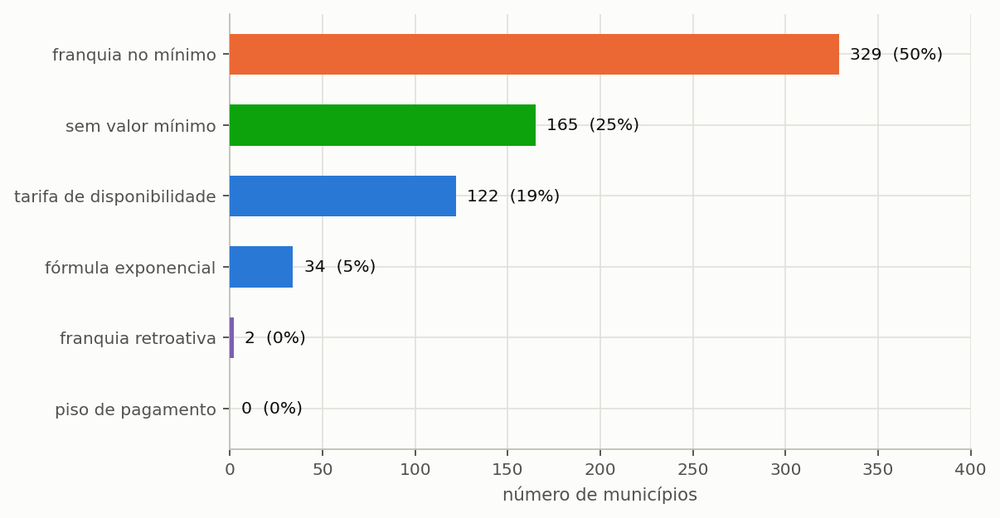

*Figure 26 — Distribution of the example tariffs among the six tariff regimes. The allowance within the minimum is the regime in which reducing consumption below the allowance does not reduce the bill; none of the three example cities has it.*

Section 3.3 presents the numerical example that compares an allowance regime with an
availability charge, from which follows the most important practical lesson of this section: under
an allowance regime, saving water below the allowance volume earns no discount at all on the bill.

---

### 2.7.4. The investment

```equacao:capex:41
CAPEX = C_cist + C_sup + C_lab + C_pipe + C_acc + ( C_pump × n_b ) + CAPEX_inc
```

<!-- tabela: **Table 61** — Variables of Equation 41 -->
| Symbol | Meaning | Unit |
| :--- | :--- | :--- |
| `CAPEX` | total initial investment of the system | currency |
| `C_cist` | cost of the lower tank | currency |
| `C_sup` | cost of the upper tank, when there is one | currency |
| `C_lab` | cost of installation labour: in a new project, a percentage of the materials, with a floor | currency |
| `C_pipe` | cost of the piping: pipes, bends and fittings of the 3D layout | currency |
| `C_acc` | cost of the accessories: the parts of the 3D layout, one by one, and the control cables | currency |
| `C_pump` | unit cost of the pump set | currency |
| `n_b` | number of pump sets, including the standby when there is one | unit |
| `CAPEX_inc` | incremental investment of the treatment line, including the first flush when sized | currency |

In a new project, `C_pipe` and `C_acc` are not allowances: they come from the **bill of quantities
of the 3D layout** (section 3.9). Each metre of pipe, each bend, each end fitting, each part —
valves, check and foot valves, solenoid, water meter, level switches, control panel, inlet
calming device, floating suction, vents, overflow, air gap, point of use — and each metre of
control cable has a price, and the sum is what enters here. Cistern, upper tank and pump set have
terms of their own; the inlet filter and the first flush enter through the treatment line when it
sizes them. The designer can type other values in the economic step; the project then uses the
typed ones, and the audit spreadsheet records the change. Projects saved before this rule keep the
costs they declare.

The labour of a new project is also recalculated at each run: a percentage of the sum of cistern,
upper tank, pump sets, piping and accessories, with a floor. In the manual's tutorial the labour is
a round figure of US$ 1,500, illustrative, not a market price. It thus grows with the tank: in the volume sweep, each volume has its own
cistern, its own usual layout and its own labour. Previously, labour was fixed once, on generic
allowances for piping and accessories, and was the same for all volumes. A value typed in the
economic step prevails, as in the other items.

The last term follows the incremental rule of section 2.5 and includes, when the physical
sizing of the first flush is enabled, the first-flush chamber and the leaf separator; the annual
running cost of that subsystem enters the running cost of the treatment line.

Tank prices are typed in, as a fixed part plus a price per litre for each material. In the
manual's tutorial the figures are round numbers, illustrative and not market prices: polyethylene
100 plus 0.55 per litre, concrete 600 plus 0.40, fibreglass 120 plus 0.65 and stainless steel 300 plus
2.00, in US$. With them a 4,000 L polyethylene cistern costs US$ 2,300 and a concrete one US$ 2,200;
with the labour, the piping, the accessories and the two pumps, the investment of the tutorial is
US$ 6,250 (illustrative, not a market price). When the requested volume is not in the table, the program interpolates linearly between the
neighbouring points; when the volume exceeds the largest tabulated value, extrapolation is only
done if the regression over the known points has a coefficient of determination above 0.90, and
the program warns when that criterion is not met, instead of extrapolating silently.

---

The make-up of the investment surprises those who come to the subject expecting the tank to
dominate the bill. In small residential volumes it weighs less than labour and piping, and only
comes to dominate when the volume grows enough for the price of the tank to exceed the fixed sum
of the installation. The design consequence is direct: doubling the tank does not double the
investment, and that non-linearity is part of the reason why the net present value curve has an
interior maximum (Figure 27).

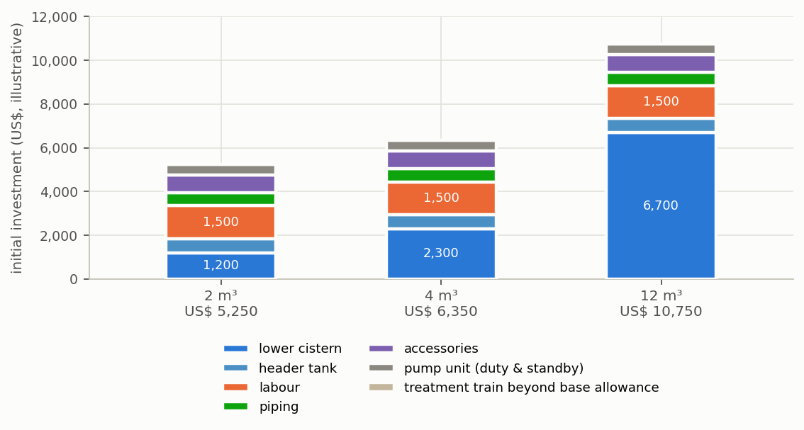

*Figure 27 — Initial investment broken down into the seven items the program adds up, for three volumes of polyethylene tank. With the costs the tutorial declares, only the lower tank grows with the volume; upper tank, labour, piping, accessories, pump sets and treatment line do not change. The treatment line enters for what it adds beyond the filtering allowance already built into the accessories, so as not to count the filter twice. In a new project, piping and accessories come from the 3D layout, which has no such allowance, and labour follows the materials of each volume.*

---

### 2.7.5. The annual running cost

<!-- tabela: **Table 62** — Parts of the annual running cost and the origin of each one -->
| Part | Origin |
| :--- | :--- |
| pumping energy | section 2.6, at the electricity tariff entered |
| chlorination | mass of **product**, not of active chlorine |
| treatment plant | incremental running cost, without counting chlorination twice |
| first flush | annual maintenance of the first-flush chamber and of the leaf separator, when sized |
| declared operating costs | the user's free list |

The electricity tariff is typed in, in the currency of the project. In the manual's tutorial it is
US$ 0.20 per kWh, illustrative, not a market price.

---

### 2.7.6. The month-by-month projection

The projection is made month by month over the whole analysis period, and applies to each part
the inflation and adjustment factors defined below.

The result of this projection is a monthly series of balances, and what matters in it is the
moment the cumulative balance stops being negative. That moment is the payback time.
Figure 28 aggregates the projection by year: in columns, the saving on the water
and sewage bill and the costs, with the investment in year zero; as a line, the discounted
cumulative balance, which crosses zero at the payback time.

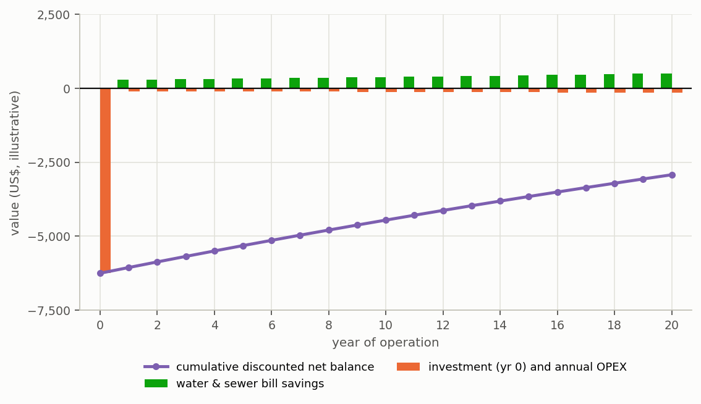

*Figure 28 — Cash flow of the tutorial project over twenty years: annual saving on the water and sewage bill and annual costs, with the initial investment in year zero, in nominal values; and cumulative balance discounted at the minimum attractive rate of return, which does not cross zero within the twenty years: there is no payback. 4,000 L concrete cistern with an upper tank, as in section 4.7; costs illustrative, not market prices.*

**Inflation applies only to the running cost:**

```equacao:inflacao:42
f_inf = ( 1 + i )^( m − 1 )
```

<!-- tabela: **Table 63** — Variables of Equation 42 -->
| Symbol | Meaning | Unit |
| :--- | :--- | :--- |
| `f_inf` | cumulative inflation factor up to month `m` | dimensionless |
| `i` | declared monthly inflation rate, as a fraction: 0.35% a month enters as 0.0035 | dimensionless |
| `m` | month of the cash flow, counted from 1 | month |

**Tariff adjustments apply only to the bill, in steps:**

```equacao:degraus:43
k = ⌊ ( m − 1 ) ÷ I ⌋
```

```equacao:reajuste:44
f_j = ( 1 + r_j )^k
```

<!-- tabela: **Table 64** — Variables of Equation 44 -->
| Symbol | Meaning | Unit |
| :--- | :--- | :--- |
| `k` | number of adjustments already applied up to month `m` | dimensionless |
| `m` | month of the cash flow, counted from 1 | month |
| `I` | interval between adjustments, typically 12 | month |
| `⌊ ⌋` | integer part of the division | — |
| `f_j` | cumulative adjustment factor of part `j` | dimensionless |
| `r_j` | adjustment rate of part `j`, which can be water, sewage or energy | dimensionless |

Equation 44 is applied separately to each of the three parts, with rates of their
own, and the following remark is about that separation.

> **Water and sewage are adjusted by separate indices**, not by a single index on the aggregate
> bill. The two parts are the subject of separate acts of the utility, and treating them together
> indexes half the bill by the wrong index.

A tax or fee incentive for rainwater systems, where one exists and the user enters it, can be
added to the cash flow as an annual saving divided by twelve, which spreads it evenly over the
months of the year. The simplification is deliberate: such a discount is usually granted all at
once, but spreading it keeps the cash flow from showing a step that has nothing to do with the
performance of the system. The manual's cases enter no such incentive.

---

### 2.7.7. The indicators

**Net present value:**

```equacao:vpl:45
NPV = − CAPEX + Σ [ CF_m ÷ ( 1 + MARR )^m ]
```

<!-- tabela: **Table 65** — Variables of Equation 45 -->
| Symbol | Meaning | Unit |
| :--- | :--- | :--- |
| `NPV` | net present value of the investment | currency |
| `CAPEX` | total initial investment, from Equation 41 | currency |
| `CF_m` | net cash flow of month `m` | currency |
| `MARR` | monthly minimum attractive rate of return, as a fraction: 0.5% a month enters as 0.005 | dimensionless |
| `m` | month of the cash flow, from 1 to the end of the analysis period | month |

**Internal rate of return:** the rate that makes the NPV zero. When there is no real root — which
happens when the flow never becomes positive — the program returns null, instead of an invented
number.

**Discounted payback:** the first month in which the discounted cumulative balance crosses zero.
When it never does within the analysis period, the program reports «no payback».

**What the tutorial shows.** With the New York tariff and the illustrative costs of the manual, the
tutorial (a 4,000 L concrete cistern with the 1,000 L upper tank) has an investment of US$ 6,250, an
annual saving of US$ 290.53, an annual running cost of US$ 2.63, a net present value of
−US$ 2,919.90 over twenty years, an internal rate of return of −1.23% a year and no payback. These
costs are illustrative, not market prices, and the result is not a verdict on New York; it shows how
the method works and what it takes for a rainwater system to pay for itself. Cheap water is the
reason: a saving of US$ 24.21 a month does not repay US$ 6,250 within twenty years at the minimum attractive rate adopted.
The method is the same where water is dearer or the works cheaper, and the program will show that
as well; enter your own tariff and costs before drawing any conclusion for a real building.

---

### 2.7.8. The fragile assumptions

Two of them deserve a sensitivity analysis, and section 3.7 shows how.

**The tariff adjustment.** Five per cent a year for twenty years multiplies the tariff by 2.65;
three per cent, by 1.81; seven per cent, by 3.87. The saving of the last years grows in the same
proportion, and that is why the adjustment is among the assumptions that most move the net present
value, as the tornado of section 3.7 shows; it is also one of the most uncertain.

**The service life.** Twenty years is the default. A concrete cistern lasts longer; polyethylene
components exposed to the sun last less. The service life enters both the analysis period and the
carbon payback of section 2.8.

---

## 2.8. Life cycle assessment

> This section presents the seven stages of the inventory and the boundary adopted, and declares
> what is measured and what is a screening assumption.

Life cycle assessment is the method that accounts for the environmental impacts of a product over
its whole existence, from the extraction of raw materials to final disposal. Applied to a
rainwater harvesting system, it answers whether the carbon emitted to manufacture the tank, the
piping and the pump set is offset by the carbon no longer emitted by not consuming water from the
utility.

==Triton's assessment is a screening one, not a full inventory.== The distinction matters and the
standard recognises it: a screening assessment ranks alternatives and identifies what dominates
the result, whereas an inventory conforming to the ISO life cycle assessment standards documents each elementary flow with
traceable provenance and undergoes external critical review. The first serves to decide between
polyethylene and concrete; the second, to declare an environmental performance publicly.

---

### 2.8.1. The four phases of the standard, and where the program stands

The international standards for life cycle assessment (the ISO 14040 series) organise every
life cycle assessment into four phases that feed back into one another. It is
worth going through them, because each one corresponds to a decision the program has already made
for you, and that a published study needs to declare.

**1. Goal and scope.** Defines what the study is for, the **functional unit** and the system
boundary. The functional unit is the quantity of service being compared, and it is what makes
different alternatives comparable. In the program, the implicit unit is the **harvesting system of
a project over the adopted service life**, and the comparison is made against the supply of the
same volume of water by the utility. Anyone wanting to compare with the literature can convert it
to the most used unit, the cubic metre of water delivered, by dividing the balance by the volume of
the service life, as Equation 51 does.

**2. Inventory.** Surveys the input and output flows of each process: masses of material, energy,
consumables. In the program, the inventory is the masses of the components, the pumping energy,
the mass of chlorine product and the volume of water replaced.

**3. Impact assessment.** Converts the flows into category indicators by characterisation factors.
The program assesses **one** category, climate change, in kilograms of carbon dioxide equivalent,
with the emission factors of appendix C.

**4. Interpretation.** Identifies what dominates the result, tests the sensitivity to the
assumptions and draws conclusions within the limits of the scope. That is what sections 4.8
and 3.7 do with the tank material and with the other assumptions.

---

### 2.8.2. The building modules

For buildings, the life cycle is commonly subdivided into modules A to D, a nomenclature that
building standards and environmental product declarations share. Declaring which
modules the study covers is the shortest and most precise way of declaring the boundary, and it is
what a reviewer expects to find.

<!-- tabela: **Table 66** — Building life cycle modules and what the program's assessment covers in each one -->
| Module | Stage | Covered by the program |
| :--- | :--- | :--- |
| A1 to A3 | product: raw material, transport to the factory, manufacture | yes, for tanks, piping, pump sets, first flush and all the parts, fittings and cables of the 3D layout |
| A4 and A5 | construction: transport to the site and installation | no; the excavation for the buried cistern is left out |
| B1 to B5 | use, maintenance, repair, replacement and refurbishment | no; pump and component replacements do not enter |
| B6 | operational energy | yes, the pumping energy |
| B7 | operational water | yes, as the credit for the potable water avoided and the treatment consumables |
| C1 to C4 | end of life: demolition, transport, processing and disposal | no |
| D | benefits and loads beyond the boundary, such as recycling | no |

The reading of the table is that the program does a **cradle-to-gate assessment, plus
operation**. It is the most common boundary in studies of rainwater harvesting in buildings, but
not the only one, and comparing the program's balance with that of a study that includes end of
life or replacements requires adjusting the boundaries before comparing the numbers.

---

### 2.8.3. The seven stages

The inventory is organised into seven stages, grouped by the nature of the emission
(Figure 29). The carbon balance is the sum of the emissions of the first six minus
the credit of the seventh, the only term with a negative sign, and it is this credit that decides
whether the system offsets the carbon embodied in its construction.


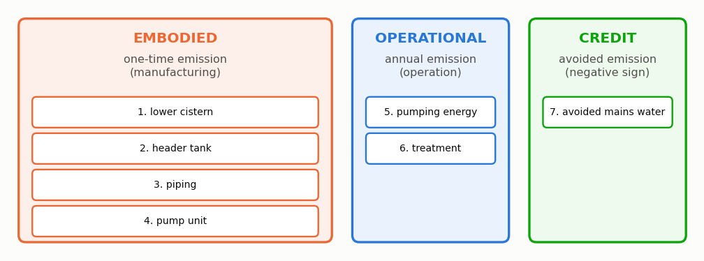

*Figure 29 — The seven stages of the inventory, grouped by the nature of the emission. The first four are embodied and occur only once; the fifth and sixth are operational and repeat every year; the seventh is the credit, and it is the only one that enters with a negative sign.*


The first four stages account for the **embodied carbon**, that is, the emissions that occurred in
manufacturing the components, before the system goes into operation; when the physical first flush
is sized, the first-flush chamber and the leaf separator are added to them. The next two account
for the operational emissions, which repeat in each year of use. And the seventh is the
**credit**: the emission the utility no longer generated because that water did not have to be
abstracted, treated and distributed.

Volume zero without rainwater consumption represents the no-system scenario and, by construction,
receives no fixed impact of tank, piping or pump set — it is the reference against which all the
other alternatives are compared.

---

### 2.8.4. Embodied carbon

```equacao:emissao_componente:46
E_comp = m_comp × EF_mat
```

<!-- tabela: **Table 67** — Variables of Equation 46 -->
| Symbol | Meaning | Unit |
| :--- | :--- | :--- |
| `E_comp` | embodied emission of the component | kg CO₂e |
| `m_comp` | mass of the component | kg |
| `EF_mat` | emission factor of the material, cradle to gate | kg CO₂e/kg |

The mass of each component follows from its sizing. For the tank, it is obtained from the useful
volume multiplied by the characteristic mass density of the material, which varies by more than an
order of magnitude between polyethylene and reinforced concrete — and a good part of the
environmental result of the project follows from that variation.

<!-- tabela: **Table 68** — Mass per useful cubic metre of each tank material -->
| Material | Mass per useful m³ | What this means in 5 m³ |
| :--- | ---: | ---: |
| polyethylene | 22 kg/m³ | 110 kg |
| fibreglass | 14.25 kg/m³ | 71 kg |
| stainless steel | 38 kg/m³ | 190 kg |
| reinforced concrete | 1,200 kg/m³ | 6,000 kg |

> **Mass is carbon.** Reinforced concrete is by far the most massive material on the list, and
> that is why it dominates the inventory when chosen. Section 4.8 shows the consequence: with
> a 4,000 L concrete cistern (4,800 kg, 858 kg CO₂e embodied) the tutorial system takes 32.5 years
> to pay off its carbon debt, longer than the twenty-year service life, whereas with polyethylene
> (88 kg, 327 kg CO₂e) it takes 12.4 years. The factors behind these figures are illustrative.

#### 2.8.4.1. The inventory of the tutorial project, item by item

The table below breaks down the carbon of the final tutorial project: a 4,000 L polyethylene
cistern, a 1,000 L upper tank, two pump sets, the standard piping and the first flush.

<!-- tabela: **Table 69** — Carbon inventory of the final tutorial project, item by item, with the share of each component in the embodied carbon; negative annual values are credits (illustrative grid and water factors, not measured values) -->
| Item | Embodied | Share of the embodied | Annual |
| :--- | ---: | ---: | ---: |
| 4,000 L cistern, polyethylene | 141.9 kg | 43.3% | — |
| 1,000 L upper tank, polyethylene | 35.5 kg | 10.8% | — |
| PVC pipe, DN 100 mm | 55.5 kg | 17.0% | — |
| PVC pipe, DN 32 mm | 3.5 kg | 1.1% | — |
| PVC pipe, DN 25 mm | 8.9 kg | 2.7% | — |
| two pumps of 0.5 hp | 61.0 kg | 18.6% | — |
| first flush: 300 L tank and leaf separator | 21.1 kg | 6.5% | — |
| pumping energy | — | — | 3.07 kg/year |
| tablet chlorination | — | — | 0.24 kg/year |
| mains water avoided | — | — | −29.69 kg/year |
| **total** | **327.4 kg** | **100%** | **−26.38 kg/year** |

Three readings matter. The first is that, even in polyethylene, the cistern accounts for more than
two fifths of the embodied carbon (43.3%), and the tanks together for more than half (54.1%). The second is that the
piping and the pump sets, which are usually forgotten in simplified calculations, add up to almost
two fifths of the total: a study that counted only the tank would underestimate the embodied carbon
by almost half. The third is in the annual column: the credit of the water avoided (29.69 kg a year) is about nine
times larger than the annual emissions of pumping and chlorination together (3.31 kg), and that is why, with
the right material, the manufacturing debt pays off.

---

### 2.8.5. Operation

**Pumping:**

```equacao:emissao_energia:47
E_energy = E_yr × EF_grid
```

<!-- tabela: **Table 70** — Variables of Equation 47 -->
| Symbol | Meaning | Unit |
| :--- | :--- | :--- |
| `E_energy` | annual emission of the pumping energy | kg CO₂e/year |
| `E_yr` | annual energy consumption of the pump set | kWh/year |
| `EF_grid` | emission factor of the electricity grid, by region and year | kg CO₂e/kWh |

The annual energy consumption comes from the calculation presented in section 2.6, according
to the supply arrangement declared, and the grid emission factor is typed in, for the place and the year
of the study: the program carries no grid factor of its own in the International Edition. The
manual's tutorial uses a round figure of 0.40 kg CO₂e/kWh, illustrative and not a measured value, so
that the reader can follow the method; a real study takes the factor from the published inventory of
the national or regional grid, states the year and shows the result for a low and a high value.

Energy is small in the program, but it is worth knowing that it tends to be larger in practice.
Vieira et al. (2014), in a review of the energy intensity of rainwater harvesting systems, found a
median of 0.20 kWh/m³ in theoretical studies and of 1.40 kWh/m³ in empirical studies, and
attributed part of the difference to start-ups, standby consumption and real efficiencies worse
than catalogue ones. The tutorial, at 0.13 kWh/m³, is in the range of theoretical studies. Ghimire
et al. (2014, 2017) reached a converging conclusion by life cycle assessment: in the systems they
analysed, the pump set and the pumping energy were the components that weighed most in most of the
impact categories, and the pumpless version outperformed the public supply in almost all of them.

> **When energy decides.** With the illustrative grid factor, multiplying the tutorial's pumping
> energy by ten, taking it close to the empirical median of Vieira et al., would raise the pumping
> emission from 3.07 to about 30.7 kg CO₂e a year, which is more than the 29.69 kg credit of the
> water avoided. The annual balance would turn from a net benefit of 26.38 kg to a small net
> emission, and the system would never pay off its embodied carbon: it would end its life owing
> carbon. On grids more fossil-based than the one assumed, the effect is even larger.

**Treatment:** the treatment line **replaces** the chlorination term instead of adding to it. It is
the same rule as in section 2.5, and it exists so that the hypochlorite is not counted twice.

---

### 2.8.6. What the boundary includes, and what it leaves out

Before discussing any emission factor, it is worth fixing the scope. The program's assessment is a
**screening** one: it serves to rank alternatives against each other, not to replace a life cycle
inventory conforming to ISO 14040. What enters the calculation and what is left out is declared,
because an environmental balance without a declared boundary can be neither checked nor contested
(Figure 30). The most limiting exclusion is that of the impact categories beyond
global warming: a system with good carbon performance can perform unfavourably in another category,
and the assessment does not record it.


*Figure 30 — Boundary of the program's environmental assessment: (a) processes included — embodied carbon of the tanks, the piping and the pump set, operational emissions of pumping and of treatment consumables, and the credit for the potable water avoided; (b) processes excluded — civil works, maintenance and replacement, end of life and impact categories beyond global warming.*

---

### 2.8.7. The boundary: water delivered, not produced

The emission factor of potable water is per cubic metre **delivered to the building**, not per
cubic metre produced at the treatment works.

The difference is the distribution losses, which vary from one supply system to another. If a
system loses 20% between the works and the tap, producing one cubic metre delivers 0.8 (an
illustrative figure, not a measured one).

A published factor at the outlet of the works, applied to the volume delivered, **underestimates
the avoided emission** by the share lost. Declare whether the factor you use is per cubic metre
delivered or produced, and convert it if it is not.

Appendix C lists the water production routes the program offers, with the provenance and
boundary of each one.

---

### 2.8.8. The indicators

**Net annual balance:**

```equacao:saldo_liquido:48
E_net = E_avoid − E_energy − E_treat
```

<!-- tabela: **Table 71** — Variables of Equation 48 -->
| Symbol | Meaning | Unit |
| :--- | :--- | :--- |
| `E_net` | net annual emission balance | kg CO₂e/year |
| `E_avoid` | emission avoided by the utility water no longer consumed | kg CO₂e/year |
| `E_energy` | annual emission of the pumping energy | kg CO₂e/year |
| `E_treat` | annual emission of the treatment consumables | kg CO₂e/year |

**Carbon payback:**

```equacao:payback_carbono:49
PB_env = E_emb ÷ E_net
```

<!-- tabela: **Table 72** — Variables of Equation 49 -->
| Symbol | Meaning | Unit |
| :--- | :--- | :--- |
| `PB_env` | environmental payback time of the system | year |
| `E_emb` | carbon embodied in the manufacture of the components | kg CO₂e |
| `E_net` | net annual emission balance, from Equation 48 | kg CO₂e/year |

When the net annual balance is not positive — a real situation, not a hypothetical one, in systems
with a large concrete tank — there is no environmental payback, because the debt is never paid off.
The program returns 999 years in that case, instead of infinity, so that the value can still be
ranked in comparisons; the meaning, however, is that the system ends its service life owing
carbon.

**Balance at the end of life:**

```equacao:saldo_vida:50
B_life = ( E_net × n_yr ) − E_emb
```

<!-- tabela: **Table 73** — Variables of Equation 50 -->
| Symbol | Meaning | Unit |
| :--- | :--- | :--- |
| `B_life` | carbon balance at the end of the adopted service life | kg CO₂e |
| `E_net` | net annual emission balance, from Equation 48 | kg CO₂e/year |
| `n_yr` | service life adopted for the system | year |
| `E_emb` | carbon embodied in the manufacture of the components | kg CO₂e |

Negative means the system **emitted more than it avoided** over the adopted life. It is not a
theoretical hypothesis: it happens with a concrete cistern and a twenty-year service life, as
section 4.8 shows.

**Specific avoided emission:**

```equacao:emissao_especifica:51
E_spec = B_life ÷ V_life
```

<!-- tabela: **Table 74** — Variables of Equation 51 -->
| Symbol | Meaning | Unit |
| :--- | :--- | :--- |
| `E_spec` | specific emission of the system over the service life | g CO₂e/L |
| `B_life` | carbon balance at the end of the service life, from Equation 50 | kg CO₂e |
| `V_life` | total volume of rainwater delivered over the service life | m³ |

---

### 2.8.9. What carries a screening label

Not every factor of the inventory has a primary source. The program marks those that do not, and
the report shows the mark.

The masses per useful cubic metre of polyethylene, concrete and stainless steel, which are still
geometric scenarios, carry the label, as does any factor typed in without a source. The default
emission factors have declared provenance; the last to receive it was that of **hypochlorite**,
which now comes from Ecoinvent 3.8: as the database has no calcium hypochlorite, the program uses
the sodium one on an active-chlorine basis, 2.65 kg CO₂e per kg, which gives 1.72 kg CO₂e per kg of
65% tablet. The manufacturing emission of the pump set, which until the September 2026 revision was
an arithmetic extrapolation in four of the six power ratings, now combines the catalogue mass with
the intensity of an environmental product declaration; it is an order-of-magnitude approximation,
and appendix C declares the caveat.

> **In a published study, declare which factors carry a screening label.** An inventory that
> presents all factors with the same degree of confidence hides where the weakness lies.

---

### 2.8.10. What the literature shows

Life cycle assessment of rainwater harvesting systems is an active field without a single method.
Vaz et al. (2023), in an integrative review conducted under the PRISMA protocol, concluded that
residential buildings are the most studied case, but that there is no consensus on a uniform
analytical framework; that several benefits of rainwater, such as runoff reduction, rarely enter
the assessment; and that integration with life cycle costing is a promising way of showing the
benefits more directly.

Marinoski and Ghisi (2018) assessed a social housing unit and compared fibreglass, high-density polyethylene and reinforced concrete tanks. The fibreglass
ones were the most favourable from the environmental point of view, and the concrete ones, from the
point of view of investment. The result converges with that of section 4.8 in the essentials:
the tank material weighs on the carbon, and the environmental and economic dimensions can point in
different directions.

Ghimire et al. (2017), comparing a commercial system with the municipal supply in eleven impact
categories, showed something else this assessment does not reach: the rainwater system outperformed
the municipal one in ten of the eleven categories, but not in all, and the result of each category
depended on the energy intensity of pumping. It is the strongest argument for declaring that the
program's assessment covers a single category.

---

### 2.8.11. What the assessment does not cover

- **end of life.** There is no credit for recycling nor burden for disposal. The boundary is
  cradle to gate plus operation.
- **excavation and civil works.** The earthworks of the buried cistern do not enter.
- **maintenance.** Component replacements over the service life do not enter.
- **impacts beyond carbon.** There is no eutrophication, acidification, land use or toxicity. It is
  an assessment of **one** impact category.

The last point is the most important. A system with good carbon performance can perform poorly in
another category, and this assessment would not see it.

---

## 2.9. Certifications

> This section gathers the qualification rules of the sustainability rating systems the program
> assesses and distinguishes, in each one, what is a requirement of the rating system from what is
> a criterion adopted by the program.

Rainwater harvesting systems appear in practically every environmental certification system for
buildings, and in each one with a metric of its own. Some measure the saving against the total
consumption of the building, others against a reference baseline, and others still require the
comparison in more than one dimension at once. The program calculates the qualification in the
international rating systems below from the simulation results, and always with the same caveat: ==the program
shows where the project would qualify, and certifies nothing.== Certification is decided by the
certification body, with the complete documentation of the development, of which water performance
is only one piece.

The International Edition shows LEED, EDGE and GRI only. National rating systems are not built
in; where a project is bound to one, take its saving from the simulation and apply that system's
own rules outside the program.

Before going through them one by one, it is worth seeing them side by side. The thresholds of each
rating system are on scales that seem incomparable while they stay in separate tables, and become
comparable when placed on the same saving ruler (Figure 31). The thresholds below are those coded in the program; confirm them
against the current text of each rating system before citing them. LEED v4 scores the
reduction of outdoor use (WEc1: 1 point from 50% and 2 points at 100%) and of indoor use (WEc2: 1
to 6 points between 25% and 50%) separately; LEED v5 gathers the category in credit WEc2, in which
the reduction in fixtures and fittings is worth 1 to 3 points between 30% and 40% and the reduction
of the whole project, 1 to 8 points between 30% and 65%; and EDGE requires a minimum reduction of
20% at the same time in water, energy and the energy embodied in materials, without points.

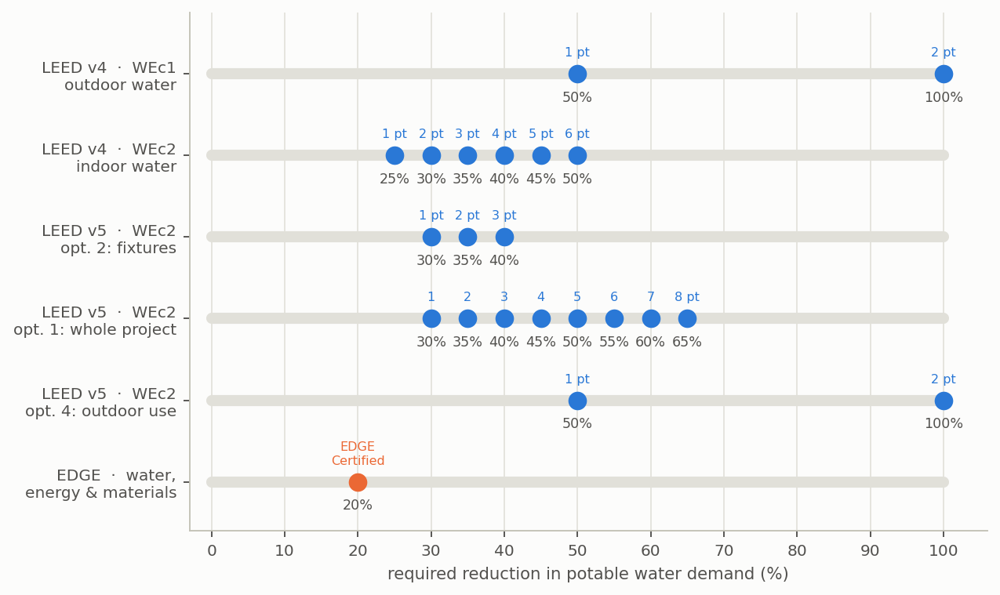

*Figure 31 — The thresholds of reduction in potable water consumption with which the program places the project in LEED v4 (credits WEc1 and WEc2), LEED v5 (credit WEc2, options 1, 2 and 4) and EDGE, on the same scale. Rating systems whose criterion scores the existence of a system, not a percentage, are not on the ruler. The same project crosses different rating systems at different points, which is why declaring the saving obtained is worth more than declaring the certification intended.*

---

### 2.9.1. LEED v4 and v4.1, Water Efficiency category

LEED is the rating system of the U.S. Green Building Council (<https://www.usgbc.org/leed>, accessed
15 October 2026), the most widespread internationally. Version 5 coexists with versions 4 and 4.1;
the program places the project in both, and the study must declare which one it used. In versions 4 and 4.1, water efficiency has a category of its own worth
eight points spread over two credits. The fundamental distinction it imposes is between indoor and
outdoor water use, and the whole score follows from that separation.

Credit WEc1 deals with the reduction of outdoor use, that is, irrigation and the other demands of
uncovered areas, and is worth up to two points. The program awards the two points with a 100%
reduction in outdoor potable water use and one point from 50%, taking the rainwater allocated to
irrigation from the daily balance itself; and a project with no outdoor demand registered does not
score, in which case the program records the reason explicitly, so that the user does not read the
zero as a performance failure.

Credit WEc2 deals with the reduction of indoor use and is worth up to six points, spread on a scale
of five percentage points at a time from a 25% saving. It is preceded by a prerequisite, WEp2,
which requires a 20% indoor reduction and is mandatory: without it the development is not eligible
for certification, and it awards no points itself.


> The separation between indoor and outdoor use depends entirely on the **breakdown of the demand**
> described in section 4.2. The program does not invent that separation: it uses the rainwater
> the daily balance allocated to irrigation, which is supplied after indoor use. Without a
> broken-down outdoor demand, credit WEc1 appears as not assessed, and the indoor saving is taken,
> conservatively, as equal to the total saving.

> The score label gives only the points of the water category. The LEED level — Certified, Silver,
> Gold or Platinum — results from the sum of all the categories, and water alone does not define
> it.

---

### 2.9.2. LEED v5, credit WEc2 Enhanced Water Efficiency

In version 5, the indoor and
outdoor use credits were gathered in credit WEc2, *Enhanced Water Efficiency*, worth up to eight
points in new construction and up to seven in *Core and Shell*; the program assesses only new
construction. Code WEc1 now designates another credit, *Water Metering and Leak Detection*, of
submetering and leak detection, and should not be confused with the outdoor-use WEc1 of LEED v4.
Prerequisite WEp2 requires, among other conditions, a 20% reduction in the consumption of fixtures
and fittings relative to the rating system's baseline, and prerequisite WEp1 requires the
alternative water source, such as the rainwater cistern, to have a meter of its own, separate from
the mains one. The project scores by one of two paths: Option 1, which measures the reduction in
water use of the whole project, or the sum of Options 2 to 6, which treat each part separately.

<!-- tabela: **Table 75** — Options of LEED v5 credit WEc2 to which rainwater harvesting contributes -->
| Option | What it measures | Score |
| :--- | :--- | :--- |
| 1. Whole project | reduction in the project's water use against the baseline | 30% 1 point, and 1 point every 5%, up to 65% 8 points; with an alternative water source, each step is worth 1 point more, up to 8 |
| 2. Fixtures and fittings | reduction calculated against the WEp2 baseline, which may include an alternative source | 30% 1 point, 35% 2 points, 40% 3 points |
| 4. Outdoor use, path 2 | reduction of the theoretical irrigation requirement | 50% 1 point, 100% 2 points |
| 6. Reuse, path 2 | on-site reuse system serving irrigation, flushing, make-up or process | 2 points |

The program calculates both paths and adopts the one with the higher score: Option 1 with the total
saving, and the sum of Options 2, 4 and 6 with the indoor saving, the outdoor saving and the
existence of the system, which the program treats as the reuse system of Option 6. The cap of eight
points applies to both. Options 3 and 5, for appliances and process water, and path 1 of Option 4,
landscaping without irrigation, do not depend on rainwater harvesting and are left out of the
calculation. As in LEED v4, the rating system's reductions are measured against a baseline of
fixture flow rates and irrigation, not against the modelled demand, so the qualification is
indicative.

Rainwater harvesting can also contribute to credit SSc3, *Rainwater Management*. Under Option 1, it
awards 1, 2 or 3 points for retaining on site the volume corresponding to the 80th, 85th or 90th
percentile of local rainfall (70th, 75th or 80th on a zero-lot-line site), and 1 additional point
when part of that volume is reused, without exceeding the cap of 3 points; under Option 2, it awards
3 points to whoever retains the increase in runoff relative to the natural land cover. The program
does not assess this credit, because it depends on the runoff of the whole site, not only of the
roof; the criteria matrix records it as not assessed.

---

### 2.9.3. National rating systems

The International Edition does not assess national rating systems. A project bound to one takes the
simulated potable water saving from the report and applies the rules of that system, in their
current version, outside the program.

> **Declare it in the study.** The qualification is only defensible with the current version of the
> rating system in hand, and the program does not replace that check.

---

### 2.9.4. EDGE, the only one that does not score

EDGE, developed by the World Bank's International Finance Corporation, follows a logic different
from all the previous ones. Instead of awarding points to increasing performance, it measures the
percentage saving against a local baseline in three independent dimensions — energy, water and the
energy embodied in materials — and requires **each** of them to cross the established threshold.
There is no compensation between dimensions: an exceptional water performance does not make up for
a deficiency in energy.

EDGE has two further levels above the first. **EDGE Advanced** requires, in addition to the 20% in
the three dimensions, an on-site energy saving of at least 40%; **Zero Carbon** requires the
previous one plus 100% renewable energy or full offsetting of the remaining emissions.

It is worth noticing which bar the advanced level raises. ==EDGE Advanced raises the energy
requirement, not the water one.== The practical consequence for those designing rainwater systems is
that the system secures the water bar with relative ease, whereas the certification level achieved
is decided entirely outside the scope of the water design. The program assesses only the water bar,
by measure WEM14, whose input in the IFC application is the catchment area in square metres.

> **The honest limit is in the denominator.** The EDGE baseline is local, varies with the country
> and the building type, and is set by the IFC application itself. The program accepts the baseline
> declared by the user; in its absence, it adopts the modelled demand of the project and warns that
> the resulting percentage is a **floor**, not the value certification will recognise.
>
> The energy and embodied energy bars are beyond the program's reach, and it declares that
> limitation in the report. Claiming that a project is EDGE Certified with a third of the necessary
> evidence would be irresponsible.

The thresholds above are those the program applies, taken from the EDGE documentation published
by the IFC (<https://edgebuildings.com/certify/certification/>); check them against the current text
before citing them.

---

### 2.9.5. GRI 303

The Global Reporting Initiative is not a building certification system but a standard for corporate
disclosure of social and environmental performance. Its 303 series deals with water and effluents,
and two of its indicators are fed directly by the program's results: GRI 303-3, which reports the
abstraction avoided in cubic metres per year and accumulated over the period, and GRI 303-5, which
expresses the water circularity rate of the development.

---

### 2.9.6. What to declare

Any study reporting qualification in certification systems needs to make four points explicit, and
omitting any of them compromises the verifiability of the result. The first is that the water
quality classes 2 to 4 adopted by the program are internal adaptations, not classes of a standard. The second concerns EDGE, and consists in declaring that only the water bar was assessed,
identifying the baseline used. The third applies to LEED, and consists in declaring the version of
the rating system adopted and stating whether the split between indoor and outdoor use was broken
down from project data or whether, in its absence, the indoor saving was taken as equal to the total
saving. The fourth, finally, is the general caveat: the qualification the program produces is
indicative, and certification is decided by the certification body in the light of the complete
documentation of the development.

---

## 2.10. Multi-criteria decision

> This section formalises the two ranking methods the program offers and declares three departures
> from the canonical formulation that a published study needs to cite.

Multi-criteria analysis is the branch of operations research that deals with choosing between
alternatives when the evaluation criteria disagree with one another and cannot be reduced to a
single number without someone declaring what is worth more. That is exactly the situation of a
rainwater harvesting project: the volume that delivers most water is not the one that yields most
money, and neither is usually the one with the lowest carbon impact.

What the methods of this section do is not discover the right answer. ==They make explicit the
weighting that would otherwise remain implicit in the choice of whoever decides.== That is the
whole difference between a study that declares its values and one that hides them behind an
apparently objective result.

---

### 2.10.1. The seven criteria

The program evaluates each volume of the sweep by seven criteria, grouped into three dimensions.
Each criterion has a direction of preference: in some, more is better; in others, less.

<!-- tabela: **Table 76** — The seven decision criteria, the direction of preference and the group of each one -->
| # | Criterion | Direction | Group |
| :-- | :--- | :--- | :--- |
| 1 | saving potential | maximise | technical |
| 2 | overflow | minimise | technical |
| 3 | net present value | maximise | economic |
| 4 | discounted payback | minimise | economic |
| 5 | internal rate of return | maximise | economic |
| 6 | CO₂e at end of life | minimise | environmental |
| 7 | potable water consumption | minimise | environmental |

The alternatives submitted to the ranking are the volumes simulated in the sweep, and each of them
appears with the seven values above, calculated in sections 2.1, 2.7 and 2.8. No
criterion is invented at this stage: the method only ranks what the previous dimensions have
already produced.

---

### 2.10.2. TOPSIS

TOPSIS — *Technique for Order of Preference by Similarity to Ideal Solution*, proposed by Hwang and
Yoon in 1981 — starts from a simple geometric idea. If each alternative is a point in a
seven-dimensional space, one dimension per criterion, then there are two reference points: the
**ideal solution**, made up of the best value of each criterion, and the **anti-ideal solution**,
made up of the worst. No real alternative occupies either of them, because none wins at everything
or loses at everything, and the best alternative is the one that is at the same time closest to
the ideal and furthest from the worst case.

The method carries out five steps. It builds the decision matrix, with the alternatives in the rows
and the criteria in the columns; normalises that matrix, so that criteria measured in currency units, in
percentage points and in kilograms come to occupy comparable scales; applies the declared weights;
identifies the ideal and anti-ideal solutions; and ranks the alternatives by relative closeness to
the ideal.

```equacao:topsis:52
C_i = d_i⁻ ÷ ( d_i⁺ + d_i⁻ )
```

<!-- tabela: **Table 77** — Variables of Equation 52 -->
| Symbol | Meaning | Unit |
| :--- | :--- | :--- |
| `C_i` | closeness coefficient of alternative `i`, between 0 and 1 | dimensionless |
| `d_i⁺` | Euclidean distance from alternative `i` to the ideal solution | dimensionless |
| `d_i⁻` | Euclidean distance from alternative `i` to the anti-ideal solution | dimensionless |

The coefficient of Equation 52 would be 1 for an alternative that coincided with the
ideal solution on all criteria, and 0 for one that coincided with the anti-ideal. As no real
alternative occupies these extremes, what matters is not the absolute value of the coefficient but
the ranking it produces.

---

Applied to a full sweep of the tutorial project (New York) in steps of 1 m³ with equal
weights, the score rises to an interior maximum and falls at the larger volumes, where the
investment and the embodied carbon come to weigh more than the gain in water
(Figure 32). The maximum of the full sweep can differ from the volume obtained in
section 4.9 with seven candidates, because the ideal and the anti-ideal are built from the set evaluated: adding
or removing alternatives shifts the reference points and can change the ranking, a phenomenon known
as rank reversal.

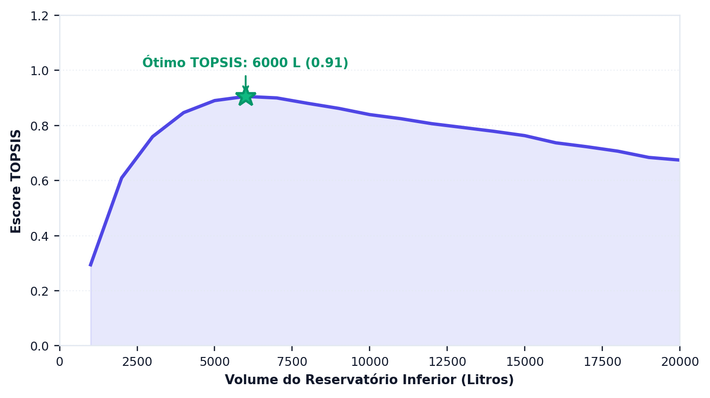

*Figure 32 — TOPSIS score of each volume of the sweep of the tutorial project, with a polyethylene cistern and equal weights among the seven criteria; the star marks the volume with the highest score. Figure generated by the program itself.*

---

### 2.10.3. Three departures to declare

The program's implementation departs from the canonical formulation in three points, all
deliberate, and a published study needs to declare them so as not to attribute to the original
methods a behaviour that belongs to the program.

**The normalisation is a variant.** Hwang and Yoon's canonical formulation uses vector
normalisation, which assumes non-negative values on all criteria. The net present value, however, is
often negative at small volumes, where the investment does not pay off. The program works around
the restriction by translating each criterion by `x − min(x)` before normalising. The choice is
necessary and deliberate, but presenting the result as canonical TOPSIS would be incorrect: declare
the variant.

**Opricovic's conditions are not implemented.** The VIKOR method, in Opricovic's formulation,
requires two checks on the compromise solution found — acceptable advantage and acceptable
stability — and, when either fails, returns a **set** of equivalent solutions instead of a single
winner. The program always returns the best alternative, without carrying out the test. In
practice, this means that the VIKOR compromise solution should be read alongside the weight
sensitivity analysis, and never alone.

**The attribution of the code.** The implementation of VIKOR and SMAA-VIKOR was written
independently and checked against the `crispyn` library, by Aleksandra Bączkiewicz. TOPSIS was
checked against Hwang and Yoon's original formulation in a case with all values positive, in which
the translation described above is harmless and the two formulations must coincide.

---

### 2.10.4. SMAA-VIKOR

SMAA — *Stochastic Multicriteria Acceptability Analysis* — exists to answer the question TOPSIS does
not: what if the weights were different? Instead of requiring a set of weights defined beforehand,
the method draws thousands of weight combinations and returns, for each alternative, the
probability of it occupying each position of the ranking.

Reading the result is direct and informative. A volume that wins in 80% of the draws is a robust
recommendation, which does not depend on a specific weighting to hold. A volume that wins in 30% is
a fragile recommendation, and the text of the study needs to say so instead of presenting the
winner as if it were consensual.

> It is the right tool when there is no consensus on the weights — which is the normal case in real
> projects, where the client, the designer and the regulator usually value different
> dimensions.

---

The most useful reading of the stochastic analysis is not the winner but the margin by which it
wins. A volume that comes first in three quarters of the weight draws is a stable choice, which
survives a change in the decision-maker's priorities; two technically tied volumes indicate the
opposite, and in that case declaring the weight adopted stops being a formality and becomes the
only information supporting the recommendation (Figure 33).

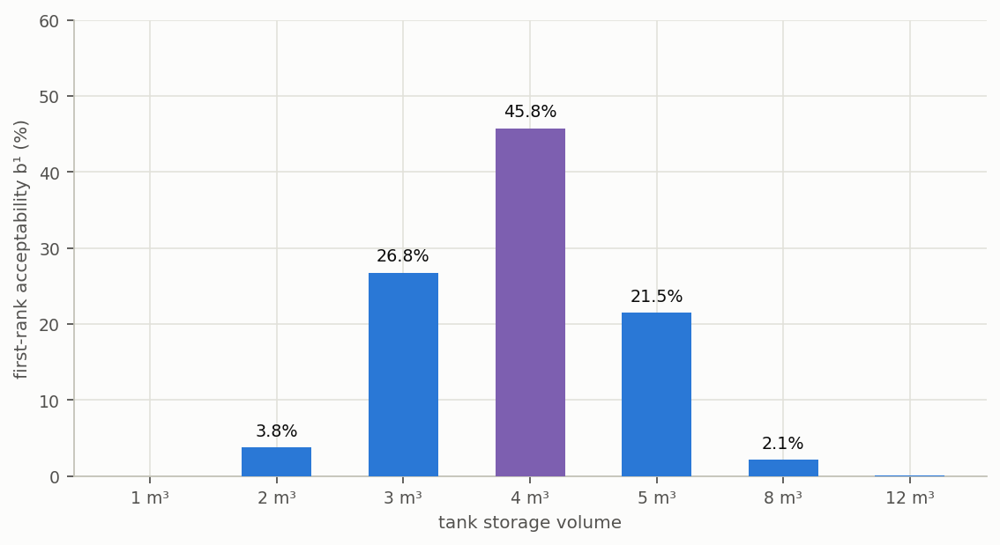

*Figure 33 — First-rank acceptability (b¹) of each candidate volume, obtained with five thousand weight vectors drawn on the simplex. The highlighted volume is the one that most often comes first, and the others share the rest.*

#### 2.10.4.1. The tutorial, by both methods

The table sets side by side the TOPSIS score, with equal weights among the three dimensions, and
the SMAA-VIKOR first-rank acceptability, with five thousand weight vectors drawn, for the seven
volumes of the tutorial in polyethylene with an upper tank. The investment and the carbon behind
the scores are the illustrative figures of section 4.7 (illustrative, not a market price).

<!-- tabela: **Table 78** — TOPSIS closeness score with equal weights across the dimensions and first-rank acceptability in SMAA-VIKOR, with 5,000 random weight vectors, for the tutorial volumes -->
| Volume | TOPSIS score | TOPSIS rank | First place in SMAA-VIKOR, b¹ |
| ---: | ---: | ---: | ---: |
| 1,000 L | 0.388 | 7th | 0.0% |
| 2,000 L | 0.685 | 5th | 3.8% |
| 3,000 L | 0.801 | 3rd | 26.8% |
| 4,000 L | 0.863 | 1st | 45.8% |
| 5,000 L | 0.849 | 2nd | 21.5% |
| 8,000 L | 0.716 | 4th | 2.1% |
| 12,000 L | 0.578 | 6th | 0.0% |

The two methods agree on the winner, 4,000 L, and disagree on the margin. TOPSIS separates first
from second place by fourteen thousandths of score, a difference no input data supports. SMAA measures
that fragility: 4,000 L wins in 46% of the draws, 3,000 L in 27% and 5,000 L in 22%, and the three
together account for nineteen out of every twenty draws. By the yardstick of section 3.7, the
recommendation is reasonable, and the study should declare 5,000 L, the TOPSIS runner-up, and 3,000 L
as the alternatives. The extremes, 1,000 L and
12,000 L, win in no draw at all: no plausible weighting recommends them, and that is also a result.

---

### 2.10.5. The weights

The program accepts one weight per dimension, technical, economic and environmental, or one weight
per criterion. With equal weights among the dimensions, each is worth a third, shared equally among
its criteria: the two technical and the two environmental ones are worth a sixth each, and the
three economic ones, a ninth each. The choice, however, is not technical: it is a statement of
value, and therefore needs to appear in the text of the study. ==The statement «optimal volume by
TOPSIS», without the weights, is impossible to reproduce,== and two studies with different weights
reach different volumes without either of them being wrong.

Three courses are defensible, and the choice between them depends on how much is known about the
priorities of whoever decides. Equal weights, explicitly declared as an absence of preference, are
the neutral position. Justified weights, with the reason for each one, are preferable when the
priorities are known. And SMAA, reporting the range of results instead of a single winner, is the
most complete course when there is no consensus.

---

### 2.10.6. The best by each criterion alone

Besides the weighted ranking, the program identifies the winner of each group of criteria —
technical, financial and environmental — and reports the three separately. They are numbers worth
publishing together, because each one answers a legitimate and different question.

When the three coincide, the recommendation is strong and the decision needs no weighting. When
they diverge, which is the common case and that of the tutorial, ==the divergence **is** the
result:== hiding it behind a single weighted number impoverishes the study and hands the reader a
conclusion they have no way of evaluating.

---

### 2.10.7. What the method does not do

It is worth ending with the limits, because multi-criteria methods are often presented with an
authority they do not have.

**They do not choose the weights.** The weighting belongs to the analyst, and it is a decision of
value, not of technique. No statistical procedure replaces it.

**They do not validate the criteria.** If the net present value is wrong because the tariff
structure was entered incorrectly, TOPSIS will rank the error with impeccable precision. The
method ranks what it receives.

**They do not incorporate constraints.** Space available on the site, maximum budget, a regulatory
requirement: all of these are filters prior to the ranking, applied by the designer when deciding
which volumes even enter the comparison.

---

# 3. Guides available in the program

---

## 3.1. Comparing cities

> **Question this guide answers:** would the same project yield the same in another city?

It would not, and the difference is larger than the rain alone suggests. The common
expectation is that more rain means more yield. That holds as a ranking, but it fails as a
proportion, and it fails for a reason that deserves a whole section.

> **Your own cities.** The program ships three sample series: New York, London and Cape
> Town. For any other city, use a rainfall file of your own, one per city; everything else
> in the guide applies as written.

---

### 3.1.1. How to make the comparison

The procedure is simple: keep all the parameters of the project and change only the
precipitation series. In step **1. Project & Rainfall**, load another series and run the
simulation again. To compare several cities without redoing the project for each one,
save one file per city, as section 3.6 recommends.

---

### 3.1.2. The result

The tutorial project — 150 m² of catchment, 600 L/day of demand, a 28% suppliable fraction
and a 4,000 L cistern — taken to the three sample cities produces the table below.

<!-- tabela: **Table 79** — The same tutorial project simulated in New York, London and Cape Town -->
| City | Annual rain | Days with rain | Ratio between the wettest and the driest month | Potential with 4,000 L | Ideal volume |
| :--- | ---: | ---: | ---: | ---: | ---: |
| New York | 1,125 mm | 44% | 1.4× | 26.83% | 4,000 L |
| London | 649 mm | 50% | 1.5× | 20.08% | 4,000 L |
| Cape Town | 495 mm | 28% | 8.3× | 14.52% | 4,000 L |

Figure 34 separates the two quantities, each one on its own scale.

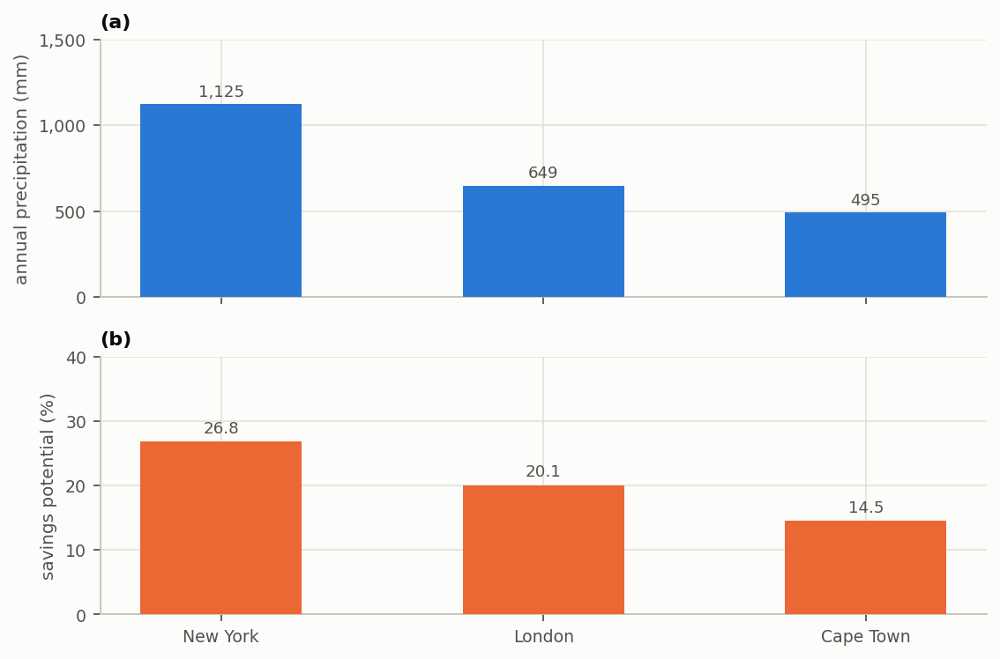

*Figure 34 — (a) Mean annual precipitation and (b) potable water saving potential of the tutorial project, with 150 m² of catchment, 600 L/day of demand, a 28% suppliable fraction and a 4,000 L cistern, in New York, London and Cape Town. The potential falls faster than the rain does from London to Cape Town.*

---

### 3.1.3. The regime matters more than the depth

Read side by side, the annual rain and saving potential columns do not move in proportion.
New York receives 73% more rain than London (1,125 mm against 649 mm) and yields 6.75
percentage points more: 26.83% against 20.08%. London receives 31% more rain than Cape
Town (649 mm against 495 mm) and yields 5.6 points more, 20.08% against 14.52%. Set
against the 28% ceiling, New York reaches 96% of it, London 72% and Cape Town 52%.

The explanation lies in how the rain is spread, and the table above shows it twice. The
share of days with rain is 44% in New York, 50% in London and only 28% in Cape Town. And the
ratio between the wettest and the driest month, which measures how much the rain
concentrates over the year, is 1.4 in New York, 1.5 in London and 8.3 in Cape Town.

<!-- tabela: **Table 80** — Ratio between the wettest and the driest month in the three cities -->
| City | Ratio | What it means |
| :--- | ---: | :--- |
| New York | 1.4× | it rains all year round, with only a mild seasonal swing |
| London | 1.5× | likewise: modest depth, but well distributed |
| Cape Town | 8.3× | **a marked wet season, and a long dry one** |

London rains less than New York but rains often and evenly, so the cistern is refilled
all year round and full supply reaches 69.1% of the days. In Cape Town the rain comes in a
few winter weeks, and the cistern, which refills in winter, runs short in the dry
summer: full supply falls to 49.9% of the days, against 95.3% in New York with the same
tank. Were the dry season three months long, a tank sized to get through it would have to
store ninety days of rainwater demand, which in this project is 15,120 litres — a volume
no residential cistern can hold. The system then stays idle for part of every year, and
the annual potential reflects that idleness.

> **The practical conclusion.** ==Rainwater harvesting yields more where rain is frequent
> than where it is abundant.== London shows it against New York's depth, and Cape Town
> shows it against London's: a climate with a marked dry season is the worst case, however
> intense the rain of the wet season.

---

Figure 35 presents the monthly regime of the three cities on the same scale.

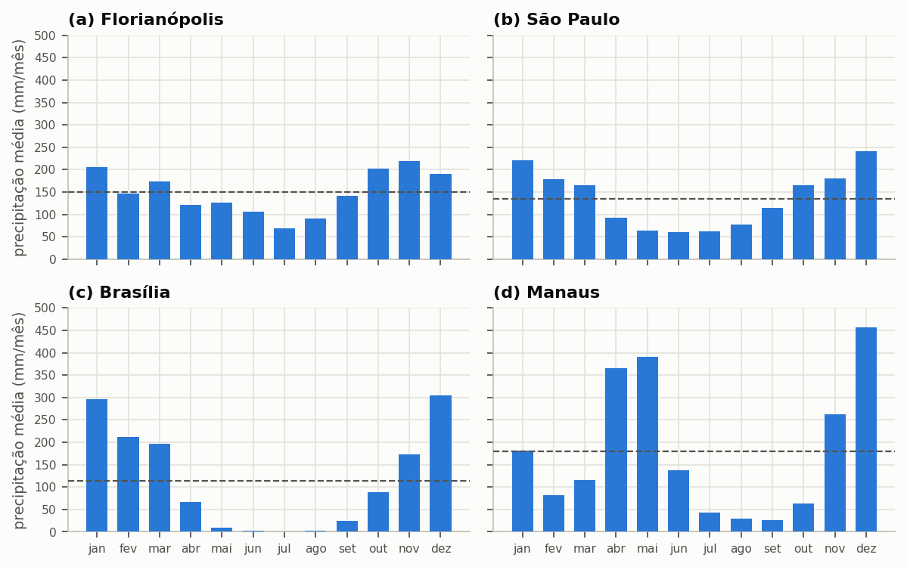

*Figure 35 — Mean monthly precipitation in (a) New York, (b) London and (c) Cape Town, on the same scale; the dashed line is the monthly mean of each series. New York and London spread the rain over the whole year; Cape Town concentrates it in winter and has a dry summer. It is this distribution, not the annual total, that decides the performance of the tank.*

---

### 3.1.4. Do not carry a result from another city

The comparison above is not a peculiarity of this tutorial, and the lesson for anyone
comparing cities is the same in every study: the local series decides, and a volume or a
potential brought from another city, even a neighbouring one, does not replace the
simulation. A published figure for a climate that is not yours is a hypothesis to test,
not a result to adopt.

#### 3.1.4.1. Many cities at once

To compare more than three or four cities, changing the series by hand stops being
practical. The scenario spreadsheet of section 3.6 runs the same project against
several series in a single run, saving one result per row. Keep the same building and tank
parameters on all rows of the spreadsheet, and vary only the series: that is what isolates
the effect of the climate.

---

### 3.1.5. What else changes between cities

Precipitation is not the only quantity that varies between cities, and the other two can
reverse the economic conclusion of a comparative study.

The first is the **tariff**. The price of a cubic metre varies considerably from one
utility to another, and so does its structure: a flat rate with a sewer surcharge, as in
New York, or stepped blocks, as in Cape Town, where the last cubic metre is the dearest.
A 15% potential under a steep tariff can yield more money than a 27% potential under a
low one, and section 3.3 deals with that mechanism in detail. The sample cities
carry their own published tariffs, but only the New York tutorial carries costs, so this
guide compares them on saving potential, not on payback.

The second is the **electricity grid emission factor**, which changes at the same time the
emission avoided per cubic metre of water replaced and the environmental cost of pumping.
In the International Edition it is entered for each project.

> **When comparing cities in a study, make clear what varied.** Comparing only the
> precipitation, keeping tariff and emission factor fixed, isolates the climate effect and
> is a legitimate comparison, as long as it is declared as such. Varying all the quantities
> at once produces a number that cannot be explained, because it adds effects of possibly
> opposite signs.

---

### 3.1.6. The ideal volume does not change here

The last column of the table holds a surprise: with the 1 %/m³ threshold, the ideal
volume is 4,000 L in all three cities, despite regimes that differ as much as these.

The explanation lies in the nature of the criterion. The ideal volume by marginal gain
locates the knee of the yield curve, and the position of that knee depends on how the first
cubic metres of storage fill and empty against a daily demand of 168 L, which is the same
in all three cities. What varies strongly is the **plateau** the curve reaches after the
knee, 26.83%, 20.08% and 14.52%, not the point at which it bends. The coincidence belongs to
this house, this threshold and these three cities; it is not a law, and another demand or
another threshold can separate them.

Put another way: in Cape Town you get the same volume right as in New York and harvest
barely more than half the water with it.

---

## 3.2. Using a future climate scenario

> **Question this guide answers:** will the system I size today still serve in 2060?

> **Your own projections.** The International Edition carries no climate projection
> database. The method of this guide applies as it stands to projected series that you
> load as rainfall files: for example, bias-corrected daily series from a national
> climate service or from a regional downscaling study. The guide says what to ask of
> such series and how to compare them.

A rainwater tank lasts thirty years or more, and the rain that will fall on the building
over that period will not be the same as the rain that fell in the recent past. Sizing a
long-lived system only on the historical series implicitly assumes a stationary climate — an
assumption the available projections do not support. Triton cannot supply the projections
for your site, but it can run the same project on any series you give it, so that the
sizing can take this question into account explicitly.

---

### 3.2.1. What the projected series must be

Check four things about any projected series before loading it.

**It must be daily and in millimetres.** The program reads one value per day, as for any
rainfall file (appendix F). Monthly projections do not serve: the tank responds to
the distribution of the days.

**It should be bias-corrected.** Global climate models have a resolution of tens to
hundreds of kilometres and reproduce local rain poorly: they tend to get the frequency of
rainy days, the intensity and the extremes wrong. A series that has not been adjusted to
the observed distribution will misstate the yield, usually in a direction you cannot tell
in advance. A correction improves the statistics; it does not turn a bad model into a
good one, and it cannot correct an implausible trend.

**It represents a grid cell, not a station.** The series of a place is that of the cell
that contains it, so it describes the mean rain over an area, not the rain at a gauge. In
rugged terrain or on the coast, the difference between the cell and the plot can be large.
The three sample series of the program (New York, London, Cape Town) are of this kind.

**Its history is simulated.** The historical part of a model series is not the observed
rain, but the model's simulation for that period, corrected to have the same
**statistics** as the observation. The chronology does not coincide: a rainy day in the
model series does not correspond to a real rainy day. That is why the right comparison for
a future scenario is with the **history of the same model**, not with the observed series.
Mixing the two would attribute to the future climate the difference between observation
and model.

---

### 3.2.2. Choosing scenario and window

The **scenario** represents the future path of greenhouse gas emissions. Scenarios are
not forecasts, but coherent hypotheses about global socioeconomic behaviour over the
century (Figure 36). A middle path stabilises and then reduces emissions; a
fossil-fuel-intensive path assumes high and growing emissions without effective
mitigation.

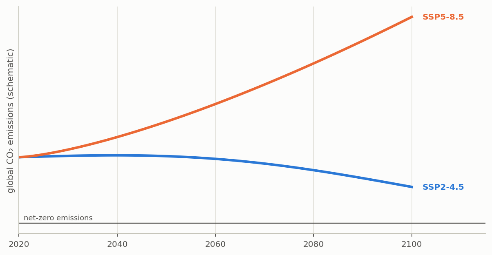

*Figure 36 — The shape of two typical emission pathways. The intermediate pathway has emissions that stabilise and then fall; the fossil-fuel-intensive one assumes high and growing emissions, without effective mitigation. The figure shows the shape of each one, not projected values.*

The **time window** is the slice of the future series on which the study is made. The
program lets you trim any period, with the start and end dates of step **1. Project &
Rainfall**. The most common convention is to take thirty-year windows, the same length as
climatological normals. The step warns when the slice is shorter than ten years. The
choice of window should relate to the intended service life of the system: assessing a
twenty-year tank, installed now, against the end of the century assesses a period in
which it will already have been replaced.

The choice of the **climate model** is the most delicate of the decisions, and a
subsection of its own is devoted to it further on.

---

### 3.2.3. How to conduct the study

The right procedure is to run the same project in each combination of interest and compare
the results with one another, instead of sizing directly on the projected series. Four
steps summarise it.

1. Close the sizing with the **historical** series. It is the reference.
2. Run the same project on the **simulated history** of each model you will use. It is
   against it, not against the observed series, that the future is compared.
3. Keep all the other parameters and change only the series, for each scenario and window.
4. Compare the **saving potential** and the **days of full supply**, always as a difference
   between the future and the history of the same model. The second usually degrades more
   than the first, because what changes first is the distribution, not the total.

> **An example of reading.** Suppose that, with one model, the potential is 36% in the
> simulated history and 33% in a future window, and that the observed series gives 37%.
> The change attributable to the climate is three points, not four: the remaining point is
> the difference between model and observation, which also exists in the past. (The
> numbers are hypothetical, to show the arithmetic.)

> **What not to do.** Size directly on the future series and present the result as a
> design. The future series is a projection with large uncertainty; it serves to test the
> **robustness** of a sizing done on the historical series, not to replace it.

---

### 3.2.4. The choice of model, and why it matters so much

Different climate models project different futures for the same city under the same
emission scenario, and that spread is not noise to be removed: it is the honest expression
of the physical uncertainty of the problem. For rain, the spread between models is often
larger than the difference between emission scenarios, which means that the choice of
model can weigh more on the result than the choice of socioeconomic future. The
consequence for the design is direct: running both scenarios with a single model informs
less than running one scenario with several models.

Three courses of action are defensible in the face of this spread, presented here in
decreasing order of rigour.

**Ensemble.** Run all the available models and report the range of results, with the
median. It is the most rigorous and the most expensive in computing time. Section 3.6
shows how to do it in batch.

**Justified subset.** Choose a few models with documented good performance for your
region, and declare the selection criterion and the source.

**Single model, declared as such.** Acceptable for an exploratory analysis, as long as the
text does not present the result as a robust projection.

> **What never to do:** run several models, pick the one that gives the most convenient
> result, and report only that one.

---

### 3.2.5. What the three sample cities suggest about a future climate

Studies that simulate rainwater harvesting systems under climate projections tend to
agree on one point: the change in the annual total of rain matters less than the change in
its **distribution**. Section 3.1 shows the same thing across space: Cape Town has
76% of London's rain and a ratio of 8.3 between its wettest and driest months, and its
potential is 14.52% against 20.08% with the same tank. A future climate with longer dry
spells behaves, for the tank, like a change of city, and a tank that is adequate today
may need to be larger to deliver the same reliability.

---

### 3.2.6. What to declare

A study with a climate scenario must state, in the method:

- the **model or models**, by name, and the selection criterion;
- the **scenario**;
- the **time window**, with the years;
- the **historical series** used as the reference;
- whether there was downscaling or bias correction, and which method, against which
  observed dataset;
- the **source of the series**, with the version;
- that the future was compared with the **simulated history of the same model**.

Without this, the result is not reproducible.

---

### 3.2.7. A caveat of method

Climate projections carry two stacked uncertainties of different kinds: that of the
scenario, which is socioeconomic and concerns future human choices, and that of the model,
which is physical and concerns the representation of the climate system. Neither is reduced
by running more simulations with the same material, because it is not sampling
uncertainty.

A study conducted honestly presents the result as a range, not as a single number, and
avoids conclusions that depend on the third decimal place of a projection for 2060.

---

## 3.3. Adjusting the tariff of your city

> **Question this guide answers:** is the tariff in my project the one the building is
> billed on, and is it entered correctly?

> **International Edition.** The program carries no tariff catalogue. The tariff is typed in,
> in the economic step, with a block table, a set of codes and six minimum-charge regimes. This
> guide describes them, so it is also the reference for entering any tariff structure. The three
> example projects (New York, London and Cape Town) each carry the published tariff of their
> city, with source and date.

This is the guide that changes results the most. The tariff structure decides the economic
feasibility of a rainwater system more than any design parameter, and it is also the input
that most often appears wrong in published studies on the subject.

---

### 3.3.1. How a water and sewage bill is made up

Before entering a tariff, it is worth understanding what is being entered. A water bill is
not the product of consumption by a single price, and five features set it apart from the
electricity bill, which is the reference most familiar to most readers.

**Provision is local, and so is the price.** Each city is served by one provider, public or
private, and each provider publishes its own table, approved by a regulator or by a public
board. There is no universal water tariff. The three example cities show it: New York charges
one price per volume, London charges a standing charge plus one price per volume, and Cape Town
charges four increasing steps plus a standing charge.

**The tariff may be progressive by consumption block.** Where it is, a cubic metre does not
cost the same at any quantity: consumption is divided into blocks, and each block has its own,
increasing price. ==Progressivity makes saving water more valuable than it seems:== the cubic
metre no longer consumed is the one of the highest block on the bill, the most expensive one.

**There may be a part that does not depend on consumption.** Many utilities charge something
even to those who consume nothing: a standing charge, a minimum bill or both. It is the subject
of the subsection on the six regimes, below, and it is the point that most decides whether a
rainwater system pays for itself.

**Sewage is charged on the water.** Providers bill sewage by applying a percentage to the
water part, by a price per cubic metre, or by blocks of its own. In New York the sewer charge is
a percentage of the water charge, so that each cubic metre saved is worth the water price
and the sewer charge together. In London, wastewater has a price per cubic metre of its own. In
Cape Town, sanitation is charged by four steps on 70% of the water consumed.

**There are different categories of consumer.** Utilities publish separate tables for
residential, commercial and other categories, often at higher prices than the residential one.
The program's tariff screen holds one structure per project: to study a school, a shop or an
industry, enter the structure of the category the building is billed in. Section 3.5 shows
the procedure.

---

### 3.3.2. Start by checking what is in the project

In the economic step, open the tariff screen. The program shows the structure in force in the
project: the block table, the sewage mode, the standing charges, the effective date and the
source recorded. In the example projects, the source and the date are filled in; in a new
project, you enter them. Three items deserve checking against your utility's current tariff
document, and the order matters because the first invalidates the others.

1. **the effective date**: tariffs are adjusted every year;
2. **the block values**;
3. **the minimum-charge regime**, which is item 3.3.4.

If any of the three differs, edit the table. The edit applies to your project and is saved
inside the `.triton` file, which means whoever receives your project will reproduce the same
calculation, with the same table.

---

### 3.3.3. How the table is built

Each row of the tariff structure is represented in the program by a quadruple of values:
the minimum volume of the block, the maximum volume, a monetary value and a code. The code is
the decisive element, because it is what says what that value means, and structures that
look alike charge in very different ways depending on the code of each row.

<!-- tabela: **Table 81** — The six tariff block codes and the effect of each one on the bill -->
| Code | What it is | How it enters the bill |
| ---: | :--- | :--- |
| 1 or 0 | consumption block | the price is charged on the volume that falls **within** each consumption block |
| −1 | availability charge | fixed value **added** to the consumption part |
| −2 | retroactive allowance | up to the allowance volume, the fixed value is paid; beyond it, **everything from zero** is charged |
| −3 | payment floor | the bill does **not** go below this value |
| 2 | exponential base price | `PB` of the formula `PB × Cⁿ`, valid up to the row's maximum |
| 3 | exponent of the exponential table | the `n` applied to the consumption **of the whole month** that falls in the row |

The London example, taken as an illustration of the notation, has two rows: one availability
charge (the water standing charge, spread by month) and one open consumption block.

```
(0.00 ; 0.00   ; standing charge per month ; -1)   availability charge, always added
(0.00 ; 999999 ; price per m³               ;  1)   one open consumption block
```

The Cape Town structure has the same availability row followed by four consumption blocks, one
for each step of the published table. The New York structure has one open block and, for the
minimum daily charge, a payment-floor row (code −3).

---

### 3.3.4. The six regimes, and why they decide projects

A minimum charge appears on the bill of many utilities, and it means **different** things in
each one. The program distinguishes six regimes:

<!-- tabela: **Table 82** — The six tariff regimes and what happens when saving in each one -->
| Regime | What happens when saving | Where it appears in the examples |
| :--- | :--- | :--- |
| **no minimum** | each m³ saved is deducted | none of the three |
| **availability charge** | likewise; the fixed fee remains, but it does not prevent the saving | London (standing charge); Cape Town (standing charge, with steps) |
| **exponential formula** | likewise; the m³ saved is worth the base price raised to the exponent | none of the three |
| **allowance in the minimum** | below the allowance, saving **deducts nothing** | none of the three |
| **retroactive allowance** | beyond the allowance, everything from zero is charged | none of the three |
| **payment floor** | the bill does not go below the floor | New York (minimum daily charge; it does not bind at the tutorial consumption) |

**The case that brings down studies.** Compare two hypothetical structures side by side, for the
same consumption. The prices are round numbers in currency units (cu), chosen to make the
arithmetic easy to follow; they are an illustration, not a tariff:

<!-- tabela: **Table 83** — Effect of the water saving on the bill in two opposite tariff regimes (hypothetical structures, in currency units) -->
| Consumption | Structure A, allowance in the minimum (50 cu for the first 10 m³, then 5 cu/m³) | Structure B, availability charge (40 cu plus 5 cu/m³) |
| ---: | ---: | ---: |
| 14 m³ | 70 cu | 110 cu |
| 12 m³ | 60 cu | 100 cu |
| 10 m³ | 50 cu | 90 cu |
| 8 m³ | **50 cu** | 80 cu |
| 5 m³ | **50 cu** | 65 cu |

In structure A, the bill **stops falling at 10 m³**. A house that consumes 12 m³ and installs a
system that saves 4 goes down to 8, and saves 10 cu, not the 20 cu the average price of
5 cu/m³ would suggest. If it saved 7, it would go down to 5 and save the **same** 10 cu: the three
additional cubic metres are worth nothing.

In structure B, each cubic metre saved reduces the bill, down to the first one.

> Running a case of structure A with the data of structure B produces a payback that does not
> exist. Check the regime before trusting any economic result.

The three example cities are all in the second family: in each, every cubic metre saved reduces
the bill. In New York, for the tutorial house, the bill without the system is for 18.26 m³ a
month, US$ 89.37; with the system, 13.31 m³ and US$ 65.15; the saving is 4.95 m³ and
US$ 24.21 a month. The two prices (water and sewer) are both earned on every cubic metre saved,
which is why the saving per cubic metre is more than twice the water price alone.

Figure 37 shows the three responses side by side. What distinguishes the regimes
is not the price charged, but the shape of the curve: ==where the curve is horizontal,
saving water does not reduce the bill at all.==

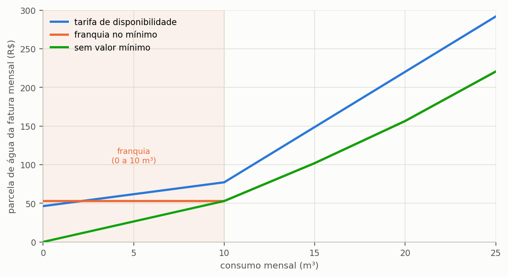

*Figure 37 — Water part of the monthly bill as a function of consumption, in three minimum-charge regimes. Sewage is not in the chart because it is charged as a percentage of this part and only multiplies the curve, without changing its shape. With the availability charge and with no minimum, each cubic metre saved reduces the bill from the first one; with the allowance in the minimum, the horizontal stretch marks the consumption range in which saving water does not reduce the bill.*

---

### 3.3.5. The exponential formula

Some utilities do not charge water by blocks. The water part of the bill is given by a formula:

```
Water = PB × Cⁿ + SB
```

where `PB` is the base price, in currency per m³; `C` is the month's consumption, in m³; `n` is
the exponent that the utility's **exponent table** gives to that consumption; and `SB` is the
basic service, charged even without consumption. Typically `n` is 1.00 up to a threshold and rises
with consumption from there on.

Two differences from the blocks decide the calculation:

- **The exponent applies to the whole consumption.** With blocks, each cubic metre is charged
  at the price of the block it falls in; with the formula, the `n` of the row in which the
  total consumption falls applies to the whole volume. Going over a threshold therefore raises
  the cost of the cubic metres below it as well.
- **There is no price step, there is a curve.** The mean price of a cubic metre of water is
  `PB × Cⁿ⁻¹`: constant while `n` is 1 and growing after that.

For rainwater harvesting, the consequence is that **every saving is deducted from the first
cubic metre**, and deducted more where the exponent is larger.

None of the three example cities uses this regime. In the program, the formula enters the same
table of quadruples, with two codes of its own: a row of code 2 holds the base price `PB`, and
one row of code 3 for each interval of the exponent table holds the `n`.

```
(0.00 ; 0.00   ; SB  ; -1)   basic service, always added
(0.00 ; 999999 ; PB  ;  2)   base price PB
(0.00 ; 20.00  ; 1.00 ; 3)   n for consumption in (0, 20]
...                          one row per interval of the exponent table
```

In the **Tariff Manager**, the structure appears with the label «Exponential formula», the
«Exponent n» rows can be edited, the simulator shows the `PB × Cⁿ` calculation for the chosen
consumption, and the upper chart shows the mean price `PB × Cⁿ⁻¹` instead of the steps. The
sewage field becomes «Sewage (per m³ consumed)», and the economic step offers the same mode,
«Per m³ consumed», next to the fixed value and the percentage of water.

---

### 3.3.6. When the minimum is diluted into the tariff

A frequent error in tariff tables: the utility states «minimum bill of 50 for 10 m³», and
whoever registers it records it as 5 per m³ up to 10 m³.

The difference is enormous. In the first reading, someone who consumes 4 m³ pays 50; in the
second, 20. And, worse for a rainwater study, in the second reading saving below 10 m³
**is deducted**, when in reality it is not.

If you register a new tariff, **check this**: a minimum stated as a bill is an availability
charge or an allowance, not a price per cubic metre.

---

### 3.3.7. Sewage

The sewage percentage applies to the **water part** of the bill, not to the total bill.

In New York the sewer charge is 159% of the water charge, so the sewer part is larger than the
water part, and the two together are the cost of each cubic metre. Where the percentage is
100%, the sewage part equals the water part and sewage is **half the bill**. Saving water saves
both parts, and that is why the effective value of the cubic metre saved is higher than the
water price.

Some utilities charge sewage by a price per cubic metre (London) or by blocks of its own on a
fraction of the water volume (Cape Town, on 70% of the water consumed). The program has one mode
for each: percentage of the water part, price per cubic metre, and blocks on a fraction of the
volume. Choose the one that matches the document.

---

### 3.3.8. Effective date, escalation and alternative tables

A table applies from the date of the document it came from, and there is not always a newer one.
The tariff dialogue shows that date next to the **Study base date**, which is stored in the
project. Between the two, the program applies the escalations already due, at the configured
escalation rate, and the following ones fall on the anniversaries of the table, not twelve
months after the study starts. This is an estimate, because the escalation actually granted may
have been different; with the current table at hand, type it in with its own date. An old
project, without the dates, stays as it was.

Some cities have more than one residential table, for example by property size, by meter size or
by area. Choose the table that matches the property, and record in the project why it represents
it. Anyone with the property's own bill can, as always, type the table in.

### 3.3.9. Where to find the data

In order of reliability:

1. **Tariff document** of the regulator, the public board or the utility. It is the official
   document, and it has the effective date.
2. **Table published by the utility**, usually under «charges» or «tariffs» on its website.
3. **Bill simulator** of the utility, when there is one. Good for checking: simulate two
   consumptions and see whether your table reproduces both values.
4. **Real water and sewage bill**, of the property itself. It is the best evidence, and it
   allows the whole structure to be checked.

> **Always record the effective date and the source.** A study that does not say when the
> tariff dates from cannot be reproduced two years from now.

---

### 3.3.10. Check before you trust

After building the table, do the test that item 3.3.7 suggests: simulate two
consumptions, one inside and one outside the minimum block, and compare with the real bill or
with the utility's simulator.

If both match, the structure is right. If only one matches, the minimum-charge regime is
wrong, and that is exactly the error that most compromises a rainwater study.

---

## 3.4. Modulating the demand by calendar

> **Question this guide answers:** and when consumption is not the same every day?

Schools close for holidays, beach hotels fill up in summer and offices empty at
weekends. Treating any of these buildings as if it had a uniform consumption errs in both
directions at once: it overestimates the demand in the empty periods and underestimates it
at the peaks. ==The error does not cancel out over the year, because what matters to the
rainwater system is not the total consumed but the match between consumption and the rain
available on that day.==

---

### 3.4.1. The four modes

The program offers four modes of demand modulation, which differ in the number of values
the user enters and in the situation in which each one is justified (Figure 38).


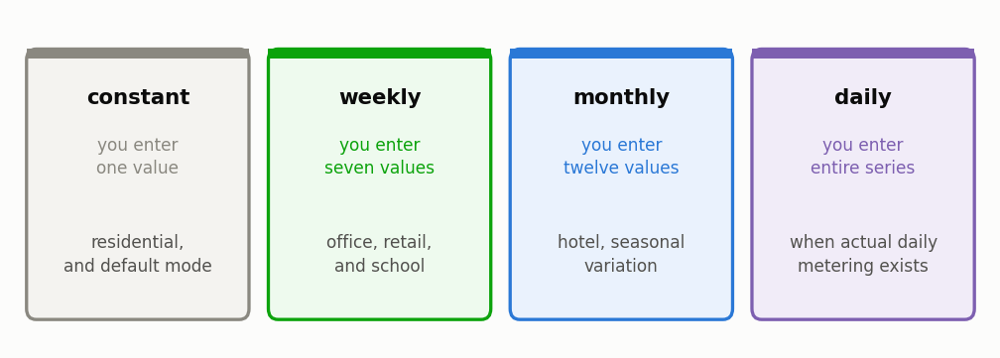

*Figure 38 — The four modulation modes, what each one asks of the user and the situation in which each one is justified. The daily mode only makes sense when there is real measurement, because inventing a daily series adds apparent precision without adding information.*


In any of them you can modulate three things independently: the **per capita demand**, the
**number of occupants** and the **fraction suppliable by rainwater**.

Modulating occupancy is usually more faithful than modulating demand: in a school on
holiday it is not that the pupil drinks less water, it is that there is no pupil.

---

### 3.4.2. How to fill it in

In step **2. Building & Demand**, choose the mode. The table of the period opens.

- An empty or zero cell **falls back to the constant value**. This is deliberate: it lets
  you modulate only the months of interest and leave the rest at the default.
- The values can be typed or loaded from CSV.
- In the daily mode, the first day of the demand series lines up with the first day of the
  **rainfall series**. If the two have different lengths, the demand series is recycled
  cyclically.

---

### 3.4.3. Why this changes the result

Modulating the demand does not change only the annual total consumed; it changes the timing
match between supply and demand, which is precisely the problem the tank exists to solve. Two
cases from the manual illustrate the reach of this effect.

**A school that closes for holidays.** The cistern is not drawn on while the pupils are away.
Whether that helps depends on when the holiday falls relative to the rain. In the London school
of the manual (300 pupils, 40 L per pupil per day, demand modulated by day of the week, a
30,000 L tank), the weekly profile yields 12.58%, against 12.63% for the same annual demand
spread evenly: 0.05 percentage points. Rain in London is well distributed through the year, so
the weekly rhythm of a school changes almost nothing. A school profile with term and holiday
months would test the idea of a closing during the dry season; the manual has no such case.

**A beach hotel with concentrated occupancy.** In the Cape Town hotel of the manual (800 m² of
roof, 60 guests, 200 L per guest per day, 45% suppliable by rainwater, a 25,000 L tank),
occupancy runs from 95% in January to 20% in June, and the hotel is fullest from December to
February, the dry season. Run with the Cape Town series, the monthly profile yields 9.83%
against 10.97% for the same annual demand spread evenly (a mean of 5,779.9 L/day): 1.14
percentage points less. The demand is concentrated in the months with the least rain, and the
tank, which fills in winter, is drawn down in the dry summer.

The two cases look different, and the rule they support has two parts. ==A demand spread over the
year makes better use of the same tank; a demand concentrated in a few months loses yield, and
loses more when those months are the dry ones.== The Cape Town hotel combines both effects,
concentration and phase: its peak falls in the dry season, and it is not possible to separate the
two with this one run. To isolate the effect of concentration, compare the same profile shifted by
six months, or against a constant demand.

A difference of more than one percentage point is large for a change that does not alter a
single litre of the annual consumption, and it is entirely invisible to any calculation made on
means, which is exactly why Triton simulates day by day. The profiles are in
Figure 39, and the yield of each one in Figure 40.

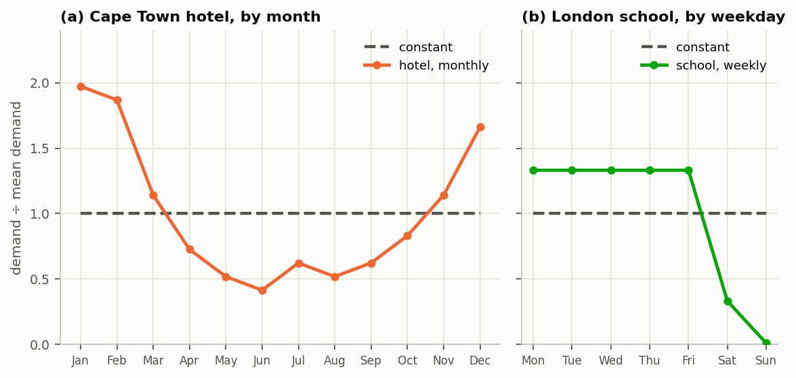

*Figure 39 — Demand profiles used in the comparison, expressed as the ratio between the month's demand and the mean demand. All have exactly the same annual consumption; what changes is how it is spread over the twelve months.*

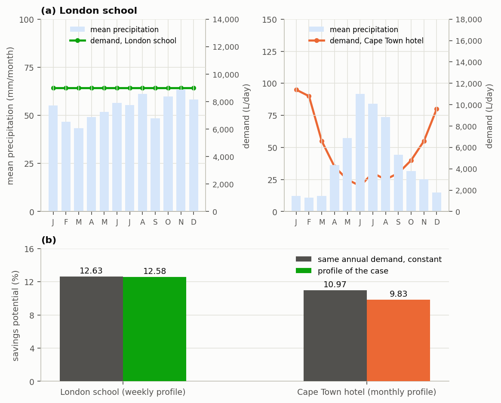

*Figure 40 — (a) Demand profiles of the school and the hotel over the mean monthly precipitation of the city of each case; (b) saving potential of each profile against the same annual demand spread evenly. The hotel profile concentrates the demand in the dry months, and it is this concentration that costs it 1.14 percentage points.*

---

### 3.4.4. The suppliable fraction can also vary

Less obvious and sometimes more important. In a school, the percentage of non-potable use
changes between term time and holidays: during the holidays, floor washing and garden
watering remain, and they are uses **entirely** suppliable by rain.

Modulating the fraction captures this. Keeping the fraction constant underestimates the yield
in the period of low occupancy.

In the table, the «Indoor Non-Potable (%)» column is a percentage, like every field you type
in: 28 means 28%. In the project file, the same column is saved as a fraction, 0.28, and
section 4.2 explains why. A cell with a value between 0 and 1 turns orange.

---

### 3.4.5. Precautions

**Do not modulate what you have not measured.** An invented modulation adds apparent precision
without adding any information, and passes on to the reader the impression of a rigour the
data do not have. When in doubt, an explicitly declared constant demand is more honest than an
arbitrary monthly profile.

**Declare the origin of the profile.** It may come from your own measurement, from twelve
monthly water and sewage bills, from a bibliographic reference or from an estimate, and those
four origins do not carry the same weight of evidence in a published study.

**Check the annual total after modulating.** The program shows the mean daily demand
resulting from the modulation, and a difference between that value and what was expected is
the quickest indicator of an error in filling the table.

---

### 3.4.6. The simplest way, when there is one

If you have **twelve water and sewage bills** of the building, you have the measured monthly
profile, which is the best possible source. Divide each month's consumption by the number of
days and by the number of occupants, and use the monthly mode.

Twelve bills are worth more than any reference from the literature.

---

## 3.5. Simulating schools, hospitals and shops

> **Question this guide answers:** does the program work for non-residential buildings?

It does, and it works well for the water side. There is, however, a weighty caveat about
the economic side, and it must be known before the study starts, not after it is finished.

---

### 3.5.1. The caveat: the tariff category

Utilities charge different tariffs depending on the consumer category (residential,
commercial, industrial, public), and the non-residential categories often cost more than the
residential one. The program has no catalogue of tariffs: the tariff is always typed in.
Enter directly the tariff of the category the building is billed in. The three example
projects carry a **residential** tariff, so they are right for a house and would be the wrong
tariff for a school, a hotel or a shop.

> **What to do, in five minutes.** Look up your utility's current tariff document, which is
> usually on its website under «charges» or «tariffs». Find the table of the category of
> interest. Enter the blocks in the custom mode of the tariff screen, with the corresponding
> minimum-charge regime. Section 3.3 describes each field. Once that is done, the economic
> result becomes that of your case, and not a residential approximation.

The two non-residential cases of the manual, the London school and the Cape Town hotel, keep
the residential tariff of their city and leave the costs at zero: they compare rainfall and
demand, not money. Take their percentages as water results, and do not read an economic
conclusion into them.

Declare which category the tariff belongs to. A study that applies a residential tariff to a
non-residential building states a limitation, and the direction of the error is usually
conservative, because non-residential categories tend to be dearer; but that is a property of
the tariff document, and you must check it in yours.

---

### 3.5.2. The available building types

The program's eight building types are grouped by the tariff category the utility bills them
in, and each one has its own unit of consumption (Figure 41). The unit of
consumption changes the meaning of the per capita value entered, and the category decides the
block structure of the bill: simulating a school with a residential tariff is one of the
mistakes described in section 5.1.


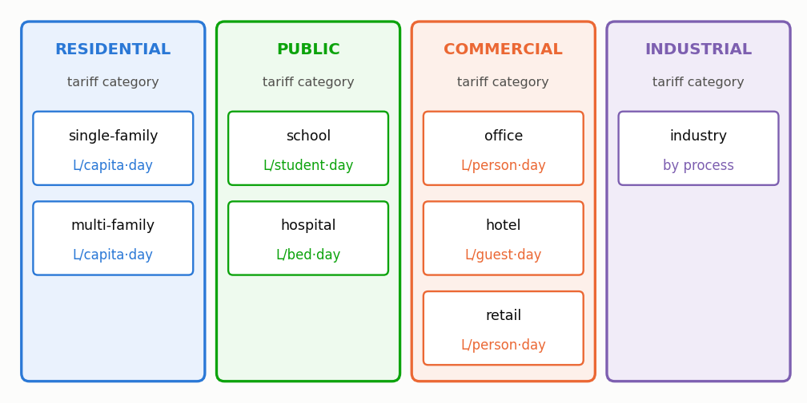

*Figure 41 — The eight available building types, grouped by the tariff category the utility charges. The unit of consumption changes with the building type, and it is what gives meaning to the per capita value entered.*


---

### 3.5.3. What changes with each building type

**School.** It is a favourable case for rainwater harvesting for two reasons that add up. The
non-potable share of consumption is high, because the toilet dominates use and many units have
neither showers nor a kitchen. And the roof area per pupil is usually large, so supply is rarely
the limiting factor.

Modulation by calendar, however, has an effect that depends on the climate, and it is better to
simulate it than to assume the result. The manual's school is in London: 1,200 m² of roof, 300
pupils, 40 L per pupil per day, 70% suppliable, a demand modulated by day of the week (40 L on
five days, 20 L and 5 L on the weekend days) and a 30,000 L tank. It yields 12.58%, against
12.63% for a constant demand of the same annual total (a mean of 9,014.3 L/day). The weekly
rhythm alone changes almost nothing, because London rain is spread through the year and the
tank refills during the weekend. A school that closes in a dry season would behave differently,
and the monthly profile of section 3.4 is the tool for that case; the manual has no
monthly school profile to quote. Section 3.1 shows how the distribution of rain changes
from one city to another.

**Hospital.** The most delicate case. High, continuous consumption, without relevant
seasonality, which is good for harvesting. But the **quality requirement** is different:
there are uses that do not admit rainwater under any circumstances, and the cooling tower,
which would be an ideal use, requires microbiological control against Legionella. Treat the
quality class with care, and do not use the program's classes 2 to 4 as if they were a
normative requirement: they are criteria adopted by the program, and the requirement of the
case is set by the health authority and the applicable standard.

**Office and shop.** Demand concentrated on working days, five days out of seven. Modulate by
week. The non-potable share is high because almost all consumption is toilets, urinals and
cleaning. The suppliable fraction varies a great deal between offices, even within one city, and
it should come from the building studied whenever possible: measure it, or survey it as
described below, before taking a value from a reference.

**Hotel.** Strong seasonality, and the case in which monthly modulation matters most. See the
Cape Town hotel of section 3.4: with occupancy concentrated in the dry summer, it yields
9.83% against 10.97% for the same annual demand spread evenly, a loss of 1.14 percentage
points. A concentrated demand wastes tank capacity, and the loss is larger when the
concentration falls in the dry season.

---

### 3.5.4. Where to get the non-potable fraction from

The suppliable fraction is the ceiling of the saving potential, as section 2.3 shows,
and it is therefore the parameter that weighs most on the result of a non-residential
building. There are three ways of obtaining it, in decreasing order of reliability.

**Measuring the end uses.** Sub-meters or flow loggers on the branches, for a few
representative weeks. It is the only way that produces a number for the building, and not an
average.

**Survey by interview and flow.** Ask the occupants
the frequency and duration of each use and multiply by the measured flows of the fixtures. It
costs little and captures the real behaviour of the building, but it depends on the memory of
those interviewed.

**Reference value from the literature.** Acceptable in a preliminary study, as long as the
reference is of the same building type, from the same country and, ideally, from the same
region. Avoid transposing residential fractions to other building types, and even among
dwellings the variation is large, and the toilet share of a household differs a lot from that
of an office or a school.

> **Declare the route.** «Suppliable fraction of 60%, measured» and «suppliable fraction of
> 60%, from a reference» are different studies, and the reader needs to know which of the
> two they are reading.

---

### 3.5.5. Individual metering and the number of dwelling units

In a multi-family building with individual metering, enter the **number of dwelling units**.
The program evaluates consumption at the level of **one** unit and multiplies by the number
of units.

This matters because of the progressive blocks: a building of twenty apartments with
individual metering pays twenty bills in the first block, not one bill that adds up all the
consumption and falls in the most expensive block. Treating the building as a single unit
would grossly overestimate the saving.

---

### 3.5.6. What to declare

Besides what section 4.10 already asks for:

- the **building type** and the unit of consumption adopted;
- the **origin** of the per capita consumption — measurement, reference or standard;
- the **tariff category** entered, and whether it is the one the building is billed in;
- the **modulation profile** and its origin;
- for a hospital, the quality class adopted and what it covers.

---

## 3.6. Comparing many cases at once

> **Question this guide answers:** how do I compare dozens of alternatives without redoing
> the whole project for each one?

The program was built to compare alternatives, and it offers three different ways of doing
it. The choice between them is not a matter of preference: each way answers a different
question, and using the wrong one costs time without producing the information wanted.

---

### 3.6.1. The three ways

<!-- tabela: **Table 84** — The three ways of comparing alternatives depending on what varies between them -->
| If what changes is | Use | Where |
| :--- | :--- | :--- |
| **only the cistern volume** | the sweep | step 4. Reservoir & Costs |
| **the volume, and you want to decide** | the multi-criteria table | step 8. Multi-Criteria Decision |
| **any other assumption** | saved projects, one per case | `.triton` file |

The first is automatic, the second too, and the third needs organisation.

---

### 3.6.2. The sweep: dozens of volumes in one pass

In step **4. Reservoir & Costs**, choose the **sweep** mode and enter the maximum volume and
the step. The program simulates all the volumes of the grid and draws the curve.

The sweep is the normal way of working, not an advanced function reserved for special cases:
it is almost always the right answer, because «which volume should I adopt?» is the central
question of every rainwater harvesting project. Section 4.4 goes through a complete sweep
step by step, and section 2.2 formalises how the grid of volumes is built.

The computational cost is modest and does not justify hesitation: a sweep from 0 to 20,000 L
with a 1,000 L step means twenty-one simulations of thirty years each, and it finishes in a
few seconds on an ordinary computer.

---

### 3.6.3. The multi-criteria table: all volumes, all dimensions

Step **8. Multi-Criteria Decision** shows, in a single table, each volume of the sweep with:

- the water saving and the days of supply;
- the net present value, the discounted payback and the internal rate of return;
- the net carbon at the end of the service life and the environmental payback;
- the TOPSIS score and the SMAA-VIKOR acceptability.

It is the densest way of comparing alternatives the program offers: ten answer columns for
each volume row. The **decision profile** changes the weights of the dimensions and re-ranks
the table on the spot. Section 2.10 explains the methods behind it.

---

### 3.6.4. When something other than the volume changes

City, tariff, demand, tank material and building type are parameters the sweep does not go
through, and to vary any of them the way is to keep one saved project per case. The procedure
below looks bureaucratic at first sight and saves hours of rework, above all when the study is
picked up again weeks later.

1. Build the complete project once, in full detail.
2. Save it with a name that describes the case: `school_london_30000.triton`.
3. Change **one** thing, and save it under another name.
4. Run each one, and note the result in a spreadsheet of your own.

The example files of the manual were made this way: `01_tutorial_new_york.triton`,
`02_london.triton` and `03_cape_town.triton` are the same project, with the rainfall series and
the tariff swapped. That is what section 3.1 compares. (Swapping the city swaps two
things at once; the manual does it on purpose, because the tariff does not change the water
result, and the water result is what the comparison is about.)

> **Change one thing at a time.** If you change the city and the tariff together, the result
> changes and there is no way of knowing which of the two moved it. It seems obvious, and it
> is the most common error in comparative studies.

---

### 3.6.5. How to organise the files

A naming convention saves more time than it seems:

```
school_study/
   base.triton
   city_new_york.triton
   city_cape_town.triton
   tariff_commercial.triton
   demand_measured.triton
   results.xlsx
```

And three habits that avoid rework:

**Keep the project, not just the result.** The `.triton` file has the rain inside it and
reproduces the whole study; the results spreadsheet does not.

**Note what changes in the file name.** Six months later, `test3.triton` means nothing.

**Export to a spreadsheet at the end of each round.** Step **10. Export** saves the tables
in `.xlsx`, and that is where the comparison between cases is put together.

---

### 3.6.6. How many cases fit

The program imposes no limit on the number of cases compared, and the real limit is the
analyst's patience: each thirty-year simulation takes fractions of a second, but building and
checking each project takes minutes, and it is the checking that takes the time.

In practice, a well-run comparative study gathers between five and twenty cases. When the
number grows far beyond that, it is usually a sign that the research question was not
narrowed down enough — or that the work is a large-scale study, which needs other tools.

For large-scale studies — factorial matrices of city, area, demand and volume, or uncertainty
propagation — the program offers a command-line interface, described next.

---

### 3.6.7. The command line

Installing the program as a Python package registers the `triton` command, which runs the
same calculation routines as the graphical interface without opening the window; the Windows
installer with the graphical interface does not include it. The command line reads `.triton`
files, projects in structured JSON and a legacy semicolon-separated text format, and writes the results in
text, JSON, CSV, HTML or XLSX. It is the interface suited to reproducible studies, because the
command itself documents the assumptions changed.

<!-- tabela: **Table 85** — Subcommands of the command line and the purpose of each one -->
| Subcommand | Purpose |
| :--- | :--- |
| `validate` | checks the structure of the project, the rainfall series and the essential assumptions, without simulating |
| `run` | simulates the project; by default, only the technical analysis |
| `analyze` | runs the complete chain: technical, economic, environmental and TOPSIS |
| `econ` | runs the economic analysis |
| `init` | creates a template `.triton` project, editable, with the rainfall series referenced or embedded |
| `init-catalog` | creates a template JSON catalogue of building or climate assumptions |
| `matrix` | combines a catalogue of assumptions with a catalogue of climates and simulates every combination |
| `matrix-projects` | runs a list of projects, a folder of rainfall series or the factorial matrix declared in the project |
| `batch` | runs the scenarios of a CSV or XLSX spreadsheet, from a base project |
| `uncertainty` | propagates uncertainties by Monte Carlo for one tank volume |
| `series-length` | answers how many years of rain the project needs, by the method of Geraldi and Ghisi |
| `stochastic-demand` | draws the daily consumption at random and returns the performance as a range, not as a single number |

The subcommands `run`, `analyze` and `econ` accept the same options: `--analysis` chooses the
analysis (`technical`, `economic`, `environmental`, `topsis` or `all`); `--volume` fixes the
lower tank volume, in litres; `--rainfall` replaces the project's rainfall series;
`--set FIELD=VALUE` changes a project field and can be repeated; `--weights` gives the
technical, economic and environmental TOPSIS weights; `--weight-sensitivity N` draws N weight
vectors and reports how often each volume wins; `--format` and `--output` set the output
format and file; and `--seed` fixes the seed of the stochastic analyses, so that the result is
reproducible.

Applied to the tutorial project, `validate` and `run` look like this (the command line prints
a confirmation in the language of the program's interface):

```
triton validate 04_tutorial_sweep.triton

triton run 04_tutorial_sweep.triton --volume 4000 --format json --output r.json
```

The file `r.json` records the provenance (source project, number of days of the series and start
date) and, for the 4,000 L volume, the saving potential of 26.83% and the classification of the
days into full, partial and no supply, with 95.3% full days.

The `uncertainty` subcommand draws, in each sample, the precipitation, the catchment area, the
demand and the investment with a distribution of declared coefficient of variation, and reports
the 5%, 50% and 95% percentiles of the saving potential and of the net present value, with the
probability of the net present value being positive. Run it on the tutorial with a modest number
of samples and a fixed `--seed`, and read the percentiles of the potential as a range, not as a
single number. Because the tutorial system already works close to the 28% ceiling, a moderate
variation in rain or demand moves the potential little, whereas the net present value, which in
the tutorial is negative with the illustrative costs of section 4.7, moves in proportion to
the investment and the tariff. The probabilistic modulation, described in its own chapters, does the same job from
the graphical interface.

The `series-length` subcommand does, with no screen time limit, the analysis the sweep step
offers in the «is the rainfall series long enough?» button, described in section 2.2.
Without `--windows`, it goes through **all** the possible windows, which is the exhaustive mode
of the papers; with `--windows N`, it draws N windows per length, with the declared seed. The
options `--max-volume`, `--step` and `--threshold` define the grid and the marginal-gain
threshold, and `--confidence` and `--tolerance` define the similarity criterion.

The `stochastic-demand` subcommand draws the consumption **day by day** and runs the simulation
many times, returning the saving potential, the days of full supply and the overflow as a range
between the 5% and 95% percentiles. There are two variation parameters, and the difference
between them is what the subcommand has to teach: `--daily-cv` is the variation from one day to
the next, and `--level-uncertainty` is the uncertainty about how much the building consumes on
average. ==The first hardly moves the result — drawn independently every day, it cancels out
over a thirty-year series —, and the second does.== With `--absence` you declare the probability
of a day with no consumption at all, such as a trip, and with `--ideal-volume` the program also
works out the ideal volume of each realisation, which is what measures whether the design
decision withstands the uncertainty of consumption.

This subcommand has no equivalent in the graphical interface, and that is a design decision:
there are many parameters, reading them requires care, and on the screen they would confuse
more than they would help.

> The subcommands `compare-mass` and `run-vaz-study` run research studies of the group on climate
> databases of tens of thousands of series, and require the files of those databases; they are not
> part of the everyday use of the program.

---

## 3.7. Sensitivity analysis

> **Question this guide answers:** which assumption moves my result the most, and how
> much can it take?

Every rainwater harvesting study rests on uncertain assumptions, and the three most
influential are usually precisely the least verifiable: will the tariff really rise 5% a
year for twenty years? Is the demand really 150 litres per person per day? Will the cistern
cost what the quotation says?

Sensitivity analysis measures how much of these doubts reaches the final result. ==It does
not remove the uncertainty, and does not try to; it measures the size of the uncertainty,==
which is exactly the information the reader needs to decide how far to trust the number
presented.

---

### 3.7.1. The procedure, in three steps

The procedure needs no specialised tool, and it is the same as in any engineering analysis
faced with a poorly known parameter: vary one thing at a time and observe the effect.

1. **Choose the assumption** you suspect is the most influential.
2. **Run the project three times**: with the likely value, a low value and a high one.
3. **Note the result of the three** and compare.

Repeat the procedure for each doubtful assumption. In the end you will have identified
which of them actually move the result and which are irrelevant — and that separation is
worth more than any refinement of the central value, because it shows where to invest
data-collection effort. Section 3.6 shows how to organise the files so that the set of
runs does not turn into confusion.

---

### 3.7.2. Which range to adopt for each assumption

The range of variation to adopt for each assumption is not a matter of guesswork: it
follows from what is known about the origin of the data, and a measured value admits a much
narrower range than a value taken from the literature (Figure 42). The tariff
escalation is expressed in percentage points per year; the other ranges, as a percentage of
the value adopted.

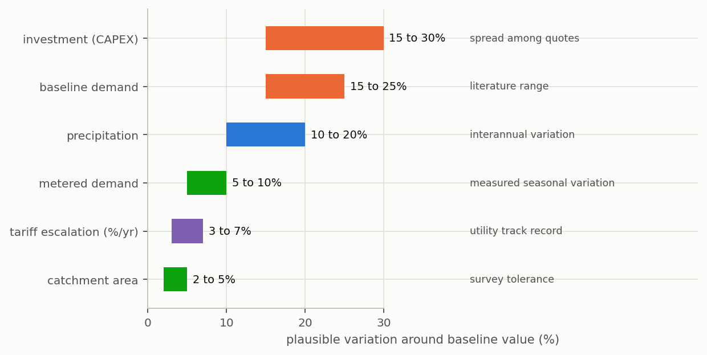

*Figure 42 — Plausible range of variation of each assumption in a sensitivity analysis, with the origin of the uncertainty. The widest ranges correspond to assumptions taken from a reference, not measured in the project.*


> **Do not perturb what you know.** If the area was measured in a survey, the range is
> narrow; widening it produces an artificial uncertainty that dilutes the result and hides
> the assumption that really matters.

---

### 3.7.3. The assumptions that dominate the economic result

In economic studies of rainwater harvesting, the assumptions that move the result most are
those that act over the whole analysis horizon: the analysis period itself, the volume of
rainwater actually consumed, the minimum attractive rate of return and the **tariff
escalation**. The escalation deserves particular attention because it is the least
verifiable and it compounds: five per cent a year for twenty years multiplies the tariff by
2.65; three per cent, by 1.81; and seven per cent, by 3.87. The saving of the last years
follows that factor, and the choice of escalation rate can decide a good part of the
study's economic conclusion.

Try it on your case: in step **6. Economic Results**, change the annual escalation to 3%,
note the NPV, repeat with 5% and with 7%. Three runs, three minutes, and a range instead of a
number.

> **In a paper, show that range.** A single net present value, calculated with a 5% annual
> escalation and presented without sensitivity, suggests a precision the assumption does
> not have.

#### 3.7.3.1. The tutorial, assumption by assumption

The table below applies the procedure to the final tutorial project, in New York: 4,000 L in
polyethylene, pumping to a 1,000 L tank, with the illustrative costs of the manual (illustrative,
not market prices). The likely net present value is negative, about −US$ 3,020. The table varies
five assumptions, one at a time, between a low and a high value.

<!-- tabela: **Table 86** — Potential, net present value and payback of the final tutorial project with each assumption varied alone, from the low to the high value (costs are illustrative, not market prices) -->
| Assumption | Low | Likely | High | Potential | 20-year NPV (illustrative, not a market price) | Discounted payback |
| :--- | ---: | ---: | ---: | ---: | ---: | ---: |
| tariff escalation, water and sewer, % per year | 1.0 | 3.0 | 5.0 | 27.09% to 27.09% | −US$ 3,760 to −US$ 2,093 | no payback to no payback |
| minimum attractive rate of return, % per month | 0.2 | 0.4 | 0.6 | 27.09% to 27.09% | −US$ 2,149 to −US$ 3,659 | no payback to no payback |
| per capita consumption, L/person·day | 120.0 | 150.0 | 180.0 | 27.64% to 26.09% | −US$ 3,892 to −US$ 2,282 | no payback to no payback |
| suppliable fraction, % | 20.0 | 28.0 | 40.0 | 19.84% to 35.26% | −US$ 4,289 to −US$ 1,590 | no payback to no payback |
| cistern price, % of the budget | 70.0 | 100.0 | 130.0 | 27.09% to 27.09% | −US$ 2,330 to −US$ 3,710 | no payback to no payback |

The first thing to read is what does **not** happen: no assumption, at the low or at the high
value, makes the net present value positive, and none produces a payback. With the New York
tariff and these costs, the tutorial system does not pay for itself within twenty years, and no
single doubt in the inputs changes that. The reason is the price of water, which is low relative
to the cost of the works; it is not a defect of the example. Read the rest of the table with this
in mind: the question is not which assumption makes the project viable, but which one moves the
result most.

**The one that moves it most is the suppliable fraction.** From 20% to 40%, the potential goes
from 19.84% to 35.26% and the net present value from −US$ 4,289 to −US$ 1,590, the widest range
of the five. It is the assumption section 4.2 fixed and that depends on the decision about
uses, not on measurement: including or not the washing machine, against the quality criterion
applicable to the case, moves the result more than any economic parameter.

**Those decided by the market and the household weigh next.** The tariff escalation moves the net
present value from −US$ 3,760 (1% a year) to −US$ 2,093 (5% a year), and the minimum attractive
rate of return from −US$ 2,149 (0.2% a month) to −US$ 3,659 (0.6% a month); neither touches the
potential. Per capita consumption moves both: from 120 to 180 L per person per day, the
potential falls from 27.64% to 26.09% while the net present value rises from −US$ 3,892 to
−US$ 2,282. With more consumption the suppliable fraction applies to a larger demand, the
cistern runs short more often, the potential falls a little, and the saving in money rises.

**The one that seemed important hardly weighs.** Between 70% and 130% of the cistern price, the
net present value goes from −US$ 2,330 to −US$ 3,710, a range smaller than the others. The
polyethylene cistern is a small share of the investment, and labour, piping and accessories,
which do not vary with the volume, dominate the account.

The result reverses the intuition of anyone who prices before simulating: spending time
quoting the cistern is worth less than spending time defining the uses.

---

### 3.7.4. The sensitivity the program does by itself

There is one case in which the sensitivity analysis comes ready and needs no additional
runs, and it concerns the final decision of the study: the choice of volume as a function
of the weights given to the criteria.

In step **8. Multi-Criteria Decision**, the **SMAA-VIKOR acceptability** column is already a
ready-made sensitivity analysis. It answers: if the weights of the dimensions were drawn at
random instead of fixed, how often would each volume come first?

Read it like this:

<!-- tabela: **Table 87** — Reading the SMAA-VIKOR acceptability of the winning volume -->
| Acceptability of the winning volume | What it means |
| :--- | :--- |
| above 70% | robust recommendation; the weights hardly matter |
| between 40 and 70% | reasonable recommendation, and it is worth declaring the second option |
| below 40% | the choice depends on the weights, and the text must say so |

The distinction this column allows is epistemological, not only statistical: a volume that
wins in 80% of the weight draws is a recommendation, whereas a volume that wins in 30% is a
preference of the analyst, legitimate as long as it is presented as such. In the New York
tutorial the winning volume, 4,000 L, has an acceptability of 45.8%, with 5,000 L second at
21.5%: a reasonable recommendation, for which the second option is worth declaring. Section 2.10
sets out the method that produces this number.

---

The tornado chart (Figure 43) is the established way of presenting this set: one
bar per assumption, ordered by range, with the two variations in different colours. Read
from top to bottom, it answers the question the reviewer will ask first, which is on which
assumption the result depends.

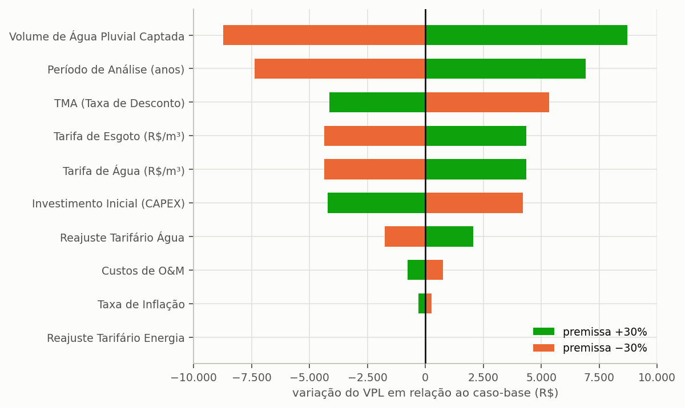

*Figure 43 — The variation of the net present value when each assumption is changed by 30% up and down, keeping the others. The colour identifies the variation applied, not the sign of the effect: that is what makes it possible to see that raising the minimum attractive rate lowers the present value, whereas raising the tariff increases it. The base case of this figure comes from the program's simplified economic model, which discounts an annual flow with a single marginal tariff and the declared escalation; that is why the base-case present value does not match that of the tutorial's monthly cash flow. What the tornado measures is the relative sensitivity, not the absolute value.*

---

### 3.7.5. How to present it

Three ways, from the simplest to the most complete:

**Scenario table.** Pessimistic, likely and optimistic, with the assumptions of each one
declared. Simple, honest and enough for most work.

**Tornado chart.** One bar per assumption, showing how much the result varies when it varies
alone. It ranks the assumptions by importance and is the most informative presentation per
area of page.

**Distribution.** The full range of the result, when all the assumptions vary together. It
requires declaring the distributions adopted, not just the ranges.

> **In depth: propagation by Monte Carlo.** The third way is done by drawing thousands of
> combinations of assumptions and accumulating the distribution of the result. The program
> does this propagation with the `uncertainty` subcommand of the command line, described in
> section 3.6. For a course or design study, the scenario table of the first item
> answers the same question with a fraction of the effort — and it is easier to defend,
> because each scenario has assumptions that can be read.

---

### 3.7.6. What to declare

- the **ranges** adopted and the origin of each one;
- how many runs were made, and with which values;
- for the choice of volume, the **acceptability** of the winner;
- **which assumptions were not perturbed**, and why.

The last is the one most often forgotten, and the one a reviewer most often asks for.

---

## 3.8. Importing a legacy project

> **Question this guide answers:** do my old studies open in Triton?

Studies saved in the legacy text format of an earlier simulation tool open in Triton, and most of
the data cross the conversion without loss. The care this section asks for comes from two facts
that sit badly together: some fields do not cross, and the import does not say which. A study
reused without checking can therefore keep looking like the original study while simulating
something else.

---

### 3.8.1. How to import

Just open the old file from the open-project menu. The program recognises the legacy format,
which is semicolon-separated text, and converts it into the internal structure of the current
version. Once converted, save the project: it is then saved in Triton's JSON format, with
the fields described in appendix A, and the original file stays intact on disk, which is
worth keeping as evidence of the previous study.

---

### 3.8.2. What comes across

Practically the whole input core of the legacy format has a direct counterpart in the current
version, and is converted without user intervention. The table below lists what the import
recovers.

<!-- tabela: **Table 88** — Legacy-format data recovered by the import -->
| Item | Comes across? |
| :--- | :---: |
| rainfall file and start date | yes |
| catchment area, runoff coefficient | yes |
| first flush and mode | yes |
| total demand and number of residents | yes |
| percentage suppliable by rainwater | yes |
| upper tank, pumping trigger level | yes |
| lower tank, range and step | yes |
| difference between potentials | yes |
| water and sewage tariffs, taxes | yes |
| initial costs: labour, piping, accessories | yes |
| pump: power, efficiency, flow rate, start-up time, cost | yes |
| electricity tariff and taxes | yes |
| inflation, escalation, analysis period, minimum attractive rate | yes |
| operating costs | yes |

---

### 3.8.3. What does not come across

> **Warning, and always check.** The reader of old files **does not recognise any variable
> demand key**. A legacy project that used a monthly or daily demand is imported as a
> **constant** demand, without any warning.

The consequence of this limitation deserves to be spelled out, because it changes results
without changing the appearance of the project. If the original study modulated the demand
by calendar (a school on holiday, a seasonal hotel), the import degrades it to a uniform
consumption, and the mismatch between supply and demand that the modulation represented
disappears from the calculation. In the Cape Town hotel of the manual, that degradation would
turn 9.83% into 10.97%. Check the demand mode right after importing, and re-enter the profile
by hand if it is on «constant» when it should not be. Section 3.4 shows how.

There is also a set of parameters that do not come across for a different reason: they simply
did not exist in the legacy format. They are irrigation and the suppression of watering by rain,
the water quality class and the treatment line, the tank materials and the pipe lengths per
diameter, the life cycle assessment parameters, the building type and the number of dwelling
units. All take the default value of the current version, and all deserve review before the
imported project is considered ready.

---

### 3.8.4. Why the result changes

Even if the import recovers all the input data perfectly, the simulation result may not be
identical to that of the previous tool. The difference is deliberate and has a known cause.

The main cause is the **treatment of the first flush**. The legacy rule treats the first-flush
depth as an event threshold: when the day's rain does not reach the depth, nothing is collected;
when it exceeds it, the whole rain is collected, without subtraction. Triton subtracts the depth
from the day's precipitation, which is physically more faithful, because the water diverted to
the self-cleaning device really does not reach the cistern. With the same inputs, the legacy
rule therefore returns a higher saving potential than Triton does, and the gap is larger where
light rain on many days is common. Section 6.1 deals with the comparison.

---

### 3.8.5. Comparing the two tools correctly

When the work explicitly compares the two tools, there is a simple procedure that isolates the
behaviour of the water balance from the deliberate methodological divergence, and it needs no
feature of the program: **run both with a first flush of zero**. Without a first flush, the two
rules coincide by construction, and any remaining difference is attributable to the
implementation, not to the method.

Once that comparison is made, repeat it with the project's real first flush to measure the
total difference. Taken together, the two numbers separate what is a deliberate change of
method from what would be an eventual divergence of implementation, and that separation is
exactly what a reviewer asks for.

> The program has no option to emulate the old first-flush rule. Use the zero-first-flush
> route, which produces the same result with a little more work and no surprises.

---

### 3.8.6. After importing

Seven checks are enough to turn an imported project into a reliable one, and they should be
done in the order below, because the first ones affect the result of the following ones.

1. **Demand mode**: was it degraded to constant?
2. **Building type**: is it the right one?
3. **Tank materials**: the default adopted is polyethylene.
4. **Water quality class** and disinfection technology.
5. **Tariff regime**: the legacy format did not distinguish the minimum-charge regimes, and
   section 3.3 shows what that changes.
6. **Motor efficiency** of the pump, which the legacy format did not have.
7. **Run the project and check the potential** against the old result before trusting the
   imported file.

And keep the original file: it is the documentary evidence of the previous study, and no
conversion replaces it.

---

## 3.9. Exporting to CAD, BIM and spreadsheets

> **Question this guide answers:** how do I take the result to the construction design and
> to my own analysis?

---

### 3.9.1. What each format carries

<!-- tabela: **Table 89** — Export formats and the purpose of each one -->
| Format | Extension | What it carries | What for |
| :--- | :--- | :--- | :--- |
| report | HTML, PDF | complete result and assumptions | delivery |
| spreadsheet | XLSX | daily series and sweep | re-analysis |
| audit | XLSX | every field of the assumptions, the tariff, the treatment, the LCA, the economics and the arrangement | checking |
| drawing | DXF | sized hydraulic diagram | construction design |
| BIM manifest | JSON | components with type, position, level and parameters | import into Revit |
| project | TRITON | all the steps and the rainfall series | reopening and auditing |

---

### 3.9.2. The project file

The `.triton` format is the only one that keeps the whole study: the nine steps, the
multi-criteria weights, the LCA routes and the **daily rainfall series**, embedded in the
file itself. A `.triton` file reopens on another computer without the source CSV and
reproduces the same number; it is with it that the cases of appendix J are
distributed. The legacy CSV format of the earlier tool is still available in the export, marked as legacy,
because it does not keep the steps added since then.

---

### 3.9.3. Spreadsheet

Exporting to a spreadsheet is the way for anyone who intends to do their own analysis of the
results, whether to build a chart the program does not offer, or to combine Triton's numbers
with data from another source. Two data sets are available, and they answer different
questions.

The **daily series** has one row per simulated day, with the recorded rain, the effective rain
after the first flush, the collected volume, the day's demand, the rainwater consumption, the
mains consumption, the overflow, the volume stored in both tanks, the volume pumped and the
supply class. It is the basis of any chart or statistic the program does not offer ready-made,
and it is what is used when the intended analysis differs from the one the program does.

The **sweep** has one row per simulated volume, with all the indicators calculated for each.
It is the basis of the diminishing-returns curve presented in section 4.4, and the right
format for anyone who wants to redraw it with another presentation.

Step **10. Export** builds the spreadsheet from six sets, ticked one by one: the executive
summary with the project metadata, the daily water balance, the sweep curve with reliability,
the year-by-year cash flow, the life cycle inventory and the multi-criteria decision matrix.
Three choices complete the export:

<!-- tabela: **Table 90** — Spreadsheet export options and when to use each one -->
| Option | Choices | When to use |
| :--- | :--- | :--- |
| format | XLSX, CSV or JSON | XLSX to open in Excel; CSV for R, Python or another program; JSON for integration |
| CSV separator | semicolon or comma | semicolon in Excel set to a decimal-comma locale; comma in R and most international tools |
| time filter | first typical year or full series | the year to illustrate; the full series for any statistic |
| economic horizon | 10, 20, 25 or 30 years | 20 years, a common design life for plumbing components, unless the study justifies another |

#### 3.9.3.1. Exporting everything, for audit

The **Export EVERYTHING (audit)** button, next to the spreadsheet export, saves a single Excel
file with the six sheets above and, besides them, sheets nobody chooses: they go through
**every** field of what the program used. They are the project assumptions, one row per
parameter, with the value and the description taken from the code itself; the tariff applied,
with the meaning of each block code, the regime, the sewage mode and the bill for
consumptions from 0 to 50 m³; the treatment line sized in the quality step, with the stages,
the doses and the carbon the LCA adds; the life cycle inventory item by item; the results of
the simulation, the economics and the multi-criteria decision; and the 3D arrangement, with
each part, each run and the take-off by diameter. The «0_Leia_me» (read-me) sheet says what is
in each one.

It is the file for anyone who needs to check a calculation from start to finish, or to answer
an assessor who asks what went into the carbon or the saving. A new parameter in the program
appears in it without anyone having to remember to add it.

> **A warning about size.** Thirty years of daily series are 10,950 rows per simulation. A
> sweep of twelve volumes with a detailed series generates a hundred and thirty thousand rows.
> Export the detailed series only for the volume of interest.

---

### 3.9.4. Drawing in DXF

The program generates the hydraulic diagram of the sized system: cistern, filter, first
flush, pump when there is one, upper tank, and the piping with the diameters adopted.

What the program produces is a **diagram**, not a construction design. It represents the
components of the system and the logical connections between them, with the diameters
adopted, and serves as a basis for the designer to draw the installation in plan, with the
levels, the routing and the real clashes of the building. ==A diagram does not replace a
plumbing design, and delivering it as one would be an error of professional responsibility.==

Nor does the diagram carry, and the construction design must add, the installation
requirements that the applicable national rules set for non-potable water:

- rainwater piping identified by colour and by an inscription such as «NON-POTABLE WATER», at
  regular intervals on exposed pipes;
- a distribution system independent of the potable one, without cross-connection, with an air gap
  on the backup supply from the mains;
- restricted-use points, such as the garden tap, with a non-potable sign;
- separate potable and non-potable tanks, with a clear separation between them;
- pumping according to the rules for building water supply, which usually call for a standby
  pump.

The colours, the wording and the distances differ from one country to the next; check the rule of
the place of the building and write it on the drawing.

What the program does **not** size:

- routing and slope of the piping;
- real head loss of the installation;
- hydraulic arrangement of the first-flush device, of which the program calculates only the volume, `A × d_f`, and the cost;
- overflow and connection to the drainage;
- foundation and waterproofing of the cistern.

---

### 3.9.5. Block library and BIM manifest

In step **10. Export**, the *Block Library for Plans + BIM JSON* mode saves the DXF blocks of
the components at 1:1 scale, in millimetres, and, next to them, the `*_triton-bim.json` file.
The program does not export IFC. The JSON manifest is the contract between the sizing and the
model: each instance declares the component type, the level, the local position in
millimetres, the rotation and the sized parameters, such as capacity and diameter, and the
structure is validated before saving.

The integration with Autodesk Revit is done by an importer distributed with the program, run
in the CPython 3 engine of pyRevit, with a document open in Revit 2022 or later, and it inserts
the instances of the manifest using the families indicated in `family_mapping.json`, which
associates each program type — cistern, upper tank, filter, first flush, pump set, valves,
non-return valve, air gap, overflow, non-potable point of use, calmed inlet, floating suction,
level switch, solenoid valve, water meter, foot valve with strainer, vent and control panel —
with a family and a type of the office.

With no saved organisation, the program pre-fills the usual arrangement of these
installations, from the study: roof collection, filter and first flush; cistern with a calmed
inlet, abstraction by floating suction with a foot valve and strainer, a level switch against
dry running, a screened vent and an overflow with a trapped outlet and anti-backflow valve to
the storm drain; isolation valves on both sides of the pump set, a non-return valve on the
rising main and a control panel; an upper tank with a level switch, screened vent, overflow
with visible discharge, cleaning outlet with a valve and distribution with a valve to an
identified point of use; and the potable backup supply — water meter, valve and solenoid
valve — which only opens when rainwater runs out and discharges into the upper tank through an
air gap, as good practice requires. The control panel decides: with the upper tank at the
start level and water in the cistern, it starts the pump; with the cistern at the minimum, it
blocks the pump and opens the solenoid, which fills the tank only up to the backup float,
lower, so as to leave room for the next rain. Pump and solenoid never run together. In the
volumetry, the control cables — from the level switches to the panel and from it to the pump
and the solenoid — appear dashed, and the complete logic is on the panel's data sheet. The
arrangement is a starting point: positions, routes and parts belong to the designer.

The arrangement follows two choices of the project:

- **Number of pump sets.** With two, the standby is drawn in parallel with the duty pump, with
  its own isolation valve on the suction, non-return valve and isolation valve on the delivery.
  It connects to the duty pump's lines by tees.
- **Supply arrangement.** It changes what exists in the installation:
  - **Pumping to an upper tank:** it is the arrangement described above.
  - **Direct pressurisation:** there is no upper tank. The pressure pump takes the water from
    the cistern straight to the point of use. The potable backup supply discharges into the
    cistern itself, also through an air gap, and only up to a backup float installed in it.
  - **Gravity:** there is no pump. The cistern sits on a base, above the point of use, and the
    water leaves by a low side outlet with a valve. The potable backup supply discharges into
    the cistern, as with pressurisation.

While the runs have not been organised, the arrangement is rebuilt at each change of the
volume, the supply or the number of pumps.

With these data the program also builds the sheet of the 3D diagram, not to scale and on an
A3 landscape sheet. Only the levels that organise the installation — cistern, upper tank,
pump set, filter and first flush — get a level plane; the small parts appear on the drawing by
their code, and the type and level of each one are in the «Parts and accessories» table, next
to the assembly sequence and the take-off by diameter.

The importer does not create families or replace components by approximation: an instance
without a family or without a corresponding level is listed as pending at the end of the
import. The coordinates are local, and the tie to the project base point and north is done in
Revit, by the designer. The manifest serves coordination and quantity take-off, and does not
replace the modelling of the plumbing installation.

#### 3.9.5.1. From the arrangement to the CAPEX and the LCA

The same arrangement feeds the cost and the carbon. The program takes off, part by part:

- the metres of pipe per diameter;
- the bends, one per change of direction of the route;
- the fittings, one at each end of a route connected to a part;
- each part of the manifest, by type;
- the metres of control cable.

Each item receives a price and a mass. The price goes to the CAPEX: pipes and fittings under
*Piping*, parts and cables under *Accessories*. The mass, times the material factor, goes to
the LCA in stage A1–A3. Cistern, upper tank and pump set already have their own line in both
analyses and are not counted again. The filter and the first flush enter the CAPEX through the
treatment line, when it is active, and the LCA through the first-flush subsystem, when it is
active.

An automatic test checks that no part, no metre of pipe, no bend, no tee and no cable of the
arrangement is left without cost or without carbon. The test covers the three supply
arrangements, with one and with two pump sets. The `Auditoria_Quantitativo` sheet of *Export
everything* lists each item with its destination in the CAPEX and the LCA, and closes the sum
against the values the analyses used. The same sheet also checks whether the arrangement is
consistent with the project: an arrangement organised by hand can fall behind when the project
changes the supply or the number of pumps, and the divergence shows up there.

The prices and masses of the parts are a reference scenario, not a quotation. They are in
`costs_database.json`, under the `pecas_do_arranjo` key, and can be changed there. In the
economic step, the designer can also type other piping and accessory values: from then on the
program uses the typed values. A new project starts from the arrangement. An old file keeps
the costs it already declared. The reference prices of the cost
database are not applied in the International Edition: the costs are typed in, in the currency
of the project, and the manual's own cases use round figures stated as illustrative, not market
prices.

---

### 3.9.6. Reports

The three of section 4.10: executive, environmental with ESG, and research. In HTML for
consultation and in PDF for delivery.

> The program has two PDF generators and uses the most complete one the computer allows. When
> it falls back to the alternative, the document comes out simpler, with the same content and
> the same numbers.

---

### 3.9.7. A filing tip

When closing a study, keep together, in the same folder:

1. the `.triton` file;
2. the **rainfall series** used, or its exact identification in the database;
3. the research report in PDF;
4. the sweep spreadsheet;
5. if there was a batch, the **script** with the commands;
6. a text file with the **program version**.

Six items that make the study reproducible five years from now. Without them, the PDF report
is just a claim.

---

# 4. Tutorial: one example from start to finish

---

## 4.1. The project and the rain

> By the end of this section you will have a project created, a precipitation series
> loaded and the catchment defined. And you will know why each of these three numbers
> matters more than it seems.

The ten sections of this chapter build **a single project**, from start to finish. With
each section the study gains a layer, and the result changes. Keep the file: it is the
same up to section 4.10.

### 4.1.1. The project

A single-family house in New York. Four residents, a 150 m² pitched roof, a cistern
buried in the back yard. It is a deliberately ordinary case, so that the method stands
out rather than the building.

New York is chosen for three reasons. The rainfall series is long and complete, 30 years
of daily values. The water and sewer tariff, set by the city's Water Board, is public and
auditable. And the local rainfall regime is well distributed over the year, which — as
section 4.4 will show — shapes the choice of volume. Section 3.1 takes the same
building to London and Cape Town and shows how much the climate alone changes.

> **Your own site.** The tutorial runs on the sample series and the tariff that come with
> the program. For a real project, replace them with the series measured at the site and
> the tariff you pay, as section 4.7 explains; the hydraulic method is the same.
---

### 4.1.2. The precipitation series

Open step **1. Project & Rainfall**. There are two ways to provide the rain.

**Your own file.** A CSV with one daily reading per line, in millimetres, in a single
column. It is the way for anyone with data from a specific station, such as the national
meteorological service of the country concerned.

**A sample series.** The program ships with three: New York, London and Cape Town, daily
precipitation for 1991 to 2020 from the ERA5 reanalysis. They are grid-point data, not
rain-gauge records, so they suit tutorials and first studies; for a design, use the
measured series of the site. Section 3.2 shows how to test a climate scenario.

For our project, use the New York series that comes with the program. It has exactly 30
years, and no trimming is needed.

<!-- tabela: **Table 91** — Characteristics of the New York precipitation series used in the tutorial -->
| The New York series | Value |
| :--- | ---: |
| days in the series | 10,958 |
| years | 30.0 |
| mean annual precipitation | 1,125 mm |
| days with rain | 44% |
| mean rain on rainy days | 7.1 mm |
| largest daily rainfall | 128.2 mm |
| days below the first-flush depth | 17% |

Three numbers in this table decide the project, and it is worth looking at them before
any simulation.

**1,125 mm per year** is a generous supply for this roof. The gross supply, about 143 m³
per year, is more than twice the rainwater demand of the house (section 4.2), which
means the limiting factor of the system will not be the supply of water, but the demand
and the size of the tank.

**It rains on 44% of the days.** Frequent, well-distributed rain favours small tanks: the
cistern fills many times a year instead of having to get through a long dry spell.
Compare with Cape Town, in section 3.1, where the rain concentrates in winter (the
wettest month receives 8.3 times the driest) and the same tank yields about half.

**Seventeen per cent of the days have rain, but below 2 mm.** Those days will be diverted
entirely, and the item on the first flush, further on, explains why.

> **How many years of series to use.** Thirty is comfortable. Below ten, the result
> starts to depend on the stretch chosen; below five, the bias of the empty tank at the
> start of the simulation weighs noticeably. Section 5.1 deals with this mistake in
> detail.
---

It is worth looking at a whole series before using it. Thirty years of New York are
not thirty similar years: the annual totals differ from year to year, and it is this
variation that an annual mean erases. The daily distribution
tells the rest of the story — most days have no rain at all, and the annual volume is
delivered by a small number of intense days (Figure 44).

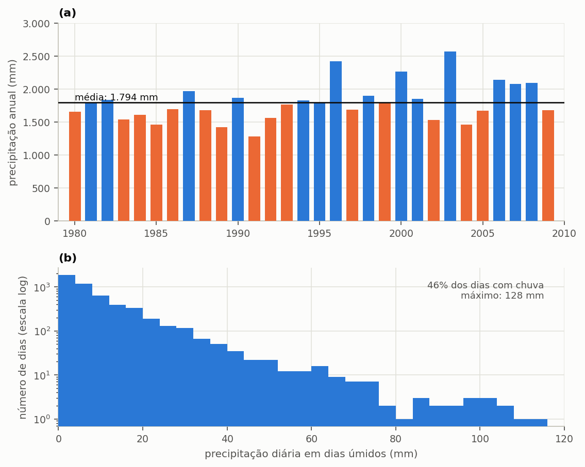

*Figure 44 — New York precipitation series used throughout the tutorial (ERA5 reanalysis, 1991 to 2020): (a) total precipitation of each year, with the thirty-year mean as a solid line and the years above the mean in blue and below it in orange; (b) frequency distribution of daily precipitation on wet days, on a logarithmic scale, which shows how few days account for the largest volumes.*

---

### 4.1.3. The catchment area

The tutorial project adopts a catchment area of 150 m², and this is the first field
where people often go wrong.

The catchment area is the **horizontal projection** of the roof, not the sloping area of
the roof. A roof with a 30% slope over a 150 m² plan has about 157 m² of tiled surface,
and still collects the same 150 m² of rain: precipitation falls vertically, and what it
meets is the shadow of the roof projected on the ground. Most rainwater guidance defines it so: the horizontally
projected area of the impermeable roof surface where the water is collected. It is this
area `A` that enters the availability equation.

> **Catchment area is not contributing area.** Gutter and downpipe design standards use
> another area, for another purpose. To size the drainage by the peak flow of a short,
> intense storm, they add to the projection the increments due to the roof slope and to
> the walls that intercept wind-driven rain. That area overestimates the volume the roof
> collects over the year. In Triton, enter the horizontal projection; the contributing
> area belongs to the gutter design, which the program does not do.

> **Warning.** Using the sloping area overestimates the collection by the ratio
> `1/cos(slope)`. On a 30% roof it gives 4.4% more water that does not exist. On steeper
> roofs the error grows quickly.

---

Once the series is loaded, the program already shows the regime it describes. It is
worth checking this drawing before going on: a series from the wrong city, or with the
wrong unit, usually shows up in the seasonal cycle of Figure 45
before it shows up in any result.

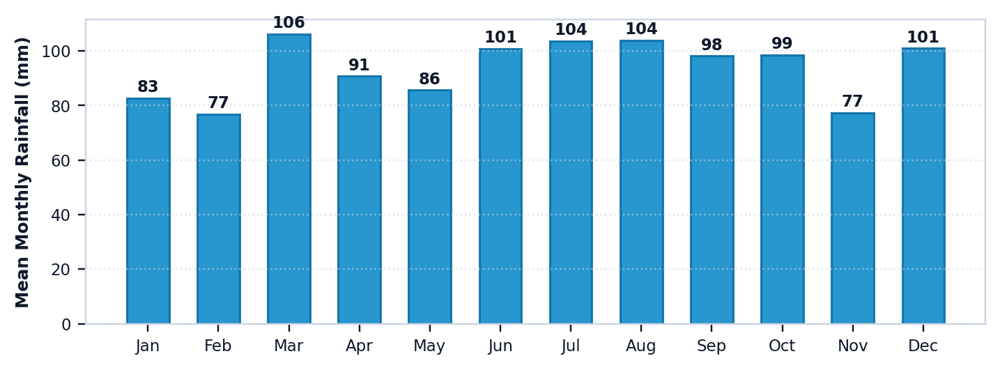

*Figure 45 — The mean seasonal cycle of the series, calculated and drawn by the program as soon as the precipitation is loaded. In New York the wettest month receives about 1.4 times what the driest month receives, a mild cycle that the tank gets through easily. Figure generated by the program itself.*

---
### 4.1.4. The runoff coefficient

The tutorial types 0.85 in the coefficient field. The program, in turn, opens with
ceramic tiles selected and applies 0.75, the value the list of materials gives them,
which is also the value it assumes when no material is entered. ==Take care when
reproducing the tutorial: to get the numbers of this manual, choose «Other / Custom» and
type 0.85.==

The origin of 0.85 deserves precision, because it is often quoted as a runoff
coefficient and it is not quite one. Rainwater guidance commonly writes the available
volume as the product of the precipitation, the area, a surface runoff coefficient and
an efficiency of the collection system (filter and diversion), and 0.85 is a round figure
sometimes suggested for that efficiency in the absence of manufacturer data. That
efficiency already accounts for the diversion of the initial runoff. Triton has a single
field for the fraction of the rain that reaches the cistern and models the first flush
separately, in millimetres. Typing a combined figure there and also applying the 2 mm
first flush counts the loss of the initial runoff twice, so the tutorial is conservative.
In a study, declare the value adopted in the field, its origin and the first flush, and
do not attribute to a standard a runoff coefficient it does not set.

The surface runoff coefficient represents the fraction of the incident rain that
actually reaches the cistern, and the difference to one corresponds to what is lost on
the way. The losses have four origins: absorption by the roof material, evaporation on
the heated surface, splashing out of the gutter and the initial wetting of the tiles at
each new rain event. Figure 46 shows the coefficient the program gives to
each roof material.


*Figure 46 — The runoff coefficient the program gives to each roof material, with the values the program uses. The dashed line marks 0.85, the collection factor adopted in the tutorial. The green roof is the only one that departs from the group, because it retains part of the rain in the substrate.*


The program accepts any value between zero and one, and refuses values outside that
interval naming the field — a coefficient larger than one would mean that the roof
delivers more water than the rain brings it. Step **11. Documentation** has the same
table, with the source of the values. For a mixed roof, the coefficient to type is the
mean of the coefficients of each material weighted by their areas.

---

### 4.1.5. The first flush

The tutorial diverts 2.0 mm on every rain event.

The first water that washes the roof carries dust, leaves, bird droppings and everything
else that has settled since the previous rain. Diverting it, instead of leading it to
the cistern, is the cheapest and most effective quality measure a rainwater system has,
and that is why it is practically universal in well-run projects. The tutorial adopts 2
mm, a round value for when there is no local data to justify another; in a study, justify
the depth you adopt.

The program offers three ways of applying the first flush, which correspond to three
types of self-cleaning device.

<!-- tabela: **Table 92** — The three ways of applying the first flush -->
| Mode | When it diverts | When to use |
| :--- | :--- | :--- |
| 1 | on every rain event | the default, and the most conservative |
| 2 | only on the first event after a dry spell | a device that does not empty by itself between close rains |
| 3 | every X days | a device with scheduled emptying |

> **Warning, and this is the point that surprises the most.** When the first flush
> applies and the day's rain **does not exceed** the depth, the **whole** day is lost,
> not the difference. A day of 1.6 mm with a 2.0 mm first flush collects **zero**.
>
> In the New York series this affects 17% of the days. In climates with more frequent
> drizzle the share is larger.

The reason for this behaviour is physical, not conventional: the self-cleaning device
has to fill completely before any water goes on to the cistern. When the day's rain is
not enough to fill it, nothing passes, and the retained volume is lost to the drainage
together with the dirt it washed.

> **The depth is not the device.** `d_f` is a depth in millimetres. The hydraulic volume
> of the self-cleaning chamber is `A × d_f`, which in our project gives 150 × 2 =
> **300 litres**. Step **3. Quality & Treatment** sizes and prices that chamber (section
> 2.5), and section 4.7 shows its cost in the investment.

---

### 4.1.6. What we have so far

<!-- tabela: **Table 93** — State of the tutorial project at the end of defining the rain and the catchment -->
| Item | Value |
| :--- | ---: |
| series | New York, 30 years |
| catchment area | 150 m² |
| runoff coefficient | 0.85 |
| first-flush depth | 2.0 mm, every event |

With this the program already knows **how much water comes in**. It remains to say how
much goes out, which is section 4.2.

A back-of-the-envelope calculation, to calibrate the expectation: 1,125 mm per year on
150 m² at a coefficient of 0.85 gives about 143 m³ per year of raw water, before the
first flush. Section 4.3 shows how much of that volume turns into an actual saving —
and the difference between the two numbers is the most important lesson of the tutorial.

---

## 4.2. The building and the demand

> By the end of this section the program will know **how much water goes out** and,
> more importantly, **which part of it rain can supply**. That fraction is the ceiling
> of everything that follows.

Section 4.1 defined the supply. This one defines the demand. And there is an
asymmetry worth understanding from the start: **rain cannot supply all the demand**,
however much water there is. There is a ceiling, it is defined here, and no tank goes
beyond it.

---

### 4.2.1. The building type

In step **2. Building & Demand**, choose *Single-family residential*. The program has
eight building types, each with its reference per capita consumption
(Figure 47) and the usual split of end uses. Industry has no reference
range, because consumption depends on the production process, not on occupancy: in that
case, the value must come from measurement.

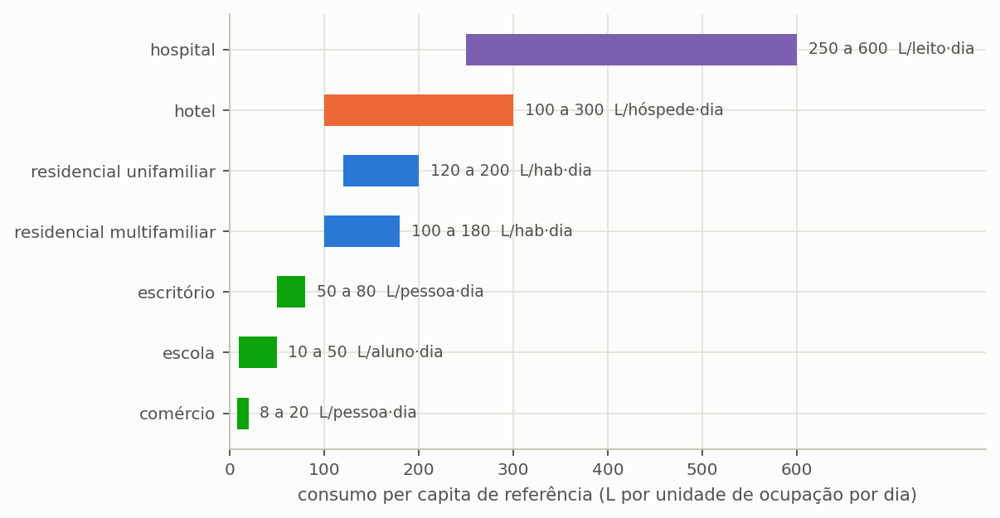

*Figure 47 — The usual ranges of per capita consumption by building type. The width of each range is large on purpose: they are reference values for those who have not yet measured, and measurement, when it exists, always prevails.*


The building type is a starting point, not an imposition: the value remains editable.
Section 3.5 deals with non-residential cases, which have a trap of their own in the
tariff.

---

### 4.2.2. The residents and the consumption

**Four residents, 150 L/person·day.** A total of **600 L/day**.

The value of 150 L/person·day is a round reference for a house with a regular supply,
not a measurement. If you have the building's water and sewage bill, use it: divide the
monthly consumption in litres by thirty and by the number of residents. The measured
number is worth more than any reference.

The program accepts a **constant** demand or one modulated by week, month or day. The
tutorial uses a constant one; section 3.4 shows the modulation, which matters in
schools, hotels and any building with seasonality.

---

### 4.2.3. The fraction rain can supply

**28%.** It is the most important number in this section.

Rainwater does not go to the shower, the kitchen sink or for drinking. In a house, it
goes to the toilet, floor washing, garden watering and vehicle washing. The share of
these uses in the total consumption is the **ceiling of the saving potential**.

The split adopted in the tutorial is shown in Figure 48, with the uses rain
supplies marked. The toilet accounts for 20% of consumption and cleaning and watering
for 8%; shower, kitchen sink, washbasin and washing machine, which account for the
rest, stay on potable water.

Adding the two that rain supplies gives the 28% of the tutorial. It is a conservative
value for a single-family house without a large garden, and it is conservative on
purpose: it keeps to the uses that rainwater guidance most widely admits.

> **The washing machine is a choice that guidance does not settle.** National rainwater
> standards differ on laundry. Some list it among the permitted non-potable uses; others
> leave it out and ask the responsible professional to study the quality parameters and
> treatment for any use not listed. Use in the washing machine is common in the
> literature and in practice, and that is why many studies work with suppliable fractions
> larger than this tutorial's. The tutorial does **not** adopt it: the machine stays on
> potable water, and the suppliable fraction falls to the 28% of the toilet and the
> outdoor uses. A project that includes laundry must declare that choice and the quality
> criterion adopted for it, and check it against the standard that applies where the
> building stands.


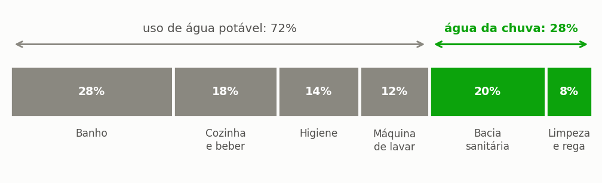

*Figure 48 — Typical split of the consumption of a house by end use. In grey, the uses that require potable water; in green, those where rainwater can be used, whose sum is the suppliable fraction and the ceiling of the saving potential: no tank, however large, saves more than this fraction.*

> **This number is the ceiling.** With a 28% suppliable fraction, the saving potential
> **never** exceeds 28%, however large the tank and however much it rains. The table of
> section 4.4 shows the curve approaching exactly this limit and never crossing it.
>
> Anyone who wants to go beyond 28% must change the **use**, not the tank: add a use,
> such as laundry, with a declared quality criterion, or reduce potable consumption.

#### 4.2.3.1. Percentage on screen, fraction in the file

The same quantity appears in two forms, and each one has its place. In every field where
you type — the fractions of the building screen, the weekly and monthly tables, the
scenario tables, the batch spreadsheet and the `--share` argument of the command line —
the fraction is a **percentage, from 0 to 100**: 28 means 28%. In the project file, in
the parameter file and in `rainwater_share` and `non_potable_indoor_share`, it is a
**fraction, from 0 to 1**: 0.28.

The split is not arbitrary. The percentage is the form in which the quantity circulates
among designers, standards and water bills, and it is the form least prone to typing
errors. The fraction is the form in which it enters the balance equation, multiplying
the indoor demand (section 2.1), and it is the form that needs no conversion for
anyone reading the file with another program.

What is not allowed is mixing them. Up to this version, twelve places in the program
accepted both forms and decided by the rule «above 1 is a percentage». The rule fails
precisely on small values, where the error cannot be seen: 1 became 100%, not 1%; 0.5
typed in a percentage column became 50%. ==Now the unit is fixed by the place, and never
guessed from the value.== A percentage above 100 is refused; a fraction above 1 is
refused with the remark that it looks like a percentage. Figure 49 shows
the three states of the field in the interface.

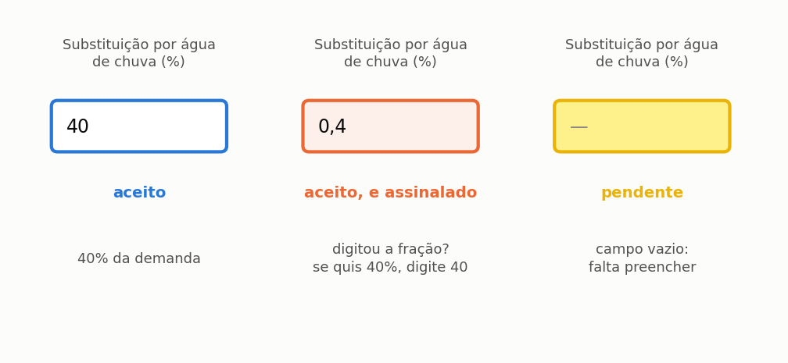

*Figure 49 — States of the suppliable-fraction field in the interface. The field receives a percentage from 0 to 100; in the project file and in the calculation parameters the quantity is stored as a fraction from 0 to 1. A value between 0 and 1 typed in the field is flagged in orange, without blocking the calculation, because 0.4% is possible, although rare.*

> **The orange marker.** A value between 0 and 1 in a percentage field is accepted,
> because less than 1% replacement is possible, but the field turns orange and the tip
> explains what was understood. In the scenario tables and the batch spreadsheet, the
> program asks before simulating.

---

### 4.2.4. Breaking down the uses, or not

The program accepts two levels of detail in the description of the demand, and the
choice between them depends on what the study intends to answer.

In the **simplified mode**, two things are entered: the non-potable fraction of indoor
consumption — toilets and laundry — and, if there is one, the outdoor demand in litres
per day. The **total** suppliable fraction comes from the two,

```text
f = (indoor fraction × indoor demand + outdoor demand) ÷ (indoor demand + outdoor demand)
```

and appears in a field that cannot be edited, because it is a result and not an input.
Without outdoor demand, the total is the indoor fraction itself: the 28% of this
tutorial. It is the mode adopted here and it is enough for most studies.

> **Why the total is not typed.** In the earlier development builds the total-fraction field was
> editable, but the simulation used the indoor fraction; and, when a project was opened,
> the screen reset the indoor fraction to 35% and the outdoor one to zero, whatever had
> been saved. A project that declared 28% was simulated with 35%. Today the screen
> restores both, the total is calculated, and an old file whose fractions disagree is
> opened with the total it declares, with a warning.

In the **detailed mode**, the demand is split into three parts: the indoor potable,
which rain never supplies; the indoor non-potable, which is the system's priority; and
irrigation, supplied last. The split changes two things. It changes the order of supply
on days of scarcity, when indoor use takes precedence over the garden; and it makes it
possible to distinguish indoor from outdoor use in certification credits, a distinction
LEED requires in separate credits, as section 2.9 describes.

It is worth breaking down the uses when there is a garden of significant area, when
certification is on the project's horizon, or when irrigation can be suppressed on rainy
days — a situation the next item deals with.

---

### 4.2.5. Irrigation and suppression by rain

Once an irrigation volume is declared, the program offers a rain suppression threshold:
on days when the precipitation exceeds that threshold, the garden is not watered. The
behaviour reproduces that of any irrigation controller with a rain sensor, a common and
cheap piece of equipment, and ignoring it would overestimate the outdoor demand over the
whole year. The default threshold is 2 mm per day.

> **The rainfall series is read twice.** One reading is converted into collected volume,
> after the first flush. The other decides whether the garden is watered. The two are
> independent: a day can suppress irrigation **and** yield collection.

One choice remains that deserves particular attention, because it changes the economic
result and is not neutral: the **backup supply** of irrigation. With it on, the mains
waters the garden on the dry days when the cistern cannot cope, and that volume enters
the water and sewage bill as potable consumption. With it off, the garden is simply not
watered on that day, the building does not buy that water, and the corresponding volume
appears in the balance as *unmet demand* — the third part dealt with in section
2.1.

==The distinction between the two settings is conceptual before it is numerical.== A
garden that must be watered every day represents a real demand, which someone will pay
for; a garden that accepts not being watered on a dry day represents a convenience, and
treating it as demand inflates both the consumption and the apparent saving of the
system.

---

### 4.2.6. What we have so far

<!-- tabela: **Table 94** — State of the tutorial project at the end of defining the demand -->
| Item | Value |
| :--- | ---: |
| building type | single-family residential |
| residents | 4 |
| per capita consumption | 150 L/person·day |
| total demand | 600 L/day |
| fraction suppliable by rain | 28% |
| **rainwater demand** | **168 L/day** |

The program now knows the supply and the demand. Before simulating, a comparison worth
keeping:

<!-- tabela: **Table 95** — Comparison between the annual rainwater supply and the suppliable demand -->
| | m³/year |
| :--- | ---: |
| gross rainwater supply (precipitation × area × coefficient) | 143 |
| **rainwater demand of the year** | **61** |

Supply exceeds demand: the gross volume is **2.3 times** what is intended to be
used, before the first flush is deducted. If supply were the only limit, the system would meet 100% of the rainwater demand
and reach the 28% ceiling.

It does not, and section 4.3 shows why.

---

## 4.3. The first simulation

> By the end of this section you will have the first result on screen and will know how
> to **read** the four numbers that matter. Reading is the hard part: the program
> delivers many numbers, and three of them answer different questions.

One input is missing before simulating: the volume of the tank. Let us guess.

**3,000 litres.** A 3 m³ cistern is a common back-yard size, and what a designer would propose
without much thought. Section 4.4 will ask
whether it is the right volume. Here we only want to see the program run.

In step **4. Reservoir & Costs**, choose a fixed volume, enter 3,000 L, leave the upper
tank unticked, and run.

---

### 4.3.1. The result

<!-- tabela: **Table 96** — Result of the first tutorial simulation, with a 3,000 L tank -->
| Result with 3,000 L | Value |
| :--- | ---: |
| potable water saving potential | **25.99%** |
| rainwater consumed | 155.9 L/day |
| mains water consumed | 444.1 L/day |
| water overflowed | 150.8 L/day |
| days of full supply | 91.9% |
| days of partial supply | 1.7% |
| days of no supply | 6.4% |
| intended rainwater demand | 168 L/day |
| annual volume saved | 57.0 m³/year |

The screen returns several dozen values, and four of them are enough to judge the project
at this stage. Each one answers a different question, and it is precisely because they
answer different questions that they do not replace one another: a project can be good
by the first and bad by the third, and reading them together is what avoids a hasty
conclusion.

---

### 4.3.2. The saving potential: 25.99%

This indicator answers the question that motivates most projects: how much of the water
and sewage bill stops being paid. It is the central value the program produces and the
one that appears in the summary of any study, and it is the ratio between the rainwater
consumed and the total demand of the building over the whole series, as in Equation
14.

The denominator deserves attention, because everything else follows from it: it is the
**total** demand, not the rainwater demand. It is this choice that sets the ceiling of
the indicator at 28%, which is the suppliable fraction defined in section 4.2, and
not at one hundred per cent.

The system reached 25.99% against a ceiling of 28%, which means it delivers 93% of what
it set out to deliver. The remaining 7% correspond to the days when the cistern did not
have enough water to meet that day's rainwater demand.

> **Do not confuse the two percentages.** «A saving of 26%» and «93% of the rainwater
> demand met» describe the same system and are different numbers. Published studies
> sometimes swap one for the other. Declare which one you are using.

---

### 4.3.3. The overflow: 150.8 L/day

**It answers: is the tank big enough?**

About 151 litres per day, on average over the thirty years, overflow from the cistern
and go to the drainage system. ==That is almost as much as the 168 L/day the system
intends to consume,== and the tank lets through nearly as much water as it uses.

It looks like an argument for enlarging the tank, and it is a weak one. The roof offers
2.3 times what the house intends to use (section 4.2), so a good part of that surplus
would overflow from any cistern, however large. The overflow only says something about the volume when
compared with that of other volumes, and that comparison is what section 4.4 does.

> A high overflow is not a defect of the program or of the project. It is the signature
> of the mismatch between the rain, which arrives concentrated in a few days, and the
> demand, which is constant. The tank exists to buffer this, and every finite tank fails
> in some event.

---

### 4.3.4. The days of supply: 91.9% full

**It answers: how often can I count on the system?**

This is the **time** reliability of the system, and it answers a question the saving
potential does not reach: how often rainwater can be counted on. Each day of the
simulation receives one of three classifications, according to the degree of supply
achieved.

<!-- tabela: **Table 97** — Classification of each day of the simulation by the degree of supply -->
| Class | What it means |
| :--- | :--- |
| full | rain met **all** the rainwater demand of the day |
| partial | it met part of it, and the mains made up the rest |
| none | the cistern was empty; everything came from the mains |

On 91.9% of the days the system met the rainwater demand on its own, and on the
remaining 8.1% the mains came in, fully or partly (1.7% of the days partial, 6.4% none). The distinction has a direct
consequence on the plumbing design: a system with many days of no supply needs a
well-sized automatic backup supply, and the user notices the switching between the two
sources over the year. A system with 99% full days is, in practice, independent of the
mains for the uses it supplies.

> **Potential and reliability do not go together.** It is possible to have a high
> potential with low reliability: a tank that fills in the rainy season and dries out in
> the dry season delivers a lot of volume over the year and fails half the days. The
> table of section 4.4 shows the two columns diverging.

---

### 4.3.5. The annual volume saved

**It answers: how much is this worth in money and in carbon?**

This is the value that carries over to sections 4.7 and 4.8, because both the
saving on the water and sewage bill and the avoided carbon emission are calculated from
it. It is 57.0 m³/year, less than half of the 143 m³/year the roof makes available
before the first flush; the first flush and the overflow account for most of the
difference.

---

Before discussing why the potential does not reach 28%, it is worth seeing the tank at
work. The results tab has the daily series of the cistern level, and it is there that
the two regimes limiting the yield can be seen at once: overflow and shortage
(Figure 50).

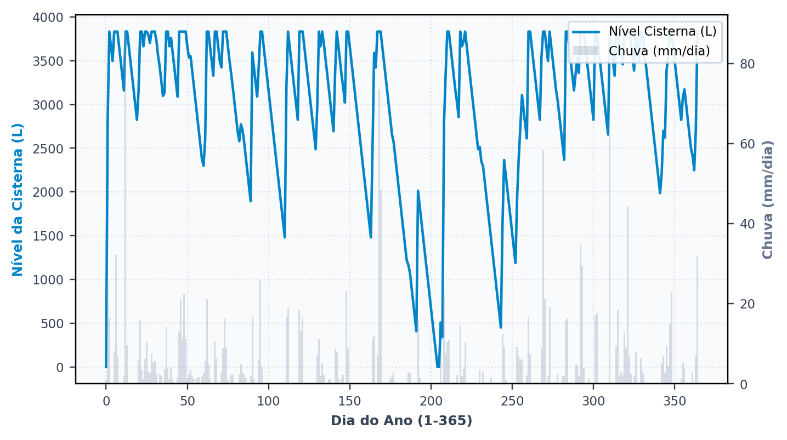

*Figure 50 — The level of the cistern over the first year of the series, with the daily rain in the background. The plateaus at the top are the days when the tank is full and overflows; the valleys at zero are the days when it ran dry and the mains supplied everything. Figure generated by the program itself.*

---
### 4.3.6. Why we do not reach 28%

Section 4.2 ended with an apparently favourable comparison: 143 m³ per year of supply
against 61 m³ of rainwater demand, that is, 2.3 times what is needed. Faced with this
surplus, it would be reasonable to expect full supply, and yet the system delivers 93% of
what was intended.

The explanation lies entirely in **time**. The surplus does not occur when the water is
needed: precipitation arrives concentrated, fills the 3,000 L cistern in a single day of
intense rain, overflows on the same day, and is missing two weeks later. The annual
surplus and the daily supply are quantities that do not communicate, and it is precisely
this lack of communication that makes the daily simulation indispensable.

The 3,000 L tank stores the equivalent of eighteen days of rainwater demand. Any dry
spell longer than that empties it, and from then on the system depends entirely on the
mains until the next rain.

That is why enlarging the tank works — and that is why enlarging has a limit. Section
4.4 measures exactly where that limit lies.

---

### 4.3.7. What we have so far

<!-- tabela: **Table 98** — State of the tutorial project after the first simulation -->
| Result with 3,000 L | |
| :--- | ---: |
| saving potential | 25.99% |
| out of a ceiling of | 28% |
| overflow | 150.8 L/day |
| days of full supply | 91.9% |

A defensible result, and already close to the ceiling. But we chose 3,000 L by guesswork:
it may be too little, and it may be too much.

What would be right?

---

## 4.4. Choosing the volume

> By the end of this section you will have the tank's return curve, will know where it
> stops paying off, and will understand why there is **no** absolute optimal volume —
> there is an optimal volume for a declared criterion.

Section 4.3 took 3,000 L as a first guess and found 150.8 L/day overflowing, almost
as much as the house intends to use, and a supply already close to the ceiling.
The two readings pull in opposite directions, and the question that arises is how much
tank is worth having. It cannot be answered by an isolated attempt: it is answered by
simulating the same project for many volumes and watching how the result evolves. That
is what the program calls a **sweep**.

---

### 4.4.1. Running the sweep

In step **4. Reservoir & Costs**, choose the sweep mode and enter the maximum volume and
the step. For our project: a maximum of 20,000 L, a step of 1,000 L.

Two particularities of how the grid is built are worth knowing before interpreting the
result. The first is that the step entered is rounded up to a multiple of 250 L, the
commercial quantum of tanks — nobody buys a 1,300 L cistern, and an optimum pointing at
that volume would be impracticable. When the step asked for is not a multiple of 250,
the program adjusts it and records the adjustment, so that the report can declare the
step actually used.

The second is that the grid is limited to forty positive volumes. A sweep from 0 to
50,000 L with a 100 L step would need five hundred simulations of thirty years each, and
the gain in information does not make up for the computing time, because the curve is
smooth and forty points describe it amply. The maximum volume entered is always kept as
the last point of the grid, so only the last interval can be smaller than the effective
step.

Zero volume is part of the grid as the reference alternative: it represents the
no-system scenario, against which all the others are compared.

---

### 4.4.2. The curve

<!-- tabela: **Table 99** — Volume sweep of the tutorial project, with the marginal gain of each added cubic metre -->
| Volume | Potential | Gain over the previous | Gain per cubic metre added | Overflow | Full-supply days |
| ---: | ---: | ---: | ---: | ---: | ---: |
| L | % | percentage points | %/m³ | L/day | % |
| 0 | 0.00 | — | — | 307 | 0.0 |
| 1,000 | 19.14 | 19.14 | 19.14 | 192 | 62.2 |
| 2,000 | 24.24 | 5.10 | 5.10 | 161 | 84.4 |
| 3,000 | 25.99 | 1.75 | 1.75 | 151 | 91.9 |
| 4,000 | 26.83 | 0.84 | 0.84 | 146 | 95.3 |
| 5,000 | 27.24 | 0.41 | 0.41 | 143 | 97.0 |
| 6,000 | 27.49 | 0.24 | 0.24 | 142 | 97.9 |
| 8,000 | 27.74 | 0.26 | 0.13 | 140 | 98.9 |
| 10,000 | 27.86 | 0.12 | 0.06 | 139 | 99.5 |
| 12,000 | 27.94 | 0.08 | 0.04 | 138 | 99.8 |
| 16,000 | 27.98 | 0.04 | 0.01 | 138 | 99.9 |
| 20,000 | 27.98 | 0.00 | 0.00 | 137 | 99.9 |

Figure 51 plots the results of the table: the saving potential
converges to the suppliable fraction, and the marginal gain falls by three orders of
magnitude across the sweep.

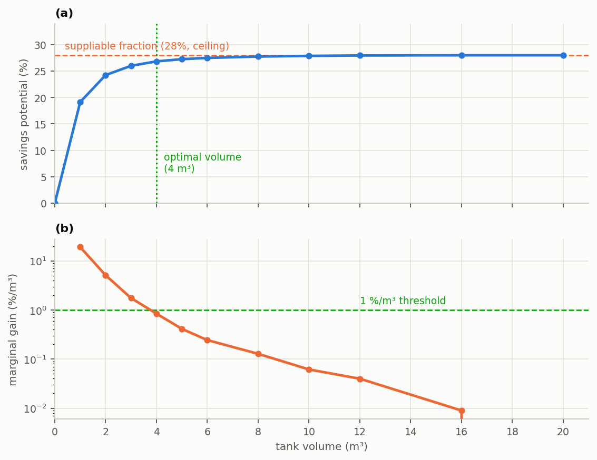

*Figure 51 — (a) Saving potential as a function of the tank volume, approaching the 28% ceiling without crossing it, with the ideal volume marked; (b) marginal gain, on a logarithmic scale, with the 1 %/m³ threshold adopted in the tutorial.*

The decisive column of the table is the **gain per added cubic metre**, which is the
discrete derivative of the potential curve and expresses how much saving each extra cubic
metre of tank adds. The table below highlights a few intervals, and the pattern it
reveals is the central argument of this section.

<!-- tabela: **Table 100** — Marginal saving gain for each cubic metre added to the tank -->
| From → to | Gain per m³ |
| :--- | ---: |
| 0 → 1,000 L | 19.14 %/m³ |
| 1,000 → 2,000 L | 5.10 %/m³ |
| 2,000 → 3,000 L | 1.75 %/m³ |
| 3,000 → 4,000 L | 0.84 %/m³ |
| 4,000 → 5,000 L | 0.41 %/m³ |
| 10,000 → 12,000 L | 0.04 %/m³ |
| 16,000 → 20,000 L | 0.00 %/m³ |

==The first cubic metre of tank delivers 19 percentage points of saving; those from 10 to
12 m³ deliver four hundredths of a point each, and those from 16 to 20 m³, nothing.==
The difference is more than two orders of magnitude, and the cubic metres cost the same
concrete, the same excavation and the same labour. From 12 m³ on, 99.8% of the days are
fully supplied, and no further volume has much to add.

This behaviour is not a peculiarity of the New York rainfall regime. It is the
characteristic shape of every rainwater harvesting curve, and it follows from two facts
acting together. The first litres of storage capture the small, frequent events, which
make up most of the rains in any regime; and the ceiling imposed by the suppliable
fraction, 28% in this project, pulls the curve towards the horizontal as the system
approaches it, so that the room left for gain runs out.

---

#### 4.4.2.1. The four charts the screen shows

The sweep does not return only the potential curve. The results tab has four charts that
answer different questions about the same set of simulations, reproduced below with the
data of this tutorial: the saving potential (Figure 52), the
marginal gain (Figure 53), the overflowed and consumed volumes
(Figure 54) and the classification of the days
(Figure 55).

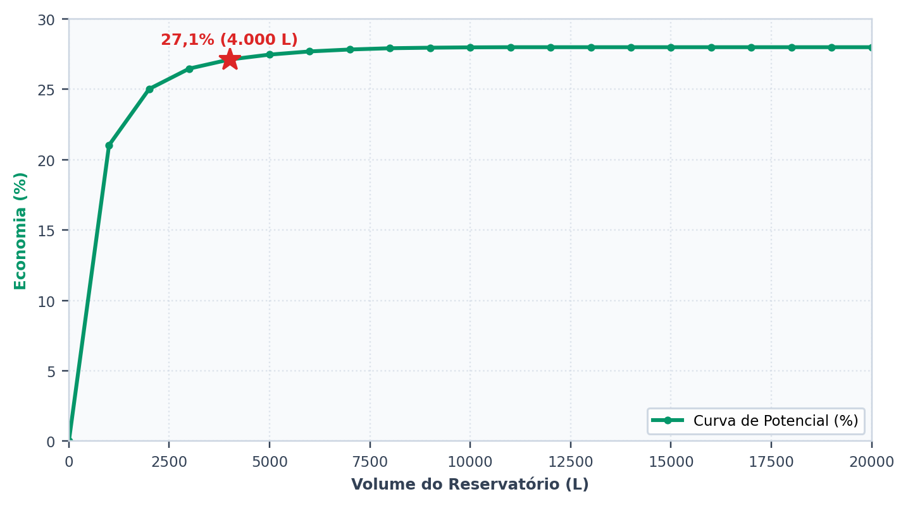

*Figure 52 — The first chart of the results tab: the potable water saving potential as a function of the lower tank volume. The star marks the selected volume. Figure generated by the program itself, with the tutorial data.*

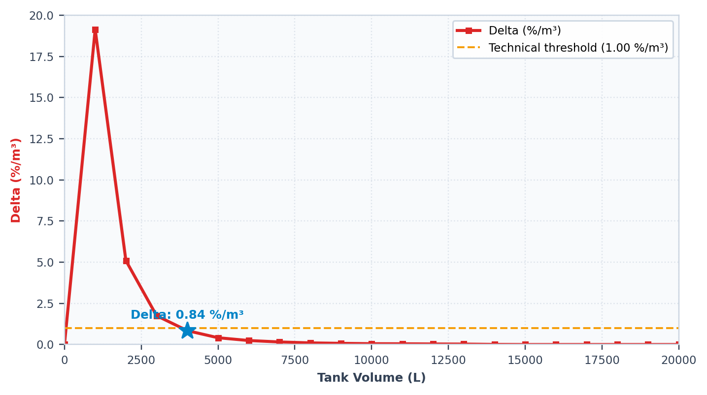

*Figure 53 — The second chart: the marginal gain, in percentage points per added cubic metre. It is the derivative of the previous curve, and it is on it that the ideal-volume criterion operates. Figure generated by the program itself.*

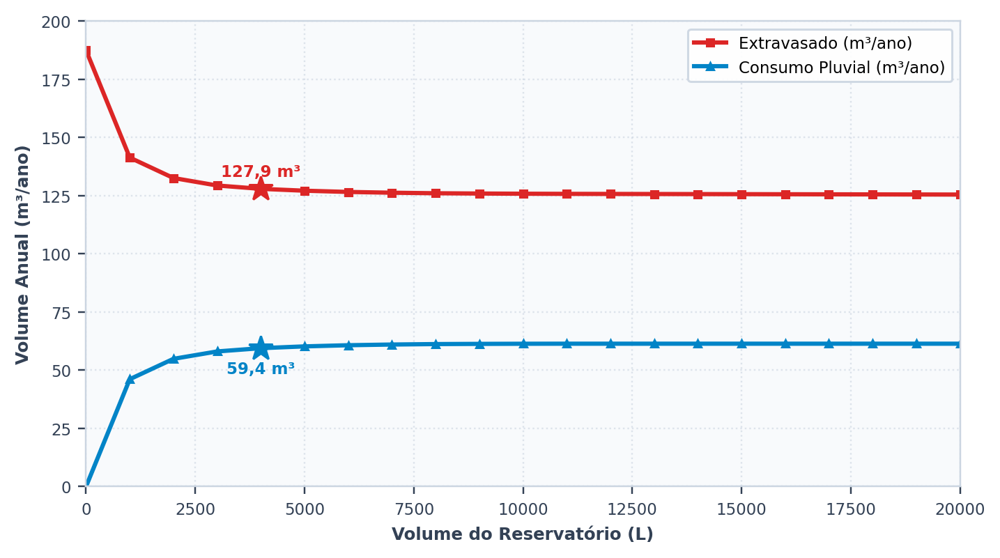

*Figure 54 — The third chart: the overflowed volume and the rainwater volume consumed, both annual, on the same scale. The two curves explain each other, because all the water that stops overflowing becomes consumed. Figure generated by the program itself.*

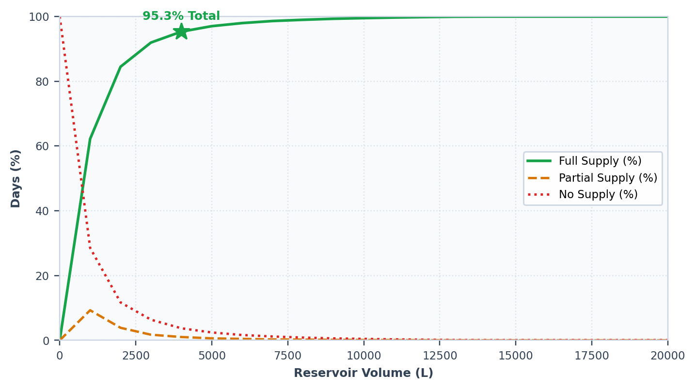

*Figure 55 — The fourth chart: the split of the days of the period into fully supplied, partly supplied and not supplied. It is the time reading of the same sweep, and the only one that answers how often the system can be counted on. Figure generated by the program itself.*

---

### 4.4.3. The ideal volume

Faced with a curve whose yield falls off in this way, the question «what is the ideal
volume?» only admits an answer once it is established what no longer paying off means.
Triton uses the marginal-gain criterion for this: the ideal volume is the smallest volume
whose gain per added cubic metre has already fallen below a threshold declared by the
user, as formulated in section 2.2.

The program opens with a threshold of 5 %/m³, and the tutorial adopts a stricter one, of
1 %/m³. The difference is not a detail: with the default, the ideal volume of this
project would be 3,000 L; with the tutorial's threshold, the first volume to fall below
it is 4,000 L, with a marginal gain of 0.84 %/m³. Anyone redoing the tutorial must
therefore change the threshold in the program before running the sweep.

<!-- tabela: **Table 101** — Indicators of the ideal volume obtained with the 1 %/m³ threshold adopted in the tutorial -->
| Indicator | Value |
| :--- | ---: |
| ideal volume, 1 %/m³ threshold | 4,000 L |
| potential at that volume | 26.83% |
| out of a ceiling of | 28% |
| days of full supply | 95.3% |

The threshold, however, is the analyst's choice, and it decides the result as much as
the input data. The table below shows the ideal volume each plausible threshold would
produce for this same project.

<!-- tabela: **Table 102** — Ideal volume obtained with each marginal-gain threshold, for the same project -->
| Declared threshold | Ideal volume | Potential |
| ---: | ---: | ---: |
| 3.0 %/m³ | 3,000 L | 25.99% |
| 1.0 %/m³ | 4,000 L | 26.83% |
| 0.5 %/m³ | 5,000 L | 27.24% |

<!-- tabela: **Table 103** — Cost and performance compared between the ideal volume and the largest volume swept (prices are illustrative, not market prices) -->
| | 4,000 L | 20,000 L |
| :--- | ---: | ---: |
| saving potential | 26.83% | 27.98% |
| concrete cistern price (illustrative, not a market price) | US$ 2,200 | US$ 8,600 |
| mass of concrete | 4,800 kg | 24,000 kg |
| embodied carbon of the system | 858 kg CO₂e | 3,546 kg CO₂e |
| **price ratio** | | **3.9×** |
| **potential gain** | | **+1.15 points** |

The program gives no opinion on which threshold would be right, and it could not: the
choice depends on the cost of the tank, the value of water at the site and the
space available on the plot, none of which is hydrological data. What the program does
is apply the declared threshold faithfully and record it in the report.

> **In a published study, declare the threshold.** Two papers with an «ideal volume»
> from different thresholds are not comparable. Between the thresholds of the table, the
> difference is 2,000 L of tank, and it buys 1.25 percentage points of saving.

---

### 4.4.4. Why the marginal-gain criterion is not enough

The marginal-gain criterion is purely hydraulic: it looks at the yield curve and nothing
else. It does not know how much the tank costs, how much a cubic metre of water is worth
at the site in question or how much carbon the chosen material carries with it.
Three consequences follow from this blindness, and each one can move the recommendation
in a different direction.

- If water is very expensive, the gain of 0.41 %/m³ of the fifth cubic metre may pay for
  itself well, and the economic volume will be **larger** than the hydraulic one.
- If the cistern is expensive or space is scarce, the opposite.
- A 20 m³ concrete cistern weighs twenty-four tonnes and carries, with the rest of the
  system, about **3.5 tonnes of embodied CO₂e**, against less than one tonne for the 4 m³
  one. The last cubic metre adds no saving at all, and has no way of offsetting the
  difference.

Three criteria and three different answers to the same question, and none of them is
more legitimate than the others in the abstract. That is why the tutorial does not end
here: sections 4.7 and 4.8 add money and carbon to the analysis, and section
4.9 puts the three dimensions on the same table, with declared weights, to reach a
compromise volume that can be defended.

> **The most common mistake, and it is in section 5.1.** Publishing the volume with
> the largest water saving as if it were the recommended volume. According to the table,
> 20,000 L gives the largest potential, 27.98%, the same as 16,000 L already gave. It
> also costs **3.9 times more** than 4,000 L (illustrative prices, not market prices), and
> carries **4.1 times more embodied carbon**, to deliver 1.15 percentage points more.

---

The sweep has one more reading that the table does not show: how much of the capacity
the consumption actually uses. Measuring the tank by its level is misleading, because a
large cistern always looks full precisely because it stores water the demand never gets
to withdraw. Figure 56 measures the capacity by consumption, in two ways.
The first is the **stored autonomy**, the volume at the end of each day divided by the
daily rainwater demand of 168 L, shown as a duration curve. The second is the number of
**turnovers per year**, the ratio between the annual rainwater consumption and the
capacity, which says how many times the volume of the cistern is actually consumed and
replenished.

The 2 m³ cistern turns its volume over many times a year and often ends the day empty:
the capacity is fully used, and water runs short. The 4 m³ one turns over fewer times and
empties on far fewer days. The 20 m³ one turns over only a few times a year and almost
never empties, but on most days it holds many weeks of demand, far beyond the dry spell
the series records. That reserve the consumption never mobilises is what
the additional investment buys, and it is the physical reading of the diminishing
returns of the potential curve.

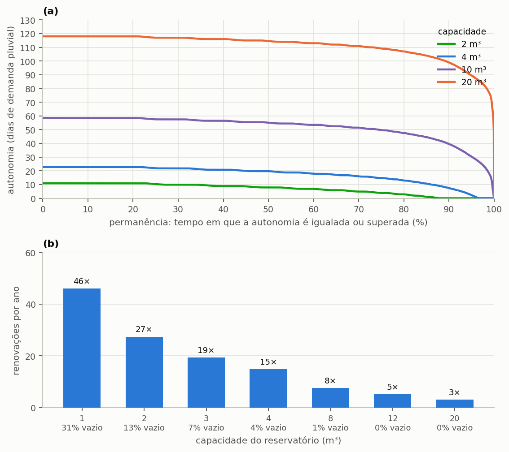

*Figure 56 — Use of the lower tank capacity in the tutorial project, with a rainwater demand of 168 L/day: (a) duration curves of the stored autonomy at the end of each day, in days of rainwater demand, for 2, 4, 10 and 20 m³; (b) annual turnovers of the volume, given by the ratio between the annual rainwater consumption and the capacity, with the fraction of days on which the tank ends empty (up to 5% of the capacity) shown under each volume.*

---
### 4.4.5. Two more readings of the table

**The overflow never reaches zero.** It starts at 307 L/day without a tank, falls to
137 L/day with twenty cubic metres and levels off there. That water will keep going to
the drainage, for a reason no enlargement of the tank solves: the demand simply does
not consume it. Rainwater harvesting systems do not hold
water for the sake of holding it, and anyone seeking flood attenuation needs a detention
tank, which is another project, with another sizing criterion.

**Reliability grows faster than the potential.** Going from 3,000 to 4,000 L, the saving
potential gains 0.84 percentage points, while the days of full supply rise from 91.9% to
95.3%, and the days of shortage fall by two fifths. When the design criterion is comfort
of use — rainwater never running out at the points that use it — and not the saving on
the bill, reading the same table leads to another choice.

---

### 4.4.6. What we have so far

The tutorial adopts 4,000 L and moves on. It is the ideal volume by the hydraulic
criterion with the 1 %/m³ threshold, and it is the value the project carries up to
section 4.9, where it will be questioned again, this time with money and carbon
included in the analysis.

<!-- tabela: **Table 104** — State of the tutorial project after choosing the volume -->
| Project so far | |
| :--- | ---: |
| series | New York, 30 years |
| catchment area | 150 m² |
| total demand | 600 L/day |
| suppliable fraction | 28% |
| **tank volume** | **4,000 L** |
| saving potential | 26.83% |
| days of full supply | 95.3% |

One hydraulic decision remains before money can be discussed: does this water need to go
up to an elevated tank, or can it be pressurised directly from the cistern? That is the
subject of section 4.5.

---

## 4.5. Is an upper tank needed?

> By the end of this section you will be able to answer the question with a number, not
> with habit. The answer usually surprises.

The classic rainwater harvesting arrangement uses two tanks: a buried cistern,
which receives the water from the roof, and an elevated water tank, which feeds the points
of use by gravity; between the two, a pump lifts the water. The arrangement is so
widespread that almost every project adopts it without examining why, and this section
examines it.

---

### 4.5.1. What the upper tank is for

==The upper tank is not for storing more water; it is for delivering it.== The
distinction seems subtle and decides the whole analysis, because everything that follows
depends on not confusing storage capacity with distribution capacity.

The cistern is buried, and the points of use — toilet, utility sink, garden tap — are
above it. Something has to overcome that difference in level, and there are two ways of
doing it with a pump.

- **Direct pressurisation.** A small pump with a pressure switch starts whenever a point
  is opened. There is no upper tank.
- **Pumping to an elevated tank.** The pump fills the tank from time to time, and gravity
  does the rest.

When the cistern is above the points of use, there is a third one: **gravity**, with no
pump. Step **4. Reservoir & Costs** asks which of the three arrangements the project
adopts, and it is this answer that defines the energy and the pump sets in the cost and
in the carbon.

<!-- tabela: **Table 105** — The three supply arrangements and what each one adds to the project -->
| Arrangement | Energy calculated | Upper tank and pump sets |
| :--- | :--- | :--- |
| pumping to an upper tank | volume pumped, at the manometric head, plus the start-ups | enter the cost and the carbon |
| direct pressurisation | all the rainwater consumed, at the working pressure | only the pump sets |
| gravity | none | none |

In direct pressurisation, step 4 asks for the model of the pressure pump, chosen from a
catalogue of six generic reference models, A to F, each with an illustrative flow × pressure
curve (none is a real product), the working pressure and the flow at the point of use. The
pressure pump starts at each flush, 5.05 per person per day according to the end-use
survey of Mayer et al. (1999), and stays on while the cistern of the toilet fills, at the
pace of its float valve. The energy is that time multiplied by the electrical power. In
the tutorial, at a head of 18 m, the smallest model would use 40.0 kWh per year, about
five times the 7.7 kWh of pumping to a tank;
section 2.6 explains why, and shows that the model chosen weighs more than the
pressure.

Pumping to an elevated tank has three real practical advantages. The pump starts a few
times a day, instead of dozens, which extends the life of the equipment; the pressure at
the points of use is constant, because it comes from the height of the water column and
not from the pump running; and there is a reserve available during a power cut. ==None of
these three advantages is a water saving,== and that is precisely the confusion this
section clears up.

---

### 4.5.2. The fair comparison

Comparing a 4,000 L system without an elevated tank with another of 4,000 L plus a
1,000 L tank is a methodological trap, because the second has more total storage and
would win for that reason, not because of the arrangement. To isolate the effect of the
arrangement, the storage must be kept constant: so 5,000 L in a single tank is compared
with 4,000 L below plus 1,000 L above.

<!-- tabela: **Table 106** — Single tank compared with two tanks, keeping the same total storage (energy cost is illustrative, not a market price) -->
| Same storage of 5,000 L | One tank only | 4,000 below + 1,000 above |
| :--- | ---: | ---: |
| saving potential | 27.24% | 27.09% |
| days of full supply | 97.0% | 96.4% |
| volume pumped | — | 59.4 m³/year |
| pump starts | — | 69 per year |
| pump hours | — | 12.6 h/year |
| energy | — | 7.7 kWh/year |
| energy cost (illustrative, not a market price) | — | US$ 1.54/year |
| **potential difference** | | **−0.15 points** |

Keeping the same storage, the arrangement with an elevated tank delivers 0.15 percentage
points less saving than the single tank. The difference is not a rounding
error, and it has a cause: **the cistern overflows while the upper tank still has room**.

Rain enters only through the cistern, and the overflow is calculated there before the
day's consumption. Pumping, however, only happens when there is consumption and the upper
tank falls below the trigger level. So, on a rainy day with the cistern full, the water
exceeding the 4,000 L below is lost even if the tank above has hundreds of litres free. A
single 5,000 L tank would keep that water.

That is also why a higher trigger level yields more: with it, the pump fills the tank
earlier, the cistern is emptier when the rain arrives, and it overflows less. The reserve
below the trigger level is not locked away, because it is consumed right after each
pumping and when the cistern runs dry.

> **The upper tank does not increase the water saving. It costs.** In our project it
> costs the tank, it costs the pump, it costs 7.7 kWh per year of energy, and it costs
> 0.15 points of potential compared with a single tank of the same total volume.
>
> That does not make it wrong. It makes the decision **hydraulic**, not one of water
> yield: adopt it if the project needs gravity pressure or a reserve against power cuts,
> and not expecting it to yield more water.

---

### 4.5.3. The trigger level

If you adopt the tank, there is a parameter to adjust: the reserve volume that is not
consumed, below which the pump starts.

<!-- tabela: **Table 107** — Effect of the pump trigger level on the saving potential and on the number of starts -->
| Trigger level | Potential | Starts per year |
| ---: | ---: | ---: |
| 0 L | 27.04% | 62 |
| 100 L | 27.09% | 69 |
| 300 L | 27.12% | 87 |
| 500 L | 27.15% | 120 |

A higher trigger level means **more potential and more starts**, for the reason above.
From 0 to 500 L, the potential rises by 0.11 points and the starts almost double, from 62
to 120 per year.

The trade-off is between a marginal water gain and the wear of the pump. Residential pump
sets cope well with a few starts a day; what kills them is continuous on-off cycling. One
hundred and twenty starts a year is one every three days, and none of the values in
the table comes close to being a problem.

> **Where the trigger level really matters** is in buildings with concentrated demand,
> where the tank empties quickly. There it can exceed a thousand starts a year, and it is
> better to size the tank than to adjust the trigger level.

---

### 4.5.4. The energy, and why it is small

Seven point seven kilowatt-hours a year. At an illustrative US$ 0.20 per kilowatt-hour, that is US$ 1.54 a year (illustrative, not a market price).

It looks too little, and it is worth understanding why. Lifting one cubic metre of water
twelve metres costs, in hydraulic energy, about 0.033 kWh. With the efficiency of the pump
and that of the motor, and adding the pump start-ups, it comes to about 0.13 kWh per cubic
metre pumped. Sixty cubic metres a year give the 7.7 kilowatt-hours of the table.

Water is heavy, but twelve metres is little. That is why the energy cost of rainwater
harvesting is negligible compared with the saving on the water and sewage bill — and that
is also why the argument that «pumping water uses more energy than it saves» does not
hold in small buildings.

> **Warning about the nameplate power.** The program asks for the efficiency **of the
> pump** and the efficiency **of the motor** separately. The nameplate power is the
> mechanical power at the shaft, and the motor efficiency is what separates what the shaft
> delivers from what the meter records. Left blank, the program adopts a default motor
> efficiency that depends on the rated power; replace it with the figure on the motor
> data sheet. Section 2.6 gives the details.

---

### 4.5.5. The tutorial's decision

**We adopt pumping to a 1,000 L upper tank, with a 100 L trigger level.**

The decision is hydraulic, not one of water yield. The elevated tank gives constant
pressure at the points of use without depending on the pump at each flush, keeps water
available during a power cut and makes the pump start 69 times a year, instead of the more
than seven thousand starts of a pressure pump triggered at each flush by four residents,
which would use 40 to 98 kWh per year depending on the generic model. The price is what the table
shows: the tank, the pumps, 7.7 kWh per year and 0.15 points of potential compared
with a single 5,000 L tank. There are two pumps, the duty pump and the standby, the usual
precaution for a pumped system that the building cannot do without.

Compared with the 4,000 L cistern on its own, the potential rises from 26.83% to 27.09%,
because the tank adds 1,000 L of storage. From here on, the cost, the carbon and the
tutorial's decision include the tank, the two pump sets and the pumping energy.

<!-- tabela: **Table 108** — State of the tutorial project after the decision on the upper tank -->
| Project so far | |
| :--- | ---: |
| lower tank volume | 4,000 L |
| arrangement | pumping to an upper tank |
| upper tank | 1,000 L, 100 L trigger level |
| saving potential | 27.09% |

Now we know how much water the system delivers. It remains to know **what water** it is.

---

## 4.6. What quality the use requires

> By the end of this section the project will have a treatment line defined, and you will
> be able to tell what a standard requires from what the program recommends.

Up to this point the tutorial has treated rainwater only as volume: how much is
collected, how much is stored, how much is consumed. Water, however, is also a quality,
and quality costs money — in equipment at installation and in consumables every month.
This section defines the quality class of the project and sizes the corresponding
treatment line.

---

### 4.6.1. What standards say, and what they do not say

Rainwater harvesting standards differ from one country to another, and the program does
not decide which one applies to your project. In general, a standard for non-potable use
sets a short list of minimum parameters: a microbiological indicator such as *E. coli*,
turbidity and pH, and, if chlorine is used, a range for the free residual. Disinfection
is often left to the designer's discretion, and monitoring is asked for at a stated
interval. Some standards divide the non-potable uses into classes with different
requirements; others set a single set of parameters for all of them; others set no
quality table and let the use and a risk assessment decide whether treatment beyond the
filter is needed. Check the standard of the jurisdiction of the project and enter its
limits as the criterion.

The program, in turn, offers four classes, and the reason is practical: toilet flushing
and garden watering do not expose the user in the same way, even if a standard does not
distinguish them (Figure 57).

> **Reuse is not harvesting.** Parameters set for the **reuse** of wastewater are usually
> much stricter than those for rainwater harvesting: absence of coliforms, a higher
> residual chlorine and lower turbidity. Rainwater is not reuse, and the table that
> applies to harvesting is the one in the rainwater standard, not the one in the reuse
> standard.


*Figure 57 — The program's four quality classes and the status of each one. Class 1 is the minimum reference set, with the least demanding parameters; classes 2 to 4 are adaptations made by the program, suitable for comparing treatments and unsuitable for presentation as a normative requirement.*


> **Classes 2 to 4 are adaptations made by the program, not by a standard.** Triton
> itself says so on the screen and in the report. In a published study, do not present
> them as a normative requirement: present them as the criterion adopted, and cite the
> source.

---

### 4.6.2. The class recommends, you decide

Choosing a class imposes no equipment on the project. The class expresses a
recommendation of the program, based on the typical requirement of the intended use, and
the decision to adopt it or not remains with whoever signs the project.

<!-- tabela: **Table 109** — Treatment line by disinfection technology adopted: stages, ultraviolet energy and annual carbon -->
| Disinfection | Stages | Annual UV energy | Annual CO₂e |
| :--- | :---: | ---: | ---: |
| Tablet chlorination | 1 | 0.0 kWh | 0.2 kg |
| Chlorination + ultraviolet | 2 | 37.5 kWh | 18.2 kg |
| Chlorination + ozonation | 2 | 0.0 kWh | 15.2 kg |

<!-- tabela: **Table 110** — Fine-filtration recommendation by quality class -->
| Target class | Fine filtration recommended? |
| :--- | :---: |
| class 1 | no |
| class 2 | yes |
| class 3 | yes |
| class 4 | yes |

The second table reveals the point: without the polishing filter, the four classes cost
exactly the same. The target class changes a single thing, which is whether the program
recommends fine filtration or not, and the corresponding filter only enters the budget
when the user ticks it explicitly.

When the class recommends polishing and the user declines it, the program records the
refusal in the report, instead of imposing the equipment silently or letting the decision
go unrecorded. ==It is the right conduct in any design program: whoever signs decides,
and the decision is documented for whoever comes later.==

---

### 4.6.3. Disinfection

Disinfection is the stage on which the microbiological safety of the stored water
depends, and the program offers three technologies. The difference between them is large,
both in cost and in behaviour, and the criterion that separates them is not the
effectiveness of disinfection — all three disinfect — but the persistence of the effect.

**Tablet chlorination.** A feeder with calcium hypochlorite tablets in the line, in one
stage. It is the default option. It leaves a **residual** in the water, which protects
the tank and the internal network against recontamination. The edition carries no
equipment catalogue, so the cost of the line is whatever you enter in the economic step,
from your own quotations; this manual quotes no price for treatment equipment.

**Ultraviolet.** A reactor with a UV lamp, in a second stage after chlorination. The lamp
and the reactor use 37.5 kWh per year in this project. **It leaves no residual**: it
disinfects what passes through it, and nothing protects the water afterwards.

**Ozonation.** Also a second stage after chlorination, also without residual.

> **Warning.** In the program, ultraviolet and ozone enter as an **additional** barrier to
> chlorination, not as substitutes. It is the right practice: without a residual, the
> treated water becomes contaminated again on the way to the point of use.
>
> That is why the UV and ozone lines add to the chlorine line instead of replacing it.
> Anyone who expected that replacing chlorine with UV would **reduce** the cost will see
> the opposite.

The carbon impact follows the same order: 0.2 kg CO₂e per year with chlorination, 18.2
with ultraviolet and 15.2 with ozonation, for the volume treated in this project, at the
illustrative grid factor of 0.40 kg CO₂e/kWh. The difference is in the electricity
consumed by the lamp and the ozone generator, since the chemical consumable of
chlorination has a modest manufacturing emission by comparison.

---

### 4.6.4. The inlet filter

Before any disinfection comes the mechanical inlet filter, which removes leaves and coarse
solids from the water before it reaches the tank. The program sizes it by the roof area,
not by the intended quality class, because what this filter has to cope with is the peak
flow of the roof — a quantity that does not depend on the final destination of the water.

<!-- tabela: **Table 111** — Mechanical inlet filter sized by the roof area -->
| Roof | Filter | Mesh |
| :--- | :--- | ---: |
| up to 200 m² | self-cleaning vortex DN 100 | 350 µm |
| up to 500 m² | self-cleaning vortex DN 150 | 400 µm |
| above | basket or cyclonic DN 200 | 500 µm |

Our 150 m² roof is in the first range. These filters retain particles of a few hundred
micrometres, well below a millimetre.

---

### 4.6.5. The incremental cost rule

The investment in the treatment line is not added in full to the total investment of the
system, and the reason is to avoid double counting. The budget of a rainwater system
already sets aside a generic treatment allowance within the accessories item, because no
designer prices a system without some filtering; adding the detailed line on top of that
allowance would charge treatment twice. The program deducts the generic allowance and adds
only the increment, as Equation 31 formalises in section 2.5.

The same goes for the running cost: chlorination is already paid in the chemical
consumables line of the cash flow, and the treatment line deducts that part so as not to
charge the hypochlorite twice.

And in the life cycle assessment, the treatment line **replaces** the chlorination term
instead of adding to it. Section 2.5 details the rule.

---

### 4.6.6. The tutorial's decision

**Class 1, tablet chlorination, no polishing filter.**

The water goes to the toilet and the outdoor area. Class 1, the program's minimum
reference set (an *E. coli* limit, turbidity and pH, with a free-chlorine range),
covers both. A project that adds the washing machine goes beyond the uses most standards
list, and the responsible professional must define and declare the quality criterion for
it, as section 4.2 records. Chlorination leaves a residual, it is the simplest of the
three lines, and it has the lowest energy and carbon: 0.2 kg CO₂e per year. The first
flush is sized in the same step; its chamber is the 300 L of section 4.1.

<!-- tabela: **Table 112** — State of the tutorial project after defining the quality class -->
| Project so far | |
| :--- | ---: |
| volume | 4,000 L |
| quality class | 1, minimum reference set |
| disinfection | tablet chlorination |
| polishing filter | no |
| annual carbon of the treatment line | 0.2 kg CO₂e |

We have volume, arrangement and quality. Now the question that decides whether the
project leaves the drawing board.

---

## 4.7. What it costs and how fast it pays back

> By the end of this section you will have the twenty-year cash flow, and you will know
> why the **tariff structure of your water utility** decides the feasibility more than any
> parameter of the project.

> **Costs in this manual are illustrative.** The International Edition carries no price
> list. Every cost in the tutorial is a round number, in US dollars, chosen so that you
> can follow the method; it is **illustrative, not a market price**. The tariff is the
> exception: it is the New York water and sewer tariff stored in the example project. In
> your own study, type your quotations, your tariff and your currency in the economic
> step. The calculation that follows is the same, and so is the lesson about tariff
> structures.

---

### 4.7.1. The saving is the difference between two bills

The most common mistake in the economic analysis of rainwater systems is to multiply the
volume saved by an average tariff. The result is often wrong, and the reason lies in the
structure of tariffs, which in many places are progressive by consumption block, as
section 3.3 details: ==the cubic metre that is no longer consumed is the last one on
the bill, the most expensive, not the average one.== Sewerage charges add a second
effect, as the New York tariff shows below.

Triton avoids the problem by calculating two complete bills — the one the building would
pay without the system and the one it pays with it — and taking the difference between
the two.

<!-- tabela: **Table 113** — Make-up of the New York water and sewer bill before and after the rainwater system -->
| The New York water and sewer bill | Consumption | Amount |
| :--- | ---: | ---: |
| without the system | 18.26 m³/month | US$ 89.37 |
| with the system | 13.31 m³/month | US$ 65.15 |
| **saving** | 4.95 m³/month | **US$ 24.21** |

<!-- tabela: **Table 114** — Economic indicators of the tutorial project over twenty years of analysis (all costs are illustrative, not market prices) -->
| Twenty-year analysis (costs illustrative, not a market price) | Value |
| :--- | ---: |
| initial investment | US$ 6,250.00 |
| annual water saving | US$ 290.53 |
| annual running cost | US$ 2.63 |
| net present value | −US$ 2,919.90 |
| internal rate of return | −1.23% per year |
| discounted payback | no payback |

The result deserves attention. The system saves 4.95 m³ per month and the bill falls by
US$ 24.21, which is US$ 4.89 per cubic metre saved. That is 2.59 times the water charge
of US$ 1.89 per cubic metre, and the difference is the sewer: New York charges sewerage
at 159% of the water charge, so each cubic metre that is not drawn from the mains is not
discharged either.

> **Sewage is a percentage of the water part, not of the total bill.** A sewer charge of
> 159% of the water means that the sewer part is 1.59 times the water part, so the sewer
> is more than three fifths of the bill. Saving water saves both parts, and that is why
> the effective value of the saved cubic metre is well above the water rate.

---

### 4.7.2. The New York tariff regime

New York charges the water by volume at a single rate from the first cubic metre
consumed (US$ 5.35 per hundred cubic feet, the rate recorded in the example project from
the New York City Water Board), adds the sewer at 159% of that charge, and applies a
minimum daily charge that does not bind at this house's consumption.

For a rainwater harvesting project, this is a favourable structure: each cubic metre
saved produces a discount from the first one. It is not progressive, so the saved cubic
metre is worth the average one, which is why the value per cubic metre above is simply
the water rate times 2.59. Cape Town, in section 3.1, has stepped blocks, and there
the cubic metre saved is worth the price of the highest block the house reaches.

Not every utility works like this, and the difference between them decides the
feasibility of entire projects. The program distinguishes six regimes.

<!-- tabela: **Table 115** — The six tariff regimes and the effect of each one on the saving -->
| Regime | What happens when saving |
| :--- | :--- |
| availability charge | each m³ saved is deducted |
| exponential formula | each m³ saved is deducted, at the base price raised to the exponent |
| no minimum | likewise |
| allowance in the minimum | saving below the allowance **deducts nothing** |
| retroactive allowance | beyond the allowance, everything from zero is charged |
| payment floor | the bill does not go below the floor |

> **Warning, and it is the point that brings down most studies.** Where the utility
> charges a fixed value that already includes an **allowance**, say 10 m³, a house that
> consumes 12 m³ and saves 3 goes down to 9, enters the allowance, and **the bill stops
> falling**. The system saves water and does not save money.
>
> Running that case with an average tariff would produce a payback that does not exist.
> Section 3.3 teaches how to build the structure of your own utility correctly.

---

### 4.7.3. The investment

US$ 6,250, split as follows (every value illustrative, not a market price):

<!-- tabela: **Table 116** — Make-up of the initial investment of the tutorial project (illustrative, not a market price) -->
| Item | Value (illustrative, not a market price) |
| :--- | ---: |
| 4,000 L concrete cistern | US$ 2,200 |
| 1,000 L polyethylene upper tank | US$ 650 |
| two half-hp pump sets, duty and standby | US$ 500 |
| labour and excavation | US$ 1,500 |
| piping | US$ 600 |
| accessories | US$ 800 |
| **total** | **US$ 6,250** |

The tank prices follow a simple illustrative rule, a fixed part plus a part per litre,
different for each material: polyethylene 100 + 0.55 per litre, concrete 600 + 0.40,
glass fibre 120 + 0.65 and stainless steel 300 + 2.00. A 4,000 L concrete cistern is
therefore 600 + 1,600 = 2,200. These are not catalogue prices; in a real study you
replace them with quotations.

**The first-flush chamber.** The first flush is not only the depth subtracted from the
rain: it is a physical component, with a cost. Step **3. Quality & Treatment** sizes it by
default, and in the tutorial the 2 mm depth over 150 m² needs a 300 L chamber. In this
illustrative budget its cost sits inside the accessories line. A study that leaves the
first flush out of the budget, while subtracting it from the rain, looks more feasible
than the system that gets built. Section 2.5 details the sizing.

---

### 4.7.4. The result

The second table above gives the indicators.

**The project does not pay for itself, and that is the honest result.** Over twenty years,
with these illustrative costs and the New York tariff, the net present value is
−US$ 2,919.90, the internal rate of return is −1.23% per year, and there is no discounted
payback within the period. We did not adjust the costs until a payback appeared.

The reason is not a defect of the example. Water is cheap in New York relative to what a
tank, two pumps and the labour cost, and the 28% fraction limits the saving to less than
five cubic metres a month, US$ 290.53 a year. A tariff that rewards the cubic metre more,
a larger suppliable fraction or a cheaper installation changes the account, and section
3.7 varies each of these in turn. It also shows that none of the assumptions tested,
taken alone, produces a payback in this case. Only the tutorial carries costs, so
section 3.1 compares the three cities on saving potential, not on payback.

**The running cost is small:** US$ 2.63 per year, of which US$ 1.54 is pumping energy, the
7.7 kWh per year of section 4.5 at an illustrative US$ 0.20 per kilowatt-hour. The
energy comes from the same function that feeds the environmental assessment, according to
the arrangement declared in step **4. Reservoir & Costs**: pumping to an upper tank,
direct pressurisation or gravity.

---

The result of an isolated volume says little without its neighbours. The economic tab
repeats the calculation for all the volumes of the sweep and plots the curve, and it is
there that you can see whether the technical optimum and the economic optimum fall in the
same place (Figure 58).


*Figure 58 — The chart of the economic tab: the net present value of each volume of the sweep, with the economic maximum and the technical optimum marked. When the two coincide, the program marks them with a single symbol. All costs are illustrative, not market prices. Figure generated by the program itself.*

---
### 4.7.5. What the projection assumes

Twenty years is a long time, and the projection depends on assumptions worth declaring:

<!-- tabela: **Table 117** — Assumptions of the economic projection and the weight of each one in the result -->
| Assumption | Value adopted | Where it weighs |
| :--- | ---: | :--- |
| minimum attractive rate of return | 0.4% per month | discounts the flow; the higher, the worse the NPV |
| cost inflation | 0.2% per month | applies only to the running cost |
| water tariff escalation | 3% per year | applies to the saving |
| sewage tariff escalation | 3% per year | likewise, and indexed separately |
| escalation interval | 12 months | in steps, not continuously |
| analysis period | 20 years | the service life adopted; declare and justify it |

All of these values are illustrative choices of the tutorial, not data of any country.

> **The water and sewage escalations are separate**, not a single index on the aggregate
> bill. The two parts are often adjusted by different decisions of the utility, and
> treating them together indexes part of the bill by the wrong index.

The tariff escalation is the most fragile assumption of the list. Three per cent a year
for twenty years multiplies the tariff by 1.81. If the real tariff rises more than that,
the project returns more; if it rises less, it returns less. A serious study declares the
value adopted and shows the sensitivity — section 3.7 teaches how.

---

### 4.7.6. What we have so far

<!-- tabela: **Table 118** — State of the tutorial project after the economic analysis (illustrative, not a market price) -->
| Project so far (illustrative, not a market price) | |
| :--- | ---: |
| volume | 4,000 L, concrete |
| arrangement | pumping to a 1,000 L upper tank |
| investment | US$ 6,250 |
| annual saving | US$ 290.53 |
| NPV over 20 years | −US$ 2,919.90 |
| payback | none within 20 years |

Money says no.

It remains to hear the carbon. And it will not simply agree.

---

## 4.8. How much carbon it avoids

> By the end of this section you will have the carbon balance of the system and a
> surprise: with the cistern we chose, the project **emits more than it avoids** over its
> service life.

---

### 4.8.1. The calculation

A rainwater harvesting system avoids emissions because each cubic metre it delivers is no
longer abstracted, treated and pumped by the utility, and those three operations consume
energy. The same system, however, emits carbon on three fronts of its own: the
manufacture of its components, the energy consumed by internal pumping and the treatment
consumables applied to the water.

The environmental balance of the system is the difference between what it avoids and
what it emits, and the question that organises this section is in how many years the net
annual credit pays off the debt incurred in manufacture. That period is the **carbon
payback**, and it plays in the environmental dimension the same role that the payback
period plays in the economic one.

> **The factors are illustrative.** The International Edition carries no emission
> factors: the environmental assessment is not calculated until you enter those of the
> project's country (appendix C). The tutorial uses two round figures,
> **0.40 kg CO₂e per kilowatt-hour** of grid electricity and **0.50 kg CO₂e per cubic
> metre** of mains water avoided. They are illustrative, not data of any country, chosen so
> that you can follow the method; the shape of the result, not its digits, is the lesson.

For our project, a 4,000 L concrete cistern pumping to a 1,000 L upper tank:

<!-- tabela: **Table 119** — Carbon balance of the tutorial project with a concrete cistern (illustrative factors) -->
| Part | Value |
| :--- | ---: |
| carbon embodied in the system | 858 kg CO₂e |
| emission avoided per year | 29.7 kg CO₂e |
| annual emission of pumping and treatment | 3.3 kg CO₂e |
| net annual balance | 26.4 kg CO₂e |
| **carbon payback** | **32.5 years** |
| balance at the end of 20 years | **+330 kg CO₂e** |

It takes thirty-two and a half years to pay off the carbon debt, against an adopted
service life of twenty years. ==The system therefore does not pay for itself
environmentally:== when it is decommissioned, it will have emitted 330 kg CO₂e more than
it avoided over its whole operation.

And the financial result of the same project was negative too, which does not make the
two verdicts the same: as the next sections show, a change of material alone reverses the
carbon verdict, while the financial one stays put. That is why the dimensions of analysis
must be kept separate until the moment of decision.

---

### 4.8.2. Why the carbon saving is so small

Thirty kilograms of CO₂e per year seems little for 59 cubic metres of water saved, and
with these factors it is: 0.50 kg CO₂e per cubic metre replaced, less the energy to pump
it.

The explanation lies in the nature of the product replaced. Treated water is not a
carbon-intensive good. Abstracting, treating and distributing water costs a fraction of a
kilogram of CO₂e per cubic metre delivered, depending on the local electricity mix and
on the source, and that is modest compared with the carbon of concrete, steel or fuels.
Replacing a low-carbon product with another that requires the manufacture of a tank
therefore does not produce the environmental gain intuition suggests.

> **The boundary matters.** The program's factor is per cubic metre **delivered** to the
> building, not per cubic metre produced at the plant. Distribution losses mean that one
> cubic metre produced delivers less than one: using the plant-outlet factor would
> underestimate the avoided emission. Section 2.8 gives the details.

---

The environmental tab shows the same balance in graphic form, with the emission parts and
the credit of the avoided water separated (Figure 59).


*Figure 59 — The chart of the environmental tab for the same project, with a concrete cistern: the parts of the carbon balance over twenty years, with illustrative factors. The sign follows the convention adopted throughout this chapter: emissions positive, avoided water negative. Figure generated by the program itself.*

---
### 4.8.3. The material decides the sign

The carbon debt is almost all in the cistern. And a 4,000 L cistern can weigh 88 kg or
4,800 kg, depending on the material. The table below and Figure 60
show the path of the net emissions over the service life, and Figure 61
the final result of each material.

==Throughout this chapter, **positive emits and negative removes**. It is the convention
of the balance chart of the program's environmental tab, and the one that keeps the
reading of an emissions chart intuitive: the line going down is the one improving.==

<!-- tabela: **Table 120** — Net carbon emissions of the tutorial project according to the tank material (prices are illustrative, not market prices) -->
| Cistern material | Mass | Embodied carbon | Carbon payback | Net emissions over 20 years | Price (illustrative, not a market price) |
| :--- | ---: | ---: | ---: | ---: | ---: |
| Polyethylene (HDPE) | 88 kg | 327 kg CO₂e | 12.4 years | −200 kg | US$ 2,300 |
| Reinforced concrete | 4,800 kg | 858 kg CO₂e | 32.5 years | 330 kg | US$ 2,200 |
| Glass fibre | 57 kg | 371 kg CO₂e | 14.1 years | −156 kg | US$ 2,720 |
| Stainless steel | 152 kg | 748 kg CO₂e | 28.4 years | 220 kg | US$ 8,300 |

<!-- tabela: **Table 121** — Effect of the concrete cistern volume on the net carbon emissions -->
| Concrete volume | Carbon payback | Net emissions over 20 years |
| ---: | ---: | ---: |
| 2,000 L | 21.3 years | 31 kg CO₂e |
| 3,000 L | 26.8 years | 176 kg CO₂e |
| 4,000 L | 32.5 years | 330 kg CO₂e |
| 8,000 L | 56.5 years | 988 kg CO₂e |


*Figure 60 — Cumulative net emissions of the 4,000 L cistern over the service life, for polyethylene and concrete, with illustrative factors. The curve starts from the carbon embodied in manufacture, above zero, and goes down with the annual credit of the avoided potable water; polyethylene crosses zero at 12.4 years and ends the service life removing carbon, and concrete does not cross it in the twenty years adopted (it would at 32.5 years).*


*Figure 61 — Net emissions over twenty years of the 4,000 L cistern, by material, with illustrative factors. In green, a negative value, that is, a net removal; in orange, positive: two of the four materials end their service life having emitted more than they avoided.*

**The choice of material reverses the result.**

Polyethylene pays off the debt in 12.4 years and ends the twenty years having removed
200 kg. Glass fibre takes 14.1 years and removes 156 kg. Concrete takes 32.5 years and
ends having emitted 330 kg. Stainless steel takes 28.4 years and also ends up emitting,
220 kg. With a 28% suppliable fraction, little water is saved, and only the light
materials manage to pay for their own manufacture.

And the second table shows the other side of the same coin: in concrete, **the larger the
cistern, the worse the carbon**. The 2,000 L one closes the twenty years having emitted
31 kg; the 8,000 L one, 988 kg, and its carbon payback stretches to 56.5 years. The
extra volume costs carbon in manufacture and yields less and less water.

---
### 4.8.4. There is an environmentally optimal volume

The observation above holds for concrete, but it is a particular case of something more
general. The embodied carbon grows almost linearly with the volume; the avoided water
grows with the supply, which saturates. The sum of the two parts has an **interior
optimum**: there is a volume beyond which each additional litre of storage emits more
than it avoids. Figure 62 shows the two curves.


*Figure 62 — Net emissions over twenty years against the cistern volume, for (a) polyethylene and (b) concrete, in the tutorial project, with illustrative factors. In polyethylene (with the 1,000 L upper tank) the balance is best, among the volumes tested, at 2 m³, where it removes 234 kg, and it turns to emission between 8 and 12 m³: above that volume the system emits more than it avoids. In concrete the net emissions are positive from 2 m³ up.*

==More storage is not monotonically better for the climate.== It is the opposite of what
common intuition suggests, and it follows from a simple property: the saturation of
supply. The volume that minimises emissions is not the same as the one that maximises the
water saving — and section 4.9 deals with how to decide between the two.

> **The lightest is also the best for carbon, at about the same price.** At the
> illustrative prices, polyethylene costs US$ 2,300 against US$ 2,200 for concrete
> (illustrative, not market prices) — price hardly separates them — but it weighs about
> fifty-five times less, and it is the material that closes the twenty years with the
> widest margin among the four.
>
> This is not luck. Mass is carbon, and reinforced concrete is by far the most massive
> material on the list.

---

### 4.8.5. When concrete still makes sense

The table does not condemn concrete. It says that it needs a justification.

- **Longer service life.** The program adopts 20 years for all materials. It is a
  floor, not a forecast: a well-built concrete cistern can last much longer, and over a
  horizon beyond 33 years the 32.5-year carbon payback is paid off, although without
  margin. If you adopt a different service life, **declare** it and justify it.
- **Large volumes.** For very large volumes, factory-made polyethylene tanks stop being
  practical and cast-in-place concrete may be the only feasible option.
- **Space restrictions.** A buried concrete cistern adapts to the plot; a polyethylene
  one comes in fixed shapes.
- **Existing structure.** A concrete tank reused from another purpose has **zero**
  embodied carbon for the purposes of this project.

---

### 4.8.6. The tutorial's decision

**We switch to polyethylene.**

It is what a designer would do faced with this table, and it is what makes this tutorial
honest: a study changes course when the analysis shows the course was wrong.

The switch costs little and changes the sign of the carbon, without changing the saving
potential. The financial result stays negative, and a little worse, because the
polyethylene cistern is US$ 100 dearer at these illustrative prices:

<!-- tabela: **Table 122** — Effect of switching from concrete to polyethylene on the three dimensions of analysis (illustrative, not a market price) -->
| (illustrative, not a market price) | Concrete | Polyethylene |
| :--- | ---: | ---: |
| cistern price | US$ 2,200 | US$ 2,300 |
| total investment | US$ 6,250 | US$ 6,350 |
| financial payback | none | none |
| NPV over 20 years | −US$ 2,920 | −US$ 3,020 |
| carbon payback | 32.5 years | 12.4 years |
| net emissions over 20 years | +330 kg | −200 kg |

<!-- tabela: **Table 123** — State of the tutorial project after the environmental analysis (illustrative, not a market price) -->
| Project so far (illustrative, not a market price) | |
| :--- | ---: |
| volume | 4,000 L |
| **material** | **polyethylene** |
| investment | US$ 6,350 |
| NPV | −US$ 3,020 |
| financial payback | none |
| carbon payback | 12.4 years |

---

### 4.8.7. What to declare

Triton's life cycle assessment is a **screening** one, not a complete inventory. All the
default factors have a declared source, but some are approximations, such as that of the
pump set and that of the hypochlorite, and a factor typed in without a source receives a
screening label, which the program displays. In a published study:

- declare the **boundary** adopted, water delivered and not produced;
- declare the **service life** and justify it;
- declare which factors are approximations and which were entered without a source;
- declare the **electricity grid basis** and the year.

Appendix C has the source of each factor, and section 2.8 explains the seven
stages of the inventory.

We now have three answers. The potential says one volume, money says another, carbon says
a third. It is time to choose.

---

## 4.9. Which volume to choose, after all

> By the end of this section you will have a recommended volume, and you will know that
> it depends on weights that **you** declared — not on a truth the program discovered.

---

### 4.9.1. Three criteria, three answers

The previous sections of this tutorial asked the same project three different questions
— how much water it delivers, how much money it returns and how much carbon it avoids —
and received three answers that do not coincide. This disagreement is not a defect of the
analysis or an inconsistency in the data: it shows that the three criteria measure
different things and behave differently with respect to the tank volume.

<!-- tabela: **Table 124** — Multi-criteria decision matrix: each sweep volume assessed in the three dimensions of analysis (costs are illustrative, not market prices) -->
| Volume | Potential | NPV (illustrative, not a market price) | Payback | 20-year carbon balance | Investment (illustrative, not a market price) |
| ---: | ---: | ---: | ---: | ---: | ---: |
| 1,000 L | 21.57% | −US$ 2,338 | no payback | 196 kg | US$ 4,700 |
| 2,000 L | 25.26% | −US$ 2,241 | no payback | 234 kg | US$ 5,250 |
| 3,000 L | 26.39% | −US$ 2,592 | no payback | 222 kg | US$ 5,800 |
| 4,000 L | 27.09% | −US$ 3,020 | no payback | 200 kg | US$ 6,350 |
| 5,000 L | 27.40% | −US$ 3,516 | no payback | 171 kg | US$ 6,900 |
| 8,000 L | 27.79% | −US$ 5,098 | no payback | 72 kg | US$ 8,550 |
| 12,000 L | 27.96% | −US$ 7,269 | no payback | −66 kg | US$ 10,750 |

<!-- tabela: **Table 125** — Winning volume under each criterion taken alone -->
| Single criterion | Winning volume |
| :--- | ---: |
| highest saving potential | 12,000 L |
| shortest discounted payback, ties broken by NPV | 2,000 L |
| highest carbon balance | 2,000 L |
| **compromise, equal weights** | **4,000 L** |

The first table is the portrait of the problem. Notice how the columns disagree:

- The **potential** grows monotonically: the larger the cistern, the more water. Maximum
  at 12,000 L.
- The **NPV** is negative at every volume (the costs are illustrative, not market prices).
  Its best value, the smallest loss, is at 2,000 L, and it worsens steadily beyond that
  point, because each additional cubic metre of tank costs more than the saving it adds. No
  volume has a payback.
- The **carbon** rises and falls much earlier: maximum at 2,000 L, practically tied with
  3,000 L. After that, each cubic metre of polyethylene adds more debt than credit, and
  at 12,000 L the balance turns to emission.

==There is no volume that wins on all three criteria at once.== Each one has its optimum
at a different point of the curve, and the choice between them is not a technical
question with a single answer: it is a question of priority, which must be declared by
whoever decides and cannot be discovered by the program. That is exactly the gap that
multi-criteria methods fill.

---

### 4.9.2. How TOPSIS solves it

The program uses TOPSIS over **seven criteria**:

<!-- tabela: **Table 126** — The seven multi-criteria criteria and the direction of preference of each one -->
| Criterion | Direction |
| :--- | :--- |
| saving potential | maximise |
| overflow | minimise |
| net present value | maximise |
| discounted payback | minimise |
| internal rate of return | maximise |
| CO₂e at the end of life | minimise |
| potable water consumption | minimise |

The method works in four linked steps. First it normalises the decision matrix, so that
criteria measured in incomparable units — percentage points, currency, kilograms of carbon
dioxide equivalent and years — come to occupy the same scale. Then it applies the declared
weights. It then calculates, for each volume alternative, the Euclidean distance to the
ideal solution, made up of the best values of each criterion, and to the anti-ideal
solution, made up of the worst. Finally it ranks the alternatives by their relative
closeness to the ideal, as formulated in section 2.10.

Applied to the tutorial project with equal weights across the three dimensions, split
equally among the criteria of each one, the method points to the 4,000 L volume.

> **Three statements a published study must make.**
>
> The program's normalisation is a **variant** of Hwang and Yoon: it shifts by
> `x − min(x)` before the vector normalisation, to admit a negative NPV. It is a
> deliberate choice, and presenting it as canonical TOPSIS would be incorrect.
>
> SMAA-VIKOR, available alongside, draws weights and returns the probability of each
> volume taking each rank. It is the right answer when there is no consensus on the
> weights.
>
> Opricovic's conditions C1 and C2, of acceptable advantage and of stability, **are not
> implemented**. Section 2.10 gives the details.

---

The decision tab shows the score of each candidate volume (Figure 63).


*Figure 63 — The chart of the decision tab: the closeness-to-ideal score of each candidate volume, with the winner highlighted. Scores close to one another mean technically equivalent alternatives, and in that case the choice comes to depend on the declared weight. Figure generated by the program itself.*

---
### 4.9.3. The weight changes the answer

The table below shows what happens when the weight is shifted.

<!-- tabela: **Table 127** — Volume chosen by TOPSIS according to the dimension given the dominant weight, and the runner-up -->
| Dominant weight | Volume | Runner-up |
| :--- | ---: | ---: |
| equal weights | 4,000 L | 5,000 L |
| technical, 60% | 5,000 L | 4,000 L |
| economic, 60% | 4,000 L | 3,000 L |
| environmental, 60% | 4,000 L | 5,000 L |

Favouring the technical criterion moves the recommendation to 5,000 L, which was
expected: the saving potential grows monotonically with the volume, and a dominant weight
on that dimension pushes the choice up. The shift is small because the potential is
already close to the ceiling, and the extra cubic metre yields little. The economic and
environmental criteria, in turn, both converge to 4,000 L.

That convergence, however, is not a general rule, and reading it as one would wrongly
generalise a particular case. Taken alone, the economic and the environmental criteria
both prefer 2,000 L; the ranking lands on 4,000 L because TOPSIS also weighs the other
criteria of each dimension, and because 4,000 L still ends its service life removing
carbon. With a different tariff or different costs the economic optimum would move, and
the divergence between the criteria would show clearly.

The multi-criteria ranking chooses a volume; it does not say whether to build. In this
tutorial every volume has a negative NPV and no payback at the illustrative costs, so the
financial dimension argues against building at all. If the project goes ahead, it is for
the reasons the other dimensions give or for a purpose the cash flow does not measure,
and the report must say so.

> **Declare the weights.** «Optimal volume by TOPSIS» without the weights is an
> impossible statement to reproduce. Two papers with different weights reach different
> volumes and both are right.

---

A compromise solution gives up something, and it is worth knowing what. The program
unfolds the single score into seven, one per criterion, and shows the distance separating
the chosen alternative from the best value reached in each of them
(Figure 64).


*Figure 64 — The second chart of the decision tab: how close the chosen volume comes to the best possible value on each of the seven criteria. It is the figure that shows what the compromise solution is giving up, and in which dimension. Figure generated by the program itself.*

---
### 4.9.4. The tutorial's recommendation

The tutorial's recommendation, if the project is built, is the **4,000 L polyethylene**
tank, and the reason to adopt it is not only that it wins under equal weights. It is the
compromise volume, not the financial optimum, which lies at 2,000 L. It also wins under a dominant
economic weight and under a dominant environmental weight, and comes second under a dominant
technical weight. Under the simulated weight uncertainty (SMAA), it ranks first in 45.8% of the draws, against 21.5% for 5,000 L. ==A recommendation that survives four different
weightings is robust precisely because it does not depend on any of them.==

It is also worth recording that this is the same volume the hydraulic criterion of section
4.4 had pointed to, with a marginal-gain threshold of 1 %/m³. Two methodologically
independent routes — one that looks only at the yield curve and another that weighs seven
criteria from three dimensions — reached the same result, and that agreement increases
confidence in the recommendation.

The agreement, however, is not guaranteed in any other case, and that is why the tutorial
took the long road instead of stopping at section 4.4. The purpose was not to reach
the volume faster, but to know that the two routes agree in **this** project, instead of
assuming they always agree.

---

### 4.9.5. The project, closed

<!-- tabela: **Table 128** — Summary of the tutorial project, with all the parameters and results -->
| Triton · single-family house in New York (costs illustrative, not market prices) | |
| :--- | ---: |
| precipitation series | New York, 30 years, 1,125 mm/year |
| catchment area | 150 m² |
| runoff coefficient | 0.85 |
| first flush | 2.0 mm, every event |
| residents | 4 |
| total demand | 600 L/day |
| fraction suppliable by rain | 28% |
| lower tank | 4,000 L, polyethylene |
| supply arrangement | pumping to an upper tank |
| upper tank | 1,000 L, 100 L trigger level |
| quality class | 1, tablet chlorination |
| first-flush chamber | 300 L |
| **potable water saving potential** | **27.09%** |
| days of full supply | 96.4% |
| rainwater consumed | 59.4 m³/year |
| pumping energy | 7.7 kWh/year |
| investment (illustrative) | US$ 6,350 |
| **net present value over 20 years (illustrative)** | **−US$ 3,020** |
| discounted payback | none |
| **net emissions over 20 years** | **−200 kg CO₂e** |
| carbon payback | 12.4 years |

One step remains, which is to communicate the result: a study that is not reported in a
verifiable way is indistinguishable, for whoever reads it, from a well-presented guess.
That is the subject of the next section.

---

## 4.10. The report, and what to declare in a paper

> By the end of this section you will have the report issued and, if you intend to
> publish, the list of what must appear in the method of the paper. That list is the
> shortest and the most important part of the manual.

---

### 4.10.1. The three reports

The program issues three different reports, and the difference is not one of length but
of audience and purpose. Choosing the wrong report for the right reader is the most
common way of producing a document nobody reads: a client does not go through a life
cycle inventory item by item, and a certification assessor is not satisfied with a
four-page conclusion.

The **executive report** takes four to six pages and brings together the technical
result, the investment, the return and an objective conclusion. It is the document handed
to the client, and its virtue is that it fits in a single reading, without requiring the
reader to know the method.

The **environmental and ESG report** presents the life cycle inventory broken down by
component, the carbon balance over the service life and how the project fits the
frameworks dealt with in section 2.9 — LEED, EDGE and GRI 303. It is the document attached to
a certification process, and the breakdown by component exists precisely because an
assessor checks item by item.

The **research report** has the complete method, the declared assumptions, the series used
and the results with the precision a paper requires. It is the basis on which a
publication is written, and it is the only one of the three that includes the analytical
figures.

Besides the three, step **10. Export** generates the schematic drawing in DXF, the BIM
model in JSON and spreadsheets with the complete daily series and with the volume sweep,
as section 3.9 details.

---

### 4.10.2. What the report does not decide for you

==The report carries the numbers; the context that makes them reproducible is yours.==
No automatically generated document can declare why that precipitation series was chosen,
whether the per capita consumption adopted was measured or taken from the literature, or
what justifies the service life considered in the environmental assessment. It is that
information that allows a third party to repeat the study and reach the same result, and
it is what the rest of this section deals with.

---

### 4.10.3. The declaration list

A study carried out in Triton that fails to declare any of the items below is not
reproducible by third parties and, which is usually worse, is not comparable with another
study done in the same program — because two simulations with different assumptions
produce numbers that look comparable and are not. The list is organised in the order in
which the decisions appear in the work, and can be followed as a script for writing the
method.

#### 4.10.3.1. Program and version

- **Triton version**, with the full number, and the **edition** (International).
  Calculation fixes between versions shift results, and without the
  declared version there is no way of knowing which calculation produced the published
  number.

#### 4.10.3.2. Precipitation series

- **Source**: station, reanalysis, or climate model.
- If a reanalysis or a model: **product, scenario and time window**, and the grid
  resolution.
- **Trimming**: start and end dates, and number of years.
- **Treatment of gaps** and the criterion for dropping an incomplete year.

#### 4.10.3.3. Building and demand

- Catchment area and **how it was obtained** — horizontal projection.
- Runoff coefficient and its origin.
- Per capita consumption and whether it is **measured or a reference value**.
- **Fraction suppliable by rainwater** and the end uses that make it up. It is the
  ceiling of the result, and without it the potential cannot be interpreted.
- Whether any use is outside the list that the applicable national standard admits, such
  as the washing machine, and which quality criterion was adopted for it.

#### 4.10.3.4. Supply arrangement

- **Arrangement**: pumping to an upper tank, direct pressurisation or gravity. It defines
  the energy and the pump sets in the cost and in the carbon.
- With pumping to a tank: tank volume, trigger level and manometric head.
- With direct pressurisation: working pressure and starts per person per day.

#### 4.10.3.5. First flush

- Depth adopted and **mode** among the three.
- **The treatment of the depth**, if the study compares Triton with another tool: some
  tools treat the depth as an event threshold, Triton subtracts it from the day's rain,
  and the two give different results.

#### 4.10.3.6. Volume and choice criterion

- If it came from a sweep: **the marginal-gain threshold adopted**. Without it, «ideal
  volume» means nothing.
- If it came from multi-criteria: **the weights of the seven criteria** and the method,
  TOPSIS or SMAA-VIKOR.
- That the TOPSIS normalisation is a **variant** with a shift by `x − min(x)`.

#### 4.10.3.7. Economic analysis

- **City and utility**, with the effective date of the tariff table.
- **Minimum-charge regime** among the six. It is what changes results most between
  utilities.
- Sewage percentage, and that it applies to the **water part** of the bill.
- Minimum attractive rate of return, inflation, analysis period.
- **Tariff escalations** for water, sewage and energy, with the interval.

#### 4.10.3.8. Life cycle assessment

- **Boundary**: water delivered, not produced.
- **Service life** adopted and its justification.
- **Material** of the tank, and whether the prices are quotations or illustrative. It
  reverses the sign of the result, as section 4.8
  shows.
- Basis of the electricity grid emission factor, **with the year**.
- Which factors are **approximations** and which carry a **screening label**.

#### 4.10.3.9. Certifications

- That quality classes 2 to 4 are **adaptations made by the program**, not by a standard.
- For LEED, the **version** of the framework: v4/v4.1 or v5.
- For EDGE, that the program assesses **only the water bar**, and that the base case used
  is the declared one or the modelled demand.

---

### 4.10.4. The ready-made paragraph

For our project, the method would read like this:

> The simulation was carried out in Triton 0.1.0, International Edition, with a daily-step
> behavioural model (overflow calculated before the demand is withdrawn, with the day's
> rain available for the day's consumption, an order between YAS and YBS), on a
> 30-year ERA5 reanalysis precipitation series for New York (10,958 days, mean of 1,125
> mm/year). A catchment area of 150 m² in horizontal projection was adopted, with a
> coefficient of 0.85, a round figure for the combined collection efficiency, and a 2.0 mm
> first flush on every event, subtracted from the daily depth. The total demand adopted
> was 600 L/day (4 residents, 150 L/person·day), with a fraction suppliable by rainwater
> of 28%, corresponding to the toilet and the outdoor uses. The 4,000 L volume resulted
> from the marginal-gain criterion with a 1 %/m³ threshold and was confirmed by a TOPSIS
> multi-criteria analysis with seven criteria and equal weights across the technical,
> economic and environmental dimensions, with normalisation in a variant of Hwang and Yoon
> shifted by x − min(x). The points of use are supplied by pumping to a 1,000 L upper tank,
> with a 100 L trigger level, a 0.5 hp pump, a manometric head of 12 m and the program's
> default motor efficiency. The economic analysis used the New York City Water Board
> tariff in force from 1 July 2026 (a single volumetric water rate and sewer at 159% of
> the water charge), a minimum attractive rate of return of 0.4% per month, inflation of
> 0.2% per month, escalations of 3% per year at 12-month intervals and a 20-year period;
> all costs were illustrative round figures, not market prices. The life cycle assessment
> adopted the boundary of water delivered, illustrative emission factors of 0.40 kg
> CO₂e/kWh and 0.50 kg CO₂e/m³, a polyethylene tank and a service life of 20 years.

That is about two hundred and fifty words, and they are the difference between a study
another researcher can repeat and a loose number nobody can check. The length is modest
compared with what is gained: a method written this way answers in advance most of the
questions a reviewer would ask.

---

### 4.10.5. The end of the tutorial

Ten sections, a single project followed from start to finish, and a complete study: it
started from a house without a system and arrived at a recommendation of volume, material,
quality class and a verdict on economic and environmental feasibility — negative on the
first, at the illustrative costs, and positive on the second once the material was
changed — with each decision justified by the number that supported it. The table of section 4.9 brings together the
consolidated result.

The way forward depends on what you intend to do next:

- **Solve a case different from the tutorial** — chapter 3, the task guides.
- **Understand where each number comes from** — chapter 2, the method.
- **Not make the mistakes the program does not prevent** — section 5.1.
- **Defend the study before a reviewer** — chapter 5.

---

# 5. Mistakes, limitations and reliability

---

## 5.1. Ten mistakes the program does not prevent

> These are not defects of the program. They are **engineering** mistakes it accepts without
> complaint, because it has no way of knowing. Each one gives the mistake, why it is tempting, what
> it does to the result, and how to avoid it.

---

### 5.1.1. Using the sloping area of the roof

**The mistake.** Entering the area of the roof surface instead of the horizontal projection.

**Why it is tempting.** It is the area that appears in the roof tile quantities, and the one the
builder knows.

**What it does to the result.** It overestimates the catchment in the ratio `1 ÷ cos(slope)`. On a
roof with a 30% pitch, 4.4% of water that does not exist; at 60%, 16.6%.

**How to avoid it.** Rainwater harvesting practice takes the catchment area as the horizontal
projection. Do not use the contributing area used to size gutters, which adds
half the height of the roof and the walls. Rain falls vertically, and what it sees
is the shadow of the roof on the ground. If you have the sloping area, multiply it by `cos(slope)`,
as in Figure 65.

---


*Figure 65 — Catchment area as the horizontal projection of the roof. For a 30% pitch, θ = 16.7° and the sloping area is 4.4% larger than the horizontal projection; using the sloping area overestimates the volume collected in that proportion on every day of the series.*

---

### 5.1.2. Sizing by the mean monthly rainfall

**The mistake.** Using the mean monthly precipitation in a spreadsheet calculation, instead of the
daily series.

**Why it is tempting.** The monthly mean is the figure published in the climatological normals, and
the spreadsheet fits on one page.

**What it does to the result.** It systematically overestimates. The mean hides that rain arrives
concentrated: a month with 200 mm spread over five events fills the cistern and makes it overflow
five times, while the mean calculation assumes a continuous flow the cistern would absorb entirely.

**How to avoid it.** It is this program's reason for existing. Section 2.1 shows the overflow
happening day by day; a calculation by means does not see it.

---

### 5.1.3. Confusing the first-flush depth with the volume of the device

**The mistake.** Entering in the first-flush field the volume of the self-cleaning chamber, in
litres.

**Why it is tempting.** The device is sized in litres, and the field asks for a number.

**What it does to the result.** The field expects **millimetres**. Entering 300, thinking of the
device's 300 litres, produces a first flush of 300 mm — larger than any daily rainfall in the
New York series of the tutorial, whose maximum is 128.2 mm. The system collects **practically nothing**.

**How to avoid it.** `d_f` is a depth. The volume of the device is `A × d_f`: in the tutorial
project, 150 m² × 2 mm = 300 litres. They are the same decision expressed in two units, and the
program wants the first.

---

### 5.1.4. Ignoring the minimum-charge regime

**The mistake.** Building the tariff table with the progressive blocks and forgetting how the
utility treats minimum consumption.

**Why it is tempting.** The blocks are what is published prominently. The minimum-charge regime is
in a footnote, when it is there at all.

**What it does to the result.** Where the tariff has an **allowance within the minimum charge**,
saving below the allowance **discounts nothing**. A study that
assumes a linear discount produces a payback that does not exist.

**How to avoid it.** Section 3.3. And the practical test: simulate two consumptions, one
inside and one outside the minimum block, and compare them with a real bill of the building.

---

### 5.1.5. Simulating a school or hospital with a residential tariff

**The mistake.** Using the residential tariff of the catalogue for a non-residential building.

**Why it is tempting.** The residential structure is the one at hand, and the program does not
prevent its use for another building type.

**What it does to the result.** It underestimates the saving. Non-residential categories are usually more
expensive than the residential one.

**How to avoid it.** The program **warns** when the building type is not residential, and states
the direction of the error. The International Edition has no tariff catalogue: the tariff is always typed in, so
type the structure of the building's category. Section 3.5 deals with the subject.

---

### 5.1.6. Expecting the upper tank to increase the saving

**The mistake.** Adopting the elevated tank expecting more water.

**Why it is tempting.** It is a common arrangement, and «more storage» sounds like
«more water».

**What it does to the result.** With the same total storage, the arrangement with an elevated tank
delivers **less**: the cistern overflows while the tank above still has room, because pumping only
happens when there is consumption. In the tutorial, 0.15 percentage point less (27.09% against 27.24% for a single 5,000 L tank), plus
7.7 kWh a year of energy.

**How to avoid it.** Decide on the tank by a **hydraulic** criterion — gravity pressure, a reserve
against power cuts — not a water-saving one. Section 4.5 makes the fair comparison.

---

### 5.1.7. Adopting too short a series

**The mistake.** Simulating with two or three years of series.

**Why it is tempting.** It is what can be obtained quickly from a nearby station.

**What it does to the result.** Two effects added together. The **empty-tank bias**, because the
simulation starts with the cistern dry and the first months penalise the result; and the
**dependence on the stretch**, because a short series may fall in an atypically dry or wet period.

**How to avoid it.** Thirty years is comfortable, ten is the minimum defensible. Below that, declare
the limitation and show the result as a range.

---

### 5.1.8. Choosing the quality class by cost

**The mistake.** Adopting class 1 because it is the cheapest, for a use that would require more.

**Why it is tempting.** The program allows it, and the cost difference is visible immediately.

**What it does to the result.** It does not change the number; it changes the **validity** of the
project. A system feeding a washing machine with water treated to the normative minimum is a quality
decision, not a budget one.

**How to avoid it.** Choose by the **requirement of the use**. And remember that classes 2 to 4 are
adaptations of the program, not requirements of a standard: use them as a declared criterion, not as
a standard.

---

### 5.1.9. Comparing with another tool without declaring the method

**The mistake.** Presenting the results of two rainwater programs side by side as if they were
comparable.

**Why it is tempting.** Both simulate the same tank with the same equations of balance.

**What it does to the result.** Tools differ in modelling decisions that move the number: whether the
first flush is subtracted from the day's rain or acts as an event threshold, how the ideal volume is
chosen, which operating rule is applied. A gap of a few percentage points can come from any of them,
and none is an error.

**How to avoid it.** Declare the divergence, and compare with a first flush of zero, where the two
first-flush rules coincide. Sections 3.8 and 6.1 go into detail.

---

### 5.1.10. Publishing the volume with the highest saving as the recommendation

**The mistake.** Choosing from the sweep the volume with the highest potential.

**Why it is tempting.** It is the column rainwater harvesting studies report, and more is better.

**What it does to the result.** In the tutorial, 20,000 L give the highest potential, 27.98%, which 16,000 L
already gave. They also cost **3.9 times more** than the 4,000 L (illustrative, not a market price:
US$ 8,600 against US$ 2,200) and carry **4.1 times more
embodied carbon** (3,546 against 858 kg CO₂e), to deliver 1.15 percentage points more. And, in concrete, the larger volume is
environmentally **worse** in absolute terms.

**How to avoid it.** Declare the selection criterion. If it is hydraulic, the marginal-gain
threshold; if it is multi-criteria, the weights. And report the winners of each criterion alone,
because the divergence between them **is** the result.

---

### 5.1.11. The underlying mistake

The ten above have a common root: **treating the program as a calculator instead of a model**.

A calculator receives numbers and returns numbers. A model receives assumptions and returns the
consequences of those assumptions. Every Triton result is conditional on what was declared, and the
quality of the study lies in the quality and explicitness of those declarations.

That is why section 4.10 gives the list of what to declare, and why section 5.2 gives the
known limitations. A study that does not declare its assumptions is not reproducible, however
correct the calculation.

---

## 5.2. Known limitations

> Where the program does not serve, and why. A program that declares its own limits is more
> trustworthy than one that seems to serve for everything, because the second leaves users to
> discover them for themselves.

This section derives from the issue register the research group keeps, and reflects the state of
the current beta version, 0.1.0. A limitation leaves this list when it is actually resolved, not when it stops being
mentioned — a distinction that seems obvious and that the documentation of scientific programs often
does not observe.

The limitations are grouped by origin, because the remedy each group admits is different. Those of
the model follow from representation choices and only change with a revision of the model itself.
Those of the data depend on surveying, and can be supplied by the user. The methodological ones are
declared departures from a reference formulation. And those of implementation are pending work, with
no conceptual obstacle.

---

### 5.2.1. Limitations of the model

**There is no hourly sub-step.** A 40 mm rain concentrated in two hours and the same depth spread
over twenty-four hours produce the same result. For tanks very small relative to the catchment area,
this underestimates the overflow.

**There are no losses in the tank.** Evaporation and leakage are not modelled.

**The initial condition is an empty tank.** In series of less than a year, this penalises the result
noticeably.

**The runoff coefficient is single and constant.** It does not vary with rainfall intensity or with
the time since the last event, when in reality the first event after a dry spell has a lower
coefficient.

**The first flush is a depth, not a device.** The program calculates the volume and cost of the
device, `A × d_f`, but not its hydraulic arrangement, which requires a design of its own.

---

### 5.2.2. Limitations of the tariff data

The International Edition has no tariff catalogue: the tariff is typed in, and its accuracy is the
user's.

**One structure is entered at a time.** A study of a school, shop or factory calculates the saving
with whatever structure was typed in. If that is the residential one, the saving is usually
**underestimated**, because non-residential categories tend to be dearer. The error is conservative
and its direction is known, but it must be declared. The program warns when the building type is not
residential; the structure of the right category is then entered as described in section 3.3.

**Sewerage charges are approximated.** Sewerage billed by blocks of its own is represented by a single
percentage of the water bill, or by a fixed value or a price per cubic metre. It is a declared
approximation.

**No social tariff and no seasonal or scarcity surcharges.** A low-income class, a drought surcharge
or a seasonal price are not modelled unless the user folds them into the structure entered. For a
study of social housing the difference can invert the conclusion.

---

### 5.2.3. Limitations of the life cycle assessment

**It is a screening assessment**, not an inventory conforming to ISO 14040.

**A single impact category.** Carbon only. There is no eutrophication, acidification, land use or
toxicity.

**The manufacturing emission of the pump set is an approximation by mass.** The program multiplies
the catalogue mass of each power rating by the intensity per kilogram of an environmental product
declaration of a pump of another class. The order of magnitude is defensible; the value for each
power rating is not a measurement.

**Direct pressurisation is modelled by mean values.** The energy uses a single working pressure,
the mean of the pressure switch range, and not the on-off cycle of each use; and no start-up energy
or standby consumption is added, which a pressure pump with a variable-frequency drive would have.
Old projects without an upper tank open with the arrangement «not stated» and receive no energy
until one is chosen.

**There is no end of life.** Neither credit for recycling nor burden for disposal.

**There is no maintenance.** Component replacements over the service life do not enter.

---

### 5.2.4. Limitations of water quality

**Classes 2 to 4 are adaptations of the program**, not classes of a standard. The matrix of
parameters by use is an internal convention; declare it as such.

**The constants of the roof wash-off model are not calibrated.** The resulting water quality is an
**assumption**, not a measurement. The program does not replace laboratory testing.

---

### 5.2.5. Declared methodological limitations

**The R95p percentile is calculated over the whole series**, not over the fixed ETCCDI base period
1961–1990. Series of different lengths are not directly comparable on this index.

**Opricovic's conditions C1 and C2 are not implemented** in VIKOR. The compromise solution should be
read with the weight sensitivity analysis alongside.

**The TOPSIS normalisation is a variant** with translation by `x − min(x)`, to admit a negative net
present value.

**The tariff adjustment is a single percentage** over the whole analysis period, which makes the
twenty-year projection fragile. It is the assumption that most moves the economic result.

---

### 5.2.6. Limitations of implementation

**Six fields are saved in the file and never read.** Among them the **installation month**, so the
cash flow always starts in month 1.


**The pump start-up time, of 108 s per start**, represents the priming time of a pump whose suction
line has drained, and is applied to **every** start. It is conservative.

**There is no option to treat the first flush as an event threshold**, as some other tools do. To
compare with such a tool, use a first flush of zero, where the two rules coincide, or the series
transformation of section 6.1.

---

### 5.2.7. What to do with this list

In a published work, cite the limitations that affect your case — not all of them, which would
turn the method section into a defensive list, but those that actually bear on the conclusions
presented. ==A declared limitation is a caveat; an omitted limitation, when discovered, is an
error.==

Three examples guide the selection. A study of a school needs to cite the tariff category issue,
because it shifts the whole economic result. A study of environmental performance needs to cite the
single impact category and the approximation by mass of the pump set emission factor. And a study
of social housing needs to cite the absence of a social tariff, which in that context can invert
the conclusion.

A reviewer who finds one of these limitations left unsaid is entirely right to raise it, and
raising it usually costs more time than declaring it would have cost.

---

## 5.3. How the program is verified

> This section describes Triton's verification suite, so that a reviewer has what they need to
> judge how far a result produced by the program can be trusted.

A scientific program whose verification is not declared is like a claim without evidence: it may
be right, but whoever uses it has no way of knowing, and whoever reviews work done with it has no
way of judging. This section is the evidence behind the numbers presented in the rest of the
manual, and it was written to be read by those who need to decide whether to trust them.

---

### 5.3.1. The suite

The program's verification consists of more than a thousand automated tests, organised
into five complementary families (Figure 66): unit tests, invariant tests, integration
tests, graphical interface tests and benchmark tests against independent reference results. The
separation is not merely organisational: each family catches a distinct class of defect, and the
absence of any of them would leave a flank exposed.


*Figure 66 — Number of tests and of files in each family of the verification suite, as collected in this version. Unit tests account for more than four fifths of the total, because they run fast and locate the error close to its origin.*


The whole suite runs at every change to the code, and no change is merged while a test is failing.
That discipline is what allows us to say that a fixed defect does not come back: the fix comes with
the test that watches over it.

---

The verification layers of the program form a hierarchy, and each one catches a kind of error the
others would not reach. A unit test does not detect a model error, because it checks the function
against what is expected of it; and a manual check, which would detect that error, does not cover a
thousand input combinations (Figure 67).


*Figure 67 — The five verification layers of the program, from the unit tests, numerous and aimed at local errors, to the manual check, occasional and aimed at model errors. No layer replaces another: it is the overlap of the five that supports the published result.*

---

### 5.3.2. The invariants

The invariants are the most important family of the suite, and the reason lies in the nature of
what they check. A value test checks whether the program produces a specific number for a specific
input; an invariant checks whether a **property** holds for any admissible input. The first detects
that a calculation has changed; the second detects that the model is no longer physically
consistent.

**Mass conservation** requires that, over ten-year series, the volume collected equals the sum of
the volume overflowed, consumed and left in storage. The residual measured is of the order of 10⁻¹⁴
per cent of the volume collected, that is, the rounding error of floating-point arithmetic itself.
**Closure of the demand balance** does the same on the consumption side: the total demand must be
exactly the sum of three parts, which are the rainwater consumed, the potable water bought and the
unmet demand.

The **range of the potential** checks that the saving potential stays between zero and one hundred
per cent for every combination of volume, runoff coefficient and area, which is checked over sixty
combinations. The **ceiling of the suppliable fraction** is more specific and more revealing: the
potential can never exceed the fraction of the demand rain can supply, and the check extends to
volumes of one hundred cubic metres, far beyond any plausible building application.

**Parity between engines** compares the compiled core with the reference loop and requires both to
return the same number, for single and double tanks, with and without the irrigation backup supply,
within a tolerance of 10⁻⁹. **Monotonicity**, finally, requires that more volume never reduces the
potential and that more demand never increases it — two properties any correct implementation
satisfies and a defective implementation violates conspicuously.

---

### 5.3.3. Analytical cases

A separate set gathers **closed-form** cases, that is, situations in which the correct result is
known by deduction, with no need to simulate: constant rain, constant demand, a tank of infinite
capacity and a tank of zero capacity. ==They are the strongest test available, because they do not
depend on any reference value produced by the program itself.== A test that compares today's output
with yesterday's detects a regression, but perpetuates an error that already existed in both; an
analytical case cannot do that.

---

### 5.3.4. Path tests

This family was born from the most persistent defect this program has shown over its history: a
value calculated correctly that does not reach whoever should consume it. It is a class of error
that escapes formula tests entirely, because each part on its own is correct — the source calculates
well, the destination would calculate well if it received the value, and what fails is the stretch
between the two. Only a path test catches it: change the input on the screen and check that the
final result actually moves.

Five real defects found by this family, and now watched by it, illustrate the pattern: the choice of
disinfection technology did not reach the life cycle assessment; unticking the polishing filter had
no effect in classes 2 to 4; the four tax fields were zeroed by the screen itself when it was
closed; the irrigation backup supply option did not reach the compiled cores; and thirty of the
eighty-seven fields of the time did not survive saving and reopening the project.

---

### 5.3.5. The numbers of the manual

With the writing of this manual a verification family of its own was created, meant to keep the
document and the program from diverging: **each printed value has a matching assertion**. The
numbers of section 2.1, those of the whole tutorial (New York) and each row of the ten-day table are
covered, as is the requirement that certain sections declare certain caveats. When the program
changes, the test fails and points to the page to correct.

It is the mechanism that keeps a whole manual from ageing silently, which is the usual fate of the
documentation of scientific programs.

---

### 5.3.6. Verification against independent references

The verification extends to results the program did not produce: the analytical cases above and
benchmark comparisons against independent reference calculations. Section 6.1 presents that
comparison and what it can and cannot show.

---

### 5.3.7. What the verification does **not** prove

The distinction between verification and validation is demanded by any competent reviewer, and
rightly so, because the two answer different questions and only one of them is within the reach of
a test suite.

**Verification** answers whether the program correctly solves the equations it implements, and
that is exactly what the suite described in this section tests. **Validation** answers whether the
equations implemented adequately represent physical reality, and that requires field measurement:
systems installed, monitored over time and compared with what the simulation predicted.

Triton is verified. The validation of the daily behavioural model rests on the literature of the
field, not on measurement of its own carried out by the group that develops the program. ==A study that presented the
program's results as if they were measurements would be making a methodological error.==

---

### 5.3.8. The verification report in the interface

The **Help → Verification Report** menu opens, inside the program, the verification report of the
version: the distinction between verification and validation, the kernels exercised, the invariants, the analytical cases and the benchmark comparison. It is the reference to cite when
a study needs to declare how the program was verified.

---

### 5.3.9. Who runs the suite, and when

The suite comes with the program's source code, not with the installation: it is run by the
research group at every change, before any version is released. What this means for those using the
installed program is that the version on their machine has passed the tests described here,
including those that check each number printed in this manual.

> **In depth: checking for yourself.** The source code is public, under an academic source-available licence
> (non-commercial use; `LICENSE.md`), and the
> suite runs with a single command in the development environment. A reviewer who wants to check the
> invariants — mass closure, monotonicity, parity between the two calculation engines — finds the
> test files organised by subject, and appendix B links each process of the program to what
> verifies it.

---

# 6. Fixes, bugs and versioning

---

## 6.1. Verification against analytical solutions and benchmarks

> This section shows how the engine is checked against results it did not produce: closed-form
> solutions, a hand-checkable case, published sizing rules and independent programs, and what each
> check can and cannot prove.

---

### 6.1.1. The role of the comparison

A comparison with another tool is not a fidelity target. ==Two programs that agree to the last
decimal may share the same mistake; two programs that differ may differ for good reasons.== What a
comparison offers is an independent set of results, produced by another hand, and the chance to
explain every difference by a cause. Without an external reference of this kind, verification
would be limited to the internal properties of section 5.3 — necessary, and unable to detect
a systematic error that respected them all.

The checks below run from the strongest to the weakest. The strongest need no reference program at
all.

---

### 6.1.2. Closed-form solutions

In a few situations the correct answer follows from the equations, with no simulation. Constant
rain and constant demand give a tank that fills to a known level; a tank of zero capacity can
supply only what falls on the day; a tank of unlimited capacity supplies the demand whenever the
mean supply exceeds it, and the potential is then the whole of the suppliable fraction. The suite
asserts each of these within numerical tolerance. Because the expected value comes from
deduction, not from an earlier run of the program, an error cannot hide in both.

---

### 6.1.3. A case you can check by hand

The ten-day case of section 2.1 is small enough to follow with pencil and paper: 100 m²,
runoff coefficient 0.85, first flush 2.0 mm, 2,000 L tank, 80 L/day of rainwater demand, and the
New York rain of 21 to 30 September 2018. The program reports 8,483 L collected, of which 6,209 L
overflow, 514 L are consumed and 1,760 L remain in the tank. The three outputs sum to the input
exactly (8,483 − 6,209 − 514 = 1,760), and the residual of the balance is zero. Repeating two days
by hand — the 59.8 mm day that overflows the tank, the 1.9 mm day that falls under the first flush
and collects nothing — is the quickest way to learn what the program does with each rule.

---

### 6.1.4. Published sizing rules as benchmarks

Sizing rules of thumb are not exact, but they bracket the answer. The tutorial house (150 m²,
600 L/day, 28% suppliable) was sized by five methods, and each volume was then run through the
daily simulation to obtain the potential it actually delivers.

- practical rule of 6% of annual demand: 3,750 L, potential 26.66%;
- daily simulation with a marginal-gain criterion: 4,000 L, potential 26.83%;
- monthly Rippl diagram: 5,750 L, potential 27.43%;
- daily Rippl diagram: 8,000 L, potential 27.74%;
- practical rule of 0.05 times rainfall times area: 8,500 L, potential 27.78%.

The methods disagree by a factor above two in volume and by 1.1 percentage points in potential. The
spread is the useful result: beyond about 4,000 L, the curve of section 4.4 is flat, and every
rule lands on it. A rule that gives a volume far outside this range for the same inputs deserves a
second look.

---

### 6.1.5. Comparing with another program

Comparing with an independent tool answers a different question: do two implementations of the
same conceptual model agree? Agreement is expected only when the modelling decisions agree. Two
differ often enough to matter.

The first is the **first flush**. Subtracting the depth from the day's rain, as Triton does, is
physically faithful, because the diverted water never reaches the cistern. Some tools instead treat
the depth as an event threshold: below it nothing is collected, above it the whole rain is. The
second is the **volume criterion**: tools choose the ideal volume by marginal gain on different
grids, and so elect different volumes. Comparing optima therefore mixes the difference in
criterion with the difference in engine; compare potentials at the **same** volume.

#### 6.1.5.1. Emulating a threshold rule without changing the engine

The old rule is emulated by transforming the input rainfall series, not by changing the water
balance code. Measuring a divergence with modified code would verify a program that is not the one
distributed to the user.

```equacao:emulacao:53
P′ = P + d_f if P ≥ d_f ; P′ = 0 otherwise
```

<!-- tabela: **Table 129** — Variables of Equation 53 -->
| Symbol | Meaning | Unit |
| :--- | :--- | :--- |
| `P′` | transformed precipitation, to be supplied to Triton | mm |
| `P` | precipitation observed on the day | mm |
| `d_f` | first-flush depth | mm |

With this transformation applied, the Triton calculation `P_ef = max(0, P′ − d_f)` reproduces the
threshold semantics exactly. The program has no option that does this automatically; use the series
transformation, or compare with a first flush of zero, where the two rules coincide.

Figure 68 illustrates how a total divergence between two programs is broken down by
cause, down to a residual.


*Figure 68 — Breakdown of the mean divergence between the program and an independent reference. The first bar is the total observed; the intermediate bars are declared differences of method, such as the criterion for the optimal volume and the first-flush treatment; the last is the residual of the water balance, which is the number that actually verifies the engine.*

---

### 6.1.6. Reference rows with a null result

Reference tools sometimes export zero where Triton calculates a positive value, typically because
the tool did not find an optimal volume under its own criterion. Such rows point to a feature of the
**reference data**, not to an error of the program. Keep them apart from the statistics, so as not to
let them dominate the mean.

---

### 6.1.7. What to declare in a comparative study

- the **two numbers**: the total divergence and the residual after the breakdown;
- the deliberate differences of method, named;
- whether the comparison used a zero first flush, threshold emulation, or no neutralisation;
- the version of each program.

Presenting only the total divergence, without breaking it down, suggests an engine error that may not
exist.

---

## 6.2. Error messages and what to do

> What each message means, what triggered it, and how to resolve it.

The program follows a deliberate policy towards impossible inputs: it rejects them instead of
silently correcting them. The reason is that a negative catchment area is not a user preference to
be accommodated, but a typing error that needs to be seen by whoever made it. ==Silently correcting
it would produce a plausible result from a wrong input, which is the worst possible combination in a
simulation program.==

> **The messages of the calculation core are in Portuguese.** The interface is
> translated, but the checks that run inside the calculation raise their messages in the language
> they were written in. The tables below quote each message as the program prints it, in
> Portuguese, followed by its meaning in English in brackets, so that you can recognise it on the
> screen.

---

### 6.2.1. Physical validation of the input

The messages below are raised before any calculation starts, and all of them name the field
responsible and the value received, so that the correction does not require a search.

<!-- tabela: **Table 130** — Physical input validation messages and the action for each one -->
| Message | What triggered it | What to do |
| :--- | :--- | :--- |
| «Volume do reservatório inferior negativo» (negative lower tank volume) | volume below zero | correct it; **zero is valid** and represents the no-system scenario |
| «Volume do reservatório superior negativo» (negative upper tank volume) | likewise, in the elevated tank | correct it; zero means no upper tank |
| «Área de captação negativa» (negative catchment area) | area below zero | correct it; use the horizontal projection in m² |
| «Coeficiente de escoamento fora de [0, 1]» (runoff coefficient outside [0, 1]) | negative coefficient or above 1 | above 1 the roof would deliver more water than the rain brings; usual roofs are between 0.80 and 0.95 |
| «Lâmina de descarte negativa» (negative first-flush depth) | first flush below zero | the first flush removes water from the catchment, it does not add any |
| «Demanda diária negativa» (negative daily demand) | demand below zero | correct it |
| «Fração atendível por água pluvial fora de [0, 1]» (rainwater-suppliable fraction outside [0, 1]) | fraction above 1 | enter 0.4 for 40%, not 40 |
| «… não é um número finito» (… is not a finite number) | field that reached the calculation empty, as text or infinite | fill in the named field with a number |
| «Modo de descarte desconhecido» (unknown first-flush mode) | mode other than 1, 2 or 3 | choose one of the three modes; for no first flush, enter a depth of zero |
| «Intervalo de descarte inválido» (invalid first-flush interval) | mode 3 with an interval below 1 day | enter the interval in whole days |
| «Nível de acionamento da motobomba negativo» (negative pump start level) | level below zero | correct it; zero means starting with the tank empty |

> The suppliable fraction is the most frequent message, and the rule that avoids it is a single
> one: where you type, a percentage from 0 to 100; where it is stored, a fraction from 0 to 1.
> Section 4.2 justifies the split. When the message appears, the value arrived as 40 in a place
> that stores 0.4 — typically a hand-edited parameter file or an automation call.

<!-- tabela: **Table 131** — Suppliable fraction messages and the action for each one -->
| Message | What triggered it | What to do |
| :--- | :--- | :--- |
| «… parece estar em percentual» (… seems to be a percentage) | fraction between 1 and 100 in the file, in the weekly, monthly or daily vector, or in automation | enter 0.4 for 40% |
| «… fora de [0, 100]» (… outside [0, 100]) | negative percentage or above 100 on the screen, in the scenario table, in the spreadsheet or in `--share` | correct it; 40 means 40% |
| orange field, or the question «Simulate anyway?» | percentage between 0 and 1 | if you meant 40%, type 40; if you really meant less than 1%, confirm |

---

### 6.2.2. Precipitation series

The program does not distinguish a dry day from a day without a record, and so it does not guess: a
gap in the series stops the calculation, saying where it is. Filling the gap, or trimming the series
to a period without gaps, is a decision for whoever conducts the study, and the decision must be
stated in the study.

<!-- tabela: **Table 132** — Precipitation series error messages and the action for each one -->
| Message | Cause | What to do |
| :--- | :--- | :--- |
| «A série de precipitação está vazia» (the precipitation series is empty) | file with no numeric line | check that the file has a column of daily values, one per line |
| «… dia(s) sem valor numérico, o primeiro no dia N» (… day(s) without a numeric value, the first on day N) | record gap: empty line or text in the middle of the series | fill the gaps or trim the series, and declare the treatment |
| «… valor(es) negativo(s), o primeiro de X mm no dia N» (… negative value(s), the first of X mm on day N) | missing-data sentinel, such as −999 | treat it as a gap: fill or trim |

A header line before the data, such as «Date;Precipitation», is not an error: it is ignored and
reading starts at the first numeric line.

---

### 6.2.3. Sweep

<!-- tabela: **Table 133** — Volume sweep error messages -->
| Message | Cause | Solution |
| :--- | :--- | :--- |
| «O volume máximo da varredura deve ser finito e não negativo» (the maximum sweep volume must be finite and non-negative) | empty or negative field | enter the maximum volume in litres |
| «O passo de varredura deve ser finito e maior que zero» (the sweep step must be finite and greater than zero) | step zero or empty | enter the step; it will be rounded to the multiple of 250 L |

There is also a warning that is not an error and should not be mistaken for one: when the sweep step
is adjusted to the multiple of 250 L, or when the limit of forty volumes forces it to be widened, the
program records the adjustment and carries on normally. All that warning requires of the user is to
declare in the study the step actually used, not the step originally requested.

---

### 6.2.4. Chlorination

<!-- tabela: **Table 134** — Chlorination parameter error messages -->
| Message | Cause | Solution |
| :--- | :--- | :--- |
| «Pureza deve ficar em (0, 1]» (purity must be in (0, 1]) | purity entered as a percentage | enter 0.65 for 65%, not 65 |
| «A dose não pode ser negativa» (the dose cannot be negative) | dose below zero | correct it |
| «O fator de emissão não pode ser negativo» (the emission factor cannot be negative) | emission factor of the product below zero | correct it; the factor is per kilogram of commercial product |

---

### 6.2.5. Economic analysis

<!-- tabela: **Table 135** — Economic analysis error messages and the action for each one -->
| Message | Cause | Solution |
| :--- | :--- | :--- |
| «… deve ser um número finito e não negativo» (… must be a finite, non-negative number) | investment, tariff, cost, power or volume empty, negative or infinite | the message names the field; fill it in with a number equal to or greater than zero |
| «O período de análise deve ser um número inteiro de anos» (the analysis period must be a whole number of years) | fractional, zero or negative period | enter the period in whole years |
| «… deve ser um número finito e maior que -100%» (… must be a finite number greater than −100%) | adjustment, inflation or discount rate of −100% or less | check the sign of the rate |
| «… parece estar em percentual» (… seems to be a percentage) | annual rate entered as 5 in a function expecting a decimal fraction | enter 0.05 for 5% |

> **Unit of the rates.** In the interface and in the project file, every rate is entered as a
> percentage, with the unit next to the field: the minimum attractive rate of return and inflation
> in % per month (p.m.) or in % per year (p.a.), according to the button beside them, and the tariff
> adjustments in % per adjustment period, whose length in months is in the neighbouring field. The
> project stores the minimum attractive rate and inflation in % per month. The conversion between
> month and year is compound, (1 + i)^12 − 1, not a multiplication by twelve: 1% a month is
> equivalent to 12.68% a year. In automation, the annual calculation functions receive the rates as
> a decimal fraction, 0.05 for 5%, and reject a value that looks like a percentage instead of
> reinterpreting it.

---

### 6.2.6. Multi-criteria decision

<!-- tabela: **Table 136** — Multi-criteria decision error messages and the action for each one -->
| Message | Cause | Solution |
| :--- | :--- | :--- |
| «Informe 3 pesos de eixo ou 7 pesos de critérios TOPSIS» (enter 3 dimension weights or 7 TOPSIS criterion weights) | number of weights other than 3 or 7 | enter one weight per dimension or one per criterion |
| «Os pesos TOPSIS devem ser finitos e não negativos» (TOPSIS weights must be finite and non-negative) | empty or negative weight | correct it; a weight of zero is valid and excludes the criterion |
| «Ao menos um peso TOPSIS deve ser maior que zero» (at least one TOPSIS weight must be greater than zero) | all weights zero | give weight to at least one criterion |
| «O critério TOPSIS … da alternativa N não é finito» (TOPSIS criterion … of alternative N is not finite) | undefined indicator in an alternative, typically a payback with no return | check the alternative indicated before deciding |

---

### 6.2.7. Pump set

<!-- tabela: **Table 137** — Pump set parameter error messages -->
| Message | Cause | Solution |
| :--- | :--- | :--- |
| «Rendimento deve ficar em (0, 1]» (efficiency must be in (0, 1]) | efficiency as a percentage in the core | use 0.55 for 55% |
| «Rendimento do motor deve ficar em (0, 1]» (motor efficiency must be in (0, 1]) | likewise, in the motor field | leave it blank for the program to adopt its default efficiency table |

---

### 6.2.8. Files

<!-- tabela: **Table 138** — Error situations when reading and saving files -->
| Situation | What happens | What to do |
| :--- | :--- | :--- |
| unreadable rainfall series | reading stops with a message | check the format: one reading per line, in mm, single column |
| `.triton` file with invalid JSON | opening stops | the file may be truncated; use the backup copy |
| section missing in the file | the fields fall back to the class default | expected when opening a file from an earlier version; review the corresponding tab |
| no climate database in this edition | the tab offers only a file of your own | supply the series as described in section 1.2 |

---

### 6.2.9. Warnings that do not stop the calculation

The warnings gathered in this table do not prevent the calculation and do not indicate a defect: they
are remarks the program makes about the conditions under which the result was produced. All of them
need to be carried over into the text of the study, because all of them affect the interpretation of
the number and none of them is evident in the result on its own.

<!-- tabela: **Table 139** — Warnings that do not stop the calculation and must be stated in the study -->
| Warning | What it means |
| :--- | :--- |
| non-residential building type with a residential tariff | the economic result is **underestimated**; see section 3.5 |
| the target class recommends fine filtration and it was declined | decision recorded in the report |
| emission factor with a screening label | the factor has no primary source; declare it |
| incomplete tariff structure | the structure typed in has a gap; check it against the published tariff |
| sweep step adjusted | the effective step differs from the one requested |
| price extrapolation with low R² | the volume is outside the price table and the regression is not reliable |

---

### 6.2.10. When the result looks wrong

Before suspecting a defect in the program, three checks resolve most of the cases in which the
result is surprising, and each one corresponds to an input error with a signature of its own.

When the **potential comes out higher than expected**, the immediate suspect is the suppliable
fraction: it is the ceiling of the whole result, and a too generous fraction inflates everything
that comes after without anything in the report revealing the origin.

When the **potential comes out much lower**, check the first-flush depth. The corresponding mistake
is described in section 5.1.3, and consists in entering the first flush in litres when the
field asks for millimetres — which discards, typically, the whole rain of every day.

When the **payback comes out absurd**, in either direction, check the tariff regime (allowance, minimum charge, availability charge).
It is the most frequent cause of an implausible economic result, and section 3.3 gives the test
that identifies it in two minutes.

It is also worth going through the four input steps before accepting any result. The sidebar marks
those still pending, and checking four screens takes less time than discovering the mistake after
the report has been issued.

---

## 6.3. Version history and what changed

This section records what changed between versions of the program and, above all, **which changes
alter results already published**. The distinction matters more than it seems: a fix to the
interface affects no earlier study, whereas a fix to a calculation can shift every number of a
paper already submitted. Anyone who has published with Triton needs to know into which category
each change falls, and that is why the history below separates the two explicitly.

==The rule guiding this whole section is simple: a calculation fix obliges you to declare the
version used; an interface fix does not.==

---

### 6.3.1. The version you are using

The version number appears in the sidebar, in the footer and in the **About Triton** menu. It is
also saved inside each project file and printed in each report, so that an old study always
carries with it the identification of the program that produced it. The redundancy is deliberate:
reports circulate separately from files, and the question «which version was this done with?»
usually comes up months later, when nobody remembers.

The numbering scheme follows the usual software engineering convention. The first number indicates
the generation of the program, and changing it means a reformulation of the conceptual model; the
second indicates a set of new features; and the third indicates fixes and adjustments that do not
change the architecture. A first number of zero marks a beta: the program is usable and verified as section 5.3
describes, but its interface, file format and defaults may still change, and a change may alter
results.

The current version is the beta **0.1.0**. No earlier version circulated, and no study was done
with one.

---

### 6.3.2. How this history is kept

From now on, each version released gets an entry of its own in this section, with the release date
and what changed, always split into two lists: ==what alters the results of studies already done and
what does not.== The most recent entry comes first.

Each entry follows the same model, so that two versions can be compared without rereading: a
one-sentence summary, the new features, the fixes that alter results, those that do not, and what
changed in the documentation. Sections with no content in that version simply do not appear.

The same list is distributed with the code, in the `CHANGELOG.md` file at the root of the
repository, and feeds the versions page of the documentation site.  It is not written three times:
all three come from this section, and an automatic check refuses the build if they diverge. Those
following the program through the repository, the site or the manual read the same record.

<!-- tabela: **Table 140** — **Table 99** — Overview of the published versions -->
| Version | Date | What it brought | Fixes that change results |
| :--- | :--- | :--- | ---: |
| **0.1.0 (beta)** | October 2026 | First beta of Triton, with its own name, versioning and repository for each edition. | 0 |

---

### 6.3.3. Version 0.1.0 (beta) — October 2026

> **In one sentence.** First beta of Triton, with its own name, versioning and repository for
> each edition.

#### 6.3.3.1. What is new

Triton simulates rainwater harvesting day by day and carries the simulation engine, the life-cycle
assessment, the treatment line, the multi-criteria decision and the probabilistic modulation. This is
the first version of the International Edition, which has its own repository, logo and numbering.
The Fewkes operating rule (φ) is available as an option in every module.

#### 6.3.3.2. Fixes that change results

None: this is the first beta, and there is no earlier version to correct.

<!-- tabela: **Table 141** — Fixes that change results in version 0.1.0 -->
| What was corrected | Effect on the result |
| :--- | :--- |

#### 6.3.3.3. Fixes that do not change results

None.

---

### 6.3.4. How to tell whether your version has a fix

The procedure is direct and does not depend on asking anyone: open one of the example files that
come with the program, described in appendix J, run it, and compare the result obtained with
the value printed in this manual. Each example case was generated by the same version of the program
that generated this manual, and each published number has a matching automatic check, as section
5.3 describes. A divergence, therefore, indicates that the installed program is not that of this
manual's version.

==If the numbers match, your installation corresponds exactly to the manual you have in hand.== If
they do not, the difference is not a defect of your installation, but a version difference that
needs to be identified before any study.

---

### 6.3.5. What to declare in a published work

Good practice in computational reproducibility requires a paper to identify unambiguously the
program that produced the results. In Triton's case, four items of information are enough, and all
are available without effort: the version of the program, which appears in the report; the source of
the precipitation series, with the period used; the tariff structure adopted, with its effective
date; and a statement of which parameters were changed from the default values. Section 4.10
gives the full list, with a ready-made method paragraph to adapt.

Attaching the `.triton` file to the supplementary material settles all four at once, because the file
is self-contained and carries the rainfall series inside it. It is the most economical way of
making a study verifiable by others, and costs a small attachment.

---

## 6.4. How to report a problem

Simulation programs have defects, and Triton is no exception. The review carried out before this
beta found a dozen calculation defects, none of them accompanied by an error message, and most of
them discovered not by reading the code but by comparing two points of the program itself that
should agree and did not. The practical lesson is that the attentive user is the best source of
detection a scientific program has, and that is why this section exists.

==A good report is one that allows the problem to be reproduced without you being there.== Everything
asked for below serves that single aim.

---

### 6.4.1. What to send

A useful report has four components, and the absence of any of them usually turns the investigation
into an exchange of messages that takes more of everyone's time than the fix itself.

**The project file.** It is the most important item, and on its own it replaces pages of
description. The `.triton` file is self-contained: it carries all the parameters and the whole
rainfall series inside it  so whoever receives it reproduces your simulation exactly, on the same
machine or any other. Without it, the investigation starts by trying to guess the inputs, and
guessing inputs is the most efficient way of not finding a defect.

**What you expected and what you got.** This is the part only you can provide. Describe the number
that appeared and the number that should have appeared, with the reason for the second — be it a
hand calculation, a result from an earlier version, a value from the literature or simply the order
of magnitude experience suggests. A report that only says «the result is wrong» leaves the recipient
to discover which of the forty numbers on the screen is the wrong one.

**The version of the program.** It appears in the sidebar, in the footer and in the **About Triton**
menu, and is already saved inside the project file and any exported report. State it anyway, because
it is the first filter of the investigation: half the problems reported in scientific programs are
defects already fixed in a version later than the one the user has installed. State the edition too.

**The error message, if there is one.** Copy the full text, not a summary. Section 6.2 lists the
messages the program raises deliberately, with the meaning of and the action for each one; if your
message is there, the problem is probably one of input and has an immediate solution.

---

### 6.4.2. What to check before reporting

A considerable share of the results that look wrong are correct results of wrong inputs, and the check
below takes a few minutes. It is not there to discourage the report, but so that your time and that
of whoever investigates is spent on what really is a defect.

Start with section 5.1, which gathers the ten design mistakes the program has no way of
preventing. Three of them account for most unexpected results: the catchment area entered as the
sloping area of the roof instead of the horizontal projection, the first-flush depth entered in
litres instead of millimetres, and the tariff regime treated as a minimum consumption
when it is an availability charge — or the reverse.

Then check whether the behaviour observed is not a declared limitation. Section 5.2 lists what
the program admittedly does not do, and some of those limitations give exactly the impression of a
defect. The most frequent case involves the tariff category: the program uses the structure typed in, so a
study of a school or a shop comes out with the residential tariff until the user enters that of the
right category. The program warns about this instead of correcting it on its own, because the right
table is public and specific to each utility.

---

### 6.4.3. Where to send it

Triton is developed by a university research group. The contact given with the program
menu and in the repository is the reporting channel, and it serves for defects as well as for feature suggestions and requests for clarification
of the method. Reports may be written in English.

Reports that come with the project file go straight into the verification suite described in section
5.3: a case that reproduces a defect becomes a test, and the test then keeps that defect from
coming back. That is why the file matters so much, and it is also the most complete answer that can
be given to whoever reported — the problem was not only fixed, it is now watched.

> **In depth: what makes a defect hard to find.** The defects that survive for years in a scientific
> program all have the same signature: they produce plausible numbers. An error that generates a
> negative value, or one a thousand times larger than expected, is found on the first run. But an
> efficiency factor applied twice, or a unit converted once more than necessary, produces a number
> that passes any visual inspection and survives years of use. That is why the program's verification
> rests on invariants — the mass balance that must close, the monotonicity that must hold, the
> ceiling the curve cannot cross — and not only on expected values. When you suspect a number, the
> quickest way to confirm the suspicion is to look for one of those identities it violates.

---

## 6.5. Roadmap

> Where the program should go, and on what evidence. A roadmap that separates what is decided
> from what is intended lets users plan a study with the version they have today, not the one they
> would like to have.

This section summarises the `ROADMAP.md` at the root of the Triton repository and reflects the state of the
beta version 0.1.0. Nothing below the line «Stable» exists in this version: these are intentions of the research
group, with no delivery date. When an item is implemented, it leaves this list and enters the version
history, with a note on whether it changes the results of studies already done.

The direction comes from two sources. The first is the systematic literature review the group is
conducting on the simulation of rainwater harvesting. It shows where published studies omit the operating rule, the definition of reliability and
the economic parameters. The second is the program's own issue register, described in the section
«Known limitations».

---

### 6.5.1. What is already stable in 0.1.0

**Climate series.** Daily series supplied by the user, plus ERA5 example series for New York,
London and Cape Town. **Tariffs.** Entered by the user, with progressive blocks, fixed charges,
allowances and escalation. **Water balance.** Daily simulation by the Triton rule, with strict YAS, YBS and the Fewkes
(2000b) parameter φ as options for a single tank. **Decision.** Multi-criteria by TOPSIS and by
SMAA-VIKOR. **Uncertainty.** Probabilistic modulation of the assumptions (section «What probabilistic
modulation is»). **Edition.** International.

---

### 6.5.2. Version 1.1: consolidation and reliability

<!-- tabela: **Table 142** — Items planned for version 1.1 -->
| Axis | Item | Method |
| :--- | :--- | :--- |
| International Edition | Global rainfall providers | ERA5-Land and NOAA GHCN-Daily reanalyses |
| International Edition | Metric and imperial units | Conversion without residual, with mass conservation checked in both |
| International Edition | Seasonal and scarcity tariffs | Dynamic blocks, drought surcharge, separate sewer charge |
| Multi-criteria decision | Full ranking with the GAIA plane | PROMETHEE II |
| Multi-criteria decision | Veto thresholds and viability classes | ELECTRE Tri |
| Multi-criteria decision | More consistent weights | Best-Worst Method (BWM) |
| Probability and risk | Dependence between rainfall and demand | Bivariate copulas (Clayton, Gumbel) |
| Probability and risk | Which variables govern the result | First-order and total Sobol indices |
| Probability and risk | Synthetic rainfall | Block bootstrap, preserving consecutive dry days |
| Costs and engineering | Installation cost by material and soil | Parametric curves by technology and soil class |
| Costs and engineering | Detailed operating cost | Filters, disinfection, pump degradation curve |

### 6.5.3. Version 2.0: methodological frontier

<!-- tabela: **Table 143** — Items planned for version 2.0 -->
| Axis | Item | Method |
| :--- | :--- | :--- |
| System physics | Hourly time step | Hourly model with rain-gauge data |
| System physics | Root-zone water balance | FAO-56 Penman-Monteith, for irrigation |
| System physics | Variable runoff coefficient | Depends on depth and antecedent dry spell |
| Territorial | Urban catchment scale | GeoJSON vectors |

---

### 6.5.4. How to read this roadmap

**The order is not a commitment of dates.** The order follows the consequence for the result of a
study. The hourly step, for example, only arrives in 2.0 because it needs rain-gauge data that most
municipalities do not have.

**An item enters on evidence.** Each method listed answers a gap measured in the literature review,
not an implementation preference.

**A change that alters results is declared.** Anyone publishing with the program must record the
version used. That is why the version history separates the correction that changes a number in a
study already done from the one that changes only the interface.

---

# 7. Probabilistic modulation

---

## 7.1. What probabilistic modulation is

> **Question this chapter answers:** is the volume the study chose still a good choice
> when the assumptions are not exactly the ones I declared?

The Triton study answers with one number per volume. That number holds for the declared
assumptions: one per capita consumption, one number of occupants, one non-potable
fraction, one catchment area, one tariff, one discount rate. None of them is known exactly
at the design stage. The per capita consumption of a house that does not yet exist is
estimated; occupancy changes over the service life; the rainfall of the next twenty years
does not repeat that of the last thirty; tariffs are revised.

Tool **13. Probabilistic Modulation** measures how much of that uncertainty reaches the
result. It reruns the finished study many times — a thousand, by default — each time with
the chosen assumptions drawn from distributions declared by the user, and returns the
**distribution** of the result instead of a single value: bands of savings and of net
present value per volume, the probability that the investment pays back and the frequency
with which each volume would be chosen.

==The deterministic study does not change.== Steps 5 to 9, the reports and the command
line keep using it. The modulation is a robustness layer on top of the study: it does not
choose another volume, it says how well the choice holds.

---

### 7.1.1. When to use it

The modulation answers three questions the deterministic study does not:

1. **How wide is the result?** With what margin does the study's saving hold? The band
   between the 5th and 95th percentiles of the realisations is the number that should
   accompany the published result.
2. **With what probability does the investment pay back?** A positive net present value
   in the base case may hide a sizeable chance of loss; the modulation gives that chance and
   its confidence interval.
3. **Is the design decision stable?** If the chosen volume wins in a minority of the
   realisations, next to neighbours with similar frequencies, the choice is fragile and the
   text must say so.

In the tutorial example, in section 7.4, the three answers appear in numbers.

It is the natural continuation of the sensitivity analysis of section 3.7. Sensitivity
varies one assumption at a time; the modulation varies all the chosen ones at once, with
weights that come from the distributions, and reveals combinations that a tornado chart
does not show.

### 7.1.2. What it does not do

The modulation does not replace measured data. A wide distribution around a wrong value is
still centred on the wrong value: when consumption has been metered, the measurement is
worth more than any draw. The starting distributions the screen proposes are **screening
values** — centred on the project, with generic widths — and must be adjusted to what is
known about the building. Section 7.5 discusses the limits of the method.

---

## 7.2. The variables and the distributions

> **Question this section answers:** what can I draw, and how do I describe the
> uncertainty of each assumption?

### 7.2.1. The catalogue of variables

The tool draws twenty assumptions, organised in seven groups. On opening, only the three consumption ones are ticked —
per capita consumption, number of occupants and non-potable fraction — because they are the
most uncertain in a new project and the ones the literature shows to move the result (Silva
and Ghisi, 2016). The others keep the study value until the user ticks them.

<!-- tabela: **Table 144** — The variables that probabilistic modulation can draw, with the screening distribution the screen proposes -->
| Group | Variable | Unit | Screening distribution | Ticked on opening |
| :--- | :--- | :--- | :--- | :--- |
| Demand | Per capita consumption | L/person/day | lognormal, project mean, CV of 20% | yes |
| Demand | Number of occupants | occupants | normal, project mean, deviation of 1 occupant; integer from 1 to double | yes |
| Demand | Indoor non-potable fraction | % | normal, project mean, deviation of 5 points; 0 to 100% | yes |
| Demand | Outdoor demand | L/day | normal, project mean, CV of 30% | no |
| Catchment | Catchment area | m² | normal, project mean, CV of 5% | no |
| Catchment | Runoff coefficient | — | triangular, from project −0.10 to project +0.05; 0 to 1 | no |
| Catchment | First-flush depth | mm | uniform, from project −1 mm to project +1 mm | no |
| Rain | Rainfall factor | × | normal, mean 1, deviation of 0.10 | no |
| Tariffs | Water and sewerage tariff factor | × | normal, mean 1, deviation of 0.10 | no |
| Tariffs | Sewerage factor | × | normal, mean 1, deviation of 0.10 | no |
| Tariffs | Tariff escalation | % per period | normal, project mean, deviation of 2 points | no |
| Tariffs | Energy tariff | currency units/kWh | normal, project mean, CV of 10% | no |
| Tariffs | Electricity escalation | % per period | normal, project mean, deviation of 2 points | no |
| Costs | Investment factor | × | lognormal, mean 1, deviation of 0.15 | no |
| Costs | Cistern price factor | × | lognormal, mean 1, deviation of 0.15 | no |
| Costs | Running cost factor (O&M) | × | lognormal, mean 1, deviation of 0.25 | no |
| Costs | Running cost inflation | % per month | normal, project mean, deviation of 0.10 point | no |
| Cash flow | Minimum attractive rate of return | % per month | normal, project mean, deviation of 0.25 point | no |
| Cash flow | Analysis period | years | triangular, from project −5 to project +5 years; integer, at least 1 | no |
| Environment | Potable water emission factor | × | normal, mean 1, deviation of 0.20 | no |
| Environment | Grid electricity emission factor | × | normal, mean 1, deviation of 0.20 | no |

Each group acts at a different point of the calculation chain:

- **Demand** changes the daily consumption and the fraction that rainwater can supply. The
  total suppliable fraction is recalculated at every draw from the indoor fraction and the
  outdoor demand, by the same rule as the study (section 4.2). In the weekly, monthly
  and daily modes, the series receive the drawn factor: the calendar profile is kept, and
  the level changes.
- **Catchment** changes the volume of rain that reaches the cistern: area, runoff
  coefficient and first-flush depth.
- **Rain** multiplies the whole daily series by a factor. It is the simplest way to
  represent future rainfall drier or wetter than the historical record. Drawing amongst
  climate models, described below, replaces the series itself.
- **Tariffs** changes the price of water, sewerage and electricity and their escalation.
- **Costs** changes the initial investment and the annual operation and maintenance cost.
- **Cash flow** changes the discount rate and the analysis horizon.
- **Environment** changes the emission factors of the life-cycle assessment.

### 7.2.2. What each economic variable multiplies or replaces

The economic variables are of two kinds. Those with their own unit — escalations, rate,
inflation, electricity tariff, period — **replace** the project value by the drawn one. The
**factors** (×) multiply a project value and equal 1 in the study: a drawn factor of 1.15
represents a cost 15% above the estimate. The table states what each one acts on and what
it leaves out.

<!-- tabela: **Table 145** — What each economic and environmental variable does in the calculation, and what it does not touch -->
| Variable | Acts on | Does not touch |
| :--- | :--- | :--- |
| Water and sewerage tariff factor | every monetary value of the water structure — bands, fixed charge, minimum bill, base price of the exponential curve — and sewerage charged in currency units (fixed or per m³) | the exponent of the exponential curve; sewerage as a % of water, which already follows the water |
| Sewerage factor | the sewerage tariff, in the mode the project declares: the percentage, the fixed value or the price per m³ | the water tariff |
| Tariff escalation | the escalation of water and sewerage in each escalation period, instead of the declared one | the electricity escalation |
| Electricity tariff | the price of the pumping kWh, instead of the declared one; the tariff flag is still added | — |
| Electricity escalation | the escalation of the electricity tariff in each period | — |
| Investment factor | the **whole** initial investment of each volume: cistern, upper tank, pump, piping, accessories, labour and treatment line | the annual running cost |
| Cistern price factor | only the cistern price of each volume, the part of the investment that grows with volume; with automatic labour, labour follows it, by the program's rule | the other items of the investment |
| Running cost factor (O&M) | the annual operation and maintenance cost: the items declared in the economic step, the running cost of the treatment line and chlorine | pumping energy, which has its own variables |
| Running cost inflation | the annual adjustment of the running cost, instead of the declared one | the tariffs |
| Minimum attractive rate of return | the discount rate of the cash flow | — |
| Analysis period | the horizon of the cash flow and of the environmental assessment, in whole years | the rainfall series, which remains that of the study |
| Potable water emission factor | the emission per m³ of the mains water the cistern avoids | the embodied carbon of the materials |
| Grid electricity emission factor | the emission factor of the pumping energy | the embodied carbon of the materials |

The two investment factors combine. Ticked together, the cistern receives the product of
both, and the rest of the investment only the investment factor. In practice, the
investment factor represents the uncertainty of the estimate as a whole — region, date,
contingencies — and the cistern factor that of the item that defines the optimum: since the
cistern price is the part of the cost that grows with volume, it is the one that shifts the
volume with the shortest payback.

### 7.2.3. Rainfall uncertainty

The International Edition has no database of climate-model series, so rainfall uncertainty enters
through the **rainfall factor**. The factor multiplies the whole daily series of the project — a
file the user supplies, or one of the bundled example series — and so keeps its temporal
structure: the sequence of dry spells and rainy days does not change, only the level. A factor
drawn with mean 1 and a deviation of 0.10 represents rain 10% wetter or drier than the record, which
is how to represent a future climate drier or wetter than the past. To test a different sequence of
dry spells, run the study once with each alternative series and compare.

### 7.2.4. The four distributions

Each ticked variable receives a distribution and its parameters:

<!-- tabela: **Table 146** — The four distributions the tool offers, their parameters and when to use each -->
| Distribution | Parameters | When to use |
| :--- | :--- | :--- |
| normal | mean and standard deviation | symmetric uncertainty around a likely value |
| lognormal | mean and standard deviation | positive quantity with an upper tail, such as consumption and construction cost |
| triangular | minimum, mode and maximum | when the range and the most likely value are known, but not the shape |
| uniform | minimum and maximum | when only the range is known |

For the lognormal, the mean and standard deviation entered are those of the variable
itself, not of its logarithm: the program computes the lognormal parameters that return
exactly the requested mean and standard deviation. Any distribution can be **truncated** by
a lower and an upper bound; a value drawn outside them is drawn again. The number of
occupants and the analysis period are rounded to integers and never fall below 1; the
non-potable fraction and the runoff coefficient stay between 0 and 100% and between 0 and
1; factors, prices, areas and consumptions are never negative.

Each card on the screen shows the curve of the chosen distribution, drawn with 4,000
samples, and its 5th and 95th percentiles. It is the quickest way to check whether the
declared width is plausible: a P95 of 400 L/person/day for a dwelling indicates an
exaggerated deviation.

### 7.2.5. The level, not the noise of the day

The variables are drawn **once per realisation**: in each realisation, the house has one
per capita consumption, one occupancy and one fraction, valid for the whole rainfall
series. This represents the uncertainty about **how much** the building consumes, which is
the one that matters. Day-to-day variation around that level, optional (field «Daily
variation»), barely moves the result: drawn independently every day, it cancels out over
thirty years of series (Silva and Ghisi, 2016; section 3.6, `stochastic-demand`
subcommand).

---

## 7.3. How to run it

> **Question this section answers:** what are the steps, on the screen and on the command
> line?

### 7.3.1. In the interface

The tool sits at the end of the sidebar, in **13. Probabilistic Modulation**, in both
editions. It starts from the study that steps 1 to 4 describe — the same configuration the
program writes to the `.triton` file — with the TOPSIS weights and the environmental
assumptions of the screen. With no rainfall series loaded, the tool warns and does not run. To
start, open the case `09_modulation_tutorial.triton` or `10_modulation_catchment.triton` (appendix J):
both are New York studies that arrive with the tool set up, and a click on **Simulate** is enough.

The distributions start from the screening of the open study. When another project is opened, or
an assumption changes in steps 1 to 4, the cards that have not been edited follow the new value; the
edited ones stay as they are. In a fixed-volume study, the tool shows only the study volume: the
per-volume figures and table require the step 4 sweep.

The screen has four blocks, from top to bottom:

1. **What to vary.** The twenty variables, in seven groups, with tick boxes. Hovering over
   one of them shows what it represents. Section 7.2 describes each group.
2. **Distributions.** One card per ticked variable, with the study value, the distribution,
   the parameters, the bounds and the curve. The **Screening values** button returns every
   distribution to the default centred on the project.
3. **Run.** The number of realisations (1,000 by default), the seed (42) and the optional
   daily variation. **Simulate** runs in the background, with a progress bar, remaining time
   and a **Cancel** button; when cancelled, the analysis shows the realisations already
   done.
4. **Results.** Numbered tables and figures, explained in section 7.4.

The layout rearranges itself with the window width — three, two or one column — and there
is no horizontal scrolling. The distributions, the ticked models, the number of realisations
and the seed are saved in the project and return when it is reopened; the results are not, because they are
reproduced identically with the same seed.

The time grows with the number of realisations, of volumes and of years of rainfall. Each
realisation reruns the technical, economic, environmental and TOPSIS chain for every volume;
the SMAA-VIKOR acceptability (section 2.10), which draws twenty thousand weight vectors,
is left out of the realisations, because the modulation only uses the TOPSIS winner. In the
tutorial, with 21 volumes and thirty years of rainfall, the progress bar estimates the remaining
time from the first realisations. The **Export (CSV + JSON)** button writes the samples, one
line per realisation, and the full summary, with the seed and the distributions.

### 7.3.2. On the command line

The `probabilistic-study` command uses the same core as the screen and gives the same numbers
with the same project and the same seed:

```
triton probabilistic-study 04_tutorial_sweep.triton --samples 1000 --seed 42
triton probabilistic-study 04_tutorial_sweep.triton --list-variables
triton probabilistic-study project.triton --var fator_chuva=normal:1:0.1 --var fator_investimento=lognormal:1:0.15
triton probabilistic-study project.triton --var fator_cisterna=lognormal:1:0.15 --var fator_om=lognormal:1:0.25

triton probabilistic-study project.triton --format json --output modulation.json
```

Without distribution options, the command reads the ones the screen saved in the project
or, failing those, the screening values. `--var VARIABLE=DISTRIBUTION` switches on any
variable of the catalogue and can be repeated; distributions are written
`normal:mean:deviation`, `lognormal:mean:deviation`, `triangular:minimum:mode:maximum`,
`uniforme:minimum:maximum` or `fixo`. The shortcuts `--per-capita`, `--people` and
`--non-potable` apply to the three consumption variables, and `--daily-cv` to the daily
variation. `--list-variables` lists the variables of the catalogue. The `csv` format writes the samples;
`json`, the whole result. The old name of the command, `stochastic-study`, is still
accepted.

---

## 7.4. How to read the results

> **Question this section answers:** what does each table and each figure say, and what
> should be declared in a report or a paper?

The example in this section is the New York tutorial project, saved with the tool already set up in the
file `09_modulation_tutorial.triton` (appendix J), with six variables drawn: the three
consumption ones, the rainfall factor, the tariff factor and the investment factor, with the
screening distributions, in a thousand realisations and seed 42. The numbers in the tables
are those the program computes; running the tool with the same project and the same seed
reproduces them.

### 7.4.1. What went in

The first table on the screen states what was actually drawn: the study value, the declared
distribution and the sample statistics. It is the first to read, because it confirms that
the distributions produced what was intended — the sample mean should be close to the
declared mean, and the interval between P5 and P95 should be plausible for the building.

<!-- tabela: **Table 147** — The variables drawn in the tutorial example: declared distribution and statistics of the realisations -->
| Variable | In the study | Distribution | Mean | Standard deviation | P5 | P95 |
| :--- | ---: | :--- | ---: | ---: | ---: | ---: |
| Per capita consumption (L/person/day) | 150.0 | lognormal (150.0; 30.0) | 149.1 | 29.4 | 105.3 | 202.6 |
| Number of occupants (occupants) | 4 | normal (4; 1) | 3.9 | 1.0 | 2 | 6 |
| Indoor non-potable fraction (%) | 28.0 | normal (28.0; 5.0) | 28.2 | 5.1 | 19.3 | 36.3 |
| Rainfall factor (×) | 1.00 | normal (1.00; 0.10) | 1.00 | 0.10 | 0.84 | 1.16 |
| Water and sewerage tariff factor (×) | 1.00 | normal (1.00; 0.10) | 1.00 | 0.10 | 0.83 | 1.16 |
| Investment factor (×) | 1.00 | lognormal (1.00; 0.15) | 1.01 | 0.15 | 0.77 | 1.27 |

### 7.4.2. The result at the chosen volume

The second table summarises the volume the study chose — the TOPSIS winner of the base case
— comparing the deterministic study with the mean, standard deviation, coefficient of
variation and percentiles of the realisations.

<!-- tabela: **Table 148** — Results at the volume chosen by the tutorial study: deterministic study and statistics of the realisations (money in US$, illustrative, not a market price) -->
| Quantity | Deterministic study | Mean | Standard deviation | CV (%) | P5 | P50 | P95 |
| :--- | ---: | ---: | ---: | ---: | ---: | ---: | ---: |
| Potable water savings (%) | 27.2 | 26.8 | 4.5 | 16.9 | 18.9 | 26.9 | 34.6 |
| NPV (US$, illustrative, not a market price) | −2,125 | −2,581 | 1,882 | 72.9 | −6,022 | −2,414 | 208 |
| Discounted payback (years) | — | 17.3 | 2.2 | 12.9 | 12.6 | 17.9 | 19.8 |
| Life-cycle CO₂ balance (kg) | −307 | −307 | 1 | 0.5 | −309 | −307 | −304 |

Two readings matter. The first is the **width**: the interval between P5 and P95 contains
90% of the realisations and is the number that should accompany the published result. The
second is the **position of the deterministic study** relative to the median. When the median
falls below the base case, the non-linearities of the system — the progressive tariff, the
minimum charge, the overflowing cistern — make unfavourable realisations weigh more than
favourable ones, and the base case is optimistic.

The discounted payback only exists when the investment pays back; the table computes it over
the realisations in which that happens, and the screen states how many there were.

<!-- tabela: **Table 149** — Probabilities at the chosen volume, with the Wilson 95% confidence interval -->
| Event | Probability (%) | 95% CI, lower bound (%) | 95% CI, upper bound (%) |
| :--- | ---: | ---: | ---: |
| the investment pays back (NPV > 0) | 6.8 | 5.4 | 8.5 |
| the life-cycle CO₂ balance is positive | 0.0 | 0.0 | 0.4 |

The probability that the investment pays back is the proportion of realisations with a
positive net present value. The 95% confidence interval beside it is Wilson's (1927), suited
to small samples and to proportions close to 0% or 100%. It measures the uncertainty of the
**sampling**, not that of the assumptions: with more realisations it narrows; the probability
itself does not.

### 7.4.3. The bands by volume

The following figures show the band between the 5th and 95th percentiles, the median and the
deterministic study across all volumes. The dotted line marks the chosen volume, and the
values written are its own (Figure 69 and Figure 70).


*Figure 69 — Potable water savings by lower-tank volume in the tutorial example: band between the 5th and 95th percentiles of the realisations, median and deterministic study. The marked values are those of the volume chosen by the study (dotted line).*


*Figure 70 — Net present value by lower-tank volume in the same example. A band that crosses zero at every volume indicates that none of them pays back with certainty; a median below the deterministic study, that the base case is optimistic.*

### 7.4.4. The stability of the choice

The frequency table and figure count, in each realisation, which volume would be the
technical ideal, which would be the economic optimum — the one with the shortest discounted
payback, the program's criterion (section 4.9) — and which would win TOPSIS (Figure 71). A
realisation in which no volume pays back appears as «none pays back» in the economic column.

<!-- tabela: **Table 150** — Frequency with which each volume is chosen in the realisations of the example, by criterion (%) -->
| Volume (m³) | Technical ideal | Economic optimum (payback) | TOPSIS winner |
| :--- | ---: | ---: | ---: |
| 1 | 0 | 0 | 0 |
| 2 | 4 | 0 | 2 |
| 3 | 28 | 0 | 7 |
| 4 | 32 | 0 | 12 |
| 5 | 28 | 0 | 36 |
| 6 | 9 | 0 | 21 |
| 7 | 0 | 0 | 10 |
| 8 | 0 | 0 | 8 |
| 9 | 0 | 0 | 3 |
| 10 | 0 | 0 | 1 |
| 11 | 0 | 0 | 0 |
| 12 | 0 | 0 | 0 |
| 13 | 0 | 0 | 0 |
| 14 | 0 | 0 | 0 |
| 15 | 0 | 0 | 0 |
| 16 | 0 | 0 | 0 |
| 17 | 0 | 0 | 0 |
| 18 | 0 | 0 | 0 |
| 19 | 0 | 0 | 0 |
| 20 | 0 | 12 | 0 |
| none pays back | 0 | 87 | 0 |


*Figure 71 — Frequency, as a percentage of the realisations, with which each volume is the technical ideal, the economic optimum and the TOPSIS winner in the tutorial example.*

The reading is the same as that of the SMAA-VIKOR acceptability (section 2.10): a volume
that wins in most realisations is a robust recommendation; one that wins in a minority, next
to neighbours with similar frequencies, is a preference that depends on the assumptions, and
the text must say so.

### 7.4.5. What weighs most

Sensitivity (Figure 72) is measured by Spearman's (1904) rank correlation between each drawn variable
and the result at the chosen volume. The coefficient ρ ranges from −1 to 1: the sign gives
the direction of the effect and the magnitude its strength. Because it uses ranks rather than
values, it captures non-linear monotonic relations — such as that of the progressive tariff —
and is not distorted by extreme realisations.

<!-- tabela: **Table 151** — Sensitivity at the chosen volume: strength and direction of the influence of each drawn variable on the tutorial results -->
| Variable | ρ with savings | ρ with NPV | ρ with CO₂ balance |
| :--- | ---: | ---: | ---: |
| Number of occupants | −0.20 | 0.58 | −0.69 |
| Per capita consumption | −0.16 | 0.42 | −0.47 |
| Investment factor | −0.06 | −0.39 | −0.04 |
| Indoor non-potable fraction | 0.92 | 0.39 | −0.49 |
| Water and sewerage tariff factor | 0.02 | 0.23 | −0.04 |
| Rainfall factor | 0.10 | 0.01 | −0.05 |


*Figure 72 — Spearman rank correlation of each drawn variable with potable water savings and with the net present value at the volume chosen by the tutorial study, from the largest to the smallest influence on the net present value.*

Rank correlation can show an effect that one-at-a-time analysis hides. The non-potable fraction
defines the demand that rainwater can supply, so it is the natural candidate to move the
**percentage** saving most. The number of occupants and the per capita consumption raise total
consumption: they tend to move the percentage little, and in the opposite direction, but they can
move the net present value a great deal, because more consumption pushes the bill into the
dearer bands of a progressive tariff and every cubic metre saved becomes worth more. Read the
table for your own case, and check which of these effects the tariff you typed in allows.

### 7.4.6. How much of the uncertainty comes from each source

ρ gives the direction and strength of a monotonic relation, but not what share of the
uncertainty of the result comes from each variable. That share is the correlation ratio,
η²: the variance of the means of the result between classes of the variable, divided by the
total variance. Continuous variables are grouped in deciles, the number of occupants and
the climate model by their own values. η² estimates the first-order sensitivity index
(Saltelli et al., 2008), ranges from 0 to 1 and also captures non-monotonic relations.

<!-- tabela: **Table 152** — Share of the variance of the result explained by each drawn variable in the tutorial example, at the chosen volume (η²; continuous variables grouped in deciles) -->
| Source of uncertainty | η² of savings | η² of NPV | η² of CO₂ balance |
| :--- | ---: | ---: | ---: |
| Number of occupants | 0.06 | 0.41 | 0.51 |
| Per capita consumption | 0.03 | 0.19 | 0.24 |
| Investment factor | 0.01 | 0.16 | 0.01 |
| Indoor non-potable fraction | 0.83 | 0.13 | 0.23 |
| Water and sewerage tariff factor | 0.01 | 0.05 | 0.01 |
| Rainfall factor | 0.02 | 0.00 | 0.01 |
| Sum | 0.97 | 0.95 | 1.01 |

In the example, compare the columns: the variables that dominate the variance of the savings are
rarely those that dominate the variance of the net present value, and factors drawn with narrow
screening widths, such as the tariff, investment and rainfall factors, usually weigh little. With independent variables and additive effects,
the sum is close to 1; a sum well below 1 indicates interaction between the variables. The
class-based estimate has a small upward bias, of the order of the number of classes divided
by the number of realisations, so the sum may slightly exceed 1.

### 7.4.7. Catchment and rainfall

The second example, saved in the file `10_modulation_catchment.triton`, uses the same New York
sweep but draws the uncertainty of the **catchment** — area, runoff coefficient and first-flush
depth — together with the rainfall factor, the tariff factor and the investment factor, in a
thousand realisations and seed 42. The International Edition has no per-model table, because it has
no climate-model database: rainfall uncertainty enters through the rainfall factor, and the
variance table lists the drawn variables, the rainfall factor among them.

Read this example for what it separates. A runoff coefficient or an area off by a few per cent
changes every day of the series by the same proportion, so these variables shift the savings
roughly in step with the rainfall factor; a deeper first flush acts mainly on small rains, which
are the days that fill an empty tank. The η² table shows which of them the savings and the net
present value actually respond to.

### 7.4.8. What to declare

In a report or a paper, declare: the drawn variables and their distributions (the first
table), the number of realisations and the seed, the P5–P95 band and the median of the result
at the chosen volume, the probability that the investment pays back with its interval, the
frequency with which the chosen volume wins and the share of variance each source explains.
The **Export** button writes all of this to
JSON, and the CSV of the samples allows any statistic to be recomputed outside the program.

---

## 7.5. Method, statistics and limits

> **Question this section answers:** how does the modulation compute, and how far can it be
> trusted?

### 7.5.1. The procedure

The modulation is a Monte Carlo simulation over the program's full chain. For N
realisations with seed s:

1. the program runs the base case, with the study assumptions;
2. it draws, at once, N values of each ticked variable, with the pseudo-random generator
   initialised by the seed;
3. for each realisation, it copies the project, replaces the assumptions by the drawn values
   and reruns the technical,
   economic, environmental and TOPSIS chain for **every** volume of the sweep;
4. it gathers the N realisations into statistics per volume and at the chosen volume.

The comparison between volumes is **paired**: in one realisation, every volume faces the same
drawn assumptions, and the difference between two of them is an effect of the volume, not of
the draw. This is what allows counting how often each volume wins. The volume grid is that of
the study, and the program stops the analysis if it changes between realisations.

### 7.5.2. The statistics

The percentiles are empirical, computed over the realisations; the standard deviation is the
sample one, and the coefficient of variation the ratio between it and the magnitude of the
mean. The probabilities come with Wilson's (1927) 95% interval. Sensitivity is Spearman's
(1904) ρ, with ties at the mean rank. The share of variance explained is the correlation
ratio η², the variance between class means divided by the total variance; the classes are
the deciles of the drawn variable, or its own values when it has up to ten distinct values,
as for the number of occupants. It is the class-based estimator of
the first-order index (Saltelli et al., 2008), computed from the same realisations at no
extra cost.

Convergence is tracked by the cumulative mean of the net present value at the chosen volume
and its 95% interval, whose half-width is 1.96 times the standard deviation divided by the
square root of the number of realisations. The band narrows with the inverse square root of
N: quadrupling the realisations halves the sampling uncertainty. If the band still oscillates
at the end of the curve, increase N before publishing.

### 7.5.3. Limits

- **The variables are independent.** The program imposes no correlation between them. In
  many projects this is reasonable; when two assumptions move together — more occupants and
  more outdoor demand, for instance — drawing them independently widens the band beyond reality
  in some combinations and narrows it in others.
- **The uncertainty is the declared one.** The output band is never more reliable than the
  input distributions. The screening values are generic; adjust them with data from the
  building, from metering or from the literature, and declare the source.
- **Rainfall varies by factor.** The rainfall factor scales the whole series and
  preserves its temporal structure — the sequence of dry and rainy days. A change in that
  structure, or a different climate scenario, is not drawn: compare them by running the
  modulation once for each series. The effect of series length has its own study (section 2.2).
- **What is not in the catalogue stays fixed.** The price of each material separately, the
  pump parameters, the chlorine dose and the other assumptions follow the study.
  The sensitivity analysis of section 3.7 covers the missing ones, one at a time.
- **Class-based η² is biased.** With k classes and N realisations, it overestimates the
  explained share by about (k − 1)/N — 0.009 with ten classes and a thousand realisations.
  Values of that order do not distinguish a variable with no effect.

Probabilistic modulation gives the uncertainty of the result from the uncertainty of the
assumptions; it is not a validation of the model, which section 5.3 discusses. For an
introduction to the method and its variants — stratified sampling, variance-based
sensitivity indices — see Saltelli et al. (2008).

---

# Appendices

---

## Appendix A — The project parameters

There are **118 parameters**. This is the complete list of what a project
stores in this edition, with the exact name of each field inside the `.triton` file.

The list was not transcribed by hand: it is extracted from the program itself for
each version, and therefore cannot diverge from it.

The column **where it is entered** says on which screen the field appears; the
column **who consumes it** says which calculation uses it. A field with neither is a
field stored in the file and never read, and is listed in section 5.2.

The defaults are those of the project the International Edition opens with. Costs, prices,
tariffs and the rainfall series start empty or at zero: you enter them, in the currency
of the project, and the program never assumes a currency. A dash means that the field
has no starting value.

The project file also holds 4 fields that belong to national schemes of other
editions. They have no effect in this one and are not listed.

### A.1. Identification

3 parameters.

<!-- tabela: **Table 153** — Project parameters: identification -->
| Parameter | Default | Unit | Where it is entered | Who consumes it |
| :--- | ---: | :--- | :--- | :--- |
| `project_name` | New Triton project | — | Export, Main window, Reports | Automation, CAD and BIM, Reports, Spreadsheets |
| `project_id` | — | — | Main window, Reports | Automation |
| `created_at` | — | — | Main window | — |

### A.2. Rainfall

9 parameters.

<!-- tabela: **Table 154** — Project parameters: rainfall -->
| Parameter | Default | Unit | Where it is entered | Who consumes it |
| :--- | ---: | :--- | :--- | :--- |
| `precip_file` | — | — | Main window, Project | Automation, Scenarios, Spreadsheets |
| `climate_source_mode` | custom_file | — | Main window, Project | — |
| `climate_city_uf` | — | — | Main window, Project, Reports | — |
| `climate_city_name` | — | — | Main window, Project, Reports | — |
| `climate_model` | — | — | Main window, Project, Reports | — |
| `climate_scenario` | — | — | Main window, Project, Reports | — |
| `climate_start_date` | 1980-01-01 | — | Main window, Project, Reports | — |
| `climate_end_date` | 2013-12-31 | — | Main window, Project, Reports | — |
| `start_date` | 1980-01-01 | — | Export, Main window, Project, Tariffs and costs | Automation, Climate, Spreadsheets |

Notes from the code:

- `climate_source_mode`: "custom_file" (own file): in this edition the rainfall series always comes from a file of the user

### A.3. Catchment

7 parameters.

<!-- tabela: **Table 155** — Project parameters: catchment -->
| Parameter | Default | Unit | Where it is entered | Who consumes it |
| :--- | ---: | :--- | :--- | :--- |
| `discard` | — | mm | Charts, Documentation, Environmental, Main window, Project, Quality, Reports | Automation, CAD and BIM, LCA, Reports, Scenarios, Spreadsheets, Treatment line |
| `discard_mode` | 1 | code | Main window, Project, Sweep | Automation, Daily balance, Scenarios |
| `discard_days_interval` | 7 | days | Main window, Project, Sweep | Automation, Daily balance, Scenarios |
| `area` | 100 | m² | Building, Charts, Documentation, Environmental, Main window, Quality, Reports, Sweep, Tariffs and costs | Automation, CAD and BIM, Daily balance, LCA, Reports, Scenarios, Spreadsheets, Treatment line |
| `irrigation_garden_area_m2` | 0 | m² | — | — |
| `runoff_coeff` | — | — | Building, Main window, Quality, Sweep | Automation, Daily balance, Scenarios, Spreadsheets |
| `first_flush_system_enabled` | no | — | Environmental, Quality | Automation, LCA, Treatment line |

Notes from the code:

- `discard`: mm
- `discard_mode`: 1 = every event, 2 = first event after a dry spell, 3 = every X days
- `discard_days_interval`: interval for mode 3
- `area`: m²
- `irrigation_garden_area_m2`: Garden area in m² for the sizing wizard
- `runoff_coeff`: see hydrology_defaults

### A.4. Building

2 parameters.

<!-- tabela: **Table 156** — Project parameters: building -->
| Parameter | Default | Unit | Where it is entered | Who consumes it |
| :--- | ---: | :--- | :--- | :--- |
| `num_economias` | 1 | units | Building, Environmental | Automation, Economic |
| `building_template_id` | res_medio | — | Building | Automation, Tariffs |

Notes from the code:

- `num_economias`: Number of dwelling units / apartments with individual metering

### A.5. Demand

17 parameters.

<!-- tabela: **Table 157** — Project parameters: demand -->
| Parameter | Default | Unit | Where it is entered | Who consumes it |
| :--- | ---: | :--- | :--- | :--- |
| `demand_type` | 0 | code | — | — |
| `demand_mode` | constant | — | Building, Environmental, Main window, Reports, Sweep | Automation, Daily balance |
| `demand_value` | 200 | L/day | Documentation, Economic, Main window | Automation, Daily balance |
| `demand_monthly` | — | — | Main window | Automation |
| `residents_type` | 0 | code | — | — |
| `residents_count` | 4 | residents | Economic, Environmental, Main window | Automation, Daily balance, Pump set |
| `residents_monthly` | — | — | Main window | Automation |
| `potable_indoor_share` | 0.6 | fraction | Building, Main window | Automation |
| `non_potable_indoor_share` | 0.4 | fraction | Building, Main window | Automation, Daily balance |
| `rainwater_share` | 0.4 | fraction | Documentation, Main window, Sweep | Automation, Daily balance, Scenarios, Spreadsheets |
| `weekly_demands` | — | — | Building, Main window, Sweep | Automation, Daily balance |
| `weekly_residents` | — | — | Building, Main window, Sweep | Automation, Daily balance |
| `weekly_shares` | — | — | Building, Main window, Sweep | Automation, Daily balance |
| `monthly_shares` | — | — | Building, Main window, Sweep | Automation, Daily balance |
| `daily_demands` | — | — | Building, Main window, Sweep | Automation, Daily balance |
| `daily_residents` | — | — | Building, Main window, Sweep | Automation, Daily balance |
| `daily_shares` | — | — | Building, Main window, Sweep | Automation, Daily balance |

Notes from the code:

- `demand_mode`: "constant", "weekly", "monthly", "daily"
- `demand_value`: L/day, per resident or total
- `potable_indoor_share`: Potable fraction of indoor consumption; 1 − non_potable_indoor_share
- `non_potable_indoor_share`: Non-potable fraction of indoor consumption (toilets, washing machine); see fracao_atendivel
- `rainwater_share`: fraction from 0 to 1 (0.4 = 40%)

### A.6. Irrigation

4 parameters.

<!-- tabela: **Table 158** — Project parameters: irrigation -->
| Parameter | Default | Unit | Where it is entered | Who consumes it |
| :--- | ---: | :--- | :--- | :--- |
| `irrigation_liters_per_day` | 0 | L/day | Building, Environmental, Main window, Reports | Automation, Daily balance |
| `irrigation_rain_threshold_mm` | 2 | mm/day | Building, Main window | Automation, Daily balance |
| `irrigation_potable_backup` | yes | — | Building, Main window | Automation, Daily balance |
| `irrigation_rate_l_m2_day` | 3 | L/m²·day | — | — |

Notes from the code:

- `irrigation_liters_per_day`: Outdoor demand (watering, washing outdoor areas), L/day
- `irrigation_rain_threshold_mm`: Daily precipitation threshold that suppresses irrigation (mm/day)
- `irrigation_potable_backup`: If True, the mains supplies irrigation on dry days when the cistern runs dry
- `irrigation_rate_l_m2_day`: Daily watering rate (L/m²/day)

### A.7. Water quality

9 parameters.

<!-- tabela: **Table 159** — Project parameters: water quality -->
| Parameter | Default | Unit | Where it is entered | Who consumes it |
| :--- | ---: | :--- | :--- | :--- |
| `water_quality_target_class` | classe_1 | — | Environmental, Quality | Automation, LCA, Treatment line |
| `water_quality_disinfection` | cloro | — | Environmental, Quality | Automation, LCA, Treatment line |
| `water_quality_polishing` | no | — | Environmental, Quality | Automation, LCA, Treatment line |
| `etap_enabled` | yes | — | Economic, Environmental, Optimiser | Automation, LCA, Treatment line |
| `chlorine_treatment_enabled` | yes | — | Economic, Environmental, Optimiser, Quality | Automation, Economic, LCA |
| `chlorine_dose_mg_l` | — | mg Cl₂/L | Economic, Environmental, Optimiser, Quality | Automation, Economic, LCA, Reports, Treatment line |
| `chlorine_product_purity` | — | kg/kg | Environmental, Quality | Automation, Economic, LCA, Treatment line |
| `chlorine_cost_per_kg` | 0 | currency/kg | Economic, Optimiser, Quality | Automation, Economic, Prices, Treatment line |
| `chlorine_co2_kg_per_kg` | — | kg CO₂e/kg | Environmental, Quality | Automation, LCA, Treatment line |

Notes from the code:

- `water_quality_disinfection`: "cloro" (chlorine), "uv", "ozonio" (ozone), "nenhum" (none)
- `chlorine_dose_mg_l`: mg of active Cl2 per litre
- `chlorine_product_purity`: kg of active Cl2 per kg of product
- `chlorine_cost_per_kg`: price per kg of commercial PRODUCT, in the currency of the project

### A.8. Tanks

12 parameters.

<!-- tabela: **Table 160** — Project parameters: tanks -->
| Parameter | Default | Unit | Where it is entered | Who consumes it |
| :--- | ---: | :--- | :--- | :--- |
| `upper_tank_vol` | 500 | L | Economic, Environmental, Export, Main window, Optimiser, Pump wizard, Reports, Sweep, Tariffs and costs, Upper tank | Automation, CAD and BIM, Daily balance, Multi-criteria, Prices, Scenarios, Spreadsheets |
| `upper_tank_used` | 1 | code | Economic, Environmental, Main window, Optimiser, Reports, Sweep, Tariffs and costs | Automation, Daily balance, LCA, Prices, Pump set, Scenarios, Spreadsheets |
| `lower_tank_max` | 10000 | L | Main window, Sweep | Automation, Daily balance, Scenarios, Spreadsheets |
| `lower_tank_step` | 250 | L | Main window, Sweep | Automation, Daily balance, Scenarios, Spreadsheets |
| `lower_tank_mode` | 1 | code | Main window, Sweep | Automation |
| `lower_tank_fixed` | 2000 | L | Main window, Sweep, Tariffs and costs | Automation |
| `delta_ideal` | 5 | %/m³ | Main window, Optimiser, Sweep | Automation, Scenarios |
| `econ_lower_tank_vol` | 2000 | L | Economic, Environmental, Sweep, Tariffs and costs | Automation |
| `lower_tank_material` | PEAD | — | Economic, Optimiser, Tariffs and costs | Automation, LCA, Prices |
| `upper_tank_material` | PEAD | — | Economic, Optimiser, Tariffs and costs | Automation, LCA, Prices |
| `cost_lower_tank` | 0 | currency | Economic, Sweep, Tariffs and costs | Automation, Economic, Prices |
| `cost_upper_tank` | 0 | currency | Economic, Sweep, Tariffs and costs | Automation, Economic |

Notes from the code:

- `upper_tank_vol`: L
- `upper_tank_used`: 0 = no upper tank, 1 = with upper tank
- `lower_tank_max`: L
- `lower_tank_step`: L
- `lower_tank_mode`: 0 = fixed volume, 1 = sweep
- `lower_tank_fixed`: used in fixed-volume mode
- `delta_ideal`: marginal-gain threshold for the ideal volume, in %/m³
- `lower_tank_material`: "PEAD" (HDPE), "CONCRETO" (concrete), "FIBRA" (GRP), "ACO_INOX" (stainless steel)
- `upper_tank_material`: "PEAD" (HDPE), "CONCRETO" (concrete), "FIBRA" (GRP), "ACO_INOX" (stainless steel)

### A.9. Pump set

18 parameters.

<!-- tabela: **Table 161** — Project parameters: pump set -->
| Parameter | Default | Unit | Where it is entered | Who consumes it |
| :--- | ---: | :--- | :--- | :--- |
| `pumping_threshold` | 50 | L | Main window, Sweep | Automation, Daily balance, Scenarios, Spreadsheets |
| `supply_arrangement` | — | code | Economic, Environmental, Sweep | Automation, Economic, LCA, Pump set |
| `pressurizer_pressure_m` | 18 | m head | Sweep | Pump set |
| `pressurizer_starts_per_person_day` | 5.05 | 1/person·day | Sweep | Pump set |
| `pressurizer_model` | — | code | Sweep | Pump set |
| `pressurizer_point_flow_l_min` | 9 | L/min | Sweep | Pump set |
| `pressurizer_power_kw` | 0.18 | kW | Sweep | Pump set |
| `pressurizer_flow_l_min` | 13.3 | L/min | Sweep | Pump set |
| `pressurizer_post_run_s` | 0 | s | Sweep | Pump set |
| `pump_count` | 2 | units | Economic, Environmental, Optimiser, Reports, Tariffs and costs | Automation, Economic, LCA, Prices, Reports |
| `pump_power_str` | 1/2 | — | Reports | — |
| `pump_power_kw` | 0.36775 | kW | Charts, Economic, Optimiser, Reports, Sweep, Tariffs and costs | Automation, CAD and BIM, Economic, Prices, Pump set, Reports |
| `pump_manometric_head_m` | 0 | m head | Sweep | Automation, Pump set |
| `pump_efficiency` | 0 | % | Charts, Sweep, Tariffs and costs | Automation, Pump set |
| `pump_flow_rate` | 0 | L/h | Charts, Economic, Optimiser, Reports, Sweep, Tariffs and costs | Automation, Pump set |
| `pump_startup_time_h` | 0.03 | h | Charts, Economic, Optimiser, Tariffs and costs | Automation, Pump set |
| `pump_motor_efficiency` | 0 | % | Tariffs and costs | Automation, Pump set |
| `pump_unit_cost` | 0 | currency | Economic, Optimiser, Sweep, Tariffs and costs | Automation, Economic, Prices |

Notes from the code:

- `pumping_threshold`: L, pump trigger level
- `pump_count`: duty + standby as the recommended initial configuration
- `pump_power_kw`: kW (1 hp (metric) = 0.7355 kW; 1/2 hp = 0.36775 kW)
- `pump_efficiency`: %, 0 = deduce from the size
- `pump_startup_time_h`: h
- `pump_motor_efficiency`: %
- `pump_unit_cost`: price of one pump set, in the currency of the project (zero until you enter it)

### A.10. Piping

1 parameter.

<!-- tabela: **Table 162** — Project parameters: piping -->
| Parameter | Default | Unit | Where it is entered | Who consumes it |
| :--- | ---: | :--- | :--- | :--- |
| `pipes_list` | — | — | Economic, Tariffs and costs | Automation, LCA |

### A.11. Investment

3 parameters.

<!-- tabela: **Table 163** — Project parameters: investment -->
| Parameter | Default | Unit | Where it is entered | Who consumes it |
| :--- | ---: | :--- | :--- | :--- |
| `cost_labor` | 0 | currency | Economic, Sweep, Tariffs and costs | Automation, Economic |
| `cost_piping` | 0 | currency | Economic, Sweep, Tariffs and costs | Automation, Economic |
| `cost_accessories` | 0 | currency | Economic, Sweep, Tariffs and costs | Automation, Economic, Treatment line |

### A.12. Operation

1 parameter.

<!-- tabela: **Table 164** — Project parameters: operation -->
| Parameter | Default | Unit | Where it is entered | Who consumes it |
| :--- | ---: | :--- | :--- | :--- |
| `op_costs` | — | — | Economic, Optimiser, Sweep, Tariffs and costs | Automation, Economic |

### A.13. Tariffs

17 parameters.

<!-- tabela: **Table 165** — Project parameters: tariffs -->
| Parameter | Default | Unit | Where it is entered | Who consumes it |
| :--- | ---: | :--- | :--- | :--- |
| `tariff_customized` | no | — | Project | — |
| `water_tariffs` | — | — | Project, Sweep, Tariffs, Tariffs and costs | Economic |
| `tariff_city_uf` | custom | — | Main window, Project, Reports, Tariffs, Tariffs and costs | — |
| `tariff_city_name` | custom | — | Main window, Project, Reports, Tariffs, Tariffs and costs | — |
| `tariff_vigencia` | — | — | Project, Tariffs and costs | — |
| `tariff_category` | residencial | — | Economic, Tariffs, Tariffs and costs | Tariffs |
| `sewage_rate` | 100 | % of water | Project, Tariffs, Tariffs and costs | Automation, Economic, Tariffs |
| `sewage_mode` | 1 | code | Economic, Optimiser, Project, Tariffs, Tariffs and costs | Automation, Economic, Tariffs |
| `sewage_tariffs` | — | — | — | Economic, Tariffs |
| `sewage_volume_factor` | 1 | — | — | Automation, Economic, Tariffs |
| `water_tax_fixed` | 0 | currency/month | Tariffs and costs | Automation, Economic |
| `water_tax_var` | 0 | % | Tariffs and costs | Automation, Economic |
| `tariff_escalation` | 12 | months | Economic, Optimiser, Sweep, Tariffs and costs | Automation, Economic |
| `water_tariff_escalation` | 5 | % per period | Economic, Optimiser, Sweep, Tariffs and costs | Automation, Economic |
| `sewage_tariff_escalation` | 5 | % per period | Economic, Optimiser, Tariffs and costs | Automation, Economic |
| `elec_tariff_escalation` | 5 | % per period | Economic, Optimiser, Sweep | Automation, Economic |
| `elec_tariff` | 0 | currency/kWh | Charts, Economic, Optimiser, Project, Reports, Sweep, Tariffs and costs | Automation, Economic |

Notes from the code:

- `tariff_category`: category of the tariff table applied; "personalizada" (custom) when typed in
- `sewage_mode`: 0 = fixed amount, 1 = percentage of the water part, 2 = amount per m³ consumed, 3 = tiers
- `water_tax_fixed`: currency per month
- `water_tax_var`: %
- `tariff_escalation`: months; length of the escalation period
- `water_tariff_escalation`: % per escalation period; with 12 months, % per year
- `sewage_tariff_escalation`: % per escalation period; with 12 months, % per year
- `elec_tariff_escalation`: % per escalation period; with 12 months, % per year
- `elec_tariff`: price of electricity per kWh, in the currency of the project (zero until you enter it)

### A.14. Energy

4 parameters.

<!-- tabela: **Table 166** — Project parameters: energy -->
| Parameter | Default | Unit | Where it is entered | Who consumes it |
| :--- | ---: | :--- | :--- | :--- |
| `elec_city_uf` | custom | — | Main window, Project, Tariffs and costs | — |
| `elec_city_name` | custom | — | Main window, Project, Tariffs and costs | — |
| `elec_tax_fixed` | 0 | currency/month | Tariffs and costs | Automation, Economic |
| `elec_tax_var` | 0 | % | Tariffs and costs | Automation, Economic |

Notes from the code:

- `elec_tax_fixed`: currency per month
- `elec_tax_var`: %

### A.15. Financial

4 parameters.

<!-- tabela: **Table 167** — Project parameters: financial -->
| Parameter | Default | Unit | Where it is entered | Who consumes it |
| :--- | ---: | :--- | :--- | :--- |
| `inflation` | 0.2 | % per month | Documentation, Economic, Optimiser, Sweep, Tariffs and costs | Automation, Economic |
| `analysis_period_years` | 20 | years | Economic, Optimiser, Reports, Sweep, Tariffs and costs | Automation, Economic, LCA, Reports |
| `tma` | 2 | % per month | Economic, Optimiser, Sweep, Tariffs and costs | Automation, Economic |
| `install_month` | 0 | month | — | — |

Notes from the code:

- `inflation`: % per month; inflation of O&M costs
- `analysis_period_years`: years
- `tma`: % per month; minimum attractive rate of return

### A.16. Certifications

1 parameter.

<!-- tabela: **Table 168** — Project parameters: certifications -->
| Parameter | Default | Unit | Where it is entered | Who consumes it |
| :--- | ---: | :--- | :--- | :--- |
| `edge_base_case_l_person_day` | 0 | L/person·day | Environmental | — |

### A.17. Other

6 parameters.

<!-- tabela: **Table 169** — Project parameters: other -->
| Parameter | Default | Unit | Where it is entered | Who consumes it |
| :--- | ---: | :--- | :--- | :--- |
| `phi_operation_rule` | — | — | Main window, Sweep | Automation, Daily balance, Spreadsheets |
| `data_base_estudo` | — | — | Tariffs and costs | — |
| `precos_de_catalogo` | no | — | Economic, Optimiser, Pump wizard, Quality, Sweep, Tariffs and costs | Automation, Prices, Treatment line |
| `bim_layout` | — | — | Export, Main window | — |
| `capex_do_arranjo` | no | — | Main window, Sweep, Tariffs and costs | Treatment line |
| `mao_de_obra_automatica` | no | — | Main window, Sweep, Tariffs and costs | — |

---

## Appendix B — The program's processes

There are **24 processes**, from the rainfall file to the report. Each
one declares what triggers it, what it receives, the rules with their branches, what
it produces and what happens when it fails.

It is the most technical appendix of the manual, and it serves two people: whoever
reviews a study made with the program and needs to know exactly which calculation was
done, and whoever found a strange result and wants to know where the number went through.

The names in `code` are the project file fields, listed in appendix A.

### B.1. PROC-01 — Load the precipitation series

*Rainfall*

**Trigger.** Project tab: open a rainfall file (CSV), or load a series stored in a project.

**Inputs**

- Daily CSV file, in millimetres per day (the series that ships in `data/rainfall`, or your own)
- `climate_start_date` and `climate_end_date`, which trim the series
- `start_date`, the date of the first day of the series

**Rules**

1. The series becomes a `numpy` vector of millimetres per day; the vector index is the day, and the date only serves to know the weekday and the month.
2. An incomplete year is dropped on reading, so as not to bias annual totals.
3. The series is always a file of the user: the edition ships three example series in `data/rainfall` (ERA5 reanalysis) and no regional rainfall database.

**Outputs**

- `precip_data`: vector of mm/day, which is the input of **two** distinct processes — PROC-04 (first flush and collection) and PROC-03 (irrigation suppression)

**Exception.** An unreadable file or one without a rainfall column stops loading with a message; the simulation does not run on an empty series.

### B.2. PROC-02 — Build the daily demand

*Demand*

**Trigger.** Start of the simulation, once per run.

**Inputs**

- `demand_mode`: constant, weekly, monthly or daily
- `demand_value` (L/day per person), `residents_count`
- `rainwater_share` or `non_potable_indoor_share`
- vectors `weekly_*`, `monthly_*`, `daily_*` when the mode uses them

**Rules**

1. Base demand of the day = `demand_value × residents_count`, with the multiplier of the weekday, month or day, depending on the mode.
2. The non-potable fraction splits the demand in two: indoor potable and indoor non-potable.
3. When the mode is weekly, monthly or daily, the fraction comes from the period vector itself; otherwise `non_potable_indoor_share` applies, and only then `rainwater_share`.
4. A null or zero value at any position of the vector falls back to the constant value.

**Outputs**

- `tot_arr`: total demand of the day
- `pot_in_arr`: indoor potable, which rain never supplies
- `non_pot_in_arr`: indoor non-potable, rain priority 1
- `pluv_arr` = indoor non-potable + active irrigation

**Exception.** An unreadable start date falls back to 01/01/1980 instead of stopping, because it only affects the weekday.

### B.3. PROC-03 — Suppress irrigation on rainy days

*Demand*

**Trigger.** Demand composition, one test per day of the series.

**Inputs**

- `irrigation_liters_per_day`
- `irrigation_rain_threshold_mm` (default 2 mm/day)
- `precip_data`, the **same** vector that feeds the collection

**Rules**

1. If the day's rain ≥ threshold, the day's irrigation is **zero** and the day is counted as suppressed.
2. Otherwise, the day's irrigation is the nominal volume.
3. It is the second reading of the rainfall file, independent of the first: a day can suppress irrigation and still yield collection.

**Outputs**

- `irr_arr`: irrigation of the day
- `irr_suppressed_mask`: suppressed days, which become `total_irrigation_days_suppressed` in the result

**Exception.** Without an irrigation volume, the vector is zero and the mask is false on every day.

### B.4. PROC-04 — Divert the first flush

*Water balance*

**Trigger.** Every day with rain, inside the daily loop.

**Inputs**

- `precip_mm` of the day
- `discard_mm`
- `discard_mode` (1, 2 or 3)
- `discard_days_interval`

**Rules**

1. **Mode 1**: diverts on every rain event.
2. **Mode 2**: diverts only on the first event after a dry spell, defined as a previous day with less than 1 mm.
3. **Mode 3**: diverts when `discard_days_interval` days have passed since the last diversion.
4. When the diversion applies: `p_eff = p − discard_mm` if `p > discard_mm`, otherwise **zero**: all the day's rain goes to the diverter.
5. When it does not apply: `p_eff = p`, the whole rain is usable.

**Outputs**

- `p_eff`: effective depth of the day, in mm, which goes **only** to PROC-05
- `eff_precip_mm` in the detailed daily series, when it is kept

**Exception.** A negative first-flush depth is rejected at the validation gate, before the loop.

### B.5. PROC-05 — Convert depth into collected volume

*Water balance*

**Trigger.** Every day, after the first flush.

**Inputs**

- `p_eff` from PROC-04
- `area` (m²)
- `runoff_coeff`

**Rules**

1. `v_ac = p_eff × area × runoff_coeff`, in litres.
2. This is where the rainfall file becomes volume, and the only place where it happens.
3. The coefficient is dimensionless and lies in [0, 1]; outside it the simulation does not start.

**Outputs**

- `v_ac`: volume collected in the day, which goes to PROC-06
- `harvested_liters` in the daily series

**Exception.** A negative area or a coefficient outside [0, 1] raises `ValueError` naming the field, in PROC-11.

### B.6. PROC-06 — Store and overflow

*Water balance*

**Trigger.** Every day, after collection.

**Inputs**

- `v_ac`
- volume left from the previous day
- `lower_tank_vol`

**Rules**

1. **Overflow before consumption**, as in the YAS rule; the day's rain, up to the capacity, already supplies the day's demand, which places the model between strict YAS and YBS.
2. `available = v_lower + v_ac`. If it exceeds the capacity, the surplus overflows and the tank is full.
3. The order matters: withdrawing the demand first would let the tank accept water that would physically have overflowed already, overestimating the yield.

**Outputs**

- `v_spill_today`, summed into `avg_spilled_l_day`, which becomes the overflow criterion in the multi-criteria decision
- `v_in_tank`, the volume available for supply

**Exception.** Zero volume is valid and represents the no-system scenario; a negative one is rejected.

### B.7. PROC-07 — Supply from a single tank

*Water balance*

**Trigger.** Every day, when there is no upper tank.

**Inputs**

- `v_in_tank`
- `pluvial_demand_per_day` from PROC-02

**Rules**

1. `v_c = min(rainwater demand, volume in the tank)`.
2. The remaining volume stays for the next day: `v_lower = v_in_tank − v_c`.

**Outputs**

- `v_c`: rainwater volume consumed in the day

**Exception.** None: the minimum already handles an empty tank and a null demand.

### B.8. PROC-08 — Supply with pumping to an upper tank

*Water balance*

**Trigger.** Every day, when `upper_tank_used` and the upper volume is positive.

**Inputs**

- `v_lower`, `v_upper`
- `upper_tank_vol`
- `pumping_threshold`, the reserve volume that is not consumed

**Rules**

1. Loop until the demand is met or the water runs out.
2. First consumes from the upper tank what lies **above** the pump trigger level.
3. If something is still missing and there is water below, starts the pump: transfers `min(v_lower, free space above)`, counts **one cycle** and records the batch.
4. After pumping, consumes again.
5. The trigger level is capped at the upper tank volume at the start of the process.

**Outputs**

- `v_c`
- `v_rec_today`, summed into `total_pumped_liters`
- `cycles_today`, summed into `total_pump_cycles`
- `max_pump_batch_liters`

**Exception.** A negative upper volume is rejected at validation. The loop has a guaranteed exit: if there is no water below or above, it stops.

### B.9. PROC-09 — Split the supply and top up with potable water

*Water balance*

**Trigger.** Every day, after supply.

**Inputs**

- `v_c`
- `non_pot_in_day`
- `irr_day`
- `pot_in_day`
- `irrigation_potable_backup`

**Rules**

1. **Priority 1**, indoor non-potable use: `c_pluv_in = min(v_c, indoor non-potable)`.
2. **Priority 2**, irrigation: `c_pluv_irr = min(v_c − c_pluv_in, irrigation of the day)`.
3. The potable water consumed is the sum of three parts: the indoor potable, the deficit of the indoor non-potable and — only if the backup supply is on — the irrigation deficit.
4. With the backup supply off, the garden is simply not watered on the dry day, and the mains is not used.

**Outputs**

- `potable_consumed_liters` of the day
- `avg_pluvial_indoor_consumed_l_day` and `avg_pluvial_irrigation_consumed_l_day`, which separate indoor from outdoor use for credits WEc1 and WEc2 of LEED v4 and Options 2 and 4 of WEc2 of LEED v5

**Exception.** None: all parts are minima and maxima with zero.

### B.10. PROC-10 — Classify the day's supply

*Water balance*

**Trigger.** Every day, at the end of supply.

**Inputs**

- `v_c`
- `pluvial_demand_per_day`

**Rules**

1. **Full** when the consumption equals the rainwater demand, with a tolerance of 10⁻⁵ L.
2. **Partial** when something was consumed, but less than the demand.
3. **Null** when nothing was consumed.

**Outputs**

- `pct_days_full_satisfaction`, `pct_days_partial_satisfaction` and `pct_days_null_satisfaction`, which are the system's time reliability

**Exception.** None.

### B.11. PROC-11 — Validate the physical input

*Water balance*

**Trigger.** First line of `run_single_simulation`, before any calculation.

**Inputs**

- lower and upper volume
- area
- runoff coefficient
- first-flush depth
- daily demand
- rainwater fraction

**Rules**

1. Negative volume, negative area, negative first flush and negative demand are refused.
2. Runoff coefficient and rainwater fraction must lie in [0, 1].
3. **Zero volume remains valid**: it is the «no system» reference of the sweep.
4. The message names the field and the value received, instead of silently correcting it.

**Outputs**

- No output: it either passes or raises `ValueError`

**Exception.** It is the handling itself. Before this gate, a volume of −1,000 L returned −166.67% saving, and the number went on to the economic analysis, the LCA and the report.

### B.12. PROC-12 — Aggregate the period and compute the indicators

*Water balance*

**Trigger.** End of the daily loop.

**Inputs**

- loop accumulators
- `n_days`

**Rules**

1. **Saving potential** = rainwater consumed in the period ÷ total demand in the period × 100.
2. The daily means divide the totals by the number of simulated days.
3. Conversions to a year use **365.25** days, not 365, to absorb the leap years of the series.
4. The potential always lies in [0, 100] — an invariant the validation gate exists to guarantee.

**Outputs**

- `SingleTankSimulationResult`, with 21 fields, which is the object **all** downstream modules consume

**Exception.** A null total demand returns zero potential instead of dividing by zero.

### B.13. PROC-13 — Sweep volumes and find the ideal volume

*Water balance*

**Trigger.** Sweep tab: simulate button.

**Inputs**

- `lower_tank_max`
- `lower_tank_step`
- `delta_ideal` (%/m³)

**Rules**

1. The discrete grid rounds the step **up** to a multiple of 250 L, the commercial quantum of tanks, and limits it to 40 positive volumes.
2. The maximum volume entered is always kept as the last point, so that only the last interval can be smaller than the step.
3. Zero enters the grid as the reference alternative.
4. Runs PROC-04 to PROC-12 once per volume.
5. The **ideal volume** is the first whose marginal gain `Δpotential/Δm³` falls below the threshold: from there on, more storage does not pay.

**Outputs**

- `SweepSimulationResult`: one result per volume, the ideal volume, and the record that the step was adjusted
- The list of volumes is the list of multi-criteria **candidates**

**Exception.** A step larger than the maximum returns a one-point grid. The step adjustment is recorded in `step_adjusted`, not silenced.

### B.14. PROC-14 — Compute the rainfall indices

*Rainfall*

**Trigger.** Charts tab and research report.

**Inputs**

- `precip_data`
- dates of the series

**Rules**

1. Nine indices: PRCPTOT, R95p, RX1day, RX5day, SDII, R20mm, CDD, CWD and the Walsh and Lawler seasonality index.
2. The set is **not** pure ETCCDI: seasonality is not in the set, and R10mm, which is, is missing.
3. The 95th percentile is computed over the **whole loaded series**, not over the fixed 1961–1990 base of ETCCDI.
4. RX5day uses `min_periods=1`, so the first windows of the year have 1 to 4 days.

**Outputs**

- Nine annual series, for chart and report

**Exception.** A series shorter than one year returns the indices that can be computed, without stopping.

### B.15. PROC-15 — Size the treatment plant

*Quality and treatment*

**Trigger.** A change in the Water Quality tab, or the start of the economic analysis and the LCA.

**Inputs**

- `water_quality_target_class` (4 use classes)
- `water_quality_disinfection`: chlorine, ultraviolet or ozone
- `water_quality_polishing`, polishing filter
- `annual_pluvial_m3` from PROC-12
- `area`
- chlorine dose, purity, price and CO₂ factor
- `discard` and `first_flush_system_enabled`, for the first-flush diverter

**Rules**

1. The target class defines the mandatory stages; the chosen disinfection defines the equipment and the running cost.
2. The polishing filter is applied **if and only if** ticked; when the class would recommend it and the user declines, this is recorded in `polishing_recommended_but_declined` instead of being imposed.
3. What is bought is the **product** — tablets with 65% active chlorine — not pure chlorine. Charging the mass of active chlorine, rather than that of the product, underestimates the cost by about 35%.
4. **Incremental rule**: the CAPEX of the line deducts the generic treatment allowance already included in «Accessories», and the running cost deducts chlorination, which the cash flow already pays. The rule lives in one place, consumed by **both** economic engines.
5. With `first_flush_system_enabled`, the first-flush diverter, of volume `discard × area`, enters the CAPEX and the running cost of the line.
6. In the LCA, the treatment line **replaces** the chlorination term; it never adds to it.
7. With `etap_enabled = False`, the treatment line enters no calculation: not the CAPEX, not the running cost, not the environmental assessment.

**Outputs**

- `total_etap_capex`, which enters the CAPEX
- `total_etap_annual_opex`, which enters the running cost
- `total_etap_co2e_kg_yr`, which replaces chlorination in the LCA
- `disinfection_stages`, shown in the report

**Exception.** A purity outside (0, 1] is refused by the validator of the chlorination chain.

### B.16. PROC-16 — Compute the pumping energy

*Pump set*

**Trigger.** Economic analysis and LCA, from the same simulation result.

**Inputs**

- `supply_arrangement`: pumping to an upper tank, direct pressurisation or gravity
- `total_pumped_liters` and `total_pump_cycles` from PROC-08
- `pressurizer_pressure_m`, `pressurizer_starts_per_person_day`, `residents_count`
- `pump_power_kw`, `pump_efficiency`, `pump_flow_rate`
- `pump_manometric_head_m`
- `pump_startup_time_h`

**Rules**

1. The arrangement decides what is pumped. **Pumping to an upper tank**: the volume sent to the upper tank. **Direct pressurisation**: all the rainwater consumed, with the working pressure in place of the head and no start-up energy. **Gravity**: nothing. It is the only source of kWh of the economic analysis and the LCA.
2. Specific energy `e = ρgH/(η_pump·η_motor)` per m³ pumped, or `P/(Q·η_motor)` when the flow rate is declared.
3. Nameplate power is shaft power and **already includes** the pump efficiency; that is why `P × hours / η_pump` counts that efficiency twice, and what is missing is to divide by the motor efficiency, entered by the user or taken from the typical value for the rated power. Four copies of that old formula survived in the program and overestimated consumption by 1.68 times — the worst of them ranked volumes in the multi-criteria decision.
4. Start-up energy is added separately, by the number of cycles.
5. Flow rate and efficiency not entered fall back to typical values **for the chosen power**, not to fixed constants.

**Outputs**

- `annual_kwh`, which becomes cost in the economic analysis and emission in the LCA
- `pump_hours_year`, `annual_cycles`

**Exception.** Gravity arrangement, an arrangement not stated in an old project, or zero power: the energy is zero.

### B.17. PROC-17 — Compute the water and sewage bill

*Economic*

**Trigger.** Twice per projected month: with and without harvesting.

**Inputs**

- monthly volume in litres
- `water_tariffs`: quadruples (minimum, maximum, value, code)
- `sewage_mode` and `sewage_rate`
- fixed and variable taxes
- `num_economias`

**Rules**

1. Consumption is evaluated **at the level of one dwelling unit** and multiplied by the number of units, so as not to distort the progressive blocks in a building with individual metering.
2. Code **1** or **0**: progressive block, charged only on the volume within it.
3. Code **−1**, availability charge: a fixed value that **adds** on top of the metered consumption.
4. Code **−2**, retroactive allowance: up to the allowance volume the fixed value is paid; beyond it, **all** the volume from zero is charged by the blocks.
5. Code **−3**, payment floor: it does not add, it **bounds from below**. With a floor of 40 currency units and a charged consumption of 55, saving up to 15 reduces nothing — and that is exactly what a rainwater harvesting study needs to see.
6. Sewage is a percentage of the **water part**, not of the total bill: where the sewer charge is 100% of the water charge, it is half the bill.
7. The six tariff regimes are described in appendix D; the user enters the table of the project.

**Outputs**

- Value of the water and sewage bill per month, for the projection of PROC-18

**Exception.** An empty table gives a zero bill: the program does not assume a tariff. An incomplete structure is flagged by the validation gate, which separates errors from warnings.

### B.18. PROC-18 — Project the cash flow

*Economic*

**Trigger.** Economic tab, after the technical simulation.

**Inputs**

- CAPEX of the five items plus pump and treatment line
- monthly water and sewage saving from PROC-17
- running costs: pumping, chlorination, treatment line and declared operating costs
- `tma`, `inflation`, `analysis_period_years`
- separate escalations for water, sewage and energy, and the interval between them

**Rules**

1. Water and sewage are escalated by **separate** indices, not by the aggregate bill.
2. Inflation applies only to running costs; tariff escalations apply only to the bill.
3. The escalation is applied every `tariff_escalation` months, in steps.
4. The payback is the first month in which the discounted cumulative cash flow crosses zero.

**Outputs**

- `vpl`, `tir_monthly_pct`, `tir_annual_pct`, `payback_months`
- `monthly_cash_flows`, month by month
- `annual_pump_kwh`, `annual_chlorine_kg`, `etap_capex_brl`

**Exception.** A negative monthly saving is truncated at zero before entering the cash flow. An IRR without a real root returns null instead of an invented number.

### B.19. PROC-19 — Assess the life cycle

*LCA*

**Trigger.** Environmental tab, after the technical simulation.

**Inputs**

- `tank_vol_liters`
- `annual_pluvial_m3` from PROC-12
- materials and masses of the two tanks
- lengths per pipe diameter
- `pump_count`
- grid electricity factor
- production route of the potable water
- treatment line result from PROC-15

**Rules**

1. Seven stages: lower cistern, upper tank, piping, pump set, pumping operation, treatment operation and avoided potable water.
2. Zero volume **without** rainwater volume is the no-system scenario, and receives no fixed impact for tank, pipe or pump.
3. The treatment line **replaces** the chlorination term; it does not add to it. Chlorination follows the treatment, not the upper tank.
4. Upper tank only in the pumping arrangement; pump sets in every arrangement with a pump; energy from PROC-16.
5. The avoided water is the water **delivered**, not produced: distribution losses mean that producing 1 m³ delivers less than 1 m³, and a factor given at the plant outlet must be converted to the volume delivered. The user enters the emission factor of the water delivered to the building and the factor of the local grid; the edition has no default for either.
6. The carbon payback is the embodied carbon divided by the net annual saving; without a positive net saving, it returns 999 years instead of infinity.

**Outputs**

- `total_embodied_co2_kg`, `net_annual_avoided_co2_kg`
- `lifetime_net_co2_saved_kg`, which is a multi-criteria criterion
- `environmental_payback_years`
- `inventory_items`, the item-by-item inventory

**Exception.** A factor without a primary source receives a screening label, and the label is shown — the gap is declared, not hidden.

### B.20. PROC-20 — Map onto certifications

*ESG and certifications*

**Trigger.** Environmental tab and reports.

**Inputs**

- `potential_potable_savings_pct`
- annual rainwater and potable volumes
- indoor/outdoor split from PROC-09
- CO₂ avoided over the life cycle
- `area`, for the catchment area of WEM14
- EDGE base case, when declared

**Rules**

1. **LEED v4**: WEc1 up to 2 points for outdoor use, WEc2 up to 6 points for indoor use, on the official scale. Without an outdoor demand, WEc1 is zero and says why.
2. **LEED v5 BD+C** (rating system of November 2025): WEc2 up to 8 points, by Option 1 (whole project, 30% to 65%, +1 with an alternative source) or by the sum of Options 2 (fixtures and fittings, 30% to 40%), 4 (outdoor, 50% and 100%) and 6 (on-site reuse, 2 points), new construction only. SSc3 recorded as not assessed; its reuse point does not exceed the cap of 3.
3. **EDGE**: **does not score points**. It measures a percentage against a local base case and compares it with 20%, in three independent bars. The advanced level raises the *energy* bar to 40%, not the water one. The program assesses only the water bar, by measure WEM14, and says that the other two are outside its reach.
4. Without a declared base case, EDGE uses the modelled demand and warns that the number is a **floor**.
5. **GRI 303**: avoided withdrawal and circularity rate.

**Outputs**

- `credit_details`: the credit matrix that feeds the on-screen table and the reports
- `esg_summary_text`
- cards for LEED, EDGE and GRI

**Exception.** A null total demand returns zero per cent without dividing by zero.

### B.21. PROC-21 — Rank volumes by multiple criteria

*Multi-criteria*

**Trigger.** Optimiser tab, with the sweep done.

**Inputs**

- one candidate per sweep volume, each with potential, overflow, NPV, discounted payback, IRR, life-cycle CO₂ and potable consumption
- weights of the seven criteria

**Rules**

1. Seven criteria: **maximise** potential, NPV and IRR; **minimise** overflow, payback, CO₂ and potable consumption.
2. Normalisation shifts by `x − min(x)` **before** the vector normalisation of Hwang and Yoon, to admit a negative NPV. It is a deliberate variant, and must be declared as a variant.
3. SMAA-VIKOR draws weights and returns the probabilities of each volume taking each rank.
4. Opricovic's conditions C1 and C2 are not implemented.

**Outputs**

- Ranking of the volumes, distance to the ideal per criterion, compromise volume

**Exception.** A single candidate returns a trivial ranking. A criterion constant across candidates does not contribute to the distance.

### B.22. PROC-22 — Save and reopen the project

*Project file*

**Trigger.** Save and open menu.

**Inputs**

- the whole `TritonConfig`, with the fields of appendix A
- interface state
- current analysis

**Rules**

1. JSON format, in named sections.
2. Reading uses a default value field by field, so an old file keeps opening.
3. `created_at` and `precip_file` describe the act of saving, not the project: that is why they do not come back.
4. It is the fifth crossing of the program — the one that crosses **time** rather than modules. Thirty of the 87 fields of the time did not survive the round trip, including the whole treatment-line choice, the manometric head, the tank materials and irrigation.

**Outputs**

- `.triton` file
- rebuilt `TritonConfig`

**Exception.** A section missing from the file falls back to the class defaults. Invalid JSON stops opening with a message.

### B.23. PROC-23 — Issue reports and exports

*Reports*

**Trigger.** Reports tab; Export tab.

**Inputs**

- results of PROC-12, PROC-18, PROC-19, PROC-20 and PROC-21
- project data

**Rules**

1. Three reports: executive, environmental with ESG, and research.
2. Export to CAD and BIM from the sizing.
3. Spreadsheets with the daily series and the sweep.

**Outputs**

- HTML, PDF, DXF, JSON for BIM and XLSX

**Exception.** Conversion to PDF tries the Qt engine and falls back to the alternative generator when it is not available.

### B.24. PROC-24 — Automation for large-scale studies

*Automation*

**Trigger.** The `triton` command line, described in section 3.6; it comes with the installation as a Python package, not with the Windows installer.

**Inputs**

- project file
- rainfall file

**Rules**

1. Calls the **same** calculation core as the window, without a screen.
2. Only part of the parameters can be reached through it; the others exist only in the interface, and the way is to build the project in the window and vary by automation only what changes between cases.
3. It serves factorial matrices of thousands of cases and uncertainty propagation by sampling, which are the instruments of the studies published by the group.

**Outputs**

- JSON and CSV with the results

**Exception.** A parameter out of range is refused before simulating, with the same validation gate as the interface.

---

## Appendix C — Emission factors

Every factor used by the life cycle assessment, with its provenance, boundary and degree of
confidence. The assessment is a **screening** one, not an inventory conforming to ISO 14040
(appendix G).

The International Edition separates the factors in two kinds.

- **User-supplied.** The factor of the electricity grid and the factor of the mains water delivered
  to the building depend on the place and the year of the project. The edition has no default for
  either: the fields start empty, and the life cycle assessment is not calculated until you enter
  them. You must obtain them from the supplier of the project's site or from a local inventory, and
  declare the source, the year and the boundary.
- **Screening factors of the program.** The factors for tank materials, pipes, the pump set and the
  treatment consumables are starting values, editable on screen. Each is listed below with the
  reference the program's source records for it. These references have not been re-verified for this
  edition of the manual (pending, see below), so treat every value as a screening assumption and
  replace it by an Environmental Product Declaration (EPD) of the product you specify whenever one
  exists.

---

### C.1. User-supplied factors

<!-- tabela: **Table 170** — Emission factors that the user supplies, and what to declare for each -->
| Factor | Unit | Default | What to declare |
| :--- | :--- | :--- | :--- |
| electricity grid | kg CO₂e/kWh | none (empty) | source, **year**, whether it is CO₂ or CO₂e, and whether it covers generation only or also losses and upstream fuel |
| mains potable water delivered to the building | kg CO₂e/m³ | none (empty) | source, boundary, and whether the figure is per m³ **delivered** or per m³ produced |
| tank material, when you replace the preset | kg CO₂e/kg and kg/m³ | see below | source, version, boundary of the product system |

**The boundary is per cubic metre delivered to the building**, not per cubic metre produced at the
works. A factor given at the outlet of the works must be divided by the share of the produced volume
that reaches the building (one minus the distribution losses of the supplier), or the avoided
emission is underestimated.

**The grid factor changes every year**, and a study without the year declared cannot be reproduced.
A factor for CO₂ alone and a factor for CO₂-equivalent are different quantities: a life cycle
assessment needs the latter.

---

### C.2. Tank materials

<!-- tabela: **Table 171** — Emission factors of the tank materials, with mass and boundary -->
| Material | Mass per useful m³ | Factor | Boundary |
| :--- | ---: | ---: | :--- |
| high-density polyethylene | 22 kg/m³ | 1.612 kg CO₂e/kg | cradle to gate |
| reinforced concrete | 1,200 kg/m³ | 0.140 kg CO₂e/kg | cradle to gate |
| fibreglass | 15 kg/m³ | 3.250 kg CO₂e/kg | cradle to gate |
| stainless steel AISI 304 | 38 kg/m³ | 3.700 kg CO₂e/kg | cradle to gate |

The mass per useful cubic metre is what converts tank volume into mass of material. It is that, and
not the factor, that makes concrete dominate the inventory: 1,200 kg per cubic metre against 22 for
polyethylene. The masses are geometric scenarios of the program, not the weight of a product.

<!-- tabela: **Table 172** — Reference recorded in the program for each tank-material factor, and its status -->
| Material | Reference recorded in the program | Status |
| :--- | :--- | :--- |
| polyethylene | Franklin Associates for the American Chemistry Council (October 2020), *Cradle-to-Gate Life Cycle Analysis of High-Density Polyethylene (HDPE) Resin*, Table 6: 1,612 kg CO₂e per 1,000 kg of resin (TRACI 2.1, IPCC 2013 GWP-100, United States scope) | recorded; re-verification pending |
| concrete | screening value of 0.14 kg CO₂e/kg; Hammond and Jones (2008, doi:10.1680/ener.2008.161.2.87) publish a concrete value but the exact adopted value is not traced to it | screening, no source traced |
| fibreglass | Composites UK, *Embodied carbon data for composites*: typical range 2.5 to 4.0 kg CO₂e/kg; the midpoint is adopted | recorded; re-verification pending |
| stainless steel | worldstainless (World Steel Association), CO₂ emissions report of 24/09/2024, cradle to gate: 1.95 kg CO₂/kg at 85% scrap, 2.45 at 75%, 3.70 at 50%, 6.80 at 30%; the 50% scrap case is adopted | recorded; re-verification pending |

> **Practical consequence, shown in section 4.8:** the material decides the **sign** of the
> environmental result. With concrete and a twenty-year service life, the tutorial system does not
> pay off its carbon debt.

---

### C.3. Pipes and pump set

PVC pipe is taken at 2.36 kg CO₂e per kilogram of installed pipe, modules A1 to A3 of an Environmental
Product Declaration (EPD Australasia S-P-05503, 25/11/2022, EN 15804+A2), multiplied by the linear
mass of the pipe for its nominal diameter. The linear masses are screening values: replace them with
the data sheet of the pipe you specify.

The pump set is taken at an intensity of 4.77 kg CO₂e per kilogram of pump, from the Grundfos EPD
EPD-GRU-20250340-CBA1-EN (2025, modules A1 to A3), applied to the mass of the pump. Enter the mass
of the pump you specify; where you hold the manufacturer's EPD for it, that prevails.

> **Declare it in the study.** The EPD is for a European circulator with on-board electronics, and
> its reference mass includes the packaging. The intensity per kilogram is an order-of-magnitude
> approximation, not an inventory of the installed pump.

Status of both references: recorded in the program, re-verification pending.

---

### C.4. Treatment consumables

<!-- tabela: **Table 173** — Emission factors of the treatment consumables -->
| Consumable | Factor |
| :--- | ---: |
| calcium hypochlorite tablet at 65% | 1.72 kg CO₂e/kg of product |
| ultraviolet lamp | grid energy |
| ozone generator | grid energy |

The mass is of **product**, not of active chlorine. Tablets have about 65% active chlorine.

The hypochlorite factor is an approximation from a commercial database (ecoinvent 3.8, *cutoff*,
sodium hypochlorite in 15% solution, rest-of-world geography, EF 3.1 *Climate change*: 2.522 kg
CO₂e per kg of NaOCl, converted to an active-chlorine basis and to a 65% tablet). It has no calcium
hypochlorite process, and the database is not open: the factor is a **screening** value. If you hold
an open factor for the product you use, enter it in the field `chlorine_co2_kg_per_kg`.

---

### C.5. Factors with a screening label

Not every parameter has a primary source, and those without one are marked in the report: the masses
per useful cubic metre of polyethylene, concrete and stainless steel, which are geometric scenarios,
the concrete factor, the hypochlorite factor, and any factor typed in without a source. Factors you
enter without a source also receive the screening label. An inventory that presents all factors with
the same degree of confidence hides where the weakness lies.

---

### C.6. What to consult before publishing

1. the EPD or the data sheet of each product you specify;
2. the Documentation tab, life cycle assessment chapter, for the justifications shown to the user;
3. the inventory of the environmental report, which lists each item with the factor applied.

---

## Appendix D — Tariff regimes

The International Edition ships **no tariff catalogue**. You enter the water and sewage
tariff of the project, in the currency you choose, and the program calculates the bill
with and without the harvesting system. This appendix describes the structure the
program accepts, the six regimes it recognises, and the three example tariffs that come
with the edition.

### D.1. The block codes

Each row of the water tariff table is a quadruple `(minimum, maximum, value, code)`, in
m³ per month and currency per m³ (or currency per month for the fixed codes).

<!-- tabela: **Table 174** — The block codes of the water tariff table -->
| Code | Meaning |
| ---: | :--- |
| 1 or 0 | progressive block: charged only on the volume inside it |
| −1 | availability charge: a fixed value per month that adds to the metered consumption |
| −2 | retroactive allowance: up to the allowance the fixed value is paid; beyond it, all the volume from zero is charged by the blocks |
| −3 | payment floor: the bill is not allowed to fall below the value |

The effect of each code on the bill is drawn in section 2.7, and is not repeated here.

### D.2. The sewage part

<!-- tabela: **Table 175** — The four ways of entering the sewage charge -->
| Mode | The sewage charge is |
| ---: | :--- |
| 0 | a fixed amount |
| 1 | a percentage of the water part (not of the whole bill) |
| 2 | an amount per m³ consumed |
| 3 | blocks (steps), applied to a fraction of the water volume that you declare |

Fixed and variable taxes can be added to the water part and to the electricity part. Tariff
escalation is entered separately for water, sewage and energy (appendix A).

### D.3. The six regimes

The program classifies a water tariff table into one of six regimes. The regime tells you
what saving water is worth, which is what a rainwater harvesting study needs to see.

<!-- tabela: **Table 176** — The six tariff regimes and what happens when saving -->
| Regime | Structure | What happens when saving |
| :--- | :--- | :--- |
| **No minimum** | Progressive blocks only. | Each m³ saved reduces the bill. |
| **Availability charge** | A fixed value that **adds** on top of the metered consumption. | Each m³ saved reduces the bill; the fixed part remains. |
| **Allowance in the minimum** | The fixed value already includes a volume. | Saving **below** the allowance deducts nothing. |
| **Retroactive allowance** | Up to the allowance the fixed value is paid; beyond it, **everything from zero** is charged by the blocks. | Going past the allowance, the whole volume is billed from zero. |
| **Payment floor** | The bill does **not** go below the floor. | It does not add: it bounds. Savings that bring the bill under the floor earn nothing. |
| **Exponential formula** | Basic service plus `PB × Cⁿ`, with the exponent `n` set by the consumption of the month. | Each m³ saved reduces the bill, but not at a fixed price per m³. |

**Quick test.** Simulate two consumptions, one inside and one outside the minimum block, and
compare them with a real bill. If only one matches, the regime is wrong. Section 3.3
teaches the test that identifies a wrong structure.

### D.4. The example tariffs that come with the edition

Three example projects (`examples/new_york.triton`, `london.triton` and `cape_town.triton`)
carry the water and sewage tariff of their city, as published by the utility and entered by
the maintainers on 14/10/2026. They are examples of how to enter a tariff, not a catalogue:
tariffs change every year, and you must check the current document of your utility before
any economic conclusion. The document address and file signature of each source have not
been recorded yet, so each value below is to be confirmed against the utility's current tariff.

#### D.4.1. New York: NYC Water Board / NYC DEP

Currency USD; effective 01/07/2026 (as stated by the maintainers; confirm).

NYC Water Board and NYC Department of Environmental Protection (DEP), Water and Sewer Rates FY2027, in force from 1 July 2026: water US$ 5.35 per CCF (100 ft3 = 2.8316847 m3), sewer 159% of the water charge, minimum charge US$ 0.49 per day.

<!-- tabela: **Table 177** — Tariff structure of the New York example -->
| Part | From (m³/month) | To (m³/month) | Value | Code |
| :--- | ---: | ---: | ---: | ---: |
| water | 0 | 0 | 14.9144 | -3 |
| water | 0 | open | 1.8893 | 1 |
| sewage | — | — | 159% of the water part | — |

Assumptions made when entering it:

- US$ 5.35 per CCF converted at 1 CCF = 2.8316847 m3 (US$ 1.8894 per m3).
- Sewer = 159% of the water charge (percentage of the water parcel, mode 1).
- The US$ 0.49 per day minimum charge is entered as a monthly floor on the water parcel (US$ 0.49 x 30.4375 days = US$ 14.91 per month); it does not bind at the example's consumption.

#### D.4.2. London: Thames Water

Currency GBP; effective 01/04/2026 (as stated by the maintainers; confirm).

Thames Water, charges 2026-27, metered household: water GBP 2.7346 per m3 and wastewater GBP 1.4721 per m3; standing charges GBP 66.87 per year (water) and GBP 128.13 per year (wastewater; GBP 80.43 with the surface-water drainage rebate). No VAT on household water and sewerage.

<!-- tabela: **Table 178** — Tariff structure of the London example -->
| Part | From (m³/month) | To (m³/month) | Value | Code |
| :--- | ---: | ---: | ---: | ---: |
| water | 0 | 0 | 5.5725 | -1 |
| water | 0 | open | 2.7346 | 1 |
| sewage | — | — | 1.4721 per m³ | — |
| fixed amount, per month | — | — | 10.6775 | — |

Assumptions made when entering it:

- Water standing charge GBP 66.87/12 per month on the water parcel; wastewater standing charge GBP 128.13/12 per month as a fixed amount (it cancels in the saving).
- Wastewater charged on 100% of the metered volume (no return-to-sewer allowance applied: none was supplied). The GBP 80.43 rebate case is not applied.
- Charging year 2026-27 taken to start on 1 April 2026 (inferred; confirm).

#### D.4.3. Cape Town: City of Cape Town

Currency ZAR; effective 01/07/2026 (as stated by the maintainers; confirm).

City of Cape Town, Tariffs 2026/27, domestic (non-indigent), no restrictions, VAT included, R/kl: water 0-6 kl 25.05; 6-10.5 kl 34.42; 10.5-35 kl 54.60; >35 kl 109.98. Sanitation: 70% of the water consumption, up to 35 kl: 0-4.2 kl 18.28; 4.2-7.35 kl 25.11; 7.35-24.5 kl 42.18; 24.5-35 kl 73.91. Monthly standing charges (domestic 12-20 mm, VAT included): water R 103.65, sanitation R 56.66 (total R 160.31).

<!-- tabela: **Table 179** — Tariff structure of the Cape Town example -->
| Part | From (m³/month) | To (m³/month) | Value | Code |
| :--- | ---: | ---: | ---: | ---: |
| water | 0 | 0 | 103.65 | -1 |
| water | 0 | 6 | 25.05 | 1 |
| water | 6 | 10.5 | 34.42 | 1 |
| water | 10.5 | 35 | 54.6 | 1 |
| water | 35 | open | 109.98 | 1 |
| sewage (on 70% of the water volume) | 0 | 4.2 | 18.28 | — |
| sewage (on 70% of the water volume) | 4.2 | 7.35 | 25.11 | — |
| sewage (on 70% of the water volume) | 7.35 | 24.5 | 42.18 | — |
| sewage (on 70% of the water volume) | 24.5 | 35 | 73.91 | — |
| fixed amount, per month | — | — | 56.66 | — |

Assumptions made when entering it:

- 1 kl = 1 m3; prices already include VAT (no extra tax is added).
- Sanitation volume = 70% of the water consumed, charged by the four steps up to 35 kl of sanitation volume; above that nothing more is charged (the cap is read from 'up to 35 kl'; confirm).
- Monthly standing charges (domestic 12-20 mm, VAT included): water R 103.65 on the water parcel and sanitation R 56.66 as a fixed amount (total R 160.31 per month; they cancel in the saving).
- Tariff year 2026/27 taken to start on 1 July 2026 (inferred; confirm).

### D.5. Entering your own tariff

1. Take the current tariff document of your water utility and write down its date.
2. Enter the blocks, the fixed charges and the sewage rule in the tariff dialog (stage 5).
3. Check the bill the program calculates against a real bill of the building.
4. Declare in the study the utility, the effective date, the regime and the currency.

---

## Appendix E — Climate database

> **The International Edition ships no regional climate database.** The rainfall series of a project
> is always a file of the user (section 4.1). Three example series come with the program, so that
> the manual's cases can be reproduced.

---

### E.1. The series that come with the program

Three daily series are installed in the program's `data/rainfall` folder. They are **reanalysis**
data, not rain-gauge records.

<!-- tabela: **Table 180** — Rainfall series distributed with the International Edition -->
| File | Place | Period | Days | Mean annual rain | Source |
| :--- | :--- | :--- | ---: | ---: | :--- |
| `NewYork.csv` | New York (grid point over Manhattan, 40.81 N, 74.02 W) | 01/01/1991 to 31/12/2020 | 10,958 | 1,125 mm | ERA5 reanalysis via Open-Meteo |
| `London.csv` | London (51.49 N, 0.16 W) | same | 10,958 | 649 mm | same |
| `CapeTown.csv` | Cape Town (33.99 S, 18.43 E) | same | 10,958 | 495 mm | same |

The format is one value per line: daily precipitation in millimetres, with no date. The date of the
first day comes from the project (1 January 1991 for these three files).

**What they are.** ERA5 is the fifth-generation global reanalysis of the European Centre for
Medium-Range Weather Forecasts (ECMWF), produced by the Copernicus Climate Change Service (Hersbach
et al., 2020, *Quarterly Journal of the Royal Meteorological Society*, 146, 1999-2049). The series
were extracted for one grid point of about 9 km through the archive interface of Open-Meteo.com
(licence CC BY 4.0) on 14/10/2026. A grid cell is an area average: it smooths intense showers and
overstates the number of days with light rain, so it is a starting point and not a substitute for
a measured record.

**Use for a real design.** Replace the example series with the record of a rain gauge near the site,
or declare explicitly that you use reanalysis and why.

---

### E.2. Using your own series

1. Obtain a daily record, in millimetres, from the meteorological service or the gauge closest to
   the site. Record the station, its distance from the site, the period and the source.
2. Save it as a CSV with one value per day. A point or a comma is accepted as the decimal separator,
   and a header line is ignored.
3. Open it in step 1 (Project & Rainfall) and set the date of the first day.

An incomplete year is dropped on reading, so as not to bias the annual totals. Daily data are
required: monthly means hide the dry spells that decide the volume (section 5.1.2).

**How long a series.** The length needed to stabilise the ideal volume is not a geographical
constant: it grows with the suppliable fraction and with the demand of the building (glossary,
appendix G). The three example series have thirty years each.

---

### E.3. Future scenarios

The International Edition carries no climate-model projections. To study a future climate, prepare
the projected daily series yourself, from the source you choose, and load it as any other file. The
rain factor of the probabilistic modulation (section 7.1) offers a simple way to test a drier or
wetter series by a declared percentage. Section 3.2 deals with conducting the study.

---

### E.4. What to declare in a study

- the **source** of the series (station or reanalysis product) and its version;
- the **location**, and for a gauge the distance from the site;
- the **period**, with the first and last years;
- whether the series was **corrected, filled or downscaled**, and how;
- for a projection, the model, the scenario and the window, and the method used to correct bias;
- the number of **years** of data.

---

## Appendix F — Files, folders and formats

Everything the program reads and writes, and where each thing is kept.

---

### F.1. What the program reads

<!-- tabela: **Table 181** — Formats the program reads and where each one is loaded -->
| Format | Extension | What it is | Where it is loaded |
| :--- | :--- | :--- | :--- |
| project | `.triton` | a complete study, with the rain inside | Open Project |
| old project | `.json` | project from an earlier version, same content | Open Project |
| legacy project | `.csv` | project saved by an early version of the program, as a table | Open Project |
| rainfall series | `.csv` | one column of millimetres per day (the edition ships three examples in `data/rainfall`) | step 1. Project & Rainfall |
| daily demand | `.csv` | measured consumption, day by day | step 2. Building & Demand |
| scenarios | `.xlsx` | one row per scenario | Scenarios & Tools menu |

**The rainfall series in CSV** is the simplest format possible: one line per day, with the depth in
millimetres. The program accepts a point or a comma as the decimal separator, and ignores a header
line if there is one. An incomplete year is discarded on reading, so as not to bias the annual
totals.

> **Legacy project in CSV.** The old format does not keep everything the current version uses:
> demand modulation, materials, multi-criteria weights and the rainfall series are left out. When
> opening such a file, the program warns and adopts the default values for what is missing. Section
> 3.8 shows what to check after importing.

---

### F.2. What the program writes

<!-- tabela: **Table 182** — Formats the program writes and where each one is generated -->
| Format | Extension | What it carries | Where it is generated |
| :--- | :--- | :--- | :--- |
| project | `.triton` | all the parameters and the rainfall series | Save Project |
| report | `.pdf` | the complete study, ready to hand over | step 9. PDF Reports |
| spreadsheet | `.xlsx` | daily series, sweep and indicators | step 10. Export |
| table | `.csv` | the same data, as delimited text | step 10. Export |
| data | `.json` | the results, for reprocessing | step 10. Export |
| drawing | `.dxf` | the hydraulic schematic, for CAD | step 10. Export |
| drawing | `.svg` | the same schematic, as a vector image | step 10. Export |

In CSV export you choose the separator: **semicolon** to open in a spreadsheet set to a language
that uses the decimal comma, **comma** for the international standard. Choosing wrongly
makes the spreadsheet open everything in a single column.

The drawing comes in three presentations: **A3 technical sheet**, **simple schematic** and **block
library**, the last accompanied by a JSON file with the properties of the components, for BIM
coordination. Section 3.9 deals with all of them.

---

### F.3. The project file, inside

The `.triton` file is a text file in JSON format. It can be opened in any text editor, and that is
deliberate: a published study needs to be inspectable without the program.

It has seven sections:

<!-- tabela: **Table 183** — The seven sections of the project file and what each one holds -->
| Section | What it holds |
| :--- | :--- |
| `metadata` | project name, identifier and dates |
| `rainfall` | the city, the period and the **whole daily series** |
| `building_and_demand` | area, coefficient, occupants, consumption and fraction |
| `demand_modulation` | the weekly, monthly and daily profiles, when there are any |
| `reservoirs_and_pumping` | volumes, thresholds and the pump set |
| `water_quality_and_etap` | target class, disinfection and treatment |
| `financial_and_economic` | tariffs, taxes, adjustments and period |

Appendix A lists all the parameters, with the exact name of each field.

> **The rainfall series goes inside the file.** That is what makes the project reproducible: whoever
> receives the file obtains exactly your numbers, without needing the original rainfall file. On the
> other hand, a project with thirty years of series takes up about 160 kB — little for a file and a
> lot for an e-mail attachment with twenty of them.

---

### F.4. Where things are kept

<!-- tabela: **Table 184** — Location of the program's files and of the user's files -->
| What | Where |
| :--- | :--- |
| the program | `C:\Program Files\Triton` |
| the rainfall series that come with it (New York, London, Cape Town) | in the program folder, in `data\rainfall` |
| the manual's cases | in the program folder, in `casos` |
| the three example projects (New York, London, Cape Town) | in the program folder, in `examples` |
| **your projects and reports** | **wherever you choose when saving** |

The program does not create a working folder or keep hidden files. Each save asks for the
destination, and nothing you produce stays inside the installation folder — which means that
reinstalling or updating the program deletes nothing of yours.

---

### F.5. Compatibility between versions

<!-- tabela: **Table 185** — Compatibility between versions of the project file -->
| Situation | What happens |
| :--- | :--- |
| project from an earlier version | opens; new fields take the default |
| project from this version in an earlier version | may not open, or may lose fields |
| legacy project in CSV | opens with a warning; check what section 3.8 lists |
| JSON file from another program | **rejected**, with a message of its own |

The last row deserves an explanation. A JSON file that is not a Triton project could, in principle,
be accepted and filled in with default values — and the user would simulate 100 m² believing they
were simulating the 180 m² the file describes. The program prefers to stop the opening with a message
of its own, which is inconvenient and is correct: a project opened wrongly produces an entire study
that is wrong.

---

## Appendix G — Glossary

Technical terms and acronyms used in the manual and in the program. The terminology guidelines of
Triton close the appendix.

---

**Allowance within the minimum**. Tariff regime in which the fixed value already includes a volume of
consumption. Saving **below** the allowance does not reduce the bill.

**Availability charge**. Tariff regime in which a fixed value is **added** on top of the metered
consumption. Every cubic metre saved earns a discount.

**BD+C** (*Building Design and Construction*). Family of LEED rating systems for the design and
construction of new or substantially refurbished buildings. It is the family dealt with in this
manual, in versions 4, 4.1 and 5.

**BIM** (*building information modelling*). Digital representation of the building in which each
component carries properties beyond geometry, which allows the designs of different disciplines to
be coordinated.

**CAD** (*computer-aided design*). The program exports the hydraulic schematic in DXF, an exchange
format accepted by CAD programs.

**CAPEX** (*capital expenditure*). Initial investment.

**Carbon payback**. Time for the net annual emission saving to pay off the carbon embodied in the
manufacture of the system.

**Catchment area**. **Horizontal** projection of the impermeable roof surface on which water is
collected, as in EN 16941-1:2024. It is not the sloping area of the roof, nor the contributing area
used to size gutters.

**CDD** (*consecutive dry days*). Longest sequence of consecutive days with rain below 1 mm.

**CSV** (*comma-separated values*). Text file format in which each line is a record and the columns
are separated by a character, typically a comma or a semicolon. It is the format of the
precipitation series.

**CWD** (*consecutive wet days*). Longest sequence of consecutive days with rain equal to or above
1 mm.

**Discounted payback**. Time for the cumulative discounted cash flow to cross zero.

**DN** (*nominal diameter*). Commercial designation of the diameter of a pipe or fitting, in
millimetres. It corresponds exactly to neither the internal nor the external diameter: it is a
reference number from which the real dimensions follow, tabulated by standard.

**DXF** (*drawing exchange format*). Exchange format for technical drawings, read by practically all
CAD programs.

**EDGE** (*excellence in design for greater efficiencies*). Certification system of the World Bank's
International Finance Corporation. It measures the percentage saving against a local baseline in
three independent dimensions and requires each to cross the threshold.

**EN** (*Europäische Norm*, European standard). Standard published by the European Committee for
Standardization. In this manual, EN 15978, which defines the building life cycle modules, EN 15804,
which governs the environmental product declarations of construction products, and EN 16941-1, on
rainwater harvesting systems.

**EPD** (*Environmental Product Declaration*). Third-party verified document, according to ISO 14025
and, in construction, EN 15804, that publishes the life cycle impacts of a product per declared
unit. It is the preferred source of emission factors for materials and equipment.

**ESG** (*environmental, social and governance*). Set of environmental, social and governance
criteria used in assessing companies and developments. The program feeds environmental indicators
of that set.

**ETCCDI** (*Expert Team on Climate Change Detection and Indices*). International working group that
standardised the indices of climate extremes, of which the program calculates eight.

**First flush**. Initial depth of rain diverted from the system, which carries the dirt deposited on
the roof. In Triton it is **subtracted** from the day's rain, in millimetres. The manual's examples
use 2 mm; the right value depends on the roof and on the local practice, and must be declared.

**GRI** (*Global Reporting Initiative*). International standard for corporate disclosure of social
and environmental performance. Its 303 series deals with water and effluents.

**IFC**. The acronym designates two different things. In certification, it is the World Bank's
*International Finance Corporation*, which develops EDGE. In the BIM context, it is *Industry
Foundation Classes*, an open exchange format the program does **not** export: the program's BIM
export is a JSON file of properties.

**Ideal volume** (optimal tank volume). Smallest tank volume of the simulation grid from which the
marginal gain in potable water saving ($\Delta E_{pot} / \Delta V$) falls below a declared threshold
(typically $1.0\%/\text{m}^3$ or $0.5\%/\text{m}^3$). It avoids oversizing tanks, securing the best
cost-benefit ratio.

**Individual metering**. Metering per dwelling unit in a multi-family building. Entered in the
program as the number of units.

**INT**. Acronym of the program's International Edition: it opens in English and ships no
national data. Rainfall series, tariffs, costs, currency and emission factors are entered by the
user; three example cities (New York, London and Cape Town) come with it.

**IPCC** (*Intergovernmental Panel on Climate Change*). Intergovernmental panel that synthesises
scientific knowledge on climate change and organises the assessment reports to which the climate
projections refer.

**IRR**. Internal rate of return. The discount rate that makes the net present value zero.

**ISO 14040**. International standard that sets out the principles and framework of life cycle
assessment. An inventory conforming to ISO 14040 requires traceability of each flow and external
critical review, requirements a screening assessment does not meet.

**JSON** (*JavaScript object notation*). Structured text file format, readable by people and by
programs. It is the internal format of the `.triton` file.

**LCA**. Life cycle assessment. Method that accounts for the environmental impacts of a product over
its whole existence, from the extraction of raw materials to disposal. The program's is a
**screening** one, not a full inventory conforming to ISO 14040.

**LCOW** (*levelized cost of water*). Ratio between the present value of all the life cycle costs of
the system (CAPEX, replacements, O&M, energy and chemicals) and the discounted volume of rainwater
consumed over the analysis horizon, in currency per m³. It allows the economic viability of the
system to be compared directly with the utility's tariff.

**LEED** (*leadership in energy and environmental design*). Environmental certification system for
buildings of the *U.S. Green Building Council*, the most widespread internationally. It deals with
water efficiency in the *Water Efficiency* category: in version 4, by credits WEc1 and WEc2; in
version 5, by credit WEc2, *Enhanced Water Efficiency*.

**Marginal gain**. Change in the saving potential per cubic metre added to the tank, in %/m³
($\Delta E_{pot} / \Delta V$). Selection criterion of the ideal volume.

**Metre of head** (m). Unit of pressure equal to that exerted by a column of water one metre high,
about 9.81 kPa. It is the usual unit in building installations. The project file and some screens
abbreviate it to «m.c.a.» (the abbreviation of the same unit in a few languages).

**MARR** (*minimum attractive rate of return*). The discount rate adopted in the economic analysis.
It is entered in the field `tma`, in per cent per month.

**Motor efficiency**. Ratio between the mechanical power at the shaft and the electrical power drawn
from the mains. Motor standards require it to be marked on the rating plate.

**Non-potable water**. Water not intended for direct human consumption, but which meets the quality
required by the applicable national standard for the uses admitted: flushing toilets and urinals,
washing vehicles, pavements and floors, landscape irrigation, laundry and cooling towers.

**NPV**. Net present value.

**Overflow** (spillage). Volume that exceeds the capacity of the tank and is led away by the overflow
pipe when the tank is already full.

**Payment floor**. Tariff regime in which the bill **does not go** below a value. Different from the
availability charge: the floor limits from below, the availability charge adds on top.

**PB** (*base price*). Base price, in currency per m³, of the exponential tariff formula `PB × Cⁿ`, in
which `C` is the month's consumption and `n` the exponent for that consumption.

**PEAD**. Code of the high-density polyethylene (HDPE) tank material in the project file.

**Pluvial demand** ($D_{pl}$). Part of the building's daily water demand that can be supplied by the
harvesting system ($D_{pl,t} = D_{tot,t} \times f$). It corresponds to the non-potable points of use
connected to the rainwater network.

**Potable water**. Water that fully meets the drinking-water standard of the country of the project,
intended for drinking, food preparation and personal hygiene.

**Potable water saving potential** ($E_{pot}$). Fraction of the **total** demand of the building
supplied by rainwater ($E_{pot} = \sum V_{con} / \sum D_{tot} \times 100\%$). It is the program's
central indicator, bounded above by the suppliable fraction ($E_{pot} \le f$).

**pp**. Percentage points. Used to express the difference between two percentages: from 35% to 37% is
two percentage points, not two per cent.

**PRCPTOT**. Total annual precipitation on wet days.

**PRFV**. Glass-fibre reinforced plastic (GRP), the material of medium and large tanks. It appears in
the program as «fibreglass» (code `FIBRA`).

**Pump efficiency**. Ratio between the hydraulic power delivered to the water and the mechanical
power at the shaft. It does not include the motor.

**PVC**. Polyvinyl chloride, the material of building cold-water piping and of the first-flush
diversion columns.

**R95p**. Sum of the precipitation of the days above the 95th percentile of the wet days.

**Rainwater**. Atmospheric precipitation collected directly on impermeable roof surfaces (roofs and
waterproofed slabs), before it reaches the ground or public drains.

**Rainwater harvesting**. Use of the water falling on roofs for non-potable uses in buildings.
«Harvesting» is preferred to «reuse», since rainwater collected on the roof is a primary resource and
not an effluent of earlier human use.

**Rainwater harvesting system**. Integrated set of building components — catchment area, pipes, first
flush, treatment line, lower cistern, upper tank, pump set or pressure pump and an independent
distribution network — designed to collect, treat, store and supply non-potable water.

**Representative rainfall series length** ($N_{rep}$). Shortest continuous period, in years of daily
rainfall data, needed to stabilise the sizing and performance of the system statistically
(reproducing the ideal volume and the saving potential of the full series with confidence
$\ge 90\%$), according to the method of Geraldi and Ghisi (2017, 2018, 2019). The length needed is not
a fixed geographical constant: it grows with the suppliable fraction and with the demand level of the
building.

**Retroactive allowance**. Tariff regime in which consumption up to the allowance pays a fixed value
and consumption above it is billed in full from 0 m³.

**Runoff coefficient**. Fraction of the rain that actually reaches the tank, after losses to
absorption, evaporation and initial wetting of the roof.

**RX1day**, **RX5day**. Largest precipitation in one and in five consecutive days, in the year.

**SB** (*basic service*). Basic service charge: the fixed monthly part of a water bill, added to the
result of the exponential formula.

**SDII** (*simple daily intensity index*). Mean precipitation of the wet days.

**SI** (*seasonality index*). Walsh and Lawler seasonality index. Zero when rain is uniform over the
year.

**SMAA** (*stochastic multicriteria acceptability analysis*). Method that draws weights and returns
the probability of each alternative winning.

**SSP** (*shared socioeconomic pathways*). Coherent hypotheses of global development and the
corresponding emissions. They are combined with the climate models to produce projections.

**Stochastic demand**. Modelling daily water consumption as a probabilistic variable that varies
from day to day and between realisations (Silva and Ghisi, 2016), allowing the uncertainty range of
the sizing and of the performance indicators to be assessed under real variability of use.

**Stormwater**. Rainwater after urban surface runoff, or when led by building drainage and storage
pipes and systems. In this manual the word is used only for drainage; the harvesting system,
the rainwater network, the pluvial demand, the rainwater consumption and the overflow all take
«rainwater» or «pluvial».

**Suppliable fraction** (non-potable demand share, $f$). Percentage of the building's total water
demand ($D_{tot}$) that can be supplied by rainwater ($f = D_{pl} / D_{tot}$). It is the
**insurmountable asymptotic ceiling** of the potable water saving potential ($E_{pot} \le f$): even
with infinite storage and unlimited rain, the potable saving never exceeds the suppliable fraction,
because the rest ($1 - f$) is reserved for potable uses. It is distinct from volumetric reliability
($C_v = E_{pot} / f$), which assesses the supply of the rainwater part.

**Time reliability** ($C_t$). Percentage of days on which the system fully ($V_{con,t} = D_{pl,t}$),
partly or not at all supplied the rainwater demand.

**TOPSIS** (*technique for order of preference by similarity to ideal solution*). Multi-criteria
ranking method of Hwang and Yoon.

**Treatment line** (code `ETAP`). In the program, the set of inlet filter, disinfection and polishing
filter that treats the rainwater before use.

**UV**. Ultraviolet radiation, used in water disinfection by inactivating micro-organisms. It acts
only at the moment of passage through the reactor and leaves no residual, unlike chlorination.

**VIKOR**. Multi-criteria decision method proposed by Opricovic, which seeks a compromise solution
between conflicting criteria. See also *SMAA*.

**Volumetric reliability** ($C_v$). Fraction of the **rainwater** demand the system supplied
($C_v = \sum V_{con} / \sum D_{pl} = E_{pot} / f$). Not to be confused with the saving potential,
whose denominator is the total demand of the building.

**WEM**. Coding of the EDGE water efficiency measures. WEM14 is the rainwater harvesting system.

**XLSX**. Microsoft Excel workbook format, based on compressed XML. It is one of the export formats
for spreadsheets and command-line results.

**YAS** (*yield after spillage*). Operating rule in which overflow is calculated **before** the demand
is withdrawn and, in the strict form, the day's withdrawal comes only from the volume stored the day
before. The program calculates overflow first, as YAS does, but lets the day's rain meet the day's
demand; it lies between YAS and YBS (section 2.1).

**YBS** (*yield before spillage*). Operating rule in which the demand is withdrawn **before** overflow
is calculated. It assumes consumption before the day's rain and overestimates the yield; the program
does not adopt it, and its result lies between YAS and YBS.

---

### G.1. Triton's terminology and naming guidelines

Consistent terminology is essential to technical rigour in scientific papers, technical reports, the
graphical interface and Triton's documentation. The conventions below detail the distinction between
related terms that are often confused.

#### G.1.1. 1. Rainwater and stormwater

<!-- tabela: **Table 186** — Terminology for rainwater and stormwater -->
| Term | Definition and context of use | Status in Triton |
| :--- | :--- | :--- |
| *rainwater* | Precipitation collected directly on the roof (roof or waterproofed slab), before it reaches the ground or drains. It refers to the **water source** and the resource collected. | **Canonical and preferred**, also for systems, networks and the balance («rainwater network», «rainwater demand»). |
| *stormwater* | Rainwater after urban surface runoff, or when led by building drainage. It applies to the **drainage** infrastructure. | Used only for drainage. |

#### G.1.2. 2. Suppliable fraction, pluvial demand, potential and reliability

To avoid the mathematical and conceptual ambiguities often found in the literature:

<!-- tabela: **Table 187** — Fundamental quantities of the water balance and relations between fraction and potential -->
| Quantity | Symbol / Code | Definition | Formula | Relation / Ceiling |
| :--- | :--- | :--- | :--- | :--- |
| **Suppliable fraction** | $f$ / `rainwater_share` | Share of the building's total demand corresponding to non-potable points of use that can be connected to the harvesting system. | $f = D_{pl} / D_{tot}$ | Design parameter ($0 \le f \le 1$). It is the **asymptotic ceiling** of $E_{pot}$. |
| **Pluvial demand** | $D_{pl}$ / `rainwater_demand` | Volume of water required by the building's non-potable points of use over a time interval. | $D_{pl,t} = D_{tot,t} \times f$ | In L/day or m³/year. |
| **Rainwater volume consumed** | $V_{con}$ / `pluvial_consumed` | Volume of non-potable water actually supplied by the rainwater tank to the points of use. | Determined by the daily balance (section 2.1) | $V_{con,t} \le D_{pl,t}$ and $V_{con,t} \le S_{t-1} + C_t$. |
| **Potable water saving potential** | $E_{pot}$ / `potential_potable_savings_pct` | Percentage of the building's **total** demand saved by rainwater harvesting. | $E_{pot} = \frac{\sum V_{con}}{\sum D_{tot}} \times 100\%$ | **Central indicator**. Always $E_{pot} \le f$. |
| **Volumetric reliability** | $C_v$ / `volumetric_reliability_pct` | Percentage of the **rainwater** demand supplied by the stored rainwater. | $C_v = \frac{\sum V_{con}}{\sum D_{pl}} \times 100\%$ | $C_v = \frac{E_{pot}}{f}$. It can reach 100% even when $E_{pot} < 100\%$. |
| **Time reliability** | $C_t$ / `temporal_reliability_pct` | Percentage of days of the series on which the rainwater demand was 100% supplied ($V_{con,t} = D_{pl,t}$). | $C_t = \frac{N_{full\_days}}{N_{total}} \times 100\%$ | It measures the security of daily supply without potable top-up. |

#### G.1.3. 3. Recommended naming for papers and reports

- Use **«rainwater harvesting»** (not «rainwater reuse» — rainwater is not an effluent; its use is
  *harvesting*, not *reuse*).
- Use **«catchment area»** for the horizontal plane of the roof (EN 16941-1) and keep
  **«contributing area»** exclusively for the hydraulic sizing of gutters under wind.
- Use **«first flush»** for the initial depth diverted, declaring its value in millimetres, not
  «first-flush threshold».
- Use **«suppliable fraction»** or «non-potable demand share» (not «relative demand» or «saving
  fraction») to express the share of non-potable uses in total consumption.
- Use **«representative series length»** for the minimum length in years needed for the statistical
  stabilisation of the simulation (Geraldi and Ghisi method).
- Use **«LCOW»** or **«levelized cost of water»** for the unit cost metric over the life cycle
  discounted at the minimum attractive rate of return.

---

## Appendix H — References

Standards, publications and databases that support the program's decisions. The list for the
International Edition has international standards and publications only. The full list, with the
provenance of each citation, is in the program's bibliography module and in the Documentation tab.

---

### H.1. Certification systems

**LEED v4 / v4.1 BD+C** — USGBC. *Water Efficiency* category, credits WEc1 and WEc2. Registration of
commercial projects until 30 Jun. 2027.

**LEED v5 BD+C** — U.S. GREEN BUILDING COUNCIL. *LEED v5 Building Design and Construction: rating
system*. Washington, DC: USGBC, Nov. 2025. Prerequisites WEp1 (*Water Metering and Reporting*) and
WEp2 (*Minimum Water Efficiency*), credits WEc2 (*Enhanced Water Efficiency*) and SSc3 (*Rainwater
Management*).

**EDGE** — IFC, World Bank Group. *EDGE Certification Process*, and the WEM coding of the water
efficiency measures. Administered by GBCI in more than 120 countries.

**GRI 303** — Global Reporting Initiative. Water and effluents, indicators 303-3 and 303-5.

---

### H.2. Methods

**Hwang, C.-L.; Yoon, K.** (1981). *Multiple Attribute Decision Making: Methods and Applications*. The
original formulation of TOPSIS.

**Opricovic, S.; Tzeng, G.-H.** The VIKOR method and the conditions C1 and C2 of acceptable advantage
and stability.

**Lahdelma, R.; Hokkanen, J.; Salminen, P.** (1998), and **Tervonen, T.; Figueira, J.** (2008). SMAA
and SMAA-2.

**Walsh, R. P. D.; Lawler, D. M.** (1981). The seasonality index.

**ETCCDI** — *Expert Team on Climate Change Detection and Indices*, of the WMO. The indices of climate
extremes.

---

### H.3. Water end uses

**Mayer, P. W.; DeOreo, W. B. et al.** (1999). *Residential End Uses of Water*. Denver: AWWA Research
Foundation. Frequency of fixture use: 5.05 flushes and 0.37 washing-machine cycles per person per
day; the flushes are the basis of the starts of direct pressurisation.

### H.4. Life cycle assessment standards

**ISO 14040:2006** — Environmental management: life cycle assessment, principles and framework. The
four phases of the assessment.

**ISO 14044:2006** — Environmental management: life cycle assessment, requirements and guidelines.

**EN 15978:2011** — Sustainability of construction works: assessment of environmental performance of
buildings, calculation method. The life cycle modules A to D of the building.

**EN 15804:2012+A2:2019** — Sustainability of construction works: environmental product
declarations, core rules for the product category of construction products.

**EN 16941-1:2024** — On-site non-potable water systems — Part 1: Systems for the use of rainwater.
Brussels: CEN, 2024.

---

### H.5. Sizing and performance of rainwater harvesting systems

**SOUZA, E. L.; GHISI, E.** (2012). Potable water savings by using rainwater for non-potable uses in
houses. *Water*, v. 4, n. 3, p. 607-628. doi:10.3390/w4030607.

**CAMPISANO, A. et al.** (2017). Urban rainwater harvesting systems: research, implementation and
future perspectives. *Water Research*, v. 115. doi:10.1016/j.watres.2017.02.056.

**CAMPISANO, A.; MODICA, C.** (2015). Appropriate resolution timescale to evaluate water saving and
retention potential of rainwater harvesting for toilet flushing in single houses. *Journal of
Hydroinformatics*, v. 17, n. 3. doi:10.2166/hydro.2015.022.

**FEWKES, A.; BUTLER, D.** (2000). Simulating the performance of rainwater collection and reuse
systems using behavioural models. *Building Services Engineering Research and Technology*, v. 21,
n. 2, p. 99-106. doi:10.1177/014362440002100204.

**GHISI, E.** (2010). Parameters influencing the sizing of rainwater tanks for use in houses. *Water
Resources Management*, v. 24, n. 10, p. 2381-2403. doi:10.1007/s11269-009-9557-4.

**HASHIMOTO, T.; STEDINGER, J. R.; LOUCKS, D. P.** (1982). Reliability, resiliency, and vulnerability
criteria for water resource system performance evaluation. *Water Resources Research*, v. 18, n. 1,
p. 14-20. doi:10.1029/WR018i001p00014.

**SEMAAN, M. et al.** (2020). Optimal sizing of rainwater harvesting systems for domestic water
usages: a systematic literature review. *Resources, Conservation & Recycling: X*, v. 6, 100033.
doi:10.1016/j.rcrx.2020.100033.

---

### H.6. Future climate

**HAWKINS, E.; SUTTON, R.** (2011). The potential to narrow uncertainty in projections of regional
precipitation change. *Climate Dynamics*, v. 37, p. 407-418. doi:10.1007/s00382-010-0810-6.

**KISAKYE, V.; VAN DER BRUGGEN, B.** (2018). Effects of climate change on water savings and water
security from rainwater harvesting systems. *Resources, Conservation and Recycling*.
doi:10.1016/j.resconrec.2018.07.009.

**LASH, D. et al.** (2014). Robust rainwater harvesting: probabilistic tank sizing for climate change
adaptation. *Journal of Water and Climate Change*. doi:10.2166/wcc.2014.080.

**MARAUN, D.** (2016). Bias correcting climate change simulations: a critical review. *Current Climate
Change Reports*, v. 2, n. 4, p. 211-220. doi:10.1007/s40641-016-0050-x.

---

### H.7. Life cycle and energy of rainwater systems

**GHIMIRE, S. R. et al.** (2014). Life cycle assessment of domestic and agricultural rainwater
harvesting systems. *Environmental Science & Technology*, v. 48. doi:10.1021/es500189f.

**GHIMIRE, S. R. et al.** (2017). Life cycle assessment of a commercial rainwater harvesting system
compared with a municipal water supply system. *Journal of Cleaner Production*.
doi:10.1016/j.jclepro.2017.02.025.

**VAZ, I. C. M. et al.** (2023). Sustainable rainwater management and life cycle assessment:
challenges and perspectives. *Sustainability*, v. 15, n. 16, 12133. doi:10.3390/su151612133.

**VIEIRA, A. S. et al.** (2014). Energy intensity of rainwater harvesting systems: a review.
*Renewable and Sustainable Energy Reviews*, v. 34, p. 225-242. doi:10.1016/j.rser.2014.03.012.

**WARD, S.; BUTLER, D.; MEMON, F. A.** (2012). Benchmarking energy consumption and CO2 emissions from
rainwater-harvesting systems: an improved method by proxy. *Water and Environment Journal*, v. 26,
n. 2, p. 184-190. doi:10.1111/j.1747-6593.2011.00279.x.

---

### H.8. Uncertainty and Monte Carlo simulation

**SILVA, A. S.; GHISI, E.** (2016). Uncertainty analysis of daily potable water demand on
the performance evaluation of rainwater harvesting systems in residential buildings.
*Journal of Environmental Management*, v. 180, p. 82-93. doi:10.1016/j.jenvman.2016.05.028.

**WILSON, E. B.** (1927). Probable inference, the law of succession, and statistical
inference. *Journal of the American Statistical Association*, v. 22, n. 158, p. 209-212.
doi:10.1080/01621459.1927.10502953.

**SPEARMAN, C.** (1904). The proof and measurement of association between two things.
*The American Journal of Psychology*, v. 15, n. 1, p. 72-101. doi:10.2307/1412159.

**SALTELLI, A.; RATTO, M.; ANDRES, T.; CAMPOLONGO, F.; CARIBONI, J.; GATELLI, D.;
SAISANA, M.; TARANTOLA, S.** (2008). *Global Sensitivity Analysis: The Primer*. Chichester:
Wiley. doi:10.1002/9780470725184.

---

### H.9. Rainfall data of the example series

**HERSBACH, H. et al.** (2020). The ERA5 global reanalysis. *Quarterly Journal of the Royal
Meteorological Society*, v. 146, p. 1999-2049. The reanalysis behind the three example series that
come with the program (appendix E).

**Open-Meteo.com.** Weather data by Open-Meteo.com, licence CC BY 4.0, based on the ERA5 reanalysis of
the ECMWF (Copernicus Climate Change Service). Archive interface consulted on 14/10/2026.

---

### H.10. Emission factors

The sources recorded in the program for the screening factors of appendix C. Their
re-verification for this edition is pending.

**FRANKLIN ASSOCIATES** for the American Chemistry Council (2020). *Cradle-to-Gate Life Cycle
Analysis of High-Density Polyethylene (HDPE) Resin*. Table 6.

**HAMMOND, G. P.; JONES, C. I.** (2008). Embodied energy and carbon in construction materials.
*Proceedings of the Institution of Civil Engineers: Energy*, v. 161, n. 2, p. 87-98.
doi:10.1680/ener.2008.161.2.87.

**EPD Australasia.** *Environmental product declaration: PVC pipes*, S-P-05503, 25/11/2022,
EN 15804+A2.

**Grundfos.** *Environmental Product Declaration*, EPD-GRU-20250340-CBA1-EN, 2025, modules A1 to A3.

**worldstainless** (World Steel Association). CO₂ emissions report, 24/09/2024.

**Composites UK.** *Embodied carbon data for composites*.

---

### H.11. How to cite the program

When publishing a study done with Triton, cite the program **with the version**, and the edition,
and declare the items of section 4.10. A study that cites the program without a
version is not reproducible: fixes between versions change results, and section 2.6 gives the
example of the pump set's consumption, which changed by 65% between two consecutive versions.

---

## Appendix I — One-page summaries

Detachable summaries. Each sheet fits on one page and serves as a quick reference beside the
computer.

---

### I.1. Sheet 1 — The flow of a complete study

<!-- tabela: **Table 188** — Reference sheet: the ten steps of a complete study and the section that deals with each one -->
| # | Step | What is decided in it | Section |
| ---: | :--- | :--- | ---: |
| 1 | Project and rain | series, area, coefficient, first flush | 4.1 |
| 2 | Building | building type, demand, suppliable fraction | 4.2 |
| 3 | First simulation | a guessed volume, to see | 4.3 |
| 4 | Sweep | return curve, ideal volume | 4.4 |
| 5 | Arrangement | is an upper tank needed? | 4.5 |
| 6 | Quality | class, disinfection, filters | 4.6 |
| 7 | Economics | real tariff, CAPEX, cash flow | 4.7 |
| 8 | Carbon | inventory, material, payback | 4.8 |
| 9 | Decision | seven criteria, declared weights | 4.9 |
| 10 | Report | outputs and the list of what to declare | 4.10 |

**Before publishing:** section 4.10, the list of what to declare. Section 5.1, the ten
mistakes. Section 5.2, the limitations that affect your case.

---

### I.2. Sheet 2 — The pitfalls, one line each

<!-- tabela: **Table 189** — Reference sheet: the ten design pitfalls and where each one is dealt with -->
| Pitfall | Where |
| :--- | :--- |
| **sloping** area instead of the horizontal projection | 5.1.1 |
| **mean monthly** rain instead of the daily series | 5.1.2 |
| first flush in **litres** when the field wants millimetres | 5.1.3 |
| tariff **minimum-charge regime** ignored | 5.1.4 |
| school or hospital with a **residential tariff** | 5.1.5 |
| expecting more **water** from the upper tank | 5.1.6 |
| too **short a series** | 5.1.7 |
| quality class chosen by **cost** | 5.1.8 |
| comparing with **another program** without declaring the differences of method | 5.1.9 |
| publishing the volume with the **highest saving** as the recommendation | 5.1.10 |

---

### I.3. Sheet 3 — The six tariff regimes

<!-- tabela: **Table 190** — Reference sheet: the six tariff regimes and the effect of saving -->
| Regime | When saving |
| :--- | :--- |
| no minimum | every m³ earns a discount |
| availability charge | every m³ earns a discount; the fixed part remains |
| exponential formula | every m³ earns a discount; the bill is PB × Cⁿ + basic service |
| **allowance within the minimum** | **below the allowance there is no discount at all** |
| retroactive allowance | going past it, everything is billed from zero |
| payment floor | the bill does not go below the floor |

**Quick test:** simulate two consumptions, one inside and one outside the minimum block, and compare
them with a real bill. If only one matches, the regime is wrong.

The International Edition has no tariff catalogue: the regime is the one of the table you enter
(appendix D).

---

### I.4. Sheet 4 — The indicators, and what each one answers

<!-- tabela: **Table 191** — Reference sheet: the indicators and the question each one answers -->
| Indicator | Denominator | Answers |
| :--- | :--- | :--- |
| saving potential | **total** demand | how much potable water consumption falls |
| volumetric reliability | **rainwater** demand | how much of what was intended was supplied |
| full, partial, no-supply days | days of the series | how often it can be counted on |
| overflow | — | is the tank small? |
| marginal gain | — | is it worth enlarging? |

`Epot = volumetric reliability × suppliable fraction`

---

### I.5. Sheet 5 — The pump set energy chain

```
pumping:   e = ρ · g · H ÷ (η_pump · η_motor)       kWh/m³
start-ups: E = plate × time ÷ η_motor              kWh
```

The plate gives the power **at the shaft**. The motor efficiency separates the shaft from the socket.
If left blank, the typical value for the rated power applies; enter the efficiency of your motor when
you have its data sheet.

---

### I.6. Sheet 6 — The list of what to declare, summarised

**Program:** version and edition, with revision.

**Rain:** source, cut, years; if a projection, model, scenario and window.

**Building:** area and how it was obtained, coefficient, per capita consumption and its source,
**suppliable fraction** and the uses that make it up.

**First flush:** depth and mode; and how it differs from the other program, if you compare programs.

**Volume:** selection criterion — marginal-gain threshold, or multi-criteria weights.

**Economics:** utility, effective date of the table, **minimum-charge regime**, sewage
percentage, minimum attractive rate of return, inflation, adjustments and period, and the
currency.

**Carbon:** boundary (water delivered), service life, tank material, grid factor with its source and year,
**approximate** factors or those with a **screening label**.

**Certification:** that classes 2 to 4 are adaptations of the program; for LEED, the version; for
EDGE, that only the water bar was assessed.

---

## Appendix J — Example files

The manual prints results; these files are what you open to reproduce them. They are in the program's
`casos` folder, and each one carries its rainfall series embedded: they open without the original
CSV, on any machine. The rainfall is the ERA5 reanalysis of 1991 to 2020 for New York, London and Cape
Town that ships in `data/rainfall` (appendix E); each file carries the water and sewage tariff of
its city (appendix D).

**Costs are illustrative, not market prices.** Only the New York tutorial files (01, 04, 06, 09 and
10) carry costs, in US$, as rounded figures that let you follow the method. The other files compare
rainfall, demand and tariff, and leave the costs at zero. Before you draw any economic conclusion,
enter your own costs in stage 5.

---

### J.1. The cases of the manual

<!-- tabela: **Table 192** — The example cases and what each one demonstrates -->
| File | Section | What it demonstrates |
| :--- | :--- | :--- |
| `01_tutorial_new_york.triton` | 4.1 to 4.10 | the closed tutorial project in New York: a 4,000 L polyethylene cistern and a pumped feed to a 1,000 L upper tank (illustrative costs, not market prices) |
| `02_london.triton` | 3.1 | the tutorial building taken to London, with the London rainfall and the Thames Water tariff (no costs set) |
| `03_cape_town.triton` | 3.1 | the tutorial building taken to Cape Town, with winter-concentrated rain and the City of Cape Town stepped tariff (no costs set) |
| `04_tutorial_sweep.triton` | 4.4 and 2.2 | the project before the upper tank, in sweep mode, from 0 to 20,000 L in 1,000 L steps (New York) |
| `05_ten_days.triton` | 2.1 | the didactic ten-day case, 21 to 30 September 2018 of the New York series, that fits in a spreadsheet |
| `06_upper_tank.triton` | 4.5 | 4,000 L below plus 1,000 above, the comparison of section 4.5 against 5,000 L in one tank (New York) |
| `07_school_weekly.triton` | 3.4 and 3.5 | a 300-pupil school in London with demand modulated by day of the week |
| `08_hotel_monthly.triton` | 3.4 | a beach hotel in Cape Town with monthly occupancy concentrated in the dry summer |
| `09_modulation_tutorial.triton` | 7.3 and 7.4 | the tutorial sweep with probabilistic modulation set up: the three consumption variables, the rain, the tariff and the investment, 1,000 realisations, seed 42 |
| `10_modulation_catchment.triton` | 7.4 | the same sweep with the uncertainty on the catchment (area, runoff coefficient, first flush), the rain factor on the New York series, the tariff and the investment; 1,000 realisations, seed 42 |

### J.2. What each one produces

The values below are obtained by **rereading the saved file** and simulating what was reread, not the
configuration that generated it. That is the difference that matters: a parameter that does not
survive saving shows up here as a wrong number, instead of going unnoticed.

<!-- tabela: **Table 193** — Result each example case produces when reread and simulated -->
| File | Mode | Volume | Potential | Rainwater consumed |
| :--- | :--- | ---: | ---: | ---: |
| `01_tutorial_new_york.triton` | fixed volume | 4,000 L | 27.09% | 162.6 L/day |
| `02_london.triton` | fixed volume | 4,000 L | 20.08% | 120.5 L/day |
| `03_cape_town.triton` | fixed volume | 4,000 L | 14.52% | 87.1 L/day |
| `04_tutorial_sweep.triton` | sweep | ideal: 4,000 L | 26.83% | 21 volumes |
| `05_ten_days.triton` | fixed volume | 2,000 L | 25.70% | 51.4 L/day |
| `06_upper_tank.triton` | fixed volume | 4,000 L | 27.09% | 162.6 L/day |
| `07_school_weekly.triton` | fixed volume | 30,000 L | 12.58% | 1,134.3 L/day |
| `08_hotel_monthly.triton` | fixed volume | 25,000 L | 9.83% | 567.9 L/day |
| `09_modulation_tutorial.triton` | sweep | ideal: 4,000 L | 26.83% | 21 volumes |
| `10_modulation_catchment.triton` | sweep | ideal: 4,000 L | 26.83% | 21 volumes |

Case 01 includes the 1,000 L upper tank, and case 06 compares it with a single 5,000 L tank, which gives
27.24% (section 4.5).

---

### J.3. How to run them

**File, Open Project**, choose the file, and the program loads everything: the rain, the building, the
tariff, the costs and the configuration of the analyses. Go through the result steps in the sidebar to
see each dimension.

Cases 09 and 10 open with **Probabilistic Modulation** already set up: the variables, the
distributions, the number of realisations and the seed of section 7.4. Go to step 13 and click
**Simulate**. Both are in sweep mode, which is what gives meaning to the per-volume figures; in a
fixed-volume case, the tool shows only the study volume. Case 09 draws the three consumption
variables, the rain, the tariff and the investment. Case 10 draws the catchment (area, runoff
coefficient, first flush), a rain factor applied to the New York series, the tariff and the
investment. Both use 1,000 realisations and seed 42.

The files are in the `casos` folder, inside the program's installation folder. If you want to modify
them, **save them under another name**: that way the original case keeps reproducing the number
printed in the manual.

---

### J.4. The three projects in `examples`

Besides the manual's cases, the program comes with three example projects in `examples`: the
tutorial house in New York, in London and in Cape Town (`new_york.triton`, `london.triton` and
`cape_town.triton`). The building is the same in the three, so that the results compare. They leave
the costs of works, pump, treatment and maintenance, and the electricity tariff, at zero, because they
depend on the site and the market. Enter your own before reading the economic results; until you do,
the economic analysis shows only the saving on the water bill, and the payback and the net present
value say little.

---

### J.5. What these files are not

They are not design templates. They are **demonstration cases**: the costs, where present, are
illustrative; the tariff of each file is the residential water and sewage tariff of its city, entered
as a user would enter it, and it is the residential one in all of them, including the school and the
hotel (see the limitations in section 5.2). For a real study, replace the tariff,
costs and rainfall series with those of your case.
