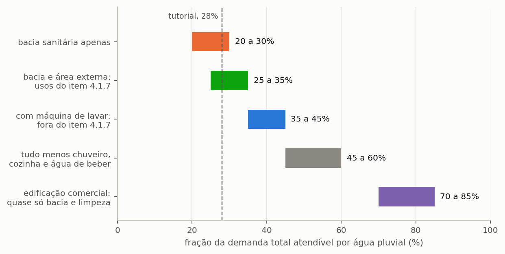

# Por onde começar, conforme o seu objetivo

Este manual reúne cinquenta e quatro secções em oito capítulos e não foi pensado para se ler do princípio ao fim. Funciona melhor como obra de consulta: cada leitor entra pelo ponto que corresponde ao que precisa de fazer. Esta secção existe para indicar esse ponto de entrada.

---

## Roteiro por objetivo

A tabela abaixo relaciona os cinco propósitos mais comuns de quem abre o programa com o percurso de leitura de cada um.

<!-- tabela: Percurso de leitura recomendado conforme o objetivo do leitor -->
| Quer | Leia |
| :--- | :--- |
| **aprender a usar** o programa | o capítulo {{c:2}} inteiro, secções {{n:4}} a {{n:13}}, por ordem |
| **resolver um caso** hoje | as três perguntas abaixo e, depois, o guia do capítulo {{c:3}} que servir |
| **publicar** um estudo | o capítulo {{c:4}}, que traz o método, e a secção {{n:13}}, com a lista de declaração |
| **rever** um estudo alheio | o capítulo {{c:6}} e os apêndices {{n:A}} e {{n:B}} |
| **exportar** para CAD, BIM ou folha de cálculo | a secção {{n:22}} |
| **não errar** | a secção {{n:33}}, com os dez enganos mais comuns |

Quem tem uma hora e nenhuma familiaridade prévia deve ler o tutorial do capítulo {{c:2}}. Constrói um estudo completo em torno de um único projeto, em Lisboa, e cada secção termina a mostrar onde o projeto chegou. O leitor acompanha a construção em vez de receber o resultado feito.

---

## As três perguntas que definem um estudo

Antes de abrir o programa, convém responder a três perguntas. Elas determinam boa parte das decisões seguintes, e responder-lhes depois costuma obrigar a refazer trabalho.

### Que usos vai a água da chuva atender?

A resposta define a **fração atendível**, e a fração atendível é o teto de tudo o resto: um sistema com fração de 28% nunca poupará mais de 28% do consumo total, por maior que seja a cisterna e por mais que chova. Nenhuma decisão de projeto posterior altera este limite, e por isso convém fixá-lo primeiro. A {{fig:fig46_atendivel}} reúne as gamas habituais da fração atendível conforme os usos previstos.

*Figura 99 — Que parte do consumo total a água da chuva pode atender, conforme os usos que o projeto prevê. É o teto do potencial de economia: nenhum reservatório, por maior que seja, ultrapassa esta fração.*

Os casos residenciais tratam-se na secção {{n:5}} e o caso comercial na secção {{n:18}}. A linha a tracejado marca os 28% do tutorial, que ficam nos usos não potáveis que a orientação sobre águas pluviais em geral admite: autoclismos, lavagens e rega. [A COMPLETAR: citar, com a fonte aberta, o artigo da ETA 0701 da ANQIP (ou da norma portuguesa em vigor) que lista os usos admitidos.]

### Vai comparar volumes ou avaliar um só?

A diferença entre avaliar um volume conhecido e procurar o volume adequado determina o modo de simulação e, com ele, o tempo de cálculo e a riqueza do resultado.

<!-- tabela: Escolha entre volume fixo e varredura conforme a pergunta do estudo -->
| Se quer | Use | Onde se trata |
| :--- | :--- | :--- |
| avaliar uma cisterna que já existe | volume fixo | secção {{n:6}} |
| descobrir o volume a comprar | **varredura** | secções {{n:7}} e {{n:24}} |
| escolher entre critérios que discordam | varredura e multicritério | secções {{n:12}} e {{n:32}} |

==A varredura é quase sempre a resposta certa.== Custa mais tempo de cálculo, da ordem dos segundos, e produz a curva de retorno decrescente, o argumento mais forte de que um estudo dispõe para justificar um volume.

### Precisa de reservatório superior?

A terceira pergunta é hidráulica. A resposta depende da altura do edifício e da pressão exigida nos pontos de consumo.

<!-- tabela: Critérios hidráulicos para decidir sobre o reservatório superior -->
| Se o edifício | Então | Onde se trata |
| :--- | :--- | :--- |
| é térreo e os pontos ficam perto da cisterna | pressurização direta, sem reservatório superior | secção {{n:8}} |
| é moradia de dois pisos ou prédio | reservatório superior, por **pressão** | secção {{n:8}} |
| precisa de reserva contra falhas de energia | reservatório superior | secção {{n:8}} |

> O reservatório superior **não aumenta** a poupança de água. Com o mesmo armazenamento total, entrega um pouco menos e gasta energia de elevação. A decisão de o adotar deve ser hidráulica, nunca fundada na expectativa de um aproveitamento maior. No tutorial de Lisboa, a diferença é de 0,31 pontos percentuais (secção {{n:8}}).

---

## A ordem de trabalho no programa

A barra lateral do programa está numerada, e a numeração segue a ordem em que se trabalha. As quatro primeiras etapas são de entrada de dados, as cinco seguintes apresentam resultados, e as restantes produzem saídas ou dão apoio ao estudo ({{fig:fig28_etapas}}).

*Figura 99 — As etapas do programa, agrupadas por natureza. As quatro primeiras são de entrada e devem ser preenchidas por ordem, porque cada uma usa o que a anterior definiu; as cinco seguintes são de leitura de resultados; as restantes produzem saídas ou dão apoio, e podem ser usadas a qualquer momento.*

Onde este manual trata cada uma: a etapa 1 na secção {{n:4}}, a 2 na {{n:5}}, a 3 na {{n:9}}, a 4 nas secções {{n:6}}, {{n:7}} e {{n:10}}, a 5 na {{n:6}}, a 6 na {{n:10}}, a 7 na {{n:11}}, a 8 na {{n:12}}, a 9 na {{n:13}}, a 10 na {{n:22}} e a 12, a Modulação Probabilística, nas secções {{n:40}} a {{n:44}}. A etapa 11 é a documentação incorporada no programa e não tem secção correspondente aqui. A Edição Portugal não traz catálogo de tarifários de todos os concelhos, e por isso não tem etapa de gestão de tarifas: os tarifários de Lisboa, do Porto e do Funchal vêm já nos projetos de exemplo, e nos restantes concelhos digita as tarifas do seu projeto na etapa económica. A numeração não tem salto.

Convém guardar o projeto no fim de cada etapa. Os parâmetros do apêndice {{n:A}} são gravados e relidos na íntegra, e o ficheiro resultante é a prova documental do estudo, tanto para quem o refizer no futuro como para quem o avaliar.

---

## Antes de publicar

Três leituras são obrigatórias para quem pretende publicar resultados, e nenhuma é longa. A secção {{n:13}} traz a lista do que declarar num artigo, com um parágrafo de método pronto a adaptar. A secção {{n:33}} reúne os dez enganos de projeto que o programa não consegue impedir. E a secção {{n:36}} lista as limitações conhecidas — das quais interessa ler não todas, mas as que afetam o caso em mãos.

O apêndice {{n:I}} condensa as três em fichas de uma página, para consulta rápida.
