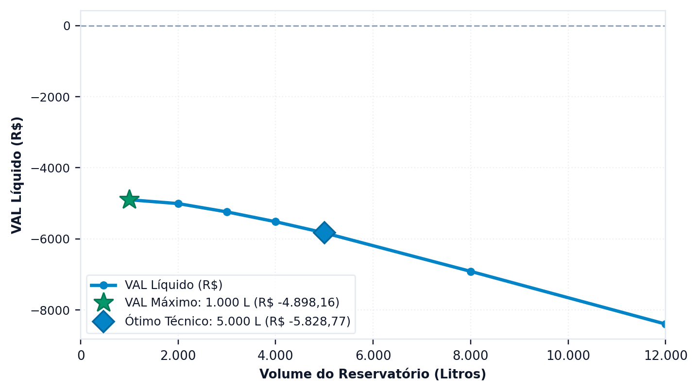

# Quanto custa e em quanto tempo se paga

> No fim desta secção, tem o fluxo de caixa a vinte anos e sabe porque a **estrutura tarifária da entidade gestora** decide a viabilidade mais do que qualquer parâmetro do projeto.

> **Os custos deste manual são ilustrativos.** A Edição Portugal não traz lista de preços. Todos os custos do tutorial são números redondos, em euros, escolhidos para se poder seguir o método; são **ilustrativos, não são preços de mercado**. A tarifa é a exceção: é o tarifário de Lisboa guardado no projeto de exemplo. No seu estudo, introduza na etapa económica os seus orçamentos e a tarifa que paga. O cálculo que se segue é o mesmo, e a lição sobre as estruturas tarifárias também.

---

## A poupança é a diferença entre duas faturas

O erro mais comum na análise económica de sistemas pluviais é multiplicar o volume poupado por uma tarifa média. O resultado quase nunca está certo, e a razão está na estrutura das tarifas, que em muitos concelhos são progressivas por escalões de consumo, como detalha a secção {{n:16}}: ==o metro cúbico que se deixa de consumir é o último da fatura, o mais caro, e não o médio.== A fatura portuguesa soma ainda várias parcelas — água, saneamento e resíduos —, o que acrescenta um segundo efeito.

O Triton evita o problema calculando duas faturas completas — a que o edifício pagaria sem o sistema e a que paga com ele — e tomando a diferença entre as duas.

<!-- inclui: _tabelas/cap10_economico.md -->

O resultado merece atenção. O sistema poupa 3,27 m³ por mês e a fatura baixa 11,19 €, o que dá 3,42 € por metro cúbico poupado. É mais do que a média da fatura sem o sistema, 2,53 € por metro cúbico (46,25 € para 18,26 m³). A diferença vem de a poupança incidir sobre os escalões mais altos e de a fatura de Lisboa somar à água o saneamento e os resíduos, ambos cobrados em função do volume de água: cada metro cúbico que não é tirado da rede também não é descarregado nem contado para os resíduos.

> **O saneamento acompanha a parcela da água, não a fatura total.** Poupar água poupa as duas parcelas, e é por isso que o valor efetivo do metro cúbico poupado fica acima do preço da água.

---

## O tarifário de Lisboa

A fatura de Lisboa soma três tarifários. A água é da EPAL, com IVA a 6% e o adicional da Câmara Municipal de Lisboa. O saneamento e os resíduos urbanos são tarifários da Câmara. Os três estão transcritos em `triton/data/portugal_tarifarios.json` a partir dos documentos de 2026: EPAL, *Preços de venda de água* (https://www.epal.pt/EPAL/docs/default-source/clientes/pre%c3%a7os-2026.pdf?sfvrsn=0), e Câmara Municipal de Lisboa, tarifários do saneamento e dos resíduos urbanos (https://www.lisboa.pt/fileadmin/portal/municipio/organizacao/financas/taxas/tarifario_saneamento_2026.pdf e https://www.lisboa.pt/fileadmin/portal/municipio/organizacao/financas/taxas/tarifario_residuos_urbanos_2026.pdf; recolhidos em 07/10/2026). Com 10 m³ por mês, a fatura completa é de 25,87 €.

Há dúvidas por resolver no tratamento do IVA do saneamento e dos resíduos, e o adicional da Câmara vem impresso na tabela da EPAL sem indicar se leva IVA (ver `examples/LEIA.md`). O programa trata-os sem IVA. [A COMPLETAR: confirmar com a EPAL e com a Câmara Municipal de Lisboa o tratamento do IVA nestas parcelas.]

Nem todas as entidades gestoras adotam a mesma estrutura, e a diferença decide a viabilidade de projetos inteiros. O programa distingue seis regimes.

<!-- tabela: Os seis regimes tarifários e o efeito de cada um sobre a poupança -->
| Regime | O que acontece ao poupar |
| :--- | :--- |
| tarifa de disponibilidade | cada m³ poupado desconta |
| fórmula exponencial | cada m³ poupado desconta, pelo preço-base elevado ao expoente |
| sem mínimo | idem |
| franquia no mínimo | poupar abaixo da franquia **não desconta nada** |
| franquia retroativa | ao passar a franquia, tarifa-se tudo desde zero |
| piso de pagamento | a fatura não desce abaixo do piso |

> **Atenção, e é o ponto que deita abaixo mais estudos.** Quando a entidade gestora cobra um valor fixo que já inclui uma **franquia**, digamos 10 m³, uma casa que consome 12 m³ e poupa 3 desce para 9, entra na franquia, e **a fatura deixa de baixar**. O sistema poupa água e não poupa dinheiro.
>
> Correr esse caso com uma tarifa média produziria um período de recuperação que não existe. A secção {{n:16}} ensina a montar corretamente a estrutura do seu tarifário.

---

## O investimento

6 650 €, assim distribuídos (todos os valores ilustrativos, não são preços de mercado):

<!-- tabela: Composição do investimento inicial do projeto do tutorial (ilustrativo, não é preço de mercado) -->
| Rubrica | Valor (ilustrativo, não é preço de mercado) |
| :--- | ---: |
| cisterna de betão de 5 000 L | 2 600 € |
| reservatório superior de 1 000 L em polietileno | 650 € |
| duas eletrobombas de meio cv, principal e de reserva | 500 € |
| mão de obra e escavação | 1 500 € |
| tubagem | 600 € |
| acessórios | 800 € |
| **total** | **6 650 €** |

Os preços dos reservatórios seguem uma regra ilustrativa simples, uma parte fixa mais uma parte por litro, diferente para cada material: polietileno 100 + 0,55 por litro, betão 600 + 0,40, fibra de vidro 120 + 0,65 e aço inoxidável 300 + 2,00. Uma cisterna de betão de 5 000 L fica, assim, em 600 + 2 000 = 2 600. Não são preços de catálogo; num estudo real, substitua-os por orçamentos.

**A câmara de descarte.** O descarte das primeiras águas não é só a lâmina subtraída à chuva: é um componente físico, com custo. A etapa **3. Qualidade & ETAP** dimensiona-o por predefinição, e no tutorial a lâmina de 2 mm sobre 150 m² exige uma câmara de 300 L. Neste orçamento ilustrativo, o seu custo está dentro da linha dos acessórios. Um estudo que deixe o descarte fora do orçamento, mas o subtraia à chuva, parece mais viável do que o sistema que se constrói. A secção {{n:27}} detalha o dimensionamento.

---

## O resultado

A segunda tabela acima dá os indicadores.

**O projeto não se paga, e esse é o resultado honesto.** Ao fim de vinte anos, com estes custos ilustrativos e o tarifário de Lisboa, o valor atual líquido (VAL) é de −5 828,77 €, a taxa interna de rentabilidade é de −11,30% ao ano, e não há período de recuperação descontado dentro do horizonte. Não ajustámos os custos até aparecer uma recuperação.

A razão não é um defeito do exemplo. A água é barata em Lisboa em relação ao que custam uma cisterna, duas bombas e a mão de obra, e a fração de 28% limita a poupança a pouco mais de três metros cúbicos por mês, 134,28 € por ano. Um tarifário que premeie mais o metro cúbico, uma fração atendível maior ou uma instalação mais barata mudam a conta, e a secção {{n:20}} varia cada um deles por sua vez. Mostra também que nenhuma das premissas testadas, isoladamente, produz recuperação neste caso. Só o tutorial leva custos, pelo que a secção {{n:14}} compara as três cidades pelo potencial de poupança, e não pela recuperação.

**O custo de exploração é pequeno:** 1,75 € por ano, dos quais 1,03 € são a energia da elevação, os 5,1 kWh por ano da secção {{n:8}} a 0,20 € por quilowatt-hora (valor ilustrativo, não é preço de mercado). A energia vem da mesma função que alimenta a avaliação ambiental, conforme o arranjo indicado na etapa **4. Reservatório & Custos**: elevação, pressurização direta ou gravidade.

---

O resultado de um volume isolado diz pouco sem os vizinhos. O separador económico repete a conta para todos os volumes da varredura e traça a curva, e é nela que se vê se o ótimo técnico e o ótimo económico caem no mesmo sítio ({{fig:fig49_programa_vpl}}).

*Figura 99 — O gráfico do separador económico: o valor atual líquido de cada volume da varredura, com o máximo económico e o ótimo técnico marcados. Quando os dois coincidem, o programa assinala-os com um único símbolo. Todos os custos são ilustrativos, não são preços de mercado. Figura gerada pelo próprio programa.*

---
## O que a projeção assume

Vinte anos são muito tempo, e a projeção depende de premissas que convém declarar:

<!-- tabela: Premissas da projeção económica e o peso de cada uma no resultado -->
| Premissa | Valor adotado | Onde pesa |
| :--- | ---: | :--- |
| taxa de atualização | 0,4% ao mês | desconta o fluxo; quanto maior, pior o VAL |
| inflação dos custos | 0,2% ao mês | incide só sobre o custo de exploração |
| atualização da tarifa da água | 3% ao ano | incide sobre a poupança |
| atualização da tarifa do saneamento | 3% ao ano | idem, e é indexada à parte |
| intervalo de atualização | 12 meses | em degraus, não de forma contínua |
| período de análise | 20 anos | a vida útil adotada; declare-a e justifique-a |

Todos estes valores são escolhas ilustrativas do tutorial, não dados de um país.

> **As atualizações da água e do saneamento são separadas**, e não um índice único sobre a fatura agregada. As duas parcelas são muitas vezes atualizadas por decisões diferentes das entidades que as cobram, e tratá-las em conjunto indexa parte da conta pelo índice errado.

A atualização da tarifa é a premissa mais frágil da lista. Três por cento ao ano durante vinte anos multiplicam a tarifa por 1,81. Se a tarifa real subir mais do que isso, o projeto rende mais; se subir menos, rende menos. Um estudo sério declara o valor adotado e mostra a sensibilidade — a secção {{n:20}} ensina como.

---

## O que temos até aqui

<!-- tabela: Estado do projeto do tutorial depois da análise económica (ilustrativo, não é preço de mercado) -->
| Projeto até aqui (ilustrativo, não é preço de mercado) | |
| :--- | ---: |
| volume | 5 000 L, betão |
| arranjo | elevação para reservatório superior de 1 000 L |
| investimento | 6 650 € |
| poupança anual | 134,28 € |
| VAL a 20 anos | −5 828,77 € |
| período de recuperação | sem recuperação em 20 anos |

O dinheiro diz não.

Falta ouvir o carbono. E ele não vai simplesmente concordar.
