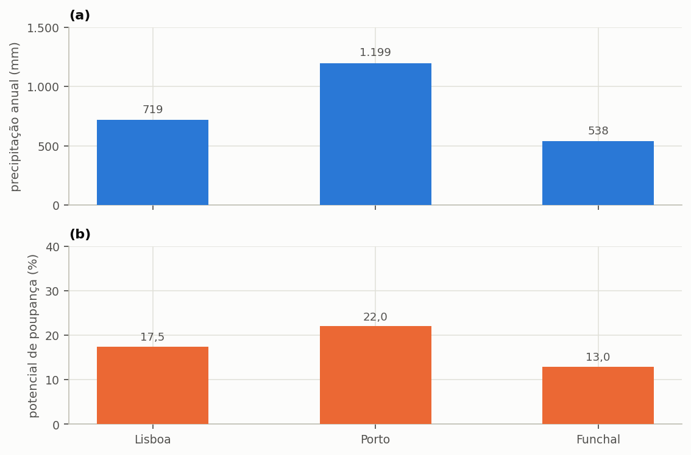

# Comparar cidades

> **Pergunta a que este guia responde:** o mesmo projeto renderia o mesmo noutra cidade?

Não renderia, e a diferença não é a que a chuva sozinha sugere. A expectativa corrente é que mais chuva dê mais aproveitamento. Isso vale como ordenação, mas falha como proporção, e falha por uma razão que merece uma secção inteira.

> **As suas cidades.** O programa traz a chuva diária de 278 concelhos do Continente (E-OBS) e a série de exemplo do Funchal. Para qualquer outro local, use um ficheiro de chuva próprio, um por cidade; tudo o resto do guia vale como está escrito.

---

## Como fazer a comparação

O procedimento é simples: manter todos os parâmetros do projeto e mudar apenas a série de precipitação. Na etapa **1. Projeto e Chuva**, escolha outro concelho da base ou carregue um ficheiro próprio, e execute de novo a simulação. Para comparar várias cidades sem refazer o projeto de cada vez, guarde um ficheiro por cidade, como a secção {{n:19}} recomenda.

---

## O resultado

O projeto do tutorial — 150 m² de captação, 600 L/dia de procura, 28% de fração atendível e cisterna de 5 000 L — levado ao Porto e ao Funchal dá a tabela abaixo, ao lado de Lisboa.

<!-- inclui: _tabelas/cap14_cidades.md -->

A {{fig:fig03_cidades}} separa as duas grandezas, cada uma na sua escala.

*Figura 99 — (a) Precipitação média anual e (b) potencial de economia de água potável do projeto do tutorial, com 150 m² de captação, 600 L/dia de procura, fração atendível de 28% e cisterna de 5 000 L, em Lisboa, no Porto e no Funchal. O potencial acompanha a chuva anual, mas não proporcionalmente.*

---

## A oferta em relação à procura, e o seu calendário

Lidas lado a lado, as colunas de chuva anual e de potencial de economia ordenam as cidades da mesma maneira, mas não andam em proporção. O Porto recebe 67% mais chuva do que Lisboa (1 199 mm contra 719 mm) e rende 4,55 pontos percentuais a mais: 22,04% contra 17,49%. Lisboa recebe 34% mais chuva do que o Funchal (719 mm contra 538 mm) e rende 4,51 pontos a mais, 17,49% contra 12,98%. Face ao teto de 28%, o Porto chega a 79%, Lisboa a 62% e o Funchal a 46%.

A explicação está em dois eixos. O primeiro é a **oferta em relação à procura**. Com 150 m² e coeficiente de 0,85, a chuva anual dá cerca de 153 m³ no Porto, 92 m³ em Lisboa e 69 m³ no Funchal, contra uma procura pluvial de 61 m³ por ano. O Porto tem 2,5 vezes o que precisa, Lisboa 1,5 vez e o Funchal pouco mais do que 1 vez. Onde a oferta sobra, a cisterna enche com facilidade e o potencial aproxima-se do teto; onde mal chega, a oferta limita-o, por maior que seja o reservatório.

O segundo eixo é o **calendário**. A tabela acima mostra-o duas vezes. A fração de dias com chuva é de 31% no Porto, 22% em Lisboa e 42% no Funchal. E a razão entre o mês mais chuvoso e o menos chuvoso, que mede quanto a chuva se concentra ao longo do ano, é de 9,8 no Porto, 14,8 no Funchal e 47,3 em Lisboa.

<!-- tabela: Razão entre o mês mais chuvoso e o menos chuvoso nas três cidades -->
| Cidade | Razão | O que significa |
| :--- | ---: | :--- |
| Porto | 9,8× | chove o ano todo, com uma estação mais húmida marcada |
| Funchal | 14,8× | chuva frequente, mas com um verão claramente mais seco |
| Lisboa | 47,3× | **um verão quase sem chuva depois de um inverno húmido** |

Em Lisboa, o verão é o que pesa. A cisterna enche no inverno e seca na estiagem: o atendimento pleno chega a 61,3% dos dias com 5 000 L, contra 77,9% no Porto e 44,5% no Funchal com o mesmo reservatório. Um reservatório dimensionado para atravessar noventa dias de estiagem teria de armazenar noventa dias de procura pluvial, o que neste projeto são 15 120 litros — um volume que nenhuma cisterna residencial comporta. É por isso que a curva de volume de Lisboa não satura (secção {{n:7}}) e que o sistema fica parado durante parte de cada ano.

> **A conclusão prática.** ==O potencial do aproveitamento pluvial depende de a chuva chegar, e de chegar quando é precisa.== O Porto mostra o que a abundância faz; Lisboa mostra o que um verão seco tira a uma chuva razoável; o Funchal mostra o que acontece quando a chuva, mesmo frequente, quase não excede a procura.

---

A {{fig:fig18_capitais}} apresenta o regime mensal das três cidades na mesma escala.

*Figura 99 — Precipitação média mensal em (a) Lisboa, (b) Porto e (c) Funchal, na mesma escala; a linha a tracejado é a média mensal de cada série. Lisboa concentra a chuva no inverno e tem um verão quase seco (a razão entre o mês mais e o menos chuvoso é de 47,3); o Porto é mais repartido (9,8); o Funchal fica entre os dois (14,8). É esta distribuição, e não o total anual sozinho, que decide o comportamento do reservatório.*

---

## Atenção ao Funchal

A série do Funchal é de natureza diferente das outras duas. Lisboa e o Porto usam a E-OBS, uma grelha interpolada de observações, média das células dentro do concelho. A E-OBS não dá uma série utilizável para o Funchal (faltam dados em 22% dos dias de 1991 a 2020, e o critério admite no máximo 1%), pelo que o exemplo usa a reanálise ERA5, uma célula de grelha de cerca de 9 km, e não um registo de estação. Comparar o Funchal com Lisboa e o Porto mistura, por isso, dois produtos. É a série menos fiável das três, e o seu valor serve para ilustrar o método, não para dimensionar. Num projeto real, use a série medida no local.

---

## Não leve um resultado de outra cidade

A comparação acima não é peculiaridade deste tutorial, e a lição para quem compara cidades é a mesma em qualquer estudo: a série local decide, e um volume ou um potencial trazido de outra cidade, ainda que vizinha, não substitui a simulação. Um número publicado para um clima que não é o seu é uma hipótese a testar, não um resultado a adotar.

### Muitas cidades de uma vez

Para comparar mais de três ou quatro cidades, trocar a série à mão deixa de ser prático. A folha de cenários da secção {{n:19}} corre o mesmo projeto contra várias séries numa única execução, gravando um resultado por linha. Mantenha na folha os mesmos parâmetros de edifício e de reservatório em todas as linhas, e varie apenas a série: é o que isola o efeito do clima.

---

## O que mais muda entre cidades

A precipitação não é a única grandeza que varia entre cidades, e as outras duas podem inverter a conclusão económica de um estudo comparativo.

A primeira é a **tarifa**. O preço do metro cúbico varia de uma entidade gestora para outra, e a estrutura também: Lisboa soma à água da EPAL o saneamento e os resíduos da Câmara Municipal; o Porto tem o tarifário da Águas e Energia do Porto; o Funchal, o da Câmara Municipal do Funchal (os três de 2026, transcritos em `triton/data/portugal_tarifarios.json`). Um potencial de 15% sob uma tarifa íngreme pode render mais dinheiro do que um de 27% sob uma tarifa baixa, e a secção {{n:16}} trata do mecanismo em pormenor. As cidades de exemplo levam os seus tarifários publicados, mas só o tutorial de Lisboa leva custos, pelo que este guia as compara pelo potencial de poupança, e não pelo período de recuperação. O IVA do Funchal (4%) está por confirmar; ver `examples/LEIA.md`.

A segunda é o **fator de emissão da rede elétrica**, que altera em simultâneo a emissão evitada por metro cúbico de água substituída e o custo ambiental da bombagem. Na Edição Portugal, introduz-se em cada projeto. A eletricidade só vem tabelada para o Funchal (tarifa da Empresa de Eletricidade da Madeira, fonte secundária, a confirmar).

> **Ao comparar cidades num estudo, deixe claro o que variou.** Comparar só a precipitação, mantendo fixos a tarifa e o fator de emissão, isola o efeito climático e é uma comparação legítima, desde que declarada como tal. Variar todas as grandezas ao mesmo tempo produz um número que não se consegue explicar, porque nele se somam efeitos de sinais possivelmente opostos.

---

## O volume ideal também muda, mas pouco

A última coluna da tabela guarda uma surpresa menor: com o limiar de 1 %/m³, o volume ideal é de 5 000 L em Lisboa e no Porto e de 4 000 L no Funchal, uma amplitude modesta perante a diferença de regimes que as separa.

A explicação está na natureza do critério. O volume ideal pelo ganho marginal localiza o joelho da curva de aproveitamento, e a posição desse joelho depende de como os primeiros metros cúbicos de armazenamento enchem e esvaziam contra uma procura diária de 168 L, que é a mesma nas três cidades. O que varia fortemente é o **patamar** que a curva atinge depois do joelho (17,49%, 22,04% e 12,98%), e não o ponto em que dobra. A coincidência pertence a esta casa, a este limiar e a estas três cidades; não é uma lei, e outra procura ou outro limiar podem separá-las.

Dito de outro modo: no Funchal acerta-se quase o mesmo volume que no Porto e colhe-se bastante menos água com ele.
