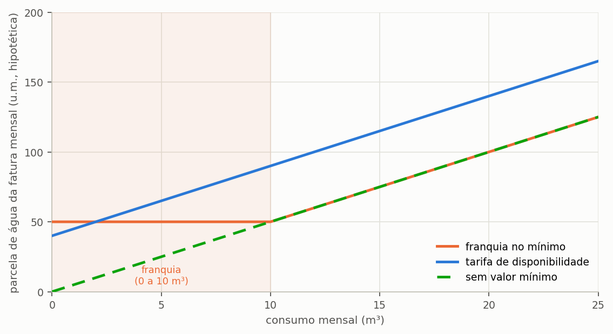

# Ajustar o tarifário do seu concelho

> **Pergunta que este guia responde:** o tarifário do meu projeto é aquele em que o edifício
> é faturado, e está bem introduzido?

> **Edição Portugal.** O programa traz transcritos os tarifários de três concelhos, Lisboa,
> Porto e Funchal, com a fonte e a data de cada um. Para qualquer outro concelho, o tarifário
> introduz-se à mão, com a mesma tabela de escalões, os mesmos códigos e os mesmos seis regimes
> de valor mínimo descritos aqui. Este guia é, por isso, também a referência para lançar
> qualquer estrutura tarifária.

Este é o guia que mais altera resultados. A estrutura tarifária decide a viabilidade
económica de um sistema pluvial mais do que qualquer parâmetro de projeto, e é também o dado
que mais vezes aparece errado nos estudos publicados sobre o tema.

---

## Como se compõe a fatura de água, saneamento e resíduos

Antes de conferir um tarifário, convém perceber o que se confere. A fatura de água não é o
produto do consumo por um preço único, e cinco características distinguem-na da fatura de
eletricidade, que é a referência mais familiar para a maioria dos leitores.

**O serviço é local, e o preço também.** Cada concelho é servido por uma entidade gestora,
municipal, intermunicipal ou empresarial, e cada entidade publica o seu tarifário. Não há tarifa
nacional de água. Os três exemplos do programa mostram-no. Em Lisboa, a água é vendida pela EPAL
e o saneamento e os resíduos são cobrados pela Câmara Municipal. No Porto, a água e o saneamento
são da Águas e Energia do Porto, EM, e os resíduos ficam de fora da fatura dessa entidade. No
Funchal, os três serviços constam da tabela de taxas da Câmara Municipal.

**A tarifa é progressiva por escalões de consumo.** O metro cúbico não custa o mesmo em
qualquer quantidade: o consumo divide-se em escalões, e cada escalão tem preço próprio,
crescente. Em Lisboa, os primeiros 5 m³ de água custam 0,4634 €/m³ e o escalão acima de 25 m³
custa 2,5961 €/m³, antes de IVA. ==A progressividade torna a poupança de água mais valiosa do que
parece:== o metro cúbico que se deixa de consumir é o do escalão mais alto atingido na fatura, o
mais caro.

**Há uma parte que não depende do consumo.** As três entidades cobram uma tarifa fixa mensal,
mesmo a quem não consome nada: a água de Lisboa tem 5,82 €/mês, a do Porto 3,726 €/mês
(0,1242 €/dia, em meses de 30 dias) e a do Funchal 4,12 €/mês. É o assunto da secção sobre os
seis regimes, adiante.

**O saneamento e os resíduos cobram-se sobre a água.** Nos três concelhos, a parte variável do
saneamento tem escalões próprios. Em Lisboa, os escalões aplicam-se ao volume recolhido, que o
tarifário fixa em 90% da água consumida. Os resíduos têm uma parte fixa e, em Lisboa e no
Funchal, uma parte indexada ao volume de água. Poupar um metro cúbico de água poupa também estas
parcelas, e é por isso que o valor do metro cúbico poupado excede o preço da água sozinho.

**O IVA é declarado parcela a parcela.** A água de Lisboa e do Porto leva IVA de 6%, taxa que a
tabela da EPAL declara e que o tarifário do Porto não imprime. O saneamento e os resíduos de
Lisboa não levam IVA nos documentos da Câmara. No Funchal, o programa aplica 4% a todas as
parcelas, valor ainda **por confirmar** (ver abaixo). Há ainda a taxa de recursos hídricos,
cobrada pela Agência Portuguesa do Ambiente e repercutida nas tarifas: no Porto entra com
0,0392 €/m³; em Lisboa, a do saneamento entra com 0,032 €/m³ recolhido.

> **O que o programa traz, e o que tem de lançar.** O tarifário transcrito cobre o
> **utilizador doméstico** no tarifário geral, com o contador de pequeno calibre. As categorias
> não domésticas existem, são públicas e constam dos documentos de cada entidade, mas o
> programa não as traz: para estudar uma escola, um comércio ou uma indústria, lance a estrutura
> da categoria correta no modo personalizado deste mesmo ecrã. A secção {{n:18}} mostra o
> procedimento. Os documentos de outras capitais de distrito já estão reunidos na base de fontes
> do programa, por transcrever; até lá, nesses concelhos o tarifário também se lança à mão.

---

## Comece por conferir o que já está no projeto

Na etapa **1. Projeto e Chuva**, no quadro «Concelho de referência & tarifário (água, saneamento
e resíduos)», escolha o concelho. Para Lisboa, Porto e Funchal, o programa mostra as entidades
gestoras, a vigência do tarifário e as fontes, e assinala que o tarifário foi transcrito dos
documentos oficiais. Para um concelho sem tarifário transcrito, avisa que a tarifa se informa em
«Editar». Três itens merecem conferência com o documento em vigor da sua entidade gestora, e a
ordem importa, porque o primeiro invalida os restantes.

1. **a data de vigência**: os tarifários atualizam-se todos os anos;
2. **os valores dos escalões**;
3. **o regime de valor mínimo**, que é o item {{n:16.4}}.

Havendo divergência em qualquer dos três, carregue em «Editar / Detalhar Tarifas da Cidade…» e
corrija a tabela. A correção vale para o seu projeto e fica guardada dentro do ficheiro
`.triton`, o que significa que quem receber o projeto reproduz o mesmo cálculo, com a mesma
tabela. O botão «Repor o tarifário transcrito do concelho» devolve a tabela de origem.

---

## Como a tabela é construída

Cada linha da estrutura tarifária é representada no programa por uma quádrupla de valores: o
volume mínimo do escalão, o volume máximo, um valor monetário e um código. O código é o elemento
decisivo, porque é ele que diz o que aquele valor significa, e estruturas parecidas cobram de
maneiras muito diferentes conforme o código de cada linha.

<!-- tabela: Os seis códigos de escalão tarifário e o efeito de cada um na fatura -->
| Código | O que é | Como entra na fatura |
| ---: | :--- | :--- |
| 1 ou 0 | escalão de consumo | cobra-se o preço por volume que cai **dentro** de cada escalão de consumo |
| −1 | tarifa de disponibilidade | valor fixo **somado** à parte de consumo |
| −2 | franquia retroativa | até ao volume da franquia, paga-se o valor fixo; acima dele, tarifa-se **tudo desde zero** |
| −3 | piso de pagamento | a fatura **não desce** abaixo deste valor |
| 2 | preço de base exponencial | `PB` da fórmula `PB × Cⁿ`, válido até ao máximo da linha |
| 3 | expoente da tabela exponencial | o `n` aplicado ao consumo **do mês inteiro** que cai na linha |

A água de Lisboa, tomada como exemplo, tem cinco linhas: uma de disponibilidade e quatro
escalões progressivos. O IVA de 6% é um campo à parte, aplicado sobre a soma.

```
(0,00 ; 0,00   ; 5,82   ; -1)   disponibilidade, soma sempre
(0,00 ; 5,00   ; 0,4634 ;  1)   primeiro escalão
(5,00 ; 15,00  ; 0,8666 ;  1)   segundo escalão
(15,00 ; 25,00 ; 2,0398 ;  1)   terceiro escalão
(25,00 ; 999999 ; 2,5961 ; 1)   último escalão
```

O saneamento de Lisboa tem os seus próprios escalões, aplicados a 90% do volume de água, e a
fatura de resíduos tem uma parte fixa e uma parte por metro cúbico. O programa guarda tudo isto
nos campos tarifários do projeto, e a conta mensal que o programa calcula coincide com a soma
parcela a parcela, conferida por teste.

---

## Os seis regimes, e por que decidem projetos

O valor mínimo aparece na fatura de quase todas as entidades, e significa coisas **diferentes**
em cada uma. O programa distingue seis regimes:

<!-- tabela: Os seis regimes tarifários e o que acontece ao poupar em cada um -->
| Regime | O que acontece ao poupar | Onde aparece nos exemplos |
| :--- | :--- | :--- |
| **sem mínimo** | cada m³ poupado desconta | nenhum dos três |
| **disponibilidade** | idem; a tarifa fixa mantém-se, mas não impede a poupança | Lisboa, Porto e Funchal (tarifa fixa mensal da água) |
| **fórmula exponencial** | idem; o m³ poupado vale pelo preço de base elevado ao expoente | nenhum dos três |
| **franquia no mínimo** | abaixo da franquia, poupar **não desconta nada** | nenhum dos três |
| **franquia retroativa** | acima da franquia, tarifa-se tudo desde zero | nenhum dos três |
| **piso de pagamento** | a fatura não desce abaixo do piso | nenhum dos três |

**O caso que deita abaixo um estudo.** Compare duas estruturas hipotéticas, lado a lado, para o
mesmo consumo. Os preços são números redondos em unidades monetárias (u.m.), escolhidos para
facilitar a conta; são uma ilustração, não um tarifário:

<!-- tabela: Efeito da poupança de água na fatura em dois regimes tarifários opostos (estruturas hipotéticas, em unidades monetárias) -->
| Consumo | Estrutura A, franquia no mínimo (50 u.m. pelos primeiros 10 m³, depois 5 u.m./m³) | Estrutura B, disponibilidade (40 u.m. mais 5 u.m./m³) |
| ---: | ---: | ---: |
| 14 m³ | 70 u.m. | 110 u.m. |
| 12 m³ | 60 u.m. | 100 u.m. |
| 10 m³ | 50 u.m. | 90 u.m. |
| 8 m³ | **50 u.m.** | 80 u.m. |
| 5 m³ | **50 u.m.** | 65 u.m. |

Na estrutura A, a fatura **deixa de descer aos 10 m³**. Uma casa que consome 12 m³ e instala um
sistema que poupa 4 desce para 8 e poupa 10 u.m., e não as 20 u.m. que o preço médio de
5 u.m./m³ sugeriria. Se poupasse 7, desceria para 5 e pouparia as **mesmas** 10 u.m.: os três
metros cúbicos adicionais não valem nada.

Na estrutura B, cada metro cúbico poupado reduz a fatura, desde o primeiro.

> Correr um caso da estrutura A com os dados da estrutura B produz um período de recuperação
> que não existe. Verifique o regime antes de confiar em qualquer resultado económico.

Os três concelhos do programa pertencem todos à segunda família: em cada um, todos os metros
cúbicos poupados reduzem a fatura. Em Lisboa, para a moradia do tutorial, a fatura sem o
sistema corresponde a 18,26 m³ por mês e custa 46,25 €; com o sistema, a 15,00 m³ e 35,06 €.
A poupança é de 3,27 m³ e 11,19 € por mês, ou seja, 3,42 € por metro cúbico poupado, contra
os 2,53 € por metro cúbico que o preço médio da fatura sem sistema sugeriria. Cada metro cúbico
poupado desconta o escalão mais alto da água e as parcelas do saneamento e dos resíduos que o
acompanham.

A {{fig:fig05_regimes}} mostra as três respostas lado a lado. O que distingue os regimes não é o
preço praticado, e sim a forma da curva: ==onde a curva é horizontal, poupar água não reduz a
fatura em nada.==



*Figura 99 — Parte da água na fatura mensal em função do consumo, em três regimes de valor mínimo. O saneamento não entra no gráfico porque acompanha a água e apenas multiplica a curva, sem lhe mudar a forma. Na tarifa de disponibilidade e sem valor mínimo, cada metro cúbico poupado reduz a fatura desde o primeiro; na franquia no mínimo, o troço horizontal marca a gama de consumo em que poupar água não reduz a fatura.*

---

## O que os três tarifários dizem, lado a lado

Os valores abaixo vêm dos documentos oficiais transcritos pelo programa (utilizador doméstico,
tarifário geral, meses de 30 dias). Servem para ver como estruturas parecidas dão contas
diferentes, e não para substituir a consulta do documento em vigor.

<!-- tabela: Fatura mensal doméstica de água, saneamento e resíduos nos três concelhos, tarifários de 2026 transcritos pelo programa -->
| Concelho | Entidades | Fatura de 10 m³ | Fatura de 30 m³ | IVA aplicado |
| :--- | :--- | ---: | ---: | :--- |
| Lisboa | EPAL (água); Câmara Municipal (saneamento e resíduos) | 25,8683 € | 94,3767 € | 6% na água; sem IVA no saneamento e nos resíduos |
| Porto | Águas e Energia do Porto, EM | 20,2995 € | 93,3293 € | 6% na água, no saneamento e na taxa de recursos hídricos |
| Funchal | Câmara Municipal do Funchal | 17,0872 € | 67,5272 € | 4%, por confirmar |

A 10 m³, Lisboa é a mais cara; a 30 m³, Lisboa e Porto quase se igualam, porque o Porto tem
escalões superiores mais caros. Quem compara concelhos pelo preço do primeiro escalão chega a
conclusões erradas: compare faturas para o consumo do edifício.

Três dúvidas ficam registadas, por honestidade, e o programa não as esconde:

- **Lisboa.** O «Adicional C.M. Lisboa» (0,1483 €/m³) vem impresso na tabela da EPAL sem dizer
  se leva IVA; o programa trata-o sem IVA. O saneamento e os resíduos da Câmara estão tratados
  sem IVA, como os documentos declaram.
- **Porto.** A tarifa de disponibilidade de água é a da secção dos utilizadores domésticos; o
  documento repete a tabela noutra página com um valor mais alto, lido como o dos não domésticos
  por inferência do desenho da página, a confirmar com a entidade. A taxa de 6% é a reduzida do
  Continente e não vem impressa no documento. Os resíduos urbanos não constam deste tarifário e
  ficam fora da fatura.
- **Funchal.** O IVA de 4% **não foi confirmado**: com 5%, a fatura de 10 m³ passaria de
  17,0872 € para 17,2515 €. O primeiro escalão do saneamento e dos resíduos não tem valor
  impresso e foi tratado como zero. A parte variável dos resíduos foi somada à do saneamento,
  porque o programa ainda não tem campo para resíduos por escalões; no ecrã, o «saneamento» do
  Funchal inclui, por isso, os resíduos variáveis.

---

## A fórmula exponencial

Algumas entidades não cobram a água por escalões. A parte da água é dada por uma fórmula:

```
Água = PB × Cⁿ + SB
```

em que `PB` é o preço de base, em €/m³; `C` é o consumo do mês, em m³; `n` é o expoente que a
**tabela de expoentes** da entidade atribui a esse consumo; e `SB` é o serviço de base, cobrado
mesmo sem consumo. Tipicamente, `n` vale 1,00 até um limiar e sobe com o consumo a partir daí.

Duas diferenças em relação aos escalões decidem o cálculo:

- **O expoente aplica-se ao consumo inteiro.** Nos escalões, cada metro cúbico paga o preço do
  escalão em que cai; na fórmula, o `n` da linha em que cai o consumo total aplica-se a todo o
  volume. Passar um limiar encarece, por isso, também os metros cúbicos abaixo dele.
- **Não há degrau de preço, há curva.** O preço médio do metro cúbico de água é `PB × Cⁿ⁻¹`:
  constante enquanto `n` vale 1 e crescente depois.

Para o aproveitamento pluvial, a consequência é que **toda a poupança desconta desde o primeiro
metro cúbico**, e desconta mais onde o expoente é maior.

Nenhum dos três concelhos do programa usa este regime. No programa, a fórmula entra na mesma
tabela de quádruplas, com dois códigos próprios: uma linha de código 2 guarda o preço de base
`PB`, e uma linha de código 3 por cada intervalo da tabela de expoentes guarda o `n`.

```
(0,00 ; 0,00   ; SB   ; -1)   serviço de base, soma sempre
(0,00 ; 999999 ; PB   ;  2)   preço de base PB
(0,00 ; 20,00  ; 1,00 ;  3)   n para o consumo em (0, 20]
...                           uma linha por intervalo da tabela de expoentes
```

No diálogo do tarifário, a estrutura aparece com o rótulo «Fórmula exponencial», as linhas
«Expoente n» podem ser editadas e o simulador mostra o cálculo `PB × Cⁿ` do consumo escolhido.
O campo do saneamento passa a «Saneamento (por m³ consumido)», e a etapa económica oferece o
mesmo modo, «Por m³ consumido», ao lado do valor fixo e da percentagem da água.

---

## Quando o mínimo é diluído na tarifa

Um erro frequente ao registar tarifas: a entidade informa «fatura mínima de 50 para 10 m³», e
quem regista grava 5 por m³ até 10 m³.

A diferença é enorme. Na primeira leitura, quem consome 4 m³ paga 50; na segunda, paga 20. E,
pior para um estudo pluvial, na segunda leitura poupar abaixo de 10 m³ **desconta**, quando na
realidade não desconta.

Se registar um tarifário novo, **verifique isto**: um mínimo declarado como fatura é uma tarifa
de disponibilidade ou uma franquia, e não um preço por metro cúbico.

---

## O saneamento

A percentagem de saneamento, quando existe, incide sobre a **parte da água** da fatura, e não
sobre a fatura total.

Cem por cento significa que a parte do saneamento iguala a da água, e portanto que o saneamento
é **metade da fatura**. Poupar água poupa as duas partes, e é por isso que o valor efetivo do
metro cúbico poupado é superior ao preço da água.

Os três concelhos do programa cobram o saneamento por escalões próprios, sobre o volume de água
consumido ou sobre uma fração dele (90% em Lisboa), e não por uma percentagem única. O programa
tem um modo para cada forma: percentagem da parte da água, preço por metro cúbico, e escalões
sobre uma fração do volume. Escolha o que corresponde ao documento.

---

## Vigência, atualização e tabelas alternativas

Um tarifário vale desde a data do documento de onde saiu, e nem sempre há um mais recente. O
diálogo do tarifário mostra essa data em **Tabela vigente desde**, ao lado da **Data-base do
estudo**, guardada no projeto. Entre as duas, o programa aplica as atualizações que já caíram,
com a taxa de atualização configurada, e as seguintes vêm nos aniversários da vigência, e não
doze meses depois do início do estudo. É uma estimativa, porque a atualização que de facto
houve pode ter sido outra; com o tarifário atual à mão, introduza-o com a sua vigência. Um
projeto antigo, sem as datas, fica como estava.

Alguns concelhos têm mais de uma tabela residencial, por exemplo por calibre do contador. Os
três tarifários do programa são os do contador de pequeno calibre. Escolha a tabela que
corresponde ao imóvel e registe no projeto a razão. Quem tiver a fatura do próprio imóvel pode,
como sempre, introduzir a tabela.

## Onde encontrar os dados

Por ordem de fiabilidade:

1. **Tarifário publicado pela entidade gestora**, em regra no seu sítio ou no do município. É o
   documento oficial e traz a data de vigência. As entidades de titularidade municipal enviam o
   tarifário à ERSAR, entidade reguladora, para parecer.
2. **Simulador de fatura** da entidade, quando existir. Bom para conferir: simule dois consumos
   e veja se a sua tabela reproduz os dois valores.
3. **Fatura real de água, saneamento e resíduos**, do próprio imóvel. É a melhor evidência, e
   permite conferir a estrutura inteira.

> **Registe sempre a data de vigência e a fonte.** Um estudo que não diz de quando é a tarifa
> não pode ser reproduzido daqui a dois anos.

---

## Confira antes de confiar

Depois de montar a tabela, faça o teste que o item {{n:16.7}} sugere: simule dois consumos, um
dentro e outro fora do escalão mínimo, e compare com a fatura real ou com o simulador da
entidade. Os tarifários transcritos do programa foram conferidos assim: a conta de 10 m³ e a de
30 m³ de cada concelho foram refeitas à mão, só com os números impressos nos documentos.

Se os dois valores coincidirem, a estrutura está certa. Se só um coincidir, o regime de valor
mínimo está errado, e é exatamente esse o erro que mais compromete um estudo pluvial.
