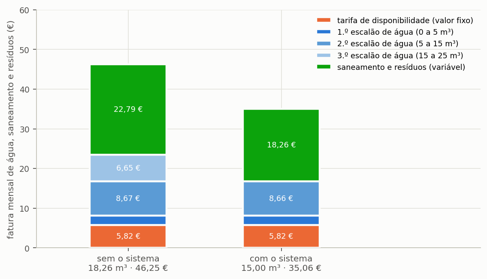
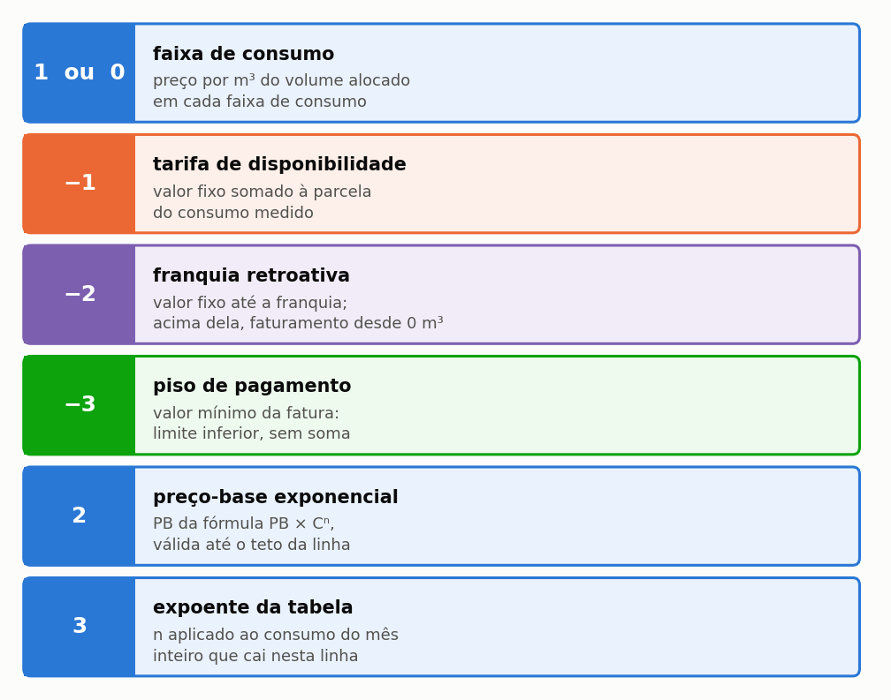
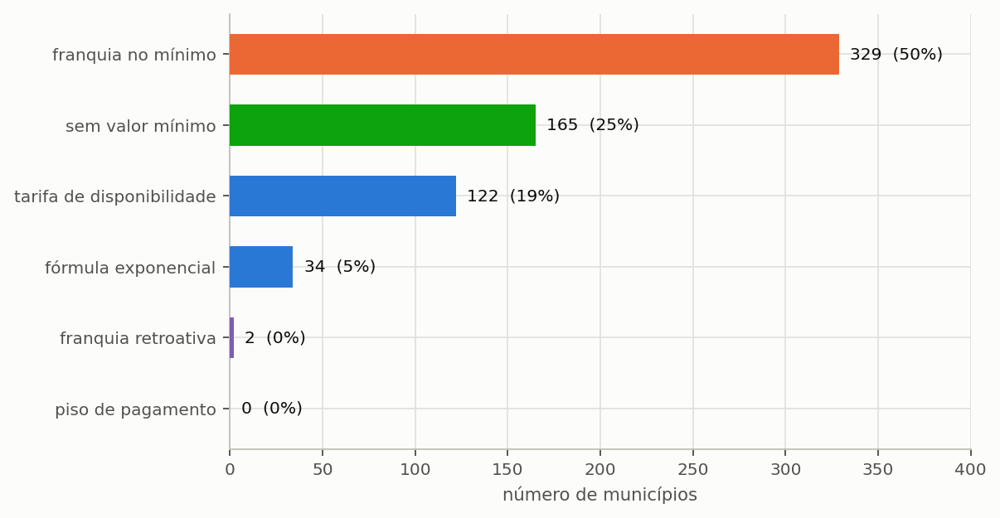
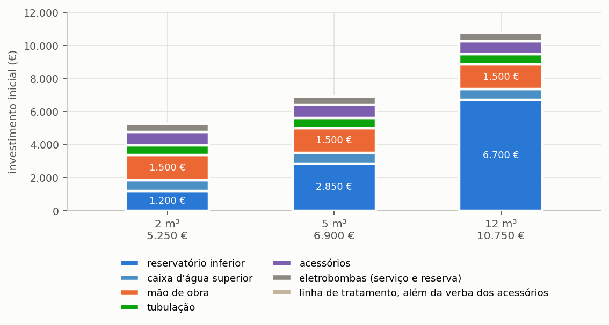
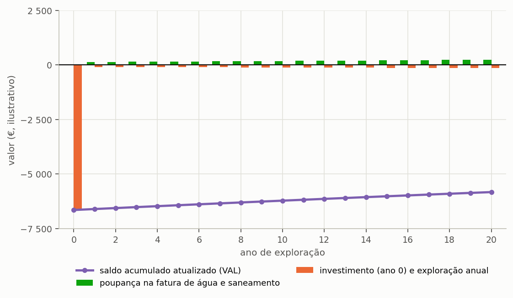

# Análise económica e regimes tarifários

> Esta secção formaliza o modelo de fluxo de caixa e detalha os regimes
> tarifários — o fator determinante na viabilidade económico-financeira de um sistema de aproveitamento de águas pluviais.

---

## A poupança resulta da diferença entre duas faturas reais

O programa não calcula a poupança financeira multiplicando simplesmente o volume pluvial
poupado por uma tarifa unitária média. Essa distinção é crítica: para cada mês do horizonte
de projeto, o programa simula duas faturas completas — uma correspondente ao consumo total
que a edificação teria sem o sistema pluvial e outra associada à água potável da rede pública
efetivamente adquirida —, apurando a poupança através da diferença entre ambas.

```equacao:economia_mensal
E_mês = F(V_tot) − F(V_pot)
```

| Símbolo | Significado | Unidade |
| :--- | :--- | :--- |
| `E_mês` | poupança mensal obtida | € |
| `F(·)` | função de cálculo da fatura (água, saneamento e taxas) para um dado volume | € |
| `V_tot` | consumo mensal total que a edificação teria sem o sistema | m³ |
| `V_pot` | volume mensal de água potável adquirido da rede | m³ |

A razão desta metodologia assenta na estrutura progressiva por escalões e na existência
de componentes fixas nos tarifários. ==O metro cúbico poupado abate sempre nos escalões superiores de consumo, que são os mais onerosos por unidade de volume.== No tutorial de Lisboa, a fatura mensal desce de 46,25 € para 35,06 €, gerando uma poupança mensal de 11,19 €. Utilizar uma tarifa média linear induziria distorções significativas nos resultados.

---

## A fatura dos serviços de águas

A estrutura tarifária dos serviços municipais de água e águas residuais é representada no
programa por uma sequência de patamares, em que cada patamar associa intervalos de volume,
preços e regras específicas de faturação.

A fatura mensal engloba parcelas de natureza distinta: uma tarifa fixa (quota de serviço),
que remunera a disponibilidade das infraestruturas e não varia com o consumo; os escalões
variáveis de consumo de água potável; e as tarifas de saneamento (águas residuais) e gestão de
resíduos associadas. A poupança gerada pela água pluvial incide de forma assimétrica sobre essas parcelas, tal como ilustrado na {{fig:fig07_fatura}}.



*Figura 99 — Fatura mensal de água e saneamento do projeto do tutorial, discriminada por parcelas, com e sem o sistema pluvial. A quota de serviço fixa permanece invariável; a redução financeira reflete-se nos escalões superiores de consumo volumétrico e na redução proporcional da tarifa variável de saneamento.*

O código associado a cada escalão no programa determina a sua aplicação no cálculo ({{fig:fig32_codigos}}):
os códigos 1 ou 0 correspondem a escalões de consumo volumétrico; o código −1 representa a quota fixa de serviço
(tarifa de disponibilidade); o código −2 representa franquias retroativas; o código −3 define pisos mínimos de faturação;
e os códigos 2 e 3 correspondem a regimes de progressividade analítica.



*Figura 99 — Os códigos de escalão tarifário e o respetivo impacto na faturação mensal. Estruturas com valores numéricos similares podem gerar resultados divergentes consoante a formulação regulamentar de cada escalão.*

### Saneamento e taxas proporcionais

```equacao:esgoto
T_esg = T_agua × s
```

| Símbolo | Significado | Unidade |
| :--- | :--- | :--- |
| `T_esg` | parcela de saneamento/águas residuais indexada | € |
| `T_agua` | parcela variável de consumo de água potável | € |
| `s` | rácio proporcional ou percentual regulamentar de saneamento | adimensional |

Quando o serviço de saneamento é cobrado em percentagem do valor da água ou por tarifa volumétrica proporcional aos metros cúbicos medidos, cada metro cúbico pluvial consumido gera benefício duplo: reduz a fatura do abastecimento e reduz a fatura do saneamento.

---

## Os seis regimes tarifários suportados

O motor de cálculo suporta seis modalidades fundamentais de tarifação, detalhadas na secção {{n:16}} ({{fig:fig33_regimes_base}}):

<!-- tabela: Codificação dos regimes tarifários -->
| Regime | Descrição no programa | Aplicação matemática | Impacto da poupança de água |
| :--- | :--- | :--- | :--- |
| sem mínimo | escalões de consumo simples | soma volumétrica por escalão | cada metro cúbico poupado reduz a fatura |
| quota fixa (disponibilidade) | quota fixa (−1) mais escalões | valor fixo somado ao consumo | o consumo reduz-se; a quota fixa mantém-se |
| franquia no mínimo | quota fixa (−1) com 1.º escalão nulo | franquia incluída na tarifa base | poupar dentro da franquia não reduz a fatura |
| franquia retroativa | franquia comutativa (−2) | consumo acima cobra desde 0 m³ | baixar da franquia reduz abruptamente a fatura |
| piso de pagamento | limite inferior garantido (−3) | fatura limitada por um mínimo | reduções abaixo do piso não geram poupança |
| fórmula progressiva | base polinomial/exponencial | progressividade contínua | redução diferenciada pelo nível de consumo |



*Figura 99 — Caracterização conceptual dos regimes tarifários suportados pelo motor de cálculo.*

---

## Investimento inicial (CAPEX)

O investimento inicial do sistema resulta do somatório das rubricas orçamentais da instalação:

```equacao:capex
CAPEX = C_cist + C_sup + C_mo + C_tub + C_ace + ( C_bomba × n_b ) + CAPEX_inc
```

| Símbolo | Significado | Unidade |
| :--- | :--- | :--- |
| `CAPEX` | investimento inicial total do sistema | € |
| `C_cist` | custo do reservatório inferior (cisterna) | € |
| `C_sup` | custo do reservatório superior (quando existente) | € |
| `C_mo` | custo de mão de obra e montagem | € |
| `C_tub` | custo das tubagens e conexões | € |
| `C_ace` | acessórios, válvulas, quadro e cablagens | € |
| `C_bomba` | custo unitário da eletrobomba | € |
| `n_b` | número de eletrobombas instaladas (serviço e reserva) | unidade |
| `CAPEX_inc` | investimento incremental da linha de tratamento (ETAP) | € |

No caso de estudo do tutorial (Lisboa, cisterna de 5.000 L em polietileno com reservatório superior de 1.000 L), o investimento total ilustrativo ascende a 6.650 €. A {{fig:fig21_investimento}} apresenta a decomposição orçamental por componente.



*Figura 99 — Estrutura do investimento inicial por componente para diferentes capacidades de reservatório. Em volumes domésticos moderados, a tubagem, mão de obra e acessórios representam uma fração significativa do custo total.*

---

## Custeio operacional anual (OPEX)

O custeio operacional anual agrega:
1. A energia elétrica consumida pelas eletrobombas (secção {{n:28}}).
2. O consumo de reagentes desinfetantes (cloração).
3. A manutenção periódica da ETAP e do dispositivo de primeiras águas.
4. Outros custos operacionais declarados pelo utilizador.

---

## Projeção temporal do fluxo de caixa

A projeção económica é calculada mês a mês ao longo do período de vida útil analisado (habitualmente 20 anos), atualizando os custos operacionais pela inflação e as faturas pelas taxas de atualização tarifária:

```equacao:inflacao
f_inf = ( 1 + i )^( m − 1 )
```

```equacao:reajuste
f_j = ( 1 + r_j )^k
```

| Símbolo | Significado | Unidade |
| :--- | :--- | :--- |
| `f_inf` | fator acumulado de inflação no mês `m` | adimensional |
| `i` | taxa de inflação mensal estimada | adimensional |
| `f_j` | fator de atualização tarifária acumulado no período | adimensional |
| `r_j` | taxa de atualização tarifária anual | adimensional |
| `k` | número de anos decorridos até ao mês de cálculo | adimensional |

A {{fig:fig08_fluxo_de_caixa}} sintetiza o fluxo de caixa acumulado ao longo do horizonte temporal.



*Figura 99 — Projeção do fluxo de caixa acumulado do projeto do tutorial ao longo de 20 anos, demonstrando o comportamento do investimento inicial face à poupança anual na fatura.*

---

## Indicadores de rentabilidade

**Valor Atual Líquido (VAL):**

```equacao:vpl
VPL = − CAPEX + Σ [ FC_m ÷ ( 1 + TMA )^m ]
```

| Símbolo | Significado | Unidade |
| :--- | :--- | :--- |
| `VPL` | valor atual líquido do investimento (VAL) | € |
| `CAPEX` | investimento inicial total | € |
| `FC_m` | fluxo de caixa líquido verificado no mês `m` | € |
| `TMA` | taxa de atualização mensal de referência | adimensional |
| `m` | índice mensal de 1 até ao horizonte de cálculo | mês |

**Taxa Interna de Rentabilidade (TIR):** taxa que anula o VAL da série financeira. Caso o investimento não seja amortizável dentro do horizonte, o programa assinala a ausência de solução real.

**Período de recuperação do investimento (Payback):** mês em que o saldo acumulado descontado cruza o valor zero. No tutorial de Lisboa, aos custos de referência ilustrativos (6.650 € de investimento para uma poupança anual de cerca de 134 €), o VAL obtido é de −5.828,77 €, não existindo período de amortização no horizonte de 20 anos. Este resultado ilustra com clareza que, em climas com verão seco e tarifários moderados, o aproveitamento pluvial deve ser equacionado sob a perspetiva de resiliência e sustentabilidade ambiental, e não apenas de retorno financeiro imediato.
