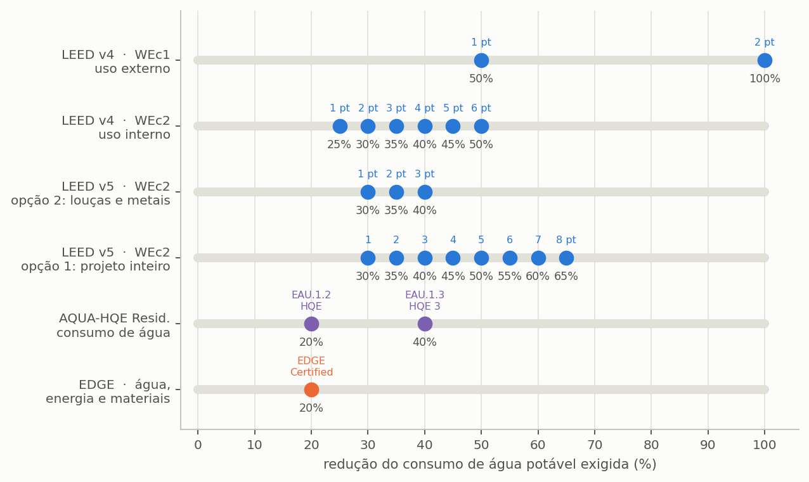

# Certificações

> Esta secção reúne as regras de enquadramento dos referenciais de sustentabilidade que o
> programa avalia e distingue, em cada um, o que é requisito do referencial do que é critério
> adotado pelo programa.

Os sistemas de aproveitamento de águas pluviais aparecem em praticamente todos os referenciais
de certificação ambiental de edifícios, e em cada um com uma métrica própria. Uns medem a
poupança contra o consumo total do edifício, outros contra um caso-base de referência, e outros
ainda exigem a comparação em mais de uma dimensão em simultâneo. O programa calcula o
enquadramento nos referenciais internacionais abaixo a partir dos resultados da simulação, e fá-lo
sempre com a mesma ressalva: ==o programa mostra onde o projeto se enquadraria, e não certifica
coisa alguma.== A certificação é decidida pelo organismo certificador, com a documentação
completa do empreendimento, da qual o desempenho hídrico é apenas uma peça.

A Edição Portugal mostra o LEED, o EDGE e o GRI. Os referenciais nacionais e europeus (ANQIP,
LiderA, BREEAM, Level(s)) não estão incorporados: descrevem-se mais abaixo, para que o
utilizador saiba o que cada um pede, e a poupança de água potável que o relatório do programa
fornece aplica-se com as regras de cada um, fora do programa.

Antes de os percorrer um a um, convém vê-los lado a lado. Os limiares de cada referencial estão
em escalas que parecem incomparáveis enquanto ficam em tabelas separadas, e passam a comparar-se
quando postos sobre a mesma régua de poupança ({{fig:fig37_certificacoes}}). Os limiares abaixo
são os codificados no programa; confirme-os no texto vigente de cada referencial antes de os
citar. O LEED v4 pontua em separado a redução do uso exterior (WEc1: 1 ponto a partir de 50% e 2
pontos com 100%) e a do uso interior (WEc2: de 1 a 6 pontos entre 25% e 50%); o LEED v5 reúne a
categoria no crédito WEc2, em que a redução em aparelhos sanitários e torneiras vale de 1 a 3 pontos entre 30% e
40% e a redução do projeto inteiro, de 1 a 8 pontos entre 30% e 65%; e o EDGE exige uma redução
mínima de 20% em simultâneo na água, na energia e na energia incorporada nos materiais, sem
pontuação.

*Figura 99 — Os limiares de redução do consumo de água potável com que o programa enquadra o projeto no LEED v4 (créditos WEc1 e WEc2), no LEED v5 (crédito WEc2, opções 1, 2 e 4) e no EDGE, na mesma escala. Os referenciais cujo critério pontua a existência de um sistema, e não uma percentagem, não entram na régua. Um mesmo projeto cruza referenciais diferentes em pontos diferentes, e é por isso que declarar a poupança obtida vale mais do que declarar a certificação pretendida.*

---

## LEED v4 e v4.1, categoria Water Efficiency

O LEED é o referencial do U.S. Green Building Council (<https://www.usgbc.org/leed>, consultado a
16 de outubro de 2026), o mais difundido a nível internacional; a página oficial dá-o como o
sistema de classificação de edifícios sustentáveis mais utilizado e lista as versões v5, v4.1 e v4,
com os níveis Certified (40 a 49 pontos), Silver (50 a 59), Gold (60 a 79) e Platinum (80 ou
mais). A versão 5 coexiste com as versões 4 e 4.1; o programa enquadra o projeto nas duas, e o
estudo deve declarar qual usou. Nas versões 4 e 4.1, a eficiência hídrica ocupa uma categoria
própria, que vale oito pontos repartidos por dois créditos. A distinção fundamental que impõe é
entre uso interior e uso exterior da água, e é dessa separação que decorre toda a pontuação.

O crédito WEc1 trata da redução do uso exterior, isto é, da rega e das restantes procuras das
áreas descobertas, e vale até dois pontos. O programa concede os dois pontos com 100% de redução
do uso exterior de água potável e um ponto a partir de 50%, tomando a água da chuva destinada à
rega do próprio balanço diário; e um projeto sem procura exterior registada não pontua, situação
em que o programa regista explicitamente a razão, para que o utilizador não interprete o zero
como falha de desempenho.

O crédito WEc2 trata da redução do uso interior e vale até seis pontos, repartidos numa escala de
cinco em cinco pontos percentuais a partir de 25% de poupança. Antecede-o um pré-requisito, o
WEp2, que exige 20% de redução interior e é obrigatório: sem ele o empreendimento não é elegível
para certificação, e não confere pontuação alguma.

> A separação entre uso interior e exterior depende inteiramente da **discriminação da procura**
> descrita na secção {{n:5}}. O programa não inventa essa separação: usa a água da chuva que o
> balanço diário destinou à rega, que é satisfeita depois do uso interior. Sem procura exterior
> discriminada, o crédito WEc1 aparece como não avaliado, e a poupança interior é tomada,
> por prudência, igual à poupança total.

> A etiqueta da pontuação dá apenas os pontos da categoria da água. O nível do LEED — Certified,
> Silver, Gold ou Platinum — resulta da soma de todas as categorias, e a água sozinha não o
> define.

---

## LEED v5, crédito WEc2 Enhanced Water Efficiency

Na versão 5, os créditos de uso interior e exterior foram reunidos no crédito WEc2, *Enhanced Water
Efficiency*, que vale até oito pontos em construção nova e até sete em *Core and Shell*; o
programa avalia apenas a construção nova. O código WEc1 passou a designar outro crédito, *Water
Metering and Leak Detection*, de contagem setorizada e deteção de fugas, e não deve ser confundido
com o WEc1 de uso exterior do LEED v4. O pré-requisito WEp2 exige, entre outras condições, uma
redução de 20% no consumo de aparelhos sanitários e torneiras em relação à linha de base do referencial, e o
pré-requisito WEp1 exige que a fonte alternativa de água, como a cisterna pluvial, tenha um
contador próprio, separado do da rede pública. O projeto pontua por uma de duas vias: a Opção 1,
que mede a redução do uso de água do projeto inteiro, ou a soma das Opções 2 a 6, que tratam cada
parcela em separado.

<!-- tabela: Opções do crédito WEc2 do LEED v5 a que o aproveitamento pluvial contribui -->
| Opção | O que mede | Pontuação |
| :--- | :--- | :--- |
| 1. Projeto inteiro | redução do uso de água do projeto contra a linha de base | 30% 1 ponto, e 1 ponto por cada 5%, até 65% 8 pontos; com fonte alternativa de água, cada escalão vale 1 ponto a mais, até 8 |
| 2. Louças e torneiras | redução calculada contra a linha de base do WEp2, que pode incluir fonte alternativa | 30% 1 ponto, 35% 2 pontos, 40% 3 pontos |
| 4. Uso exterior, via 2 | redução da necessidade teórica de rega | 50% 1 ponto, 100% 2 pontos |
| 6. Reutilização, via 2 | sistema de reutilização no local que sirva a rega, os autoclismos, a reposição ou o processo | 2 pontos |

O programa calcula as duas vias e adota a de maior pontuação: a Opção 1 com a poupança total, e a
soma das Opções 2, 4 e 6 com a poupança interior, a poupança exterior e a existência do sistema,
que o programa trata como o sistema de reutilização da Opção 6. O teto de oito pontos vale para
as duas. As Opções 3 e 5, de equipamentos e de água de processo, e a via 1 da Opção 4, de
paisagismo sem rega, não dependem do aproveitamento pluvial e ficam fora do cálculo. Como no
LEED v4, as reduções do referencial medem-se contra uma linha de base de caudais de aparelhos e de
rega, e não contra a procura modelada, pelo que o enquadramento é indicativo.

O aproveitamento pluvial pode ainda contribuir para o crédito SSc3, *Rainwater Management*. Pela
Opção 1, concede 1, 2 ou 3 pontos pela retenção no lote do volume correspondente ao percentil 80,
85 ou 90 das chuvas locais (70, 75 ou 80 em lote sem recuos), e 1 ponto adicional quando parte
desse volume é reutilizada, sem exceder o teto de 3 pontos; pela Opção 2, concede 3 pontos a quem
retém o acréscimo de escoamento em relação à cobertura natural do terreno. O programa não avalia
este crédito, porque depende do escoamento de todo o terreno, e não só da cobertura; a matriz de
critérios regista-o como não avaliado.

[A COMPLETAR: confirmar, no texto vigente do *LEED v4.1 BD+C* e do *LEED v5 BD+C Rating System*, os
limiares e as pontuações dos créditos WEc1, WEc2 (v4) e WEc2 (v5), e o crédito SSc3. A página
<https://www.usgbc.org/leed> confirma o sistema, as versões e os níveis, mas não os créditos.]

---

## EDGE, o único que não pontua

O EDGE, desenvolvido pela International Finance Corporation (IFC) do Banco Mundial, segue uma
lógica distinta da de todos os anteriores. Em vez de atribuir pontos a desempenhos crescentes, mede
a percentagem de poupança contra um caso-base local em três dimensões independentes — energia,
água e energia incorporada nos materiais — e exige que **cada uma** delas cruze o limiar
estabelecido. Não há compensação entre dimensões: um desempenho hídrico excecional não supre uma
deficiência na energia.

O EDGE tem ainda dois níveis acima do primeiro. O **EDGE Advanced** exige, além dos 20% nas três
dimensões, uma poupança de energia de pelo menos 40% no local; o **Zero Carbon** exige o anterior
mais 100% de energia renovável, no local ou fora dele, ou a compra de compensações de carbono para
completar os 100%. Os níveis e os requisitos conferem com a página oficial do EDGE
(<https://edgebuildings.com/certify/certification/>, consultada a 16 de outubro de 2026).

Vale notar qual é a barra que o nível avançado eleva. ==O EDGE Advanced sobe a exigência de
energia, e não a de água.== A consequência prática para quem projeta sistemas pluviais é que o
sistema garante a barra hídrica com relativa folga, ao passo que o nível de certificação
alcançado se decide inteiramente fora do âmbito do projeto de água. O programa avalia apenas a
barra de água, pela medida WEM14, cuja entrada na aplicação do IFC é a área de captação em metros
quadrados.

> **O limite honesto está no denominador.** O caso-base do EDGE é local, varia com o país e com a
> tipologia, e é fixado pela própria aplicação do IFC. O programa aceita o caso-base declarado
> pelo utilizador; na sua ausência, adota a procura modelada do projeto e adverte que a
> percentagem resultante é um **piso**, e não o valor que a certificação reconhecerá.
>
> As barras de energia e de energia incorporada nos materiais estão fora do alcance do programa,
> que declara essa limitação no relatório. Afirmar que um projeto é EDGE Certified dispondo de um
> terço da evidência necessária seria irresponsável.

[A COMPLETAR: confirmar com o guia da medida WEM14 da aplicação EDGE a definição da medida e o
dado de entrada; a página de certificação não a descreve.]

---

## GRI 303

A Global Reporting Initiative não é um referencial de certificação de edifícios, mas uma norma de
divulgação empresarial de desempenho socioambiental. A sua série 303 trata da água e dos efluentes
(<https://www.globalreporting.org/standards/standards-development/topic-standard-project-for-water-and-effluents/>,
consultada a 16 de outubro de 2026), e dois dos seus indicadores são alimentados diretamente pelos
resultados do programa: o GRI 303-3, que reporta a captação evitada em metros cúbicos por ano e
acumulada ao longo do período, e o GRI 303-5, que exprime a taxa de circularidade hídrica do
empreendimento.

[A COMPLETAR: confirmar, no texto do GRI 303:2018, a redação exata das divulgações 303-3 e 303-5; a
página consultada apresenta o projeto da norma, não as divulgações.]

---

## Referenciais nacionais e europeus fora do programa

O programa não avalia estes referenciais. Descrevem-se aqui só os factos verificados nas páginas
oficiais, para que o utilizador saiba onde procurar os requisitos.

**ANQIP.** A Associação Nacional para a Qualidade nas Instalações Prediais
(<https://www.anqip.pt>, consultada a 16 de outubro de 2026) certifica produtos, sistemas de
águas pluviais e de águas cinzentas, e instalações hidráulicas prediais (CertIHP, certificação
voluntária). A página de produtos certificados (<https://www.anqip.pt/pt/produtos-certificacao>)
exibe a **etiqueta de eficiência hídrica**, com classes por produto: de A++ a B nos autoclismos e
de A+ a D nos chuveiros. A especificação técnica ANQIP ETA 0701, de sistemas de aproveitamento de
águas pluviais em edifícios (SAAP), é a referência portuguesa de projeto para usos não potáveis; a
certificação da instalação rege-se por uma especificação própria, a ETA 0702.

[A COMPLETAR: as indicações sobre a ETA 0701 e a ETA 0702 vêm de documentos de versões antigas
(validade 2009 a 2014) obtidos por pesquisa; confirmar na ANQIP a versão vigente de ambas, o
âmbito da certificação do SAAP e as classes em vigor da etiqueta de eficiência hídrica.]

**LiderA.** Sistema voluntário que orienta e certifica ambientes construídos sustentáveis, com
vinte áreas e uma escala de classes de A++ a E (<https://lidera.info>, consultado a 16 de outubro de
2026).

[A COMPLETAR: critérios e indicadores de água do LiderA (a página inicial não os lista; ver as
especificações da versão 4 no mesmo sítio).]

**BREEAM.** Método de avaliação da sustentabilidade do ambiente construído, associado ao grupo BRE
(<https://breeam.com>, consultado a 16 de outubro de 2026).

[A COMPLETAR: critérios de água do BREEAM aplicáveis ao aproveitamento pluvial, níveis de
classificação e versão aplicável em Portugal; a página consultada não os apresenta.]

**Level(s).** Quadro europeu voluntário de indicadores de sustentabilidade de edifícios de
escritórios e residenciais, do Centro Comum de Investigação da Comissão Europeia. O indicador 3.1,
consumo de água na fase de utilização (m³ por ocupante e por ano), traz uma lista de verificação
de projeto que inclui o aproveitamento de águas pluviais e a reutilização de águas cinzentas
(manual do utilizador, versão 1.1, janeiro de 2021:
<https://susproc.jrc.ec.europa.eu/product-bureau/sites/default/files/2021-01/UM3_Indicator_3.1_v1.1_31pp.pdf>).

[A COMPLETAR: confirmar se existe versão mais recente do manual do indicador 3.1.]

> **Declare-o no estudo.** O enquadramento só é defensável com a versão vigente do referencial à
> mão, e o programa não substitui essa verificação.

---

## O que declarar

Qualquer estudo que reporte enquadramento em sistemas de certificação precisa de explicitar quatro
pontos, e a omissão de qualquer um deles compromete a verificabilidade do resultado. O primeiro é
que as classes 2 a 4 de qualidade da água adotadas pelo programa são adaptações internas, e não
classes de uma norma. O segundo diz respeito ao EDGE, e consiste em declarar que apenas a barra de
água foi avaliada, identificando o caso-base utilizado. O terceiro aplica-se ao LEED, e consiste
em declarar a versão do referencial adotada e informar se a partição entre uso interior e exterior
foi discriminada a partir de dados do projeto ou se, na falta dela, a poupança interior foi tomada
igual à poupança total. O quarto, por fim, é a ressalva geral: o enquadramento produzido pelo
programa é indicativo, e a certificação é decidida pelo organismo certificador à luz da
documentação completa do empreendimento.
