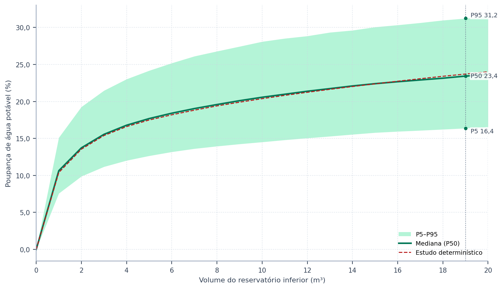
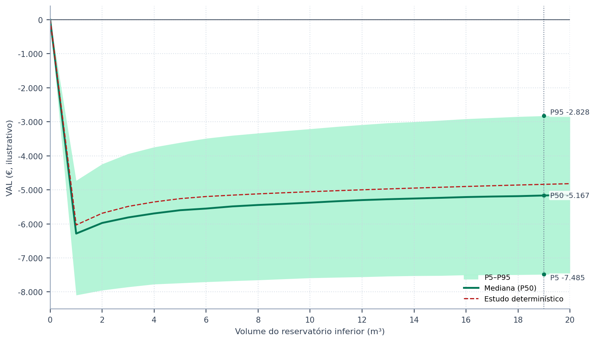
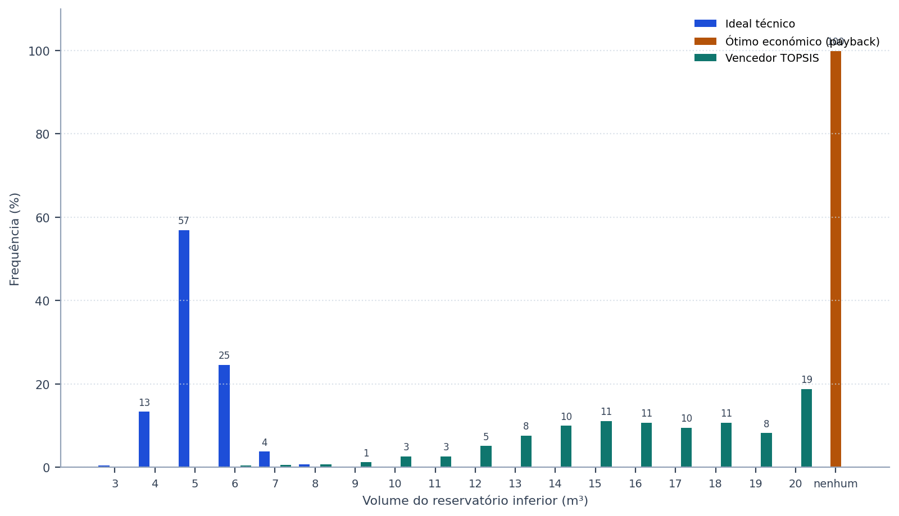
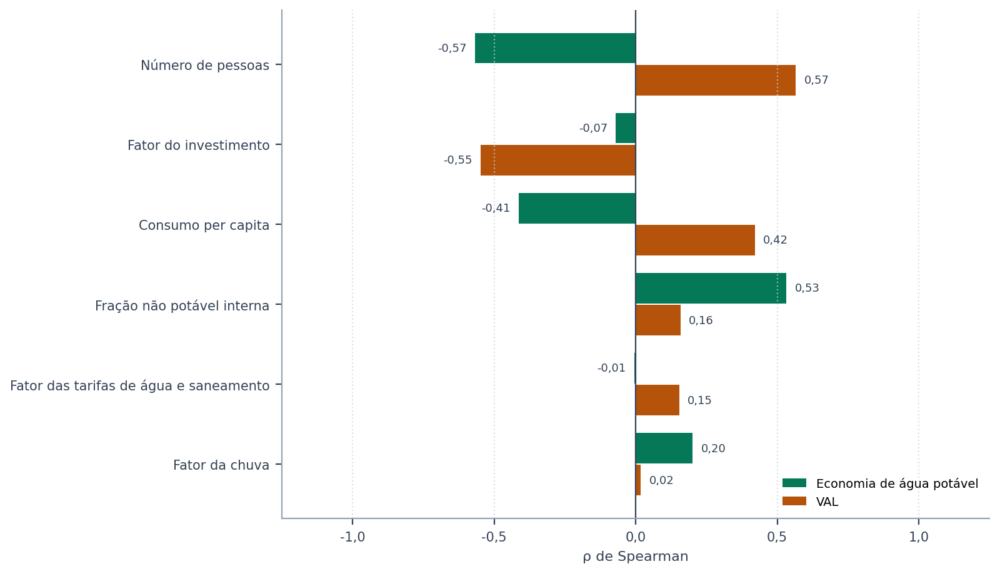

# Como ler os resultados

> **Pergunta a que esta secção responde:** o que diz cada tabela e cada figura, e o que declarar num
> relatório ou num artigo?

O exemplo desta secção é o projeto do tutorial de Lisboa, gravado com a ferramenta já montada no
ficheiro `09_modulacao_tutorial.triton` (apêndice J), com seis variáveis sorteadas: as três de
consumo, o fator da chuva, o fator das tarifas e o fator do investimento, com as distribuições de
triagem, em mil realizações e semente 42. Os números das tabelas são os que o programa calcula;
executar a ferramenta com o mesmo projeto e a mesma semente reproduz-os. Os custos do projeto são
ilustrativos, não são preços de mercado.

## O que entrou

A primeira tabela do ecrã diz o que foi de facto sorteado: o valor do estudo, a distribuição
declarada e as estatísticas da amostra. É a primeira a ler, porque confirma que as distribuições
produziram o que se pretendia — a média da amostra deve ficar perto da média declarada, e o
intervalo entre P5 e P95 deve ser plausível para o edifício.

<!-- inclui: _tabelas/cap43_entradas.md -->

## O resultado no volume escolhido

A segunda tabela resume o volume que o estudo escolheu — o vencedor do TOPSIS do caso-base —,
comparando o estudo determinístico com a média, o desvio-padrão, o coeficiente de variação e os
percentis das realizações.

<!-- inclui: _tabelas/cap43_referencia.md -->

Duas leituras importam. A primeira é a **largura**: o intervalo entre P5 e P95 contém 90% das
realizações e é o número que deve acompanhar o resultado publicado. A segunda é a **posição do
estudo determinístico** em relação à mediana. Quando a mediana fica abaixo do caso-base, as
não linearidades do sistema — a tarifa por escalões, a parte fixa da fatura, a cisterna que
transborda — fazem as realizações desfavoráveis pesar mais do que as favoráveis, e o caso-base é
otimista.

O período de recuperação descontado só existe quando o investimento se paga; a tabela calcula-o
sobre as realizações em que isso acontece, e o ecrã diz quantas foram. Com a tarifa de Lisboa e os
custos ilustrativos do tutorial, o caso-base não recupera o investimento (secção {{n:10}}), e o
que a tabela de probabilidades acrescenta é a medida de quão perto, ou quão longe, as premissas
sorteadas levam esse resultado de uma recuperação.

<!-- inclui: _tabelas/cap43_probabilidades.md -->

A probabilidade de o investimento se pagar é a proporção de realizações com valor atual líquido
positivo. O intervalo de confiança de 95% ao lado é o de Wilson (1927), adequado a amostras
pequenas e a proporções perto de 0% ou de 100%. Mede a incerteza do **sorteio**, e não a das
premissas: com mais realizações estreita-se; a probabilidade em si, não.

## As gamas por volume

As figuras seguintes mostram a gama entre os percentis 5 e 95, a mediana e o estudo determinístico
ao longo de todos os volumes. A linha a tracejado marca o volume escolhido, e os valores escritos
são os dele ({{fig:fig52_modulacao_economia}} e {{fig:fig53_modulacao_vpl}}).

*Figura 99 — Poupança de água potável por volume do reservatório inferior no exemplo do tutorial: gama entre os percentis 5 e 95 das realizações, mediana e estudo determinístico. Os valores marcados são os do volume escolhido pelo estudo (linha a tracejado).*

*Figura 99 — Valor atual líquido por volume do reservatório inferior no mesmo exemplo (custos ilustrativos, não são preços de mercado). Uma gama que atravessa o zero em todos os volumes indica que nenhum deles se paga com certeza; uma mediana abaixo do estudo determinístico, que o caso-base é otimista.*

## A estabilidade da escolha

A tabela e a figura de frequência contam, em cada realização, qual volume seria o ideal técnico,
qual seria o ótimo económico — o de menor período de recuperação descontado, critério do programa
(secção {{n:12}}) — e qual venceria o TOPSIS ({{fig:fig54_modulacao_frequencia}}). Uma realização
em que nenhum volume se paga aparece como «nenhum se paga» na coluna económica.

<!-- inclui: _tabelas/cap43_frequencia.md -->

*Figura 99 — Frequência, em percentagem das realizações, com que cada volume é o ideal técnico, o ótimo económico e o vencedor do TOPSIS no exemplo do tutorial.*

A leitura é a mesma da aceitabilidade SMAA-VIKOR (secção {{n:32}}): um volume que vence na maioria
das realizações é uma recomendação robusta; um que vence numa minoria, ao lado de vizinhos com
frequências parecidas, é uma preferência que depende das premissas, e o texto tem de o dizer.

## O que mais pesa

A sensibilidade ({{fig:fig55_modulacao_sensibilidade}}) mede-se pela correlação de postos de
Spearman (1904) entre cada variável sorteada e o resultado no volume escolhido. O coeficiente ρ
vai de −1 a 1: o sinal diz o sentido do efeito, e o módulo a sua força. Por usar postos, e não
valores, capta relações monótonas não lineares — como a da tarifa por escalões — e não é
distorcido por realizações extremas.

<!-- inclui: _tabelas/cap43_sensibilidade.md -->

*Figura 99 — Correlação de postos de Spearman de cada variável sorteada com a poupança de água potável e com o valor atual líquido no volume escolhido pelo estudo do tutorial, da maior para a menor influência no valor atual líquido.*

A correlação de postos pode mostrar um efeito que a análise de uma premissa de cada vez esconde. A
fração não potável define a procura que a água da chuva pode satisfazer, pelo que é a candidata
natural a mover mais a poupança **percentual**. O número de pessoas e o consumo per capita
aumentam o consumo total: tendem a mover pouco a percentagem, e em sentido contrário, mas podem
mover muito o valor atual líquido, porque mais consumo empurra a fatura para os escalões mais
caros de uma tarifa por escalões e cada metro cúbico poupado passa a valer mais. Leia a tabela para
o seu caso, e verifique qual destes efeitos o tarifário que introduziu permite.

## Quanto da incerteza vem de cada fonte

O ρ diz o sentido e a força de uma relação monótona, mas não diz que parte da incerteza do
resultado vem de cada variável. Essa parte é a razão de correlação, η²: a variância das médias do
resultado entre classes da variável, dividida pela variância total. As variáveis contínuas são
agrupadas em decis, e o número de pessoas pelos seus próprios valores. O η² estima o índice de
sensibilidade de primeira ordem (Saltelli et al., 2008), vai de 0 a 1 e capta também relações não
monótonas.

<!-- inclui: _tabelas/cap43_variancia.md -->

No exemplo, compare as colunas: as variáveis que dominam a variância da poupança raramente são as
que dominam a variância do valor atual líquido, e os fatores sorteados com larguras de triagem
estreitas, como os das tarifas, do investimento e da chuva, costumam pesar pouco. Com variáveis
independentes e efeitos aditivos, a soma fica perto de 1; uma soma bem abaixo de 1 indica
interação entre as variáveis. A estimativa por classes tem um pequeno viés para cima, da ordem do
número de classes dividido pelo número de realizações, e por isso a soma pode exceder ligeiramente
1.

## A captação e a chuva

O segundo exemplo, gravado no ficheiro `10_modulacao_captacao.triton`, usa a mesma varredura de
Lisboa mas sorteia a incerteza da **captação** — área, coeficiente de escoamento e lâmina de
descarte — em conjunto com o fator da chuva, o fator das tarifas e o fator do investimento, em mil
realizações e semente 42. A Edição Portugal não tem tabela por modelo climático, porque não tem
base de modelos climáticos: a incerteza da chuva entra pelo fator da chuva sobre a série E-OBS de
Lisboa, e a tabela da variância lista as variáveis sorteadas, entre elas o fator da chuva.

Leia este exemplo pelo que separa. Um coeficiente de escoamento ou uma área errados em alguns por
cento alteram todos os dias da série na mesma proporção, pelo que estas variáveis deslocam a
poupança aproximadamente ao ritmo do fator da chuva; um descarte mais profundo atua sobretudo nas
chuvas pequenas, que são os dias que enchem um reservatório vazio. A tabela de η² mostra a quais
delas a poupança e o valor atual líquido respondem de facto.

## O que declarar

Num relatório ou num artigo, declare: as variáveis sorteadas e as suas distribuições (a primeira
tabela), o número de realizações e a semente, a gama P5–P95 e a mediana do resultado no volume
escolhido, a probabilidade de o investimento se pagar com o respetivo intervalo, a frequência com
que o volume escolhido vence e a parte da variância que cada fonte explica. O botão **Exportar**
grava tudo isto em JSON, e o CSV das amostras permite refazer qualquer estatística fora do
programa.
